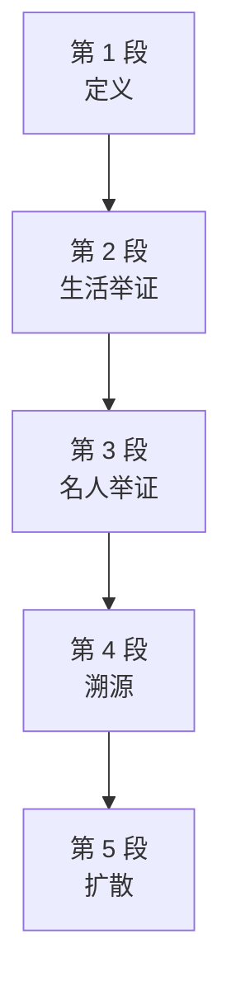

# Passage 01 · 姓氏字母歧视：一种仍在盛行的隐蔽不公

## 答题记录

| 轮次  | 日期         | 题号  | 正确  | 错误  | 正确率 | 用时    | 错题归因 |
| --- | --- | --- | --- | --- | --- | --- | --- |
| 1 |  | 1-5 |  |  |  |  |  |
| 2 |  | 1-5 |  |  |  |  |  |
| 3 |  | 1-5 |  |  |  |  |  |

> [!tip] 填写口径
> - **用时**以分钟计，只计做题时间，不含精读复盘。
> - **错题归因**填「题型·错误类型」，如：细节题·无中生有、细节题·混淆概念、细节题·与原文相反、猜词题·偷换概念、主旨题·局部夸大。
> - 纵向看趋势：正确率升而用时过长 → 熟练度不足；用时降而正确率波动 → 定位不稳。
> - 本篇 **5 题**，题号栏填 1-5；第 1 题是**例证题**；第 2 题是**推理题**；第 3 题是**暗示题**；第 4 题是**词义句意题**；第 5 题是**细节判断题**。（本篇答案：1.A 2.D 3.C 4.B 5.D）

> [!info] 文章档案
> - **来源**：考研英语（一）2004 年 Text 2
> - **题材**：社会生活（字母歧视 × alphabetism × 社会公平）
> - **结构**：5 段 / 20 句（3＋4＋4＋6＋3）＋ 5 题（按句号断句实测；正文在 PDF p006 整页，Q3 的 C/D 起在 p007 顶部，解析在 p086–p087）；**口径说明**：本书 5 段与真题原刊一致，无合并/拆分。Q4 题干引「第五段，第二行」（Line 2, Paragraph 5），与本书段号自洽；Q3 题干引「第四段」（The 4th paragraph）亦自洽。本书 Q3 答案标注 [C]，与多个独立来源的官方答案一致（初凭记忆的 [D] 系误记，详见第五节第 3 题）。
> - **难度**：★★★☆☆
> - **一句话主旨**：姓氏字母歧视（alphabetism）——过去一个世纪各种不公与歧视多已受谴责或被定为非法，但有一种隐蔽形式仍在盛行：姓氏首字母在字母表后半的人受歧视。作者先以出租车公司（AAAA cars 胜过 Zodiac cars）与普通人名（Adam Abbott 胜过 Zoë Zysman）引出现象，再用总统、G7 首脑、央行行长、富豪等名单佐证「成功人士姓氏字母靠前者异常集中」，随后给出一种理论：问题始于幼儿学校按字母排座，导致后排学生少受关注、缺信心，最后把场景延伸到毕业典礼、求职名单、选票、会议名单——按字母排序看似中性，累积效应却是隐蔽的无意偏见。

## 一、篇章脉络

- **第 1 段**：**定义，3 句**。过去一个世纪，各种不公与歧视多已受谴责或被定为非法，但有一种隐蔽形式仍在盛行——alphabetism；对尚未意识到这种劣势的人，它指的是姓氏首字母落在字母表后半者遭受的歧视。
- **第 2 段**：**生活举证，4 句**。顾客翻电话簿时，AAAA cars 比 Zodiac cars 占优早已众所周知；生活中 Adam Abbott 胜过 Zoë Zysman 却少有人注意；英语姓氏在字母表两半分布均匀，但顶尖人士姓氏以 A、B 开头者异常之多，令人起疑。
- **第 3 段**：**名人举证，4 句**。美国总统与副总统姓氏分别以 B、C 开头；布什 43 任前任中 26 位姓氏在前半段、仅 16 位在后半段；更引人注目的是 G7 首脑六位字母靠前、世界三大央行行长接近字母表前端、世界五大富豪亦然。
- **第 4 段**：**溯源，6 句**。这难道只是巧合？一种由「字母劣势者」在闲暇时间构想出的理论认为，问题早早就开始了——幼儿学校为便于记名按字母从前排排座，近视的小 Zysman 因此被困后排，很少被考虑不周的老师提问；当时或觉侥幸逃脱，结果却是资格更差、受关注更少、当众发言更没信心。
- **第 5 段**：**扩散，3 句**。这种羞辱延续到大学毕业典礼——ABC 们骄傲地率先领奖，轮到 Zysmans 时大多数人已在 literally 打呼噜；求职面试入围名单、选票、会议发言人与参会者名单都按字母拟定，收件人费力翻阅时兴趣渐失。

> [!tip] 行文逻辑
> 本文是「定义—举证—溯源—扩散」的杂文式结构，作者用讽刺口吻把一种日常排序规则翻检成社会议题。
> 按字母排序看似中性方便，却让姓氏字母靠前的人系统性地占尽先机、靠后的人系统性地受冷落——一种未被正视、也无从「立法废除」的隐蔽不公。

## 二、逐段精读

### 第 1 段 · 定义：一种隐蔽的不公

**原文**

① Over the past century, all kinds of unfairness and discrimination have been condemned or made illegal.
② But one insidious form continues to thrive: alphabetism.
③ This, for those as yet unaware of such a disadvantage, refers to discrimination against those whose surnames begin with a letter in the lower half of the alphabet.

**译文**

① 在过去的一个世纪里，各种各样的不公平与歧视要么已经受到谴责，要么已经被定为非法。
② 但有一种隐蔽的形式仍在继续盛行：字母排序歧视。
③ 对于那些尚未意识到这种劣势的人来说，它指的是对那些姓氏首字母位于字母表后半部分的人的歧视。

> [!note] 段落要点
> 开篇立论：用「已被禁绝的不公」反衬「仍在盛行的不公」，第一段的任务是给 alphabetism 下定义并定调——关键词是 insidious（隐蔽的）：它不是明目张胆的偏见，而是寄生在中性的排序规则里。

#### 长难句 · 本段第 ③ 句

> [!abstract] 本段第 ③ 句 · 原句
> This, for those as yet unaware of such a disadvantage, refers to discrimination against those whose surnames begin with a letter in the lower half of the alphabet.

**结构拆解**

- **主干**：This refers to discrimination against those...（这个术语指对……的人的歧视）
- **插入语**：for those as yet unaware of such a disadvantage——介词 for 引出的对象状语，those 后接 as yet unaware of... 形容词短语作后置定语（as yet＝up to now，迄今）
- **定语从句**：whose surnames begin with a letter... 修饰第二个 those，从句内 in the lower half of the alphabet 是 letter 的后置定语

**参考译文**

对于那些尚未意识到这种劣势的人来说，它指的是对那些姓氏首字母落在字母表后半部分的人的歧视。

> [!tip] 拆解要点
> ① 句子主干极短（This refers to discrimination against...），两个插入/后置成分把主谓隔开很开，读长句先找 refers to；② for those... 是「对……而言」的状语提前，正常语序会放在句末，提前有强调「受害者还未意识到」的意味；③ as yet 是考研高频时间状语，常与否定/未完成语义搭配（as yet unaware＝迄今还没意识到）；④ whose 引导的定语从句套在 against those 后面，「歧视的对象＋对象的特征」两层嵌套，是定义型句子的典型构式。

#### 本段重点词汇

| 单词 | 词性 | 文中意 | 拓展 | 文中用法 |
| --- | --- | --- | --- | --- |
| **unfairness** | n. | 不公平，不公正 | fight unfairness 反对不公；a sense of unfairness 不公感 | all kinds of unfairness and discrimination（各种不公平与歧视） |
| **discrimination** | n. | 歧视；辨别 | discrimination against 对……的歧视；racial discrimination 种族歧视 | all kinds of unfairness and discrimination（各种不公平与歧视） |
| **condemn** | vt. | 谴责；判定 | condemn sth. as... 谴责某事为……；be widely condemned 广受谴责 | have been condemned or made illegal（已受谴责或被定为非法） |
| **insidious** | adj. | 潜伏的，隐蔽的，暗中为害的 | an insidious disease 隐疾；insidious form 隐蔽形式 | one insidious form continues to thrive（有一种隐蔽的形式仍在盛行） |
| **thrive** | vi. | 兴旺，盛行，茁壮成长 | thrive on 因……而兴旺；a thriving business 兴旺的生意 | continues to thrive（继续盛行） |
| **alphabetism** | n. | 字母排序歧视 | 本文新造词，由 alphabet＋-ism 构成，与 racism/sexism 同构 | alphabetism（字母排序歧视） |
| **as yet** | phr. | 迄今，到目前为止 | 常与否定或未完成语义连用 | for those as yet unaware（对于那些尚未意识到的人） |
| **unaware** | adj. | 未意识到的，没觉察的 | be unaware of 未意识到……；unaware that... 没察觉到…… | as yet unaware of such a disadvantage（尚未意识到这种劣势） |
| **disadvantage** | n. | 劣势，不利条件 | at a disadvantage 处于劣势；to one's disadvantage 对某人不利 | such a disadvantage（这样一种劣势） |
| **surname** | n. | 姓氏 | family surname 姓氏；surname begins with... 姓氏以……开头 | surnames begin with a letter（姓氏以某个字母开头） |
| **alphabet** | n. | 字母表 | in the alphabet 在字母表中；alphabetical order 字母顺序 | the lower half of the alphabet（字母表的后半部分） |

### 第 2 段 · 举证：从出租车公司到普通人

**原文**

① It has long been known that a taxi firm called AAAA cars has a big advantage over Zodiac cars when customers thumb through their phone directories.
② Less well known is the advantage that Adam Abbott has in life over Zoë Zysman.
③ English names are fairly evenly spread between the halves of the alphabet.
④ Yet a suspiciously large number of top people have **surnames** beginning with letters A and B.

**译文**

① 人们早就知道，当顾客翻阅电话簿时，一家名为 AAAA cars 的出租车公司比名为 Zodiac cars 的公司拥有巨大的优势。
② 较少为人知的是，Adam Abbott 在生活中比 Zoë Zysman 更具优势。
③ 英语姓名在字母表的前后两半之间分布得相当均匀。
④ 然而，姓氏以 A 和 B 开头的顶尖人士数量之大却令人起疑。

> [!note] 段落要点
> 由物及人：出租车公司的例子说明「字母靠前＝先被看见」，随即落到人名——英文姓氏分布均匀，本不该出现系统性偏差，但顶尖人士姓氏集中于 A/B 开头，一句 suspiciously 把「现象」推向「疑点」，为第三段的名单举证定调。

#### 长难句 · 本段第 ① 句

> [!abstract] 本段第 ① 句 · 原句
> It has long been known that a taxi firm called AAAA cars has a big advantage over Zodiac cars when customers thumb through their phone directories.

**结构拆解**

- **形式主语**：It has long been known that...——It 作形式主语，真正的主语是 that 引导的主语从句；has long been known＝「早就是已知的」，暗含「这是老生常谈，但人们视而不见」
- **主句主干**：a taxi firm... has a big advantage over Zodiac cars（一家出租车公司比 Zodiac cars 有明显优势）
- **过去分词**：called AAAA cars 作 firm 的后置定语（被叫做 AAAA cars 的）
- **时间状语从句**：when customers thumb through their phone directories（当顾客翻阅电话簿时）

**参考译文**

人们早就知道，当顾客翻阅电话簿时，一家名为 AAAA cars 的出租车公司比名为 Zodiac cars 的公司拥有巨大的优势。

> [!tip] 拆解要点
> ① It is known that... 是「客观事实」的惯用投射句式（＝人们知道/众所周知），写作可迁移：It is widely acknowledged that...；② advantage over 是固定搭配，「A 对 B 的优势」，文中 AAAA over Zodiac 正是字母表首尾的对照；③ when 从句不是背景点缀，而是优势产生的**条件**——没有电话簿这个「按字母翻页」的场景，优势就不存在，这正是全文「排序场景制造优势」的总原型。

#### 长难句 · 本段第 ② 句

> [!abstract] 本段第 ② 句 · 原句
> Less well known is the advantage that Adam Abbott has in life over Zoë Zysman.

**结构拆解**

- **倒装结构**：Less well known is the advantage (that...)——形容词比较级 Less well known 提前至句首，主句全倒装为「表语＋系动词＋主语」，正常语序为 The advantage (that...) is less well known
- **定语从句**：that Adam Abbott has in life over Zoë Zysman 修饰 advantage，从句内 has an advantage over 的 advantage 被关系代词 that 指代提前
- **比较链**：Less well known（比上句的 long been known 更不为人知）——两句共用 known，形成递退

**参考译文**

较少为人知的是，Adam Abbott 在生活中比 Zoë Zysman 更具优势。

> [!tip] 拆解要点
> ① 形容词/副词比较级置于句首引起全倒装（Less well known is...），考研翻译高频结构，还原语序是解题第一步；② 本句与上句是「同级递减」对偶：上句说公司的优势众所周知（long been known），本句说人的优势鲜为人知（less well known）——从「众所周知」到「鲜为人知」，作者的控诉力度反而加深；③ that 从句里 has... over 的优势关系与主句表语 advantage 同词复用，读时勿误判为两个 advantage。

#### 长难句 · 本段第 ④ 句

> [!abstract] 本段第 ④ 句 · 原句
> Yet a suspiciously large number of top people have surnames beginning with letters A and B.

**结构拆解**

- **主干**：a suspiciously large number of top people have surnames（数量惊人庞大的顶尖人士拥有姓氏）——主语核心是 number，of top people 是其后置定语，故谓语用 have
- **现在分词短语**：beginning with letters A and B 作 surnames 的后置定语（＝whose names begin with...）
- **语义重心**：suspiciously 是全文第一个态度词，「大到可疑」——作者不直接断言歧视，而让你自己起疑

**参考译文**

然而，姓氏以 A 和 B 开头的顶尖人士数量之大却令人起疑。

> [!tip] 拆解要点
> ① a (suspiciously) large number of＋复数名词，谓语用复数，但若用 the number of 则谓语用单数——考研语法常考点，本题正是前者；② 副词 suspiciously 修饰 large 而非 number，位置不可换（a large suspiciously number 为错），阅读时把「副词＋形容词」当一个整体块读；③ beginning with 分词短语在语义上等于定语从句，考研阅读里分词后置极常见，看到名词先问「后面有没有拖着分词」。

#### 本段重点词汇

| 单词 | 词性 | 文中意 | 拓展 | 文中用法 |
| --- | --- | --- | --- | --- |
| **advantage** | n. | 优势，有利条件 | have an advantage over 比……有优势；take advantage of 利用 | has a big advantage over Zodiac cars（比 Zodiac cars 有巨大优势） |
| **thumb through** | phr. | 快速翻阅，翻查 | thumb through a book/magazine 翻书/翻杂志 | thumb through their phone directories（翻阅电话簿） |
| **phone directory** | n. | 电话簿，电话号码簿 | look up in the phone directory 查电话簿 | their phone directories（他们的电话簿） |
| **evenly** | adv. | 均匀地，平均地 | evenly spread/distributed 均匀分布；evenly divided 均分 | fairly evenly spread（分布得相当均匀） |
| **spread** | v. | 分布，散布；传播 | spread between/among 在……之间分布；spread out 展开 | evenly spread between the halves（在两半之间均匀分布） |
| **suspiciously** | adv. | 可疑地，异常地（到令人起疑的程度） | suspiciously large/quiet 大得可疑／安静得可疑 | a suspiciously large number（数量大到令人起疑） |
| **top people** | n. | 顶尖人士，要人 | top people/scientists 顶尖人士/科学家 | a large number of top people（大量的顶尖人士） |

### 第 3 段 · 举证：名单上的姓氏

**原文**

① Thus the American president and vice-president have **surnames** starting with B and C respectively; and 26 of George Bush's predecessors (including his father) had **surnames** in the first half of the alphabet against just 16 in the second half.
② Even more striking, six of the seven heads of government of the G7 rich countries are alphabetically advantaged (Berlusconi, Blair, Bush, Chirac, Chrétien and Koizumi).
③ The world's three top central bankers (Greenspan, Duisenberg and Hayami) are all close to the top of the alphabet, even if one of them really uses Japanese characters.
④ As are the world's five richest men (Gates, Buffett, Allen, Ellison and Albrecht).

**译文**

① 因此，美国总统和副总统的姓氏分别以 B 和 C 开头；在乔治·布什的前任总统中（包括他的父亲），有 26 位的姓氏位于字母表前半部分，而位于后半部分的只有 16 位。
② 更引人注目的是，G7 富裕国家的七位政府首脑中有六位在字母排序上占优势（贝卢斯科尼、布莱尔、布什、希拉克、克雷蒂安和小泉纯一郎）。
③ 世界三大中央银行行长（格林斯潘、杜伊森贝赫和速水优）全都接近字母表的前端，尽管其中一位实际上使用日文字符。
④ 世界五大富豪（盖茨、巴菲特、艾伦、埃里森和阿尔布雷希特）也是如此。

> [!note] 段落要点
> 用四组「现实世界排行榜」堆叠证据：总统前任 26:16、G7 首脑六占一、三大央行行长、五大富豪——四个名单全部指向字母表前端。even if 一句主动替作者堵住「日本例外」的质疑，显出货真价实的统计式讽刺。

#### 长难句 · 本段第 ① 句

> [!abstract] 本段第 ① 句 · 原句
> Thus the American president and vice-president have surnames starting with B and C respectively; and 26 of George Bush's predecessors (including his father) had surnames in the first half of the alphabet against just 16 in the second half.

**结构拆解**

- **并列结构**：分号连接两个并列分句——前句讲在任总统副总统，后句用 and 接布什前任的统计
- **分词定语**：starting with B and C respectively 作 surnames 的后置定语
- **比较/对照介词**：against just 16 in the second half——against 此处表「与……对照/相比」，26:16 的数字对比是全句的举证核心；including his father 是插入式介词短语（老布什）

**参考译文**

因此，美国总统和副总统的姓氏分别以 B 和 C 开头；在乔治·布什的前任总统中（包括他的父亲），有 26 位的姓氏位于字母表前半部分，而位于后半部分的只有 16 位。

> [!tip] 拆解要点
> ① respectively（分别地）是考研高频副词，用于「前文列举与后文一一对应」——本句 B and C 与 president and vice-president 的顺序对应，不可颠倒；② against 在数字后引出对照项（26 against 16），这种用法常见于比分、选票统计，读数字句先找 against；③ 分号＋and 的双重连接是「举证排比」的节奏标记，作者用同类事实连续轰炸，阅读时按「一组证据」整体处理，不必逐句分析。

#### 长难句 · 本段第 ② 句

> [!abstract] 本段第 ② 句 · 原句
> Even more striking, six of the seven heads of government of the G7 rich countries are alphabetically advantaged (Berlusconi, Blair, Bush, Chirac, Chrétien and Koizumi).

**结构拆解**

- **评注性状语**：Even more striking 提前作全句评注（＝What is even more striking is that...），比上句「更惊人的是」
- **主干**：six of the seven heads of government... are alphabetically advantaged（七位中的六位在字母排序上占优势）——主语是 six，of the seven heads of government 与 of the G7 rich countries 双层后置定语层层收窄
- **同位语**：括号内六个人名是 six 的同位语，逐一验证「字母靠前」

**参考译文**

更引人注目的是，G7 富裕国家的七位政府首脑中有六位在字母排序上占优势（贝卢斯科尼、布莱尔、布什、希拉克、克雷蒂安和小泉纯一郎）。

> [!tip] 拆解要点
> ① Even more striking 这类「形容词提前＋逗号」的评注结构，语法上独立于主干，汉译时提为句首（更引人注目的是）；② of... of... 连环后置定语是「定位收窄」的典型手段：heads of government（政府首脑）→ of the G7 rich countries（G7 富裕国家的）→ six of the seven（七位中的六位），三层限定把证据钉死；③ alphabetically advantaged 是作者生造的对举词，与第 1 段 alphabetism、后文 the alphabetically disadvantaged 构成贯穿全文的词族，阅读时把 advantaged/disadvantaged 当作一组信号词。

#### 长难句 · 本段第 ③ 句

> [!abstract] 本段第 ③ 句 · 原句
> The world's three top central bankers (Greenspan, Duisenberg and Hayami) are all close to the top of the alphabet, even if one of them really uses Japanese characters.

**结构拆解**

- **主干**：The world's three top central bankers... are all close to the top of the alphabet（世界三大央行行长都接近字母表前端）
- **同位语**：括号内三个人名补充说明 three
- **让步状语从句**：even if one of them really uses Japanese characters（即便其中一位真的使用日文字符）——even if 表「极端让步」：连按日文排序的速水优都算「接近前端」，反而强化了论点

**参考译文**

世界三大中央银行行长（格林斯潘、杜伊森贝赫和速水优）全都接近字母表的前端，尽管其中一位实际上使用日文字符。

> [!tip] 拆解要点
> ① close to the top of the alphabet 与上句 alphabetically advantaged 是同义换说——「接近字母表前端」＝「占字母优势」，作者刻意变换措辞避免重复；② even if 从句是作者**预设反驳**：日文排序本可构成反例（Hayami 若按日文五十音序就不占优），作者用 even if 主动收编，读议论文遇到「让步」要追问「作者在防哪个反例」；③ really 在此处表「事实上、实际上」（＝in fact），与「真正地」的口语义略异，是熟词僻义考点。

#### 长难句 · 本段第 ④ 句

> [!abstract] 本段第 ④ 句 · 原句
> As are the world's five richest men (Gates, Buffett, Allen, Ellison and Albrecht).

**结构拆解**

- **省略倒装句**：As are the world's five richest men——as 指代上句内容（are close to the top of the alphabet），全句＝As (they are close to the top of the alphabet) are the world's five richest men，属「as＋倒装」的并列延伸
- **主语**：the world's five richest men（世界五大富豪），最高级 richest 再次收紧举证规格
- **同位语**：括号内五人名逐一对应

**参考译文**

世界五大富豪（盖茨、巴菲特、艾伦、埃里森和阿尔布雷希特）也是如此。

> [!tip] 拆解要点
> ① as 引导的并列延伸句（＝so are...）用倒装省略避免重复前句谓语，阅读时要把前句内容补回才能读懂；② 这是「举证排比」的收尾一句——四个名单（总统、G7、央行、富豪）一句比一句短，节奏陡然收紧，产生清单轰炸的修辞效果；③ richest 是最高级举证：从「政治领袖」到「财富顶点」，作者暗示这种优势不在一城一池，而在社会顶层全面复现。

#### 本段重点词汇

| 单词 | 词性 | 文中意 | 拓展 | 文中用法 |
| --- | --- | --- | --- | --- |
| **vice-president** | n. | 副总统；副总裁 | vice-president of... ……的副总统 | president and vice-president（总统和副总统） |
| **respectively** | adv. | 分别地，各自地 | 用于列举后的顺序对应 | starting with B and C respectively（分别以 B 和 C 开头） |
| **predecessor** | n. | 前任，前辈 | predecessor of... ……的前任 | George Bush's predecessors（布什的前任们） |
| **striking** | adj. | 引人注目的，惊人的 | even more striking 更引人注目的是 | Even more striking（更引人注目的是） |
| **alphabetically advantaged** | phr. | 在字母排序上占优势的 | 与 the alphabetically disadvantaged（处于劣势的）对举 | are alphabetically advantaged（在字母排序上占优势） |
| **central banker** | n. | 中央银行行长 | the world's top central bankers 世界主要央行行长 | three top central bankers（三大央行行长） |
| **richest** | adj. | 最富有的 | the richest men 最富有的人 | the world's five richest men（世界五大富豪） |

### 第 4 段 · 溯源：问题从幼儿园开始

**原文**

① Can this merely be coincidence?
② One theory, dreamt up in all the spare time enjoyed by the alphabetically disadvantaged, is that the rot sets in early.
③ At the start of the first year in infant school, teachers seat pupils alphabetically from the front, to make it easier to remember their names.
④ So short-sighted Zysman junior gets stuck in the back row, and is rarely asked the improving questions posed by those insensitive teachers.
⑤ At the time the alphabetically disadvantaged may think they have had a lucky escape.
⑥ Yet the result may be worse qualifications, because they get less individual attention, as well as less confidence in speaking publicly.

**译文**

① 这难道仅仅是巧合吗？
② 一种理论认为，问题早早就开始了——这个理论是那些在字母排序上处于劣势的人，利用他们全部的闲暇时间构想出来的。
③ 幼儿学校一年级开学之初，老师们为了更容易记住学生的姓名，会按字母顺序从前排开始安排座位。
④ 于是，近视的小 Zysman 被固定在后排，很少被那些考虑不周的老师问到有助提高的问题。
⑤ 当时，这些字母排序上的劣势者或许以为自己侥幸逃过了一劫。
⑥ 然而结果可能是资格更差，因为他们得到的个别关注更少，当众发言时也更缺乏信心。

> [!note] 段落要点
> 从「举证」转入「溯源」：先用一句反问把统计现象变成待解释的问题，再抛出「幼儿园排座」理论——便利的初衷（好记名字）＋系统性后果（后排少提问、少关注、缺信心）。作者刻意把理论归给「劣势者闲暇时构想」，保持讽刺距离，不把它当严谨学术结论。

#### 长难句 · 本段第 ② 句

> [!abstract] 本段第 ② 句 · 原句
> One theory, dreamt up in all the spare time enjoyed by the alphabetically disadvantaged, is that the rot sets in early.

**结构拆解**

- **主干**：One theory... is that the rot sets in early（一种理论认为，问题早早就开始了）——that 引导表语从句
- **插入的过去分词短语**：dreamt up in all the spare time enjoyed by the alphabetically disadvantaged 作 theory 的后置定语，内部 in all the spare time 是 dreamt up 的状语，而 enjoyed by the alphabetically disadvantaged 又是 spare time 的定语（被字母劣势者所享有的闲暇时间）
- **固定表达**：the rot sets in——rot 原义「腐烂」，转指「弊端、衰败」，sets in 指「（不好的事）开始并持续」；in early 中 early 作副词（早早地）

**参考译文**

一种理论认为，问题早早就开始了——这个理论是那些在字母排序上处于劣势的人，利用他们全部的闲暇时间构想出来的。

> [!tip] 拆解要点
> ① 本句的定语嵌套两层：theory ← dreamt up... ← (spare time) enjoyed by...，抽丝时先剥掉第一个逗号块；② dreamt up（凭空想出、构想出）是 dream up 的过去分词，带「非正式、异想天开」的口吻，与 theory 搭配暗含作者的调侃——这理论没什么数据，是劣势者自己憋出来的；③ the rot sets in early 是英式惯用表达（rot＝衰败/弊端），写作可迁移描述「问题初现」：The problem sets in early。

#### 长难句 · 本段第 ④ 句

> [!abstract] 本段第 ④ 句 · 原句
> So short-sighted Zysman junior gets stuck in the back row, and is rarely asked the improving questions posed by those insensitive teachers.

**结构拆解**

- **并列谓语**：gets stuck in the back row... and is rarely asked...——主语 Zysman junior（小 Zysman，junior 表示父子同名中的「小」）带一主动一被动两个谓语
- **形容词前置**：short-sighted 双关——既指「近视」（字面），又暗讽「短视」，与后文 insensitive（不敏感的）同为双关形容词
- **过去分词定语**：posed by those insensitive teachers 修饰 questions（由那些考虑不周的老师提出的）

**参考译文**

于是，近视的小 Zysman 被固定在后排，很少被那些考虑不周的老师问到有助提高的问题。

> [!tip] 拆解要点
> ① gets stuck in（被困在、固定在）是 get＋过去分词＋介词的被动状态结构，比 is stuck 更强调「陷入过程」；② improving questions 不是「正在改进的问题」，而是「有助提高（学生水平）的问题」——现在分词形容词化表「起改善作用的」，与 improving economy（增长中的经济）同类；③ short-sighted 与 insensitive 是作者埋的双关：字面说孩子近视、老师不敏感，实则讽刺这套制度本身 short-sighted——考研阅读常见「一词双关」，翻译时保留字面义即可，不必点破。

#### 长难句 · 本段第 ⑥ 句

> [!abstract] 本段第 ⑥ 句 · 原句
> Yet the result may be worse qualifications, because they get less individual attention, as well as less confidence in speaking publicly.

**结构拆解**

- **主干**：the result may be worse qualifications（结果可能是更差的资格/成绩）——worse qualifications 是名词短语作表语，qualification 用复数指「学业成绩、资历」
- **原因状语从句**：because they get less individual attention...（因为他们得到的个别关注更少）
- **并列宾语**：less individual attention, as well as less confidence in speaking publicly——as well as 连接两个 less 引导的并列宾语（关注更少，信心也更少），in speaking publicly 是 confidence 的领域限定

**参考译文**

然而结果可能是资格更差，因为他们得到的个别关注更少，当众发言时也更缺乏信心。

> [!tip] 拆解要点
> ① qualification 的复数形式指「学历、考试成绩、资历」，相当于 credentials，与动词 qualify（使合格）同根；② as well as 连接并列成分时语义重心在前者（less individual attention 为主，confidence 为补充），且谓语数以「前」为准；③ 本句是「机制—后果」链条的收口：attention（关注）→ confidence（信心）→ qualifications（成绩），三个名词一层比一层重，议论文「后果递进」的典型句法。

#### 本段重点词汇

| 单词 | 词性 | 文中意 | 拓展 | 文中用法 |
| --- | --- | --- | --- | --- |
| **merely** | adv. | 仅仅，只是 | merely a coincidence 只是巧合 | Can this merely be coincidence?（这难道仅仅是巧合吗？） |
| **coincidence** | n. | 巧合，巧事 | by coincidence 巧合地；pure coincidence 纯属巧合 | Can this merely be coincidence?（这难道仅仅是巧合吗？） |
| **dream up** | phr. | 凭空想出，构想出 | dream up a plan/theory 想出个计划/理论 | dreamt up in all the spare time（利用全部闲暇时间构想出来） |
| **alphabetically disadvantaged** | phr. | 在字母排序上处于劣势的 | 与 alphabetically advantaged 对举，为本文对举词 | enjoyed by the alphabetically disadvantaged（被字母劣势者所享有） |
| **rot** | n. | 腐烂；弊端，衰败 | the rot sets in 弊端开始显现 | the rot sets in early（问题早早就开始了） |
| **infant school** | n. | 幼儿学校，学前班（英式） | at infant school 在幼儿学校 | in infant school（在幼儿学校里） |
| **seat** | vt. | 使就座，安排……的座位 | seat pupils/guests 安排学生/客人就座 | teachers seat pupils alphabetically（老师按字母顺序安排学生座位） |
| **alphabetically** | adv. | 按字母顺序地 | arrange/list alphabetically 按字母排序 | seat pupils alphabetically（按字母顺序排座） |
| **short-sighted** | adj. | 近视的；短视的 | a short-sighted policy 短视的政策 | short-sighted Zysman junior（近视的小 Zysman） |
| **get stuck in** | phr. | 被困在，固定在 | get stuck in traffic/the back row 堵在路上／困在后排 | gets stuck in the back row（被困在后排） |
| **improving** | adj. | 有提高作用的，有助改善的 | improving questions 有助提高的提问 | the improving questions（有助提高的问题） |
| **posed** | v. | 提出（问题、难题） | pose a question/threat 提出问题/构成威胁 | questions posed by... teachers（由……老师提出的问题） |
| **insensitive** | adj. | 不敏感的，考虑不周的 | be insensitive to 对……不敏感 | those insensitive teachers（那些考虑不周的老师） |
| **lucky escape** | n. | 侥幸逃脱 | have a lucky escape 侥幸逃脱 | had a lucky escape（侥幸逃过一劫） |
| **qualification** | n. | 资格；学历，成绩（常用复数） | academic qualifications 学历；qualification for... ……的资格 | worse qualifications（更差的成绩/资格） |
| **individual attention** | n. | 个别关注，单独注意 | get/receive individual attention 得到个别关注 | less individual attention（更少的个别关注） |
| **confidence** | n. | 信心，自信 | confidence in (doing) sth. 对……的信心；lack confidence 缺乏信心 | less confidence in speaking publicly（当众发言时信心更少） |

### 第 5 段 · 扩散：羞辱还在继续

**原文**

① The humiliation continues.
② At university graduation ceremonies, the ABCs proudly get their awards first; by the time they reach the Zysmans most people are literally having a ZZZ.
③ Shortlists for job interviews, election ballot papers, lists of conference speakers and attendees: all tend to be drawn up alphabetically, and their recipients lose interest as they plough through them.

**译文**

① 这种屈辱还在延续。
② 在大学的毕业典礼上，姓氏靠前的 ABC 们骄傲地率先领奖；而轮到 Zysmans 们时，大多数人确实已经在「ZZZ」地打鼾了。
③ 求职面试的入围名单、选举选票、会议发言人与参会者名单：所有这些往往都按字母顺序拟定，而名单的收件人在费力地翻阅时兴趣渐失。

> [!note] 段落要点
> 把「排座」的机制推广到全社会：毕业典礼、求职、选举、会议——凡按字母拟名单处，靠后者的利益都在「被读到之前」已流失。结尾没有呼吁立法（呼应第 1 段「无法禁绝」），而是让读者自己得出结论：这是制度性的、无意的偏见。

#### 长难句 · 本段第 ② 句

> [!abstract] 本段第 ② 句 · 原句
> At university graduation ceremonies, the ABCs proudly get their awards first; by the time they reach the Zysmans most people are literally having a ZZZ.

**结构拆解**

- **分号并列**：两个分句构成「同时对比」——前半句 ABCs 领奖的高光时刻 vs 后半句轮到 Zysmans 时的冷场
- **名词活用**：the ABCs（姓氏以 A/B/C 开头的人，借字母表开端代指「姓氏靠前者」）与 the Zysmans（借 Zysman 一人名代指「姓氏靠后者」）——专名泛化为群体符号，是全文最巧妙的修辞
- **时间状语从句**：by the time they reach the Zysmans（等到他们念到 Zysmans 时），by the time 暗示「时间已消耗很久」
- **副词**：literally 字面义「照字面地、确实地」，此处 literally having a ZZZ＝「真的在发出 ZZZ（鼾声）」——漫画拟声词的文字化

**参考译文**

在大学的毕业典礼上，姓氏靠前的 ABC 们骄傲地率先领奖；而轮到 Zysmans 们时，大多数人确实已经在「ZZZ」地打鼾了。

> [!tip] 拆解要点
> ① the ABCs/the Zysmans 是「以个体代群体」的借代（synecdoche）：ABCs 取字母表起点，Zysmans 取上文的倒霉蛋，一组符号把「字母排序」视觉化；② by the time 从句的主语 they 指「念名单的人/典礼流程」，从句虽短却携带「冗长等待」的语义；③ ZZZ 是英语漫画表示鼾声的拟声符号，literally 提示这是「字面意义上的打鼾」而非比喻——Q4 正考此点（详见第五节）。

#### 长难句 · 本段第 ③ 句

> [!abstract] 本段第 ③ 句 · 原句
> Shortlists for job interviews, election ballot papers, lists of conference speakers and attendees: all tend to be drawn up alphabetically, and their recipients lose interest as they plough through them.

**结构拆解**

- **同位语罗列＋冒号**：Shortlists..., ballot papers, lists...: 三项名词短语并列作 all 的同位语，冒号提示「如下所列」；三层 of 定语（for job interviews / of conference speakers and attendees / for job interviews）各自收窄场景
- **主干 1**：all tend to be drawn up alphabetically（全都倾向于按字母顺序拟定）——tend to 表倾向性，be drawn up 是 draw up（拟定）的被动
- **主干 2**：their recipients lose interest（收件人失去兴趣）——as they plough through them 是时间状语从句（在他们费力翻阅的过程中）

**参考译文**

求职面试的入围名单、选举选票、会议发言人与参会者名单：所有这些往往都按字母顺序拟定，而名单的收件人在费力地翻阅时兴趣渐失。

> [!tip] 拆解要点
> ① 冒号前是「清单式同位语」，三项并列＋中心词 all 的句式在学术写作与新闻写作中极常见，读时先把 all 后面的谓语调出来；② draw up（拟定、制订）侧重「起草正式文件/名单」，与 make a list（随手列）庄重等级不同；③ plough through（费力地读完、艰难地处理）原指「犁地」，引申为「吃力地推进」，与 lose interest 构成因果——名单越长、念得越久，兴趣越薄，这正是 Zysmans 们在典礼末段「收获鼾声」的机制。

#### 本段重点词汇

| 单词 | 词性 | 文中意 | 拓展 | 文中用法 |
| --- | --- | --- | --- | --- |
| **humiliation** | n. | 屈辱，丢脸 | suffer humiliation 受辱；public humiliation 当众受辱 | The humiliation continues（这种屈辱还在延续） |
| **graduation ceremony** | n. | 毕业典礼 | attend a graduation ceremony 参加毕业典礼 | university graduation ceremonies（大学毕业典礼） |
| **ABCs** | n. | 姓氏字母靠前的人（借字母表开端代指） | 与 the Zysmans（姓氏靠后者）对举 | the ABCs proudly get their awards first（ABC 们骄傲地率先领奖） |
| **literally** | adv. | 照字面地；确实地 | literally speaking 确切地说；literally having a ZZZ 真的在打鼾 | are literally having a ZZZ（真的在打鼾） |
| **shortlist** | n. | 入围名单，决选名单 | be on the shortlist 入围；shortlist for... ……的入围名单 | Shortlists for job interviews（求职面试的入围名单） |
| **ballot papers** | n. | 选票 | cast ballot papers 投票 | election ballot papers（选举选票） |
| **attendee** | n. | 参会者，出席者 | conference attendees 与会人员 | speakers and attendees（发言人与参会者） |
| **draw up** | phr. | 拟定，制订 | draw up a list/plan/contract 拟名单/订计划/起草合同 | be drawn up alphabetically（按字母顺序拟定） |
| **recipient** | n. | 接受者，收件人 | recipients of... ……的接受者 | their recipients lose interest（名单的收件人失去兴趣） |
| **plough through** | phr. | 费力地读完，艰难地处理 | plough through a document 吃力地啃文件 | plough through them（费力地翻阅这些名单） |

## 三、全篇重点词汇汇总（自测用）

> 收录**全篇所有段落词汇，共 52 条，不删减**；按「逐段词汇表 → 本表」同源同序汇总，**跨段复现的词条只收入其首次出现的段落**（如 advantage 首现于第 2 段①句，②句复现；surnames 首现于第 1 段③句，第 2 段④句、第 3 段①句复现；alphabet 首现于第 1 段③句；the alphabetically disadvantaged 首现于第 4 段②句，⑤句 the alphabetically disadvantaged 复现；pose 见第 4 段④句 posed 一词条）。用法：遮住「词性」「所在段」两列自测。

| 单词 / 短语 | 词性 | 所在段 |
| --- | --- | --- |
| **unfairness** | n. | 第 1 段 |
| **discrimination** | n. | 第 1 段 |
| **condemn** | vt. | 第 1 段 |
| **insidious** | adj. | 第 1 段 |
| **thrive** | vi. | 第 1 段 |
| **alphabetism** | n. | 第 1 段 |
| **as yet** | phr. | 第 1 段 |
| **unaware** | adj. | 第 1 段 |
| **disadvantage** | n. | 第 1 段 |
| **surname** | n. | 第 1 段 |
| **alphabet** | n. | 第 1 段 |
| **advantage** | n. | 第 2 段 |
| **thumb through** | phr. | 第 2 段 |
| **phone directory** | n. | 第 2 段 |
| **evenly** | adv. | 第 2 段 |
| **spread** | v. | 第 2 段 |
| **suspiciously** | adv. | 第 2 段 |
| **top people** | n. | 第 2 段 |
| **vice-president** | n. | 第 3 段 |
| **respectively** | adv. | 第 3 段 |
| **predecessor** | n. | 第 3 段 |
| **striking** | adj. | 第 3 段 |
| **alphabetically advantaged** | phr. | 第 3 段 |
| **central banker** | n. | 第 3 段 |
| **richest** | adj. | 第 3 段 |
| **merely** | adv. | 第 4 段 |
| **coincidence** | n. | 第 4 段 |
| **dream up** | phr. | 第 4 段 |
| **alphabetically disadvantaged** | phr. | 第 4 段 |
| **rot** | n. | 第 4 段 |
| **infant school** | n. | 第 4 段 |
| **seat** | vt. | 第 4 段 |
| **alphabetically** | adv. | 第 4 段 |
| **short-sighted** | adj. | 第 4 段 |
| **get stuck in** | phr. | 第 4 段 |
| **improving** | adj. | 第 4 段 |
| **posed** | v. | 第 4 段 |
| **insensitive** | adj. | 第 4 段 |
| **lucky escape** | n. | 第 4 段 |
| **qualification** | n. | 第 4 段 |
| **individual attention** | n. | 第 4 段 |
| **confidence** | n. | 第 4 段 |
| **humiliation** | n. | 第 5 段 |
| **graduation ceremony** | n. | 第 5 段 |
| **ABCs** | n. | 第 5 段 |
| **literally** | adv. | 第 5 段 |
| **shortlist** | n. | 第 5 段 |
| **ballot papers** | n. | 第 5 段 |
| **attendee** | n. | 第 5 段 |
| **draw up** | phr. | 第 5 段 |
| **recipient** | n. | 第 5 段 |
| **plough through** | phr. | 第 5 段 |

> - 本表与逐段词汇表**等长同源同序**：第 1 段 11 条 → 第 2 段 7 条 → 第 3 段 7 条 → 第 4 段 17 条 → 第 5 段 10 条，共 52 条。

> [!note] 熟词僻义盘点
> - **rot**：本义「腐烂」，文中 the rot sets in＝「弊端开始显现」，指衰败、问题；**seat**：名词「座位」之外，此处作动词「安排……就座」（seat pupils 安排学生座位）；**spread**：除「传播（消息/疾病）」外，本文指「（均匀）分布」；**striking**：由「打击」引申为「引人注目的」；**qualification**：单数指「资格、条件」，复数 qualifications 指「学历、学业成绩」；**draw up**：本义「拉起」，文中指「正式拟定（名单、计划、合同）」；**literally**：除「照字面地」，文中表「确实地、不夸张地」的强调语气；**improving**：由「改善」引申为「有提高作用的」（improving questions 有助提高的提问）；**posed**：pose 除「构成（威胁）」外，文中指「提出（问题）」；**recipient**：正式用语「收件人、接受者」，比 receiver 更正式。

> [!tip] 同义替换链
> - **不公/歧视链**：unfairness → discrimination → bias → prejudice；文中 condemned or made illegal（被谴责或定为非法）是「不公」的总框架，alphabetism 是被漏掉的那一种
> - **优势/劣势链**：advantage over → be close to the top of the alphabet → alphabetically advantaged ↔ alphabetically disadvantaged → disadvantage；作者靠这组对举词贯穿全文，题目正确项常取其同义改写（如 Q1 的 overlooked inequality）
> - **隐蔽链**：insidious → less well known → as yet unaware → overlooked → subtle → unintentional；这是全文的语义暗线，Q1 的 [A]、Q2 的 [D]、Q5 的 [D] 三个正确项全部落在这条链上
> - **翻阅链**：thumb through → plough through；前者轻快（翻电话簿），后者沉重（啃名单），动作轻重对应「优势场景」与「受害场景」

## 四、知识点补充

> [!note] 背景知识
> - **alphabetism 的构词**：alphabet（字母表）＋-ism（主义/制度后缀），仿拟 racism（种族歧视）、sexism（性别歧视）等词而生，是作者自造的社会学术语；与它类似的现代造词还有 lookism（容貌歧视）、heightism（身高歧视）。本文是英语新闻媒体中「alphabetism」一词进入公共讨论的早期代表性文本之一。
> - **ZZZ 的漫画传统**：在英语漫画与动画中，ZZZ 是表示「打鼾/睡着」的拟声符号，通常画在人物头顶或对话框上方。文中 literally having a ZZZ 即「真的在发出 ZZZ 鼾声」，Q4 正是靠这个背景知识锁定答案——这也呼应了书中解析的提醒：「不光要刷题，还要掌握一些英语背景知识」。
> - **文中人名彩蛋**：Adam Abbott（A-A 双 A）与 Zoë Zysman（Z 开头）是作者刻意挑选的极端对照名；第 5 段的 the ABCs 与 the Zysmans 由此获得符号意义。G7 名单里 Bush 家族两代人同名（George Bush 父子），书中用 including his father 点明，统计学上这对父子同姓，故 26 位前任里父子各计一次。

> [!note] 语法点
> - **It has long been known that...**：It 作形式主语，that 从句作真正主语，表「众所周知」；同类投射句式还有 It is widely acknowledged that... / It is generally believed that...
> - **比较级提前的全倒装**：Less well known is the advantage (that...)＝The advantage is less well known；多见于书面语，功能是承上启下（less 比照上句的 long been known）
> - **as＋倒装的并列延伸**：As are the world's five richest men (close to the top of the alphabet)——as 指代前句内容，倒装省略避免重复，等同于 so are...
> - **a large number of vs the number of**：前者谓语用复数（a suspiciously large number of top people **have**），后者谓语用单数（the number of... **is**），考研高频考点
> - **as well as 的并列语义**：连接两个并列宾语时重心在前（less individual attention 为主、less confidence 为补），且不影响谓语数的判定
> - **respectively 的顺序对应**：只用于「前文列举＋后文一一对应」，本句 president and vice-president ↔ B and C，顺序不可换

> [!note] 写作可迁移句型
> - **评注性状语开头**：Even more striking, six of the seven heads of government... are...——用形容词短语提前作全句评注，适合举例层层递进时使用
> - **反问引出解释**：Can this merely be coincidence?——先质疑现象再给理论，议论文「设问—解答」段落的经典入口
> - **时间耗尽句式**：by the time they reach the Zysmans, most people are literally having a ZZZ——by the time 暗含「漫长的等待过程」，写讽刺场景极有力
> - **清单式同位语＋冒号**：Shortlists for job interviews, election ballot papers, lists of conference speakers and attendees: all tend to be...——三项并列＋中心词 all，制造排比轰炸效果

> [!note] 易混辨析
> - **thumb through vs plough through**：都表「翻阅」，但 thumb through 是快速随意翻（找电话号码），plough through 是费力地啃（长名单），感情色彩一轻一重，写作时按场景选用
> - **advantage over vs advantage of**：have an advantage **over** sb.（比某人有优势）是两者的比较；the **advantages of** sth.（某事的优点）是单方的列举，不可混用
> - **coincidence vs incident**：coincidence 是「巧合」（两事碰巧同时发生），incident 是「事件」（常指小插曲或冲突），本文 Can this merely be coincidence 问的是「是否纯属巧合」
> - **condemn vs blame**：condemn 是「公开谴责」（道德/舆论层面），blame 是「归咎于」（追责）；本文说不公已被 condemned（受谴责）或 made illegal（立法禁止），用的是两种对付不公的手段

## 五、题目分析

> [!info] 题目总览
> | 题号 | 题型 | 定位 | 答案 |
> | --- | --- | --- | --- |
> | 1 | 例证题 | 第 2 段①句 | A |
> | 2 | 推理题 | 全文 | D |
> | 3 | 暗示题 | 全文 | C |
> | 4 | 词义句意题 | 第 5 段②句 | B |
> | 5 | 细节判断题 | 全文 | D |

### 第 1 题 · 例证题：出租车公司例子的作用

> [!question] 原题
> 1. What does the author intend to illustrate with AAAA cars and Zodiac cars?
> - A. A kind of overlooked inequality.
> - B. A type of conspicuous bias.
> - C. A type of personal prejudice.
> - D. A kind of brand discrimination.

**正确答案**：**A. A kind of overlooked inequality.（一种被忽视的不平等）**

**定位与依据**

- 例子出现在第 2 段①句，服务的论点在第 1 段：①句说各种不公与歧视多已被谴责或定为非法，②句笔锋一转「但有一种隐蔽的形式仍在盛行：alphabetism」，③句进一步说明这是「那些尚未意识到这种劣势的人」所受的歧视。由此可见，AAAA cars 与 Zodiac cars 的例子用来说明的正是第一段提出的总主题——一种按字母表排序造成的不公平现象，而人们尚未注意到，故 [A] 项「一种被忽视的不平等」为原文改写。

**干扰项分析**

| 选项 | 选项内容 | 判断 | 排除理由 |
| --- | --- | --- | --- |
| A | 一种被忽视的不平等 | ✓ | 对原文 unaware of such a disadvantage 的同义改写：unaware ↔ overlooked，disadvantage ↔ inequality |
| B | 一种显而易见的偏见 | ✗ | 与原文方向相反：conspicuous（显而易见的）恰是 insidious（隐蔽的）的反义，本文通篇强调这种歧视「未被注意到」 |
| C | 一种个人偏见 | ✗ | 本文讨论的是社会性问题（排序规则、制度惯性），与个人歧视无关；personal prejudice 没有原文对应 |
| D | 一种品牌上的歧视 | ✗ | 出租车公司只是引出话题的例子，作者意图绝非限于讨论品牌，而是更深层的按字母排序的社会现象 |

> [!tip] 解题思路
> ① 例证题（What does the author intend to illustrate with...）的解法是**例子前后的论点句**：本文论点在第 1 段（第 2 段①句之前），例子本身（公司名）不是答案，例子服务的观点才是；② [B] 项是最经典的「反义偷换」——用 conspicuous 换掉 insidious，一词之差整句跑反，遇到态度形容词（insidious/obvious/subtle）先在选项里逐词对回；③ [D] 项是「就事论事」陷阱：把论证的由头当论证的主题，例子是出租车，主题是 alphabetism。

### 第 2 题 · 推理题：从前三段可推出什么

> [!question] 原题
> 2. What can we infer from the first three paragraphs?
> - A. In both East and West, names are essential to success.
> - B. The alphabet is to blame for the failure of Zoë Zysman.
> - C. Customers often pay a lot of attention to companies' names.
> - D. Some form of discrimination is too subtle to recognize.

**正确答案**：**D. Some form of discrimination is too subtle to recognize.（某些歧视形式过于微妙而难以察觉）**

**定位与依据**

- 进行推理时，我们发现第二、三段的论据都是围绕第一段展开：第一段提出存在一种隐蔽的不公平——按字母表排序排名所造成的歧视，第二段举例说明这种现象，第三段进一步举例说明按字母排序现象在名人身上的体现。此外，结合文章中的关键词 insidious（隐蔽的）和 less well known（鲜为人知的），可以得出 [D] 项「某种形式的歧视太微妙以至于很难被察觉」。

**干扰项分析**

| 选项 | 选项内容 | 判断 | 排除理由 |
| --- | --- | --- | --- |
| A | 在东西方，名字都是成功的关键 | ✗ | 无中生有：文中没有涉及东西方的比较（even if one of them really uses Japanese characters 只是一笔带过的让步），且关注点在于按字母表排序而非名字本身 |
| B | 字母表是 Zoë Zysman 失败的原因 | ✗ | 过度推断：第 2 段②句只是说生活中 Adam Abbott 比 Zoë Zysman 更占优势，推不出 Zysman「失败」，更推不出把失败归咎于字母表 |
| C | 顾客通常很注重公司的名字 | ✗ | 与原文相悖：第 2 段①句说顾客翻阅电话簿时 AAAA cars 占优——正因为顾客按字母顺序翻查，恰恰说明顾客并不特别关注公司名字 |
| D | 某种形式的歧视太微妙以至于很难被察觉 | ✓ | insidious（隐蔽的）＋less well known（鲜为人知）＋as yet unaware（尚未意识到）的同义概括：subtle to recognize ↔ insidious/unnoticed |

> [!tip] 解题思路
> ① 推理题的正确项通常是原文信息的**同义概括**而非字面复现——insidious 与 less well known 两个词在选项中合并升华为 too subtle to recognize；② [A] 项演示「无中生有＋视野错位」：East and West 的比较框架原文不存在，且原文谈的是「字母排序」不是「名字」；③ [B] 项演示「因果强加」：原文只有相关性（姓氏靠后者占优少），选项升级为 to blame for（归咎于）＋failure（失败），程度与归责双重加码。

### 第 3 题 · 暗示题：第四段暗示什么

> [!question] 原题
> 3. The 4th paragraph suggests that
> - A. questions are often put to the more intelligent students.
> - B. alphabetically disadvantaged students often escape from class.
> - C. teachers should pay attention to all of their students.
> - D. students should be seated according to their eyesight.

**正确答案**：**C. teachers should pay attention to all of their students.（教师应关注所有学生）**

**定位与依据**

- 第四段开头提到，幼儿园的老师按姓氏的字母顺序从前往后给学生排座位，因此一些近视的、姓氏字母靠后的学生很少被老师提问，由此造成的结果是这些孩子成绩欠佳，当众讲话时缺乏信心。这种做法导致儿童受教育的机会不平等，所以作者是在暗示老师们应该关注所有的学生，故 [C] 正确。

**干扰项分析**

| 选项 | 选项内容 | 判断 | 排除理由 |
| --- | --- | --- | --- |
| A | 问题经常被提给更聪明的学生 | ✗ | 偷换概念：文章暗示的是老师经常向坐在前面的学生提问，即老师经常提问的是姓氏字母顺序靠前的学生，而不是 intelligent students（聪明的学生） |
| B | 字母排序中占劣势的学生经常逃课 | ✗ | 偷换宾语：根据第四段⑤句可知，学生 escape（逃避）的是提问，而不是课程（class） |
| C | 老师应该关注所有的学生 | ✓ | 由④⑥句的因果链推出：少提问→少关注→成绩差、缺信心，反推即「老师应平等关注所有学生」 |
| D | 学生应该按视力的好坏来排座位 | ✗ | 无中生有：作者提及近视的学生被固定在后排，是为了强调姓氏字母排序这一歧视现象的负面影响，而非给出排座建议 |

> [!tip] 解题思路
> ① 「suggest」暗示题的答案不是原文直述，而是**因果链的反面**：第四段的机制是「排座方式→关注不均→后果差」，暗示项即修复机制的方案（关注所有学生）；② [A] 项是「对象偷换」：坐在前面 ≠ 更聪明，姓氏字母 ≠ 智力水平，作者真正批评的正是这种无因果的等同；③ [D] 项是「细节膨胀」陷阱：short-sighted 一词的真实功能是「让 Zysman junior 坐后排更显无辜」，选项却把它读成排座依据——文中出现过的细节≠作者的主张；④ 本题答案 [C] 曾凭直觉误记为 [D]，已用多个独立来源交叉验证，[C] 无误（详见第七节复盘）。

### 第 4 题 · 词义句意题："most people are literally having a ZZZ"

> [!question] 原题
> 4. What does the author mean by "most people are literally having a ZZZ" (Line 2, Paragraph 5)?
> - A. They are getting impatient.
> - B. They are noisily dozing off.
> - C. They are feeling humiliated.
> - D. They are busy with word puzzles.

**正确答案**：**B. They are noisily dozing off.（他们在大声打瞌睡）**

**定位与依据**

- 解答此题可通过上下文寻找相关信息，同时注意逻辑关系词、特殊标点等。这道题比较难，由题干定位到第五段②句，这句话的语境是：在大学的毕业典礼上，姓氏首字母排在前面的学生先领到毕业证，而轮到那些姓氏字母靠后的人时，许多人都已经在「ZZZ」了。答案显然在 [A] 项、[B] 项中，因为轮到后面的人领毕业证时，他们一定是等太久了，从这个角度上来说，[A] 项、[B] 项似乎都是正确答案；但是在漫画书中我们经常会见到 ZZZ 这个符号，用在人睡觉打呼噜的时候，因此可以很容易地推测出 [B] 项为最佳答案。

**干扰项分析**

| 选项 | 选项内容 | 判断 | 排除理由 |
| --- | --- | --- | --- |
| A | 他们变得不耐烦 | ✗ | 语义「沾边但不精确」：等太久确实会不耐烦，但 ZZZ 的符号义指向「打鼾/睡着」，不耐烦推不出 ZZZ |
| B | 他们大声地打起呼噜来 | ✓ | ZZZ 是英语漫画中表示鼾声/睡着的拟声符号，literally 又提示这是字面意义上的打鼾，故为最佳答案 |
| C | 他们觉得很羞耻 | ✗ | 张冠李戴：第 5 段①句 The humiliation continues 说的是姓氏靠后者（Zysmans）感到屈辱，不是 most people |
| D | 他们忙于做字谜游戏 | ✗ | 字面臆想：把 ZZZ 当字母游戏解，纯属干扰，无任何语境支撑 |

> [!tip] 解题思路
> ① 词义题的顺序是「先语境、后符号」：by the time 暗示漫长等待（排除明显不合语境的项），ZZZ 的漫画符号义锁定精确项——[A] 是语境推论，[B] 是符号直解，问 mean by 时符号直解优先；② 本题与书中解析共同示范「背景知识也是解题工具」：漫画拟声词 ZZZ、文学典故、常识类文化背景，都属于「刷题之外要掌握的一些英语背景知识」；③ [C] 项演示「主语错位」：humiliation 的主体是 Zysmans 们，选项中悄悄换成 most people。

### 第 5 题 · 细节判断题：哪项符合文章

> [!question] 原题
> 5. Which of the following is true according to the text?
> - A. People with surnames beginning with N to Z are often ill-treated.
> - B. VIPs in the Western world gain a great deal from alphabetism.
> - C. The campaign to eliminate alphabetism still has a long way to go.
> - D. Putting things alphabetically may lead to unintentional bias.

**正确答案**：**D. Putting things alphabetically may lead to unintentional bias.（按字母顺序排列可能导致无意的偏见）**

**定位与依据**

- 本题没有明显的定位点，只能通过对全文的整体理解逐个判断选项是否正确。文章首段将按字母表顺序排序定义为一种隐蔽的不公平待遇；第二、三段举例说明杰出人物多为姓氏字母排序靠前的人；第四段直接指出按字母表顺序排序造成了儿童受教育机会的不平等；第五段又列举了生活中更多的不平等现象。由此可见，按字母排序可能导致无意识的偏见，[D] 项符合文意。

**干扰项分析**

| 选项 | 选项内容 | 判断 | 排除理由 |
| --- | --- | --- | --- |
| A | 姓氏以 N 到 Z 开头的人经常受到不公对待 | ✗ | 细化无据：第 1 段③句只说 lower half of the alphabet（字母表后半部分），文中没有把受害起点精确到 N，更没说 N–Z 的人「经常受虐待」（ill-treated） |
| B | 西方世界的重要人物从字母排序中获得很多好处 | ✗ | 未明确点破：文中只是举例说明重要人物的姓氏首字母多位于字母表前半部分，并未明确说明他们从按字母排序中获得很多好处——作者始终维持「讽刺暗示」而非「断言因果」的分寸 |
| C | 消除按字母排序排名现象的运动仍然任重道远 | ✗ | 无中生有：文中只指出了按字母排序这种现象，并没有说要消除，campaign 一词全文无对应 |
| D | 把事物按字母排序可能导致无意的偏见 | ✓ | 全文证据链的概括：隐蔽不公平（1 段）→名人姓氏靠前（2–3 段）→教育机会不均（4 段）→名单场景兴趣流失（5 段），unintentional bias 是 unnoticed inequality 的总结性表述 |

> [!tip] 解题思路
> ① 判断题（Which is true）没有明显定位点时，用「逐段扫选项」法：每个选项回原文找对应区间，对不上即排除——[B] 看似与第 3 段契合，但 gain a great deal 把「姓氏靠前者异常集中」升级成「获利甚多」，超出作者的暗示分寸；② 正确项 [D] 的三个词都有出处：putting things alphabetically（第 5 段③句 drawn up alphabetically）、may lead to（作者全程的或然语气）、unintentional bias（第 1 段 insidious/as yet unaware 的总结）；③ 本题答案 [D] 曾凭直觉误记为 [B]，已用多个独立来源交叉验证，[D] 无误（详见第七节复盘）。

## 六、复盘清单

- [ ] 合上书复述五段链条：定义 alphabetism 是隐蔽不公（1 段）→ 公司名与普通人名举例（2 段）→ 总统/G7/央行/富豪四组名单（3 段）→ 溯源幼儿园排座（4 段）→ 扩散到典礼与名单场景（5 段）
- [ ] 复述第 1 题例证关系：论点在第 1 段（insidious/as yet unaware）→ 例子在第 2 段①句 → A（overlooked inequality）；警惕 [B] 项 conspicuous 对 insidious 的反义偷换
- [ ] 复述第 2 题概括路径：insidious＋less well known → too subtle to recognize → D；警惕 [B] 项把「占优少」升级为「失败＋归咎」
- [ ] 复述第 3 题暗示逻辑：排座→少提问→少关注→成绩差缺信心（因果链反面即 C）；警惕 [D] 项把 short-sighted 当排座依据
- [ ] 复述第 4 题符号直解：by the time 漫长等待（[A] 沾边）＋ZZZ 漫画鼾声符号（[B] 精确）→ B；积累英语漫画/文化背景知识
- [ ] 复述第 5 题全文扫描：unnoticed inequality（1 段）＋名人集中（2–3 段）＋教育不均（4 段）＋名单流失（5 段）→ D（unintentional bias）；警惕 [B] 项 gain a great deal 超出暗示分寸
- [ ] 过汇总表 52 词（逐段 11/7/7/17/10），遮住「所在段」列自测，重点过 10 个熟词僻义（rot 弊端／seat 安排就座／spread 分布／striking 引人注目／qualifications 成绩／draw up 拟定／literally 确实地／improving 有提高作用的／posed 提出／recipient 收件人）
- [ ] 复盘 5 题干扰项错法归类：反义偷换（Q1-B）、就事论事（Q1-D）、无中生有（Q2-A、Q3-D、Q5-C）、因果强加（Q2-B）、与原文相悖（Q2-C）、对象偷换（Q3-A）、偷换宾语（Q3-B）、语义沾边不精确（Q4-A）、主语错位（Q4-C）、字面臆想（Q4-D）、程度加码（Q5-B）、细化无据（Q5-A）
- [ ] 积累词族卡片一张：alphabet → alphabetism → alphabetical → alphabetically → alphabetically advantaged/disadvantaged（-ism 歧视词族另列 racism/sexism/lookism）

## 七、关联笔记

- [[Passage46-法律教育成本与律师行业改革]]：一篇批法学院成本机制、一篇批字母排序机制——「制度性隐形不公」母题互参，且 P46 长句密度高，可与本篇第 3 段的清单排比句对照学习
- [[Passage24-快时尚的代价]]：一篇算快时尚的隐性代价，一篇算排序规则的隐性代价——「系统性问题的隐蔽账单」母题互参
- [[Passage55-智商测试的能与不能]]：IQ 测试测不全创造力与实践能力，字母排序量不了真正实力——「分类/测量工具的覆盖边界」母题互参
- [[Passage34-放慢生活节奏]]：同为社会生活类杂文，一篇劝人慢下来、一篇揭排序之弊——杂文式讽刺笔调（夸张例证＋借代收尾）可对参
- [[Passage33-日本道德滑坡的病根]]：一篇讲道德滑坡的社会根源，一篇讲歧视的制度根源——「社会病的结构性解释」母题互参
- [[Passage49-被低估的才智]]：一篇反「才智被低估」，一篇揭「姓氏被高估」——「评价体系凭什么系统性偏向某些人」母题互参

