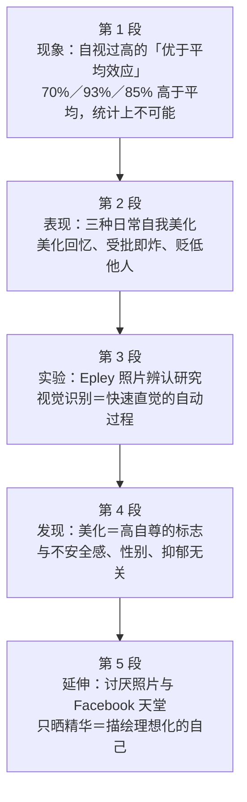

# Passage 03 · 自我美化与优于平均效应

## 答题记录

| 轮次  | 日期         | 题号  | 正确  | 错误  | 正确率 | 用时    | 错题归因 |
| --- | --- | --- | --- | --- | --- | --- | --- | --- |
| 1 |  | 1-5 |  |  |  |  |  |
| 2 |  | 1-5 |  |  |  |  |  |
| 3 |  | 1-5 |  |  |  |  |  |

> [!tip] 填写口径
> - **用时**以分钟计，只计做题时间，不含精读复盘。
> - **错题归因**填「题型·错误类型」，如：细节题·无中生有、细节题·混淆概念、猜词题·偷换概念、推理题·与原文相反。
> - 纵向看趋势：正确率升而用时过长 → 熟练度不足；用时降而正确率波动 → 定位不稳。
> - 本篇 **5 题**，题号栏填 1-5；第 1 题是**事实细节题**（问社会心理学家发现了什么，定位第一段③句的三个百分比），第 2 题是**事实细节题**（问视觉识别的性质，定位第三段③句引语，答案 C 是 intuitively／automatic 的同义归纳），第 3 题是**事实细节题**（问高自尊者的倾向，定位第四段③句，答案 B 是「认为美化的图像是真实自己」的改写），第 4 题是**猜词题**（viscerally 词义，定位第五段①句第 2 行，答案 A 靠破折号后的解释句），第 5 题是**推理题**（问 Facebook 为何是自我美化者的天堂，定位第五段②③句，答案 D 靠「只晒精华」反推）。错因建议分别写「细节题·无中生有」「细节题·偷换概念」「细节题·曲解文意」「猜词题·脱离语境」「推理题·与原文相反」。

> [!info] 文章档案
> - **来源**：考研英语（二）2014 年 Text 2
> - **题材**：社会生活（社会心理学 × 自我认知 × 社交媒体）——人人都自视过高：社会心理学称之为「优于平均效应／虚幻的优越感」，照片辨认实验证明视觉识别是快速直觉的自动过程，而 Facebook 之所以舒服，正因为它允许人只晒精华
> - **结构**：5 段 / 19 句 ＋ 5 题（按句号断句与行首缩进实测；与解析引用的「第一段①②③句」「第三段③句」「第四段②③④⑥句」「第五段②③句」全部吻合；第 4 题的 viscerally 位于第五段①句第 2 行，与书中 Line 2 一致）
> - **难度**：★★★☆☆
> - **一句话主旨**：我们天生需要自我感觉良好，于是普遍自我美化——70%、93%、85% 的人分别自评领导力、驾驶、相处能力高于平均，统计上不可能；Epley 的照片辨认实验表明视觉识别是快速、直觉的自动心理过程，选中美化照片的人真信那就是真实的自己，且这与高自尊相关而与不安全感无关；所以人们本能地讨厌自己的照片，而 Facebook 恰是自我美化者的天堂——不是资料不诚实，而是只描绘理想化的自己。

## 一、篇章脉络

- **第 1 段**：**现象与数据——自视过高是普遍事实**。《科学美国人》一文点题：你认为自己比实际更好看；自我美化源于「让自己感觉良好」的根深蒂固的需求；社会心理学家的海量研究给出三个数字（70%／93%／85%），并一锤定音——统计上不可能。第 1 题的战场。
- **第 2 段**：**日常表现——三个「我们」句**。美化回忆（rose-tint）、受批评就防御并贬低他人（defensive / negative stereotypes）、自视甚高（hot stuff）。本段短，只铺不考，但 defensive 为第 2 题 D 项 self-defence 埋了雷。
- **第 3 段**：**实验——Epley 的照片辨认研究**。不让被试给自己颜值打分，而是从一组（含美化与丑化版本）照片里辨认原始照；引语给出关键结论：视觉识别是自动、快速、直觉、几乎无意识思考的心理过程。第 2 题的战场。
- **第 4 段**：**发现——美化与自尊挂钩，与不安全感无关**。无性别差异；排除了「自我美化是为了弥补不安全感」的动机假说；认为美化图像是真实的人恰是自尊更强的人；Epley 两句话总结：不是错觉，只是人们普遍自我感觉良好。
- **第 5 段**：**生活延伸并收束**。所以人们本能地讨厌自己的照片（连照片里的人都不认得是自己）；Facebook 恰好反向满足——只分享最讨喜的照片、只晒精华；托马补上定音句：不是资料不诚实，而是描绘了理想化的自己。第 4、5 题的战场。

> [!tip] 行文逻辑
> 全篇是考研阅读典型的**「现象 → 实验 → 发现 → 延伸」科研型结构**：第 1–2 段立现象（自视过高及其日常表现）→ 第 3 段摆实验（照片辨认）→ 第 4 段给发现（美化＝高自尊标志，排除两种误解）→ 第 5 段做延伸（讨厌照片、Facebook 天堂）。它与「问题—对策」结构最大的不同是**没有价值判断的对立，只有「普通人怎么看 vs 数据怎么说」的反差**：第 1 段的三个百分比负责制造反差，第 3 段引语负责给机制，第 4 段负责纠偏（no gender difference / no evidence of insecurity / not delusion 三连否定），第 5 段 Facebook 收尾。三个贯穿全篇的词串：**self-enhancing / self-enhancement / self-enhancer（自我美化）**、**automatic / rapidly / intuitively / viscerally（自动—直觉一线，第 2、4 题的钥匙）**、**self-esteem / insecurity / depressed（自尊—不安全感—抑郁，第 3 题的钥匙）**。**命题格局题文同序**（1→P1、2→P3、3→P4、4→P5、5→P5），第 4、5 题同在末段但一考词义一考推理，互不重叠。

## 二、逐段精读

### 第 1 段 · 现象：自视过高的「优于平均效应」

**原文**

① An article in *Scientific American* has pointed out that empirical research says that, actually, you think you're more beautiful than you are.
② We have a deep-seated need to feel good about ourselves and we naturally employ a number of self-enhancing strategies to achieve this.
③ Social psychologists have amassed oceans of research into what they call the "above average effect", or "illusory superiority", and shown that, for example, 70% of us rate ourselves as above average in leadership, 93% in driving and 85% at getting on well with others—all obviously statistical impossibilities.

**译文**

① 一篇发表于《科学美国人》的文章指出，实证研究表明：事实上，你认为自己比实际更好看。
② 我们有一种根深蒂固的需求，需要让自己感觉良好，为此我们自然地运用了许多自我美化的策略。
③ 社会心理学家对所谓的「优于平均效应」或「虚幻的优越感」积累了海量研究，并表明：例如，70% 的人自评领导力高于平均水平，93% 的人自评驾驶技术高于平均，85% 的人自评与人相处的能力高于平均——所有这些显然都是统计学上不可能的事。

> [!note] 段落要点
> - **本段三句一线**：①句借《科学美国人》点出「你自视更高」→ ②句给心理动因（deep-seated need ＋ self-enhancing strategies）→ ③句甩出三个百分比作硬证据，破折号后 all obviously statistical impossibilities 收口。
> - **③句是第 1 题的定位句**：三个百分比共同指向「自评普遍高于平均」→ A 项 our self-ratings are unrealistically high。
> - **B、C、D 三项的雷全在本段埋好**：①句「研究真实存在」排掉 B；②句 need 与③句 leadership 拼凑出 C；②句「用策略」但未评价有效与否留出 D。

#### 本段重点词汇

| 单词 | 词性 | 文中意 | 拓展 | 文中用法 |
| --- | --- | --- | --- | --- |
| **empirical** | adj. | 经验的，实证的 | empirical research 实证研究；empirical data 经验数据；同义 evidence-based | empirical research says that...（实证研究表明） |
| **deep-seated** | adj. | 根深蒂固的 | deep ＋ seat（安置）；同义 deep-rooted、ingrained；a deep-seated belief 根深蒂固的观念 | a deep-seated need to feel good about ourselves（根深蒂固的自我良好感需求） |
| **employ** | v. | 运用，使用 | 熟词僻义：常见义「雇佣」，此处宾语是 strategies，作「运用」；employ a method 采用方法 | we naturally employ a number of self-enhancing strategies（自然地运用许多自我美化策略） |
| **self-enhancing** | adj. | 自我美化的，自我提升的 | enhance v. 提高、增强；self-enhancement n. 自我美化（第 3 段复现） | employ a number of self-enhancing strategies（运用许多自我美化策略） |
| **amass** | v. | 积累，汇集 | amass a fortune 积累财富；同义 accumulate、pile up | have amassed oceans of research（积累了海量研究） |
| **oceans of** | 短语 | 大量的，海量的 | ocean n. 海洋；oceans of time／money 大把时间／金钱；同义 loads of | amassed oceans of research into...（对……积累了海量研究） |
| **above average effect** | 短语 | 优于平均效应 | average n. 平均数 adj. 平均的、普通的；above average 高于平均水平 | what they call the "above average effect"（他们所说的「优于平均效应」） |
| **illusory superiority** | 短语 | 虚幻的优越感 | illusory adj. 虚幻的（illusion n. 错觉）；superiority n. 优越（superior adj. 上级的、更好的） | or "illusory superiority"（或称「虚幻的优越感」） |
| **rate** | v. | 评价；把……评定为 | rate oneself 自我评价；rating n. 等级、收视率；熟词僻义：非「速率」 | 70% of us rate ourselves as above average in leadership（70% 的人自评领导力高于平均） |
| **get on well with** | 短语 | 与……相处融洽 | get on 相处、进展；同义 get along with；第 1 题数据源之一 | getting on well with others（与他人相处融洽） |
| **statistical impossibility** | n. | 统计学上不可能的事 | statistical adj. 统计（学）的（statistics n. 统计学）；impossible adj. 不可能的 | all obviously statistical impossibilities（显然都是统计学上不可能的事） |

#### 长难句 · 本段第 ③ 句

> [!abstract] 本段第 ③ 句 · 原句
> Social psychologists have amassed oceans of research into what they call the "above average effect", or "illusory superiority", and shown that, for example, 70% of us rate ourselves as above average in leadership, 93% in driving and 85% at getting on well with others—all obviously statistical impossibilities.

**结构拆解**

- **主干**：Social psychologists（主）＋ have amassed（谓 1）＋ oceans of research（宾 1）＋ and shown（谓 2，与 have 共享）＋ that 从句（宾 2）。
- **介词宾语从句**：into **what they call** the "above average effect" —— what they call ＋ 术语，是考研阅读给概念下定义的固定句式。
- **并列补语**：or "illusory superiority"，给同一效应的第二个学术名。
- **数据并列**：70% ... in leadership, 93% in driving and 85% at ... —— 三个介词短语（in／in／at）分别挂接不同领域，93% 与 85% 后省略了 rate ourselves as above average。
- **破折号总结**：all obviously statistical impossibilities，all 复指前面三个百分比，名词短语作同位总结。

**参考译文**

社会心理学家对所谓的「优于平均效应」或「虚幻的优越感」积累了海量研究，并表明：例如，70% 的人自评领导力高于平均水平，93% 的人自评驾驶技术高于平均，85% 的人自评与人相处的能力高于平均——所有这些显然都是统计学上不可能的事。

> [!tip] 拆解要点
> 这句是**全篇的数据支柱，也是第 1 题的定位句**。三个要点：其一，**what they call ＋ 术语是「概念引入器」**，读完要立刻明白 above average effect ＝ illusory superiority＝同一现象的两个名字，第 1 题 B 项故意把 illusory superiority 单独拎出来说它 baseless（毫无根据），而①句恰恰说这项实证研究真实存在——**效应是否存在与人们的评价是否过高是两回事**；其二，**三个百分比必须读成一组**：领域不同、方向一致（全部高于平均），all ＋ impossibilities 是作者的统计判断，A 项 unrealistically high 正是对这三个数字的概括；其三，**93% in driving 是省略结构**，补全为 93% (of us rate ourselves as above average) in driving，读省略句先找第一个完整分句再平移。**细节题问「发现了什么」，答案永远是「数据的共同指向」，不是某一个数字**。

### 第 2 段 · 表现：三种日常自我美化

**原文**

① We rose-tint our memories and put ourselves into self-affirming situations.
② We become defensive when criticised, and apply negative stereotypes to others to boost our own esteem.
③ We stalk around thinking we're hot stuff.

**译文**

① 我们美化自己的回忆，把自己置于自我肯定的情形之中。
② 受到批评时我们会变得戒备，并用负面的刻板印象看待他人，以此提升自己的自尊。
③ 我们昂首阔步，自以为是个人物。

> [!note] 段落要点
> - **三个「We」开头、一句一个动作**，是第 1 段②句 self-enhancing strategies 的具体化：对过去（rose-tint memories）、对批评（defensive）、对他人（negative stereotypes）、对自己（hot stuff）。
> - **②句的 defensive 是第 2 题 D 项 automatic self-defence 的词源雷**——自我防卫确实在文中出现，但它是「受批评时的反应」，与第 2 题问的「视觉识别」毫无关系。
> - **本段最短（3 句 21 词级），不设考点，但承担「由现象过渡到实验」的桥**：正是这些日常表现引出第 3 段「那实验证据呢」的追问。

#### 本段重点词汇

| 单词 | 词性 | 文中意 | 拓展 | 文中用法 |
| --- | --- | --- | --- | --- |
| **rose-tint** | v. | 美化，粉饰 | tint v. 染色 n. 色调；rose-tinted glasses 玫瑰色眼镜（喻乐观滤镜） | We rose-tint our memories（我们美化自己的回忆） |
| **self-affirming** | adj. | 自我肯定的 | affirm v. 肯定、断言；affirmation n. 肯定；self- 前缀构词 | put ourselves into self-affirming situations（把自己置于自我肯定的情形中） |
| **defensive** | adj. | 戒备的，防御性的 | defence／defense n. 防御；become／feel defensive（受批时）产生戒备；defend v. 保卫 | We become defensive when criticised（受批评时变得戒备） |
| **stereotype** | n. | 刻板印象 | v. 对……形成刻板印象；stereotyped adj. 僵化的；gender／racial stereotypes 性别／种族刻板印象 | apply negative stereotypes to others（用负面刻板印象看待他人） |
| **boost** | v. | 提升，增强 | boost confidence／ego 增强自信；boost the economy 振兴经济；同义 enhance | to boost our own esteem（以提升自身的自尊） |
| **esteem** | n. | 自尊，尊重 | hold sb in high esteem 十分尊敬某人；self-esteem 自尊（第 4 段复现） | boost our own esteem（提升自身的自尊） |
| **stalk** | v. | 昂首阔步地走 | 熟词僻义：常见义「（捕猎）潜近、跟踪」，stalker n. 跟踪狂；此处指「大摇大摆地走」 | We stalk around thinking we're hot stuff（我们昂首阔步，自视甚高） |
| **hot stuff** | 短语 | 了不起的人物，好手 | stuff n. 东西；feel like hot stuff 自我感觉良好；口语化表达 | thinking we're hot stuff（自以为是个人物） |

#### 长难句 · 本段第 ② 句

> [!abstract] 本段第 ② 句 · 原句
> We become defensive when criticised, and apply negative stereotypes to others to boost our own esteem.

**结构拆解**

- **主干并列**：We（主）＋ become defensive（系表 1）＋ and apply ... stereotypes to others（谓 2 宾补）。
- **省略状语从句**：when (we are) criticised —— when／while／if ＋ 过去分词，从句主语与主句一致时省略「主语 ＋ be」。
- **不定式作目的状语**：to boost our own esteem，说明「贬低他人」的动机。

**参考译文**

受到批评时我们会变得戒备，并用负面的刻板印象看待他人，以此提升自己的自尊。

> [!tip] 拆解要点
> 这句是**本段的逻辑枢纽**：一个动机链「受批评 → 防御 → 贬低别人 → 抬高自己」。两个要点：其一，**when criticised 是「主语一致省略」的标准样本**，补全为 when we are criticised，考研阅读里 when／if ＋ 分词的省略极常见，读到先问「省略的主语是谁」——这里显然是 we；其二，**to boost our own esteem 是全句的「动机锚点」**，它把「贬低他人」定性为自我美化的一种手段，与第 1 段②句 employ self-enhancing strategies 呼应；同时注意 defensive 这个词将在第 2 题 D 项 automatic self-defence 里「借尸还魂」——**选项用原文真词＋一个与题干无关的名词拼接，是「张冠李戴」型干扰的常规配方**。

### 第 3 段 · 实验：Epley 的照片辨认研究

**原文**

① Psychologist and behavioural scientist Nicholas Epley oversaw a key study into self-enhancement and attractiveness.
② Rather than have people simply rate their beauty compared with others, he asked them to identify an original photograph of themselves from a lineup including versions that had been altered to appear more and less attractive.
③ Visual recognition, reads the study, is "an automatic psychological process, occurring rapidly and intuitively with little or no apparent conscious deliberation."
④ If the subjects quickly chose a falsely flattering image—which most did—they genuinely believed it was really how they looked.

**译文**

① 心理学家、行为科学家尼古拉斯·艾普利主持了一项关于自我美化与吸引力的关键研究。
② 他没有让人们单纯地把自己的美貌与他人比较后打分，而是请他们从一组照片中辨认出自己的原始照片，其中包括一些被修改得更好看或更难看的版本。
③ 研究写道，视觉识别是「一种自动的心理过程，它快速而直觉地发生，几乎不带任何明显的有意识思考」。
④ 如果受试者很快选出了一张失真美化的图像——大多数人都这样做了——他们就真的相信这就是自己真实的样子。

> [!note] 段落要点
> - **实验段的标准四步**：①句介绍研究者与主题 → ②句实验设计（不是打分，而是辨认照片）→ ③句机制结论（视觉识别＝自动、快速、直觉、无意识思考）→ ④句结果（大多数人选了美化版，且真心相信）。
> - **③句引语是第 2 题的唯一定位句**：automatic ＋ occurring rapidly and intuitively ＋ little or no conscious deliberation 三条性质合起来就是 C 项 intuitive response。
> - **②句的 Rather than 是理解本实验的关键**：否定的旧方法「与他人比较打分」正是第 1 段百分比的做法，新方法的巧处在于把「评价自己」换成「辨认自己」。

#### 本段重点词汇

| 单词 | 词性 | 文中意 | 拓展 | 文中用法 |
| --- | --- | --- | --- | --- |
| **oversee** | v. | 监督，主持 | oversaw 过去式；overseer n. 监工；同义 supervise、be in charge of | Epley oversaw a key study（Epley 主持了一项关键研究） |
| **attractiveness** | n. | 吸引力，魅力 | attractive adj. 有魅力的；attract v. 吸引；反义 unattractiveness | a key study into self-enhancement and attractiveness（一项关于自我美化与吸引力的研究） |
| **lineup** | n. | 一组待辨认的照片／人 | line up 排队；police lineup 警方指认队列；identity parade 英式 | identify an original photograph from a lineup（从一组照片中辨认原图） |
| **alter** | v. | 改变，改动 | alteration n. 改动；同义 modify、change；alter ego 另一个自我 | versions that had been altered（被修改过的版本） |
| **visual recognition** | 短语 | 视觉识别 | visual adj. 视觉的；recognition n. 识别（recognise v. 认出）；第 2 题题干词 | Visual recognition, reads the study, is...（研究写道，视觉识别是……） |
| **automatic** | adj. | 自动的，不自觉的 | automatically adv. 自动地；automation n. 自动化；近义 spontaneous | an automatic psychological process（一种自动的心理过程） |
| **occur** | v. | 发生 | occurrence n. 发生、事件；occur to sb 某人想到；不用被动 | occurring rapidly and intuitively（快速而直觉地发生） |
| **intuitively** | adv. | 凭直觉地 | intuitive adj. 直觉的；intuition n. 直觉；第 2 题答案源词 | occurring rapidly and intuitively（快速而直觉地发生） |
| **conscious deliberation** | 短语 | 有意识的思考 | conscious adj. 有意识的（反 unconscious）；deliberation n. 深思、审议（deliberate v.／adj. 深思熟虑的） | with little or no apparent conscious deliberation（几乎不带明显的有意识思考） |
| **subject** | n. | 受试者，实验对象 | 熟词僻义：常见义「主题、科目」；experimental subject 实验对象 | If the subjects quickly chose...（如果受试者很快选出……） |
| **flattering** | adj. | （照片／描述）显得比实际好看的 | flatter v. 奉承、使显得更好看；flattery n. 奉承；a flattering photo 美化照 | a falsely flattering image（一张失真美化的图像） |
| **genuinely** | adv. | 真正地，由衷地 | genuine adj. 真正的、真诚的；同义 truly、sincerely | they genuinely believed it was really how they looked（他们真信这就是自己真实的样子） |

#### 长难句 · 本段第 ② 句

> [!abstract] 本段第 ② 句 · 原句
> Rather than have people simply rate their beauty compared with others, he asked them to identify an original photograph of themselves from a lineup including versions that had been altered to appear more and less attractive.

**结构拆解**

- **Rather than ＋ 动词原形**：句首否定一种做法（have people simply rate...），主句给出实际做法，形成「不是 A 而是 B」框架。
- **主干**：he（主）＋ asked（谓）＋ them（宾）＋ to identify...（宾补）。
- **后置定语**：from a lineup including versions...，现在分词 including 引出 lineup 的内容。
- **that 定语从句**：that had been altered to appear more and less attractive，that 指 versions，过去完成时被动语态；more and less attractive 并列，指「更美／更丑」两个方向。

**参考译文**

他没有让人们单纯地把自己的美貌与他人比较后打分，而是请他们从一组照片中辨认出自己的原始照片，其中包括一些被修改得更好看或更难看的版本。

> [!tip] 拆解要点
> 这句是**实验设计的全貌**，读懂它等于看懂实验。三个要点：其一，**Rather than ＋ 动词原形放句首，「旧方法」与「新方法」同框**——打分（主观评价）被否掉，辨认（自动反应）被采用，方法一换，「自视过高」就从嘴上承认变成了下意识行为；其二，**lineup including versions that had been altered... 修饰链三层**：lineup → versions → altered，被改动的是照片版本而不是人，more and less attractive 是双向改动（既有美化版也有丑化版），这保证了④句 falsely flattering image 的存在；其三，**identify an original photograph 的 original 是实验题眼**——被试的任务是找回「原始照」，结果却挑了美化版，才有「觉得自己比实际好看」的结论。**实验段的 Rather than 句几乎必然是考点：先读主句（实际做法），再回头理解被否定的做法**。

#### 长难句 · 本段第 ③ 句

> [!abstract] 本段第 ③ 句 · 原句
> Visual recognition, reads the study, is "an automatic psychological process, occurring rapidly and intuitively with little or no apparent conscious deliberation."

**结构拆解**

- **插入语**：reads the study —— 倒装的引述语（＝ the study reads），插在主系表中间。
- **主干**：Visual recognition（主）＋ is（系）＋ an automatic psychological process（表语）。
- **现在分词后置定语**：occurring rapidly and intuitively...，修饰 process，说明过程的发生方式。
- **介词短语**：with little or no apparent conscious deliberation，补足「几乎无有意识思考」，与 automatic 呼应。

**参考译文**

研究写道，视觉识别是「一种自动的心理过程，它快速而直觉地发生，几乎不带任何明显的有意识思考」。

> [!tip] 拆解要点
> 这句是**第 2 题的唯一定位句，也是全篇的「机制句」**。三个要点：其一，**reads the study 作插入语**，正常语序是 the study reads（该研究写道），插进主系表之间制造分隔，读的时候先跳过它把 Visual recognition is... 连起来；其二，**引语内三重性质必须打包读**：automatic（自动）→ occurring rapidly and intuitively（快速＋直觉）→ with little or no conscious deliberation（无意识思考），它们共同指向「不经大脑审批」这一个核心，第 2 题 C 项 intuitive response 是打包后的同义浓缩；其三，**A 项 rapid matching 的 rapid 确实出自本句**，但 matching（匹配）在文中无出处——**「真词＋无中生有搭配」比「整句编造」更难识破，务必核对搭配整体**。这句与第 4 题 viscerally 的答案一脉相承：识别是本能，讨厌照片也是本能。

#### 长难句 · 本段第 ④ 句

> [!abstract] 本段第 ④ 句 · 原句
> If the subjects quickly chose a falsely flattering image—which most did—they genuinely believed it was really how they looked.

**结构拆解**

- **if 条件从句**：If the subjects quickly chose a falsely flattering image，主语 the subjects，谓语 chose。
- **插入语**：—which most did—，which 指代「快速选出美化图像」这件事，did 替代 chose，most 指「大多数受试者」。
- **主句**：they（主）＋ genuinely believed（谓）＋ (that) it was really how they looked（宾语从句）。
- **宾语从句内嵌**：it was really **how they looked**，how 引导表语从句，作 was 的表语。

**参考译文**

如果受试者很快选出了一张失真美化的图像——大多数人都这样做了——他们就真的相信这就是自己真实的样子。

> [!tip] 拆解要点
> 这句是**实验结论句，把「机制」落到「人」身上**。三个要点：其一，**主从句时态配套**：条件句 chose（过去式）、主句 believed（过去式），整句是实验结果的虚拟复盘，不是真实条件句，不要被 if 误导成「假设」；其二，**—which most did— 这个插入短语信息量极大**：which 指整个「快速选美化照」的行为，did 避免重复 chose，它告诉读者「大多数人都这样」——这正是第 5 段 Facebook 现象的实验依据；其三，**genuinely believed ＋ really 叠用**，「真心相信」＋「真的」，强调这种自我美化不是策略性撒谎而是无意识信以为真，与第 4 段④句 not personal delusion、第 5 段③句 not dishonest 一条线。**实验段的 If ...—which most did—... 结构里，插入语往往才是作者真正想强调的信息**。

### 第 4 段 · 发现：美化＝高自尊的标志

**原文**

① Epley found no significant gender difference in responses.
② Nor was there any evidence that those who self-enhanced the most (that is, the participants who thought the most positively doctored pictures were real) were doing so to make up for profound insecurities.
③ In fact, those who thought that the images higher up the attractiveness scale were real directly corresponded with those who showed other markers for having higher self-esteem.
④ "I don't think the findings that we have are any evidence of personal delusion," says Epley.
⑤ "It's a reflection simply of people generally thinking well of themselves."
⑥ If you are depressed, you won't be self-enhancing.

**译文**

① 艾普利发现，人们的反应没有显著的性别差异。
② 也没有任何证据表明，那些自我美化程度最高的人（即认为被美化得最好看的照片才是真实自己的受试者）这样做是为了弥补强烈的不安全感。
③ 事实上，那些认为吸引力等级上位置更高的图像是真实的人，恰好与那些表现出更强自尊其他标志的人直接对应。
④ 「我不认为我们的这些发现是个人错觉的任何证据，」艾普利说。
⑤ 「它只是人们普遍自我感觉良好的一种反映。」
⑥ 如果你情绪抑郁，你就不会自我美化。

> [!note] 段落要点
> - **本段是「发现 ＋ 排除误解」的组合**：①句排除性别变量 → ②句排除动机假说（不是出于不安全感）→ ③句给出正相关（美化 ＝ 高自尊的标志）→ ④⑤句 Epley 定性（不是错觉，是自我感觉良好）→ ⑥句反向印证（抑郁者不美化）。
> - **③句是第 3 题的定位句**：认为美化图像是真实的人 ＝ 自尊更强的人 → 相信自身吸引力 → B。
> - **②③④⑥句分别是第 3 题 A、D、C 项的排除依据**：不安全感、delusion、depressed 三个词都在本段，但都被解析逐一借去排除错误选项——**考点段落的词要按「谁说了什么」分开归位**。

#### 本段重点词汇

| 单词 | 词性 | 文中意 | 拓展 | 文中用法 |
| --- | --- | --- | --- | --- |
| **significant** | adj. | 显著的，重大的 | significance n. 意义、显著性；a significant difference 显著差异；统计学术语 | no significant gender difference in responses（反应无显著性别差异） |
| **gender difference** | 短语 | 性别差异 | gender n. 性别；gender gap 性别差距；第 3 题 A 项相关词 | no significant gender difference（无显著性别差异） |
| **make up for** | 短语 | 弥补，补偿 | make up 捏造、组成、和好；同义 compensate for；make-up n. 化妆、构成 | to make up for profound insecurities（以弥补强烈的不安全感） |
| **profound** | adj. | 强烈的，深刻的 | profundity n. 深刻；profoundly adv. 深深地；profound effect 深远影响 | profound insecurities（强烈的不安全感） |
| **insecurity** | n. | 不安全感 | insecure adj. 不安全的、无把握的；security n. 安全；反义 confidence | make up for profound insecurities（弥补强烈的不安全感） |
| **scale** | n. | 等级，级别；刻度 | the attractiveness scale 吸引力等级；on a large scale 大规模地；scale v. 缩放 | the images higher up the attractiveness scale（吸引力等级上更高的图像） |
| **correspond with** | 短语 | 与……对应；与……相符 | correspond v. 符合、通信；correspondence n. 对应、通信；同义 match | directly corresponded with those who...（与……直接对应） |
| **marker** | n. | 标志，标记 | mark n.／v. 标记；a marker for／of...的标志；同义 indicator | showed other markers for having higher self-esteem（表现出更强自尊的其他标志） |
| **self-esteem** | n. | 自尊（心） | esteem n. 尊重（第 2 段已收单字）；boost／lower self-esteem 提升／削弱自尊 | having higher self-esteem（拥有更强的自尊） |
| **delusion** | n. | 错觉，妄想 | delude v. 欺骗、迷惑；be under a delusion 产生错觉；近义 illusion（illusion 偏「幻象」，delusion 偏「执念」） | any evidence of personal delusion（个人错觉的证据） |
| **reflection** | n. | 反映，体现 | reflect v. 反映、反思；a reflection of...的体现；熟词僻义：非「反射／反思」 | a reflection simply of people generally thinking well of themselves（只是人们普遍自我感觉良好的反映） |
| **depressed** | adj. | 沮丧的，抑郁的 | depression n. 抑郁（症）、萧条；depress v. 使沮丧、使不景气 | If you are depressed, you won't be self-enhancing（如果你情绪抑郁，就不会自我美化） |

#### 长难句 · 本段第 ② 句

> [!abstract] 本段第 ② 句 · 原句
> Nor was there any evidence that those who self-enhanced the most (that is, the participants who thought the most positively doctored pictures were real) were doing so to make up for profound insecurities.

**结构拆解**

- **Nor 倒装**：Nor was there... —— 否定副词开头，句子部分倒装（was 提到 there 前），承接①句的否定（no significant gender difference）。
- **that 同位语从句**：that those ... were doing so...，说明 evidence 的内容。
- **主语嵌套**：those who self-enhanced the most —— who 定语从句修饰 those；括号内 (that is, ...) 给出同位解释，其中又套 who thought the most positively doctored pictures were real（thought 后接省略 that 的宾语从句）。
- **不定式作目的状语**：to make up for profound insecurities，说明 were doing so 的动机（本句否定这一动机）。

**参考译文**

也没有任何证据表明，那些自我美化程度最高的人（即认为被美化得最好看的照片才是真实自己的受试者）这样做是为了弥补强烈的不安全感。

> [!tip] 拆解要点
> 这句是**全段语法最重、逻辑最关键的「排除句」**。三个要点：其一，**Nor ＋ 倒装承接上句否定**，①句说「没有性别差异」，本句说「也没有动机证据」，两句一起为③句的正相关结论扫清竞争解释——**考研说明文常用「先排除、再立论」的手法，Nor／Nor is there any evidence 是排他句的标志**；其二，**括号同位语 (that is, ...) 是「术语翻译器」**，把抽象的 those who self-enhanced the most 落到实验行为「认为美化照片是真实的」，读不懂主语时先读括号；其三，**doctored 是熟词僻义**（doctor v. 篡改、做手脚，doctored pictures＝修改过的照片），不是「医生」，这个动词也是实验设计的核心——第 3 题 A 项 underestimate their insecurities 正是踩着本句的「无证据」改成「低估」，**「原文说没有关系，选项说有某种关系」，一律按曲解文意排除**。

#### 长难句 · 本段第 ③ 句

> [!abstract] 本段第 ③ 句 · 原句
> In fact, those who thought that the images higher up the attractiveness scale were real directly corresponded with those who showed other markers for having higher self-esteem.

**结构拆解**

- **过渡语**：In fact，由「排除」转入「立论」。
- **主干**：those（主 1）＋ corresponded with（谓）＋ those（宾 2）——「那些人 ＝ 那些人」的对应框架。
- **who 定语从句 1**：who thought that the images higher up the attractiveness scale were real，thought 后接 that 宾语从句；从句主语 the images 被后置定语 higher up the attractiveness scale 修饰。
- **who 定语从句 2**：who showed other markers for having higher self-esteem，for ＋ 动名词说明 marker 的所属。

**参考译文**

事实上，那些认为吸引力等级上位置更高的图像是真实的人，恰好与那些表现出更强自尊其他标志的人直接对应。

> [!tip] 拆解要点
> 这句是**第 3 题的唯一定位句，也是全段的核心发现**。三个要点：其一，**those who ... corresponded with those who ... 是「两组人画等号」的框架**，读的时候把两个 who 从句各自压缩成一个标签：左边＝「认为美化照片是真的」，右边＝「有高自尊其他标志」，等号一画，结论自明；其二，**higher up the attractiveness scale 是「等级语言」**，scale 把吸引力变成一把尺子，higher up 表示「刻度更上方」，即被改动得更好看的版本；其三，**directly corresponded 的 directly 是程度保险**——不是「大致相关」而是「一一对应」，这让第 3 题 B 项 believe in their attractiveness 的改写成立：**认为美化的自己＝真实自己 ⇔ 相信自己的吸引力**。这句与前句构成「否定 A（不安全感）→ 肯定 B（自尊）」的经典论证闭环，**「In fact／However 之后才是一段的真正主张」**。

### 第 5 段 · 延伸：讨厌照片与 Facebook 天堂

**原文**

① Knowing the results of Epley's study, it makes sense that many people hate photographs of themselves viscerally—on one level, they don't even recognise the person in the picture as themselves.
② Facebook, therefore, is a self-enhancer's paradise, where people can share only the most flattering photos, the cream of their wit, style, beauty, intellect and lifestyles.
③ "It's not that people's profiles are dishonest," says Catalina Toma of Wisconsin-Madison University, "but they portray an idealised version of themselves."

**译文**

① 了解艾普利的研究结果后，许多人本能地厌恶自己的照片就说得通了——在某种层面上，他们甚至不认得照片里的人就是自己。
② 因此，脸书是自我美化者的天堂：在那里，人们只分享最讨人喜欢的照片，只晒他们才智、风格、美貌、才华与生活方式中最精华的部分。
③ 「这并不是说人们的个人资料不诚实，」威斯康星大学麦迪逊分校的卡塔琳娜·托马说，「而是他们描绘出了一个理想化的自己。」

> [!note] 段落要点
> - **本段把实验结果拉回生活**：①句用 Knowing... it makes sense 解释「讨厌自己照片」的现象（识别是本能的，照片里「不像自己」的那个形象自然引发本能的不适）；②句 Facebook 是镜像面——线下看照片难受，线上晒图痛快；③句专家定音：不是不诚实，是理想化。
> - **①句的 viscerally 是第 4 题猜词点**（书中标注 Line 2 即本句第 2 行），答案藏在「识别照片＝自动心理过程」的机制回链里。
> - **②句是第 5 题的定位句**：only the most flattering photos ＝ 只让人看到讨喜的一面 → D 项 withhold their unflattering sides；③句同时是 A 项 dishonest 的排除句。

#### 本段重点词汇

| 单词 | 词性 | 文中意 | 拓展 | 文中用法 |
| --- | --- | --- | --- | --- |
| **viscerally** | adv. | 发自内心地，本能地 | visceral adj. 出自内脏的、发自肺腑的（viscera n. 内脏）；第 4 题猜词词 | hate photographs of themselves viscerally（本能地厌恶自己的照片） |
| **on one level** | 短语 | 在某种层面上 | on the one level... on another 在一个层面……在另一层面；同义 in a sense | on one level, they don't even recognise...（在某种层面上，他们甚至不认得……） |
| **recognise ... as ...** | 短语 | 把……认作…… | recognise v. 认出、承认；recognition n. 识别（第 3 段 visual recognition 复现词根） | don't even recognise the person in the picture as themselves（甚至不认得照片里的人是自己） |
| **paradise** | n. | 天堂，乐土 | a paradise for／of...的天堂；paradise lost 失乐园；第 5 题题干词 | a self-enhancer's paradise（自我美化者的天堂） |
| **the cream of** | 短语 | ……的精华，最优秀的部分 | cream n. 奶油、精华；the cream of the crop 精英中的精英 | the cream of their wit, style, beauty...（他们才智、风格、美貌……的精华） |
| **wit** | n. | 才智，风趣 | witty adj. 机智幽默的；at one's wit's end 智穷计尽；集合义「智者」 | the cream of their wit（他们才智的精华） |
| **intellect** | n. | 智力，才智 | intellectual adj. 智力的 n. 知识分子（第 5 题 C 项偷换来源）；intelligence n. 智力、情报 | the cream of their... intellect（他们……才智的精华） |
| **profile** | n. | （社交网络）个人资料，主页 | a Facebook profile 脸书个人主页；high profile 高调；profile v. 描绘……的轮廓 | people's profiles are dishonest（人们的个人主页资料并不诚实） |
| **portray** | v. | 描绘，刻画 | portrait n. 肖像、描写；portrayal n. 描绘；同义 depict、present | they portray an idealised version of themselves（他们描绘出理想化的自己） |
| **idealised** | adj. | 理想化的 | idealise v. 理想化；ideal n. 理想 adj. 理想的；idealised image 理想化形象 | an idealised version of themselves（理想化的自己） |

#### 长难句 · 本段第 ① 句

> [!abstract] 本段第 ① 句 · 原句
> Knowing the results of Epley's study, it makes sense that many people hate photographs of themselves viscerally—on one level, they don't even recognise the person in the picture as themselves.

**结构拆解**

- **现在分词作原因状语**：Knowing the results of Epley's study，逻辑主语是后面整个 that 从句所描述的事实（也可理解为对读者的「鉴于」）。
- **形式主语**：it makes sense that...，it 代替 that 从句「许多人本能地讨厌自己的照片」。
- **破折号解释**：on one level, they don't even recognise... as themselves，对 viscerally 作现象级解释。
- **recognise A as B**：把照片里的人（A）认作他们自己（B），don't even 否定——「连认都不认得」。

**参考译文**

了解艾普利的研究结果后，许多人本能地厌恶自己的照片就说得通了——在某种层面上，他们甚至不认得照片里的人就是自己。

> [!tip] 拆解要点
> 这句是**第 4 题的语境句**（viscerally 位于本句第 2 行，即书中 Line 2）。三个要点：其一，**viscerally 修饰 hate，是方式副词，刻画「讨厌」的方式**，猜词题第一步是给词定位词性与搭配；其二，**破折号后是猜词的钥匙**——「他们甚至不认得照片里的人是自己」，而「认照片」正是第 3 段说的自动、快速、直觉的视觉识别过程，识别尚且本能，由识别引发的厌恶自然也是本能 → instinctively；其三，**it makes sense that... 是「现象合理化」句式**，作者用它把实验（第 3–4 段）与日常（第 5 段）焊接起来，考研阅读里段首的 makes sense／explains why 句是承上启下的路标。**猜词题的答案方向永远由解释句决定，而不是由词的常见义决定**。

#### 长难句 · 本段第 ② 句

> [!abstract] 本段第 ② 句 · 原句
> Facebook, therefore, is a self-enhancer's paradise, where people can share only the most flattering photos, the cream of their wit, style, beauty, intellect and lifestyles.

**结构拆解**

- **主干**：Facebook（主）＋ is（系）＋ a self-enhancer's paradise（表语），therefore 承接①句，故论证链是「线下照片难看 → 线上只晒好看」。
- **where 定语从句**：where people can share only the most flattering photos，修饰 paradise（先行词表地点义）。
- **only 的位置**：only the most flattering photos——only 限定宾语，是「只晒好看的」的语义核心。
- **同位语**：the cream of their wit, style, beauty, intellect and lifestyles，复指 the most flattering photos，五项并列由 of 统摄。

**参考译文**

因此，脸书是自我美化者的天堂：在那里，人们只分享最讨人喜欢的照片，只晒他们才智、风格、美貌、才华与生活方式中最精华的部分。

> [!tip] 拆解要点
> 这句是**第 5 题的唯一定位句，也是全篇的落点**。三个要点：其一，**therefore 是因果路标**——「天堂」的成立依赖①句的机制（人们本能地想看好看的自己），所以第 5 题 because 的答案要从「只分享 most flattering photos」反推：晒出来的全是精华，就意味着**没晒的、不讨喜的一面被藏起来了**（D 项 withhold their unflattering sides）；其二，**only 是最高频的考点小词**，它把「分享照片」的范围收窄到「讨喜的」，A 项 dishonest 的错误正出在这里——③句明说 profiles 不 dishonest；其三，**the cream of their wit, style, beauty, intellect and lifestyles 五连并列**，其中 intellect 被 C 项偷换成 intellectual pursuits（对知识的追求）——「晒才智的精华」不等于「分享求知活动」，**并列结构中的单个名词被扩展成一个新概念，是偷换概念的典型手法**。

## 三、全篇重点词汇汇总（自测用）

> [!info] 说明
> 本表只列「单词 / 词性 / 所在段」，不含释义与搭配，用于遮表自测：说出词义后再回该段核对。
> 收录**全篇所有段落词汇，共 53 条，不删减**，与各段「本段重点词汇」等长同源（跨段复现的词只在其首次出现的段落收录一次，如 self-esteem 以第 4 段的复合词收录、flattering 只在第 3 段收录）。

| 单词 / 短语 | 词性 | 所在段 |
| --- | --- | --- |
| **empirical** | adj. | 第 1 段 |
| **deep-seated** | adj. | 第 1 段 |
| **employ** | v. | 第 1 段 |
| **self-enhancing** | adj. | 第 1 段 |
| **amass** | v. | 第 1 段 |
| **oceans of** | 短语 | 第 1 段 |
| **above average effect** | 短语 | 第 1 段 |
| **illusory superiority** | 短语 | 第 1 段 |
| **rate** | v. | 第 1 段 |
| **get on well with** | 短语 | 第 1 段 |
| **statistical impossibility** | n. | 第 1 段 |
| **rose-tint** | v. | 第 2 段 |
| **self-affirming** | adj. | 第 2 段 |
| **defensive** | adj. | 第 2 段 |
| **stereotype** | n. | 第 2 段 |
| **boost** | v. | 第 2 段 |
| **esteem** | n. | 第 2 段 |
| **stalk** | v. | 第 2 段 |
| **hot stuff** | 短语 | 第 2 段 |
| **oversee** | v. | 第 3 段 |
| **attractiveness** | n. | 第 3 段 |
| **lineup** | n. | 第 3 段 |
| **alter** | v. | 第 3 段 |
| **visual recognition** | 短语 | 第 3 段 |
| **automatic** | adj. | 第 3 段 |
| **occur** | v. | 第 3 段 |
| **intuitively** | adv. | 第 3 段 |
| **conscious deliberation** | 短语 | 第 3 段 |
| **subject** | n. | 第 3 段 |
| **flattering** | adj. | 第 3 段 |
| **genuinely** | adv. | 第 3 段 |
| **significant** | adj. | 第 4 段 |
| **gender difference** | 短语 | 第 4 段 |
| **make up for** | 短语 | 第 4 段 |
| **profound** | adj. | 第 4 段 |
| **insecurity** | n. | 第 4 段 |
| **scale** | n. | 第 4 段 |
| **correspond with** | 短语 | 第 4 段 |
| **marker** | n. | 第 4 段 |
| **self-esteem** | n. | 第 4 段 |
| **delusion** | n. | 第 4 段 |
| **reflection** | n. | 第 4 段 |
| **depressed** | adj. | 第 4 段 |
| **viscerally** | adv. | 第 5 段 |
| **on one level** | 短语 | 第 5 段 |
| **recognise ... as ...** | 短语 | 第 5 段 |
| **paradise** | n. | 第 5 段 |
| **the cream of** | 短语 | 第 5 段 |
| **wit** | n. | 第 5 段 |
| **intellect** | n. | 第 5 段 |
| **profile** | n. | 第 5 段 |
| **portray** | v. | 第 5 段 |
| **idealised** | adj. | 第 5 段 |

## 四、知识点补充

> [!question] 背景知识
> - **优于平均效应（above average effect）**：社会心理学最著名的自评偏差之一，又称 illusory superiority（虚幻的优越感）或 Lake Wobegon effect（乌比冈湖效应，源自作家 Keillor 虚构的小镇——「那里所有孩子都在平均水平之上」）。经典数据：约 70% 的人自评领导力高于平均、93% 自评驾驶技术高于平均，而统计上「高于平均」的人最多只能接近 50%。本文开篇三个百分比即来源于此。
> - **Epley 的照片研究**：即 Epley 与 Whitchurch（2008）发表于《人格与社会心理学公报》的 "Mirror, mirror on the wall" 研究。实验让被试从 11 张（真实照 ＋ 按吸引力双向改动的版本）中辨认自己的脸，结果显示被试系统性地选择比真实更美化的版本——本文第 3 段②句「more and less attractive 双向改动」与④句「多数人选了美化版」即该实验的还原。识别自己面孔走的是快速直觉通道，这一结论后来被用于解释人们为何讨厌证件照（照片比镜像丑、且不经过大脑的自动美化）。
> - **viscerally 的词源**：来自拉丁语 viscera（内脏），英语 visceral 既保留解剖义「内脏的」，更常作比喻「发自肺腑的、本能的、不经思考的」（a visceral reaction 本能反应）。它与第 3 段 automatic／intuitively 属于同一语义场——这正是第 4 题答案 A（instinctively）的语言学依据。
> - **达克效应（Dunning-Kruger effect）**：与本文效应常被一起引用的姊妹偏差——能力越欠缺的人越容易高估自己。区别在于：above average effect 说的是「人人都把自己往上放」，达克效应说的是「越差的人放得越高」。写作中两者都可作「自我认知偏差」的例证，但不可混用。
> - **Facebook 与理想化自我呈现**：卡塔琳娜·托马（Catalina Toma，威斯康星大学麦迪逊分校传播学教授）长期研究社交媒体的自我呈现，结论与本文③句一致：用户选择性发布（selective self-presentation）不等于欺骗，而是戈夫曼（Goffman）「拟剧理论」中「前台形象」的数字化——人人都在管理自己给别人的印象，Facebook 只是降低了管理成本。
> - **第 2 题的机制背景**：认知心理学把面孔识别归为「快速、自动、整体加工」的过程（约 200 毫秒内完成），被试往往在意识到自己「在选」之前就已经选完——所以「选择美化照」不是虚荣的决定，而是系统的默认输出。这是理解④句 genuinely believed 的科学底色。

## 五、题目分析

> [!info] 题目总览
> | 题号 | 题型 | 定位 | 答案 |
> | --- | --- | --- | --- |
> | 1 | 事实细节题（社会心理学家发现了什么） | 第 1 段③句 | A |
> | 2 | 事实细节题（视觉识别的性质） | 第 3 段③句 | C |
> | 3 | 事实细节题（高自尊者的倾向） | 第 4 段③句 | B |
> | 4 | 猜词题（viscerally 词义） | 第 5 段①句（第 2 行） | A |
> | 5 | 推理题（Facebook 为何是天堂） | 第 5 段②句 | D |

### 第 1 题 · 事实细节题（社会心理学家发现了什么）

> [!question] 原题
> According to the first paragraph, social psychologists have found that
> - A. our self-ratings are unrealistically high.
> - B. illusory superiority is a baseless effect.
> - C. our need for leadership is unnatural.
> - D. self-enhancing strategies are ineffective.

**正确答案**：**A. our self-ratings are unrealistically high.（我们的自评高得不切实际）**

**定位与依据**

- 题干关键词 **the first paragraph** 与 **social psychologists have found** 直接锁定第 1 段③句：Social psychologists have amassed oceans of research into what they call the "above average effect", or "illusory superiority", **and shown that** ... 70% of us rate ourselves as above average in leadership, 93% in driving and 85% at getting on well with others—all obviously **statistical impossibilities**.
- 书中解析：「根据题干关键词『the first paragraph』和『social psychologists have found』定位到第一段③句。该句指出了社会心理学家发现的事实：70% 的人认为自己在领导能力方面高于平均水平，93% 的人认为自己在驾驶方面高于平均水平，85% 的人认为自己在与人相处方面高于平均水平——显然这些数据在统计学上是不可能的。也就是说人们的自我评价过高，这一现象在统计学上不可能发生，因此 [A] 项正确。」
- A 项 unrealistically high 正是对「三个百分比全部高于平均 ＋ 统计上不可能」的概括——**自评高得不切实际**。
- B 项（illusory superiority is a baseless effect）**曲解文意**：①句指出社会心理学家「已经积累了海量研究」，说明这种现象真实存在，并非「毫无根据的效应」。
- C 项（our need for leadership is unnatural）**无中生有**：由②句的 need 和③句的 leadership 拼凑而来；文中只说「70% 的人自评领导力高于平均」，并未提到「对领导力的需求」。
- D 项（self-enhancing strategies are ineffective）**曲解文意**：②句只说「我们会自然地运用自我美化策略」，并未评价这些策略是否有效。

**干扰项分析**

| 选项 | 选项内容 | 判断 | 排除理由 |
| --- | --- | --- | --- |
| A | our self-ratings are unrealistically high. | ✓ | 正确项：③句三个百分比「全部高于平均且统计上不可能」的概括。 |
| B | illusory superiority is a baseless effect. | ✗ | 曲解文意：①句海量实证研究证明该现象真实存在。 |
| C | our need for leadership is unnatural. | ✗ | 无中生有：need（②句）与 leadership（③句）跨句拼凑，文中无「领导力需求」。 |
| D | self-enhancing strategies are ineffective. | ✗ | 曲解文意：②句只说「会用策略」，未评价有效性。 |

> [!tip] 解题思路
> 「According to the first paragraph, ... have found that」是**观点验证型细节题**：题干给足了定位（第一段 ＋ social psychologists），难度全在四个选项与原文的对应精度上。可复制的动作：**①找到「发现」的落点句（③句 and shown that 之后）→ ②用一句话概括数据的共同指向（人人都自评高于平均，不可能）→ ③把选项逐个拉回原文对号**。本题的设错三件套很有代表性：B 项把「现象存在」偷换成「效应无根据」（真词 baseless 无出处）；C 项是**跨句拼凑**（②句的 need ＋ ③句的 leadership）；D 项在「有行为」与「有评价」之间偷渡（原文说了会用策略，没说策略好不好）。**细节题四个选项里凡出现原文真词、却把词与词的关系改写的，先查「关系」再查「词」**。

### 第 2 题 · 事实细节题（视觉识别的性质）

> [!question] 原题
> Visual recognition is believed to be people's
> - A. rapid matching.
> - B. conscious choice.
> - C. intuitive response.
> - D. automatic self-defence.

**正确答案**：**C. intuitive response.（直觉反应）**

**定位与依据**

- 题干关键词 **Visual recognition** 直接锁定第 3 段③句（全篇唯一出现该术语处）：Visual recognition, reads the study, is "an **automatic** psychological process, occurring **rapidly and intuitively** with little or no apparent **conscious deliberation**."
- 书中解析：「根据题干中的 Visual recognition 定位到第三段③句。该句指出，视觉识别是『一种自发的心理过程，这个过程依靠直觉（intuitively）快速发生，很少经过或不经过有意识的思考』。由此可知，视觉识别是无意识的，是依靠直觉的，[C] 项是对原文内容的同义改写，因此 [C] 项正确。」
- C 项 intuitive response 是引语三重性质（automatic ＋ rapidly and intuitively ＋ little or no conscious deliberation）的同义浓缩。
- A 项（rapid matching）**无中生有**：rapid 确实出自本句，但 matching（匹配）在文中毫无出处。
- B 项（conscious choice）**与原文相反**：引语明说 with little or no conscious deliberation（几乎无有意识思考）。
- D 项（automatic self-defence）**张冠李戴**：automatic 源自本句，但 self-defence 源自第 2 段②句「受批评时的防御反应」，与视觉识别无关。

**干扰项分析**

| 选项 | 选项内容 | 判断 | 排除理由 |
| --- | --- | --- | --- |
| A | rapid matching. | ✗ | 无中生有：rapid 是原词，matching 无出处。 |
| B | conscious choice. | ✗ | 与原文相反：引语说 little or no conscious deliberation。 |
| C | intuitive response. | ✓ | 正确项：automatic ＋ intuitively ＋ 无意识思考的同义浓缩。 |
| D | automatic self-defence. | ✗ | 张冠李戴：automatic 属视觉识别，self-defence 属第 2 段受批评反应。 |

> [!tip] 解题思路
> 术语细节题的定位零成本（Visual recognition 全文仅一见），**考点在「真词拼接」的识别力**。本题 A、D 两项的「前半词」都真实存在于定位句附近，这正是出题人设的口袋：**把真词 A 和真词 B 装进一个原文没有的搭配里**。破解动作只有一步——**回到定位句，把「识别 ＋ 谓语性质」整体读一遍**：识别＝自动、快速、直觉、无意识思考；然后逐项问「这个词组整体在原文有依据吗」，而不是问「这个词在原文出现过吗」。C 项 intuitive response 的 response 在原文也找不到对应词，但它与三个性质**语义等价**——同义替换允许换词，不允许换关系。凡选项与引语性质相加等于原意，即正确；凡选项靠「搬家」凑成，即排除。

### 第 3 题 · 事实细节题（高自尊者的倾向）

> [!question] 原题
> Epley found that people with higher self-esteem tended to
> - A. underestimate their insecurities.
> - B. believe in their attractiveness.
> - C. cover up their depressions.
> - D. oversimplify their illusions.

**正确答案**：**B. believe in their attractiveness.（相信自己的吸引力）**

**定位与依据**

- 题干关键词 **Epley found** 与 **higher self-esteem** 锁定第 4 段③句：In fact, those who thought that the images **higher up the attractiveness scale** were real **directly corresponded with** those who showed other markers for having **higher self-esteem**.
- 书中解析：「根据题干中的 Epley 和 higher self-esteem 定位到第四段③句。该句指出，Epley 发现『那些认为经过美化的形象是真实的自己的人，就是那些表现出更强自尊心的人』。换句话说，自尊心较强的人就会认为经过美化的形象就是真实的自己，也就是相信自身的吸引力，因此 [B] 项正确。」
- 换句话说：认为「美化版＝真实自己」 ⇔ 相信自己的吸引力 → B。
- A 项（underestimate their insecurities）**曲解文意**：②句说「没有任何证据表明自我美化与不安全感有关」，不是「低估不安全感」。
- C 项（cover up their depressions）**曲解文意**：⑥句说「抑郁的人不会自我美化」，并未说谁「掩饰沮丧」。
- D 项（oversimplify their illusions）**无中生有**：④句只说发现「不是个人错觉的证据」，与「过于简化错觉」无关。

**干扰项分析**

| 选项 | 选项内容 | 判断 | 排除理由 |
| --- | --- | --- | --- |
| A | underestimate their insecurities. | ✗ | 曲解文意：②句说无证据表明美化源于不安全感，非「低估」。 |
| B | believe in their attractiveness. | ✓ | 正确项：「认为美化图像是真实自己」的改写。 |
| C | cover up their depressions. | ✗ | 曲解文意：⑥句说抑郁者不美化，未说「掩饰沮丧」。 |
| D | oversimplify their illusions. | ✗ | 无中生有：④句与「简化错觉」无关。 |

> [!tip] 解题思路
> 本题的关键动作是把③句的**「两组人对应」框架翻译成一句大白话**：左边 those who thought the images higher up the attractiveness scale were real（认为美化照是真的）＝右边 those who showed other markers for having higher self-esteem（自尊更强）。画完等号，题干问「高自尊者倾向于怎样」，从等号右侧走向左侧即可：高自尊 ⇔ 相信美化照 ＝ 相信自身吸引力 → B。三个干扰项全部使用**本段真词**（insecurities、depressed、delusion），这是本篇最阴的设错法：**词全真、关系全假**。对策是「逐项回原句核谓语关系」——原文说「无关」（no evidence），选项说「低估」；原文说「不会美化」，选项说「掩饰」；原文说「不是错觉」，选项说「简化错觉」。**关系词（动词／否定）与原文对不上，名词再真也排除**。

### 第 4 题 · 猜词题（viscerally 词义）

> [!question] 原题
> The word "viscerally" (Line 2, Para. 5) is closest in meaning to
> - A. instinctively.
> - B. occasionally.
> - C. particularly.
> - D. aggressively.

**正确答案**：**A. instinctively.（本能地）**

**定位与依据**

- viscerally 位于第 5 段①句第 2 行（与书中 Line 2 一致）：Knowing the results of Epley's study, it makes sense that many people hate photographs of themselves **viscerally**—on one level, they don't even recognise the person in the picture as themselves.
- 书中解析：「这种猜测词义的题目一般需通过联系上下文来进行解答。viscerally 修饰 hate，即『许多人______讨厌自己的照片』。破折号后提出『在某种程度上，他们甚至不承认照片中的人就是他们自己』，该句描述了人们在识别照片过程中的心理状态，『识别照片』正是上文提到过的『视觉识别』的过程。上文提到，这个过程是 automatic（自发的）、rapidly（快速地）、intuitively（直觉地），与此最接近的是 [A] 项 instinctively（本能地，直觉地，天生地），因此 [A] 项为正确答案。将其余三项代入原文中，均不符合语境。且人们『讨厌自己的照片』是常态动作，也是人们共有的特征，不具有偶然性与特殊性，这一行为是为了描述理想化的自己，并非攻击他人，因此也不具有攻击性。故 [B] 项、[C] 项和 [D] 项均排除。」
- 机制回链：识别照片 ＝ 第 3 段③句的自动／快速／直觉过程 → 由这种本能识别引发的厌恶也是本能 → instinctively。

**干扰项分析**

| 选项 | 选项内容 | 判断 | 排除理由 |
| --- | --- | --- | --- |
| A | instinctively. | ✓ | 正确项：与「识别照片＝自动、直觉过程」的机制一致。 |
| B | occasionally. | ✗ | 不合语境：讨厌自己的照片是普遍常态，非偶然发生。 |
| C | particularly. | ✗ | 不合语境：这种厌恶人人共有，无「特别」可言。 |
| D | aggressively. | ✗ | 不合语境：自我厌恶谈不上「攻击性」。 |

> [!tip] 解题思路
> 猜词题的标准流程是**「定词性 → 找搭配 → 读解释句 → 回链上文」**。本题 viscerally 是方式副词、修饰 hate，搭配是「许多人___讨厌自己的照片」；破折号后的解释句说「他们甚至不认得照片里的人是自己」——这一步还不能定答案，必须再往回接第 3 段③句：识别人脸是 automatic／rapidly／intuitively 的自动过程。识别是本能，识别带来的不适自然也是本能 → A。本题的四个选项全是 -ly 副词、词义互不相干，属于**「语境排除型」猜词题**：B（偶然）、C（特别）被「人人如此、时时如此」的语境排除，D（攻击性）被「讨厌的对象是自己」排除。**考研猜词题 90% 的答案藏在逻辑连接词（破折号、that is、or）引导的解释句里，剩下 10% 需要把词放回全文的论证链**——本题两样都用上了。

### 第 5 题 · 推理题（Facebook 为何是天堂）

> [!question] 原题
> It can be inferred that Facebook is a self-enhancer's paradise because people can
> - A. present their dishonest profiles.
> - B. define their traditional lifestyles.
> - C. share their intellectual pursuits.
> - D. withhold their unflattering sides.

**正确答案**：**D. withhold their unflattering sides.（隐藏自己不讨喜的一面）**

**定位与依据**

- 题干关键词 **Facebook** 与 **paradise** 锁定第 5 段②句：Facebook, therefore, is a self-enhancer's **paradise**, where people can share **only the most flattering photos**, the cream of their wit, style, beauty, intellect and lifestyles.
- 书中解析：「根据题干中的 Facebook 和 paradise 定位到第五段②句。该句指出，在那里人们可以只分享自己最讨人喜欢的照片，这些照片是他们智慧、风格、美丽、才华和生活方式的精华。即他们可以只分享好的、精华的、愿意让人看见的东西，而不让别人发现他们不讨喜的一面，因此 [D] 项正确。第五段③句指出，这并不是说人们的个人形象不真实，而是他们描绘出了一个理想化的自己。因此，人们只是理想化地把自我呈现给别人，[A] 项与原文不符，故排除。文中没有提到要定义传统的生活方式，故 [B] 项排除。[C] 项将②句中的『the cream of their... intellect...（他们……才华……的精华）』换成了 their intellectual pursuits（他们对知识的追求），属于偷换概念，故 [C] 项也排除。」
- 推理链：只晒最讨喜的照片 ＝ 讨喜的都晒、**不讨喜的藏着** → D。

**干扰项分析**

| 选项 | 选项内容 | 判断 | 排除理由 |
| --- | --- | --- | --- |
| A | present their dishonest profiles. | ✗ | 与原文相反：③句明说 profiles 并非 dishonest，只是理想化。 |
| B | define their traditional lifestyles. | ✗ | 无中生有：全文未提「定义传统生活方式」。 |
| C | share their intellectual pursuits. | ✗ | 偷换概念：把 intellect（才智）的「精华」换成「对知识的追求」。 |
| D | withhold their unflattering sides. | ✓ | 正确项：「只晒精华」的反面推理。 |

> [!tip] 解题思路
> 推理题最忌「推过头」：答案往往只是定位句的**一步反面**。本题主干信息是 only the most flattering photos（只晒最讨喜的），「only」逼出反面——**没晒的那部分去了哪里？藏着（withhold）**。D 项就是这个一步推理，一个词都没超出②句加常识。三个干扰项的配方值得记：A 项与③句正面相撞（not that profiles are dishonest——原文的否定句直接钉死它）；B 项无中生有；C 项是**并列名词的偷换**——wit, style, beauty, intellect and lifestyles 是「晒的内容清单」，C 项把其中一个名词 intellect 扩写成一个新活动「对知识的追求」，清单成员被偷换成了新概念。**推理题的正确答案可以胆小，不能越界：凡推理链超过一步、或给原文名词强加动作的选项，先按「推过头」处理**。

## 六、复盘清单

- [ ] 过汇总表 53 词（逐段 11/8/12/12/10），遮住「所在段」列自测，重点过 10 个熟词僻义与难词（employ「运用」非「雇佣」、rate「评价」非「速率」、subject「受试者」非「科目」、stalk「昂首阔步」非「潜近」、doctored「篡改过的」非「医生的」、scale「等级」非「规模」、reflection「体现」非「反思」、viscerally、flattering「显得比实际好看的」、lineup）
- [ ] 重做 9 个长难句的口头翻译，特别是第 3 段②句（Rather than ＋ have sb do 的「不是 A 而是 B」实验框架）与第 4 段②句（Nor 倒装 ＋ that 同位语从句 ＋ 括号同位语三层嵌套）
- [ ] 画一遍五段结构图：**现象（1 段）→ 表现（2 段）→ 实验（3 段）→ 发现（4 段）→ 延伸（5 段）**，并标出五道题的定位句
- [ ] 整理本篇干扰项类型：无中生有 ×3（1C、2A、5B）、曲解文意 ×4（1B、1D、3A、3C）、与原文相反 ×2（2B、5A）、张冠李戴 ×1（2D）、偷换概念 ×1（5C）
- [ ] 复记三组硬信息：**70% 领导力／93% 驾驶／85% 相处（第 1 段）**、**第 3 段引语三性质 automatic／rapidly and intuitively／little or no conscious deliberation（第 2、4 题共用）**、**「识别美化照＝真实」⇔「高自尊」（第 3 段③句）**——三道细节题全从这里出
- [ ] 背熟三个「同义浓缩」样本：unrealistically high ← 统计上不可能；intuitive response ← automatic ＋ intuitively；withhold unflattering sides ← only the most flattering photos 的反面
- [ ] 积累四条通用解法：**观点验证题先概括「数据的共同指向」再对选项**；**真词拼接选项必须核「搭配整体」而非「单个词」**；**猜词题答案由破折号／解释句决定，必要时回链前文机制**；**推理题答案＝定位句一步反面，多走一步即错**
- [ ] 写作模板背诵：We have a deep-seated need to ... and we naturally employ ... to achieve this；... have amassed oceans of research into what they call the "..."；Rather than have people simply ..., he asked them to ...；Nor was there any evidence that ...；It's not that ..., but ...；Knowing the results of ..., it makes sense that ...
- [ ] 把答题记录填进顶部表格，对照正确率决定是否二刷

## 七、关联笔记

- [[Passage02-美国人身高逼近遗传极限]]
- [[考研英语 · 阅读六大题型方法论]]
- [[考研英语 · 熟词僻义汇总]]
