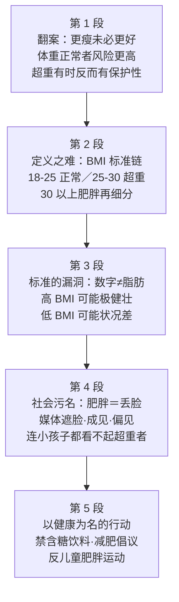

# Passage 04 · 更瘦未必更好

## 答题记录

| 轮次  | 日期         | 题号  | 正确  | 错误  | 正确率 | 用时    | 错题归因 |
| --- | --- | --- | --- | --- | --- | --- | --- |
| 1 |  | 1-20 |  |  |  |  |  |
| 2 |  | 1-20 |  |  |  |  |  |
| 3 |  | 1-20 |  |  |  |  |  |

> [!tip] 填写口径
> - **用时**以分钟计，只计做题时间，不含精读复盘。
> - **错题归因**填「题型·错误类型」，如：动词辨析·搭配不熟、逻辑关系·句间关系读反、形容词辨析·主旨代入缺失、名词辨析·总分对照漏看。
> - 纵向看趋势：正确率升而用时过长 → 熟练度不足；用时降而正确率波动 → 定位不稳。
> - 本篇 **20 空**，题号栏填 1-20；题型分布：动词辨析 ×6（1/7/12/15/16/18）、名词辨析 ×6（4/5/11/14/19）、逻辑关系题 ×4（3/8/10/17）、形容词辨析 ×3（2/9/13）、介词（短语）辨析 ×2（6/20）；答案链 **B A C A D｜A C C D B｜A B C D B D｜A D C B**。错因建议重点标「逻辑关系·句间关系读反」（3/10/17 三题都是上下文方向题）与「名词辨析·总分对照漏看」（14/19 都要靠后文 banned／instituted／launched 三个动词归纳）。

> [!info] 文章档案
> - **来源**：考研英语（二）2014 年完形填空（书中标注类别：社会生活类）
> - **题材**：由「更瘦未必更健康」的研究结论引出肥胖定义之难（BMI 标准的漏洞），再转入社会对肥胖的污名（媒体遮脸、刻板成见、连儿童都歧视）与以健康为名的反肥胖政策
> - **结构**：5 段 / 26 句 / 20 个挖空
> - **难度**：★★★☆☆
> - **一句话主旨**：更瘦并不总是更好——不少研究发现体重正常者某些疾病风险反而更高；肥胖本身极难定义（BMI 标准分不清肌肉与脂肪）；而社会却普遍把肥胖污名化（媒体遮脸、刻板成见、成人到儿童的偏见），并基于健康考量催生了禁含糖饮料、减肥倡议、反儿童肥胖运动等一系列反肥胖政策。

## 一、篇章脉络

- **第 1 段**：**翻案立论——更瘦未必更好**。①句一句话立论；②句给证据（多项研究表明体重正常者患某些疾病风险更高）；③句反向补证（超重对某些健康问题反而有保护性）；④⑤句两个例子（胖女性不易缺钙、老年人略超重是健康的标志）。本段考 4 空：concluded（1）、protective（2）、Likewise（3）、indicator（4）。
- **第 2 段**：**推进一层——肥胖更麻烦的是定义难**。①句承上启下（Of even greater concern）；②—⑥句给出 BMI 标准链：BMI＝体重÷身高²，18–25 正常、25–30 超重、30 以上肥胖；⑦句顺承细分（中度／重度／极度肥胖）。本段考 4 空：concern（5）、in terms of（6）、equals（7）、in turn（8）。
- **第 3 段**：**戳破标准——数字标准看似简单直白，其实不然**。①句设转折（While ... seem straightforward, they are not）；②句给出判据真源（肥胖是体脂问题而非体重）；③句对比例证（高 BMI 可能极健壮 vs 低 BMI 可能状况差）；④⑤句双向例子（橄榄球运动员 BMI 高但体脂率低算不上真胖；矮小骨架者体脂高 BMI 却正常）。本段考 5 空：straightforward（9）、while（10）、shape（11）、qualify（12）、normal（13）。
- **第 4 段**：**由生理转向社会——肥胖的污名**。①句总起（我们倾向于把肥胖当作丢脸的事）；②—⑤句四路分述：媒体刊登超重者照片遮脸、与肥胖相伴的刻板成见（懒惰／缺乏意志力／成功前景差）、教师雇主健康专业人士的偏见、甚至小孩子都看不起超重者且体格嘲笑久已有之。本段考 4 空：tendency（14）、pictured（15）、associated（16）、Even（17）。
- **第 5 段**：**收束——以健康为名的反肥胖行动**。①句总起（基于健康考量的消极态度催生反肥胖政策）；②③句两个例子（医院禁含糖饮料、雇主推减肥健身倡议）；④句升级到国家层面（米歇尔·奥巴马发起高关注度反儿童肥胖运动，甚至称肥胖是国家安全的最大威胁）。本段考 3 空：grounded（18）、policies（19）、against（20）。

> [!tip] 行文逻辑
> 全篇是完形最爱考的**「翻案 → 定义 → 反例 → 污名 → 行动」五段递进**：第 1 段先颠覆「瘦＝健康」的常识（2、4 空的正向词全靠这一定调），第 2 段把话题从「胖瘦」移到「定义」（5 空 concern 是全篇枢纽——「更值得关注的是」），第 3 段用 while／Conversely 两组对比戳破数字标准（10 空是全篇最经典的对比逻辑），第 4、5 段由「身体」转入「态度与行动」。**主旨句是第 1 段①句 Thinner isn't always better**——第 2 空 protective、第 13 空 normal 都要靠这个反向定调才能选对。四道逻辑题方向各异：③并列（Likewise）、⑧顺承细分（in turn）、⑩对比（while）、⑰递进（Even），加上⑭⑲两道总分结构对照题（空在总述句、答案靠 banned／instituted／launched 三个分述动词归纳），构成本篇「逻辑＋概括」两大主干。**命题按段均匀分布**（4/4/5/4/3），无一段免考。

## 二、逐段精读

### 第 1 段 · 翻案立论：更瘦未必更好

**原文**

① Thinner isn't always better.
② A number of studies have concluded〔1〕 that normal-weight people are in fact at higher risk of some diseases compared to those who are overweight.
③ And there are health conditions for which being overweight is actually protective〔2〕.
④ For example, heavier women are less likely to develop calcium deficiency than thin women.
⑤ Likewise〔3〕, among the elderly, being somewhat overweight is often an indicator〔4〕 of good health.

**译文**

① 更瘦并不总是更好。
② 多项研究已得出结论：事实上，与超重的人相比，体重正常的人患某些疾病的风险更高。
③ 而且对某些健康问题来说，超重实际上反而具有保护性。
④ 例如，较胖的女性比纤瘦的女性更不容易缺钙。
⑤ 同样地，对老年人来说，略微超重往往是一种健康的标志。

> [!note] 段落要点
> - 功能：①句立翻案论点（ thinner≠better），②句给大证据（研究结论），③句反向补证（超重有时有保护性），④⑤句用 For example／Likewise 连给两个例子（女性缺钙、老年人）。
> - ②句的 concluded that 宾语从句是第 1 空考点；③句 actually 是「正向定调」的提示词——第 2 空 protective 全靠它与①句联动。
> - ④⑤句是并列举例关系：For example → Likewise，一例不够再来一例，第 3 空 likewise 考的就是这两句间的方向。

#### 长难句 · 本段第 ② 句

> [!abstract] 本段第 ② 句 · 原句
> A number of studies have concluded that normal-weight people are in fact at higher risk of some diseases compared to those who are overweight.

**结构拆解**

- **主干**：A number of studies（主）＋ have concluded（谓，现在完成时）＋ that 宾语从句。
- **宾语从句内**：normal-weight people（主）＋ are at higher risk of some diseases（系表）＋ compared to those who are overweight（过去分词短语作比较状语）。
- **嵌套定语从句**：those **who are overweight**，who 从句修饰 those。
- **插入强调**：in fact 插在主语与系动词之间，强化「事实与常识相反」。

**参考译文**

多项研究已得出结论：事实上，与超重的人相比，体重正常的人患某些疾病的风险更高。

> [!tip] 拆解要点
> 这句是**全篇第一个数据型论据，也是第 1 空的考点句**。三个要点：其一，**have concluded 的时态与语义共同锁定答案**——「研究＋完成时＋ that 从句」是「得出结论」的固定框架，denied（否认）方向相反、doubled（加倍）搭配不通、ensured（确保）语义过强（研究只能「得出」结论，不能「确保」事实），四选一里只有 concluded 与「研究 → 结论」的动宾逻辑严丝合缝；其二，**compared to those who are overweight 是「对照组」标记**，读清「谁和谁比」（正常体重者 vs 超重者）才能明白②句其实是把常识颠倒了；其三，**in fact 是「翻案信号灯」**——完形议论文里 in fact／actually 出现处往往正是空格前后文走向反转的位置，第 2 空 protective 的「正向定调」由此而来。

#### 本段重点词汇

| 单词 | 词性 | 文中意 | 拓展 | 文中用法 |
| --- | --- | --- | --- | --- |
| **thinner** | adj. | 更瘦的（thin 的比较级） | thin adj. 瘦的、薄的；slim／slender 近义；lean（精瘦） | Thinner isn't always better（更瘦并不总是更好） |
| **concluded** | v. | 得出结论，推断出 | conclude v. 结束、断定；conclusion n. 结论；draw a conclusion 得出结论（第 1 空答案） | A number of studies have concluded that...（多项研究已得出结论） |
| **normal-weight** | adj. | 体重正常的 | 复合形容词＝名词＋名词；normal adj. 正常的；weight n. 体重 | normal-weight people（体重正常的人） |
| **at higher risk of** | 短语 | 有更高的……风险 | risk n. 风险；at risk 处于危险中；risk factor 危险因素 | at higher risk of some diseases（患某些疾病的风险更高） |
| **overweight** | adj. | 超重的 | over- 前缀「过度」；obese adj. 肥胖的（程度更重）；underweight 偏瘦的 | compared to those who are overweight（与超重者相比） |
| **protective** | adj. | 有保护性的（第 2 空答案） | protect v. 保护；protection n. 保护；protective against 对……有保护作用 | being overweight is actually protective（超重实际上反而有保护性） |
| **calcium deficiency** | 短语 | 缺钙 | calcium n. 钙；deficiency n. 缺乏、不足（deficient adj.）；iron deficiency 缺铁 | less likely to develop calcium deficiency（更不容易缺钙） |
| **likewise** | adv. | 同样地（第 3 空答案） | like＋-wise 构词（如 otherwise）；表并列举例的衔接词 | Likewise, among the elderly...（同样地，对老年人来说……） |
| **somewhat** | adv. | 稍微，略微 | some＋what；somewhat of a 有点……的意味；程度弱于 rather | being somewhat overweight（略微超重） |
| **indicator** | n. | 标志，指标（第 4 空答案） | indicate v. 表明；indication n. 指示；economic indicators 经济指标 | an indicator of good health（健康的标志） |

### 第 2 段 · 定义之难：BMI 标准链

**原文**

① Of even greater concern〔5〕 is the fact that obesity turns out to be very difficult to define.
② It is often defined in terms of〔6〕 body mass index, or BMI.
③ BMI equals〔7〕 body mass divided by the square of height.
④ An adult with a BMI of 18 to 25 is often considered to be normal weight.
⑤ Between 25 and 30 is overweight.
⑥ And over 30 is considered obese.
⑦ Obesity, in turn〔8〕, can be divided into moderately obese, severely obese, and very severely obese.

**译文**

① 更值得关注的是，肥胖事实上极难定义。
② 它通常依据身体质量指数（即 BMI）来定义。
③ BMI 等于体重除以身高的平方。
④ BMI 在 18 到 25 之间的成年人通常被视为体重正常。
⑤ 25 到 30 之间为超重。
⑥ 30 以上则被视为肥胖。
⑦ 肥胖本身又可相应地细分为中度肥胖、重度肥胖和极度肥胖。

> [!note] 段落要点
> - 功能：①句承上启下（Of even greater concern 把话题从「胖瘦与健康」推进到「如何定义肥胖」）；②—⑥句给出 BMI 标准链（定义依据 → 计算公式 → 三段区间）；⑦句顺承细分肥胖等级。
> - ①句是倒装句（表语 Of even greater concern 提前），第 5 空 concern 靠「下文花整整四句讲定义」反推。
> - ⑦句是第 8 空考点：上文「正常／超重／肥胖」是第一层划分，本句「中度／重度／极度」是第二层划分——顺承关系用 in turn。

#### 长难句 · 本段第 ① 句

> [!abstract] 本段第 ① 句 · 原句
> Of even greater concern is the fact that obesity turns out to be very difficult to define.

**结构拆解**

- **倒装**：表语 Of even greater concern 提到句首，系动词 is 提前——「Of ＋ 抽象名词」结构作表语前置是英语议论文承上启下的经典句式（正常语序：The fact that... is of even greater concern）。
- **主干**：the fact（主语核心）＋ is（系）＋ Of even greater concern（表语）。
- **that 同位语从句**：that obesity turns out to be very difficult to define，说明 fact 的内容。
- **turn out to be**：证明是，结果是；比 be 多一层「最终发现」的转折意味。

**参考译文**

更值得关注的是，肥胖事实上极难定义。

> [!tip] 拆解要点
> 这句是**全篇的枢纽句：它把文章从「胖瘦与健康」拉到「定义肥胖」，后文三段全部挂在这句上**。三个要点：其一，**「Of even greater ＋ 名词 ＋ is the fact that...」倒装框架里，greater 是比较级**——与什么比？与第 1 段「胖瘦影响健康」的事比；既然是「更」值得关注，空格里的名词必须是「值得花笔墨去谈的东西」，impact（影响）／relevance（相关）／assistance（帮助）都撑不起后文整整一段的定义讲解，只有 concern（关注）成立；其二，**turn out to be 含「结果发现」的意外感**，呼应第 3 段 While ... seem ..., they are not 的反转伏笔；其三，**difficult to define 是不定式的主动形式表被动含义**（difficult ＋ to do，逻辑宾语是主语 obesity），同类结构 easy to read／hard to please。**完形遇到倒装的承上启下句，先看比较级方向，再让下文内容替你选词**。

#### 本段重点词汇

| 单词 | 词性 | 文中意 | 拓展 | 文中用法 |
| --- | --- | --- | --- | --- |
| **concern** | n. | 关注，关心（第 5 空答案） | concerning prep. 关于；be of great concern 十分重要／值得关注 | Of even greater concern is the fact that...（更值得关注的是……） |
| **obesity** | n. | 肥胖（症） | obese adj. 肥胖的；obesity rate 肥胖率；程度重于 overweight | obesity turns out to be very difficult to define（肥胖极难定义） |
| **turn out** | 短语 | 证明是，结果是 | turn out (to be)＋ adj./n.；it turns out that... 句型 | obesity turns out to be very difficult to define（肥胖结果证明极难定义） |
| **define** | v. | 定义 | definition n. 定义；definite adj. 明确的；define... as 把……定义为 | very difficult to define（极难定义） |
| **in terms of** | 短语 | 依据，按照（第 6 空答案） | in 术语组合介词；同义 on the basis of；比较 in case of 万一／in favor of 赞同 | It is often defined in terms of body mass index（常依据 BMI 来定义） |
| **body mass index** | 短语 | 身体质量指数（BMI） | mass n. 质量；index n. 指数（复数 indices／indexes） | defined in terms of body mass index（依据 BMI 定义） |
| **equal** | v. | 等于（第 7 空答案） | equal adj. 相等的；equality n. 平等；A equals B＝A is equal to B | BMI equals body mass divided by the square of height（BMI＝体重÷身高²） |
| **divided by** | 短语 | 除以 | divide v. 除、分开；division n. 除法、划分；乘除口诀表达 | body mass divided by the square of height（体重除以身高的平方） |
| **square** | n. | 平方 | square n. 正方形、广场；v. 求平方；cube n. 立方 | the square of height（身高的平方） |
| **moderately** | adv. | 中等地 | moderate adj. 温和的、适度的；moderation n. 适度 | moderately obese（中度肥胖） |
| **in turn** | 短语 | 相应地，依次（第 8 空答案） | turn n. 轮流；in turn 表顺承承接；另义「反过来」 | Obesity, in turn, can be divided into...（肥胖又可相应细分为……） |

### 第 3 段 · 标准的漏洞：数字不等于脂肪

**原文**

① While such numerical standards seem straightforward〔9〕, they are not.
② Obesity is probably less a matter of weight than body fat.
③ Some people with a high BMI are in fact extremely fit, while〔10〕 others with a low BMI may be in poor shape〔11〕.
④ For example, many collegiate and professional football players qualify〔12〕 as obese, though their percentage body fat is low.
⑤ Conversely, someone with a small frame may have high body fat but a normal〔13〕 BMI.

**译文**

① 虽然这些数字标准看起来简单直白，其实不然。
② 肥胖与其说是体重问题，不如说是体脂问题。
③ 有些 BMI 很高的人实际上极其健壮，然而有些 BMI 很低的人身体状况却可能不佳。
④ 例如，许多大学及职业橄榄球运动员按 BMI 算得上肥胖，尽管他们的体脂率很低。
⑤ 相反，骨架小的人可能体脂很高，BMI 却正常。

> [!note] 段落要点
> - 功能：①句转折立论（数字标准看似简单其实不然）；②句给出判据真源（体脂＞体重）；③句一组 while 对比（高 BMI 健壮 vs 低 BMI 不佳）；④⑤句 For example／Conversely 双向例证（运动员 BMI 高体脂低、矮小者体脂高 BMI 正常）。
> - ③句 while 是第 10 空考点：fit 与 in poor shape 构成语义对立，前后分句方向相反。
> - ④⑤句是「反例对」：④句证明「BMI 高≠真胖」，⑤句证明「体脂高≠BMI 高」——两句合起来坐实①句「标准不可靠」。
> - 本段也是全篇主旨的反向注脚：第 2 空 protective、第 13 空 normal 的「正向定调」在此被充分展开。

#### 长难句 · 本段第 ③ 句

> [!abstract] 本段第 ③ 句 · 原句
> Some people with a high BMI are in fact extremely fit, while others with a low BMI may be in poor shape.

**结构拆解**

- **主干对举**：Some people ... are extremely fit（分句 1）＋ while ＋ others ... may be in poor shape（分句 2）——some ... while others ... 是英语「对比」最经典的双分句框架。
- **with 介词短语作后置定语**：with a high BMI／with a low BMI，分别修饰两边的 people／others。
- **语义呼应**：extremely fit（极其健壮）↔ in poor shape（身体状况不佳），一对反义短语撑起整句的对比骨架。
- **情态缓和**：may be 表不确定，与前句的 in fact（确定语气）形成微妙的让步。

**参考译文**

有些 BMI 很高的人实际上极其健壮，然而有些 BMI 很低的人身体状况却可能不佳。

> [!tip] 拆解要点
> 这句是**全篇逻辑含金量最高的一句，第 10、11 两空都在这里**。三个要点：其一，**while 表对比时别读成「当……时」**——前后分句主语对举（some vs others）、谓语方向相反（fit vs in poor shape），是典型的「然而」；第 10 空 so（因果）／since（时间或原因）／unless（条件）全把方向读错，只有 while 保住对比。其二，**in poor shape 与 fit 构成「对应反义」**，第 11 空四个选项里只有 shape（状况）能和 fit（健康的）挂上同一个维度——spirit（精神）、balance（平衡）、taste（味道）都不是「身体状况」的量尺。其三，**in fact 又一次出现**——它与第 1 段②句的 in fact 遥相呼应，都是「事实 vs 标准」的信号词，本篇作者反复用「事实说话」戳数字标准。**对比逻辑题先找「成对的反义元素」，再看连接词方向，顺序不能反**。

#### 本段重点词汇

| 单词 | 词性 | 文中意 | 拓展 | 文中用法 |
| --- | --- | --- | --- | --- |
| **numerical standards** | 短语 | 数字标准 | numerical adj. 数字的（number n.）；standard n. 标准；criteria 近义 | While such numerical standards seem...（虽然这些数字标准看起来……） |
| **straightforward** | adj. | 简单明了的，直截了当的（第 9 空答案） | straight＋forward 复合构词；同义 simple、clear-cut；反义 complicated | seem straightforward（看起来简单直白） |
| **body fat** | 短语 | 体脂 | fat n. 脂肪；body fat rate 体脂率 | less a matter of weight than body fat（与其说是体重不如说是体脂） |
| **extremely** | adv. | 极其，非常 | extreme adj. 极端的；extremity n. 极端 | extremely fit（极其健壮） |
| **fit** | adj. | 健康的，健壮的 | keep fit 保持健康；fitness n. 健康、健身；fit v. 合身 | are in fact extremely fit（实际上极其健壮） |
| **while** | conj. | 然而，对比（第 10 空答案） | while 三义：当……时／然而／尽管；本句表对比 | extremely fit, while others... may be in poor shape（……健壮，然而另一些……不佳） |
| **in poor shape** | 短语 | 身体状况不佳（第 11 空答案） | shape n. 状况、形状；in good shape 状态好；out of shape 走形／状态差 | others with a low BMI may be in poor shape（BMI 低的人身体状况可能不佳） |
| **collegiate** | adj. | 大学的，学院的 | college n. 学院；collegiate and professional（大学及职业的）；intercollegiate 校际的 | many collegiate and professional football players（许多大学及职业橄榄球运动员） |
| **qualify as** | 短语 | 算得上，有资格成为（第 12 空答案） | qualify v. 取得资格；qualified adj. 有资格的；qualification n. 资格 | players qualify as obese（运动员算得上肥胖） |
| **percentage body fat** | 短语 | 体脂率 | percentage n. 百分比；percent n. 百分之……；体脂占比 | their percentage body fat is low（他们的体脂率很低） |
| **conversely** | adv. | 相反地 | converse adj. 相反的（con ＋ verse）；同义 on the contrary | Conversely, someone with a small frame...（相反，骨架小的人……） |
| **frame** | n. | 体格，骨架 | frame n. 框架、身型；a small frame 小骨架；frame v. 构筑、陷害 | someone with a small frame（骨架小的人） |
| **normal** | adj. | 正常的（第 13 空答案） | normal adj. 正常的（norm n. 常态）；normalize v. 正常化 | high body fat but a normal BMI（体脂高但 BMI 正常） |

### 第 4 段 · 社会污名：肥胖＝丢脸

**原文**

① Today we have a(n) tendency〔14〕 to label obesity as a disgrace.
② The overweight are sometimes pictured〔15〕 in the media with their faces covered.
③ Stereotypes associated〔16〕 with obesity include laziness, lack of will power, and lower prospects for success.
④ Teachers, employers, and health professionals have been shown to harbor biases against the obese.
⑤ Even〔17〕 very young children tend to look down on the overweight, and teasing about body build has long been a problem in schools.

**译文**

① 如今，我们倾向于把肥胖当作一件不光彩的事。
② 媒体有时在刊登超重者的照片时会遮住其脸部。
③ 与肥胖相伴的固有成见包括懒惰、缺乏意志力和成功前景较差。
④ 教师、雇主和健康专业人士已被证明对肥胖者怀有偏见。
⑤ 甚至连年幼的孩子也看不起超重者，而对体格的嘲笑长期以来一直是学校里的问题。

> [!note] 段落要点
> - 功能：①句总起（把肥胖污名化的倾向）；②—⑤句四路分述：媒体（遮脸）→ 成见内容（懒惰／意志力差／前景差）→ 职业人群的偏见（教师／雇主／健康专业人士）→ 儿童（甚至小孩子也看不起，且体格嘲笑是学校老问题）。
> - ①句的 tendency 是第 14 空答案：空在总述句，答案必须能概括后文「展现偏见」的全部行为——只有「倾向」能统摄。
> - ④⑤句间是递进关系：成人（教师雇主专业人士）都已有偏见，**甚至**（Even）小孩子也如此——第 17 空考递进方向。
> - ③句 associated with 是第 16 空考点：stereotypes 与 obesity 是「与……相关」的关系，不是比较／结合／和解。

#### 长难句 · 本段第 ⑤ 句

> [!abstract] 本段第 ⑤ 句 · 原句
> Even very young children tend to look down on the overweight, and teasing about body build has long been a problem in schools.

**结构拆解**

- **并列句**：and 连接两个分句；分句 1 谈「看不起」的态度，分句 2 谈「嘲笑」的行为——态度与行为配套。
- **Even 强调**：Even 置于 very young children 之前，聚焦强调——连「最不该有偏见的人群」都有了偏见。
- **the ＋ 形容词表类指**：the overweight＝肥胖者这一类人（同类：the rich／the elderly）。
- **完成时表延续**：has long been——「长期以来一直是」，说明问题之久远。

**参考译文**

甚至连年幼的孩子也看不起超重者，而对体格的嘲笑长期以来一直是学校里的问题。

> [!tip] 拆解要点
> 这句是**第 17 空的考点句，也是本段「污名 распространя到全人群」的收束**。三个要点：其一，**Even 的位置决定它的逻辑功能**——置于主语 very young children 前，强调「这批人居然也……」；上一句刚说完教师、雇主、健康专业人士（本该更有素养的人群）有偏见，本句推到「连小孩子都……」，方向只能是递进而非转折（Still／Yet）或范围（Only），第 17 空 thus 只有 Even 能把两句话焊成「程度加深」；其二，**the overweight 是「the ＋ 形容词」类指结构**，与第 1 段 those who are overweight 同指，完形里这类名词化表达常是定位锚点；其三，**has long been 的完成时**与①句 Today 形成时间张力——如今有此倾向，问题却由来已久，作者在说「这不是新闻，是顽疾」。**逻辑题选项代入前，先问「前后两组人群／两件事是什么关系」：同类加深选 Even，反向拉扯选 Still／Yet，圈范围选 Only**。

#### 本段重点词汇

| 单词 | 词性 | 文中意 | 拓展 | 文中用法 |
| --- | --- | --- | --- | --- |
| **tendency** | n. | 倾向，趋向（第 14 空答案） | tend v. 倾向；tend to do 往往会；have a tendency to 有……的倾向 | we have a(n) tendency to label obesity as a disgrace（我们倾向于把肥胖当作不光彩的事） |
| **label ... as ...** | 短语 | 把……称为／归为 | label v. 贴标签；label sb as 把某人归为；同义 brand ... as | label obesity as a disgrace（把肥胖视为丢脸的事） |
| **disgrace** | n. | 不光彩，丢脸 | disgrace n.／v. 耻辱；disgraceful adj. 可耻的；shame 近义 | label obesity as a disgrace（把肥胖视为丢脸的事） |
| **picture** | v. | 刊登照片，展现（第 15 空答案） | picture n. 照片 v. 想象、刊登……的照片；depict 近义 | The overweight are sometimes pictured in the media（媒体有时刊登超重者照片） |
| **media** | n. | 媒体 | medium 的复数；mass media 大众媒体；media coverage 媒体报道 | pictured in the media（在媒体上刊登照片） |
| **stereotype** | n. | 固有成见，刻板印象 | stereotype n.／v.；stereotyped adj. 僵化的；性别／种族刻板印象同词 | Stereotypes associated with obesity（与肥胖相关的固有成见） |
| **associate ... with ...** | 短语 | 与……相关联（第 16 空答案） | associate v. 联系、交往；association n. 联想、协会；be associated with 与……相关 | Stereotypes associated with obesity（与肥胖相伴的成见） |
| **prospect** | n. | 前景，前途 | prospect n. 前景、展望；prospective adj. 未来的；career prospects 职业前景 | lower prospects for success（成功前景较差） |
| **harbor** | v. | 心怀，怀有（恶意、偏见等） | 熟词僻义：常见义「港口」；harbor doubts／grudges 怀疑／怀恨 | harbor biases against the obese（对肥胖者怀有偏见） |
| **bias** | n. | 偏见 | bias n.／v. 偏见、使偏向；biased adj. 有偏见的；racial bias 种族偏见 | harbor biases against the obese（对肥胖者怀有偏见） |
| **look down on** | 短语 | 看不起，轻视 | 反义 look up to 尊敬；despise 近义 | children tend to look down on the overweight（孩子也看不起超重者） |
| **teasing** | n. | 嘲笑，戏弄 | tease v. 取笑；tease out 梳理出；make fun of 近义 | teasing about body build（对体格的嘲笑） |
| **body build** | 短语 | 体格 | build n. 体格、体型（熟词僻义：非「建造」）；a heavy build 壮实体格 | teasing about body build（对体格的嘲笑） |
| **even** | adv. | 甚至（第 17 空答案） | even adv. 强调递进；even if／even though 即使；表递进的常用词 | Even very young children tend to look down on...（甚至连小孩子也看不起……） |

### 第 5 段 · 以健康为名的反肥胖行动

**原文**

① Negative attitudes toward obesity, grounded〔18〕 in health concerns, have stimulated a number of anti-obesity policies〔19〕.
② My own hospital system has banned sugary drinks from its facilities.
③ Many employers have instituted weight loss and fitness initiatives.
④ Michelle Obama has launched a high-visibility campaign against〔20〕 childhood obesity, even claiming that it represents our greatest national security threat.

**译文**

① 以健康考量为基础的对肥胖的消极态度，已经催生了许多反肥胖政策。
② 我所在的医院体系已禁止在其场所内提供含糖饮料。
③ 许多雇主已推行减肥与健身倡议。
④ 米歇尔·奥巴马发起了一场高关注度的运动来反对儿童肥胖，甚至宣称肥胖代表着我们国家安全的最大威胁。

> [!note] 段落要点
> - 功能：①句总起（基于健康考量的消极态度 → 反肥胖政策）；②③句两个机构例子（医院禁含糖饮料、雇主推减肥健身倡议）；④句升到国家人物（米歇尔·奥巴马反儿童肥胖运动）。
> - ①句是第 18、19 双空考点句：grounded in health concerns 说明态度的「依据」，policies 概括下文全部行动——两空一「因」一「果」。
> - ②③④句的 banned／instituted／launched 是第 19 空的「分述动词」：三个动作的共同属性＝政策（policies），这正是总分对照法的样本。
> - ④句 even claiming that it represents our greatest national security threat 为 against（反对）提供最重的语意砝码。

#### 长难句 · 本段第 ① 句

> [!abstract] 本段第 ① 句 · 原句
> Negative attitudes toward obesity, grounded in health concerns, have stimulated a number of anti-obesity policies.

**结构拆解**

- **主干**：Negative attitudes（主）＋ have stimulated（谓，现在完成时）＋ a number of anti-obesity policies（宾）。
- **插入语**：grounded in health concerns——过去分词短语作非限制性定语（＝ which are grounded in...），插入主谓之间，说明态度的依据。
- **ground in**：「以……为基础／根据」，ground 作动词是熟词僻义（名词「地面」→动词「奠基」）。
- **复合词宾语**：anti-obesity policies，anti- 前缀「反」＋ obesity，修饰 policies。

**参考译文**

以健康考量为基础的对肥胖的消极态度，已经催生了许多反肥胖政策。

> [!tip] 拆解要点
> 这句是**第 18、19 两空的共用考点句，也是「总—分」结构的总述句**。三个要点：其一，**grounded in health concerns 是插入的「依据链」**——态度不是凭空的，是「基于健康考量」的，第 18 空四个选项里只有 grounded（以某事物为根据）能承接 in health concerns：despised（藐视）、corrected（改正）、ignored（不理睬）都接不进 in 表依据的框架；其二，**stimulated a number of anti-obesity policies 的宾语是空 19**——policies（政策）能否成立，不看本句而看下文：banned（禁）、instituted（推行）、launched（发起）三个动词的宾语全是机构或人物层面的「举措」，能概括它们的上位词只有 policies；其三，**现在完成时 have stimulated 贯穿本段**——②③④句的 has banned／have instituted／has launched 与主句时态严格平行，完形里「时态一致」常是验证答案的暗尺。**总分对照题的标准动作：先看空格句是不是总述句（有无冒号、列举、下文多个例子），再让分述内容投票选词**。

#### 本段重点词汇

| 单词 | 词性 | 文中意 | 拓展 | 文中用法 |
| --- | --- | --- | --- | --- |
| **ground** | v. | 以……为根据（第 18 空答案） | 熟词僻义：名词「地面」→动词「奠基、基于」；be grounded in 基于……；well-grounded 有根据的 | attitudes, grounded in health concerns（以健康考量为基础的态度） |
| **stimulate** | v. | 促使，催生 | stimulate v. 刺激、激励；stimulus n. 刺激（物）；stimulant n. 兴奋剂 | have stimulated a number of anti-obesity policies（催生了许多反肥胖政策） |
| **anti-obesity** | adj. | 反肥胖的 | anti- 前缀「反对」（如 anti-war）；obesity n. 肥胖；合成形容词 | a number of anti-obesity policies（许多反肥胖政策） |
| **policy** | n. | 政策（第 19 空答案） | policy n. 政策、方针（复数 policies）；policymaker n. 决策者；insurance policy 保险单 | anti-obesity policies（反肥胖政策） |
| **ban** | v. | 禁止 | ban v.／n. 禁止（banned／banning）；ban ... from ... 禁止……做；prohibit 近义 | has banned sugary drinks from its facilities（禁止在其场所内提供含糖饮料） |
| **sugary drinks** | 短语 | 含糖饮料 | sugary adj. 含糖的（sugar n. 糖）；soft drinks 软饮料 | has banned sugary drinks（禁止含糖饮料） |
| **facility** | n. | 设施，场所 | facility n. 设施（复数 facilities 常指场馆）；facilitate v. 促进 | banned sugary drinks from its facilities（禁止在其场所内提供） |
| **institute** | v. | 制定，推行 | 熟词僻义：名词「学院」→动词「制定、实行」；institution n. 制度、机构 | have instituted weight loss and fitness initiatives（推行减肥与健身倡议） |
| **initiative** | n. | 倡议，举措 | initiative n. 倡议、主动权；take the initiative 采取主动；initiate v. 发起 | weight loss and fitness initiatives（减肥与健身倡议） |
| **launch** | v. | 发起，启动 | launch v. 发射、发起；launch a campaign 发起运动；launch pad 发射台 | has launched a high-visibility campaign（发起了一场高关注度运动） |
| **high-visibility** | adj. | 高关注度的 | visibility n. 可见度（visible adj. 可见的）；high-profile 近义 | a high-visibility campaign（一场高关注度的运动） |
| **campaign** | n. | 运动，宣传活动 | campaign n. 运动、战役；campaign against 反……运动；election campaign 竞选活动 | a high-visibility campaign against childhood obesity（高关注度的反儿童肥胖运动） |
| **against** | prep. | 反对（第 20 空答案） | against prep. 反对、靠着、对比；be against 反对；反义 for 支持 | a campaign against childhood obesity（反对儿童肥胖的运动） |
| **national security** | 短语 | 国家安全 | security n. 安全（secure adj.）；national security threat 国家安全威胁 | our greatest national security threat（我们国家安全的最大威胁） |

## 三、全篇重点词汇汇总（自测用）

> [!info] 说明
> 本表只列「单词 / 词性 / 所在段」，不含释义与搭配，用于遮表自测：说出词义后再回该段核对。
> 收录**全篇所有段落词汇，共 62 条，不删减**，与各段「本段重点词汇」等长同源（跨段复现的词只在其首次出现的段落收录一次，如 obesity 只在第 2 段收录、overweight 只在第 1 段收录）。

| 单词 / 短语 | 词性 | 所在段 |
| --- | --- | --- |
| **thinner** | adj. | 第 1 段 |
| **concluded** | v. | 第 1 段 |
| **normal-weight** | adj. | 第 1 段 |
| **at higher risk of** | 短语 | 第 1 段 |
| **overweight** | adj. | 第 1 段 |
| **protective** | adj. | 第 1 段 |
| **calcium deficiency** | 短语 | 第 1 段 |
| **likewise** | adv. | 第 1 段 |
| **somewhat** | adv. | 第 1 段 |
| **indicator** | n. | 第 1 段 |
| **concern** | n. | 第 2 段 |
| **obesity** | n. | 第 2 段 |
| **turn out** | 短语 | 第 2 段 |
| **define** | v. | 第 2 段 |
| **in terms of** | 短语 | 第 2 段 |
| **body mass index** | 短语 | 第 2 段 |
| **equal** | v. | 第 2 段 |
| **divided by** | 短语 | 第 2 段 |
| **square** | n. | 第 2 段 |
| **moderately** | adv. | 第 2 段 |
| **in turn** | 短语 | 第 2 段 |
| **numerical standards** | 短语 | 第 3 段 |
| **straightforward** | adj. | 第 3 段 |
| **body fat** | 短语 | 第 3 段 |
| **extremely** | adv. | 第 3 段 |
| **fit** | adj. | 第 3 段 |
| **while** | conj. | 第 3 段 |
| **in poor shape** | 短语 | 第 3 段 |
| **collegiate** | adj. | 第 3 段 |
| **qualify as** | 短语 | 第 3 段 |
| **percentage body fat** | 短语 | 第 3 段 |
| **conversely** | adv. | 第 3 段 |
| **frame** | n. | 第 3 段 |
| **normal** | adj. | 第 3 段 |
| **tendency** | n. | 第 4 段 |
| **label ... as ...** | 短语 | 第 4 段 |
| **disgrace** | n. | 第 4 段 |
| **picture** | v. | 第 4 段 |
| **media** | n. | 第 4 段 |
| **stereotype** | n. | 第 4 段 |
| **associate ... with ...** | 短语 | 第 4 段 |
| **prospect** | n. | 第 4 段 |
| **harbor** | v. | 第 4 段 |
| **bias** | n. | 第 4 段 |
| **look down on** | 短语 | 第 4 段 |
| **teasing** | n. | 第 4 段 |
| **body build** | 短语 | 第 4 段 |
| **even** | adv. | 第 4 段 |
| **ground** | v. | 第 5 段 |
| **stimulate** | v. | 第 5 段 |
| **anti-obesity** | adj. | 第 5 段 |
| **policy** | n. | 第 5 段 |
| **ban** | v. | 第 5 段 |
| **sugary drinks** | 短语 | 第 5 段 |
| **facility** | n. | 第 5 段 |
| **institute** | v. | 第 5 段 |
| **initiative** | n. | 第 5 段 |
| **launch** | v. | 第 5 段 |
| **high-visibility** | adj. | 第 5 段 |
| **campaign** | n. | 第 5 段 |
| **against** | prep. | 第 5 段 |
| **national security** | 短语 | 第 5 段 |

## 四、知识点补充

> [!question] 背景知识
> - **BMI（body mass index，身体质量指数）**：19 世纪比利时统计学家凯特勒（Adolphe Quetelet）提出，故又称凯特勒指数，计算式为体重（kg）÷ 身高²（m²）——即第 2 段③句 BMI equals body mass divided by the square of height。WHO 标准：18.5–24.9 正常、25–29.9 超重、30 及以上肥胖，与文中区间一致。
> - **肥胖的 WHO 分级**：文章⑦句的「中度／重度／极度肥胖」对应 WHO 的 obese class I（30–34.9）／class II（35–39.9）／class III（≥40，又称 morbid obesity 病态肥胖）。分级依据仍是 BMI 数值区间，这正是第 3 段要戳的漏洞所在。
> - **BMI 的局限**：肌肉密度大于脂肪，运动员体重高而体脂率低（第 3 段④句的橄榄球运动员即典型——职业锋线球员 BMI 常超 30 但体脂率个位数）；反之，肌少性肥胖者（sarcopenic obesity）体重正常却体脂偏高。因此在医学上 BMI 只作初筛，金标准还包括体脂率、腰围、腰臀比等指标。
> - **米歇尔·奥巴马的反肥胖运动**：文中④句指 2010 年发起的「Let's Move!」运动，目标是消除儿童肥胖。「national security threat」的说法源自 2010 年一组退役将军的报告《Too Fat to Fight》（太胖而无法服役）——约四分之一的美国青年因超重不符参军体检标准，故儿童肥胖被上升为国家安全议题。
> - **肥胖污名（obesity stigma）**：第 4 段是「污名化」的社会学样本——媒体遮脸（视觉羞辱）、刻板成见（懒惰／意志力差）、机构性偏见（教师／雇主／医护）与同伴排斥（校园体格嘲笑）四个层次。研究显示医护人员的隐性偏见反而会降低肥胖者就医意愿，这是「健康专业人士 harbor biases」的现实讽刺。

> [!warning] 语法点
> - **while 的三义辨析**（第 10 空）：①当……时（时间）；②然而（对比，前后主语对举、谓语方向相反）；③尽管（让步，多放句首）。本篇③句是标准对比用法，判断口诀：**前后「方向相反」选对比，只让步不对比选让步**。
> - **过去分词插入语**（第 18 空）：grounded in health concerns 插在主谓之间，还原为 which are grounded in...；过去分词表被动，「依据」义固定搭配 be grounded in——despised／corrected／ignored 均无此框架。
> - **倒装句式 Of even greater concern is...**（第 5 空）：表语前置引倒装，正常语序 the fact ... is of even greater concern；同类句式 Of particular importance is...／Of equal significance is...，多用于承上启下。
> - **qualify as 与 as 搭配**（第 12 空）：qualify (as) 有资格成为、算得上；start／retire／stay 均不与 as 搭配表「算作」义，与 as 固定搭配的还有 serve as（充当）、regard ... as（视为）。
> - **total-detail 总分对照**（第 14／19 空）：空格在总述句时，答案必须「罩得住」全部分述内容——banned／instituted／launched 的共同上位词是 policies 而非 discussions／studies；「展现偏见」的整体行为倾向是 tendency 而非 option／reason。

## 五、题目分析

> [!info] 题目总览
> | 题号 | 题型 | 定位 | 答案 |
> | --- | --- | --- | --- |
> | 1 | 动词辨析 | 第 1 段②句 | B |
> | 2 | 形容词辨析 | 第 1 段③句 | A |
> | 3 | 逻辑关系题 | 第 1 段⑤句 | C |
> | 4 | 名词辨析 | 第 1 段⑤句 | A |
> | 5 | 名词辨析 | 第 2 段①句 | D |
> | 6 | 介词（短语）辨析 | 第 2 段②句 | A |
> | 7 | 动词辨析 | 第 2 段③句 | C |
> | 8 | 逻辑关系题 | 第 2 段⑦句 | C |
> | 9 | 形容词辨析 | 第 3 段①句 | D |
> | 10 | 逻辑关系题 | 第 3 段③句 | B |
> | 11 | 名词辨析 | 第 3 段③句 | A |
> | 12 | 动词辨析 | 第 3 段④句 | B |
> | 13 | 形容词辨析 | 第 3 段⑤句 | C |
> | 14 | 名词辨析 | 第 4 段①句 | D |
> | 15 | 动词辨析 | 第 4 段②句 | B |
> | 16 | 动词辨析 | 第 4 段③句 | D |
> | 17 | 逻辑关系题 | 第 4 段⑤句 | A |
> | 18 | 动词辨析 | 第 5 段①句 | D |
> | 19 | 名词辨析 | 第 5 段①句 | C |
> | 20 | 介词辨析 | 第 5 段④句 | B |

### 第 1 题 · 动词辨析（第 1 段②句）

> [!question] 原题
> A number of studies have ____ that normal-weight people are in fact at higher risk of some diseases compared to those who are overweight.
> - A. denied 否认
> - B. concluded 推断出，得出结论
> - C. doubled 加倍
> - D. ensured 确保

**正确答案**：**B. concluded（推断出，得出结论）**

**辨析**：主语是 A number of studies（多项研究），空后 that 从句是一条完整的研究发现（体重正常者某些疾病风险反而更高）。「研究 ＋ that 从句」的最自然动宾搭配是「得出结论」。书中解析：「根据上下文可知，空后面的部分实际上是研究得出的结论，[B] concluded（推断出，得出结论）符合语意，故为正确答案。[A] denied（否认）与文意不符；[C] doubled 怀疑，与文意不符；[D] ensured（确保）不合逻辑，因为研究不能确保后面的事实，只能得出结论，故均排除。」（注：[C] doubled 本义为「加倍」，书上解析此处误注作「怀疑」，当为官方解析流传笔误；无论取何义，doubled 均无法与 that 结论从句搭配。）另注意 ensured 的排除逻辑最有含金量：**研究只能「得出」结论，不能「确保」事实**——结论可错，事实不由研究担保。

### 第 2 题 · 形容词辨析（第 1 段③句）

> [!question] 原题
> And there are health conditions for which being overweight is actually ____.
> - A. protective 有保护性的
> - B. dangerous 危险的
> - C. sufficient 充足的
> - D. troublesome 麻烦的，棘手的

**正确答案**：**A. protective（有保护性的）**

**辨析**：本空是全篇「定调题」——①句 Thinner isn't always better 已经把全文立在「反向常识」上，②句又说正常体重者风险更高，则③句 being overweight is actually ___ 必然要填一个**正面词**才能接住这股「翻案」势头。书中解析：「由于 overweight 是本文讨论的主题，故结合本段首句 Thinner isn't always better 可知，空内应填入正向感情色彩的词汇，使本句语意符合文章主旨『超重是有好处的』。[A] protective（有保护性的）代入后符合文章语境，故为正确答案。[B] dangerous（危险的）、[C] sufficient（充足的）、[D] troublesome（麻烦的，棘手的）代入后不符合文章中心，故均排除。」可复制的动作：**完形第 1、2 题永远先读首句定调，首句若是翻案句，紧跟其后的空格优先考虑与常识相反的正面词**；actually 是这个方向判断的显性路标。

### 第 3 题 · 逻辑关系题（第 1 段⑤句）

> [!question] 原题
> ____, among the elderly, being somewhat overweight is often an indicator of good health.
> - A. Instead 代替；反而
> - B. However 然而
> - C. Likewise 同样地
> - D. Therefore 因此

**正确答案**：**C. Likewise（同样地）**

**辨析**：空格所在句「对老年人来说，略微超重往往是健康的标志」与前一句「较胖女性更不容易缺钙」**方向完全一致**——都是「超重／较胖反而有益」的例子，两句是并列递进的举例关系。书中解析：「前一句指出较重的女性与身材纤细的女性相比更不容易缺钙，本句与上文表达的意思一致，显然这里需要填入的是和前一句表示并列或递进等方向的逻辑关系词。[C] Likewise（同样地）表示并列关系，故为正确答案。[A] Instead（代替；反而）表示对比关系；[B] However（然而）表示转折关系；[D] Therefore（因此）表示因果关系，均不符合此处的逻辑关系，故均排除。」注意 For example（④句）→ Likewise（⑤句）的举例链：**一例不够再来一例时，用 Likewise／Similarly；换角度再举例才用 On the other hand 类对比词**。

### 第 4 题 · 名词辨析（第 1 段⑤句）

> [!question] 原题
> ...being somewhat overweight is often an ____ of good health.
> - A. indicator 标志；指标
> - B. objective 目标
> - C. origin 起源
> - D. example 例子；榜样

**正确答案**：**A. indicator（标志；指标）**

**辨析**：空格结构是 an ___ of good health（健康的___）。第 1 段已经确立「略微超重有利健康」的方向，本句要把「略超重」定性为健康的什么。书中解析：「前文已经明确指出超重在某些方面有利于身体健康，所以这里想表达的是略微超重常常是一种健康的标志或表现。[A] indicator（标志；指标）代入后符合文章语境，故为正确答案。[B] objective（目标）、[C] origin（起源）和 [D] example（例子；榜样）代入原文后均不符合上下文语义及逻辑关系，故均排除。」四个选项都能接 of，**判断点在「健康」与「略超重」的关系语义**：略超重是健康的外在「标志」（indicator），既不是健康「目标」（objective）、也不是健康「起源」（origin），更不是健康「榜样」（example）——an indicator of 是体检语境高频搭配（a marker／indicator of good health）。

### 第 5 题 · 名词辨析（第 2 段①句）

> [!question] 原题
> Of even greater ____ is the fact that obesity turns out to be very difficult to define.
> - A. impact 影响
> - B. relevance 相关
> - C. assistance 帮助
> - D. concern 关注

**正确答案**：**D. concern（关注）**

**辨析**：本句是倒装的承上启下句，greater 是比较级——与第 1 段的内容比，本段「更值得花笔墨」的是肥胖的定义问题（后文整整四句讲 BMI 定义链）。书中解析：「前文已经提到略微超重事实上有利健康，这句话指出人们又面临一个问题——到底该如何定义肥胖。因此人们需要更加关注对肥胖的定义，从而引出下文『如何定义』的内容。[D] concern（关注）符合文意，故为正确答案。根据上下文可知，本段描述的是如何定义肥胖的相关内容，[A] impact（影响）、[B] relevance（相关）和 [C] assistance（帮助）虽然可以与 greater 搭配，但无法与上下文构成合理的逻辑关系，故均排除。」本题是「下文投票」型：**greater impact／relevance／assistance 搭配上都通，但只有 concern 能解释「作者为什么要花一整段讲定义」——因为他觉得这事更值得关注**。

### 第 6 题 · 介词（短语）辨析（第 2 段②句）

> [!question] 原题
> It is often defined ____ body mass index, or BMI.
> - A. in terms of 依据，按照
> - B. in case of 万一
> - C. in favor of 赞同
> - D. in respects of 关于

**正确答案**：**A. in terms of（依据，按照）**

**辨析**：本句是被动句「它（肥胖）通常___身体质量指数来定义」，空格要交代「定义的依据」。书中解析：「空所在前一句指出肥胖很难被定义，结合文章语境可知，空处应该填入一个词，表明肥胖的定义和身体质量指数的关系，即，身体质量指数是定义肥胖的依据（医学研究和临床测试经常将 BMI 作为衡量受试者健康的重要指标）。[A] in terms of（依据）代入文中符合语境，故为正确答案。[B] in case of（万一）、[C] in favor of（赞同）和 [D] in respects of（关于）代入原文后均不符合文意，且语义逻辑不通，故均排除。」**in terms of 是「以……方式／依据……」的万能学术介词短语**，define ... in terms of ...（按……来定义）是论文高频搭配；其余三个短语各有固定场景（in case of 后接意外、in favor of 表支持、in respects of 少用且义为「在……方面」），均无法表「依据」。

### 第 7 题 · 动词辨析（第 2 段③句）

> [!question] 原题
> BMI ____ body mass divided by the square of height.
> - A. measures 测量
> - B. determines 决定
> - C. equals 等于，比得上
> - D. modifies 修改

**正确答案**：**C. equals（等于，比得上）**

**辨析**：空格句是「BMI ___ 体重÷身高²」——这正是 BMI 的计算公式用文字写出来。书中解析：「空所在句 BMI ___ body mass divided by the square of height（BMI ___ 身体质量除以身高的平方），即用文字叙述了 BMI 值得出的方法，也就是一个数学公式，[C] equals（等于，比得上）符合文意，故为正确答案。[A] measures（测量）、[B] determines（决定）和 [D] modifies（修改）代入原文后语义逻辑不通，无法体现专业术语与其计算方式之间的对等关系，故均排除。」三个干扰项的共同问题是**方向反了**：BMI 不是「去测量／决定／修改」体重和身高，而是「由它们算出来」——公式左右两边是恒等关系，只有 equals 表达「A 就是 B」的对等。**看到「术语 ＋ 数学式」的句子，先认出这是公式定义句，等义动词 equals／is／corresponds to 优先**。

### 第 8 题 · 逻辑关系题（第 2 段⑦句）

> [!question] 原题
> Obesity, ____, can be divided into moderately obese, severely obese, and very severely obese.
> - A. in essence 本质上
> - B. in contrast 相反
> - C. in turn 相应地；依次
> - D. in part 部分地

**正确答案**：**C. in turn（相应地；依次）**

**辨析**：上文刚完成第一层划分（18–25 正常、25–30 超重、30 以上肥胖），本句对「肥胖」做第二层细分（中度／重度／极度）——上下文是**顺承递进**关系。书中解析：「上文提到不同 BMI 值对应不同体质：体重正常、超重和肥胖。空所在句进一步说明肥胖可以细分为：中度肥胖、重度肥胖和极度肥胖，上下文间是顺承关系。……将四个选项代入原文中，[C] in turn（相应地；依次）最符合前后的逻辑关系，故为正确答案。文中并未提及肥胖的本质、与其他事物的对比以及部分情况，故 [A] in essence（本质上）、[B] in contrast（相反）和 [D] in part（部分地）这三项均排除。」**in turn 表「继而、相应地」承接上一层分类**；in essence 谈本质、in contrast 谈对立、in part 谈部分——本句既无对比对象、也无部分整体之辨，只剩顺承一条路。

### 第 9 题 · 形容词辨析（第 3 段①句）

> [!question] 原题
> While such numerical standards seem ____, they are not.
> - A. complicated 复杂的
> - B. conservative 保守的
> - C. variable 可变的
> - D. straightforward 简单的，直截了当的

**正确答案**：**D. straightforward（简单的，直截了当的）**

**辨析**：本句是「While＋让步，they are not＋反驳」的转折框架——空格填的必须是**第 2 段那套 BMI 数字标准给人的「表面印象」**，而 they are not 宣布这个印象靠不住。书中解析：「such numerical standards 指则上一段提到的衡量肥胖的 BMI 数值标准，……第二段提到，依据不同的 BMI 值区间，我们可以区分正常体重、超重及肥胖，而不同的 BMI 值区间对应不同的肥胖程度。可见这些数字标准看上去清晰直观并不复杂。因此，空格所填词应表示 BMI 这一数字标准在界定肥胖方面『直接、清楚』的特点，[D] straightforward（简单的）符合上一段对 BMI 值的看法，故为正确答案。[A] complicated（复杂的）代入原文后与文意相悖，故排除。一般不用保守来形容标准，并且文中没有体现保守这一观点，[B] conservative（保守的）不符合文意，故排除。上文未提及 BMI 值变化的相关信息，故 [C] variable（可变的）也不符合文意，故排除。」**seem ＋ X, they are not 的句式里，X 必须是「表象」而 they are not 才是「真相」**——complicated 与 they are not 连用会变成「看似复杂实则不复杂」，与作者要说的正好相反。

### 第 10 题 · 逻辑关系题（第 3 段③句）

> [!question] 原题
> Some people with a high BMI are in fact extremely fit, ____ others with a low BMI may be in poor shape.
> - A. so 所以
> - B. while 然而
> - C. since 自从；因为
> - D. unless 除非

**正确答案**：**B. while（然而）**

**辨析**：前半句「有些人 BMI 很高，实际上极其健壮」，后半句「有些人 BMI 很低，身体状况却可能不佳」——两句主语对举（some vs others）、谓语方向相反（fit vs in poor shape），是标准对比。书中解析：「从前半句我们可以看出，有些人的 BMI 值很高，应该属于肥胖的人，但实际上身体很健康，这里说明的是反常的现象，后半句指出有些人的 BMI 值很低，但 ___ 可能不佳，前后形成对比。四个选项中只有 [B] while（然而）表示对比关系，故为正确答案。[A] so（所以）表示结果；[C] since（自从；因为）表示时间或原因；[D] unless（除非）表条件，均不符合中文逻辑，故均排除。」**some ... while others ... 是对比逻辑的固定双框架**，见到这个骨架直接锁 while；so 表因果（前后无因果链）、since 表时间或原因、unless 表条件，三个方向都不成立。

### 第 11 题 · 名词辨析（第 3 段③句）

> [!question] 原题
> ...while others with a low BMI may be in poor ____.
> - A. shape 状况，情形
> - B. spirit 精神
> - C. balance 平衡
> - D. taste 味道

**正确答案**：**A. shape（状况，情形）**

**辨析**：本空考「对应反义」：前半句的 extremely fit（极其健壮）需要一个能与之构成「身体状况」维度对立的短语，in poor shape（身体状况不佳）正是 fit 的反义搭配。书中解析：「不难看出，前后句子的意思相反，fit（健康的）与 in poor ___ 是对应关系，与之最相关的是 [A] shape（状况，情形），in poor shape 指的是『身体状况不佳』，故 [A] 项为正确答案。[B] spirit（精神）、[C] balance（平衡）和 [D] taste（味道）代入原文后均不能与 fit（健康的）构成语义上的对应关系，故均排除。」in poor shape／in good shape／out of shape 是口语与体检语境通用搭配；**spirit（精神）是最大干扰——它也是抽象状态名词，但「身体状况」的对比维度由 fit 钉死，精神不在这个量尺上**。

### 第 12 题 · 动词辨析（第 3 段④句）

> [!question] 原题
> ...many collegiate and professional football players ____ as obese, though their percentage body fat is low.
> - A. start 开始
> - B. qualify 有资格；可算作
> - C. retire 退休
> - D. stay 保持

**正确答案**：**B. qualify（有资格；可算作）**

**辨析**：空格后接 as obese——「___ 为肥胖」。本句是 For example 引出的例证：这些运动员 BMI 高（按标准「算得上」肥胖）但体脂率低（实际不算胖）。书中解析：「只有 [B] qualify（有资格；可算作）可与 as 搭配表示『有资格成为；算得上』，代入文中表示许多足球运动员在 BMI 指数上『算得上』肥胖，故 [B] 项为正确答案。[A] start（开始）、[C] retire（退休）和 [D] stay（保持）均不常与 as 搭配，且无法与上文衔接，故均排除。」**qualify as ＋ 身份／类别是「够格算作」的固定搭配**（qualify as a doctor／qualify as an emergency）；though 让步从句（尽管体脂率低）也提示主句说的是「名义上算、实际上不算」——只有 qualify 传达这种「按标准够格」的微妙语义。

### 第 13 题 · 形容词辨析（第 3 段⑤句）

> [!question] 原题
> Conversely, someone with a small frame may have high body fat but a ____ BMI.
> - A. strange 奇怪的
> - B. changeable 多变的
> - C. normal 正常的
> - D. constant 不变的

**正确答案**：**C. normal（正常的）**

**辨析**：Conversely（相反地）表明本句与④句构成「反例对」：④句是「BMI 高、体脂低」，本句要给出镜像——「体脂高、BMI ___」。能和 high body fat 并存、又与 obese 相反的 BMI 状态只能是「正常」。书中解析：「空所在句以 Conversely（相反地）开头，表示与上文的转折关系，即有些矮小的人可能体脂率高，但 BMI ___。本句的 high body fat 对应空所在前一句的 body fat is low，因此修饰 BMI 的词应与上文的 obese（肥胖的）相反，故 [C] normal（正常的）为正确答案。同时可排除 [A] strange（奇怪的）。[B] changeable（多变的）和 [D] constant（不变的）均不能与 obese 形成对比，且空处探讨的不是 BMI 值是否不变的问题，故排除。」**反例句的答案要在「上一句的镜像位置」找：④句异常项（BMI 高）在本句对应位置应取其反义（BMI 正常）**。

### 第 14 题 · 名词辨析（第 4 段①句）

> [!question] 原题
> Today we have a(n) ____ to label obesity as a disgrace.
> - A. option 选择权
> - B. reason 原因
> - C. opportunity 机会
> - D. tendency 倾向，趋向

**正确答案**：**D. tendency（倾向，趋向）**

**辨析**：本句是第 4 段总述句，后面②—⑤句（媒体遮脸、成见、职业偏见、儿童歧视）全是「污名化」的具体表现——空格词必须能统摄这批行为。书中解析：「空所在句为总述句，需要看下面的分述句。后文的句子首先提到医院体系禁止在相关设施中提供含糖饮料，……由此可以看出，空处应该是表达了对肥胖问题的倾向，人们将肥胖视为一件不光彩的事，且由后文的 tend to 也可知，人们将肥胖视为一件不光彩的事是一种倾向，故 [D] tendency（倾向；趋向）符合，故为正确答案。[A] option（选择权）通常与 of 连用，[B] reason（原因）和 [C] opportunity（机会）可以与 to 连用，但代入后语义逻辑不通，故均排除。」**have a tendency to＝tend to（同词根验证）**：⑤句原文明写 children tend to look down on，与 tendency 呼应；option／reason／opportunity 三个「可以接 to」的名词都撑不起后文的群体性行为概括——**总分对照法：分述全是「集体行为」，总述就选「倾向」不选「个体选择／机会」**。

### 第 15 题 · 动词辨析（第 4 段②句）

> [!question] 原题
> The overweight are sometimes ____ in the media with their faces covered.
> - A. employed 雇佣
> - B. pictured 展示照片
> - C. imitated 模仿
> - D. monitored 监控

**正确答案**：**B. pictured（展示照片）**

**辨析**：本句讲媒体对超重者的呈现方式，句尾 with their faces covered（脸部被遮住）是关键线索——什么行为会伴随「遮脸」？只有「刊登照片」。书中解析：「上一句提到『我们倾向于把肥胖视为一件不光彩的事情』，下文均是对该论点的进一步论述。由此可知，此处表达的就应该是人们对肥胖的偏见，[B] pictured（展示照片）代入原文后意为『媒体在刊登超重者的照片时会遮住其脸部』，符合文意，故 [B] 项为正确答案。[A] employed（雇佣）、[C] imitated（模仿）和 [D] monitored（监控）代入原文后与文意不符，故均排除。」**with their faces covered 是「手段／伴随状语」，先问「什么动作需要遮脸」再选词**——employed／monitored 逻辑上也可能涉及人脸，但都不构成「遮脸」的动机； pictured（照片曝光才需要遮脸）语义闭环。

### 第 16 题 · 动词辨析（第 4 段③句）

> [!question] 原题
> Stereotypes ____ with obesity include laziness, lack of will power, and lower prospects for success.
> - A. compared (with) 与……相比较
> - B. combined (with) 与……结合
> - C. settled (with) 与……清算／和解
> - D. associated (with) 与……相关

**正确答案**：**D. associated（with，与……相关）**

**辨析**：空格结构是 Stereotypes ___ with obesity——「与肥胖___的固有成见」。成见与肥胖的关系是「围绕……产生的联想」。书中解析：「空前面提到的『懒惰、缺乏意志力和成功的可能性较小』都是与肥胖相关的表现，分析四个选项，只有 [D] associated（with，与……相关）符合句意，故为正确答案。[A] compared（with）表示『与……相比较』，而原文中并没有可比的事物；[B] combined（with）表示『与……结合』，表并列关系，但原文中不存在并列关系；[C] settled（with）表示『与……清算／和解』，代入原文后不符合文意，故均排除。」stereotypes associated with（与……相关的刻板印象）是社会学高频搭配；**四个动词短语全带 with，比的是「关系语义」：比较／结合／和解都装不下「成见」与「肥胖」之间的归属联想**。

### 第 17 题 · 逻辑关系题（第 4 段⑤句）

> [!question] 原题
> ____ very young children tend to look down on the overweight, and teasing about body build has long been a problem in schools.
> - A. Even 甚至
> - B. Still 但是
> - C. Yet 然而
> - D. Only 仅仅

**正确答案**：**A. Even（甚至）**

**辨析**：前一句已说教师、雇主、健康专业人士（成人、职业人群）对肥胖者有偏见，本句推到「连年幼的孩子也看不起超重者」——人群范围扩大、程度加深，是递进。书中解析：「空所在前一句提到『Teachers, employers, and health professionals have been shown to harbor biases against the obese（教师、雇主和健康专业人士已经表现出对肥胖者的偏见）』，这表明了成人对肥胖者的看法，后面进一步说到儿童对肥胖者的看法，前句是成人，后面是儿童，可见有递进关系，分析四个选项，只有 [A] Even（甚至）符合上下文逻辑关系，故为正确答案。[B] Still（但是）表示转折关系；[C] Yet（然而）表示转折关系；[D] Only（仅仅）表示范围，均不符合此处的逻辑关系，故均排除。」**判断递进的口诀：后一句的主语比前一句「更不该如此」（小孩 vs 专业人士）或「范围更广」，就选 Even**；Still／Yet 表转折需要前后方向相反，本句方向一致加深，Only 表限制与语境无关。

### 第 18 题 · 动词辨析（第 5 段①句）

> [!question] 原题
> Negative attitudes toward obesity, ____ in health concerns, have stimulated a number of anti-obesity policies.
> - A. despised 藐视
> - B. corrected 改正
> - C. ignored 不理睬
> - D. grounded 以某事物为根据

**正确答案**：**D. grounded（以某事物为根据）**

**辨析**：空格是插入分词短语 ___ in health concerns（___ 健康考量），说明「消极态度」的来源。书中解析：「显然该空所填动词要表达的意思是，反对肥胖是基于对健康的关注。分析四个选项，符合此语义只有 [D] grounded（以某事物为根据），故为正确答案。[A] despised（藐视）、[B] corrected（改正）和 [C] ignored（不理睬）代入后均与上下文语义不符，故均排除。」**be grounded in（扎根于／以……为据）是固定搭配**，ground 作动词是熟词僻义；despised／corrected／ignored 三个及物动词虽然都能接宾语，但「in ＋ 抽象名词」的框架只有 grounded in 成立——**分词插入语先看它带的介词，用介词反推动词**。

### 第 19 题 · 名词辨析（第 5 段①句）

> [!question] 原题
> Negative attitudes toward obesity, grounded in health concerns, have stimulated a number of anti-obesity ____.
> - A. discussions 讨论
> - B. businesses 生意
> - C. policies 政策
> - D. studies 研究

**正确答案**：**C. policies（政策）**

**辨析**：本空与第 14 题同法——总分结构对照。空格在后，分述在前文之后：②句医院 ban（禁止）含糖饮料、③句雇主 institute（推行）减肥健身倡议、④句米歇尔·奥巴马 launch（发起）反肥胖运动。书中解析：「空所在句为总述句，需要看下面的分述句。空后的句子首先提到医院体系禁止在相关设施中提供含糖饮料，其后又提到一些雇主推行相关的减肥和健身举措，这些都是具体的抗肥胖的行动。由此可以看出，空处应该是表达了对肥胖问题的应对，人们制定了一些应该的对策来应对肥胖问题，所填词应可以概括 banned、instituted 以及 launched 等动词所指的行为方式，[C] policies（政策）符合文意，故为正确答案。[A] discussions（讨论）、[B] businesses（生意）和 [D] studies（研究）均不符合要求，故排除。」**三个分述动词的宾语全是「机构层面的举措」，其上位词只有 policies**——discussions（只谈不做）、businesses（营利活动）、studies（纸面研究）都「罩不住」禁售与强制推行这类制度性行动。

### 第 20 题 · 介词辨析（第 5 段④句）

> [!question] 原题
> Michelle Obama has launched a high-visibility campaign ____ childhood obesity, even claiming that it represents our greatest national security threat.
> - A. for 支持
> - B. against 反对
> - C. with 和……一起
> - D. without 没有

**正确答案**：**B. against（反对）**

**辨析**：campaign ___ childhood obesity（___ 儿童肥胖的运动），方向由后半句钉死：even claiming that it represents our greatest national security threat（甚至宣称它是国家安全的最大威胁）——把肥胖称为「威胁」，立场必是反对。书中解析：「后文提到『甚至声称肥胖是我们国家最大的安全威胁』，此表明米歇尔·奥巴马对儿童肥胖持反对的态度，因而空处需填入的词汇应该含有『反对，拒绝』的意思，只有 [B] against（反对）符合文意，故为正确答案。[A] for（支持）与文中语意相悖；[C] with（和……一起）和 [D] without（没有）代入文中均无法与上下文语意衔接，故均排除。」**even 是让步递进信号：连「国家安全威胁」都说了，立场毫无悬念**；a campaign against／a war against／a fight against 是「反对类名词」的固定介词搭配，遇到 campaign／war／fight 优先检查 against／for 二选一，再用上下文定方向。

## 六、复盘清单

- [ ] 过汇总表 62 词（逐段 10/11/13/14/14），遮住「所在段」列自测，重点过 6 个熟词僻义（harbor 心怀／ground 以……为据／institute 制定／picture 刊登照片／build 体格／frame 骨架）与 4 个「术语公式词」（in terms of／divided by／square／equals）
- [ ] 复写四个固定框架：While ... seem ..., they are not.／Some ..., while others ...／Of even greater concern is the fact that ...／... , grounded in ..., have stimulated ...
- [ ] 画一遍五段结构图：**翻案（1 段）→ 定义（2 段）→ 反例（3 段）→ 污名（4 段）→ 行动（5 段）**，并标出 4 道逻辑题（3／8／10／17）与 2 道总分题（14／19）的位置
- [ ] 整理逻辑题四方向：并列（Likewise）、顺承细分（in turn）、对比（while／some...while others）、递进（Even）——各回原文读一遍上下句
- [ ] 复盘两道总分对照题的「分述投票法」：第 14 题由②—⑤句的偏见行为投出 tendency，第 19 题由 banned／instituted／launched 投出 policies
- [ ] 重做错题，重点复盘「主旨代入法」：第 2 题（protective）与第 13 题（normal）都要靠首句 Thinner isn't always better 的反向定调
- [ ] 积累三条通用解法：**逻辑题先找「成对元素的方向」再看连接词**；**术语＋数学式的句子认出公式定义句选等义动词**；**分词插入语先看它带的介词、用介词反推动词**
- [ ] 把答题记录填进顶部表格，对照正确率决定是否二刷

## 七、关联笔记

- [[Passage03-自我美化与优于平均效应]]
- [[考研英语 · 完形填空方法论]]
- [[考研英语 · 熟词僻义汇总]]
