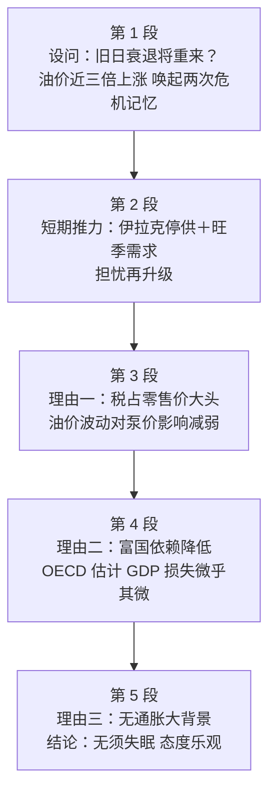

# Passage 05 · 油价上涨的冲击今不如昔

## 答题记录

| 轮次  | 日期         | 题号  | 正确  | 错误  | 正确率 | 用时    | 错题归因 |
| --- | --- | --- | --- | --- | --- | --- | --- |
| 1 |  | 1-5 |  |  |  |  |  |
| 2 |  | 1-5 |  |  |  |  |  |
| 3 |  | 1-5 |  |  |  |  |  |

> [!tip] 填写口径
> - **用时**以分钟计，只计做题时间，不含精读复盘。
> - **错题归因**填「题型·错误类型」，如：细节题·无中生有、细节题·混淆概念、推理题·与原文相反、态度题·主观臆断。
> - 纵向看趋势：正确率升而用时过长 → 熟练度不足；用时降而正确率波动 → 定位不稳。
> - 本篇 **5 题**，题号栏填 1-5；第 1 题是**事实细节题**（问油价上涨的主因，定位第一段②句，答案 B 是 OPEC 减产的同义改写），第 2 题是**推理题**（问零售价大涨的条件，定位第三段②③句，答案 D 靠「税占零售价 4/5」反推），第 3 题是**事实细节题**（问《经济展望》估计表明什么，定位第四段⑤⑥句，答案 D 是「仅增 GDP 0.25%～0.5%」的概括），第 4 题是**推理题**（问全文结论，通览全篇定位第三段①句与第五段①句，答案 A 是「这次冲击没那么可怕」的总括），第 5 题是**观点态度题**（问作者态度，看首尾段转折与理由铺陈，答案 A optimistic）。错因建议分别写「细节题·张冠李戴」「推理题·曲解文意」「细节题·张冠李戴」「推理题·与原文相反」「态度题·主观臆断」。

> [!info] 文章档案
> - **来源**：考研英语（一）2002 年 Text 3
> - **题材**：商业经济（石油价格 × 宏观经济影响 × 态度判断）——OPEC 减产与伊拉克停供推高油价，勾起 1973／1979 两次石油危机的可怕记忆；但作者用三重理由（税占零售价大头、富国依赖降低、无通胀大背景）论证这次冲击不会重演经济衰退，通篇持乐观态度
> - **结构**：5 段 / 21 句 ＋ 5 题（按句号断句与行首缩进实测；与解析引用的「第一段②句」「第三段②③句」「第四段⑤句」全部吻合；正文自书 p007 下部起，第 5 段跨至 p008 顶）
> - **难度**：★★★☆☆
> - **一句话主旨**：OPEC 减产以来油价涨近三倍，伊拉克停供又添一把火，人们担心 1973／1979 年式的滞胀重演；但作者指出这次不同——原油在汽油零售价中占比小且被高税稀释，富国单位 GDP 用油量比 1973 年少近一半（《经济展望》估计全年 22 美元一桶也只增加 GDP 的 0.25%～0.5%），且此番涨价没有发生在商品普涨与全球需求过旺的大背景下——所以无须为油价失眠，作者态度总体乐观。

## 一、篇章脉络

- **第 1 段**：**设问起笔——旧日衰退会重来吗**。①句劈头一问；②句给数据（OPEC 减产以来油价从不足 10 美元涨至近 26 美元一桶）；③句点出近三倍涨幅唤起 1973／1979—1980 两次危机记忆；④句交代两次危机的恶果（两位数通胀＋全球衰退）；⑤句反问收口：这次怎么没见大字标题？第 1 题的战场。
- **第 2 段**：**短期推力——担忧再升级**。伊拉克停供本周再推油价；经济走强叠加北半球寒冬，短期内价格可能更高。本段只两句，为「担忧」加码，反衬后文转折。
- **第 3 段**：**理由一——税占大头，冲击被稀释**。①句转折立论（这次后果不会像 70 年代那么严重）；②句原油在汽油价格中占比比 70 年代小；③句欧洲税占零售价高达五分之四，原油大变动对泵价影响 muted。第 2 题的战场。
- **第 4 段**：**理由二——富国依赖降低**。①句总起（富国对油价波动不再敏感）；②③④句给三条原因（节能、产业转型、软件咨询等低耗油行业）与硬数据（单位 GDP 用油量比 1973 年少近 50%）；⑤⑥句引 OECD《经济展望》估算（全年 22 美元一桶也只增加 GDP 0.25%～0.5%，不足 1974／1980 损失的 1/4）；⑦句补反面（重工业转移后的石油进口型新兴经济体可能被挤压得更狠）。第 3 题的战场。
- **第 5 段**：**理由三并收束——大背景不同，无须失眠**。①句给最后一个理由（此番涨价没有发生在商品普涨与全球需求过旺的背景之下）；②③④句给证据（世界大部分地区刚走出衰退、《经济学人》商品价格指数同比基本未变、对比 1973 年涨 70%／1979 年涨近 30%）。第 4、5 题的战场。

> [!tip] 行文逻辑
> 全篇是经典的**「设问 → 加码 → 三重论证 → 收束」驳忧型结构**：第 1 段以疑问句立靶（旧日衰退会重来吗）→ 第 2 段火上浇油（短期推力仍在）→ 第 3、4、5 段用 Yet／also／One more reason 依次亮出三重理由（税占比小、依赖降低、背景不同）→ 结论水到渠成：不必为油价失眠。三重理由各占一段，是「总—分—分—分」的递进列举，考点（Q2/Q3）与态度（Q4/Q5）全落在论证段。

## 二、逐段精读

### 第 1 段 · 设问：旧日衰退会重来吗

**原文**

① Could the bad old days of economic decline be about to return?
② Since OPEC agreed to supply-cuts in March, the price of crude oil has jumped to almost $26 a barrel, up from less than $10 last December.
③ This near-tripling of oil prices calls up scary memories of the 1973 oil shock, when prices quadrupled, and 1979—1980, when they also almost tripled.
④ Both previous shocks resulted in double-digit inflation and global economic decline.
⑤ So where are the headlines warning of gloom and doom this time?

**译文**

① 经济衰退的悲惨旧日会不会即将重演？
② 自从石油输出国组织（OPEC）三月份决定减产以来，原油价格已飙升到每桶近 26 美元，而去年 12 月还不足 10 美元。
③ 油价近三倍的上涨唤起了人们对 1973 年油价冲击的可怕记忆——当时油价翻了四倍；以及 1979—1980 年的记忆——那次油价也几乎涨了三倍。
④ 前两次冲击都导致了两位数的通货膨胀和全球经济衰退。
⑤ 那么，这一次警告「阴暗与末日」的大字标题都到哪里去了？

> [!note] 段落要点
> - **本段五句一问一答**：①句设问（衰退会重来吗）→ ②句给数据（涨幅近三倍）→ ③句唤起记忆（两次危机）→ ④句交代恶果 → ⑤句反问否定担忧（标题何在）。
> - **②句是第 1 题的定位句**：Since OPEC agreed to supply-cuts → 油价上涨的主因是「供应减少」→ B 项 reduction in supply。
> - **③④句的两次危机是全文参照系**：1973 年 quadruple、1979—1980 年 triple、两次都导致通胀＋衰退——Q4 的 B 项（通胀与油价冲击无关）死在这里。

#### 本段重点词汇

| 单词 | 词性 | 文中意 | 拓展 | 文中用法 |
| --- | --- | --- | --- | --- |
| **decline** | n. | 衰退，下降 | 熟词僻义：常见义「婉拒」（v.）；economic decline 经济衰退；in decline 处于衰退中 | the bad old days of economic decline（经济衰退的悲惨旧日） |
| **supply-cuts** | n. | 供应削减 | supply（供应）＋ cut（削减）；合成名词，同义 reduction in supply（第 1 题答案） | OPEC agreed to supply-cuts（OPEC 同意减产） |
| **crude** | adj. | 原油的；粗糙的 | crude oil 原油；crude oil prices 原油价格；本义「天然的、未加工的」，引申「粗鲁的」 | the price of crude oil（原油价格） |
| **jump** | v. | 飙升，猛涨 | 熟词僻义：常见义「跳」；prices jump 价格飙升；jump to / jump by 两种搭配 | the price of crude oil has jumped to almost $26 a barrel（原油价格已飙升到每桶近 26 美元） |
| **near-tripling** | n. | 近三倍的上涨 | triple v. 翻三倍；tripling 动名词；前缀 near-「接近」 | This near-tripling of oil prices（油价近三倍的上涨） |
| **call up** | phr. | 唤起，使想起 | 同义 evoke、bring back；call up memories 唤起回忆 | calls up scary memories of the 1973 oil shock（唤起对 1973 年油价冲击的可怕记忆） |
| **oil shock** | n. | 石油冲击，石油危机 | shock 本义「震惊」，此处指油价骤涨的冲击；同义 oil crisis | the 1973 oil shock（1973 年油价冲击） |
| **quadruple** | v. | （使）成四倍 | 词根 quadr-「四」：quadruple 翻四倍；triple 翻三倍；double 翻倍 | prices quadrupled（价格翻了四倍） |
| **triple** | v. | （使）成三倍 | 词根 tri-「三」；treble 同义 | they also almost tripled（油价也几乎涨了三倍） |
| **result in** | phr. | 导致，造成 | 同义 lead to、give rise to；注意 result from「由……引起」方向相反 | Both previous shocks resulted in double-digit inflation（前两次冲击都导致了两位数的通胀） |
| **double-digit** | adj. | 两位数的 | double（双）＋ digit（数字）；复合形容词 | double-digit inflation（两位数的通货膨胀） |
| **inflation** | n. | 通货膨胀 | inflate v. 膨胀、使通胀；反义 deflation 通货紧缩 | double-digit inflation and global economic decline（两位数通胀与全球经济衰退） |
| **headline** | n. | 大字标题，（pl.）新闻提要 | head（头）＋ line（行）；make headlines 上头条 | where are the headlines（大字标题都到哪里去了） |
| **warn of** | phr. | 警告，预告 | warn sb of sth 提醒某人某事；warning n. 警告 | the headlines warning of gloom and doom（警告阴暗末日的大字标题） |
| **gloom and doom** | phr. | 阴暗与末日，悲观失望 | gloom n. 阴暗、忧郁；doom n. 厄运；常连用表「前景暗淡」 | headlines warning of gloom and doom（预言黯淡前景的标题） |

#### 长难句 · 本段第 ② 句

> [!abstract] 本段第 ② 句 · 原句
> Since OPEC agreed to supply-cuts in March, the price of crude oil has jumped to almost $26 a barrel, up from less than $10 last December.

**结构拆解**

- **主干**：the price of crude oil（主）＋ has jumped（谓，现在完成时）＋ to almost $26 a barrel（结果状语）。
- **时间状语从句**：Since OPEC agreed to supply-cuts in March，since 引导，交代上涨的起点与原因。
- **比较补充**：up from less than $10 last December，形容词短语作补充——up（涨到）＋ from（从）＋ less than $10（起点价），一涨一跌形成强对比。

**参考译文**

自从石油输出国组织（OPEC）三月份决定减产以来，原油价格已飙升到每桶近 26 美元，而去年 12 月还不足 10 美元。

> [!tip] 拆解要点
> 这句是**第 1 题的定位句，也是全文的数据起点**。两个要点：其一，**since 从句本身就是答案**——「自 OPEC 减产以来油价飙升」，因果藏在时间状语从句里，B 项 reduction in supply 就是 supply-cuts 的同义改写；其二，**up from ... 是考研阅读常见的信息补充式**：现价（$26）＋ 起点（less than $10 last December）＋ 变化幅度（near-tripling 在③句补足），三块信息合起来读，③句的 near-tripling 才有出处。**细节题问「主要原因」，答案永远落在「最先发生、最直接引发变化」的那个动作上**， Iraq 停供（第 2 段）只是「another push up」。

#### 长难句 · 本段第 ③ 句

> [!abstract] 本段第 ③ 句 · 原句
> This near-tripling of oil prices calls up scary memories of the 1973 oil shock, when prices quadrupled, and 1979—1980, when they also almost tripled.

**结构拆解**

- **主干**：This near-tripling of oil prices（主）＋ calls up（谓）＋ scary memories of the 1973 oil shock（宾）。
- **并列补语**：and 1979—1980，与 the 1973 oil shock 并列，同属 memories of 的范围。
- **双 when 非限制性定语从句**：when prices quadrupled（修饰 1973）、when they also almost tripled（修饰 1979—1980），when ＝ in which，分别给出两次危机的涨幅数据。
- **they 回指**：第二个 when 从句里的 they 指代 prices，避免重复。

**参考译文**

油价近三倍的上涨唤起了人们对 1973 年油价冲击的可怕记忆——当时油价翻了四倍；以及 1979—1980 年的记忆——那次油价也几乎涨了三倍。

> [!tip] 拆解要点
> 这句是**全文的「参照系句」**：作者把本次涨幅（triple）与历史两次危机（quadruple／triple）并排摆出，为后文「这次不同」的论证搭建对照板。两个要点：其一，**when 引导的定语从句修饰的是时间名词**，读的时候把 1973 → quadrupled、1979—1980 → tripled 分别配对，不要把两个 when 从句当成并列的时间状语；其二，**本句的 triple 与②句的 near-tripling 是有意的呼应**——本次涨幅与 1979 年几乎相同， scary memories 由此而来；Q4 判断「冲击是否减弱」时，比的就是「涨幅相近、后果不同」这组对照。

### 第 2 段 · 短期推力：担忧再升级

**原文**

① The oil price was given another push up this week when Iraq suspended oil exports.
② Strengthening economic growth, at the same time as winter grips the northern hemisphere, could push the price higher still in the short term.

**译文**

① 本周，随着伊拉克暂停石油出口，油价又被向上推了一把。
② 经济增长走强，加之北半球寒冬降临，可能在短期内把油价推得更高。

> [!note] 段落要点
> - **本段两句全是「担忧加码」**：①句供给端再受冲击（伊拉克停供）→ ②句需求端再添压力（经济走强＋寒冬），短期油价可能更高。
> - **①句的 another 是关键词**：说明伊拉克停供是「又一次推升」，并非主因——第 1 题 D 项就死在这个 another 上。
> - **②句 could 是推测语气**：为第 3 段的 Yet 转折蓄势。

#### 本段重点词汇

| 单词 | 词性 | 文中意 | 拓展 | 文中用法 |
| --- | --- | --- | --- | --- |
| **push up** | phr. | 推高，抬高 | push up prices 推高价格；名词化 a push up（一次推升） | The oil price was given another push up（油价又被推高了一把） |
| **suspend** | v. | 暂停，中止 | 熟词僻义：常见义「悬挂」；suspend exports 暂停出口；suspension n. 暂停（第 1 题 D 项原文） | Iraq suspended oil exports（伊拉克暂停石油出口） |
| **export** | n. | 出口（物） | ex-（向外）＋ port（港）；反义 import 进口；oil exports 石油出口 | Iraq suspended oil exports（伊拉克暂停石油出口） |
| **strengthening** | adj. | 走强的，不断加强的 | strengthen v. 加强（-en 动词后缀）；现在分词作前置定语 | Strengthening economic growth（不断走强的经济增长） |
| **grip** | v. | 攥紧，笼罩 | 熟词僻义：常见义「紧握」，此处比喻「严寒笼罩」；in the grip of 受……控制 | winter grips the northern hemisphere（寒冬笼罩北半球） |
| **hemisphere** | n. | 半球 | hemi-（半）＋ sphere（球）；the northern hemisphere 北半球 | winter grips the northern hemisphere（寒冬笼罩北半球） |
| **still** | adv. | 更加 | 熟词僻义：常见义「仍然」，此处修饰比较级 higher still＝even higher；much / even / still ＋ 比较级 | push the price higher still（把油价推得更高） |
| **short term** | n. | 短期 | in the short term 短期内；反义 in the long term 长期 | in the short term（短期内） |

#### 长难句 · 本段第 ② 句

> [!abstract] 本段第 ② 句 · 原句
> Strengthening economic growth, at the same time as winter grips the northern hemisphere, could push the price higher still in the short term.

**结构拆解**

- **主干**：Strengthening economic growth（主）＋ could push（谓，情态推测）＋ the price（宾）＋ higher still（宾补）＋ in the short term（时间状语）。
- **插入的时间状语**：at the same time as winter grips the northern hemisphere，at the same time as ＋ 从句，把主语和谓语生生隔开——「与此同时寒冬正笼罩北半球」。
- **推测语气**：could 表示可能性而非事实，与②句事实性的 was given 形成层次。

**参考译文**

经济增长走强，加之北半球寒冬降临，可能在短期内把油价推得更高。

> [!tip] 拆解要点
> 这句的考点是**主谓分隔**：Strengthening economic growth 与 could push 之间插入了长达 10 个词的时间状语，扫读时先跳过插入语抓住「增长 → 推高价格」的主干，再回头补「同时还有寒冬」的第二压力源。两个要点：其一，**Strengthening 是现在分词作定语**，「不断走强的」，不是动名词「加强经济增长」这个动作本身；其二，**higher still 的 still 是「更加」**，修饰比较级，与 even / much 同类——这是熟词僻义高频点。本句与①句合起来构成「供给＋需求」双推力，把第 1 段的担忧推到顶点，为 Yet 转折蓄满势能。

### 第 3 段 · 理由一：税占大头，冲击被稀释

**原文**

① Yet there are good reasons to expect the economic consequences now to be less severe than in the 1970s.
② In most countries, the cost of crude oil now accounts for a smaller share of the price of petrol than it did in the 1970s.
③ In Europe, taxes account for up to four-fifths of the retail price, so even quite big changes in the price of crude oil have a more muted effect on pump prices than in the past.

**译文**

① 然而，我们有充分的理由预期：这次油价上涨的经济后果不会比 20 世纪 70 年代那么严重。
② 在大多数国家，与 20 世纪 70 年代相比，现在原油成本在汽油价格中所占的份额更小。
③ 在欧洲，税收占到汽油零售价的五分之四，因此即使原油价格发生相当大的变化，它对泵价（加油站价格）的影响也比过去更为微弱。

> [!note] 段落要点
> - **①句是全文论点句**：Yet 一转，亮出「这次后果不会那么严重」的立场，其后每段都是理由。
> - **②③句是第 2 题的定位句**：原油占比小＋税占零售价 4/5 → 零售价格被税收「锚定」，只有**税**大涨零售价才会大涨 → D 项 oil taxes rise。
> - **muted 是本段题眼**：原油变动对泵价的影响被高税「消音」，这正是 Q4「冲击减弱」的第一层证据。

#### 本段重点词汇

| 单词 | 词性 | 文中意 | 拓展 | 文中用法 |
| --- | --- | --- | --- | --- |
| **consequence** | n. | 后果，结果 | 同义 result、outcome；as a consequence of 由于；consequences of the rise in oil prices | the economic consequences now to be less severe（这次的经济后果没那么严重） |
| **severe** | adj. | 严重的，严厉的 | severity n. 严重性；severe weather 恶劣天气 | less severe than in the 1970s（比 70 年代轻） |
| **account for** | phr. | 占（比例）；解释 | 两义并考：account for 30% 占 30%；account for the difference 解释差异 | the cost of crude oil now accounts for a smaller share（原油成本现在占的份额更小） |
| **share** | n. | 份额，比例 | 熟词僻义：常见义「分享」；market share 市场份额 | a smaller share of the price of petrol（汽油价格中更小的份额） |
| **petrol** | n. | 汽油 | 英式说法，美式 gasoline（gas）；petrol price 汽油价格 | the price of petrol（汽油价格） |
| **tax** | n. | 税，税款 | tax v. 征税；taxation n. 税制；income tax 所得税 | taxes account for up to four-fifths（税收占到五分之四） |
| **four-fifths** | num. | 五分之四 | 分数表达：分子基数词＋分母序数词（分子＞1 分母加 s）；three-quarters 四分之三 | up to four-fifths of the retail price（高达零售价的五分之四） |
| **retail** | adj./n. | 零售 | retail price 零售价；反义 wholesale 批发；retailer n. 零售商 | the retail price（零售价格） |
| **muted** | adj. | 缓和的，不明显的 | 熟词僻义：本义「（声音）减弱的、静音的」，此处比喻「影响被削弱的」；同义 weakened、dampened | have a more muted effect on pump prices（对泵价的影响更为微弱） |
| **pump price** | n. | 泵价，加油站零售价 | pump n. 油泵、加油泵；即消费者在加油站实付的价格 | a more muted effect on pump prices（对泵价影响更弱） |

#### 长难句 · 本段第 ① 句

> [!abstract] 本段第 ① 句 · 原句
> Yet there are good reasons to expect the economic consequences now to be less severe than in the 1970s.

**结构拆解**

- **主干**：there be 存在句——there are good reasons（有好理由）。
- **后置定语**：to expect ...，不定式修饰 reasons。
- **复合宾语**：expect ＋ the economic consequences（宾语）＋ to be less severe（宾补），expect sb / sth to do 结构。
- **比较结构**：less severe than in the 1970s，than 后省略 the economic consequences were。

**参考译文**

然而，我们有充分的理由预期：这次油价上涨的经济后果不会比 20 世纪 70 年代那么严重。

> [!tip] 拆解要点
> 这句是**全文论点句（topic sentence）**，Yet 之后的 every word 都值得圈出来。两个要点：其一，**there are good reasons to expect ... to be ... 是「亮观点」的万能句式**——reasons 是复数，预示后文至少三条（本篇恰好三段各一条），读到复数理由就要立刻去找列举标志（also／One more reason）；其二，**expect sth to be less severe than ... 是带预期的比较**，作者立场（乐观）已经写进 less severe，Q5 的答案 A（optimistic）在本句就埋好了——态度题先找论点句，再看理由是否被推翻。

#### 长难句 · 本段第 ③ 句

> [!abstract] 本段第 ③ 句 · 原句
> In Europe, taxes account for up to four-fifths of the retail price, so even quite big changes in the price of crude oil have a more muted effect on pump prices than in the past.

**结构拆解**

- **并列结构**：so 连接两个分句，前因后果。
- **分句一**：taxes（主）＋ account for（谓）＋ up to four-fifths of the retail price（宾）。
- **分句二**：even quite big changes in the price of crude oil（主，in 短语后置修饰 changes）＋ have（谓）＋ a more muted effect on pump prices（宾）＋ than in the past（比较状语）。
- **even 让步强化**：即便原油变动「相当大」，影响仍被税稀释。

**参考译文**

在欧洲，税收占到汽油零售价的五分之四，因此即使原油价格发生相当大的变化，它对泵价（加油站价格）的影响也比过去更为微弱。

> [!tip] 拆解要点
> 这句是**第 2 题的直接依据，也是本篇最漂亮的「比例论证」**。两个要点：其一，**account for 本段出现两次**（②句原油占小头、③句税占大头），两句话合起来才构成完整逻辑——原油占比小＋税收占比大 → 零售价由税锚定 → 只有 oil taxes rise 才能让零售价 dramatically 上涨（D 项）；其二，**so 分句里 even ... muted ... 是让步＋弱化的双重保险**：连「相当大的原油变动」都被消音，反向推出零售价大涨的唯一条件就是税。**推理题问「什么条件下会 X」，答案是「结构中唯一能撬动 X 的那个变量」**，A 项（原油涨价）恰恰被本句证明影响 muted。

### 第 4 段 · 理由二：富国依赖降低

**原文**

① Rich economies are also less dependent on oil than they were, and so less sensitive to swings in the oil price.
② Energy conservation, a shift to other fuels and a decline in the importance of heavy, energy-intensive industries have reduced oil consumption.
③ Software, consultancy and mobile telephones use far less oil than steel or car production.
④ For each dollar of GDP (in constant prices) rich economies now use nearly 50% less oil than in 1973.
⑤ The OECD estimates in its latest *Economic Outlook* that, if oil prices averaged $22 a barrel for a full year, compared with $13 in 1998, this would increase the oil import bill in rich economies by only 0.25%~0.5% of GDP.
⑥ That is less than one-quarter of the income loss in 1974 or 1980.
⑦ On the other hand, oil-importing emerging economies—to which heavy industry has shifted—have become more energy-intensive, and so could be more seriously squeezed.

**译文**

① 发达经济体对石油的依赖也比过去降低了，因此对油价波动的敏感度也随之降低。
② 能源节约、向其他燃料的转型，以及重工业这类高耗能产业重要性的下降，都减少了石油消耗。
③ 软件、咨询和移动电话行业消耗的石油远比钢铁或汽车生产少。
④ 发达经济体每产出 1 美元 GDP（按不变价格计算），如今的石油用量比 1973 年少了近 50%。
⑤ 经济合作与发展组织（OECD）在其最近的《经济展望》中估计：如果油价全年平均维持在每桶 22 美元（1998 年为 13 美元），发达经济体的石油进口支出也只会增加 GDP 的 0.25%～0.5%。
⑥ 这还不到 1974 年或 1980 年收入损失的四分之一。
⑦ 另一方面，石油进口型新兴经济体——重工业已转移至此——变得更加高耗能，因此可能受到更严重的挤压。

> [!note] 段落要点
> - **本段七句是「总—分—证—反」**：①句总起（依赖降低→敏感降低）→ ②③④句给原因与数据 → ⑤⑥句引权威估算收口 → ⑦句补反面（新兴经济体反受其害）。
> - **⑤⑥句是第 3 题的定位句**：OECD 估计「全年 22 美元一桶也只增加 GDP 0.25%～0.5%」→ 油价变化对 GDP 影响不大 → D 项。
> - **⑦句是 Q3 的 A/C 两项陷阱来源**：heavy industry 更耗能、可能被挤压的是**新兴经济体**，不是发达国家——张冠李戴双雷。

#### 本段重点词汇

| 单词 | 词性 | 文中意 | 拓展 | 文中用法 |
| --- | --- | --- | --- | --- |
| **dependent** | adj. | 依赖的，依靠的 | be dependent on 依赖；dependence n. 依赖；反义 independent | Rich economies are also less dependent on oil（富国对石油依赖降低） |
| **sensitive** | adj. | 敏感的 | be sensitive to 对……敏感；sensitivity n. 敏感度；反义 insensitive | less sensitive to swings in the oil price（对油价波动不那么敏感） |
| **swing** | n. | 波动，摆动 | 熟词僻义：常见义「荡秋千」，此处指价格波动；同义 fluctuation、volatility | swings in the oil price（油价的波动） |
| **conservation** | n. | 节约，保护 | conserve v. 节约、保护；energy conservation 节能；wildlife conservation 野生动物保护 | Energy conservation ... have reduced oil consumption（能源节约减少了石油消耗） |
| **shift** | n./v. | 转变，转移 | shift to 转向；a shift in attitude 态度转变；本段 shift 兼有「转型」（②句）与「转移」（⑦句）两义 | a shift to other fuels（向其他燃料的转型） |
| **energy-intensive** | adj. | 高耗能的，能源密集型的 | intensive 后缀「密集的」：labour-intensive 劳动密集型、capital-intensive 资本密集型 | heavy, energy-intensive industries（高耗能的重工业） |
| **consumption** | n. | 消耗（量），消费 | consume v. 消耗、消费；consumer n. 消费者；oil consumption 石油消耗 | have reduced oil consumption（减少了石油消耗） |
| **consultancy** | n. | 咨询（业） | consult v. 咨询；consultant n. 顾问 | Software, consultancy and mobile telephones（软件、咨询和移动电话） |
| **constant** | adj. | 不变的，恒定的 | 熟词僻义：常见义「不断的、持续的」，此处 in constant prices「按不变价格计算」是经济学固定表达 | in constant prices（按不变价格计算） |
| **estimate** | v./n. | 估计，估算 | estimate that... 估计；estimate n. 估计值；同义 reckon、assess | The OECD estimates that...（OECD 估计） |
| **average** | v. | 平均为 | 熟词僻义：常见义「平均的」（adj.），此处作动词「（长期）平均达到」 | if oil prices averaged $22 a barrel for a full year（如果油价全年平均为每桶 22 美元） |
| **barrel** | n. | 桶（石油计量单位） | 1 barrel ≈ 159 升；$26 a barrel 每桶 26 美元 | oil prices averaged $22 a barrel（油价平均每桶 22 美元） |
| **import bill** | n. | 进口支出 | bill「账单」；oil import bill 石油进口账单／支出 | the oil import bill in rich economies（富国的石油进口支出） |
| **one-quarter** | num. | 四分之一 | 分数表达同 four-fifths；quarter 兼义「季度」 | less than one-quarter of the income loss（不到收入损失的四分之一） |
| **emerging** | adj. | 新兴的 | emerge v. 浮现；emerging economies 新兴经济体（固定搭配） | oil-importing emerging economies（石油进口型新兴经济体） |
| **squeeze** | v. | 挤压，使承受（经济压力） | 熟词僻义：本义「挤、榨」，经济学中指「利润／经济体被挤压」 | could be more seriously squeezed（可能受到更严重的挤压） |

#### 长难句 · 本段第 ② 句

> [!abstract] 本段第 ② 句 · 原句
> Energy conservation, a shift to other fuels and a decline in the importance of heavy, energy-intensive industries have reduced oil consumption.

**结构拆解**

- **三并列主语**：Energy conservation ＋ a shift to other fuels ＋ a decline in the importance of heavy, energy-intensive industries，由 and 连接。
- **远隔谓语**：have reduced 挂在第三个并列项的 long 尾（in the importance of ... industries）之后，谓语与第一个主语隔了整整 20 个词。
- **宾语**：oil consumption，三个主语共同作用的落点。

**参考译文**

能源节约、向其他燃料的转型，以及重工业这类高耗能产业重要性的下降，都减少了石油消耗。

> [!tip] 拆解要点
> 这句是**典型的「三并列主语＋远隔谓语」**，读法是先数逗号：两个逗号把三个并列主语切开，第三个主语内部还套了 in the importance of 的多级后置修饰。两个要点：其一，**主语是复数并列，谓语用 have reduced**，找到谓语再回头给三个主语「点数」就不会读散；其二，**heavy, energy-intensive industries 是同位叠置**——heavy 与 energy-intensive 共同修饰 industries，第二个逗号只是并列形容词的分隔，不是主语的边界（识别方法：它后面跟的是名词 industries 而非 have）。Q4 的 C 项（节能可以抑制油价）正是把本句的「减少消耗」偷换成「抑制油价」。

#### 长难句 · 本段第 ⑤ 句

> [!abstract] 本段第 ⑤ 句 · 原句
> The OECD estimates in its latest Economic Outlook that, if oil prices averaged $22 a barrel for a full year, compared with $13 in 1998, this would increase the oil import bill in rich economies by only 0.25%~0.5% of GDP.

**结构拆解**

- **主干**：The OECD（主）＋ estimates（谓）＋ that 从句（宾）。
- **插入语**：in its latest Economic Outlook，书名斜体，交代估算出处。
- **虚拟条件**：if oil prices averaged ... for a full year，对现在的假设，主句用 would increase。
- **比较插入**：compared with $13 in 1998，过去分词短语，给出对照基价。
- **结果**：this would increase ... by only 0.25%~0.5% of GDP，this 复指 if 从句所述情形；increase by ＋ 幅度。

**参考译文**

经济合作与发展组织（OECD）在其最近的《经济展望》中估计：如果油价全年平均维持在每桶 22 美元（1998 年为 13 美元），发达经济体的石油进口支出也只会增加 GDP 的 0.25%～0.5%。

> [!tip] 拆解要点
> 这句是**全篇最长的权威引证句，也是第 3 题的定位句**。三个要点：其一，**先跳读到 that 后的数字**——$22 vs $13（假设涨幅近 70%）却只增加 GDP 的 0.25%～0.5%，⑥句再补一刀「不到 1974／1980 年损失的 1/4」，「影响不大」的结论不用作者说，数字自己会说话，D 项（no significant impact on GDP）就是这两个数字的概括；其二，**if ... would 是对未来的假设估算**，不是已发生的事实，四个选项里把假设说成已然的都要警惕；其三，**estimates 的主语是 OECD、出处是 Economic Outlook**，Q3 题干 The estimates in Economic Outlook 正是从这里来的——权威机构＋报告名是细节题最可靠的定位锚。

#### 长难句 · 本段第 ⑦ 句

> [!abstract] 本段第 ⑦ 句 · 原句
> On the other hand, oil-importing emerging economies—to which heavy industry has shifted—have become more energy-intensive, and so could be more seriously squeezed.

**结构拆解**

- **主干**：oil-importing emerging economies（主）＋ have become（谓 1）＋ more energy-intensive（表）＋ and so could be more seriously squeezed（谓 2，递进推测）。
- **插入的定语从句**：to which heavy industry has shifted，修饰 economies，shift to 的介词前置——「重工业已转移到的那些经济体」。
- **双重破折号**：把定语从句整块插入主谓之间，与第②句的远隔谓语形成同款难度。

**参考译文**

另一方面，石油进口型新兴经济体——重工业已转移至此——变得更加高耗能，因此可能受到更严重的挤压。

> [!tip] 拆解要点
> 这句是**全文唯一「反向补刀」**：前三段都在论证「冲击减弱」，本句提醒「富国不怕，新兴经济体怕」。两个要点：其一，**主语限定词一个都不能丢**——oil-importing（石油进口型）＋ emerging（新兴的），Q3 的 A 项（heavy industry becomes more energy-intensive）和 C 项（manufacturing ... squeezed）都把「富国」替换成了这里的新兴经济体主体，属于典型张冠李戴；其二，**could be 是推测**，「可能被挤压」不等于「已经被严重挤压」，C 项的 has been seriously squeezed 把推测坐实、把 may 升级成 done，双重失真。**On the other hand 后的信息常是细节题陷阱的集散地——主体、情态、程度三处都要核对**。

### 第 5 段 · 理由三：无通胀大背景，无须失眠

**原文**

① One more reason not to lose sleep over the rise in oil prices is that, unlike the rises in the 1970s, it has not occurred against the background of general commodity-price inflation and global excess demand.
② A sizable portion of the world is only just emerging from economic decline.
③ The Economist's commodity price index is broadly unchanging from a year ago.
④ In 1973 commodity prices jumped by 70%, and in 1979 by almost 30%.

**译文**

① 不必为油价上涨而失眠的另一个理由是：与 20 世纪 70 年代的几次上涨不同，这次并不是发生在商品价格普遍上涨和全球需求过旺的大背景之下。
② 世界相当大一部分地区才刚刚走出经济衰退。
③ 《经济学人》的商品价格指数与一年前相比基本未变。
④ 1973 年商品价格上涨了 70%，而 1979 年上涨了近 30%。

> [!note] 段落要点
> - **①句是「最后一条理由＋标题句」**：lose sleep over 直接回应第 1 段的 gloom and doom——为什么不必失眠？因为这次没有通胀与需求过旺的大背景。
> - **②③④句是三块证据**：世界经济刚复苏、商品价格指数平稳、对比历史涨幅（70%／30%）——本次油价上涨是「孤立事件」而非「普涨之一」。
> - **④句的 jump by 70%** 与第 1 段②句的油价 near-tripling 形成指数对照：当年是万物齐涨，这次只有油在涨。

#### 本段重点词汇

| 单词 | 词性 | 文中意 | 拓展 | 文中用法 |
| --- | --- | --- | --- | --- |
| **lose sleep over** | phr. | 为……失眠，为……担忧 | 习语；常用于否定 not lose sleep over「不必为……担忧」 | One more reason not to lose sleep over the rise in oil prices（不必为油价上涨失眠的又一个理由） |
| **commodity-price** | adj. | 商品价格的 | commodity n. 商品（尤指大宗商品）；commodity price index 商品价格指数；inflation 跨段复现（首现第 1 段④句） | the background of general commodity-price inflation（商品价格普遍上涨的大背景） |
| **excess** | adj. | 过度的，超额的 | excess demand 过度需求；excess n. 过量；同义 excessive、surplus | global excess demand（全球需求过旺） |
| **sizable** | adj. | 相当大的 | size ＋ -able「可观的」；同义 considerable、substantial | A sizable portion of the world（世界相当大一部分） |
| **portion** | n. | 一部分 | a portion of ……的一部分；同义 part、segment | A sizable portion of the world（世界相当大的一部分） |
| **broadly** | adv. | 大体上，大致 | broad adj. 宽的；broadly speaking 广义上说；同义 roughly、generally | is broadly unchanging from a year ago（与一年前相比基本未变） |
| **unchanging** | adj. | 未变化的 | un-（否定前缀）＋ change ＋ -ing；同义 stable、flat | broadly unchanging from a year ago（同比基本未变） |

#### 长难句 · 本段第 ① 句

> [!abstract] 本段第 ① 句 · 原句
> One more reason not to lose sleep over the rise in oil prices is that, unlike the rises in the 1970s, it has not occurred against the background of general commodity-price inflation and global excess demand.

**结构拆解**

- **主干**：One more reason（主）＋ is（系）＋ that 从句（表）。
- **后置定语**：not to lose sleep over the rise in oil prices，不定式短语修饰 reason——「不必为油价上涨失眠的」理由。
- **表语从句内插入**：unlike the rises in the 1970s，介词短语作对比状语，把主语 it 与谓语隔开。
- **否定 occur against**：has not occurred against the background of ...，「不是发生在……背景之下」，against the background of「在……背景下」。

**参考译文**

不必为油价上涨而失眠的另一个理由是：与 20 世纪 70 年代的几次上涨不同，这次并不是发生在商品价格普遍上涨和全球需求过旺的大背景之下。

> [!tip] 拆解要点
> 这句是**全文的「收束论点句」，Q4 与 Q5 共用的证据库**。三个要点：其一，**One more reason 是列举收尾的标志性开头**——见到它就要知道：理由到此齐了（税、依赖、背景），结论即将成立；其二，**not to lose sleep over 是习语**，字面「不为……失眠」即「不为……担忧」，它把第 1 段悬着的 gloom and doom 正式按下去；其三，**unlike 插入语提示本句是比较句**——70 年代的涨价「嵌在」通胀与过旺需求里，这次是「裸涨」，这个背景差异正是「冲击减弱」的第三块拼图。**态度题（Q5）看到作者连摆三条理由否定担忧、结尾还用 relax 式习语收尾，optimistic 基本可以内定**。

## 三、全篇重点词汇汇总（自测用）

| 单词 / 短语 | 词性 | 所在段 |
| --- | --- | --- |
| **decline** | n. | 第 1 段 |
| **supply-cuts** | n. | 第 1 段 |
| **crude** | adj. | 第 1 段 |
| **jump** | v. | 第 1 段 |
| **near-tripling** | n. | 第 1 段 |
| **call up** | phr. | 第 1 段 |
| **oil shock** | n. | 第 1 段 |
| **quadruple** | v. | 第 1 段 |
| **triple** | v. | 第 1 段 |
| **result in** | phr. | 第 1 段 |
| **double-digit** | adj. | 第 1 段 |
| **inflation** | n. | 第 1 段 |
| **headline** | n. | 第 1 段 |
| **warn of** | phr. | 第 1 段 |
| **gloom and doom** | phr. | 第 1 段 |
| **push up** | phr. | 第 2 段 |
| **suspend** | v. | 第 2 段 |
| **export** | n. | 第 2 段 |
| **strengthening** | adj. | 第 2 段 |
| **grip** | v. | 第 2 段 |
| **hemisphere** | n. | 第 2 段 |
| **still** | adv. | 第 2 段 |
| **short term** | n. | 第 2 段 |
| **consequence** | n. | 第 3 段 |
| **severe** | adj. | 第 3 段 |
| **account for** | phr. | 第 3 段 |
| **share** | n. | 第 3 段 |
| **petrol** | n. | 第 3 段 |
| **tax** | n. | 第 3 段 |
| **four-fifths** | num. | 第 3 段 |
| **retail** | adj./n. | 第 3 段 |
| **muted** | adj. | 第 3 段 |
| **pump price** | n. | 第 3 段 |
| **dependent** | adj. | 第 4 段 |
| **sensitive** | adj. | 第 4 段 |
| **swing** | n. | 第 4 段 |
| **conservation** | n. | 第 4 段 |
| **shift** | n./v. | 第 4 段 |
| **energy-intensive** | adj. | 第 4 段 |
| **consumption** | n. | 第 4 段 |
| **consultancy** | n. | 第 4 段 |
| **constant** | adj. | 第 4 段 |
| **estimate** | v./n. | 第 4 段 |
| **average** | v. | 第 4 段 |
| **barrel** | n. | 第 4 段 |
| **import bill** | n. | 第 4 段 |
| **one-quarter** | num. | 第 4 段 |
| **emerging** | adj. | 第 4 段 |
| **squeeze** | v. | 第 4 段 |
| **lose sleep over** | phr. | 第 5 段 |
| **commodity-price** | adj. | 第 5 段 |
| **excess** | adj. | 第 5 段 |
| **sizable** | adj. | 第 5 段 |
| **portion** | n. | 第 5 段 |
| **broadly** | adv. | 第 5 段 |
| **unchanging** | adj. | 第 5 段 |

## 四、知识点补充

> [!question] 背景知识
> - **OPEC（石油输出国组织）**：1960 年成立，现有 12 余个成员国，通过协调成员国原油产量影响国际油价。文中「OPEC agreed to supply-cuts」即典型的「限产保价」操作——供给收缩推高价格，这是理解第 1 题 B 项的经济常识底座。
> - **两次石油危机**：1973 年第四次中东战争引发第一次石油危机，油价从约 3 美元涨至 12 美元（文中 quadrupled）；1979 年伊朗革命引发第二次危机（文中 1979—1980 tripled）。两次危机都被认为是造成西方「滞胀」（高通胀＋低增长）的推手，文中④句 double-digit inflation 即指此。2002 年本文写作时（2000—2001 年油价上涨期）的担忧正是「第三次危机是否会重演」。
> - **OECD 与《经济展望》**：OECD（经济合作与发展组织）是 38 个市场经济国家的政府间组织，其一年两期的《Economic Outlook》（经济展望报告）是全球宏观预测的权威来源。细节题中「权威机构＋预测报告」是高频定位锚——Q3 题干直接引用其报告名。
> - **《经济学人》商品价格指数**：The Economist 自 1986 年发布 commodity price index，跟踪大宗商品价格走势。文中用它证明「本次油价上涨没有商品普涨的大背景」——油价单独蹿升而指数平稳，说明是供给冲击（supply shock）而非需求过热（demand pull）。
> - **pump price 与零售价**：pump price 指加油站泵嘴上显示的最终售价，由原油成本＋炼制运输＋税构成。欧洲税占零售价 4/5（本文③句），美国税率低——所以「原油涨价对欧洲泵价影响 muted」的结论隐含欧洲场景，读细节题时注意国别限定词（In Europe / In most countries）。
> - **态度题的方法论锚点**：本文 Q5 是标准观点态度题。作者态度藏在三处：转折词后（Yet there are good reasons）、情态与习语（could／not to lose sleep over）、理由的完备度（三条理由无一被推翻）。**结论未被打折 → optimistic**；若出现让步却无否定、或结尾反转，才考虑 cautious / skeptical。

## 五、题目分析

> [!info] 题目总览
> | 题号 | 题型 | 定位 | 答案 |
> | --- | --- | --- | --- |
> | 1 | 事实细节题（油价上涨的主因） | 第 1 段②句 | B |
> | 2 | 推理题（零售价大涨的条件） | 第 3 段②③句 | D |
> | 3 | 事实细节题（《经济展望》的估计表明什么） | 第 4 段⑤⑥句 | D |
> | 4 | 推理题（全文结论） | 第 3 段①句 ＋ 第 5 段①句 | A |
> | 5 | 观点态度题（作者态度） | 第 3 段①句／第 5 段①句 | A |

### 第 1 题 · 事实细节题（油价上涨的主因）

> [!question] 原题
> The main reason for the latest rise of oil price is
> - A. global inflation.
> - B. reduction in supply.
> - C. fast growth in economy.
> - D. Iraq's suspension of exports.

**正确答案**：**B. reduction in supply.（供应量减少）**

**定位与依据**

- 题干关键词 **main reason** 与 **the latest rise of oil price** 定位到第 1 段②句：**Since** OPEC agreed to supply-cuts in March, the price of crude oil has jumped to almost $26 a barrel, up from less than $10 last December.
- 书中解析：「根据题干关键词 main reason 和 the latest rise of oil price 定位到第一段②句。该句明确指出，自从石油输出国组织在 3 月决定减少原油供应以来，原油的价格已从去年 12 月的不到 10 美元一路迅速上涨到了约 26 美元一桶，因此 [B] 项为正确答案。[A] 项是第一段提到的前两次油价上涨造成的后果，不是此次油价上涨的原因，故排除；[C] 项和 [D] 项是第二段提到的进一步推动油价上涨的原因，而非主要原因，故排除。」
- B 项 reduction in supply 正是 OPEC agreed to supply-cuts 的同义改写——**减产是本轮上涨的起点与主因**。
- A 项（global inflation）**张冠李戴**：通货膨胀是前两次危机的**后果**（④句 resulted in double-digit inflation），不是本次上涨的原因。
- C 项（fast growth in economy）与 D 项（Iraq's suspension of exports）**张冠李戴**：两者都是第 2 段的「进一步推升」因素（another push up），且②句 could 只是短期推测，均非「主要原因」。

**干扰项分析**

| 选项 | 选项内容 | 判断 | 排除理由 |
| --- | --- | --- | --- |
| A | global inflation. | ✗ | 张冠李戴：通胀是前两次危机的后果（第 1 段④句），非本次上涨的原因。 |
| B | reduction in supply. | ✓ | 正确项：OPEC agreed to supply-cuts（第 1 段②句）的同义改写。 |
| C | fast growth in economy. | ✗ | 张冠李戴：经济增长是第 2 段的短期推力之一，且 could 为推测，非主因。 |
| D | Iraq's suspension of exports. | ✗ | 张冠李戴：伊拉克停供是本周「another push up」（第 2 段①句），是次因。 |

> [!tip] 解题思路
> 「The main reason ... is」是**因果型细节题**，核心动作是**给原因分层**：主因在前、次因在后。本文的时间线非常清楚——3 月 OPEC 减产（②句，since 起点）→ 本周伊拉克停供（第 2 段①句，another）→ 短期可能更高（第 2 段②句，could）。**主因就是 since 从句里的那个动作**；another 这个词本身就供认了「伊拉克停供不是第一推手」。可复制的动作：**①抓 since／because／thanks to 等因果标记 → ②把选项逐个回原文对时序 → ③主因取「最先触发」的那个**。本题三个错误项全是「真词拼接」——inflation、growth、suspension 都在原文出现，但时间与因果位置不对，**细节题见真词先核「位置」再核「词义」**。

### 第 2 题 · 推理题（零售价大涨的条件）

> [!question] 原题
> It can be inferred from the text that the retail price of petrol will go up dramatically if
> - A. price of crude rises.
> - B. commodity prices rise.
> - C. consumption rises.
> - D. oil taxes rise.

**正确答案**：**D. oil taxes rise.（石油税上涨）**

**定位与依据**

- 题干关键词 **the retail price of petrol** 与 **go up dramatically** 定位到第 3 段②③句：the cost of crude oil now **accounts for a smaller share** of the price of petrol ... In Europe, **taxes account for up to four-fifths of the retail price**, so even quite big changes in the price of crude oil have a more **muted effect** on pump prices than in the past.
- 书中解析：「根据题干信息和题文同序原则定位到文章第三段，该段②③句指出，原油成本只占汽油价格的一小部分，占汽油零售价大部分（在欧洲高达 4/5）的是税收，因此原油价格的变动对汽油价格影响不大。由此可知，影响汽油价格的主要因素是税收，[D] 项为正确答案。[A] 项反向干扰，第三段后一句明确指出，即使原油价格出现很大的波动，汽油价格所受的影响也不会像过去那么显著，故排除；[B] 项是第一段提到的前两次石油涨价产生的结果，故排除；[C] 项在文中未提及，属于无中生有，故排除。」
- D 项 oil taxes rise 是唯一符合比例结构的条件：**税占零售价高达 4/5，只有税大涨，零售价才能 dramatically 上涨**。
- A 项（price of crude rises）**与原文相反**：③句明说原油价格大变动对泵价影响 muted——原油涨价恰恰推不动零售价。
- B 项（commodity prices rise）**张冠李戴**：商品价格上涨是第 5 段的背景信息（70 年代的情形），文中未将其与汽油零售价关联。
- C 项（consumption rises）**无中生有**：全文只谈石油消耗的变化趋势，未提消费上涨对零售价的影响。

**干扰项分析**

| 选项 | 选项内容 | 判断 | 排除理由 |
| --- | --- | --- | --- |
| A | price of crude rises. | ✗ | 与原文相反：③句明说原油大变动对泵价影响 muted。 |
| B | commodity prices rise. | ✗ | 张冠李戴：商品涨价是第 5 段的历史背景，与零售价无直接关联。 |
| C | consumption rises. | ✗ | 无中生有：文中未谈消费上涨推高零售价。 |
| D | oil taxes rise. | ✓ | 正确项：税占零售价 4/5（第 3 段③句），是能撬动零售价的唯一变量。 |

> [!tip] 解题思路
> 「It can be inferred that ... will go up dramatically if」是**条件反推型推理题**：题目不问「是什么」，而问「什么才能撬动它」。可复制的动作：**①画出零售价的构成比例（原油小头＋税大头）→ ②问自己「哪个变量权重大」→ ③答案就是权重最大的那个变量**。A 项是最强的诱惑项——常识里原油涨价汽油就该贵，但本文的 muted effect 恰恰推翻了这条常识，**推理题的答案永远以文内证据为准，不能带常识入场**。B、C 两项则提醒我们：推理题的干扰项不需要「错得离谱」，只要「文中没有这条因果链」就可以排除。

### 第 3 题 · 事实细节题（《经济展望》的估计表明什么）

> [!question] 原题
> The estimates in Economic Outlook show that in rich countries
> - A. heavy industry becomes more energy-intensive.
> - B. income loss mainly results from fluctuating crude oil prices.
> - C. manufacturing industry has been seriously squeezed.
> - D. oil price changes have no significant impact on GDP.

**正确答案**：**D. oil price changes have no significant impact on GDP.（油价变化对国内生产总值没有很大影响）**

**定位与依据**

- 题干关键词 **The estimates in Economic Outlook** 定位到第 4 段⑤句：The OECD estimates in its latest *Economic Outlook* that, if oil prices averaged $22 a barrel for a full year, compared with $13 in 1998, **this would increase the oil import bill in rich economies by only 0.25%~0.5% of GDP**.
- 书中解析：「根据 Economic Outlook 可将本题定位到第四段，该段⑤句提到，国际经济合作与组织在最新一期的《经济展望》中预计，与 1998 年 13 美元一桶的油价相比，如果全年的平均油价维持在 22 美元一桶，发达国家的石油进口支出也只会增加 GDP 的 0.25%～0.5%。这个数据表明油价变化的影响不是很大，因此 [D] 项为正确答案。第四段末句指出，进口石油的新兴国家因重工业转移而变得更加能源密集，因此可能会遭受更沉重的打击。由此可知，[A] 项所述为新兴国家的情况，不是发达国家，故排除；[B] 项和 [C] 项属于无中生有，故排除。」
- D 项 no significant impact on GDP 是「油价大幅假设（22 vs 13 美元，涨幅近 70%）＋ GDP 增量仅 0.25%～0.5%」的概括；⑥句再补一刀——这还不到 1974／1980 年收入损失的 1/4。
- A 项（heavy industry becomes more energy-intensive）**张冠李戴**：⑦句说的是**石油进口型新兴经济体**，不是题干限定的 in rich countries。
- B 项（income loss mainly results from fluctuating crude oil prices）**曲解文意**：⑥句只比较了本次与 1974／1980 年损失的大小，未说收入损失「主要源于」油价波动。
- C 项（manufacturing industry has been seriously squeezed）**张冠李戴＋情态失真**：「可能被更严重挤压」的是新兴经济体（⑦句），且原文是 could be 推测，C 项坐成了 has been。

**干扰项分析**

| 选项 | 选项内容 | 判断 | 排除理由 |
| --- | --- | --- | --- |
| A | heavy industry becomes more energy-intensive. | ✗ | 张冠李戴：主体是新兴经济体（⑦句），非题干的 rich countries。 |
| B | income loss mainly results from fluctuating crude oil prices. | ✗ | 曲解文意：⑥句只作损失大小对比，未言「主要源于」。 |
| C | manufacturing industry has been seriously squeezed. | ✗ | 张冠李戴＋情态失真：主体系新兴经济体，且 could be 推测被坐实为 has been。 |
| D | oil price changes have no significant impact on GDP. | ✓ | 正确项：⑤⑥句「GDP 仅增 0.25%～0.5%、不足历史损失 1/4」的概括。 |

> [!tip] 解题思路
> 题干点名报告名（Economic Outlook）是**送分定位**，难度全在数字到结论的一步概括。可复制的动作：**①圈出假设值与结果值（22／13 美元 → 0.25%~0.5%）→ ②问「这组数字说明了什么」→ ③用一句话压缩成「影响不大」再看选项**。本题的三个干扰项有固定套路：A、C 都是把⑦句「新兴经济体」的账记到「富国」头上——**细节题第一步永远核对主体**；B 则在⑥句的对比关系上私自加码出因果。**「数字型细节题」的答案是数字的「含义」而非数字本身**——0.25%~0.5% 的含义就是 no significant impact。

### 第 4 题 · 推理题（全文结论）

> [!question] 原题
> We can draw a conclusion from the text that
> - A. oil-price shocks are less shocking now.
> - B. inflation seems irrelevant to oil-price shocks.
> - C. energy conservation can keep down the oil prices.
> - D. the price rise of crude leads to the shrinking of heavy industry.

**正确答案**：**A. oil-price shocks are less shocking now.（现在的油价震荡不那么可怕了）**

**定位与依据**

- 题干 **draw a conclusion from the text** 要求通览全篇：第 3 段①句 Yet there are good reasons to expect the economic consequences now to be **less severe** than in the 1970s ＋ 第 5 段①句 One more reason **not to lose sleep over** the rise in oil prices——两条论点句合起来即「这次冲击减弱了」。
- 书中解析：「解答此题可通过浏览首、尾和其他各段首句，并且根据选项内容进行分析。文章一开始指出最近石油价格大幅上涨，接下来阐述这次油价上涨不会造成经济衰退的原因：第一，原油价格只占汽油价格的一小部分；第二，发达国家对石油的依赖性有所降低；第三，此次油价上涨并未在商品价格普遍上涨和全球需求过旺的大环境中发生。因此，综合全文得出的结论是 [A] 项。[B] 项与文章第一段④句提到的通货膨胀是石油危机的结果相悖，故排除；第四段②句中说的是能源节约和重工业重要性降低减少了石油消耗量，并未提到能源节约可以抑制油价的增长，也没有说原油价格上涨导致重工业的萎缩，只是提到重工业的重要性降低，但未提及它是什么原因造成的，故排除 [C] 和 [D] 项。」
- A 项 less shocking now 是全文三重理由的总括——**冲击的「杀伤力」减弱**：传导被税稀释（第 3 段）、依赖降低（第 4 段）、背景不同（第 5 段）。
- B 项（inflation seems irrelevant to oil-price shocks）**与原文相反**：第 1 段④句明说两次危机都 resulted in double-digit inflation——通胀与油价冲击高度相关。
- C 项（energy conservation can keep down the oil prices）**曲解文意**：第 4 段②句只说节能减少了石油**消耗**，没有说节能能**抑制油价**。
- D 项（the price rise of crude leads to the shrinking of heavy industry）**无中生有**：文中只说重工业重要性下降减少了用油（②句因果方向相反），从未说油价上涨导致重工业萎缩。

**干扰项分析**

| 选项 | 选项内容 | 判断 | 排除理由 |
| --- | --- | --- | --- |
| A | oil-price shocks are less shocking now. | ✓ | 正确项：三重理由的总括——冲击减弱、无须失眠。 |
| B | inflation seems irrelevant to oil-price shocks. | ✗ | 与原文相反：第 1 段④句两次危机都导致两位数通胀。 |
| C | energy conservation can keep down the oil prices. | ✗ | 曲解文意：节能减少的是消耗量，不是油价。 |
| D | the price rise of crude leads to the shrinking of heavy industry. | ✗ | 无中生有：原文因果方向相反——重工业萎缩减少用油，而非油价上涨致其萎缩。 |

> [!tip] 解题思路
> 「We can draw a conclusion」是**全文主旨型推理题**，做这种题的动作是**把各段论点句串成一句话**：第 3 段 less severe ＋ 第 4 段 less dependent ＋ 第 5 段 not lose sleep → 一句话：这次的油价冲击不如从前可怕。A 项的 less shocking 就是这条串线的浓缩，其中 less 呼应了两个论点句里的 less severe／not lose sleep。本题的三个干扰项都是**「真词错配因果」**：B 反转相关性（④句），C 把「减消耗」偷成「压价格」（②句），D 把「萎缩→少用油」倒转成「涨价→萎缩」（②句反推）。**结论题验证法：把选项放回各段首句，能被≥2 个论点句直接支持的才选**。

### 第 5 题 · 观点态度题（作者态度）

> [!question] 原题
> From the text we can see that the writer seems
> - A. optimistic.
> - B. sensitive.
> - C. gloomy.
> - D. scared.

**正确答案**：**A. optimistic.（乐观的）**

**定位与依据**

- 态度题看**论点句、转折词与感情色彩词**：第 3 段①句 Yet there are **good reasons** to expect the consequences now to be **less severe**（转折后亮论点）；第 5 段①句 One more reason **not to lose sleep over** the rise in oil prices（习语收尾）。
- 书中解析：「本题考查对作者态度的判断，要着重看首段和每段首（尾）句的转折、感情色彩词和情态动词等。对于这次油价上涨的后果不会很严重的观点，作者列出了很多理由来说明。第三段①句提到，我们有很多的理由预期这次油价上涨给经济带来的影响不会像 20 世纪 70 年代那么严重。最后一段①句提到 One more reason not to lose sleep over the rise in oil prices（另外一个无须因油价上涨而失眠的原因），后面又提到，这次的情况不同于 20 世纪 70 年代，油价上涨并未发生在商品价格普遍上涨和全球需求过旺的背景之下。由此可知，作者对这次油价上涨并不担心，这只是一个暂时的现象，同时经济也越来越不依赖石油消耗，总体是乐观的，所以 [A] 项正确。」
- A 项 optimistic 与「三条理由无一被推翻 ＋ not lose sleep over 的宽心收尾」完全一致。
- B 项（sensitive）**无中生有**：全文没有作者「敏感」的任何表述。
- C 项（gloomy）与 D 项（scared）**与原文相反**：gloom and doom 只出现在第 1 段⑤句的反问里——作者借「担忧去哪儿了」否定悲观，随即用三段理由巩固乐观立场。

**干扰项分析**

| 选项 | 选项内容 | 判断 | 排除理由 |
| --- | --- | --- | --- |
| A | optimistic. | ✓ | 正确项：三重理由论证「不必担忧」，态度总体乐观。 |
| B | sensitive. | ✗ | 无中生有：文中无「敏感」依据。 |
| C | gloomy. | ✗ | 与原文相反：gloom and doom 在反问中被否定，非作者立场。 |
| D | scared. | ✗ | 与原文相反：作者摆理由消除恐惧，通篇无惧色。 |

> [!tip] 解题思路
> 态度题三步走：**①找论点句**（Yet / One more reason 之后都是作者自己的声音）；**②验理由成色**（三条理由——税占比、低依赖、无通胀背景——全部有数据或事实支撑，没有一条被让步推翻）；**③对感情词**（good reasons、not to lose sleep over 都是正向宽心词）。四个选项里 C（gloomy）和 D（scared）是借第 1 段 scary memories／gloom and doom 设下的「词面陷阱」——**这两个词是作者转述「市场担忧」用的，不是作者的态度**；态度题见到「他人情绪词」，先判断它在引语还是论点里。B 项 sensitive 则是纯凑数项，态度题四个选项中通常有一个「词义正确但全文无据」的陪跑。

## 六、复盘清单

- [ ] 过汇总表 56 词（逐段 15/8/10/16/7），遮住「所在段」列自测，重点过 10 个熟词僻义与难词（decline「衰退」非「婉拒」、jump「飙升」非「跳」、still「更加」非「仍然」、share「份额」非「分享」、muted「缓和的」非「静音的」、swing「波动」非「秋千」、constant「不变的」非「持续的」、average 作动词「平均为」、grip「笼罩」非「紧握」、suspend「暂停」非「悬挂」）
- [ ] 重做 9 个长难句的口头翻译，特别是第 4 段②句（三并列主语＋远隔谓语）与第 4 段⑤句（that 宾从＋if 虚拟条件＋比较插入三层嵌套）
- [ ] 画一遍五段结构图：**设问（1 段）→ 加码（2 段）→ 理由一：税占大头（3 段）→ 理由二：依赖降低（4 段）→ 理由三：背景不同（5 段）**，并标出五道题的定位句
- [ ] 整理本篇干扰项类型：张冠李戴 ×6（1A、1C、1D、2B、3A、3C）、与原文相反 ×4（2A、4B、5C、5D）、曲解文意 ×2（3B、4C）、无中生有 ×3（2C、4D、5B）
- [ ] 复记三组硬信息：**$26 vs $10（近三倍）＋1973 quadruple／1979—1980 triple（第 1 段）**、**税占零售价 4/5 ＋ 原油占比小 → muted effect（第 3 段）**、**22 vs 13 美元 → GDP 仅增 0.25%～0.5%、不足历史损失 1/4（第 4 段⑤⑥句）**——三道细节题全从这里出
- [ ] 背熟三个「同义浓缩」样本：reduction in supply ← OPEC agreed to supply-cuts；no significant impact on GDP ← only 0.25%~0.5% of GDP；less shocking now ← less severe ＋ not lose sleep over
- [ ] 积累四条通用解法：**因果细节题先分层（主因在 since 从句里）**；**条件反推题找「权重最大的变量」**；**数字型细节题答「数字的含义」而非数字本身**；**态度题区分「他人情绪词」与「作者态度词」**
- [ ] 写作模板背诵：Since ..., the price of ... has jumped to ..., up from ...；Yet there are good reasons to expect ... to be less severe than ...；One more reason not to lose sleep over ... is that ...；... have become more energy-intensive, and so could be more seriously squeezed
- [ ] 把答题记录填进顶部表格，对照正确率决定是否二刷

## 七、关联笔记

- [[Passage06-艺术品市场的低迷状况]]
- [[考研英语 · 阅读六大题型方法论]]
- [[考研英语 · 熟词僻义汇总]]
