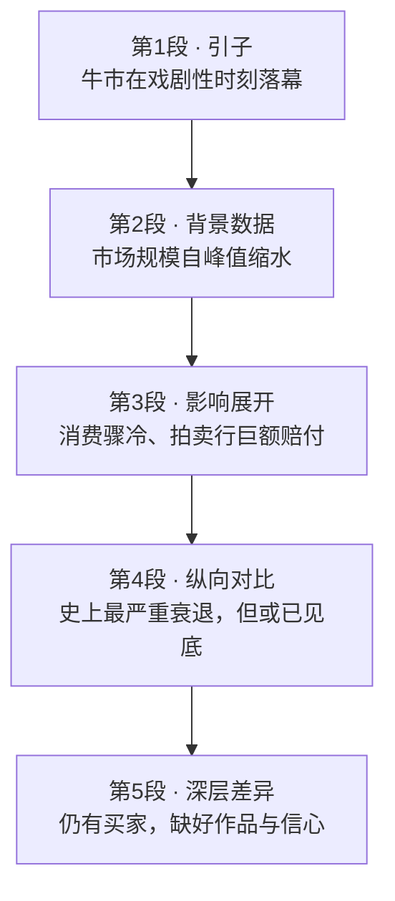

# Passage 06 · 艺术品市场的低迷状况（真题册）

## 答题记录

| 轮次  | 日期         | 题号  | 正确  | 错误  | 正确率 | 用时    | 错题归因 |
| --- | ---------- | --- | --- | --- | --- | ----- | ---- |
| 1   | 2026/10/11 | 1-5 | 3   | 2   |     | 15min |      |
| 2   |            |     |     |     |     |       |      |
| 3   |            |     |     |     |     |       |      |

> [!tip] 填写口径
> - **用时**以分钟计，只计做题时间，不含精读复盘。
> - **错题归因**填「题型·错误类型」，如：推理判断·过度推断、主旨大意·以偏概全。
> - 纵向看趋势：正确率升而用时过长 → 熟练度不足；用时降而正确率波动 → 定位不稳。

> [!info] 文章档案
> - **来源**：考研英语（二）2010 年 Text 1（《考研英语 58 篇基础阅读·真题册》书页 008–009，答案解析见书页 093–095）
> - **题材**：商业经济
> - **结构**：5 段 / 19 句 ＋ 5 题
> - **难度**：★★★☆☆
> - **一句话主旨**：以赫斯特拍卖与雷曼破产同日发生的戏剧性场景开篇，回顾 2008 年金融危机后全球艺术品市场自 650 亿美元峰值一路下滑的过程，并点出本次衰退的特点——需求仍在，缺的是好作品与信心。

## 一、篇章脉络

- **第 1 段**：以一个具体场景引出话题——2008 年 9 月 15 日赫斯特天价拍卖的同一天雷曼兄弟申请破产，宣告艺术品市场百年牛市终结。
- **第 2 段**：给出市场全貌与数据，说明牛市早已失去势头，规模自 650 亿美元缩水至约 500 亿，并解释该市场受关注度高的原因。
- **第 3 段**：展开危机的影响——消费骤冷、当代艺术销售额暴跌、两大拍卖行向客户支付巨额保证金。
- **第 4 段**：把本次衰退与 1989 年对比，指明其严重程度，同时借佳士得高管之口提出「已到谷底」的判断。
- **第 5 段**：指出本次衰退与上次的不同——市场仍有买家，真正的问题不是需求不足，而是缺少好作品；非卖不可者离场观望，等待信心回归。

> [!tip] 行文逻辑
> 现象（戏剧性事件）→ 数据（规模缩水）→ 影响（行业寒冬）→ 评价（最严重但见底）→ 深因（供需错位）。典型的「事件驱动 + 数据支撑 + 观点收尾」商业报道结构；第 5 题主旨题正是考这套结构的概括。

## 二、逐段精读

### 第 1 段 · 牛市落幕的戏剧性时刻

**原文**

① The longest bull run in a century of art-market history ended on a dramatic note with a sale of 56 works by Damien Hirst, *Beautiful Inside My Head Forever*, at Sotheby's in London on September 15th 2008.
② All but two pieces sold, fetching more than £70m, a record for a sale by a single artist.
③ It was a last victory.
④ As the auctioneer called out bids, in New York one of the oldest banks on Wall Street, Lehman Brothers, filed for bankruptcy.

**译文**

① 一个世纪以来艺术品市场最长的牛市，以戏剧性的方式落幕：2008 年 9 月 15 日，伦敦苏富比以「美丽永存脑海」为题拍卖了达米恩·赫斯特的 56 件作品。
②（本场拍卖）除两件外其余均被售出，总成交额超过 7000 万英镑，创造了单个艺术家作品成交额纪录。
③ 这是最后的胜利。
④ 拍卖师喊出竞价的同时，在纽约，华尔街最古老的银行之一——雷曼兄弟——申请了破产。

> [!note] 段落要点
> - 功能：开篇设景，用「同一天发生的两件事」制造强烈反差（拍卖场狂欢 vs 银行倒闭），引出牛市终结的主题。
> - ③ 句 It was a last victory 是全文「题眼」：拍卖的辉煌实为崩盘前夜——第 1 题即考此句。

#### 长难句 · 本段

> [!abstract] 本段第 ① 句 · The longest bull run in a century of art-market history ended on a dramatic note with a sale of 56 works by Damien Hirst, *Beautiful Inside My Head Forever*, at Sotheby's in London on September 15th 2008.

**结构拆解**

- **主干**：The longest bull run（主） + ended（谓）
- **定语**：in a century of art-market history（介词短语，修饰 bull run）
- **方式状语**：on a dramatic note（以戏剧性的方式）
- **伴随状语**：with a sale of 56 works by Damien Hirst
- **同位语**：*Beautiful Inside My Head Forever*（解释说明 a sale，拍卖专场名）
- **时空状语**：at Sotheby's in London / on September 15th 2008

**参考译文**

一个世纪以来艺术品市场最长的牛市以戏剧性的方式落幕：2008 年 9 月 15 日，伦敦苏富比拍卖了达米恩·赫斯特的 56 件作品（《美丽永存脑海》专场）。

> [!tip] 拆解要点
> 句子虽长却只有 ended 一个谓语动词：先抓谓语定主干，再按「方式 → 伴随 → 同位 → 时空」顺序剥离状语。

> [!abstract] 本段第 ④ 句 · As the auctioneer called out bids, in New York one of the oldest banks on Wall Street, Lehman Brothers, filed for bankruptcy.

**结构拆解**

- **主干**：one of the oldest banks（主） + filed for（谓） + bankruptcy（宾）
- **时间状语从句**：As the auctioneer called out bids（当拍卖师喊出竞价时）
- **地点状语**：in New York
- **定语**：on Wall Street（修饰 banks）
- **同位语**：Lehman Brothers（解释说明主语，构成「分隔结构」）

**参考译文**

拍卖师喊出竞价的同时，在纽约，华尔街最古老的银行之一——雷曼兄弟——申请了破产。

> [!tip] 拆解要点
> 主语与其同位语被谓语隔开是本句难点：看到逗号夹注的大写专名（, Lehman Brothers,）先确认它只解释前面名词，不参与主干。

#### 本段重点词汇

| 单词 / 短语 | 词性 | 文中意 | 常用考义与拓展 | 英文示例搭配（中译） |
| --- | --- | --- | --- | --- |
| **bull run** | n. | 牛市行情 | bull market 牛市 / bear market 熊市；run 此处指「一段持续期」 | the longest bull run（最长的牛市行情） |
| **dramatic** | adj. | 戏剧性的；引人注目的 | 派生 drama n. 戏剧；dramatically adv. 显著地（数据类高频） | ended on a dramatic note（以戏剧性的方式收场） |
| **note** | n. | 特征；气氛；调子 | 熟词僻义：常见义「笔记；便条」→ 文中义「调子、气氛」 | end on a dramatic note（以戏剧性的方式收场） |
| **sale** | n. | 拍卖会；专场 | 熟词僻义：售卖 → 文中指「（艺术品）拍卖专场」 | a sale of 56 works by Damien Hirst（赫斯特 56 件作品的拍卖专场） |
| **work** | n. | 作品 | 熟词僻义：工作 → 艺术作品（常用复数 works） | 56 works by Damien Hirst（赫斯特的 56 件作品） |
| **all but** | （phr.） | 除……之外都 | 易混：另一常考义为「几乎，差一点」（all but impossible 几乎不可能） | All but two pieces sold（除两件外全部售出） |
| **piece** | n. | （艺术品的）件；一件作品 | 熟词僻义：碎片 / 一块 → 文中指「一件作品」 | two pieces（两件作品） |
| **fetch** | v. | 售得，卖得（某价） | 熟词僻义：取来 → 售得 | fetching more than £70m（卖得 7000 多万英镑） |
| **record** | n. | 纪录 | 动词义「记录、录制」；a record for 创……的纪录 | a record for a sale by a single artist（单个艺术家拍卖的纪录） |
| **auctioneer** | n. | 拍卖师 | 派生 auction n. 拍卖；auction house 拍卖行 | as the auctioneer called out bids（在拍卖师喊出竞价时） |
| **call out** | （v.） | 大声说出；喊出 | 另一义「召集、出动」（call out the army） | called out bids（喊出竞价） |
| **bid** | n. | 出价；竞买 | 动词义「出价；投标」；bidder n. 竞买人 | call out bids（喊出竞价） |
| **file for bankruptcy** | （v.） | 申请破产 | file v. 提交（申请），僻义；file a lawsuit 提起诉讼 | filed for bankruptcy（申请破产） |

### 第 2 段 · 市场规模自峰值缩水

**原文**

① The world art market had already been losing momentum for a while after rising bewilderingly since 2003.
② At its peak in 2007 it was worth some $65 billion, reckons Clare McAndrew, founder of Arts Economics, a research firm—double the figure five years earlier.
③ Since then it may have come down to $50 billion.
④ But the market generates interest far beyond its size because it brings together great wealth, enormous egos, greed, passion and controversy in a way matched by few other industries.

**译文**

① 自 2003 年以来令人费解地暴涨之后，世界艺术品市场失去势头已有一段时间。
② 据艺术经济研究公司创始人克莱尔·麦克安德鲁估算，在 2007 年的顶峰时期，全球艺术品市场价值约 650 亿美元——是五年前的两倍。
③ 此后，其价值可能已降至 500 亿美元。
④ 但该市场产生的利益远远超过其本身的规模，因为它将巨额财富、膨胀的自尊心、贪婪、激情与争议以其他行业难以比拟的方式汇聚在一起。

> [!note] 段落要点
> - 功能：补足背景——牛市并非戛然而止，崩盘前已在「失速」；用具体数据（650 亿 → 500 亿）量化下滑。
> - ④ 句的让步逻辑（But...）解释「市场虽小、动静很大」的原因，是转折后的常考重点；第 3 题 [B] 项的排除正依赖此句。

#### 长难句 · 本段

> [!abstract] 本段第 ② 句 · At its peak in 2007 it was worth some $65 billion, reckons Clare McAndrew, founder of Arts Economics, a research firm—double the figure five years earlier.

**结构拆解**

- **主干（引述部分）**：reckons（谓） + Clare McAndrew（主，**主谓倒装**，宾语从句前置）
- **宾语从句**：At its peak in 2007 it was worth some $65 billion
- **同位语**：founder of Arts Economics（说明 McAndrew 身份）；a research firm（说明 Arts Economics）
- **破折号补充**：double the figure five years earlier（同位语，补充说明 $65 billion）

**参考译文**

据艺术经济研究公司创始人克莱尔·麦克安德鲁估算，2007 年顶峰时全球艺术品市场价值约 650 亿美元——是五年前的两倍。

> [!tip] 拆解要点
> 新闻体倒装引述「宾语从句 + reckons + 人名」极常见，等同于 says Clare McAndrew；先认出引述动词，就不会把 reckons 误当从句谓语。

> [!abstract] 本段第 ④ 句 · But the market generates interest far beyond its size because it brings together great wealth, enormous egos, greed, passion and controversy in a way matched by few other industries.

**结构拆解**

- **主干**：the market（主） + generates（谓） + interest（宾）
- **定语**：far beyond its size（修饰 interest）
- **原因状语从句**：because it brings together...（五项并列宾语：great wealth, enormous egos, greed, passion and controversy）
- **方式状语 + 后置定语**：in a way + 过去分词 matched by few other industries（修饰 a way）

**参考译文**

但该市场产生的利益远超其规模，因为它将巨额财富、膨胀的自尊心、贪婪、激情与争议以其他行业难以比拟的方式汇聚在一起。

> [!tip] 拆解要点
> matched by... 是分词后置定语（= which is matched by...），意为「被其他行业比肩」；注意比较的对象是「汇聚财富与争议的方式」，不是「发展势头」——第 3 题 [B] 项正是偷换这一点。

#### 本段重点词汇

| 单词 / 短语 | 词性 | 文中意 | 常用考义与拓展 | 英文示例搭配（中译） |
| --- | --- | --- | --- | --- |
| **momentum** | n. | 势头；动力 | 高频抽象词，可与 lose / gain / maintain 搭配 | losing momentum（失去势头） |
| **for a while** | （adv.） | 一段时间；一阵子 | 同义 for some time；常与完成（进行）时连用 | had been losing momentum for a while（失势已有一段时间） |
| **bewilderingly** | adv. | 令人困惑地；令人费解地 | 派生 bewilder v. 使迷惑；bewildered adj. 不知所措的 | rising bewilderingly（涨得令人费解） |
| **at its peak** | （prep.） | 在顶峰；在峰值时 | peak n. 顶点；反义 at its lowest / at the bottom（见第 4 段③） | At its peak in 2007（在 2007 年的顶峰时期） |
| **worth** | adj. | 值……的；价值为 | be worth + 金额 / doing（值得做） | it was worth some $65 billion（价值约 650 亿美元） |
| **figure** | n. | 数字；数额 | 熟词僻义：图形 / 人物 / 身材 → 文中指「数字」 | double the figure five years earlier（是五年前那个数字的两倍） |
| **reckon** | v. | 认为；估算 | 口语化 estimate，阅读中常引述观点：reckon that... | reckons Clare McAndrew（麦克安德鲁估算道） |
| **come down to** | （v.） | （价格）下降到 | 区别 come down（下降）与 boil down to（归结为） | come down to $50 billion（降至 500 亿美元） |
| **generate** | v. | 产生；创造 | 派生 generation n.；generate income / interest 创造收益 | generates interest far beyond its size（产生远超其规模的影响/利益） |
| **interest** | n. | 好处；利益 | 熟词僻义：兴趣 / 利息 → 利益、好处 | generate interest far beyond its size（产生远超其规模的好处） |
| **far beyond** | （prep.） | 远远超出 | far 加强比较级/超出程度；beyond one's expectation 出乎意料 | interest far beyond its size（远超其规模的影响） |
| **size** | n. | 规模；体量 | 熟词僻义：尺寸、尺码 → 组织/市场的规模 | far beyond its size（远超其自身规模） |
| **bring together** | （v.） | 汇集；使聚在一起 | 同义 gather / combine；bring about 导致（形近辨析） | brings together great wealth and controversy（汇聚巨额财富与争议） |
| **ego** | n. | 自我；自尊心 | 派生 egoist n. 利己主义者；egocentric adj. 以自我为中心的 | enormous egos（膨胀的自尊心） |
| **greed** | n. | 贪婪；贪心 | 派生 greedy adj. 贪婪的 | brings together greed（汇集贪婪） |
| **controversy** | n. | 争论；争议 | 派生 controversial adj. 有争议的（写作高频词） | arouse controversy（引发争议） |
| **match** | v. | 与……相匹敌 | 熟词僻义：比赛 / 火柴 → 比得上 | matched by few other industries（少有其他行业能比得上） |

### 第 3 段 · 行业寒冬与巨额赔付

**原文**

① In the weeks and months that followed Mr. Hirst's sale, spending of any sort became deeply unfashionable.
② In the art world that meant collectors stayed away from galleries and salerooms.
③ Sales of contemporary art fell by two-thirds, and in the most overheated sector, they were down by nearly 90% in the year to November 2008.
④ Within weeks the world's two biggest auction houses, Sotheby's and Christie's, had to pay out nearly $200m in guarantees to clients who had placed works for sale with them.

**译文**

① 在赫斯特的作品拍卖之后的一段时间里，任何形式的消费都变得极不合时宜。
② 在艺术领域，那意味着收藏家们远离了画廊和拍卖行。
③ 当代艺术品的销售额下降了 2/3，而在最热门（过热）的领域，截至 2008 年 11 月的一年里销售额几乎下降了 90%。
④ 短短几周内，全球最大的两家拍卖行——苏富比和佳士得——不得不向委托他们拍卖作品的客户支付近 2 亿美元的保证金。

> [!note] 段落要点
> - 功能：用三层数据递进展示衰退烈度——整体消费 → 当代艺术销售额 -2/3 → 最热门领域 -90%。
> - ② 句是第 2 题的解题关键：unfashionable 的具体所指由 ② 句 that meant 给出。

#### 长难句 · 本段

> [!abstract] 本段第 ④ 句 · Within weeks the world's two biggest auction houses, Sotheby's and Christie's, had to pay out nearly $200m in guarantees to clients who had placed works for sale with them.

**结构拆解**

- **主干**：the world's two biggest auction houses（主） + had to pay out（谓） + nearly $200m（宾）
- **时间状语**：Within weeks
- **同位语**：Sotheby's and Christie's（解释说明主语）
- **状语**：in guarantees（以保证金的形式）+ to clients（向客户）
- **定语从句**：who had placed works for sale with them（修饰 clients，过去完成时表「先于主句动作」）

**参考译文**

短短几周内，全球最大的两家拍卖行——苏富比和佳士得——不得不向委托他们拍卖作品的客户支付近 2 亿美元的保证金。

> [!tip] 拆解要点
> pay out A in B = 「以 B 的名义支付 A」；who 从句的 had placed（过去完成时）提示时间先后，翻译时需补出「（早已）委托」。

#### 本段重点词汇

| 单词 / 短语 | 词性 | 文中意 | 常用考义与拓展 | 英文示例搭配（中译） |
| --- | --- | --- | --- | --- |
| **follow** | v. | 在……之后发生；随后 | 熟词僻义：跟随 → 文中指「紧随其后发生」；following adj. 接下来的 | in the weeks and months that followed（在随后的几周和几个月里） |
| **of any sort** | （prep.） | 任何种类的 | sort n. 种类（同义 kind / type）；sort of 有几分 | spending of any sort（任何形式的消费） |
| **deeply** | adv. | 极大地；深深地 | 程度副词，修饰抽象形容词：deeply concerned / rooted | became deeply unfashionable（变得极不合时宜） |
| **unfashionable** | adj. | 不合时宜的；不流行的 | 反义 fashionable；同义 out of date | become deeply unfashionable（变得极不合时宜） |
| **collector** | n. | 收藏家 | 派生 collect v. 收集；collection n. 收藏品 | collectors stayed away from galleries（收藏家远离画廊） |
| **stay away from** | （v.） | 远离；不介入 | 同义 keep away from（见第 5 段④） | stayed away from galleries and salerooms（远离画廊和拍卖行） |
| **gallery** | n. | 画廊；美术馆 | 同义 art gallery；与 auction house 分属一级/二级市场 | galleries and salerooms（画廊和拍卖行） |
| **saleroom** | n. | 拍卖行；拍卖厅 | 本义「拍卖厅」，文中借代拍卖机构（= auction house） | collectors stayed away from salerooms（收藏家远离拍卖行） |
| **contemporary** | adj. | 当代的；现代的 | 名词义「同龄人，同时代的人」为僻义 | sales of contemporary art（当代艺术品的销售额） |
| **fall by** | （v.） | 下降了（幅度） | 数据类高频：fall by + 幅度 / fall to + 数值 | fell by two-thirds（下降了三分之二） |
| **two-thirds** | num. | 三分之二 | 分数表达：分子基数词 + 分母序数词（分子 >1 时分母加 s） | fell by two-thirds（下降了三分之二） |
| **be down by** | （v.） | 下降了（幅度） | 数据类高频：be down by + 幅度；反义 be up by | they were down by nearly 90%（销售额几乎下降了 90%） |
| **overheated** | adj. | 过热的；过火的 | 经济语境常考：overheated economy 经济过热 | the most overheated sector（最热门/过热的领域） |
| **sector** | n. | 领域；行业 | 同义 industry / field；public sector 公共部门 | in the most overheated sector（在最热门的领域） |
| **auction house** | n. | 拍卖行 | 同义 saleroom；两大拍卖行 Sotheby's / Christie's | the two biggest auction houses（最大的两家拍卖行） |
| **pay out** | （v.） | 支付；付巨款 | 区别 pay off（还清；得到回报） | pay out nearly $200m（支付近 2 亿美元） |
| **guarantee** | n. | 保证金；担保 | 动词义「保证，担保」为写作高频词 | in guarantees to clients（以保证金形式给客户） |
| **client** | n. | 客户；委托人 | 同义 customer（商业）/ principal（法律委托人） | guarantees to clients（给客户的保证金） |
| **place sth. for sale with** | （v.） | 委托（某人/机构）出售 | place 熟词僻义：放置 → 正式「委托、下单」 | placed works for sale with them（委托他们拍卖作品） |

### 第 4 段 · 最严重衰退，但或已见底

**原文**

① The current downturn in the art market is the worst since the Japanese stopped buying Impressionists at the end of 1989.
② This time experts reckon that prices are about 40% down on their peak on average, though some have been far more fluctuant.
③ But Edward Dolman, Christie's chief executive, says: "I'm pretty confident we're at the bottom."

**译文**

① 当前艺术品市场的衰退，是自 1989 年底日本人停止购买印象派画家（的作品）以来最严重的一次。
② 专家估计，此番艺术品价格较峰值平均下跌约 40%，不过部分作品价格波动更为剧烈。
③ 但佳士得首席执行官爱德华·多尔曼表示：「我相当确信我们已在低谷。」

> [!note] 段落要点
> - 功能：纵向对比定严重程度（自 1989 年以来之最），数据（-40%）说话；③ 句借业内人士之口第一次给出「见底」的乐观判断，与第 5 段衔接。

#### 长难句 · 本段

> [!abstract] 本段第 ① 句 · The current downturn in the art market is the worst since the Japanese stopped buying Impressionists at the end of 1989.

**结构拆解**

- **主干**：The current downturn（主） + is（系） + the worst（表）
- **定语**：in the art market（修饰 downturn）
- **时间状语从句**：since the Japanese stopped buying Impressionists at the end of 1989（自……以来）
- **注意**：since 此处表「自从」，不表「因为」；stopped buying 为「停止购买」

**参考译文**

当前艺术品市场的衰退，是自 1989 年底日本人停止购买印象派画家（的作品）以来最严重的一次。

> [!tip] 拆解要点
> since 在最高级句式中常引导时间状语从句，与 the worst 构成「自某时以来最……」；判断 since 是「自从」还是「因为」，看主句是否为完成时或最高级表述。

#### 本段重点词汇

| 单词 / 短语 | 词性 | 文中意 | 常用考义与拓展 | 英文示例搭配（中译） |
| --- | --- | --- | --- | --- |
| **current** | adj. | 当前的；目前的 | 派生 currently adv.；current n. 潮流、电流（僻义） | the current downturn（当前的衰退） |
| **downturn** | n. | 衰退期；下行 | economic downturn 经济下行（写作高频） | the current downturn in the art market（当前艺术品市场的衰退） |
| **Impressionist** | n. | 印象派画家 | 派生 impressionism n. 印象派；impression n. 印象 | stopped buying Impressionists（停止购买印象派画家的作品） |
| **be down on** | （adj.） | 比（峰值）低；低于 | 同义 be down from；be down by + 幅度（见第 3 段③） | prices are about 40% down on their peak（价格较峰值低约 40%） |
| **on average** | （adv.） | 平均而言 | 同义 on the average；average n./adj./v. 平均 | prices are about 40% down on average（价格平均下跌约 40%） |
| **fluctuant** | adj. | 波动的 | 派生 fluctuate v. 波动；fluctuation n.（高频词族） | far more fluctuant（波动更为剧烈） |
| **chief executive** | n. | 首席执行官（CEO） | executive n. 高管 / adj. 执行的；CEO = chief executive officer | Christie's chief executive（佳士得首席执行官） |
| **confident** | adj. | 确信的；有信心的 | 派生 confidence n. 信心（见第 5 段④）；be confident that... | I'm pretty confident we're at the bottom（我相当确信我们已处低谷） |
| **at the bottom** | （prep.） | 处于低谷 | 反义 at the peak / at the top | we're at the bottom（我们已在低谷） |

### 第 5 段 · 仍有买家，缺的是好作品与信心

**原文**

① What makes this slump different from the last, he says, is that there are still buyers in the market.
② Almost everyone who was interviewed for this special report said that the biggest problem at the moment is not a lack of demand but a lack of good work to sell.
③ The three Ds—death, debt and divorce—still deliver works of art to the market.
④ But anyone who does not have to sell is keeping away, waiting for confidence to return.

**译文**

① 他指出，此次衰退与上次的不同之处在于，市场上仍有买家存在。
② 几乎所有接受本次特别报道采访的人都表示，当下最大的问题不是需求不足，而是缺少好的待售作品。
③ 「三个 D」——死亡（death）、债务（debt）和离婚（divorce）——仍在为市场输送艺术品。
④ 但任何并非非卖不可的人都远离了市场，等待信心回归。

> [!note] 段落要点
> - 功能：收束全文，给出本次衰退的定性——供需错位而非需求消失。
> - ② 句 not A but B 结构点明核心矛盾；③ 句是第 4 题命题点，④ 句是第 3 题 [D] 项依据。

#### 长难句 · 本段

> [!abstract] 本段第 ① 句 · What makes this slump different from the last, he says, is that there are still buyers in the market.

**结构拆解**

- **主语**：What makes this slump different from the last（**what 引导的主语从句**，what 在从句中作主语）
- **插入语**：he says
- **系表结构**：is + **that 引导的表语从句**（that there are still buyers in the market）

**参考译文**

他指出，此次衰退与上次的不同之处在于，市场上仍有买家存在。

> [!tip] 拆解要点
> 「What makes A different from B is that...」是「比较 + 归因」的高能句型；去掉插入语 he says 后骨架一目了然。

> [!abstract] 本段第 ② 句 · Almost everyone who was interviewed for this special report said that the biggest problem at the moment is not a lack of demand but a lack of good work to sell.

**结构拆解**

- **主干**：Almost everyone（主） + said（谓） + that 宾语从句
- **定语从句**：who was interviewed for this special report（修饰 everyone）
- **宾语从句**：the biggest problem is not A but B（并列结构作表语）
- **A / B**：a lack of demand / a lack of good work to sell（不定式 to sell 作后置定语）

**参考译文**

几乎所有接受本次特别报道采访的人都表示，当下最大的问题不是需求不足，而是缺少好的待售作品。

> [!tip] 拆解要点
> not A but B 是阅读「取非」高频结构，答案往往落在 but 之后；识别时确认 A、B 语法形式对称（此处均为 a lack of...）。

#### 本段重点词汇

| 单词 / 短语 | 词性 | 文中意 | 常用考义与拓展 | 英文示例搭配（中译） |
| --- | --- | --- | --- | --- |
| **slump** | n. | 萧条期；骤降 | 动词义「（价格等）暴跌」；同义 decline / plunge | this slump（这次衰退） |
| **interview** | v. | 采访；面谈 | 名词义「面试；采访」；interviewee 受访者 / interviewer 采访者 | who was interviewed for this special report（为本次特别报道接受采访的） |
| **special report** | n. | 特别报道；专题报道 | report n./v. 报告；a special report on... 关于……的专题 | for this special report（为本次特别报道） |
| **at the moment** | （adv.） | 目前；当下 | 同义 at present / currently；另一义「此刻、那时」 | the biggest problem at the moment（当下最大的问题） |
| **a lack of** | （n.） | 缺乏；不足 | 派生 lack v. 缺乏；for lack of 因缺少 | not a lack of demand but a lack of good work（不是需求不足，而是缺少好作品） |
| **demand** | n. | 需求 | 经济类核心词：supply and demand 供需；动词义「要求」 | a lack of demand（需求不足） |
| **debt** | n. | 债务；欠款 | 派生 debtor n. 债务人；in debt 负债 | debt and divorce（债务与离婚） |
| **divorce** | n. | 离婚 | 动词义「使离婚；使分离」：divorce A from B | the three Ds—death, debt and divorce（三个 D——死亡、债务、离婚） |
| **deliver** | v. | 输送；交付 | 熟词僻义：递送 → 提供、输送；deliver a speech 发表演讲 | deliver works of art to the market（向市场输送艺术品） |
| **keep away** | （v.） | 远离；不靠近 | 同义 stay away from（见第 3 段②）；keep away from 后接宾语 | is keeping away（正远离市场/持观望态度） |
| **confidence** | n. | 信心；信任 | 派生 confident adj.（见第 4 段③）；consumer confidence 消费者信心 | waiting for confidence to return（等待信心回归） |
| **return** | v. | 恢复；回归 | 熟词僻义：归还 → （状态）恢复；n. 回报（tax return） | waiting for confidence to return（等待信心回归） |

## 三、全篇重点词汇汇总（自测用）

> [!info] 说明
> 本表只列「单词 / 词性 / 所在段」，不含释义与搭配，用于遮表自测：说出词义后再回该段核对。
> 收录**全篇所有段落词汇，共 70 条，不删减**，与各段「本段重点词汇」等长同源。

| 单词 / 短语 | 词性 | 所在段 |
| --- | --- | --- |
| **bull run** | n. | 第 1 段 |
| **dramatic** | adj. | 第 1 段 |
| **note** | n. | 第 1 段 |
| **sale** | n. | 第 1 段 |
| **work** | n. | 第 1 段 |
| **all but** | （phr.） | 第 1 段 |
| **piece** | n. | 第 1 段 |
| **fetch** | v. | 第 1 段 |
| **record** | n. | 第 1 段 |
| **auctioneer** | n. | 第 1 段 |
| **call out** | （v.） | 第 1 段 |
| **bid** | n. | 第 1 段 |
| **file for bankruptcy** | （v.） | 第 1 段 |
| **momentum** | n. | 第 2 段 |
| **for a while** | （adv.） | 第 2 段 |
| **bewilderingly** | adv. | 第 2 段 |
| **at its peak** | （prep.） | 第 2 段 |
| **worth** | adj. | 第 2 段 |
| **figure** | n. | 第 2 段 |
| **reckon** | v. | 第 2 段 |
| **come down to** | （v.） | 第 2 段 |
| **generate** | v. | 第 2 段 |
| **interest** | n. | 第 2 段 |
| **far beyond** | （prep.） | 第 2 段 |
| **size** | n. | 第 2 段 |
| **bring together** | （v.） | 第 2 段 |
| **ego** | n. | 第 2 段 |
| **greed** | n. | 第 2 段 |
| **controversy** | n. | 第 2 段 |
| **match** | v. | 第 2 段 |
| **follow** | v. | 第 3 段 |
| **of any sort** | （prep.） | 第 3 段 |
| **deeply** | adv. | 第 3 段 |
| **unfashionable** | adj. | 第 3 段 |
| **collector** | n. | 第 3 段 |
| **stay away from** | （v.） | 第 3 段 |
| **gallery** | n. | 第 3 段 |
| **saleroom** | n. | 第 3 段 |
| **contemporary** | adj. | 第 3 段 |
| **fall by** | （v.） | 第 3 段 |
| **two-thirds** | num. | 第 3 段 |
| **be down by** | （v.） | 第 3 段 |
| **overheated** | adj. | 第 3 段 |
| **sector** | n. | 第 3 段 |
| **auction house** | n. | 第 3 段 |
| **pay out** | （v.） | 第 3 段 |
| **guarantee** | n. | 第 3 段 |
| **client** | n. | 第 3 段 |
| **place sth. for sale with** | （v.） | 第 3 段 |
| **current** | adj. | 第 4 段 |
| **downturn** | n. | 第 4 段 |
| **Impressionist** | n. | 第 4 段 |
| **be down on** | （adj.） | 第 4 段 |
| **on average** | （adv.） | 第 4 段 |
| **fluctuant** | adj. | 第 4 段 |
| **chief executive** | n. | 第 4 段 |
| **confident** | adj. | 第 4 段 |
| **at the bottom** | （prep.） | 第 4 段 |
| **slump** | n. | 第 5 段 |
| **interview** | v. | 第 5 段 |
| **special report** | n. | 第 5 段 |
| **at the moment** | （adv.） | 第 5 段 |
| **a lack of** | （n.） | 第 5 段 |
| **demand** | n. | 第 5 段 |
| **debt** | n. | 第 5 段 |
| **divorce** | n. | 第 5 段 |
| **deliver** | v. | 第 5 段 |
| **keep away** | （v.） | 第 5 段 |
| **confidence** | n. | 第 5 段 |
| **return** | v. | 第 5 段 |

> [!warning] 熟词僻义专列（14 个）
> - **run** n. 一段持续的行情/时期（非「跑」）
> - **note** n. 气氛、调子（非「笔记」）
> - **sale** n. 拍卖专场（非「销售」）
> - **work** n. 艺术作品（非「工作」）
> - **piece** n. 一件作品（非「碎片」）
> - **fetch** v. 售得（非「取来」）
> - **file** v. 提交（申请）（非「文件」）
> - **figure** n. 数字、数额（非「图形 / 人物」）
> - **interest** n. 利益、好处（非「兴趣 / 利息」）
> - **size** n. 规模、体量（非「尺寸」）
> - **match** v. 匹敌、比得上（非「比赛 / 火柴」）
> - **follow** v. 随后发生（非「跟随」）
> - **deliver** v. 输送、提供（非「递送」）
> - **return** v. （状态）恢复（非「归还 / 返回」）

> [!example] 同义替换链（阅读题高频）
> - 衰退/下滑：**downturn = slump = decline = fall**（第 3—5 段轮换使用，实指同一概念）
> - 底部：**at the bottom ≈ at a low point**；峰值：**at its peak = on their peak**
> - 远离：**stay away from = keep away from**（第 3 段② 与第 5 段④ 呼应）
> - 下降幅度：**fall by = be down by = be down on**（第 3 段③ 与第 4 段②）

## 四、知识点补充

> [!question] 背景知识
> - **雷曼兄弟破产**：2008 年 9 月 15 日，拥有 158 年历史的华尔街投行雷曼兄弟申请破产保护，标志全球金融危机全面升级；文中它与赫斯特拍卖同日发生，构成强烈反讽——艺术品市场的「最后辉煌」与金融体系的崩塌同框。
> - **达米恩·赫斯特（Damien Hirst）**：英国当代艺术家，「英国青年艺术家」（YBA）群体代表，以鲨鱼标本、钻石骷髅等装置闻名，是艺术市场商业化的标志性人物。
> - **苏富比（Sotheby's）与佳士得（Christie's）**：全球两大拍卖行，分别创立于 1744 年与 1766 年；文中 guarantee（保证金）指拍卖行向委托人承诺的最低成交价，市场下行时拍卖行需补足差额。
> - **「三个 D」**：death, debt, divorce——艺术品流入市场的传统三大动因：遗产处置、偿债、离婚分产，即「非卖不可」的典型场景。
> - **1989 年底日本人停购印象派**：日本泡沫经济时期曾天价扫货印象派名作，泡沫破裂后骤然收手，触发艺术品市场上一轮大衰退，故文中用作对比基准。

> [!warning] 语法点
> - **新闻体倒装引述**：`..., reckons Clare McAndrew` / `..., he says`——先把引述动词剥离，主干立现（第 2 段②、第 5 段①）。
> - **同位语的分隔**：`one of the oldest banks..., Lehman Brothers, filed for...`——同位语夹在主谓之间形成分隔，勿误判为主语（第 1 段④）。
> - **not A but B**：`is not a lack of demand but a lack of good work`——否定前者肯定后者，是态度与细节题的定位金句（第 5 段②）。
> - **过去完成时的先后关系**：`who had placed works for sale`——从句动作先于主句，翻译时补「（早已）委托」（第 3 段④）。
> - **since 的两种用法**：本段为「自从」（时间状语从句），非「因为」，靠主句最高级/完成时判别（第 4 段①）。
> - **英语分数表达**：分子用基数词、分母用序数词，分子大于 1 时分母加 s：`two-thirds`（2/3）、`one-third`（1/3）（第 3 段③）。

> [!success] 写作可迁移句型
> - `What makes A different from B is that...` → 对比型作文开头：What makes online learning different from traditional classes is that it frees students from time and space limits.
> - `The biggest problem at the moment is not a lack of A but a lack of B` → 「不是……而是……」强调句式，适合问题分析段。
> - `A generates interest far beyond its size` → 表示「影响力远超体量」，可评述小而重要的对象。
> - `end on a ... note` / `on a dramatic note` → 以某种调子收尾：The meeting ended on a hopeful note.

> [!danger] 易混辨析
> - **slump / downturn / recession**：slump 强调骤降、低迷（本文作名词）；downturn 强调周期性下行；recession 是正式经济学术语「经济衰退」。
> - **auctioneer / auction house / saleroom**：auctioneer 拍卖师（人）；auction house 拍卖行（机构）；saleroom 本义拍卖厅，文中借代「拍卖行」。
> - **file / apply**：file for 多用于正式提交法律或官方申请（file for bankruptcy / file a lawsuit）；apply for 泛指申请（apply for a job / visa）。
> - **pay out / pay off**：pay out 支出、赔付；pay off 还清（债务）或「得到回报」，含义几乎相反。
> - **fall by / fall to / be down by**：fall by + 幅度（-2/3）；fall to + 数值；be down by + 幅度（数据题必辨）。

## 五、题目分析

> [!info] 题目总览
> | 题号 | 题型 | 定位 | 答案 |
> | --- | --- | --- | --- |
> | 1 | 细节推断题（因果） | 第 1 段①③句 | D |
> | 2 | 词义句意题 | 第 3 段①②句 | A |
> | 3 | 判断题（NOT true） | 第 2、3、5 段 | B |
> | 4 | 事实细节题 | 第 5 段③句 | C |
> | 5 | 主旨大意题 | 全文（首段 + 各段首句） | C |

### 第 1 题 · 细节推断题（因果）

> [!question] 原题
> In the first paragraph, Damien Hirst's sale was referred to as "a last victory" because
> - A. the art market had witnessed a succession of victories.
> - B. the auctioneer finally got the two pieces at the highest bids.
> - C. *Beautiful Inside My Head Forever* won over all masterpieces.
> - D. it was successfully made just before the world financial crisis.

**正确答案**：**D. it was successfully made just before the world financial crisis.（它恰在全球金融危机爆发之前成功举办）**

**定位与依据**
- 定位第 1 段①③④句：① 句拍卖戏剧性地落幕（ended），③ 句称之为「最后的胜利」，④ 句拍卖师喊价的同时雷曼兄弟申请破产。
- 因果链：拍卖「恰好发生在雷曼破产、金融危机爆发之前」→ 辉煌是崩盘前最后一场 → 故称 last victory。

**干扰项分析**

| 选项 | 选项内容 | 判断 | 排除理由 |
| --- | --- | --- | --- |
| A | the art market had witnessed a succession of victories. | ✗ | 无中生有：原文未提及艺术市场已经见证了一系列的胜利 |
| B | the auctioneer finally got the two pieces at the highest bids. | ✗ | 与原文相反：第 1 段②句说明除两件作品外其余均被售出，并非「拍卖师最终拍下两件作品」 |
| C | *Beautiful Inside My Head Forever* won over all masterpieces. | ✗ | 张冠李戴：*Beautiful Inside My Head Forever* 是拍卖专场的主题，而非「战胜所有杰作」的作品 |

> [!tip] 解题思路
> 代词/短语指代因果题：先定位原句，再向**上下文**找解释——本题 ③ 句的指代对象在 ① 句，解释依据在 ④ 句；「按时间先后推因果」是此类题的核心逻辑。

### 第 2 题 · 词义句意题

> [!question] 原题
> By saying "spending of any sort became deeply unfashionable" (Line 1, Para. 3), the author suggests that
> - A. collectors were no longer actively involved in art-market auctions.
> - B. people stopped every kind of spending and stayed away from galleries.
> - C. art collection as a fashion had lost its appeal to a great extent.
> - D. works of art in general had gone out of fashion so they were not worth buying.

**正确答案**：**A. collectors were no longer actively involved in art-market auctions.（收藏家不再积极参与艺术品市场的拍卖）**

**定位与依据**
- 定位第 3 段①②句：① 句说消费变得不合时宜，② 句 immediately 解释——that meant collectors stayed away from galleries and salerooms（收藏家远离画廊和拍卖行）。
- 同义替换：no longer actively involved ≈ stayed away from。

**干扰项分析**

| 选项 | 选项内容 | 判断 | 排除理由 |
| --- | --- | --- | --- |
| B | people stopped every kind of spending and stayed away from galleries. | ✗ | 以偏概全：③句只涉及艺术品消费，未说「人们停止了所有种类的消费」 |
| C | art collection as a fashion had lost its appeal to a great extent. | ✗ | 过度推断：原文并未说明「作为时尚的艺术品收藏在很大程度上失去了吸引力」 |
| D | works of art in general had gone out of fashion so they were not worth buying. | ✗ | 无中生有：原文未提「艺术品总体上已经过时、不值得购买」 |

> [!tip] 解题思路
> 句意暗示题的答案通常就在**紧随其后的解释句**（that meant / in other words / that is）；正确项是原文的保守同义改写，带 all / every / totally 等绝对词的选项优先怀疑。

### 第 3 题 · 判断题（NOT true）

> [!question] 原题
> Which of the following statements is NOT true?
> - A. Sales of contemporary art fell dramatically from 2007 to 2008.
> - B. The art market surpassed many other industries in momentum.
> - C. The art market generally went downward in various ways.
> - D. Some art dealers were awaiting better chances to come.

**正确答案**：**B. The art market surpassed many other industries in momentum.（艺术品市场在增长势头方面超越了许多其他行业）**

**定位与依据**
- [B] 对应第 2 段①④句：① 句说「自 2003 年暴涨之后市场**已持续失去势头**」，④ 句说「将巨额财富、争议等**汇聚在一起的方式**少有行业能比」——原文比较的是「汇聚方式」，不是「增长势头」，[B] 属偷换概念，且与「失去势头」矛盾。
- [A][C][D] 均与原文一致（见下表）。

**干扰项分析**

| 选项 | 选项内容 | 判断 | 排除理由（为何为真） |
| --- | --- | --- | --- |
| A | Sales of contemporary art fell dramatically from 2007 to 2008. | ✓ 真 | 第 3 段③句：当代艺术品销售额截至 2008 年 11 月大幅下滑（-2/3、-90%） |
| C | The art market generally went downward in various ways. | ✓ 真 | 第 2 段①、第 3 段③、第 4 段①反复呈现市场各种下行 |
| D | Some art dealers were awaiting better chances to come. | ✓ 真 | 第 5 段④句：不必卖的人离场等待信心回归，即部分交易者在等更好时机 |

> [!tip] 解题思路
> NOT/EXCEPT 题逐项回原文找依据，**与原文完全一致的排除，无依据或矛盾的入选**；本题 [B] 的陷阱是把 ④ 句「in a way matched by few other industries」的比较对象从「方式」偷换成「势头」。

### 第 4 题 · 事实细节题

> [!question] 原题
> The three Ds mentioned in the last paragraph are
> - A. auction houses' favorites.
> - B. contemporary trends.
> - C. factors promoting artwork circulation.
> - D. styles representing Impressionists.

**正确答案**：**C. factors promoting artwork circulation.（促进艺术品流通的因素）**

**定位与依据**
- 定位第 5 段③句：The three Ds—death, debt and divorce—still deliver works of art to the market（仍为市场输送艺术品）。
- 同义替换：promote artwork circulation ≈ deliver works of art to the market。

**干扰项分析**

| 选项 | 选项内容 | 判断 | 排除理由 |
| --- | --- | --- | --- |
| A | auction houses' favorites. | ✗ | 答非所问：auction houses 出现在第 3 段④句，不在题干限定的最后一段 |
| B | contemporary trends. | ✗ | 答非所问：contemporary trends 对应第 3 段③句，不在最后一段 |
| D | styles representing Impressionists. | ✗ | 答非所问：Impressionists 出现在第 4 段①句，且三个 D 与印象派无关 |

> [!tip] 解题思路
> 题干限定词（in the last paragraph）本身就是排错工具：三个干扰项都取自**其他段落**的真实细节，逐项核对「是否在限定范围内」即可秒杀。

### 第 5 题 · 主旨大意题

> [!question] 原题
> The most appropriate title for this text could be
> - A. Fluctuation of Art Prices.
> - B. Up-to-date Art Auctions.
> - C. Art Market in Decline.
> - D. Shifted Interest in Arts.

**正确答案**：**C. Art Market in Decline.（衰退的艺术品市场）**

**定位与依据**
- 首段由赫斯特拍卖大获成功引出世界艺术品市场由盛转衰；中间各段展开市场低迷情况（失速、销量暴跌、巨额赔付、史上最严重衰退）；末段「市场虽然陷入衰退，但需求仍在，优秀的艺术作品有望使其复苏」。
- 全文反复出现的关键词群：losing momentum → fell by two-thirds → the worst downturn → this slump，主题即「衰退中的艺术品市场」。

**干扰项分析**

| 选项 | 选项内容 | 判断 | 排除理由 |
| --- | --- | --- | --- |
| A | Fluctuation of Art Prices. | ✗ | 以偏概全：艺术品价格的波动只是第 4 段②句的一个细节，无法覆盖全文 |
| B | Up-to-date Art Auctions. | ✗ | 偏离主题：并非介绍「最新的艺术品拍卖」，文中「最新艺术品」更是无从谈起 |
| D | Shifted Interest in Arts. | ✗ | 无中生有：文中未提及「对艺术品兴趣的转移」 |

> [!tip] 解题思路
> 标题题 = 主旨题：浏览首段 + 各段首（尾）句，找全文反复复现的话题词；警惕「细节正确但范围过窄」（A）与「文中根本不存在的话题」（D）两类高发干扰项。

## 六、复盘清单

- [ ] 通读全文，不看译文能复述每段主旨与全文脉络
- [ ] 汇总表 70 词，遮住「所在段」列自测一遍，重点过 14 个熟词僻义
- [ ] 7 个长难句，每个能 10 秒内切出主干
- [ ] 重做 5 道题，核对顶部答题记录，比对用时与正确率趋势
- [ ] 整理本题五类干扰项：无中生有（1A、2D、5D）、原文相反（1B）、张冠李戴（1C）、以偏概全/绝对化（2B、5A）、过度推断（2C）、偷换概念（3B）、答非所问（4A/B/D）
- [ ] 背诵两个写作句型：What makes... different from... / not a lack of A but a lack of B

## 七、关联笔记

- [[Passage07-高管裸辞潮]]
- [[考研英语 · 阅读六大题型方法论]]
- [[考研英语 · 熟词僻义汇总]]
