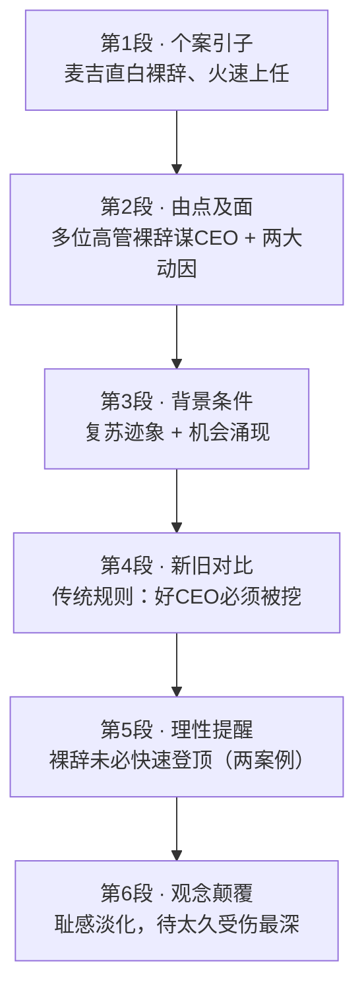

# Passage 07 · 高管裸辞潮

## 答题记录

| 轮次  | 日期         | 题号  | 正确  | 错误  | 正确率 | 用时    | 错题归因 |
| --- | ---------- | --- | --- | --- | --- | ----- | ---- |
| 1   | 2026/10/12 | 1-5 | 2   | 3   |     | 10min |      |
| 2   |            |     |     |     |     |       |      |
| 3   |            |     |     |     |     |       |      |

> [!tip] 填写口径
> - **用时**以分钟计，只计做题时间，不含精读复盘。
> - **错题归因**填「题型·错误类型」，如：词义句意·偷换概念、主旨大意·偷换中心词。
> - 纵向看趋势：正确率升而用时过长 → 熟练度不足；用时降而正确率波动 → 定位不稳。

> [!info] 文章档案
> - **来源**：考研英语（二）2011 年 Text 2（《考研英语 58 篇基础阅读·真题册》书页 010–011，答案解析见书页 095–097）
> - **题材**：商业经济
> - **结构**：6 段 / 21 句 ＋ 5 题
> - **难度**：★★★☆☆
> - **一句话主旨**：以麦吉不找下家、直白宣布辞去美国银行总裁开场，说明经济复苏期高管「没有新职位保障也敢跳槽」（裸辞）正从禁忌变为常态——旧规则被颠覆，待得太久反而受伤最深。

## 一、篇章脉络

- **第 1 段**：个案开场——麦吉不用模糊借口、公开抱负，两周内即获新任命，引出「裸辞」话题。
- **第 2 段**：由点及面——雅芳、运通的二号高管同样裸辞谋 CEO；并给出两个动因：未在继任计划中得到认可者想走、动荡环境下高管不愿含糊表态损害名声。
- **第 3 段**：背景条件——复苏初现、机会将随经济好转而增多，副职们更敢「无保护跳槽」；用 CEO 更替率下降 23% 反衬「行情未到、人心已动」。
- **第 4 段**：新旧对比——传统规则是「最理想的 CEO 候选人必须被挖来」，凸显麦吉们主动裸辞的非传统性（第 3 题考点所在）。
- **第 5 段**：理性提醒——裸辞者未必快速登顶，马拉姆等了一年、维卢姆斯塔德等了三年。
- **第 6 段**：观念收束——「跳槽可耻」的旧耻感正在淡化，传统规则被彻底颠覆；受伤害最深的是待得太久的人。

> [!tip] 行文逻辑
> 个案（麦吉）→ 普遍现象（多位高管）→ 时机背景（复苏）→ 传统参照（必须被挖）→ 现实代价（未必登顶）→ 观念颠覆（耻感淡化）。典型「新闻事件 + 现象归纳 + 专家引语」的商业报道；第 5 题主旨题考的正是「重复出现的主题：高管裸辞」。

## 二、逐段精读

### 第 1 段 · 个案引子：麦吉直白裸辞

**原文**

① When Liam McGee departed as president of Bank of America in August, his explanation was surprisingly straight up.
② Rather than cloaking his exit in the usual vague excuses, he came right out and said he was leaving "to pursue my goal of running a company."
③ Broadcasting his ambition was "very much my decision," McGee says.
④ Within two weeks, he was talking for the first time with the board of Hartford Financial Services Group, which named him CEO and chairman on September 29.

**译文**

① 今年 8 月，当利亚姆·麦吉辞去美国银行总裁一职时，他的解释出人意料地直白。
② 他没有用通常那种含糊的借口来掩饰自己的离职，而是坦率地说自己离开是「为了追求经营一家公司的目标」。
③ 麦吉说，公开自己的抱负「完全是我自己的决定」。
④ 两周之内，他首次与哈特福德金融服务集团董事会展开洽谈，该董事会于 9 月 29 日任命他为首席执行官（CEO）兼董事长。

> [!note] 段落要点
> - 功能：个案开场。三个细节（不找借口、公开抱负、两周上任）刻画「直白裸辞」的新做派，与下文「传统规则」形成张力。
> - ① 句 surprisingly straight up 是第 1 题（态度题）的命题点。

#### 长难句 · 本段

> [!abstract] 本段第 ② 句 · Rather than cloaking his exit in the usual vague excuses, he came right out and said he was leaving "to pursue my goal of running a company."

**结构拆解**

- **主干**：he（主） + came right out and said（并列谓） + 宾语从句 he was leaving...（省略 that）
- **对比状语**：Rather than cloaking his exit in the usual vague excuses（而不是……，rather than + 动名词）
- **目的状语**：to pursue my goal of running a company（不定式表目的，嵌套 of + 动名词）

**参考译文**

他没有用通常那种含糊的借口来掩饰自己的离职，而是坦率地说自己离开是「为了追求经营一家公司的目标」。

> [!tip] 拆解要点
> Rather than + doing 置于句首表「（做）……而不是……」，否定的对象在前、肯定的对象在后；这种「先否后肯」结构本身就是命题人爱设干扰项的地方。

#### 本段重点词汇

| 单词 / 短语 | 词性 | 文中意 | 常用考义与拓展 | 英文示例搭配（中译） |
| --- | --- | --- | --- | --- |
| **depart** | v. | 离职；离开 | 较 quit / resign 更正式；departure n. 离开 | departed as president（辞去总裁一职） |
| **president** | n. | 总裁；行长 | 熟词僻义：总统 / 主席 → 企业、银行的最高负责人 | president of Bank of America（美国银行总裁） |
| **surprisingly** | adv. | 出人意料地 | 派生 surprising adj.；态度题信号词（评价性副词） | his explanation was surprisingly straight up（解释出人意料地直白） |
| **straight up** | （adv.） | 直白地；坦率地 | 口语用法，同义 frankly | his explanation was surprisingly straight up（他的解释出人意料地直白） |
| **rather than** | （conj.） | 而不是 | 后接 doing / n. / 动词原形；并列结构须对称 | Rather than cloaking his exit in vague excuses（而不是用含糊借口掩饰离职） |
| **cloak** | v. | 掩饰；掩盖 | 熟词僻义：常见义「斗篷，披风」→ 动词「掩饰」 | cloaking his exit in vague excuses（用含糊借口掩饰离职） |
| **exit** | n. | 离职；退出 | 熟词僻义：出口 → 离开（公司/职位）；动词义「退出」 | cloaking his exit（掩饰自己的离职） |
| **vague** | adj. | 含糊的；模糊的 | 派生 vaguely adv.；vagueness n. | the usual vague excuses（惯常的含糊借口） |
| **come right out** | （v.） | 直截了当地说；公开表态 | 口语短语，同义 speak out | he came right out and said...（他直截了当地说……） |
| **pursue** | v. | 追求；致力于 | 派生 pursuit n. 追求（第 2 题选项词）；pursue a goal / career | to pursue my goal of running a company（追求经营一家公司的目标） |
| **broadcast** | v. | 公开（宣扬）；传播 | 熟词僻义：广播 → 「公开表露」；过去式/分词同形 | broadcasting his ambition（公开自己的抱负） |
| **ambition** | n. | 抱负；雄心 | 派生 ambitious adj. 有野心的（中性/褒义视语境） | broadcasting his ambition（公开自己的抱负） |
| **board** | n. | 董事会 | 熟词僻义：木板 / 上（船、飞机）→ 董事会 | the board of Hartford Financial Services Group（哈特福德金融服务集团董事会） |
| **name** | v. | 任命；提名 | 熟词僻义：名字 → 任命、命名 | named him CEO and chairman（任命他为首席执行官兼董事长） |

### 第 2 段 · 由点及面：裸辞成现象

**原文**

① McGee says leaving without a position lined up gave him time to reflect on what kind of company he wanted to run.
② It also sent a clear message to the outside world about his aspirations.
③ And McGee isn't alone.
④ In recent weeks the No. 2 executives at Avon and American Express quit with the explanation that they were looking for a CEO post.
⑤ As boards scrutinize succession plans in response to shareholder pressure, executives who don't get the nod also may wish to move on.
⑥ A turbulent business environment also has senior managers cautious of letting vague pronouncements cloud their reputations.

**译文**

① 麦吉说，在没有找好下家（职位）的情况下离职，让他有时间思考自己想经营什么样的公司。
② 这也向外界清晰地传递了有关他抱负的信息。
③ 这样做的不止麦吉一人。
④ 最近几周，雅芳和美国运通的两名二号高管相继离职，理由是他们想谋求 CEO 职位。
⑤ 当董事会迫于股东的压力仔细审查继任计划时，那些没有得到认可的高管也可能想要跳槽。
⑥ 动荡的商业环境也让高管们小心翼翼，不让含糊其辞的表态玷污自己的名声。

> [!note] 段落要点
> - 功能：由个案到现象（③ And McGee isn't alone 是过渡句），并给出两个动因（⑤ 未获认可者欲走、⑥ 维护名声）。
> - ⑤ 句为第 2 题定位句；⑥ 句 cloud 为僻义动词，也是常考语言点。

#### 长难句 · 本段

> [!abstract] 本段第 ① 句 · McGee says leaving without a position lined up gave him time to reflect on what kind of company he wanted to run.

**结构拆解**

- **主干**：McGee（主） + says（谓） + 宾语从句（省略 that）
- **宾语从句主语**：leaving without a position lined up（动名词短语；lined up 为过去分词后置定语，修饰 position）
- **宾语从句谓宾**：gave（谓） + him（间宾） + time（直宾）
- **目的状语**：to reflect on...（不定式）+ what 引导的宾语从句（reflect on 的宾语）

**参考译文**

麦吉说，在没有找好下家（职位）的情况下离职，让他有时间思考自己想经营什么样的公司。

> [!tip] 拆解要点
> 宾语从句里的主语是动名词短语，且其中嵌套过去分词后置定语（a position lined up＝「已安排好的职位」）；先找出 gave 才能看清从句骨架。

> [!abstract] 本段第 ⑤ 句 · As boards scrutinize succession plans in response to shareholder pressure, executives who don't get the nod also may wish to move on.

**结构拆解**

- **主干**：executives（主） + may wish to move on（谓）
- **时间状语从句**：As boards scrutinize succession plans（当董事会审查继任计划时）
- **原因状语**：in response to shareholder pressure（迫于股东压力）
- **定语从句**：who don't get the nod（修饰 executives）

**参考译文**

当董事会迫于股东的压力仔细审查继任计划时，那些没有得到认可的高管也可能想要跳槽。

> [!tip] 拆解要点
> As 从句在此表「当……时」（伴随背景）而非「因为」；get the nod（获得点头＝得到认可）是习语，靠上下文而非字面理解。

#### 本段重点词汇

| 单词 / 短语 | 词性 | 文中意 | 常用考义与拓展 | 英文示例搭配（中译） |
| --- | --- | --- | --- | --- |
| **line up** | （v.） | 预先安排好；准备好 | 同义 arrange / secure | without a position lined up（没找好下家） |
| **reflect on** | （v.） | 思考；反省 | 熟词僻义：反射 → 沉思、反思 | reflect on what kind of company he wanted to run（思考自己想经营什么样的公司） |
| **send a clear message** | （v.） | 传递明确信息 | 写作高频：send a message that...；message 亦作「要点、主旨」 | sent a clear message to the outside world（向外界传递明确信息） |
| **aspiration** | n. | 抱负；渴望 | 派生 aspire v. 渴望（aspire to）；同义 ambition | a clear message about his aspirations（关于他抱负的清晰信息） |
| **isn't alone** | （phr.） | 并非个例；不止一人 | 写作衔接句：X isn't alone.（由个案过渡到普遍现象） | And McGee isn't alone.（麦吉并非个例） |
| **No. 2 executive** | n. | 二号高管；二把手 | 同义 deputy chief / second-in-command（见第 3 段①） | the No. 2 executives at Avon and American Express（雅芳和运通的二号高管） |
| **quit** | v. | 辞职；离开 | 同义 resign / depart / leave（详见易混辨析）；quit doing 停止做 | the No. 2 executives quit（二号高管辞职） |
| **post** | n. | 职位；岗位 | 熟词僻义：邮寄 / 柱子 → 职位；同义 position | looking for a CEO post（谋求 CEO 职位） |
| **scrutinize** | v. | 仔细审查 | 派生 scrutiny n.（under scrutiny 受到审查） | scrutinize succession plans（仔细审查继任计划） |
| **succession** | n. | 继任；接替 | 派生 successive adj. 连续的；succession plan 继任计划 | scrutinize succession plans（审查继任计划） |
| **in response to** | （prep.） | 作为对……的回应 | 同义 in reaction to；respond v. 回应 | in response to shareholder pressure（迫于股东压力） |
| **shareholder** | n. | 股东 | 同义 stockholder；stakeholder 利益相关者 | shareholder pressure（股东压力） |
| **get the nod** | （v.） | 得到认可；获选 | nod 僻义：「点头许可」→ 获准、中选 | executives who don't get the nod（未得到认可的高管） |
| **move on** | （v.） | 跳槽；继续前行 | 同义 make the jump（见第 3 段①） | may wish to move on（可能想要另谋高就） |
| **turbulent** | adj. | 动荡的；混乱的 | 派生 turbulence n. 动荡（经济语境高频） | a turbulent business environment（动荡的商业环境） |
| **cautious** | adj. | 谨慎的；小心翼翼的 | 派生 caution n. 谨慎；be cautious of/about 对……谨慎 | senior managers cautious of letting...（小心翼翼不让……的高管） |
| **pronouncement** | n. | 声明；表态 | 派生 pronounce v. 宣称、发音 | vague pronouncements（含糊其辞的表态） |
| **cloud** | v. | 玷污；使模糊 | 熟词僻义：云 → 动词「玷污、搅浑」 | letting vague pronouncements cloud their reputations（让含糊表态玷污名声） |
| **reputation** | n. | 名声；声誉 | 同义 fame / standing；damage one's reputation 损害名声 | cloud their reputations（玷污他们的名声） |

### 第 3 段 · 背景条件：复苏与机会

**原文**

① As the first signs of recovery begin to take hold, deputy chiefs may be more willing to make the jump without a net.
② In the third quarter, CEO turnover was down by 23% from a year ago as nervous boards stuck with the leaders they had, according to Liberum Research.
③ As the economy picks up, opportunities will abound for aspiring leaders.

**译文**

① 随着经济复苏的初步迹象逐渐稳固，副手们可能更愿意在没有「安全网」（新职位保障）的情况下冒险一跳。
② 据 Liberum 研究公司的数据，第三季度 CEO 更替率同比下降了 23%，因为紧张的董事会选择与现有领导者继续合作。
③ 随着经济好转，对于有抱负的领导者而言，机会将大量涌现。

> [!note] 段落要点
> - 功能：交代时机背景——复苏初现、机会将增多，解释「为什么现在敢裸辞」。
> - ② 句用「更替率下降」反衬：行情未到、人心已动（想走的人攒着劲儿），为第 4 段的「传统规则」铺垫。

#### 长难句 · 本段

> [!abstract] 本段第 ② 句 · In the third quarter, CEO turnover was down 23% from a year ago as nervous boards stuck with the leaders they had, according to Liberum Research.

**结构拆解**

- **主干**：CEO turnover（主） + was down 23%（谓，表语结构）
- **时间状语**：In the third quarter；比较基准：from a year ago
- **原因/伴随从句**：as nervous boards stuck with the leaders（as 表「因为/随着」）
- **定语从句**：(that) they had（省略关系词，修饰 leaders）
- **信息来源**：according to Liberum Research（介词短语作评注性状语）

**参考译文**

据 Liberum 研究公司的数据，第三季度 CEO 更替率同比下降了 23%，因为紧张的董事会选择与现有领导者继续合作。

> [!tip] 拆解要点
> as 在此可两读（「因为」或「随着」），但都指向「更替率下降的原因」；数据引用类句子按「主干数据 → as 从句原因 → according to 来源」三层读，信息不乱。

#### 本段重点词汇

| 单词 / 短语 | 词性 | 文中意 | 常用考义与拓展 | 英文示例搭配（中译） |
| --- | --- | --- | --- | --- |
| **sign** | n. | 迹象；征兆 | 熟词僻义：标志 / 签名 / 手势 → 「迹象」；signs of recovery 复苏迹象 | the first signs of recovery（复苏的最初迹象） |
| **recovery** | n. | 复苏；恢复 | 派生 recover v. 恢复；economic recovery 经济复苏 | the first signs of recovery（经济复苏的初步迹象） |
| **take hold** | （v.） | 稳固确立；生根 | 同义 take root；signs of recovery take hold（复苏迹象站稳） | the first signs of recovery begin to take hold（复苏的初步迹象开始稳固） |
| **deputy chief** | n. | 副手；副总 | deputy n. 副职（deputy manager 副经理）；同义 No. 2 executive | deputy chiefs may be more willing to...（副手们可能更愿意……） |
| **be willing to** | （adj.） | 愿意；乐意 | 派生 willingness n.；反义 be reluctant to 不愿 | may be more willing to make the jump（可能更愿意跳槽） |
| **make the jump** | （v.） | 跳槽；冒险一跳 | 本义「跳跃」→ 换工作；与 without a net 连用 | make the jump without a net（无退路地跳槽） |
| **without a net** | （prep.） | 无保障地；无退路地 | 源自杂技「不设安全网」，本文喻「没有新职位兜底」 | make the jump without a net（无保障跳槽/裸辞） |
| **quarter** | n. | 季度 | 熟词僻义：四分之一 → 季度；quarterly adj./adv. 季度的 | in the third quarter（在第三季度） |
| **turnover** | n. | （人事）更替率 | 熟词僻义：营业额 / 翻转 → 人事变动率 | CEO turnover was down 23%（CEO 更替率下降 23%） |
| **be down by** | （v.） | 下降了（幅度） | 数据类高频：be down by + 幅度；反义 be up by | turnover was down by 23%（更替率下降了 23%） |
| **according to** | （prep.） | 根据；据……所说 | 阅读定位信号词，后接数据来源/观点来源 | according to Liberum Research（据 Liberum 研究公司） |
| **nervous** | adj. | 紧张的；担忧的 | 熟词僻义：神经的 → 焦虑的、担忧的（经济语境常考） | nervous boards（忧心忡忡的董事会） |
| **stick with** | （v.） | 坚持；不更换 | 同义 stay with / keep to | nervous boards stuck with the leaders（紧张的董事会留用现任领导） |
| **pick up** | （v.） | （经济）好转 | 熟词僻义：捡起 / 接人 → 好转、恢复 | as the economy picks up（随着经济好转） |
| **abound** | v. | 大量存在；充裕 | 派生 abundant adj. 丰富的；abundance n. | opportunities will abound（机会将大量涌现） |
| **aspiring** | adj. | 有抱负的；有志于……的 | 派生 aspire v. / aspiration n.（见第 2 段②） | opportunities for aspiring leaders（有抱负的领导者的机会） |

### 第 4 段 · 新旧对比：好 CEO 必须被「挖」

**原文**

① The decision to quit a senior position to look for a better one is unconventional.
② For years executives and headhunters have adhered to the rule that the most attractive CEO candidates are the ones who must be poached.
③ Says Korn/Ferry senior partner Dennis Carey: "I can't think of a single search I've done where a board has not instructed me to look at sitting CEOs first."

**译文**

① 辞去高级职位去寻求更好的职位，这一决定是非同寻常（不合常规）的。
② 多年来，高管们和猎头们都信奉一条规则：最有吸引力的 CEO 候选人，是那些必须被「挖来」的人。
③ 光辉国际（Korn/Ferry）资深合伙人丹尼斯·凯里说：「我想不起我做过的哪一次寻聘中，董事会没有指示我先考察在任的 CEO。」

> [!note] 段落要点
> - 功能：亮出「旧规则」作参照——好 CEO 从来是被动被挖的，反衬第 1—2 段主动裸辞的非传统性。
> - ② 句 poached 是第 3 题（词义题）考点；③ 句以「找不到反例」强化规则。

#### 长难句 · 本段

> [!abstract] 本段第 ② 句 · For years executives and headhunters have adhered to the rule that the most attractive CEO candidates are the ones who must be poached.

**结构拆解**

- **主干**：executives and headhunters（主） + have adhered to（谓） + the rule（宾）
- **时间状语**：For years（与现在完成时连用）
- **同位语从句**：that the most attractive CEO candidates are the ones...（解释 rule 的内容，that 不作成分）
- **定语从句**：who must be poached（修饰 the ones）

**参考译文**

多年来，高管们和猎头们都信奉一条规则：最有吸引力的 CEO 候选人，是那些必须被「挖来」的人。

> [!tip] 拆解要点
> 辨析 that 从句：rule 后的 that 从句内容完整、that 不作成分 → 同位语从句；the ones 后的 who 从句缺主语 → 定语从句。同位语从句是抽象名词（rule / fact / notion）的高频搭配。

> [!abstract] 本段第 ③ 句 · Says Korn/Ferry senior partner Dennis Carey: "I can't think of a single search I've done where a board has not instructed me to look at sitting CEOs first."

**结构拆解**

- **引述倒装**：Says（谓） + Korn/Ferry senior partner Dennis Carey（主，主谓倒装）
- **直接引语主干**：I（主） + can't think of（谓） + a single search（宾）
- **定语从句**：(that) I've done（修饰 search，省略关系词）+ where a board has not instructed me to...（修饰 search，where 表抽象地点「在这类寻聘中」）
- **双重否定**：can't think of... where... not...（＝每一次都……）

**参考译文**

光辉国际（Korn/Ferry）资深合伙人丹尼斯·凯里说：「我想不起我做过的哪一次寻聘中，董事会没有指示我先考察在任的 CEO。」

> [!tip] 拆解要点
> 双重否定（can't think of... not...）＝全部肯定（每次招聘都先看在任 CEO）；where 引导定语从句时可指抽象场合（case / search / situation），不要误判为地点状语从句。

#### 本段重点词汇

| 单词 / 短语 | 词性 | 文中意 | 常用考义与拓展 | 英文示例搭配（中译） |
| --- | --- | --- | --- | --- |
| **senior** | adj. | 高级的；资深的 | 反义 junior；senior citizen 老年人（僻义）；be senior to 年长于 | quit a senior position（辞去高级职位） |
| **unconventional** | adj. | 非传统的；不合常规的 | 构词 un- + conventional（常规的）；反义 conventional | the decision to quit a senior position is unconventional（辞去高职另谋高就是不常规的） |
| **headhunter** | n. | 猎头（顾问） | 复合词 head + hunter；同义 executive recruiter | executives and headhunters（高管们和猎头们） |
| **adhere to** | （v.） | 信奉；遵循 | 同义 stick to / abide by；派生 adherence n. | adhered to the rule（信奉这条规则） |
| **candidate** | n. | 候选人；人选 | 派生 candidacy n. 候选资格；candidate for... | the most attractive CEO candidates（最有吸引力的 CEO 候选人） |
| **poach** | v. | 挖走（人才）；偷猎 | 熟词僻义：水煮（poached eggs）→ 偷猎 → 挖角（本文义） | candidates who must be poached（必须被「挖来」的候选人） |
| **single** | adj. | 单个的；任何一个 | 熟词僻义：单身的 → 用于否定句强调「一个（也没有）」 | a single search I've done（我做过的任何一次寻聘） |
| **search** | n. | （高管的）寻聘；物色 | 熟词僻义：搜索 → 名词「猎头寻聘项目」 | a single search I've done（我做过的每一次寻聘） |
| **instruct** | v. | 指示；吩咐 | 派生 instruction n. 指示、用法说明；instruct sb. to do | a board has not instructed me to...（董事会没有指示我……） |
| **look at** | （v.） | 考察；考虑 | 熟词僻义：看 → 文中指「考察、审视（人选）」 | look at sitting CEOs first（先考察在任 CEO） |
| **sitting** | adj. | 在任的；现任的 | 熟词僻义：坐 → 现任的（a sitting president 在任总统） | look at sitting CEOs first（先考察在任 CEO） |

### 第 5 段 · 理性提醒：裸辞未必快速登顶

**原文**

① Those who jumped without a job haven't always landed in top positions quickly.
② Ellen Marram quit as chief of Tropicana a decade ago, saying she wanted to be a CEO.
③ It was a year before she became head of a tiny Internet-based commodities exchange.
④ Robert Willumstad left Citigroup in 2005 with ambitions to be a CEO.
⑤ He finally took that post at a major financial institution three years later.

**译文**

① 那些没有找到工作就跳槽的人，并非总能很快登上高层职位。
② 埃伦·马拉姆十年前辞去纯果乐总裁一职，说自己想当 CEO。
③ 一年之后她才成为一家基于互联网的小型商品交易所的主管。
④ 罗伯特·维卢姆斯塔德 2005 年怀抱着当 CEO 的抱负离开花旗集团。
⑤ 三年后他才在一家大型金融机构得到那个职位。

> [!note] 段落要点
> - 功能：用两个案例给「裸辞热」泼冷水——等待期可能长达一至三年，避免文章一边倒地乐观。
> - ① 句 haven't always landed 是部分否定（并非总是），呼应 ③⑤ 句的时间差。

#### 长难句 · 本段

> [!abstract] 本段第 ③ 句 · It was a year before she became head of a tiny Internet-based commodities exchange.

**结构拆解**

- **固定句型**：It was + 时间段 + before...（过了……才……）
- **主干**：It（形式主语/先行词） + was（系） + a year（表） + before 从句
- **后置定语**：Internet-based（复合形容词）+ of a tiny... exchange（修饰 head 的所属）

**参考译文**

一年之后她才成为一家基于互联网的小型商品交易所的主管。

> [!tip] 拆解要点
> 「It was + 时间 + before...」强调「历经多久才发生」，与「It was not until... that...」（直到……才）不同；翻译时把时间差落在「才」上。

#### 本段重点词汇

| 单词 / 短语 | 词性 | 文中意 | 常用考义与拓展 | 英文示例搭配（中译） |
| --- | --- | --- | --- | --- |
| **land** | v. | 成功得到（职位） | 熟词僻义：陆地 / 着陆 → 「谋得、摘得」 | haven't always landed in top positions quickly（并不总能很快登上高位） |
| **chief** | n. | 主管；负责人 | 熟词僻义：主要的（adj.）→ 首领、主管（n.）；CEO = chief executive officer | quit as chief of Tropicana（辞去纯果乐主管一职） |
| **decade** | n. | 十年 | 同义 ten years；decades of 数十年的 | a decade ago（十年前） |
| **head** | n. | 主管；负责人 | 熟词僻义：头 → 负责人；head of department 部门主管 | became head of a tiny commodities exchange（成为一家小型商品交易所的主管） |
| **commodities exchange** | n. | 商品交易所 | commodity n. 商品（大宗）；stock exchange 证券交易所 | head of a tiny Internet-based commodities exchange（一家小型互联网商品交易所的主管） |
| **major** | adj. | 大型的；主要的 | 反义 minor；major in 主修（动词僻义） | a major financial institution（一家大型金融机构） |
| **financial institution** | n. | 金融机构 | institution n. 机构 / 制度（熟词多义）；financial crisis 金融危机 | at a major financial institution（在一家大型金融机构） |
| **take the post** | （v.） | 就任该职位 | post 僻义关注：岗位（非「邮寄」）；同义 take office | took that post at a major financial institution（在一家大型金融机构就任该职） |

### 第 6 段 · 观念颠覆：待太久反而受伤最深

**原文**

① Many recruiters say the old disgrace is fading for top performers.
② The financial crisis has made it more acceptable to be between jobs or to leave a bad one.
③ "The traditional rule was it's safer to stay where you are, but that's been fundamentally inverted," says one headhunter.
④ "The people who've been hurt the worst are those who've stayed too long."

**译文**

① 许多招聘人员表示，对顶尖人才而言，「跳槽可耻」的旧观念正在淡化。
② 金融危机让人们更容易接受待业（暂时没有工作）或辞掉一份糟糕的工作。
③ 一位猎头说：「传统规则认为待在原地更安全，但这种观念已被从根本上颠覆。」
④ 「受伤害最深的，恰恰是那些待得太久的人。」

> [!note] 段落要点
> - 功能：收束全文——「裸辞可耻」的旧耻感淡化（①②），传统规则被颠覆（③），待太久反而受损（④）。
> - ③ 句 that 指代「传统规则」整句内容；③④ 句是第 4 题（推理题）与第 5 题 [D] 项的出处。

#### 长难句 · 本段

> [!abstract] 本段第 ③ 句 · "The traditional rule was it's safer to stay where you are, but that's been fundamentally inverted," says one headhunter.

**结构拆解**

- **引述倒装**：says（谓） + one headhunter（主）
- **并列结构**：The traditional rule was..., but that's been fundamentally inverted（but 连接两个分句）
- **表语从句**：(that) it's safer to stay where you are（省略 that；内嵌 where 引导的地点从句）
- **指代**：that（指代前半句的整个「传统规则」观念）；inverted（被动：被颠倒）

**参考译文**

一位猎头说：「传统规则认为待在原地更安全，但这种观念已被从根本上颠覆。」

> [!tip] 拆解要点
> it's safer 中 it 是形式主语，真实主语是不定式 to stay...；but 后的 that 指代整个前句观念——代词指代「一句话」而非「一个名词」时，往往是推理题的埋伏点。

#### 本段重点词汇

| 单词 / 短语 | 词性 | 文中意 | 常用考义与拓展 | 英文示例搭配（中译） |
| --- | --- | --- | --- | --- |
| **recruiter** | n. | 招聘人员；猎头 | 派生 recruit v. 招募；与 headhunter 近义 | many recruiters say（许多招聘人员表示） |
| **top performer** | n. | 顶尖人才；业绩优异者 | performer 熟词僻义：表演者 → 表现者、人才；perform v. 表现 | the old disgrace is fading for top performers（顶尖人才的旧耻感正在淡化） |
| **disgrace** | n. | 不光彩；耻辱 | 派生 graceful adj. 体面的；in disgrace 失宠 | the old disgrace is fading（旧的不光彩感正在淡化） |
| **fade** | v. | 逐渐消失；变淡 | 同义 disappear gradually；fade away 消散 | the old disgrace is fading（旧耻感正在淡化） |
| **between jobs** | （prep.） | 暂时待业 | 委婉语，同义 out of work / between positions | more acceptable to be between jobs（更容易接受暂时待业） |
| **fundamentally** | adv. | 根本上；彻底地 | 派生 fundamental adj. 根本的（写作高频） | that's been fundamentally inverted（这种观念已被从根本上颠覆） |
| **invert** | v. | 颠倒；颠覆 | 派生 inversion n.；同义 overturn / reverse；inverse adj. 相反的 | that's been fundamentally inverted（这种观念已被从根本上颠覆） |

## 三、全篇重点词汇汇总（自测用）

> [!info] 说明
> 本表只列「单词 / 词性 / 所在段」，不含释义与搭配，用于遮表自测：说出词义后再回该段核对。
> 收录**全篇所有段落词汇，共 75 条，不删减**，与各段「本段重点词汇」等长同源。

| 单词 / 短语 | 词性 | 所在段 |
| --- | --- | --- |
| **depart** | v. | 第 1 段 |
| **president** | n. | 第 1 段 |
| **surprisingly** | adv. | 第 1 段 |
| **straight up** | （adv.） | 第 1 段 |
| **rather than** | （conj.） | 第 1 段 |
| **cloak** | v. | 第 1 段 |
| **exit** | n. | 第 1 段 |
| **vague** | adj. | 第 1 段 |
| **come right out** | （v.） | 第 1 段 |
| **pursue** | v. | 第 1 段 |
| **broadcast** | v. | 第 1 段 |
| **ambition** | n. | 第 1 段 |
| **board** | n. | 第 1 段 |
| **name** | v. | 第 1 段 |
| **line up** | （v.） | 第 2 段 |
| **reflect on** | （v.） | 第 2 段 |
| **send a clear message** | （v.） | 第 2 段 |
| **aspiration** | n. | 第 2 段 |
| **isn't alone** | （phr.） | 第 2 段 |
| **No. 2 executive** | n. | 第 2 段 |
| **quit** | v. | 第 2 段 |
| **post** | n. | 第 2 段 |
| **scrutinize** | v. | 第 2 段 |
| **succession** | n. | 第 2 段 |
| **in response to** | （prep.） | 第 2 段 |
| **shareholder** | n. | 第 2 段 |
| **get the nod** | （v.） | 第 2 段 |
| **move on** | （v.） | 第 2 段 |
| **turbulent** | adj. | 第 2 段 |
| **cautious** | adj. | 第 2 段 |
| **pronouncement** | n. | 第 2 段 |
| **cloud** | v. | 第 2 段 |
| **reputation** | n. | 第 2 段 |
| **sign** | n. | 第 3 段 |
| **recovery** | n. | 第 3 段 |
| **take hold** | （v.） | 第 3 段 |
| **deputy chief** | n. | 第 3 段 |
| **be willing to** | （adj.） | 第 3 段 |
| **make the jump** | （v.） | 第 3 段 |
| **without a net** | （prep.） | 第 3 段 |
| **quarter** | n. | 第 3 段 |
| **turnover** | n. | 第 3 段 |
| **be down by** | （v.） | 第 3 段 |
| **according to** | （prep.） | 第 3 段 |
| **nervous** | adj. | 第 3 段 |
| **stick with** | （v.） | 第 3 段 |
| **pick up** | （v.） | 第 3 段 |
| **abound** | v. | 第 3 段 |
| **aspiring** | adj. | 第 3 段 |
| **senior** | adj. | 第 4 段 |
| **unconventional** | adj. | 第 4 段 |
| **headhunter** | n. | 第 4 段 |
| **adhere to** | （v.） | 第 4 段 |
| **candidate** | n. | 第 4 段 |
| **poach** | v. | 第 4 段 |
| **single** | adj. | 第 4 段 |
| **search** | n. | 第 4 段 |
| **instruct** | v. | 第 4 段 |
| **look at** | （v.） | 第 4 段 |
| **sitting** | adj. | 第 4 段 |
| **land** | v. | 第 5 段 |
| **chief** | n. | 第 5 段 |
| **decade** | n. | 第 5 段 |
| **head** | n. | 第 5 段 |
| **commodities exchange** | n. | 第 5 段 |
| **major** | adj. | 第 5 段 |
| **financial institution** | n. | 第 5 段 |
| **take the post** | （v.） | 第 5 段 |
| **recruiter** | n. | 第 6 段 |
| **top performer** | n. | 第 6 段 |
| **disgrace** | n. | 第 6 段 |
| **fade** | v. | 第 6 段 |
| **between jobs** | （prep.） | 第 6 段 |
| **fundamentally** | adv. | 第 6 段 |
| **invert** | v. | 第 6 段 |

> [!warning] 熟词僻义专列（25 个）
> - **president** n. 总裁、行长（非「总统」）
> - **cloak** v. 掩饰（非「斗篷」）
> - **exit** n. 离职（非「出口」）
> - **board** n. 董事会（非「木板 / 上船」）
> - **name** v. 任命、提名（非「名字」）
> - **broadcast** v. 公开宣扬（非「广播」）
> - **line up** v. 安排好、落实好（非「排隊」）
> - **reflect on** v. 思考、反省（非「反射」）
> - **post** n. 职位（非「邮寄 / 柱子」）
> - **move on** v. 跳槽、另谋高就（非「继续走」）
> - **cloud** v. 玷污、使模糊（非「云」）
> - **sign** n. 迹象（非「标志 / 签名」）
> - **quarter** n. 季度（非「四分之一」）
> - **turnover** n. 人事更替率（非「营业额 / 翻转」）
> - **nervous** adj. 担忧的、紧张的（非「神经的」）
> - **pick up** v. （经济）好转（非「捡起 / 接人」）
> - **senior** adj. 高级的、资深的（非「年长的」）
> - **single** adj. （用于否定）任何一个（非「单身的」）
> - **look at** v. 考察、审视（非「看」）
> - **sitting** adj. 在任的（非「坐」）
> - **search** n. 猎头寻聘项目（非「搜索动作」）
> - **poach** v. 挖角（非「水煮 / 偷猎」）
> - **land** v. 成功谋得（职位）（非「陆地 / 着陆」）
> - **chief / head** n. 主管、负责人（非「主要的 / 头」）
> - **top performer** n. 顶尖人才（非「表演者」）

> [!example] 同义替换链（阅读题高频）
> - 跳槽：**make the jump = move on = quit = depart = leave**（不同正式程度轮换使用）
> - 坦率：**straight up = frankly = come right out**（第 1 题答案依据）
> - 挖人：**poach = hunt for = search = look at**（第 3 题答案依据）
> - 二把手：**No. 2 executive = deputy chief**（第 2 段④ 与第 3 段①）
> - 追求：**pursue = aspire to**；**pursuit = aspiration**（第 2 题题干与原文呼应）
> - 颠覆：**invert = overturn = reverse**

## 四、知识点补充

> [!question] 背景知识
> - **利亚姆·麦吉（Liam McGee）**：2009 年 8 月辞去美国银行（Bank of America）总裁职务，9 月底出任哈特福德金融服务集团（Hartford Financial Services Group）CEO 兼董事长，是本文的引子案例。
> - **光辉国际（Korn/Ferry）**：全球最大高管寻聘（猎头）公司之一，文中 senior partner 指其资深合伙人。
> - **文中公司与人物**：雅芳（Avon）、美国运通（American Express）、纯果乐（Tropicana，百事旗下果汁品牌）、花旗集团（Citigroup）；埃伦·马拉姆（Ellen Marram）与罗伯特·维卢姆斯塔德（Robert Willumstad，后曾任 AIG CEO）均为美国商界知名经理人。
> - **without a net**：源自空中飞人等杂技表演「不设安全网」，本文喻指「没有新职位兜底的裸辞」。

> [!warning] 语法点
> - **Rather than + doing**：句首先否后肯，「（而不是 A），而是 B」（第 1 段②）。
> - **同位语从句 vs 定语从句**：the rule **that** the most attractive... are...（that 不作成分 → 同位语）；the ones **who** must be poached（who 作主语 → 定语）（第 4 段②）。
> - **双重否定**：can't think of a single search... where... not...（＝每一次都……）（第 4 段③）。
> - **It was + 时间段 + before...**：过了……才……（第 5 段③）。
> - **形式主语与指代**：it's safer **to** stay...（it 形式主语）；but **that**'s been inverted（that 指代整个前句观念）（第 6 段③）。
> - **have + 宾语 + 形容词（宾补）**：has senior managers cautious of...（让高管们保持谨慎）（第 2 段⑥）。

> [!success] 写作可迁移句型
> - `The traditional rule was ..., but that's been fundamentally inverted.` → 用于「旧观念已被颠覆」的议论段。
> - `Those who've been hurt the worst are those who've stayed too long.` → 「那些……的人恰恰是那些……的人」的对比警句。
> - `X isn't alone.` → 由个案过渡到普遍现象的万能衔接句。
> - `As the economy picks up, opportunities will abound for...` → 展望趋势的收尾句。
> - `... sends a clear message to the outside world about...` → 说明行为传递的信号。

> [!danger] 易混辨析
> - **turnover**：人事更替率（本文）／营业额／翻转——凭语境判断，经济类文章两义都高频。
> - **board**：董事会（collective，常与 the 连用）／木板／登船（动词）。
> - **poach / hunt / headhunt**：poach 强调「从别处挖走」（含偷偷意味）；hunt for 泛指寻找；headhunt 专指猎头挖角。
> - **quit / resign / depart**：quit 口语化「辞职」；resign 正式「辞呈」；depart 最正式「离任」，常带 as 短语（depart as president）。
> - **chief / head / president / CEO**：chief、head 泛指「主管、负责人」；president 为「总裁、行长」；CEO（chief executive officer）为「首席执行官」。
> - **fall by / be down by**：均接下降幅度（见 Passage 06 第 3 段）；本文 be down by 23%。

## 五、题目分析

> [!info] 题目总览
> | 题号 | 题型 | 定位 | 答案 |
> | --- | --- | --- | --- |
> | 1 | 观点态度题 | 第 1 段①②句 | B |
> | 2 | 事实细节题 | 第 2 段①④句 | D |
> | 3 | 词义句意题 | 第 4 段②③句 | C |
> | 4 | 推理判断题 | 第 6 段③④句 | A |
> | 5 | 主旨大意题 | 全文（首段 + 各段首句） | C |

### 第 1 题 · 观点态度题

> [!question] 原题
> When McGee announced his departure, his manner can best be described as being
> - A. arrogant.
> - B. frank.
> - C. self-centered.
> - D. impulsive.

**正确答案**：**B. frank.（坦率的）**

**定位与依据**
- 定位第 1 段①②句：① 句 his explanation was surprisingly straight up（解释出人意料地直白）；② 句他没有用含糊借口掩饰，而是 came right out（直截了当）说出离开原因。
- 同义替换：frank ≈ straight up / came right out / rather than cloaking。

**干扰项分析**

| 选项 | 选项内容 | 判断 | 排除理由 |
| --- | --- | --- | --- |
| A | arrogant. | ✗ | 无中生有且贬义：文中没有「傲慢」依据 |
| C | self-centered. | ✗ | 无中生有且贬义：「以自我为中心」与「公开抱负是自己的决定」不符 |
| D | impulsive. | ✗ | 无中生有且贬义：「冲动」与「深思熟虑后裸辞求发展」相悖 |

> [!tip] 解题思路
> 态度题先抓**直接描写态度的形容词/副词**（straight up）与**行为细节**（不用借口、直说原因）；文中人物正面形象时，贬义选项（arrogant / self-centered / impulsive）整体排除。

### 第 2 题 · 事实细节题

> [!question] 原题
> According to Paragraph 2, senior executives' quitting may be spurred by
> - A. their expectation of better financial status.
> - B. their need to reflect on their private life.
> - C. their strained relations with the boards.
> - D. their pursuit of new career goals.

**正确答案**：**D. their pursuit of new career goals.（对新职业目标的追求）**

**定位与依据**
- 定位第 2 段①④句：① 句麦吉离职是为了「有时间思考想经营什么样的公司」（即追求自己的职业目标）；④ 句雅芳与运通的二号高管辞职是因为 looking for a CEO post。
- 同义替换：spur ≈ 动因；pursuit of new career goals ≈ reflect on what kind of company he wanted to run / looking for a CEO post。

**干扰项分析**

| 选项 | 选项内容 | 判断 | 排除理由 |
| --- | --- | --- | --- |
| A | their expectation of better financial status. | ✗ | 无中生有：第二段未提及对更好财务状况的期待 |
| B | their need to reflect on their private life. | ✗ | 曲解文意：①句 reflect on 的是「想经营什么公司」，非「思考私人生活」 |
| C | their strained relations with the boards. | ✗ | 过度推断：⑤句未获认可者可能想走，但推不出「与董事会关系紧张」 |

> [!tip] 解题思路
> 细节题的选项常把原文词「半真半假」重写：reflect on（B）、boards（C）都来自原文，但搭配对象被调包；回原文核对「动作 + 对象」的完整搭配，而不是只认词。

### 第 3 题 · 词义句意题

> [!question] 原题
> The word "poached" (Line 2, Paragraph 4) most probably means
> - A. approved of.
> - B. attended to.
> - C. hunted for.
> - D. guarded against.

**正确答案**：**C. hunted for.（被物色、被挖）**

**定位与依据**
- 定位第 4 段②句：最理想的 CEO 候选人是 those who must be poached 的人；③ 句凯里解释该规则——每次寻聘（search）中董事会都要求先考察在任 CEO（look at sitting CEOs first）。
- 逻辑推导：poached 与 search（寻聘）、look at（物色考察）表达同一行为 →「被物色、被挖来」。

**干扰项分析**

| 选项 | 选项内容 | 判断 | 排除理由 |
| --- | --- | --- | --- |
| A | approved of. | ✗ | 不合上下文：「被批准」与「候选人遴选规则」逻辑无关 |
| B | attended to. | ✗ | 不合上下文：「被照料」与招聘场景无关 |
| D | guarded against. | ✗ | 反向干扰：「被防范」与「最有吸引力的候选人」逻辑相反 |

> [!tip] 解题思路
> 词义题不靠词汇量靠**上下文互证**：抽象词后常跟例子或解释句（③句 for example 式引语）；在本句中 poached 与 search / look at 形成同指，代入验证即可锁定。

### 第 4 题 · 推理判断题

> [!question] 原题
> It can be inferred from the last paragraph that
> - A. top performers used to cling to their posts.
> - B. loyalty of top performers is getting out-dated.
> - C. top performers care more about reputations.
> - D. it's safer to stick to the traditional rules.

**正确答案**：**A. top performers used to cling to their posts.（顶尖人才过去常常坚守自己的岗位）**

**定位与依据**
- 定位第 6 段③句：The traditional rule was it's safer to stay where you are（传统规则认为待在原地更安全）——「过去常常如此、现在不再」的语气与 used to do 完全对应。
- 辅助依据：② 句「更容易接受待业或辞掉糟糕工作」说明「坚守岗位」是**从前**的常态。

**干扰项分析**

| 选项 | 选项内容 | 判断 | 排除理由 |
| --- | --- | --- | --- |
| B | loyalty of top performers is getting out-dated. | ✗ | 曲解概念：原文只说「待在原岗位」的规则被颠覆，「忠诚」是另一概念，且 loyalty 未被否定为过时 |
| C | top performers care more about reputations. | ✗ | 无中生有：文中所说的「名声（reputation）」在第 2 段⑥句，且与「更在意名声」不等 |
| D | it's safer to stick to the traditional rules. | ✗ | 与原文相反：原文明确说固守传统规则的做法已被颠覆 |

> [!tip] 解题思路
> 推理题的「过去 vs 现在」线索常藏在 used to / traditional / no longer / fundamentally inverted 这类标记词里；本题答案恰好是「由现在反推过去」，而不是顺着字面选「现在怎样」。

### 第 5 题 · 主旨大意题

> [!question] 原题
> Which of the following is the best title for the text?
> - A. CEOs: Where to Go?
> - B. CEOs: All the Way Up?
> - C. Top Managers Jump without a Net.
> - D. The Only Way Out for Top Performers.

**正确答案**：**C. Top Managers Jump without a Net.（高管们的「无保护跳槽」）**

**定位与依据**
- 浏览首段及其他各段首句：本文以麦吉被问到离职方式非常坦诚开篇，第二段继续谈麦吉裸辞给了他思考未来的时间，其他高管离职的原因也是追求新的职业目标；第三段首句提到高管们更愿意在没有新职位的情况下跳槽；第四段大意为辞去高级职位去寻找更好的工作并非惯例（不合常规）；第五段首句谈没有工作就跳槽的高管们并不总能很快找到高管职位；第六段首句说高管裸辞不再那么令人诟病。
- 文章自始至终重复一个主题：「高管裸辞」，[C] 项 without a net 恰是全文反复出现的意象。

**干扰项分析**

| 选项 | 选项内容 | 判断 | 排除理由 |
| --- | --- | --- | --- |
| A | CEOs: Where to Go? | ✗ | 偷换中心词：把 top managers 换成 CEOs；CEO 是大多数高管辞任后追求的职业目标，不是全文中心 |
| B | CEOs: All the Way Up? | ✗ | 偷换中心词 + 方向相反：「一路高升」与「裸辞后未必快速登顶」的文意不符 |
| D | The Only Way Out for Top Performers. | ✗ | 绝对化：利用第 6 段③④句编造出「唯一出路」；传统规则被颠覆 ≠ 高管只有裸辞一条路可走 |

> [!tip] 解题思路
> 标题题先锁定**全文复现的主题词与意象**（jump without a net 首尾呼应），再核查中心词是否被偷换（top managers ≠ CEOs）；含 only / all / never 等绝对表达的标题优先怀疑。

## 六、复盘清单

- [ ] 通读全文，不看译文能复述每段主旨与全文脉络
- [ ] 汇总表 75 词，遮住「所在段」列自测一遍，重点过 25 个熟词僻义
- [ ] 8 个长难句，每个能 10 秒内切出主干
- [ ] 重做 5 道题，核对顶部答题记录，比对用时与正确率趋势
- [ ] 重点复盘第 4 题：「used to + 传统规则被颠覆」的过去/现在对照逻辑
- [ ] 背诵写作句型：The traditional rule was..., but that's been fundamentally inverted. / Those who've been hurt the worst are those who've stayed too long.

## 七、关联笔记

- [[Passage06-艺术品市场的低迷状况]]
- [[考研英语 · 阅读六大题型方法论]]
- [[考研英语 · 熟词僻义汇总]]
