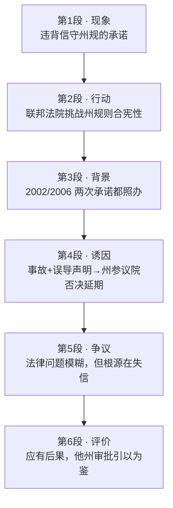

# Passage 08 · 安特吉核电违约风波

## 答题记录

| 轮次  | 日期       | 题号  | 正确  | 错误  | 正确率 | 用时    | 错题归因 |
| --- | -------- | --- | --- | --- | --- | ----- | ---- |
| 1   | 20261013 | 1-5 | 1   | 4   |     | 11min |      |
| 2   |          |     |     |     |     |       |      |
| 3   |          |     |     |     |     |       |      |

> [!tip] 填写口径
> - **用时**以分钟计，只计做题时间，不含精读复盘。
> - **错题归因**填「题型·错误类型」，如：词义句意·偷换概念、推理判断·无中生有。
> - 纵向看趋势：正确率升而用时过长 → 熟练度不足；用时降而正确率波动 → 定位不稳。

> [!info] 文章档案
> - **来源**：考研英语（二）2012 年 Text 2（《考研英语 58 篇基础阅读·真题册》书页 011–012，答案解析见书页 097–099）
> - **题材**：商业经济
> - **结构**：6 段 / 21 句 ＋ 5 题
> - **难度**：★★★☆☆
> - **一句话主旨**：能源巨头安特吉 2002 年收购佛蒙特州核电站时承诺遵守州监管、2006 年又照办州立法，如今却为保住老核电站而在联邦法院挑战州规则合宪性——作者批评其失信行径，指出本案将检验州级核监管权的边界，并提醒联邦监管机构认清该公司承诺的分量。

## 一、篇章脉络

- **第 1 段**：开篇亮观点——「协议就是协议，除非安特吉掺和进来」；该公司上周宣布背弃遵守州核监管规定的长期承诺，激起正当的公愤。
- **第 2 段**：具体化「违约」——不在州层面周旋，而是在联邦法院挑战州规则的合宪性，只为保住佛蒙特扬基核电站继续运转；作者评价：惊人的举动。
- **第 3 段**：回溯时间线证明「公司曾两次照办」——2002 年收购时承诺向州监管机构申请运营许可，2006 年又接受州立法机构审批延期；为下文「变卦」作反衬。
- **第 4 段**：交代变卦的背景与州政府行动的依据——事故频发加误导性声明引爆信任危机，州参议院以 26 比 4 否决延期。
- **第 5 段**：呈现法律争议——安特吉改口称 2002 协议无效、监管权只在联邦；各州权限边界确实模糊，但作者强调：即便担忧合理，争论的根源仍是安特吉失信。
- **第 6 段**：收束评价——公司名誉已毁、索性破罐破摔，但「这应当有后果」；以 NRC 审批朝圣者核电站作结，提醒监管方认清安特吉承诺的分量。

> [!tip] 行文逻辑
> 现象（违约）→ 行动（法庭挑战）→ 背景（曾两次照办）→ 诱因（事故毁信任）→ 争议（法律模糊但归因失信）→ 评价（失信必有代价）。典型「新闻事件 + 来龙去脉 + 作者评论」的商业法律报道；第 4、5 题分别落在这套结构的「争议」与「评价」层。

## 二、逐段精读

### 第 1 段 · 开篇亮观点：安特吉违约

**原文**

① A deal is a deal—except, apparently, when Entergy is involved.
② The company, a major energy supplier in New England, provoked justified outrage in Vermont last week when it announced it was reneging on a longstanding commitment to abide by the state's strict nuclear regulations.

**译文**

① 协议就是协议——但当安特吉公司掺和进来时，显然例外。
② 这家公司是新英格兰地区一家主要的能源供应商，上周它宣布背弃一项长期承诺——遵守该州严格的核监管规定——在佛蒙特州激起了正当的公愤。

> [!note] 段落要点
> - 功能：开篇亮明立场——「协议就是协议，唯独安特吉例外」；justified（正当的）一词表明作者站在州政府一边。
> - ② 句 renege on（违背承诺）是第 1 题（词义题）的考点词。

#### 长难句 · 本段

> [!abstract] 本段第 ② 句 · The company, a major energy supplier in New England, provoked justified outrage in Vermont last week when it announced it was reneging on a longstanding commitment to abide by the state's strict nuclear regulations.

**结构拆解**

- **主干**：The company（主） + provoked（谓） + justified outrage（宾）
- **同位语**：a major energy supplier in New England（插入主谓之间，构成**分隔结构**）
- **时间状语从句**：when it announced + 宾语从句 (that) it was reneging on...
- **后置定语**：to abide by the state's strict nuclear regulations（修饰 commitment）

**参考译文**

这家新英格兰地区的主要能源供应商上周宣布背弃遵守该州严格核监管规定的长期承诺，在佛蒙特州激起了正当的公愤。

> [!tip] 拆解要点
> 同位语插入导致主谓分隔：先跳过逗号夹注（, a major energy supplier...,）找到谓语 provoked，句子骨架立现。

#### 本段重点词汇

| 单词 / 短语 | 词性 | 文中意 | 常用考义与拓展 | 英文示例搭配（中译） |
| --- | --- | --- | --- | --- |
| **deal** | n. | 交易；协议 | 熟词僻义：动词「给予」→ 名词「交易、协议」；a deal with sb. 与某人的协议 | A deal is a deal.（协议就是协议／一言为定。） |
| **apparently** | adv. | 显然；看来 | 派生 apparent adj. 明显的；另一义「表面上」 | except, apparently, when Entergy is involved（但当安特吉掺和进来时显然例外） |
| **involved** | adj. | 牵涉其中的 | 动词 involve 涉及、使卷入；involve sb. in 使某人卷入 | when Entergy is involved（当安特吉公司牵涉其中时） |
| **energy supplier** | n. | 能源供应商 | supply v./n. 供应；supplier 供应商 | a major energy supplier in New England（新英格兰一家主要能源供应商） |
| **provoke** | v. | 激起；挑起 | 派生 provocative adj. 挑衅的；provoke outrage / debate 激起公愤／争论 | provoked justified outrage（激起了正当的公愤） |
| **justified** | adj. | 有正当理由的 | 熟词僻义：justify 证明…正当 → justified 有理有据的（非「公正的」） | justified outrage（正当的公愤） |
| **outrage** | n. | 愤怒；义愤 | 熟词僻义：暴行 → 强烈愤慨；outrageous adj. 骇人的 | provoked justified outrage（激起公愤） |
| **renege on** | （v.） | 违背；食言 | 第 1 题考点词；同义 go back on / break（见同义替换链） | reneging on a longstanding commitment（背弃一项长期承诺） |
| **longstanding** | adj. | 长期存在的；由来已久的 | 复合形容词 long-standing | a longstanding commitment（一项长期承诺） |
| **commitment** | n. | 承诺；投入 | 动词 commit 承诺／犯（罪）；commitment to 对…的承诺 | a longstanding commitment to abide by...（遵守……的长期承诺） |
| **abide by** | （v.） | 遵守；信守 | 同义 comply with / observe；近义 live by（见第 4 段①） | abide by the state's strict nuclear regulations（遵守该州严格的核监管规定） |

### 第 2 段 · 行动：联邦法院挑战州规则

**原文**

① Instead, the company has done precisely what it had long promised it would not: challenge the constitutionality of Vermont's rules in the federal court, as part of a desperate effort to keep its Vermont Yankee nuclear power plant running.
② It's a stunning move.

**译文**

① 相反，这家公司恰恰做了它长期以来承诺不做的事：在联邦法院质疑佛蒙特州规则的合宪性，这是它为让佛蒙特扬基核电站继续运转而孤注一掷的努力的一部分。
② 这是一个惊人的举动。

> [!note] 段落要点
> - 功能：具体化「违约」——不走州层面程序，直接在联邦法院挑战州规则的合宪性，只为保厂。
> - ② 句 stunning move 是作者的评价，与第 1 段 justified outrage 一脉相承。

#### 长难句 · 本段

> [!abstract] 本段第 ① 句 · Instead, the company has done precisely what it had long promised it would not: challenge the constitutionality of Vermont's rules in the federal court, as part of a desperate effort to keep its Vermont Yankee nuclear power plant running.

**结构拆解**

- **主干**：the company（主） + has done（谓） + what 引导的宾语从句（what 作 done 的宾语）
- **嵌套从句**：what it had long promised (that) it would not（promise 后省略 that 的从句）
- **冒号解释**：challenge the constitutionality...（具体说明「做的事」）
- **介词短语**：as part of a desperate effort（方式/身份）
- **后置定语**：to keep its Vermont Yankee nuclear power plant running（修饰 effort；keep + 宾语 + 现在分词作宾补）

**参考译文**

相反，这家公司恰恰做了它长期以来承诺不做的事：在联邦法院质疑佛蒙特州规则的合宪性，这是它为让佛蒙特扬基核电站继续运转而孤注一掷的努力的一部分。

> [!tip] 拆解要点
> 冒号是「解释标志」，其后的 challenge... 就是 what 指代的具体内容；what 从句内部还嵌套一个省略 that 的从句，逐层剥开即可。

#### 本段重点词汇

| 单词 / 短语 | 词性 | 文中意 | 常用考义与拓展 | 英文示例搭配（中译） |
| --- | --- | --- | --- | --- |
| **instead** | adv. | 相反；反而 | 句首转折信号词，提示「不做 A 而做 B」 | Instead, the company has done precisely...（相反，该公司恰恰做了……） |
| **precisely** | adv. | 恰恰；正是 | 派生 precise adj. 精确的；precision n. 精确 | has done precisely what it had long promised it would not（做的恰是它长期承诺不做的事） |
| **challenge** | v. | 质疑；对…提出异议 | 熟词僻义：挑战 → 法律语境「质疑（合法性）」 | challenge the constitutionality of the rules（质疑这些规则的合宪性） |
| **constitutionality** | n. | 合宪性 | 派生 constitution n. 宪法／章程；constitutional adj. 符合宪法的 | the constitutionality of Vermont's rules（佛蒙特州规则的合宪性） |
| **desperate** | adj. | 不顾一切的；孤注一掷的 | 派生 desperation n. 绝望；desperately adv. 拼命地 | a desperate effort to keep the plant running（为保核电站运转而孤注一掷的努力） |
| **stunning** | adj. | 令人震惊的 | 熟词僻义：stun 击晕 → 令人震惊／惊艳（另一常用义） | It's a stunning move.（这是一个惊人的举动。） |
| **move** | n. | 举动；行动 | 熟词僻义：移动 → 棋步、举措 | It's a stunning move.（这是一个惊人的举动。） |

### 第 3 段 · 背景：2002/2006 两次承诺都照办

**原文**

① The conflict has been surfacing since 2002, when the corporation bought Vermont's only nuclear power plant, an aging reactor in Vernon.
② As a condition of receiving state approval for the sale, the company agreed to seek permission from state regulators to operate past 2012.
③ In 2006, the state went a step further, requiring that any extension of the plant's license be subject to the Vermont legislature's approval.
④ Then, too, the company went along.

**译文**

① 这场冲突自 2002 年起逐渐显现，当时该公司买下了佛蒙特州唯一的核电站——弗农镇一座日渐老化的反应堆。
② 以获得该州对这次出售的批准为条件，公司同意向州监管机构申请 2012 年之后继续运营的许可。
③ 2006 年，该州更进一步，规定核电站许可证的任何延期都须经佛蒙特州立法机构的批准。
④ 当时，公司也都照办了。

> [!note] 段落要点
> - 功能：回溯时间线证明「公司曾两次照办」——2002 年承诺申请州许可、2006 年接受州立法审批，为今日「变卦」作反衬。
> - ② 句签订协议的目的是第 2 题的答案出处；③ 句 2006 年立法是第 2 题 [C] 项的干扰源。

#### 长难句 · 本段

> [!abstract] 本段第 ③ 句 · In 2006, the state went a step further, requiring that any extension of the plant's license be subject to the Vermont legislature's approval.

**结构拆解**

- **主干**：the state（主） + went（谓）
- **伴随状语**：requiring that...（现在分词短语）
- **虚拟语气**：require that + 主语 + (should) **be** subject to...（require 后的 that 从句用动词原形）

**参考译文**

2006 年，该州更进一步，规定核电站许可证的任何延期都须经佛蒙特州立法机构的批准。

> [!tip] 拆解要点
> require / demand / insist / suggest 等词的 that 从句用「(should) + 动词原形」虚拟语气——看到 be subject to 前没有 should，正是省略了 should 的虚拟式，不要误判为语法错误。

#### 本段重点词汇

| 单词 / 短语 | 词性 | 文中意 | 常用考义与拓展 | 英文示例搭配（中译） |
| --- | --- | --- | --- | --- |
| **surface** | v. | 显露；浮现 | 熟词僻义：表面（n.）→ 动词「显现、暴露」 | The conflict has been surfacing since 2002（这场冲突自 2002 年起逐渐显现） |
| **corporation** | n. | 公司；企业 | 同义 company / firm；corporate adj. 公司的 | when the corporation bought the plant（该公司收购核电站时） |
| **aging** | adj. | 老化的；日渐陈旧的 | age v. 变老；aging population 老龄化人口 | an aging reactor in Vernon（弗农镇一座日渐老化的反应堆） |
| **reactor** | n. | 核反应堆 | react v. 反应 + -or 名词后缀 | an aging reactor（一座老化的反应堆） |
| **as a condition of** | （prep.） | 以…为条件 | condition 熟词僻义：状况 → 条件；on condition that 条件是 | as a condition of receiving state approval（以获得州批准为条件） |
| **approval** | n. | 批准；认可 | 动词 approve of 赞成；同义 permission / license（见同义替换链） | state approval for the sale（该州对这次出售的批准） |
| **seek permission** | （v.） | 寻求许可 | seek 过去式 sought；permission from... 向…申请许可 | seek permission from state regulators（向州监管机构申请许可） |
| **regulator** | n. | 监管机构；监管者 | 动词 regulate 监管；regulation n. 条例、规定 | permission from state regulators（州监管机构的许可） |
| **operate** | v. | 运营；运转 | 名词 operation 运营、手术；operating license 运营许可 | to operate past 2012（运营至 2012 年以后） |
| **past** | prep. | 超过（时间、限度） | 熟词僻义：经过 → 「超出」某时间点 | operate past 2012（运营超过 2012 年） |
| **go a step further** | （phr.） | 更进一步 | 同义 go further；step n. 步骤、措施 | the state went a step further（该州更进一步） |
| **extension** | n. | 延期；延长 | 动词 extend 延长、延伸；extend 亦指「扩展」（见第 5 段②） | any extension of the plant's license（核电站许可证的任何延期） |
| **license** | n. | 许可证；执照 | 动词 license 批准；driver's license 驾照 | the plant's license（核电站的许可证） |
| **be subject to** | （prep.） | 须经…批准的；受支配于 | subject adj. 易受…影响的（另一常考义） | be subject to the legislature's approval（须经州立法机构批准） |
| **legislature** | n. | 立法机构 | 派生 legislative adj. 立法的；legislate v. 立法 | the Vermont legislature's approval（佛蒙特州立法机构的批准） |
| **go along** | （v.） | 同意；照办 | 完整式 go along with；本文省略 with 短语 | Then, too, the company went along.（当时公司也都照办了。） |

### 第 4 段 · 诱因：事故与误导引爆信任危机

**原文**

① Either Entergy never really intended to live by those commitments, or it simply didn't foresee what would happen next.
② A string of accidents, including the partial collapse of a cooling tower in 2007 and the discovery of an underground pipe system leakage, raised serious questions about both Vermont Yankee's safety and Entergy's management—especially after the company made misleading statements about the pipe.
③ Enraged by Entergy's behavior, the Vermont Senate voted 26 to 4 last year against allowing an extension.

**译文**

① 要么是安特吉从来就没真正打算恪守那些承诺，要么它只是没有预见到接下来会发生什么。
② 一连串的事故——包括 2007 年一座冷却塔的部分坍塌和地下管道系统泄漏的发现——让人们既对佛蒙特扬基核电站的安全性、也对安特吉的管理提出了严重质疑，尤其是在公司就该管道发表误导性声明之后。
③ 被安特吉的行为激怒的佛蒙特州参议院，去年以 26 票对 4 票否决了延期申请。

> [!note] 段落要点
> - 功能：给出州政府强硬态度的依据——事故频发（冷却塔坍塌、管道泄漏）+ 误导性声明引爆信任危机，参议院 26:4 否决延期。
> - ② 句「对……管理提出严重质疑」是第 3 题答案出处；① 句「没预料到」是 [D] 项（商业远见）的过度推断源。

#### 长难句 · 本段

> [!abstract] 本段第 ② 句 · A string of accidents, including the partial collapse of a cooling tower in 2007 and the discovery of an underground pipe system leakage, raised serious questions about both Vermont Yankee's safety and Entergy's management—especially after the company made misleading statements about the pipe.

**结构拆解**

- **主干**：A string of accidents（主） + raised（谓） + serious questions（宾）
- **插入语**：including the partial collapse... and the discovery...（举例，分隔主谓）
- **并列宾语**：both Vermont Yankee's safety and Entergy's management
- **破折号补充**：especially after the company made misleading statements（时间状语从句）

**参考译文**

一连串的事故——包括 2007 年一座冷却塔的部分坍塌和地下管道系统泄漏的发现——让人们既对佛蒙特扬基核电站的安全性、也对安特吉的管理提出了严重质疑，尤其是在公司就该管道发表误导性声明之后。

> [!tip] 拆解要点
> 主语与谓语被 including 插入语隔开：先跳过逗号夹注找到 raised，再处理 both...and... 并列与破折号后的补充层次。

#### 本段重点词汇

| 单词 / 短语 | 词性 | 文中意 | 常用考义与拓展 | 英文示例搭配（中译） |
| --- | --- | --- | --- | --- |
| **live by** | （v.） | 恪守；按…行事 | 同义 abide by（见第 1 段②）；live up to 不辜负（形近辨析） | live by those commitments（恪守那些承诺） |
| **foresee** | v. | 预见；预知 | 构词 fore-（先、前）+ see；foreseeable adj. 可预见的 | didn't foresee what would happen next（没有预见到接下来会发生什么） |
| **a string of** | （phr.） | 一连串的；一系列的 | 同义 a series of；string n. 细绳、一串 | A string of accidents（一连串事故） |
| **partial** | adj. | 部分的；不完全的 | 派生 partially adv.；反义 complete / total | the partial collapse of a cooling tower（冷却塔的部分坍塌） |
| **collapse** | n. | 倒塌；崩溃 | 动词同形；经济语境「暴跌、崩溃」 | the partial collapse of a cooling tower（冷却塔的部分坍塌） |
| **cooling tower** | n. | 冷却塔 | cool v. 冷却；核电站设施 | the partial collapse of a cooling tower（一座冷却塔的部分坍塌） |
| **leakage** | n. | 泄漏 | 动词 leak 泄漏；a gas leak 燃气泄漏 | an underground pipe system leakage（地下管道系统泄漏） |
| **raise serious questions** | （v.） | 引发严重质疑 | raise 熟词僻义：举起 → 「引起、提出」 | raised serious questions about its management（对其管理提出严重质疑） |
| **misleading** | adj. | 误导性的 | 动词 mislead（mis- 误 + lead），过去式 misled | made misleading statements about the pipe（就该管道发表误导性声明） |
| **enrage** | v. | 激怒 | 构词 en-（使）+ rage（狂怒）；同义 infuriate | Enraged by Entergy's behavior（被安特吉的行为激怒） |
| **Senate** | n. | 参议院；（州）参议院 | 美国国会两院之一；各州亦设 Senate | the Vermont Senate voted 26 to 4（佛蒙特州参议院以 26 比 4 表决） |
| **vote against** | （v.） | 投票反对 | 反义 vote for / in favor of；vote down 否决 | voted 26 to 4 last year against allowing an extension（去年以 26 比 4 否决延期） |

### 第 5 段 · 争议：法律模糊，但根源在失信

**原文**

① Now the company is suddenly claiming that the 2002 agreement is invalid because of the 2006 legislation, and that only the federal government has regulatory power over nuclear issues.
② The legal issues in the case are obscure: whereas the Supreme Court has ruled that states do have some regulatory authority over nuclear power, legal scholars say the Vermont case will offer a precedent-setting test of how far those powers extend.
③ Certainly, there are valid concerns about the patchwork regulations that could result if every state sets its own rules.
④ But had Entergy kept its word, that debate would be beside the point.

**译文**

① 如今，这家公司突然宣称：由于 2006 年的立法，2002 年的协议是无效的，而且只有联邦政府才对核问题拥有监管权。
② 本案中的法律问题并不明晰：尽管最高法院已裁定各州确实对核电拥有一定的监管权，但法学学者表示，佛蒙特案将提供一次开创先例的检验——考验证这些权力的边界究竟能延伸到何种程度。
③ 当然，如果每个州都自行制定规则，由此产生的「拼凑式」法规确实令人有理由担忧。
④ 但倘若安特吉信守了诺言，那场争论就无关紧要了。

> [!note] 段落要点
> - 功能：呈现法律争议——安特吉改口称协议无效、监管权只在联邦；州级权限边界确实模糊（让步），但作者落点在「倘若守信，争论本不存在」（④ 句虚拟倒装）。
> - ② 句「那些权力的边界」是第 4 题答案出处；③ 句拼凑法规是 [B] 项干扰源。

#### 长难句 · 本段

> [!abstract] 本段第 ② 句 · The legal issues in the case are obscure: whereas the Supreme Court has ruled that states do have some regulatory authority over nuclear power, legal scholars say the Vermont case will offer a precedent-setting test of how far those powers extend.

**结构拆解**

- **冒号总起**：The legal issues are obscure（法律问题不明朗）
- **让步从句**：whereas the Supreme Court has ruled + that 宾语从句（states do have...，do 表强调）
- **主句**：legal scholars say + 宾语从句 the Vermont case will offer a test
- **后置定语**：of how far those powers extend（介词 + 宾语从句，修饰 test）

**参考译文**

本案中的法律问题并不明晰：尽管最高法院已裁定各州确实对核电拥有一定的监管权，但法学学者表示，佛蒙特案将提供一次开创先例的检验——考验证这些权力的边界究竟能延伸到何种程度。

> [!tip] 拆解要点
> 冒号之后才是信息重心；whereas 在此表「尽管／然而」而非「当…时」；「那些权力」回指前句 states 的监管权——第 4 题正考这一指代。

> [!abstract] 本段第 ④ 句 · But had Entergy kept its word, that debate would be beside the point.

**结构拆解**

- **虚拟语气（与过去事实相反）**：had Entergy kept its word = **if Entergy had kept its word**（省略 if，had 提前构成部分倒装）
- **主句**：that debate would be beside the point（would + 动词原形）

**参考译文**

但倘若安特吉信守了诺言，那场争论就无关紧要了。

> [!tip] 拆解要点
> 「Had + 主语 + 过去分词」开头＝ if 虚拟条件句的倒装形式；读到句首的 Had / Were / Should 就按条件句理解，这是阅读中的高频语法点。

#### 本段重点词汇

| 单词 / 短语 | 词性 | 文中意 | 常用考义与拓展 | 英文示例搭配（中译） |
| --- | --- | --- | --- | --- |
| **claim** | v. | 声称；主张 | 熟词僻义：认领；索赔；声称（未必属实的断言） | is suddenly claiming that the agreement is invalid（突然声称协议无效） |
| **invalid** | adj. | 无效的 | 构词 in-（非）+ valid；反义 valid（见本段③） | the 2002 agreement is invalid（2002 年的协议无效） |
| **legislation** | n. | 立法；法律 | 动词 legislate；legislature n. 立法机构（见第 3 段③） | because of the 2006 legislation（由于 2006 年的立法） |
| **regulatory** | adj. | 监管的 | 动词 regulate；regulatory power 监管权 | regulatory power over nuclear issues（对核问题的监管权） |
| **obscure** | adj. | 模糊难解的；不清楚的 | 熟词僻义：无名的 → 晦涩的、不明朗的 | The legal issues in the case are obscure（本案的法律问题并不明晰） |
| **whereas** | conj. | 然而；尽管 | 表对比或让步，写作高频连接词 | whereas the Supreme Court has ruled that...（尽管最高法院已裁定……） |
| **the Supreme Court** | n. | （美国联邦）最高法院 | supreme adj. 最高的；justice n. 大法官 | the Supreme Court has ruled that...（最高法院已裁定……） |
| **rule** | v. | 裁决；判定 | 熟词僻义：规则（n.）→ 裁定（v.）；ruling n. 裁决 | the Supreme Court has ruled that states do have...（最高法院裁定各州确实拥有……） |
| **authority** | n. | 权力；权威 | 熟词僻义：当局（the authorities）；动词 authorize 授权 | some regulatory authority over nuclear power（对核电的一定监管权） |
| **precedent-setting** | adj. | 开创先例的 | precedent n. 先例；set a precedent 开创先例 | a precedent-setting test（一次开创先例的检验） |
| **valid** | adj. | 有依据的；有效的 | 反义 invalid；validity n. 有效性 | there are valid concerns（这些担忧不无道理） |
| **concern** | n. | 担忧；关切 | 动词 concern 涉及；concerned adj. 担心的、有关的 | valid concerns about the regulations（对相关法规的合理担忧） |
| **patchwork** | n. | 拼凑之物；大杂烩 | patch n. 补丁；patchwork quilt 百衲被；比喻「零拼碎凑」 | the patchwork regulations（各自为政的拼凑式法规） |
| **keep one's word** | （v.） | 信守诺言 | word 熟词僻义：单词 → 诺言；反义 break one's word | had Entergy kept its word（倘若安特吉信守了诺言） |
| **beside the point** | （phr.） | 离题的；无关紧要的 | 同义 irrelevant；反义 to the point 切题 | that debate would be beside the point（那场争论就无关紧要了） |

### 第 6 段 · 评价：失信应有后果，他州引以为鉴

**原文**

① The company seems to have concluded that its reputation in Vermont is already so damaged that it has nothing left to lose by going to war with the state.
② But there should be consequences.
③ Permission to run a nuclear plant is a public trust.
④ Entergy runs 11 other reactors in the United States, including Pilgrim Nuclear station in Plymouth.
⑤ Pledging to run Pilgrim safely, the company has applied for federal permission to keep it open for another 20 years.
⑥ But as the Nuclear Regulatory Commission (NRC) reviews the company's application, it should keep in mind what promises from Entergy are worth.

**译文**

① 这家公司似乎已经断定：它在佛蒙特州的名声已经败坏到如此地步，以至于与该州对抗它已没有什么可失去的了。
② 但这应当有后果。
③ 运营核电站的许可是一种公众信任。
④ 安特吉在美国还运营着另外 11 座反应堆，其中包括普利茅斯的朝圣者核电站。
⑤ 该公司一边承诺安全运营朝圣者核电站，一边已向联邦申请许可让它再运营 20 年。
⑥ 但在美国核管理委员会（NRC）审查该公司的申请时，应当记治安特吉的承诺究竟值几个钱。

> [!note] 段落要点
> - 功能：收束评价——公司「破罐破摔」，但作者主张失信必有后果；③ 句「许可即公众信任」点题，⑤⑥ 句以朝圣者核电站申请为落点，提醒 NRC 引以为鉴。
> - 本段是第 5 题（推理题）的完整出处。

#### 长难句 · 本段

> [!abstract] 本段第 ① 句 · The company seems to have concluded that its reputation in Vermont is already so damaged that it has nothing left to lose by going to war with the state.

**结构拆解**

- **主干**：The company seems to have concluded + that 宾语从句（seem to have done：对已完成动作的推测）
- **结果状语从句**：so damaged **that** it has nothing left to lose（so...that... 结构嵌在宾语从句内）
- **方式状语**：by going to war with the state

**参考译文**

这家公司似乎已经断定：它在佛蒙特州的名声已经败坏到如此地步，以至于与该州对抗它已没有什么可失去的了。

> [!tip] 拆解要点
> seem to have done 表「想必已经……」（推测已完成动作）；so...that... 藏在宾语从句里，先抓 concluded 的宾语从句边界，再拆 so...that。

> [!abstract] 本段第 ⑥ 句 · But as the Nuclear Regulatory Commission (NRC) reviews the company's application, it should keep in mind what promises from Entergy are worth.

**结构拆解**

- **时间状语从句**：as the NRC reviews the company's application（在……审查期间）
- **主干**：it（主） + should keep in mind（谓） + what 从句（宾语，因过长而自然后置）
- **宾语从句**：what promises from Entergy are worth（what 作 worth 的宾语：承诺价值几何）

**参考译文**

但在美国核管理委员会（NRC）审查该公司的申请时，应当记治安特吉的承诺究竟值几个钱。

> [!tip] 拆解要点
> keep in mind 的宾语是 what 引导的从句；worth 是介词/形容词，其后可接「价值量」——what promises are worth ＝「这些承诺值多少」，反问语气即作者的讽刺。

#### 本段重点词汇

| 单词 / 短语 | 词性 | 文中意 | 常用考义与拓展 | 英文示例搭配（中译） |
| --- | --- | --- | --- | --- |
| **conclude** | v. | 断定；得出结论 | 熟词僻义：缔结（条约）；conclusion n. 结论 | seems to have concluded that...（似乎已经断定……） |
| **damaged** | adj. | 受损的；败坏的 | 动词 damage 损害；reputation damaged 名誉受损 | its reputation in Vermont is already so damaged（它在佛蒙特的名声已严重败坏） |
| **have nothing left to lose** | （phr.） | 再没有什么可失去 | 习语 have nothing to lose 光脚不怕穿鞋的 | it has nothing left to lose（它已没有什么可失去的了） |
| **go to war with** | （v.） | 与…开战；与…对抗 | 比喻用法：正面交锋、对簿公堂 | going to war with the state（与该州对抗） |
| **consequence** | n. | 后果；结果 | 熟词僻义：重要性（of consequence）；consequent adj. 随之而来的 | But there should be consequences.（但这应当有后果。） |
| **permission** | n. | 许可；批准 | 动词 permit；同义 approval / license（见同义替换链） | Permission to run a nuclear plant（运营核电站的许可） |
| **public trust** | n. | 公众信任；公共信托 | trust n. 信任／信托（trust fund 信托基金） | Permission to run a nuclear plant is a public trust.（运营核电站的许可是公众信任。） |
| **pledge** | v. | 承诺；保证 | 名词 pledge 誓约；同义 promise / vow | Pledging to run Pilgrim safely（承诺安全运营朝圣者核电站） |
| **apply for** | （v.） | 申请 | 名词 application；apply to 适用于（另一义） | has applied for federal permission（已申请联邦许可） |
| **keep ... open** | （v.） | 使…保持运营 | open adj. 开放的、营业中的 | keep it open for another 20 years（让它再运营 20 年） |
| **review** | v. | 审查；审核 | 熟词僻义：复习／评论 → 官方「审查」 | as the NRC reviews the application（在核管会审查申请期间） |
| **application** | n. | 申请；应用 | 动词 apply；applicant n. 申请人 | reviews the company's application（审查该公司的申请） |
| **be worth** | （adj.） | 值得的；有（某）价值 | worth 前只加程度词；辨析 worthy / worthwhile | what promises from Entergy are worth（安特吉的承诺究竟值几个钱） |

## 三、全篇重点词汇汇总（自测用）

> [!info] 说明
> 本表只列「单词 / 词性 / 所在段」，不含释义与搭配，用于遮表自测：说出词义后再回该段核对。
> 收录**全篇所有段落词汇，共 74 条，不删减**，与各段「本段重点词汇」等长同源。

| 单词 / 短语 | 词性 | 所在段 |
| --- | --- | --- |
| **deal** | n. | 第 1 段 |
| **apparently** | adv. | 第 1 段 |
| **involved** | adj. | 第 1 段 |
| **energy supplier** | n. | 第 1 段 |
| **provoke** | v. | 第 1 段 |
| **justified** | adj. | 第 1 段 |
| **outrage** | n. | 第 1 段 |
| **renege on** | （v.） | 第 1 段 |
| **longstanding** | adj. | 第 1 段 |
| **commitment** | n. | 第 1 段 |
| **abide by** | （v.） | 第 1 段 |
| **instead** | adv. | 第 2 段 |
| **precisely** | adv. | 第 2 段 |
| **challenge** | v. | 第 2 段 |
| **constitutionality** | n. | 第 2 段 |
| **desperate** | adj. | 第 2 段 |
| **stunning** | adj. | 第 2 段 |
| **move** | n. | 第 2 段 |
| **surface** | v. | 第 3 段 |
| **corporation** | n. | 第 3 段 |
| **aging** | adj. | 第 3 段 |
| **reactor** | n. | 第 3 段 |
| **as a condition of** | （prep.） | 第 3 段 |
| **approval** | n. | 第 3 段 |
| **seek permission** | （v.） | 第 3 段 |
| **regulator** | n. | 第 3 段 |
| **operate** | v. | 第 3 段 |
| **past** | prep. | 第 3 段 |
| **go a step further** | （phr.） | 第 3 段 |
| **extension** | n. | 第 3 段 |
| **license** | n. | 第 3 段 |
| **be subject to** | （prep.） | 第 3 段 |
| **legislature** | n. | 第 3 段 |
| **go along** | （v.） | 第 3 段 |
| **live by** | （v.） | 第 4 段 |
| **foresee** | v. | 第 4 段 |
| **a string of** | （phr.） | 第 4 段 |
| **partial** | adj. | 第 4 段 |
| **collapse** | n. | 第 4 段 |
| **cooling tower** | n. | 第 4 段 |
| **leakage** | n. | 第 4 段 |
| **raise serious questions** | （v.） | 第 4 段 |
| **misleading** | adj. | 第 4 段 |
| **enrage** | v. | 第 4 段 |
| **Senate** | n. | 第 4 段 |
| **vote against** | （v.） | 第 4 段 |
| **claim** | v. | 第 5 段 |
| **invalid** | adj. | 第 5 段 |
| **legislation** | n. | 第 5 段 |
| **regulatory** | adj. | 第 5 段 |
| **obscure** | adj. | 第 5 段 |
| **whereas** | conj. | 第 5 段 |
| **the Supreme Court** | n. | 第 5 段 |
| **rule** | v. | 第 5 段 |
| **authority** | n. | 第 5 段 |
| **precedent-setting** | adj. | 第 5 段 |
| **valid** | adj. | 第 5 段 |
| **concern** | n. | 第 5 段 |
| **patchwork** | n. | 第 5 段 |
| **keep one's word** | （v.） | 第 5 段 |
| **beside the point** | （phr.） | 第 5 段 |
| **conclude** | v. | 第 6 段 |
| **damaged** | adj. | 第 6 段 |
| **have nothing left to lose** | （phr.） | 第 6 段 |
| **go to war with** | （v.） | 第 6 段 |
| **consequence** | n. | 第 6 段 |
| **permission** | n. | 第 6 段 |
| **public trust** | n. | 第 6 段 |
| **pledge** | v. | 第 6 段 |
| **apply for** | （v.） | 第 6 段 |
| **keep ... open** | （v.） | 第 6 段 |
| **review** | v. | 第 6 段 |
| **application** | n. | 第 6 段 |
| **be worth** | （adj.） | 第 6 段 |

> [!warning] 熟词僻义专列（14 个）
> - **deal** n. 交易、协议（非「给予」）
> - **justified** adj. 有正当理由的（非「公正的」）
> - **challenge** v. 质疑（合法性）（非「挑战」）
> - **stunning** adj. 令人震惊的（非「极漂亮的」）
> - **move** n. 举动、举措（非「移动」）
> - **surface** v. 显露、浮现（非「表面」）
> - **as a condition of** 中 condition＝条件（非「状况」）
> - **past** prep. 超过（时间）（非「经过」）
> - **rule** v. 裁决（非「规则」）
> - **obscure** adj. 晦涩难明的（非「无名的」）
> - **authority** n. 权力（非「权威人士」）
> - **word** n. 诺言（keep one's word）（非「单词」）
> - **review** v. 审查（非「复习 / 评论」）
> - **claim** v. 声称（非「认领 / 索赔」）

> [!example] 同义替换链（阅读题高频）
> - 违背承诺：**renege on = dishonor = go back on = break**（第 1 题答案依据）
> - 遵守：**abide by = live by = keep one's word = go along**（第 1 段②与第 3 段④、第 4 段①、第 5 段④ 呼应）
> - 批准／许可：**approval = permission = license**（第 2 题各选项间的名词轮换）
> - 震惊：**stunning = surprising**
> - 引发质疑：**raise questions = provoke outrage**（第 4 段②与第 1 段②）

## 四、知识点补充

> [!question] 背景知识
> - **安特吉公司（Entergy）**：美国大型能源公司，总部位于新奥尔良，在美国多地运营核电机组；2002 年收购佛蒙特扬基核电站，2010 年宣布不再寻求州许可延期，转而在联邦法院挑战州监管权，引发本文所述风波。
> - **佛蒙特州（Vermont）**：美国东北部新英格兰地区州份，以环保传统与严格监管著称；佛蒙特扬基核电站位于弗农镇（Vernon），是该州唯一核电站。
> - **NRC（Nuclear Regulatory Commission，美国核管理委员会）**：联邦独立监管机构，负责核电站安全审批与延寿审查；「联邦还是州说了算」正是本案核心法律争点。
> - **朝圣者核电站（Pilgrim Nuclear Station）**：位于马萨诸塞州普利茅斯（Plymouth），同属安特吉运营，是作者提醒 NRC「引以为鉴」的现实落点。
> - **时代背景**：2011 年日本福岛核事故后，美国对老旧核电机组延寿的审查明显趋严；本文为 2012 年考研英二 Text 2。

> [!warning] 语法点
> - **同位语分隔主谓**：`The company, a major energy supplier..., provoked...`——先跳过逗号夹注找谓语（第 1 段②）。
> - **冒号解释 + what 从句**：`done precisely what it had long promised it would not: challenge...`——冒号后即 what 的具体内容（第 2 段①）。
> - **require that + (should) do 虚拟语气**：`requiring that any extension... be subject to...`（第 3 段③）。
> - **过去分词短语作原因状语**：`Enraged by Entergy's behavior, the Vermont Senate voted...`（第 4 段③）。
> - **whereas 表让步/对比**：`whereas the Supreme Court has ruled that..., legal scholars say...`（第 5 段②）。
> - **虚拟条件句省略 if 倒装**：`But had Entergy kept its word, ... would be...`＝ If Entergy had kept...（第 5 段④）。
> - **so...that... 嵌套宾语从句**：`so damaged that it has nothing left to lose`（第 6 段①）。
> - **either...or 并列推测**：`Either Entergy never really intended to..., or it simply didn't foresee...`（第 4 段①）。

> [!success] 写作可迁移句型
> - `A deal is a deal—except, apparently, when...` → 谚语 + 例外的讽刺性开头：A promise is a promise—except, apparently, when deadlines loom.
> - `Either A never really intended to..., or it simply didn't foresee...` → 二选一归因，评述争议行为。
> - `...will offer a precedent-setting test of how far...` → 论证事件的长远意义。
> - `But had + 主语 + done..., ... would be beside the point.` → 虚拟倒装作反驳：But had the plan been fully tested, such doubts would be beside the point.
> - `Permission to... is a public trust.` → 断言式金句，用于强调责任与信任。

> [!danger] 易混辨析
> - **renege on / go back on / break one's word**：均指「违背承诺」；renege on 最正式、书面；go back on 常用；break one's word 侧重「食言」。
> - **abide by / comply with / conform to**：均指「遵守」；abide by 多接规则、协议、判决；comply with 常接 standards、requirements；conform to 强调「符合」规范。
> - **permission / approval / license**：permission 许可（动作授权）；approval 批准、认可（态度同意）；license 执照、许可证（凭证本身）。第 2 题选项正是这三者的轮换。
> - **valid / sound / plausible**：valid 有效且有依据（valid concerns）；sound 理由充分；plausible 似有道理（未必为真）。

## 五、题目分析

> [!info] 题目总览
> | 题号 | 题型 | 定位 | 答案 |
> | --- | --- | --- | --- |
> | 1 | 词义句意题 | 第 1 段①②句 | C |
> | 2 | 事实细节题 | 第 3 段①②句 | D |
> | 3 | 事实细节题 | 第 4 段①②句 | A |
> | 4 | 观点细节题 | 第 5 段②③④句 | D |
> | 5 | 推理判断题 | 第 6 段③④⑤⑥句 | A |

### 第 1 题 · 词义句意题

> [!question] 原题
> The phrase "reneging on" (Line 2, Para. 1) is closest in meaning to
> - A. condemning.
> - B. reaffirming.
> - C. dishonoring.
> - D. securing.

**正确答案**：**C. dishonoring.（违背，不履行）**

**定位与依据**
- 定位第 1 段②句：reneging on a longstanding commitment to abide by the state's strict nuclear regulations（背弃遵守该州严格核监管规定的长期承诺）。
- 结合①句 A deal is a deal—except... when Entergy is involved（协议就是协议，唯独安特吉例外）→ 对协议的「违背」。同义替换：renege on ≈ dishonor。

**干扰项分析**

| 选项 | 选项内容 | 判断 | 排除理由 |
| --- | --- | --- | --- |
| A | condemning. | ✗ | 无中生有：condemning（谴责）的对象应是行为主体，而 renege on 的宾语是承诺本身，动作方向不符 |
| B | reaffirming. | ✗ | 与原文相反：reaffirming（重申）与「背弃承诺」语义相反 |
| D | securing. | ✗ | 无中生有：securing（获得、确保）与承诺的语境无关 |

> [!tip] 解题思路
> 词义题先看**搭配对象**（renege on + commitment），再看**上下文逻辑**（deal is a deal—except...）：能同时满足「宾语是承诺」且「与协议精神相反」的只有 dishonor。

### 第 2 题 · 事实细节题

> [!question] 原题
> By entering into the 2002 agreement, Entergy intended to
> - A. obtain protection from Vermont regulators.
> - B. seek favor from the federal legislature.
> - C. acquire an extension of its business license.
> - D. get permission to purchase a power plant.

**正确答案**：**D. get permission to purchase a power plant.（获得收购核电站的许可）**

**定位与依据**
- 定位第 3 段①②句：2002 年公司收购佛蒙特州唯一核电站；「以获得该州对这次出售的批准为条件，公司同意向州监管机构申请 2012 年后继续运营的许可」。
- 签订 2002 年协议的目的即「获得州批准此次收购」→ 获得收购核电站的许可。

**干扰项分析**

| 选项 | 选项内容 | 判断 | 排除理由 |
| --- | --- | --- | --- |
| A | obtain protection from Vermont regulators. | ✗ | 偷换概念：approval（批准）≠ protection（保护）；州监管机构给予的是批准而非庇护 |
| B | seek favor from the federal legislature. | ✗ | 无中生有 + 张冠李戴：协议的对手方是**州**监管机构，与联邦立法机构（federal legislature）无关 |
| C | acquire an extension of its business license. | ✗ | 张冠李戴：许可证**延期**须经州立法机构批准是 **2006 年立法**的规定（第 3 段③），与 2002 年协议无关 |

> [!tip] 解题思路
> 时间线细节题先把「年份 + 事件」配对：2002＝收购与承诺申请许可、2006＝延期须立法审批、2010＝拒绝延期。干扰项最爱做的是**把一个年份的规定安到另一个年份的事件上**（C 项）。

### 第 3 题 · 事实细节题

> [!question] 原题
> According to Paragraph 4, Entergy seems to have problems with its
> - A. managerial practices.
> - B. technical innovativeness.
> - C. financial goals.
> - D. business vision.

**正确答案**：**A. managerial practices.（管理实践）**

**定位与依据**
- 定位第 4 段②句：一连串事故「让人们对佛蒙特扬基核电站的**安全性**和安特吉的**管理**提出了严重质疑」→ 该公司在管理方面存在问题。
- 同义替换：problems with its managerial practices ≈ serious questions about Entergy's management。

**干扰项分析**

| 选项 | 选项内容 | 判断 | 排除理由 |
| --- | --- | --- | --- |
| B | technical innovativeness. | ✗ | 无中生有：本段未提及「技术创新」的任何信息 |
| C | financial goals. | ✗ | 无中生有：本段未提及「财务目标」 |
| D | business vision. | ✗ | 过度推断：①句「根本没预料到接下来会发生什么」推不出「缺乏商业远见」这一整体判断 |

> [!tip] 解题思路
> 「have problems with its ___」这类填空式细节题，答案必须**在定位段内有明示原文**（management）；干扰项 B、C 是凭空捏造，D 是从「没预料到」过度拔高——注意「文中提到过的词」不等于「能推出的结论」。

### 第 4 题 · 观点细节题

> [!question] 原题
> In the author's view, the Vermont case will test
> - A. Entergy's capacity to fulfill all its promises.
> - B. the nature of states' patchwork regulations.
> - C. the federal authority over nuclear issues.
> - D. the limits of states' power over nuclear issues.

**正确答案**：**D. the limits of states' power over nuclear issues.（各州在核问题上的权限范围）**

**定位与依据**
- 定位第 5 段②句：法学学者表示佛蒙特案将提供一次开创先例的检验——考验证「**那些权力**的边界究竟能延伸到何种程度」；「那些权力」回指前半句各州（states）对核电的监管权。
- 作者态度佐证：③ 句承认「各州各自立法致拼凑法规」的担忧合理，④ 句虚拟倒装强调「倘若守信，争论本不存在」——争论既然已不可避免，其检验对象即州级核监管权的边界，作者与法学学者观点一致。

**干扰项分析**

| 选项 | 选项内容 | 判断 | 排除理由 |
| --- | --- | --- | --- |
| A | Entergy's capacity to fulfill all its promises. | ✗ | 答非所问：安特吉不守诺言是既定事实，并非案件「将检验」的对象 |
| B | the nature of states' patchwork regulations. | ✗ | 偷换对象：③句确实提及拼凑式法规（patchwork regulations），但它不是本案检验的对象 |
| C | the federal authority over nuclear issues. | ✗ | 张冠李戴：②句讨论的是**各州**对核电的监管权，而非联邦政府的权威 |

> [!tip] 解题思路
> 「case will test ___」的宾语要看**指代还原**：those powers ＝ states' regulatory authority；再看作者立场（③④句并未否定这一检验意义）。干扰项分别用了「文中的其他名词」（patchwork、federal）做张冠李戴——回原文核对「test 的逻辑宾语」即可。

### 第 5 题 · 推理判断题

> [!question] 原题
> It can be inferred from the last paragraph that
> - A. Entergy's business elsewhere might be affected.
> - B. the authority of the NRC will be defied.
> - C. Entergy will withdraw its Plymouth application.
> - D. Vermont's reputation might be damaged.

**正确答案**：**A. Entergy's business elsewhere might be affected.（安特吉在其他地方的业务可能会受影响）**

**定位与依据**
- 定位第 6 段③句：「运营核电站的许可是公众信任」——点明**信任**对获得许可的重要性；④⑤⑥ 句：安特吉还运营另外 11 座反应堆，并已为朝圣者核电站申请联邦延期许可，NRC 审查时「应当记治安特吉的承诺究竟值几个钱」。
- 推理链：失信 → 公众信任受损 → 其他核电站的许可申请可能受牵连 → 其在别处的业务可能受影响。

**干扰项分析**

| 选项 | 选项内容 | 判断 | 排除理由 |
| --- | --- | --- | --- |
| B | the authority of the NRC will be defied. | ✗ | 无中生有：末段未提及「NRC 的权威将受到挑战」 |
| C | Entergy will withdraw its Plymouth application. | ✗ | 过度推断：文中只说 NRC 审查时应保持警惕，并未说安特吉将**撤回**普利茅斯的申请 |
| D | Vermont's reputation might be damaged. | ✗ | 与原文相反：①句明确名誉受损的是**安特吉公司**，而非佛蒙特州 |

> [!tip] 解题思路
> 「inferred from the last paragraph」先分层：① 句（现状）→ ②③ 句（作者论点：应有后果＋许可即信任）→ ④⑤⑥ 句（证据：他州申请）。正确项 A 恰是把「论点 + 证据」合起来的一步推理；C、D 分别犯「过度推断」与「主体颠倒」，B 纯属编造。

## 六、复盘清单

- [ ] 通读全文，不看译文能复述每段主旨与全文脉络
- [ ] 汇总表 74 词，遮住「所在段」列自测一遍，重点过 14 个熟词僻义
- [ ] 8 个长难句，每个能 10 秒内切出主干
- [ ] 重做 5 道题，核对顶部答题记录，比对用时与正确率趋势
- [ ] 整理本题干扰项类型：无中生有（1A、1D、3B、3C、5B）、与原文相反（1B、5D）、偷换概念（2A、4B）、张冠李戴（2B、2C、4C）、过度推断（3D、5C）、答非所问（4A）
- [ ] 背诵两个写作句型：A deal is a deal—except... / But had..., ... would be beside the point.

## 七、关联笔记

- [[Passage07-高管裸辞潮]]
- [[考研英语 · 阅读六大题型方法论]]
- [[考研英语 · 熟词僻义汇总]]
