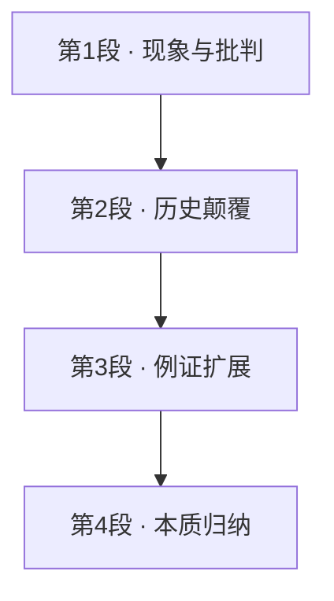

# Passage 09 · 粉色痴迷的营销真相

## 答题记录

| 轮次  | 日期       | 题号  | 正确  | 错误  | 正确率 | 用时    | 错题归因 |
| --- | -------- | --- | --- | --- | --- | ----- | ---- |
| 1   | 20261014 | 1-5 | 2   | 3   |     | 15min |      |
| 2   |          |     |     |     |     |       |      |
| 3   |          |     |     |     |     |       |      |

> [!tip] 填写口径
> - **用时**以分钟计，只计做题时间，不含精读复盘。
> - **错题归因**填题型术语：主旨大意 / 事实细节 / 推理判断 / 词义句意 / 观点态度 / 篇章结构，后接错误类型（无中生有、以偏概全、偷换概念、过度推断等）。
> - 纵向对比正确率与用时曲线即可看出趋势：正确率上升但用时过长 → 熟练度不足；用时下降但正确率波动 → 定位不够稳。

> [!info] 文章档案
> - **来源**：考研英语（二）2012 年 Text 1（原书页头印作「2012 Text 2」，疑为印刷之误——Passage 08 的 Entergy 案才是 Text 2，本篇为「Pretty in pink」）
> - **题材**：商业经济
> - **结构**：4 段 / 18 句
> - **难度**：★★★☆☆
> - **一句话主旨**：女孩对粉色的痴迷并非天生，而是 20 世纪 80 年代以来「细分客群牟利」的营销策略一手塑造的。

## 一、篇章脉络

- **第 1 段**：以「粉红佳丽」起笔，指出粉色虽颂扬少女时代，却把女孩身份与外表牢牢熔合——奠定批判基调。
- **第 2 段**：用颜色史颠覆常识——20 世纪前童装不分颜色，粉色曾属「男性」，1980 年代营销策略才让粉色「归位」女孩。
- **第 3 段**：例证扩展——连「学步儿童」这一「常识性阶段」也是 1930 年代服装商的营销伎俩。
- **第 4 段**：归纳升华——细分客群是提升利润的万全之策，放大乃至发明性别差异正是其最省力的手法，回答了标题之问。

> [!tip] 行文逻辑
> 现象（女孩痴迷粉色）→ 历史考据（颜色偏好非天生）→ 平行例证（toddler 同为营销产物）→ 本质揭示（细分牟利、发明差异）。典型的「破除迷思型」论证结构。

## 二、逐段精读

### 第 1 段 · 粉红佳丽：批判的起笔

**原文**

① Pretty in pink: adult women do not remember being so obsessed with the colour, yet it is pervasive in our young girls' lives.
② It is not that pink is intrinsically bad, but it is such a tiny slice of the rainbow and, though it may celebrate girlhood in one way, it also repeatedly and firmly fuses girls' identity to appearance.
③ Then it presents that connection, even among two-year-olds, between girls as not only innocent but as evidence of innocence.
④ Looking around, I despaired at the singular lack of imagination about girls' lives and interests.

**译文**

① 「粉红佳丽」：成年女性不记得自己曾如此痴迷这种颜色，然而它在我们少女的生活中无处不在。
② 这并不是说粉色本身有多糟糕，而是它在彩虹中只占那么窄窄的一缕：虽然在某种意义上它为少女时代增光，却也在反复而顽固地把女孩的身份与外表熔合在一起。
③ 于是，就连在两岁的孩子身上，它也把这种联系呈现出来——女孩不仅天真，而且她们本身就是天真的证据。
④ 环顾四周，我对女孩的生活与兴趣中这种异乎寻常的想象力匮乏感到绝望。

> [!note] 段落要点
> - 功能：开篇立论——粉色「无害却有害」，要害在「身份与外表熔合」。
> - ④ 句作者直接现身表态（despair），为全文定下批判基调，末段将揭晓批判对象。

#### 长难句 · 本段

> [!abstract] 本段第 ② 句 · It is not that pink is intrinsically bad, but it is such a tiny slice of the rainbow and, though it may celebrate girlhood in one way, it also repeatedly and firmly fuses girls' identity to appearance.

**结构拆解**

- **主干**：It is not that... , but...（not...but 并列两个分句）
- **表语从句 1**：that pink is intrinsically bad（not that 引导）
- **分句 2 主干**：it is such a tiny slice of the rainbow and ... it also ... fuses A to B
- **让步插入**：though it may celebrate girlhood in one way（插入 and 与 it also 之间）
- **固定搭配**：fuse A to B（把 A 与 B 熔合）

**参考译文**

这并不是说粉色本身有多糟糕，而是它在彩虹中只占那么窄窄的一缕：虽然它在某种意义上为少女时代增光，却也在反复而顽固地把女孩的身份与外表熔合在一起。

> [!tip] 拆解要点
> 遇到 It is not that..., but... 先切成两个分句再各自治内分析；本句难点在 but 分句里又插了一个 though 从句——把插入语先摘出来，主干 immediately 清晰。

> [!abstract] 本段第 ③ 句 · Then it presents that connection, even among two-year-olds, between girls as not only innocent but as evidence of innocence.

**结构拆解**

- **主干**：it presents that connection（那个联系）
- **分隔结构**：that connection 与 between girls 被插入语 even among two-year-olds 隔开
- **介宾补足**：between girls as not only innocent but as evidence of innocence（as A but as B 并列）
- **修辞**：innocent 与 innocence 顶真呼应

**参考译文**

于是，就连在两岁的孩子身上，它也把这种联系呈现出来——女孩不仅天真，而且她们本身就是天真的证据。

> [!tip] 拆解要点
> presents A ... between B as C 是典型的「动宾被状语分隔」结构：先找 presents 的宾语（that connection），再把 between... 挂回去，最后拆 as not only...but as... 并列。

#### 本段重点词汇

| 单词 / 短语 | 词性 | 文中意 | 常用考义与拓展 | 英文示例搭配（中译） |
| --- | --- | --- | --- | --- |
| **obsessed** | adj. | 痴迷的，念念不忘的 | obsession n. 痴迷；固定搭配 be obsessed with | being so obsessed with the colour（如此痴迷这种颜色） |
| **pervasive** | adj. | 无处不在的，弥漫的 | pervade v. 遍布；pervasion n.; 近义 widespread / prevalent | pervasive in our young girls' lives（在少女的生活中无处不在） |
| **intrinsically** | adv. | 本质地，内在地 | intrinsic adj. 内在的 ↔ extrinsic adj. 外在的 | pink is intrinsically bad（粉色本身很糟） |
| **slice** | n. | 一部分，一缕 | 熟义：薄片；a slice of cake 一块蛋糕；slices of the market 市场份额 | such a tiny slice of the rainbow（彩虹中那么窄的一缕） |
| **celebrate** | v. | 颂扬，赞美 | 熟词僻义：庆祝 → 赞美、为……增光；celebrated adj. 著名的 | celebrate girlhood in one way（在某种意义上为少女时代增光） |
| **fuse** | v. | 熔合，融合 | n. 保险丝，导火索；fuse A to/with B | fuses girls' identity to appearance（把女孩身份与外表熔合） |
| **identity** | n. | 身份，特性 | identity card 身份证；identify v. 识别 | girls' identity（女孩的身份） |
| **appearance** | n. | 外表，外貌 | 熟义：出现；to all appearances 表面上 | fuses identity to appearance（把身份与外表熔合） |
| **present** | v. | 呈现，展示 | 熟词僻义：n. 礼物 → v. 呈现；presentation n. | it presents that connection（它呈现出那种联系） |
| **connection** | n. | 联系 | connect v. 连接；in connection with 与……有关 | presents that connection between girls（呈现女孩身上的那种联系） |
| **innocent** | adj. | 天真的，纯真的 | innocence n. 天真；熟义：无辜的 | girls as not only innocent（女孩不仅天真） |
| **evidence** | n. | 证据，印证 | evident adj. 明显的；in evidence 显眼 | as evidence of innocence（作为天真的证据） |
| **despair** | v. | 绝望 | n. 绝望；despair of 对……绝望；desperation n. | I despaired at the singular lack（我对这种匮乏感到绝望） |
| **singular** | adj. | 异乎寻常的，非凡的 | 熟词僻义：单数的 → 非凡的、突出的；singularity n. | the singular lack of imagination（异乎寻常的想象力匮乏） |
| **lack** | n. | 缺乏 | v. 缺乏；be lacking in 缺少；a lack of | the singular lack of imagination（想象力的严重匮乏） |
| **imagination** | n. | 想象力 | imagine v. 想象；imaginative adj. 富有想象力的 | lack of imagination about girls' lives（对女孩生活想象力的匮乏） |

### 第 2 段 · 颜色史颠覆常识

**原文**

① Girls' attraction to pink may seem unavoidable, somehow encoded in their DNA, but according to Jo Paoletti, an associate professor of American Studies, it is not.
② Children were not colour-coded at all until the early 20th century: in the era before domestic washing machines all babies wore white as a practical matter, since the only way of getting clothes clean was to boil them.
③ What's more, both boys and girls wore what were thought of as gender-neutral dresses.
④ When nursery colours were introduced, pink was actually considered the more masculine colour, a pastel version of red, which was associated with strength.
⑤ Blue, with its intimations of the Virgin Mary, constancy and faithfulness, symbolised femininity.
⑥ It was not until the mid-1980s, when amplifying age and sex differences became a dominant children's marketing strategy, that pink fully came into its own, when it began to seem inherently attractive to girls, part of what defined them as female, at least for the first few critical years.

**译文**

① 女孩对粉色的迷恋看似不可避免，仿佛根植于她们的 DNA，但据美国研究副教授乔·保利蒂所言，事实并非如此。
② 直到 20 世纪早期，儿童从未按颜色加以区分：在家用洗衣机问世之前的年代，出于实际考虑，所有婴儿都穿白色——因为当时把衣服洗净的唯一办法就是煮洗。
③ 再者，男孩女孩穿的都是人们心目中不分性别的童装。
④ 当婴儿房用色被引入时，粉色实际上被认为更具男性气质——它是红色的浅柔版本，而红色与力量相联。
⑤ 蓝色则因让人联想到圣母马利亚的坚贞与忠诚，象征着女性气质。
⑥ 直到 20 世纪 80 年代中期，「放大年龄与性别差异」成为儿童市场的主导营销策略，粉色才彻底时来运转：从那时起，它开始显得对女孩有着天生的吸引力，成为界定「女性」的一部分——至少在人生最初的关键几年里是如此。

> [!note] 段落要点
> - 功能：用颜色史「证伪」粉色天生命题，是全文的论据核心（第 2 题定位段）。
> - 论证链：无颜色区分 → 粉色曾属男性、蓝色曾属女性 → 1980s 营销策略才完成「颜色归位」，将矛头引向 marketing。

#### 长难句 · 本段

> [!abstract] 本段第 ① 句 · Girls' attraction to pink may seem unavoidable, somehow encoded in their DNA, but according to Jo Paoletti, an associate professor of American Studies, it is not.

**结构拆解**

- **分句 1 主干**：Girls' attraction to pink may seem unavoidable
- **插入语**：somehow encoded in their DNA（过去分词短语，补理由）
- **转折**：but
- **插入成分**：according to Jo Paoletti + an associate professor of American Studies（同位语）
- **省略句**：it is not ＝ it is not (unavoidable / encoded in their DNA)

**参考译文**

女孩对粉色的迷恋看似不可避免，仿佛根植于她们的 DNA，但据美国研究副教授乔·保利蒂所言，事实并非如此。

> [!tip] 拆解要点
> but 后的 it is not 是「承接省略」：把 but 前的表语（unavoidable）补回去即可。同位语「职务头衔」常紧跟人名，是判断观点归属的关键标记。

> [!abstract] 本段第 ④ 句 · When nursery colours were introduced, pink was actually considered the more masculine colour, a pastel version of red, which was associated with strength.

**结构拆解**

- **时间状语从句**：When nursery colours were introduced
- **主干**：pink was actually considered the more masculine colour（被动语态，consider + 宾补）
- **同位语**：a pastel version of red（解释 masculine colour）
- **非限定定语从句**：which was associated with strength（修饰 red）

**参考译文**

当婴儿房用色被引入时，粉色实际上被认为更具男性气质——它是红色的浅柔版本，而红色与力量相联。

> [!tip] 拆解要点
> 被动语态「A was considered B」在阅读中可还原为「人们认为 A 是 B」；which 从句的先行词要就近确认（此处是 red，不是 colour），同义替换题最爱在此设障。

> [!abstract] 本段第 ⑥ 句 · It was not until the mid-1980s, when amplifying age and sex differences became a dominant children's marketing strategy, that pink fully came into its own, when it began to seem inherently attractive to girls, part of what defined them as female, at least for the first few critical years.

**结构拆解**

- **强调句主干**：It was not until the mid-1980s that pink fully came into its own
- **第一层 when 从句**：when amplifying age and sex differences became a dominant children's marketing strategy（修饰 the mid-1980s）
- **第二层 when 从句**：when it began to seem inherently attractive to girls（补充说明 came into its own 之后的情况）
- **同位语**：part of what defined them as female（＝粉色成了「界定女性」的一部分，what 从句作介词 of 的宾语）
- **限定状语**：at least for the first few critical years

**参考译文**

直到 20 世纪 80 年代中期，「放大年龄与性别差异」成为儿童市场的主导营销策略，粉色才彻底时来运转：从那时起，它开始显得对女孩有着天生的吸引力，成为界定「女性」的一部分——至少在人生最初的关键几年里是如此。

> [!tip] 拆解要点
> 本句是「强调句 + 双重 when 从句」的三层嵌套：先剥出 It was not until X that Y 主干，再确认两个 when 各自修饰谁（第一个＝年代，第二个＝粉色翻身之后），part of what... 是全文最深的修饰层。

#### 本段重点词汇

| 单词 / 短语 | 词性 | 文中意 | 常用考义与拓展 | 英文示例搭配（中译） |
| --- | --- | --- | --- | --- |
| **attraction** | n. | 迷恋，吸引力 | attract v. 吸引；attraction to 对……的迷恋；tourist attraction 旅游景点 | girls' attraction to pink（女孩对粉色的迷恋） |
| **unavoidable** | adj. | 不可避免的 | avoid v. 避免；近义 inevitable；un- 否定前缀 | may seem unavoidable（看似不可避免） |
| **encode** | v. | 编码，使根植 | en-（使动）+ code；be encoded in 根植于、写进 | somehow encoded in their DNA（仿佛写进了她们的 DNA） |
| **colour-coded** | adj. | 按颜色区分的 | code v. 编码、分类；dress code 着装规范 | Children were not colour-coded（儿童从不按颜色区分） |
| **domestic** | adj. | 家用的 | 熟词僻义：国内的 → 家用的、家庭的；GDP＝gross domestic product | domestic washing machines（家用洗衣机） |
| **as a practical matter** | （短语） | 出于实际考虑 | practical adj. 实际的、实用的；practically adv. 几乎 | wore white as a practical matter（出于实际考虑穿白色） |
| **gender-neutral** | adj. | 不分性别的 | neutral adj. 中立的；neutral colours 中性色 | what were thought of as gender-neutral dresses（被视为不分性别的童装） |
| **nursery** | n. | 婴儿室，托儿所 | nursery school 幼儿园；nurse v. 护理 | nursery colours（婴儿房用色） |
| **masculine** | adj. | 男性气质的 | ↔ feminine；masculinity n. 男性气质 | the more masculine colour（更具男性气质的颜色） |
| **pastel** | n./adj. | 柔和的浅色 | 拓展：a pastel version of＝……的浅淡版本 | a pastel version of red（红色的浅柔版本） |
| **associated** | adj. | 相关联的 | associate v. 联想；be associated with 与……相关；association n. | which was associated with strength（与力量相关联） |
| **intimations** | n. | 联想，暗示 | 熟词僻义：intimate adj. 亲密的 → intimation n. 暗示、略示 | with its intimations of the Virgin Mary（让人联想到圣母马利亚） |
| **constancy** | n. | 坚贞，恒定 | constant adj. 持续的、忠实的；constantly adv. | intimations of... constancy and faithfulness（对坚贞与忠诚的联想） |
| **faithfulness** | n. | 忠诚 | faithful adj. 忠实的；faith n. 信念 | constancy and faithfulness（坚贞与忠诚） |
| **symbolised** | v. | 象征 | symbol n. 象征；symbolic adj. 象征性的 | symbolised femininity（象征女性气质） |
| **femininity** | n. | 女性气质 | feminine adj. 女性的；↔ masculinity | symbolised femininity（象征女性气质） |
| **amplifying** | v. | 放大，强化 | amplify v. 放大；amplifier n. 扩音器；近义 magnify | amplifying age and sex differences（放大年龄与性别差异） |
| **dominant** | adj. | 主导的 | dominate v. 支配；dominance n. 优势；predominant adj. | a dominant children's marketing strategy（主导性的儿童营销策略） |
| **marketing strategy** | （n.） | 营销策略 | marketing n. 营销；strategy n. 战略、策略；strategic adj. | a dominant children's marketing strategy（主导性的儿童营销策略） |
| **came into its own** | （短语） | 时来运转，盛行起来 | come into one's own 得到承认、大显身手 | pink fully came into its own（粉色彻底时来运转） |
| **inherently** | adv. | 天生地，固有地 | inherent adj. 固有的；近义 intrinsically | seem inherently attractive to girls（对女孩显得有天生吸引力） |
| **defined** | v. | 界定，定义 | define...as 把……定义为；definition n.; definite adj. 确定的 | part of what defined them as female（界定其女性身份的一部分） |
| **critical** | adj. | 关键的 | 熟词僻义：批评的 → 关键的、决定性的；critic n. 批评家 | the first few critical years（最初的关键几年） |

### 第 3 段 · 「学步儿童」也是营销造的

**原文**

① I had not realised how profoundly marketing trends dictated our perception of what is natural to kids, including our core beliefs about their psychological development.
② Take the toddler.
③ I assumed that phase was something experts developed after years of research into children's behaviour: wrong.
④ Turns out, according to Daniel Cook, a historian of childhood consumerism, it was popularised as a marketing trick by clothing manufacturers in the 1930s.

**译文**

① 我此前没有意识到，营销潮流对我们「什么才属于孩子天性」的认知支配得有多深，其中包括我们对儿童心理发展的核心信念。
② 拿「学步儿童」来说。
③ 我曾以为这个阶段是专家们经过多年儿童行为研究后才界定的：错了。
④ 事实证明，据童年消费主义史学家丹尼尔·库克考证，这一概念是 20 世纪 30 年代服装制造商当作营销伎俩推广开来的。

> [!note] 段落要点
> - 功能：平行例证——把「粉色」的个案推广为普遍规律：连「学步阶段」这种发展心理学常识也是营销产物。
> - ③ 句冒号后的「wrong」是全文最利落的自我纠错，提示读者：直觉认知 ≠ 事实。

#### 长难句 · 本段

> [!abstract] 本段第 ① 句 · I had not realised how profoundly marketing trends dictated our perception of what is natural to kids, including our core beliefs about their psychological development.

**结构拆解**

- **主干**：I had not realised + 宾语从句
- **宾语从句**：how profoundly marketing trends dictated our perception（感叹式 how 引导）
- **介宾从句**：what is natural to kids（of 的宾语，what 作从句主语）
- **列举补充**：including our core beliefs about their psychological development

**参考译文**

我此前没有意识到，营销潮流对我们「什么才属于孩子天性」的认知支配得有多深，其中包括我们对儿童心理发展的核心信念。

> [!tip] 拆解要点
> how + 副词（profoundly）引导的宾语从句自带强调语气；perception of what... 是「抽象名词 + of + wh 从句」结构，翻译时把 what 从句提前作「对……的认知」。

#### 本段重点词汇

| 单词 / 短语 | 词性 | 文中意 | 常用考义与拓展 | 英文示例搭配（中译） |
| --- | --- | --- | --- | --- |
| **profoundly** | adv. | 深刻地，极大地 | profound adj. 深刻的、深远的；profundity n. | how profoundly marketing trends dictated...（营销潮流支配得多深） |
| **dictated** | v. | 支配，决定 | 熟词僻义：听写 → 支配、 dictate to sb 对某人发号施令；dictation n. | marketing trends dictated our perception（营销潮流支配我们的认知） |
| **perception** | n. | 认知，观念 | perceive v. 感知；perceptive adj. 敏锐的 | our perception of what is natural to kids（我们对孩子天性的认知） |
| **core** | adj. | 核心的 | n. 果核；核心；core value 核心价值观 | our core beliefs（我们的核心信念） |
| **psychological** | adj. | 心理的 | psychology n. 心理学；psychologist n. 心理学家 | their psychological development（他们的心理发展） |
| **toddler** | n. | 学步儿童 | toddlerhood n. 幼儿期；toddle v. 蹒跚学步 | Take the toddler.（拿学步儿童来说。） |
| **assumed** | v. | 以为，想当然 | assume v. 假定；assumption n. 假设；presume v. 推定 | I assumed that phase was something experts developed（我以为那个阶段是专家提出的） |
| **phase** | n. | 阶段，时期 | 近义 stage / period；phase in/out 分阶段引入/取消 | I assumed that phase...（我以为那个阶段……） |
| **behaviour** | n. | 行为 | behavior（美）；behave v. 举止；behavioural adj. 行为的 | research into children's behaviour（对儿童行为的研究） |
| **consumerism** | n. | 消费主义 | consumer n. 消费者；consumption n. 消费 | a historian of childhood consumerism（童年消费主义史学家） |
| **popularised** | v. | 推广，使流行 | popular adj. 流行的；popularize（美）；-ise/-ize 动词后缀 | it was popularised as a marketing trick（它作为营销伎俩被推广） |
| **manufacturers** | n. | 制造商 | manufacture v. 制造；manufacturer n. 厂商；manu- 手 + fact 制作 | clothing manufacturers in the 1930s（20 世纪 30 年代的服装制造商） |

### 第 4 段 · 细分客群，发明差异

**原文**

① Trade publications counselled department stores that, in order to increase sales, they should create a "third stepping stone" between infant wear and older kids' clothes.
② It was only after "toddler" became a common shoppers' term that it evolved into a broadly accepted developmental stage.
③ Splitting kids, or adults, into ever-tinier categories has proved a sure-fire way to boost profits.
④ And one of the easiest ways to segment a market is to magnify gender differences—or invent them where they did not previously exist.

**译文**

① 行业刊物建议百货商店：为了提升销售额，应在婴儿服装和大童服装之间创造一个「第三过渡阶段」。
② 只有在「学步儿童」成为购物者的常用语之后，它才演变为一个被广泛接受的发育阶段。
③ 事实证明，把儿童（乃至成人）划分为越来越细的类别，是提升利润的万全之策。
④ 而细分市场最省力的办法之一，就是放大性别差异——或者在原本不存在差异的地方，把它们发明出来。

> [!note] 段落要点
> - 功能：点题收束——①②句以 toddler 再证「术语先行、认知跟进」，③④句上升到商业普遍规律。
> - ④ 句破折号后的「发明差异」是全文最重的一笔：直接回应第 1 段「粉色把女孩身份与外表熔合」的批判。

#### 长难句 · 本段

> [!abstract] 本段第 ② 句 · It was only after "toddler" became a common shoppers' term that it evolved into a broadly accepted developmental stage.

**结构拆解**

- **强调句主干**：It was only after... that...（强调时间状语从句）
- **时间从句**：after "toddler" became a common shoppers' term
- **主干**：it evolved into a broadly accepted developmental stage（it 回指 toddler 这一概念）

**参考译文**

只有在「学步儿童」成为购物者的常用语之后，它才演变为一个被广泛接受的发育阶段。

> [!tip] 拆解要点
> 判断强调句的口诀：去掉 It was...that 后句子仍完整即强调句。本句强调 only after 从句，突出「先有营销用语、后有科学概念」的时序——这正是作者论证「营销塑造常识」的关键。

> [!abstract] 本段第 ④ 句 · And one of the easiest ways to segment a market is to magnify gender differences—or invent them where they did not previously exist.

**结构拆解**

- **主干**：one of the easiest ways to segment a market is to magnify gender differences（主系表，表语为不定式）
- **并列结构**：or invent them...（与 to magnify 并列，省略 to）
- **地点状语从句**：where they did not previously exist（they 回指 gender differences）

**参考译文**

而细分市场最省力的办法之一，就是放大性别差异——或者在原本不存在差异的地方，把它们发明出来。

> [!tip] 拆解要点
> 「one of the + 最高级 + 复数名词 + to do」是最高频写作句型；or 后省略 to 的并列不定式要注意 them 的指代（gender differences），破折号引出的补充往往是作者真正的「点睛之笔」。

#### 本段重点词汇

| 单词 / 短语 | 词性 | 文中意 | 常用考义与拓展 | 英文示例搭配（中译） |
| --- | --- | --- | --- | --- |
| **publications** | n. | 刊物，出版物 | 熟词僻义：出版 → 刊物；publish v. 出版；publicity n. 宣传 | Trade publications counselled department stores（行业刊物建议百货商店） |
| **counselled** | v. | 建议，劝告 | 熟词僻义：n. 法律顾问 → v. 建议；counselor n. 顾问 | counselled department stores that...（建议百货商店……） |
| **department stores** | （n.） | 百货商店 | department n. 部门；retail n. 零售 | counselled department stores（建议百货商店） |
| **stepping stone** | n. | 过渡阶段，垫脚石 | a stepping stone to＝通往……的踏板/过渡 | create a "third stepping stone"（创造「第三过渡阶段」） |
| **infant wear** | （n.） | 婴儿服装 | infant n./adj. 婴儿（的）；infancy n. 婴儿期；wear n. 服装（不可数） | a third stepping stone between infant wear and older kids' clothes（在婴儿服装与大童服装之间的第三过渡阶段） |
| **evolved** | v. | 演变为 | evolve into 演化为；evolution n. 演变、进化 | it evolved into a broadly accepted developmental stage（它演变为广为接受的发育阶段） |
| **developmental stage** | （n.） | 发育阶段 | development n. 发展；develop v. 发展 | a broadly accepted developmental stage（广为接受的发育阶段） |
| **Splitting** | v. | 划分，切分 | split...into 把……分成；split up 分手、分裂 | Splitting kids into ever-tinier categories（把孩子划分为越来越细的类别） |
| **categories** | n. | 类别 | categorise v. 分类；category n. 类别（复数 -ies） | ever-tinier categories（越来越细的类别） |
| **proved** | v. | 证明是，结果是 | 系动词用法：prove + adj./n.；proven adj. 已证实的 | has proved a sure-fire way to boost profits（被证明是提升利润的万全之策） |
| **sure-fire** | adj. | 万无一失的，稳赢的 | 拓展：a sure thing 十拿九稳的事 | a sure-fire way to boost profits（提升利润的万全之策） |
| **boost** | v. | 提升，推动 | boost profits/morale/economy；近义 enhance / promote | boost profits（提升利润） |
| **segment** | v. | 细分（市场） | n. 部分、段；segmentation n. 细分；market segmentation 市场细分 | segment a market（细分市场） |
| **magnify** | v. | 放大，夸大 | magnifier n. 放大镜；近义 amplify / exaggerate | magnify gender differences（放大性别差异） |
| **previously** | adv.  | 此前，原来 | previous adj. 先前的；prior to 在……之前 | where they did not previously exist（在原本不存在差异的地方） |

## 三、全篇重点词汇汇总（自测用）

> [!info] 说明
> 本表只列「单词 / 词性 / 所在段」，不含释义与搭配，用于遮表自测：说出词义后再回该段核对。
> 收录**全篇所有段落词汇，共 66 条，不删减**，与各段「本段重点词汇」等长同源。

| 单词 / 短语 | 词性 | 所在段 |
| --- | --- | --- |
| **obsessed** | adj. | 第 1 段 |
| **pervasive** | adj. | 第 1 段 |
| **intrinsically** | adv. | 第 1 段 |
| **slice** | n. | 第 1 段 |
| **celebrate** | v. | 第 1 段 |
| **fuse** | v. | 第 1 段 |
| **identity** | n. | 第 1 段 |
| **appearance** | n. | 第 1 段 |
| **present** | v. | 第 1 段 |
| **connection** | n. | 第 1 段 |
| **innocent** | adj. | 第 1 段 |
| **evidence** | n. | 第 1 段 |
| **despair** | v. | 第 1 段 |
| **singular** | adj. | 第 1 段 |
| **lack** | n. | 第 1 段 |
| **imagination** | n. | 第 1 段 |
| **attraction** | n. | 第 2 段 |
| **unavoidable** | adj. | 第 2 段 |
| **encode** | v. | 第 2 段 |
| **colour-coded** | adj. | 第 2 段 |
| **domestic** | adj. | 第 2 段 |
| **as a practical matter** | （短语） | 第 2 段 |
| **gender-neutral** | adj. | 第 2 段 |
| **nursery** | n. | 第 2 段 |
| **masculine** | adj. | 第 2 段 |
| **pastel** | n./adj. | 第 2 段 |
| **associated** | adj. | 第 2 段 |
| **intimations** | n. | 第 2 段 |
| **constancy** | n. | 第 2 段 |
| **faithfulness** | n. | 第 2 段 |
| **symbolised** | v. | 第 2 段 |
| **femininity** | n. | 第 2 段 |
| **amplifying** | v. | 第 2 段 |
| **dominant** | adj. | 第 2 段 |
| **marketing strategy** | （n.） | 第 2 段 |
| **came into its own** | （短语） | 第 2 段 |
| **inherently** | adv. | 第 2 段 |
| **defined** | v. | 第 2 段 |
| **critical** | adj. | 第 2 段 |
| **profoundly** | adv. | 第 3 段 |
| **dictated** | v. | 第 3 段 |
| **perception** | n. | 第 3 段 |
| **core** | adj. | 第 3 段 |
| **psychological** | adj. | 第 3 段 |
| **toddler** | n. | 第 3 段 |
| **assumed** | v. | 第 3 段 |
| **phase** | n. | 第 3 段 |
| **behaviour** | n. | 第 3 段 |
| **consumerism** | n. | 第 3 段 |
| **popularised** | v. | 第 3 段 |
| **manufacturers** | n. | 第 3 段 |
| **publications** | n. | 第 4 段 |
| **counselled** | v. | 第 4 段 |
| **department stores** | （n.） | 第 4 段 |
| **stepping stone** | n. | 第 4 段 |
| **infant wear** | （n.） | 第 4 段 |
| **evolved** | v. | 第 4 段 |
| **developmental stage** | （n.） | 第 4 段 |
| **Splitting** | v. | 第 4 段 |
| **categories** | n. | 第 4 段 |
| **proved** | v. | 第 4 段 |
| **sure-fire** | adj. | 第 4 段 |
| **boost** | v. | 第 4 段 |
| **segment** | v. | 第 4 段 |
| **magnify** | v. | 第 4 段 |
| **previously** | adv. | 第 4 段 |

> [!warning] 熟词僻义专列
> - **celebrate** v. 庆祝 → 颂扬、为……增光（celebrate girlhood）
> - **present** n. 礼物 → v. 呈现、展示（presents that connection）
> - **singular** adj. 单数的 → 异乎寻常的、非凡的（the singular lack）
> - **domestic** adj. 国内的 → 家用的、家庭的（domestic washing machines）
> - **intimation** → intimate adj. 亲密的 → n. 暗示、联想（intimations of the Virgin Mary）
> - **critical** adj. 批评的 → 关键的、决定性的（the first few critical years）
> - **counsel** n. 法律顾问 → v. 建议、劝告（counselled department stores）
> - **dictate** v. 听写 → 支配、决定（dictated our perception）
> - **code** n. 密码 → v. 编码、划分（colour-coded）
> - **prove** v. 证明 → 系动词「证明是」（has proved a sure-fire way）
> - **take** v. 拿 → 以……为例（Take the toddler.）
> - **publication** v. 出版 → n. 刊物（trade publications）
> - **wrong** adj. 错误的 → 口语独词句「错了」（...children's behaviour: wrong.）
> - **practical** adj. 实际的 → as a practical matter 出于实际考虑

> [!example] 同义替换链（阅读题高频）
> - pervasive ≈ widespread ≈ prevalent（无处不在的）
> - dictate ≈ determine ≈ shape ≈ govern（支配）
> - magnify ≈ amplify ≈ exaggerate（放大）
> - segment ≈ split ≈ classify ≈ categorise（细分）
> - unavoidable ≈ inevitable（不可避免的）
> - attraction ≈ appeal ≈ fascination（吸引力）

## 四、知识点补充

> [!question] 背景知识
> - **Pretty in pink**：标题化用 1986 年美国青春片《红粉佳人》，也是英语中形容少女着粉的习语；本篇以它起笔自带文化梗。
> - **真题定位**：本篇为 2012 年考研英语（二）Text 1「Pretty in pink」；原书页头印作「2012 Text 2」疑为印刷之误（Passage 08 的 Entergy 案才是 Text 2）。
> - **Jo Paoletti（乔·保利蒂）**：马里兰大学美国研究副教授，著有《Pink and Blue: Telling the Boys from the Girls in America》，正是「粉色曾属男孩」观点的出处。
> - **颜色性别史**：20 世纪前欧美婴儿普遍穿白色；一战后商业目录才开始推「男孩蓝、女孩粉」，且粉色一度被视为「男孩色」；1980 年代起童装营销才把粉色固化为女孩符号。
> - **市场细分（market segmentation）**：营销学术语，指把大市场拆为子市场分别 targeting——第 4 段是其「发明差异」的批评版表述。

> [!warning] 语法点
> - **强调句**：It was not until...that...（第 2 段⑥）、It was only after...that...（第 4 段②），两处强调时间，判定口诀「去掉 It was...that 句子仍完整」。
> - **承接省略**：it is not（第 2 段①）、wrong（第 3 段③）——口语化省略在真题中出现频率极高。
> - **分隔结构**：presents that connection, even among two-year-olds, between girls as...（第 1 段③），动宾被状语隔开。
> - **prove 系动词**：has proved a sure-fire way（第 4 段③）＝ turn out to be，后面直接接名词短语。
> - **what 从句作介宾**：part of what defined them as female（第 2 段⑥）、perception of what is natural to kids（第 3 段①）。

> [!success] 写作可迁移句型
> - `It is not that..., but...` → 用于让步反驳：It is not that online learning is useless, but it demands self-discipline.（不是说网课没用，而是它需要自律）
> - `Take X. I assumed...: wrong. Turns out...` → 先立自己旧观点再推翻，议论文「反思式开头」的利器。
> - `one of the easiest ways to do A is to do B` → 举例论证万能句：One of the easiest ways to build trust is to keep promises.
> - `has proved a sure-fire way to...` → 替换 is effective：Regular review has proved a sure-fire way to consolidate memory.

> [!danger] 易混辨析
> - **masculine vs male**：masculine 指「男性气质」（社会文化属性），male 指「生理男性」；对应 feminine vs female。
> - **feminine vs femininity vs feminism**：feminine 女性气质的（adj.）／femininity 女性气质（n.）／feminism 女权主义（n.），第 2 段⑤句考的是 femininity。
> - **intrinsically vs inherently**：都译「本质地」，intrinsically 强调「内在属性」（与 extrinsic 相对），inherently 强调「与生俱来、难以剥离」；第 1 段②说粉色非 intrinsic，第 2 段⑥说粉色似乎 inherently 有吸引力——一破一立，形成呼应。
> - **perception vs conception**：perception 偏「感知、认知」（对外界信息的接收理解），conception 偏「概念、构想」；本文 perception of what is natural 取前者。

## 五、题目分析

> [!info] 题目总览
> | 题号 | 题型 | 定位 | 答案 |
> | --- | --- | --- | --- |
> | 1 | 词义句意题 | 第 1 段②句 | A |
> | 2 | 判断题 | 第 2 段①②④⑤句 | B |
> | 3 | 事实细节题（因果） | 第 3 段①句 | B |
> | 4 | 推理判断题 | 第 4 段①③句 | C |
> | 5 | 推理判断题（全文推断） | 全文（第 2 段⑥ + 第 4 段③④句） | C |

### 第 1 题 · 词义句意题

> [!question] 原题
> By saying "it is... the rainbow" (Line 2, Para. 1), the author means pink
> - A. should not be the sole representation of girlhood.
> - B. should not be associated with girls' innocence.
> - C. cannot explain girls' lack of imagination.
> - D. cannot influence girls' lives and interests.

**正确答案**：**A. should not be the sole representation of girlhood.（不应该成为少女时代的唯一代表）**

**定位与依据**
- 定位第 1 段②句：though 引导的让步状语从句——粉色「虽有歌颂少女时代的一面」，但它「反复而顽固地把女孩身份与外表熔合」。
- 逻辑推导：粉色只是 rainbow 中「窄窄一缕」却有如此强大的塑造力 → 女孩的特质本应有粉色之外的其他代表 → 粉色不应是少女时代的唯一代表。同义替换：not the sole representation ≈ such a tiny slice of the rainbow + fuses identity to appearance 的批判。

**干扰项分析**

| 选项 | 选项内容 | 判断 | 排除理由 |
| --- | --- | --- | --- |
| B | should not be associated with girls' innocence. | ✗ | 无中生有 + 过度推断：innocence 出自第 1 段③句，与题干所指的②句无关，且作者未说粉色「不应与天真关联」 |
| C | cannot explain girls' lack of imagination. | ✗ | 无中生有：lack of imagination 出自第 1 段④句，说的是作者对社会的绝望，与粉色「能否解释」无关 |
| D | cannot influence girls' lives and interests. | ✗ | 与原文相反：②句恰恰强调粉色「反复而顽固地」影响女孩身份，lives and interests 过度推断自第④句 |

> [!tip] 解题思路
> 句意暗示题先看**紧随其后的逻辑信号**（though 让步 → 重心在后半句）；再警惕「原词勾引」——B、C、D 三个选项全部由邻近句子里的原词（innocence / lack of imagination / lives and interests）拼贴而成，与题干所指句无关，属于「出处漂移」型干扰。

### 第 2 题 · 判断题

> [!question] 原题
> According to Paragraph 2, which of the following is true of colours?
> - A. Colours are encoded in girls' DNA.
> - B. Blue used to be regarded as the colour for girls.
> - C. White is preferred by babies.
> - D. Pink used to be a neutral colour in symbolising genders.

**正确答案**：**B. Blue used to be regarded as the colour for girls.（蓝色曾被视为代表女孩的颜色）**

**定位与依据**
- 定位第 2 段⑤句：Blue, with its intimations of the Virgin Mary, constancy and faithfulness, symbolised femininity（蓝色因让人联想到圣母的坚贞与忠诚，象征女性气质）。
- 同义替换：used to be regarded as the colour for girls ≈ symbolised femininity（过去式呼应「曾经」）。

**干扰项分析**

| 选项 | 选项内容 | 判断 | 排除理由 |
| --- | --- | --- | --- |
| A | Colours are encoded in girls' DNA. | ✗ | 与原文相反：①句 but 转折后明确否定「颜色根植 DNA」的说法（it is not） |
| C | White is preferred by babies. | ✗ | 偷换因果：②句说婴儿穿白衣是「出于实际考虑」（便于煮洗），并非婴儿「偏爱」白色 |
| D | Pink used to be a neutral colour in symbolising genders. | ✗ | 张冠李戴：「中性」的是童装（③句 gender-neutral dresses）；④句明确说粉色曾被认为**更具男性气质**，而非中性 |

> [!tip] 解题思路
> 判断题逐项回原文「对表」：A 与转折后的结论相反，C 把「客观实际」偷换成「主观偏好」，D 把 A 物的属性安到 B 物头上。注意 used to / 过去式的时态线索——B 项的 used to 与⑤句过去时精确对应，是判断题中最可靠的「时态指纹」。

### 第 3 题 · 事实细节题（因果）

> [!question] 原题
> The author suggests that our perception of children's psychological development was much influenced by
> - A. the observation of children's nature.
> - B. the marketing of products for children.
> - C. researches into children's behaviour.
> - D. studies of childhood consumption.

**正确答案**：**B. the marketing of products for children.（儿童产品的市场营销）**

**定位与依据**
- 定位第 3 段①句：I had not realised how profoundly marketing trends dictated our perception of what is natural to kids, including our core beliefs about their psychological development（我未意识到营销潮流对我们「孩子天性」认知——包括心理发展信念——的支配之深）。
- 同义替换：influenced ≈ dictated；the marketing of products for children ≈ marketing trends。

**干扰项分析**

| 选项 | 选项内容 | 判断 | 排除理由 |
| --- | --- | --- | --- |
| A | the observation of children's nature. | ✗ | 无中生有：文中未提及「观察儿童天性」影响认知 |
| C | researches into children's behaviour. | ✗ | 与原文相反：③句「我曾以为是专家多年研究的结果」随后被 wrong 一口否定——研究恰是被推翻的旧认知 |
| D | studies of childhood consumption. | ✗ | 张冠李戴：④句 childhood consumerism 是 Daniel Cook 的研究头衔，其结论指向「营销伎俩」，并非「认知的来源」 |

> [!tip] 解题思路
> 「was much influenced by」问施动者，答案要回定位句找**主语位置的动作发出者**（marketing trends）；C 项是最典型的「原文有词、逻辑相反」陷阱——作者引用 research 恰恰是为了推翻它，看到 but / wrong 等否定信号词后的原词复现要格外警惕。

### 第 4 题 · 推理判断题

> [!question] 原题
> We may learn from Paragraph 4 that department stores were advised to
> - A. focus on infant wear and older kids' clothes.
> - B. attach equal importance to different genders.
> - C. classify consumers into smaller groups.
> - D. create some common shoppers' terms.

**正确答案**：**C. classify consumers into smaller groups.（把消费者划分为更小的群体）**

**定位与依据**
- 定位第 4 段①句（在婴儿装与大童装之间创造「第三过渡阶段」）＋③句（把儿童或成人划分为越来越细的类别是提升利润的万全之策）。
- 归纳推理：创造「第三过渡阶段」＝细分客群的具体做法 → 被建议做的是「分类细化」。同义替换：classify consumers into smaller groups ≈ splitting kids, or adults, into ever-tinier categories。

**干扰项分析**

| 选项 | 选项内容 | 判断 | 排除理由 |
| --- | --- | --- | --- |
| A | focus on infant wear and older kids' clothes. | ✗ | 偷换内容：①句建议的是在两类服装**之间**开辟新品类，而非「聚焦」这两类本身 |
| B | attach equal importance to different genders. | ✗ | 无中生有：第 4 段未提及「平等对待不同性别」；相反④句说营销在**放大**性别差异 |
| D | create some common shoppers' terms. | ✗ | 颠倒因果：②句「学步儿童」成为常用语是概念流行后的**结果/现象**，不是百货商店得到的建议 |

> [!tip] 解题思路
> 「were advised to」要看**建议的具体动作**而非文中出现的名词：A 用原词（infant wear / older kids' clothes）包装错误方向，D 把「事后现象」包装成「事前建议」。先定位①句的建议动词（create a third stepping stone），再概括其本质（细分）即可锁定 C。

### 第 5 题 · 推理判断题（全文推断）

> [!question] 原题
> It can be concluded that girls' attraction to pink seems to be
> - A. clearly explained by their inborn tendency.
> - B. fully understood by clothing manufacturers.
> - C. mainly imposed by profit-driven businessmen.
> - D. well interpreted by psychological experts.

**正确答案**：**C. mainly imposed by profit-driven businessmen.（主要由逐利的商人强加而来）**

**定位与依据**
- 定位第 2 段⑥句（放大性别差异成为主导营销策略后，粉色才「时来运转」）＋第 3 段④句（toddler 是服装制造商的营销伎俩）＋第 4 段③④句（细分客群牟利、放大乃至发明性别差异）。
- 全文归纳：粉色偏好非天生（②段证伪 DNA 说）→ 营销塑造（②⑥③④）→ 归因于「逐利商人的强加」。同义替换：imposed ≈ invented / dictated；profit-driven businessmen ≈ clothing manufacturers / marketing strategy。

**干扰项分析**

| 选项 | 选项内容 | 判断 | 排除理由 |
| --- | --- | --- | --- |
| A | clearly explained by their inborn tendency. | ✗ | 与原文相反：①段②段恰恰在否定「天生论」（not encoded in their DNA） |
| B | fully understood by clothing manufacturers. | ✗ | 过度推断：③段④句只说制造商用营销伎俩推广了 toddler，推不出他们「完全理解」女孩对粉色的迷恋 |
| D | well interpreted by psychological experts. | ✗ | 无中生有：全文未提及「心理学专家很好地解释了」这一偏好；专家（Paoletti）观点恰与「天生论」相反 |

> [!tip] 解题思路
> 全文推断题以「中心论证链」作答：现象（痴迷粉色）→ 证伪天生论 → 营销塑造 → 商业动机（牟利）。正确项 C 的三个词 imposed / profit-driven / businessmen 分别对应「营销塑造 + 逐利 + 商人」三要素；A 与主旨相反，B、D 用「充分理解 / 很好解释」这类**程度化绝对表达**包装无据推论。

## 六、复盘清单

- [ ] 通读全文，能不看译文复述每段主旨
- [ ] 词汇表遮住「文中意」自测一遍（66 词，重点过 14 个熟词僻义）
- [ ] 长难句主干能 10 秒内切出（重点：两处强调句、presents 分隔结构）
- [ ] 第 2 题逐项回第 2 段核对一遍颜色史（白→粉→蓝的属性轮转）
- [ ] 错题重做并写出错误原因，更新顶部答题记录比对趋势

## 七、关联笔记

- [[Passage08-安特吉核电违约风波]]
- [[考研英语 · 阅读题型方法论]]
- [[考研英语 · 熟词僻义汇总]]
