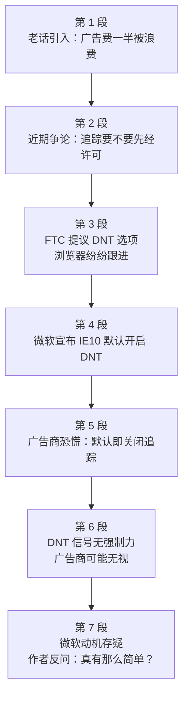

# Passage 10 · 广告追踪之争

## 答题记录

| 轮次  | 日期       | 题号  | 正确  | 错误  | 正确率 | 用时  | 错题归因 |
| --- | -------- | --- | --- | --- | --- | --- | ---- |
| 1   | 20261017 | 1-5 | 0   | 5   |     | 14m |      |
| 2   |          | 1-5 |     |     |     |     |      |
| 3   |          | 1-5 |     |     |     |     |      |

> [!tip] 填写口径
> - **用时**以分钟计，只计做题时间，不含精读复盘。
> - **错题归因**填「题型·错误类型」，如：细节题·定位错、推理判断·过度推断、主旨大意·以偏概全。
> - 纵向看趋势：正确率升而用时过长 → 熟练度不足；用时降而正确率波动 → 定位不稳。

> [!info] 文章档案
> - **来源**：考研英语（一）2013 年 Text 2
> - **题材**：互联网行为广告（behavioural ads）与「请勿追踪」（DNT）隐私之争
> - **结构**：7 段 / 25 句 ＋ 5 题
> - **难度**：★★★☆☆
> - **一句话主旨**：微软把 DNT 设为浏览器默认引爆广告业恐慌；文章梳理这场「追踪要不要先经许可」之争，并指出 DNT 既无强制力、微软动机也存疑。

## 一、篇章脉络

- **第 1 段**：借「广告费一半被浪费」的老话引出行业痛点，给出互联网时代的解法——行为广告。
- **第 2 段**：以近期一场争论点明分歧：追踪用户是默认许可，还是必须明确许可。
- **第 3 段**：交代制度背景——FTC 提议 DNT 选项，各大浏览器与广告联盟相继跟进。
- **第 4 段**：微软抢跑，宣布 IE10 将 DNT 设为默认开启，争议由此引爆。
- **第 5 段**：广告行业恐慌：多数人不会改默认设置，等于追踪被集体关闭。
- **第 6 段**：指出 DNT 并无强制力，广告商可能无视信号照旧追踪。
- **第 7 段**：质疑微软的真实动机，并以反问收束——事情真有这么简单吗？

> [!tip] 行文逻辑
> 老话（行业痛点）→ 解法（行为广告）→ 争议（许可之争）→ 引爆（微软默认 DNT）→ 反弹（广告业恐慌）→ 漏洞（无强制力）→ 追问（动机存疑）。典型的「现象 + 争议 + 追问」新闻评论结构；第 5 题态度题考的正是结尾那记反问。

## 二、逐段精读

### 第 1 段 · 广告浪费之谜与行为广告的解法

**原文**

① An old saying has it that half of all advertising budgets are wasted—the trouble is, no one knows which half.
② In the internet age, at least in theory, this fraction can be much reduced.
③ By watching what people search for, click on and say online, companies can aim "behavioural" ads at those most likely to buy.

**译文**

① 有句老话说，所有的广告预算有一半都被浪费了——麻烦在于，没人知道是哪一半。
② 在互联网时代，至少在理论上，这一比例可以大幅降低。
③ 通过观察人们在网上搜索什么、点击什么、说什么，公司可以把「行为」广告投向那些最有可能购买的人。

> [!note] 段落要点
> - 功能：开篇借谚语抛出行业痛点（广告浪费），随即给出互联网时代的理论解法——行为广告。
> - ③ 句是全文题眼之一（第 1 题定位句）。

#### 长难句 · 本段

> [!abstract] 本段第 ① 句 · An old saying has it that half of all advertising budgets are wasted—the trouble is, no one knows which half.

**结构拆解**

- **主干**：An old saying has it that...（has it that... 为固定结构，it 是形式宾语，that 从句才是真正的宾语，意为「据说……」）
- **破折号**：the trouble is, no one knows which half 是并列分句，作解释补充；which half 是宾语从句，省略了 is wasted。

**参考译文**

有句老话说，所有的广告预算有一半都被浪费了——麻烦在于，没人知道是哪一半。

> [!tip] 拆解要点
> `say / rumor / legend + has it that...` 是新闻文体高频句式，遇到直接按「据说」处理。

> [!abstract] 本段第 ③ 句 · By watching what people search for, click on and say online, companies can aim "behavioural" ads at those most likely to buy.

**结构拆解**

- **主干**：companies can aim ads at those...（aim A at B 把 A 投向 B）
- **方式状语**：By watching...，watch 后接三个并列的 what 引导的宾语从句（search for / click on / say 共用 what）。
- **修饰**：most likely to buy 是形容词短语后置定语，修饰 those（那些最可能购买的人）。

**参考译文**

通过观察人们在网上搜索什么、点击什么、说什么，公司可以把「行为」广告投向那些最有可能购买的人。

> [!tip] 拆解要点
> by + 动名词作方式状语是「手段—结果」型段落的标志性开头。

#### 本段重点词汇

| 单词 / 短语 | 词性 | 文中意 | 常用考义与拓展 | 英文示例搭配（中译） |
| --- | --- | --- | --- | --- |
| **saying** | n. | 老话，谚语 | 格言；名言 | an old saying（一句老话） |
| **has it that** | （短语） | 据说 | say / rumor has it that... 固定结构 | The rumor has it that...（谣传……） |
| **budget** | n. | 预算 | 经费；v. 编预算 | advertising budgets（广告预算） |
| **fraction** | n. | 比例；小部分 | 分数；a fraction of 一小部分 | this fraction（这一比例） |
| **reduce** | v. | 降低，减少 | reduction n. 减少 | be much reduced（被大幅降低） |
| **search for** | （短语） | 搜索 | look for；search A for B 为找 B 搜 A | what people search for（人们搜索什么） |
| **click on** | （短语） | 点击 | 点击（链接 / 按钮） | click on the link（点击链接） |
| **aim ... at** | （短语） | 把……投向 | aim at 瞄准；致力于 | aim ads at those most likely to buy（把广告投向最可能购买的人） |
| **behavioural** | adj. | 行为的 | behavior n. 行为；行为科学的 | behavioural ads（行为广告） |
| **most likely to buy** | （短语） | 最有可能购买 | be likely to do 可能做…… | those most likely to buy（最可能购买的人） |

### 第 2 段 · 争论登场：追踪是否需要许可

**原文**

① In the past couple of weeks a quarrel has illustrated the value to advertisers of such fine-grained information:
② Should advertisers assume that people are happy to be tracked and sent behavioural ads?
③ Or should they have explicit permission?

**译文**

① 过去几周的一场争吵表明了这类精细信息对广告商的价值：
② 广告商应该认为人们乐于被追踪并接收行为广告吗？
③ 还是说应该先获得他们的明确许可？

> [!note] 段落要点
> - 功能：用一个具体事件引出争议的两种立场（默认许可 vs 明确许可）。
> - ②③ 两句的问句形式预告了下文双方的观点交锋。

#### 长难句 · 本段

> [!abstract] 本段第 ① 句 · In the past couple of weeks a quarrel has illustrated the value to advertisers of such fine-grained information.

**结构拆解**

- **主干**：a quarrel has illustrated the value...
- **难点**：the value to advertisers of such fine-grained information 中，to advertisers 与 of such... information 都是修饰 value 的定语，被分隔开（value 的完整形式是 the value of A to B「A 对 B 的价值」）。

**参考译文**

过去几周的一场争吵表明了这类精细信息对广告商的价值。

> [!tip] 拆解要点
> 名词后连续挂两个介词短语时，先找中心名词，再依次挂回修饰语。

#### 本段重点词汇

| 单词 / 短语 | 词性 | 文中意 | 常用考义与拓展 | 英文示例搭配（中译） |
| --- | --- | --- | --- | --- |
| **a couple of** | （短语） | 几个 | 两（个）；a couple of weeks 几周 | in the past couple of weeks（过去几周） |
| **quarrel** | n. | 争吵，争论 | dispute / controversy 近义 | a quarrel has illustrated...（一场争吵表明了……） |
| **illustrate** | v. | 表明，例证 | 说明；举例说明 | illustrate the value of...（表明……的价值） |
| **fine-grained** | adj. | 精细的 | 颗粒细的；细节丰富的 | fine-grained information（精细的信息） |
| **assume** | v. | 认为，假定 | assumption n. 假定 | assume that...（认为……） |
| **track** | v. | 追踪 | n. 轨迹；跟踪记录 | people are happy to be tracked（人们乐于被追踪） |
| **explicit** | adj. | 明确的 | 清楚的；直白的；反义 implicit | explicit permission（明确许可） |
| **permission** | n. | 许可 | permit v. 允许；with one's permission 经某人许可 | have explicit permission（获得明确许可） |

### 第 3 段 · DNT 提议与行业共识

**原文**

① In December 2010 America's Federal Trade Commission (FTC) proposed adding a "do not track" (DNT) option to internet browsers, so that users could tell advertisers that they did not want to be followed.
② Microsoft's Internet Explorer and Apple's Safari both offer DNT; Google's Chrome is due to do so this year.
③ In February the FTC and Digital Advertising Alliance (DAA) agreed that the industry would get cracking on responding to DNT requests.

**译文**

① 2010 年 12 月，美国联邦贸易委员会（FTC）提议在互联网浏览器中加入「请勿追踪」（DNT）选项，让用户可以告诉广告商自己不想被追踪。
② 微软的 IE 浏览器和苹果的 Safari 都已提供 DNT；谷歌的 Chrome 预计今年跟进。
③ 二月，FTC 与数字广告联盟（DAA）一致同意，行业将着手回应 DNT 请求。

> [!note] 段落要点
> - 功能：交代争议的制度背景——监管提议 → 浏览器跟进 → 行业承诺，为第 4 段微软「抢跑」做铺垫。
> - ② 句的浏览器列举是第 2 题（the industry 指代题）的语境。

#### 长难句 · 本段

> [!abstract] 本段第 ① 句 · In December 2010 America's Federal Trade Commission (FTC) proposed adding a "do not track" (DNT) option to internet browsers, so that users could tell advertisers that they did not want to be followed.

**结构拆解**

- **主干**：FTC proposed adding a DNT option to internet browsers（propose doing sth 提议做某事）
- **目的状语**：so that users could tell...（so that 引导目的状语从句）
- **宾语从句**：that they did not want to be followed 作 tell 的直接宾语；followed 此处即 tracked（被追踪）。

**参考译文**

2010 年 12 月，美国联邦贸易委员会提议在互联网浏览器中加入「请勿追踪」选项，让用户可以告诉广告商自己不想被追踪。

> [!tip] 拆解要点
> propose / suggest / advise + doing（动名词）而非 to do。

#### 本段重点词汇

| 单词 / 短语 | 词性 | 文中意 | 常用考义与拓展 | 英文示例搭配（中译） |
| --- | --- | --- | --- | --- |
| **propose** | v. | 提议 | proposal n. 提案；propose doing sth | proposed adding a DNT option（提议加入 DNT 选项） |
| **option** | n. | 选项 | 选择权；optional adj. 可选的 | a "do not track" option（「请勿追踪」选项） |
| **browser** | n. | 浏览器 | 浏览程序 | internet browsers（互联网浏览器） |
| **so that** | （连词） | 以便 | 引导目的 / 结果状语从句 | so that users could tell...（以便用户能告诉……） |
| **follow** | v. | 追踪 | 跟随；遵循 | did not want to be followed（不想被追踪） |
| **be due to do** | （短语） | 预计将做 | due adj. 预定的；到期的 | Chrome is due to do so this year（Chrome 预计今年跟进） |
| **alliance** | n. | 联盟 | 联合；结盟 | Digital Advertising Alliance（数字广告联盟） |
| **get cracking on** | （短语） | 着手做 | 口语：赶紧开始干 | get cracking on responding to DNT requests（着手回应 DNT 请求） |
| **request** | n. | 请求 | 要求；at one's request 应某人请求 | DNT requests（DNT 请求） |
| **respond to** | （短语） | 回应 | response n. 回应 | responding to DNT requests（回应 DNT 请求） |
| **industry** | n. | 行业 | 工业；产业（此处指广告业，第 2 题考点） | the industry（该行业） |

### 第 4 段 · 微软抢跑：DNT 设为默认

**原文**

① On May 31st Microsoft set off the row.
② It said that Internet Explorer 10, the version due to appear with Windows 8, would have DNT as a default.

**译文**

① 5 月 31 日，微软点燃了这场争吵。
② 它宣称，将随 Windows 8 一起发布的 IE10 版本将把 DNT 设为默认开启。

> [!note] 段落要点
> - 功能：全文的事件引爆点，仅两句——谁（微软）+ 做了什么（默认开启 DNT）。
> - default 一词是理解第 5 段广告商恐慌的钥匙。

#### 本段重点词汇

| 单词 / 短语 | 词性 | 文中意 | 常用考义与拓展 | 英文示例搭配（中译） |
| --- | --- | --- | --- | --- |
| **set off** | （短语） | 引发，点燃 | 出发；引爆；抵消 | set off the row（引发这场争吵） |
| **row** | n. | 争吵 | 熟词僻义：一排 / 划船之外的核心僻义 | set off the row（引发争吵） |
| **version** | n. | 版本 | 说法；译本 | the version due to appear（即将发布的版本） |
| **due to appear** | （短语） | 即将发布 | be due to do 预定做 | the version due to appear with Windows 8（将随 Win8 发布的版本） |
| **default** | n. | 默认设置 | 熟词僻义：违约（金融） | have DNT as a default（把 DNT 设为默认） |

### 第 5 段 · 广告商的恐慌

**原文**

① Advertisers are horrified.
② Human nature being what it is, most people stick with default settings.
③ Few switch DNT on now, but if tracking is off it will stay off.
④ Bob Liodice, the chief executive of the Association of National Advertisers, says consumers will be worse off if the industry cannot collect information about their preferences.
⑤ People will not get fewer ads, he says.
⑥ "They'll get less meaningful, less targeted ads."

**译文**

① 广告商们吓坏了。
② 人性使然，大多数人都会保持默认设置。
③ 现在几乎没人主动开启 DNT，但如果追踪被默认关掉，它就会一直关着。
④ 全国广告商协会会长鲍勃·利奥迪斯说，如果行业无法收集用户偏好的信息，消费者的境况会更糟。
⑤ 他说，人们看到的广告不会变少。
⑥ 「只会变得更没有意义、更不精准。」

> [!note] 段落要点
> - 功能：摆出反对方（广告行业）的核心论据——默认开启 = 大多数人被动关闭追踪 = 广告失去精准度。
> - ④ 句是第 3 题（Liodice 观点题）的定位句。

#### 长难句 · 本段

> [!abstract] 本段第 ② 句 · Human nature being what it is, most people stick with default settings.

**结构拆解**

- **主干**：most people stick with default settings
- **独立主格**：Human nature being what it is 是名词 + being 结构的独立主格，作原因状语（= As human nature is / 人性使然）；what it is 是介词宾语从句。

**参考译文**

人性使然，大多数人都会保持默认设置。

> [!tip] 拆解要点
> `名词 + being...` 置于句首 = 独立主格作状语，常表原因，是考研高频语法点。

> [!abstract] 本段第 ④ 句 · Bob Liodice, the chief executive of the Association of National Advertisers, says consumers will be worse off if the industry cannot collect information about their preferences.

**结构拆解**

- **主干**：Bob Liodice says (that) consumers will be worse off...
- **插入语**：the chief executive of... 是主语的同位语，双逗号隔开，先跳过不读。
- **条件状语从句**：if the industry cannot collect information about their preferences。

**参考译文**

全国广告商协会会长鲍勃·利奥迪斯说，如果行业无法收集用户偏好的信息，消费者的境况会更糟。

> [!tip] 拆解要点
> says 后的宾语从句省略了 that；遇到「人名 + 头衔同位语 + says」结构，直接抓 says 后的内容即可。

#### 本段重点词汇

| 单词 / 短语 | 词性 | 文中意 | 常用考义与拓展 | 英文示例搭配（中译） |
| --- | --- | --- | --- | --- |
| **horrified** | adj. | 惊恐的 | horrify v. 使惊恐；horror n. 恐怖 | Advertisers are horrified.（广告商吓坏了。） |
| **stick with** | （短语） | 保持使用，不换 | 坚持陪伴；继续支持 | stick with default settings（保持默认设置） |
| **switch on** | （短语） | 开启 | switch off 关闭；switch n. 开关 | Few switch DNT on（很少人开启 DNT） |
| **off** | adj./adv. | 关闭 | turn off；on and off 断断续续 | if tracking is off（如果追踪被关闭） |
| **chief executive** | n. | 会长；总裁 | CEO 全称 chief executive officer | the chief executive of the Association（协会会长） |
| **association** | n. | 协会 | 联合；交往 | the Association of National Advertisers（全国广告商协会） |
| **worse off** | （短语） | 境况更糟 | bad off 的比较级；反义 better off | consumers will be worse off（消费者境况会更糟） |
| **collect** | v. | 收集 | 收藏；聚集 | collect information about their preferences（收集偏好信息） |
| **preference** | n. | 偏好 | prefer v. 更喜欢 | information about their preferences（偏好信息） |
| **meaningful** | adj. | 有意义的 | meaning n. 意义 | less meaningful ads（更没意义的广告） |
| **targeted** | adj. | 精准定向的 | target v. 瞄准；n. 目标 | less targeted ads（更不精准的广告） |

### 第 6 段 · DNT 无强制力

**原文**

① It is not yet clear how advertisers will respond.
② Getting a DNT signal does not oblige anyone to stop tracking, although some companies have promised to do so.
③ Unable to tell whether someone really objects to behavioural ads or whether they are sticking with Microsoft's default, some may ignore a DNT signal and press on anyway.

**译文**

① 目前尚不清楚广告商将作何回应。
② 收到 DNT 信号并不等于任何人有义务停止追踪，尽管一些公司已承诺这么做。
③ 由于无法分辨用户是真的反感行为广告、还是只是保持了微软的默认设置，一些广告商可能会无视 DNT 信号，照样我行我素。

> [!note] 段落要点
> - 功能：指出 DNT 的制度缺陷——无强制力（②句）+ 分不清真实意愿与默认惰性（③句），广告商可能照旧追踪。
> - 第 4 题「DNT 或不能实现预期目的」的出处。

#### 长难句 · 本段

> [!abstract] 本段第 ② 句 · Getting a DNT signal does not oblige anyone to stop tracking, although some companies have promised to do so.

**结构拆解**

- **主干**：Getting a DNT signal does not oblige anyone to stop tracking（动名词短语作主语；oblige sb to do sth 强迫某人做某事）
- **让步状语从句**：although some companies have promised to do so。

**参考译文**

收到 DNT 信号并不等于任何人有义务停止追踪，尽管一些公司已承诺这么做。

> [!tip] 拆解要点
> oblige 的三个高频用法：oblige sb to do（强迫）/ be obliged to do（有义务）/ be obliged to sb（感激）。

> [!abstract] 本段第 ③ 句 · Unable to tell whether someone really objects to behavioural ads or whether they are sticking with Microsoft's default, some may ignore a DNT signal and press on anyway.

**结构拆解**

- **主干**：some may ignore a DNT signal and press on anyway
- **原因状语**：Unable to tell... 是形容词短语位于句首作原因状语（= Because they are unable to tell...）。
- **并列宾语从句**：whether... or whether... 两个选择性的宾语从句，共用 tell。

**参考译文**

由于无法分辨用户是真的反感行为广告、还是只是保持了微软的默认设置，一些广告商可能会无视 DNT 信号，照样我行我素。

> [!tip] 拆解要点
> `形容词短语, 主句` 是分词/形容词状语的典型形态，先译原因再译主干。

#### 本段重点词汇

| 单词 / 短语 | 词性 | 文中意 | 常用考义与拓展 | 英文示例搭配（中译） |
| --- | --- | --- | --- | --- |
| **respond** | v. | 作出反应 | response n.；respond to 回应 | how advertisers will respond（广告商将如何反应） |
| **signal** | n. | 信号 | 暗号；v. 发信号 | a DNT signal（DNT 信号） |
| **oblige** | v. | 强制，责成 | 迫使；施恩于 | does not oblige anyone to stop tracking（并不强制任何人停止追踪） |
| **promise** | v. | 承诺 | promising adj. 有前途的 | have promised to do so（已承诺这么做） |
| **unable** | adj. | 不能 | be unable to do 无法做 | Unable to tell whether...（无法分辨……） |
| **object to** | （短语） | 反感，反对 | objection n. 反对；to 是介词 | really objects to behavioural ads（真的反感行为广告） |
| **ignore** | v. | 无视 | ignorant adj. 无知的；ignorance n. | ignore a DNT signal（无视 DNT 信号） |
| **press on** | （短语） | 执意继续 | press ahead with 继续推进 | press on anyway（照样我行我素） |

### 第 7 段 · 微软动机之谜与作者的怀疑

**原文**

① Also unclear is why Microsoft has gone it alone.
② After all, it has an ad business too, which it says will comply with DNT requests, though it is still working out how.
③ If it is trying to upset Google, which relies almost wholly on advertising, it has chosen an indirect method: There is no guarantee that DNT by default will become the norm.
④ DNT does not seem an obviously huge selling point for Windows 8—though the firm has compared some of its other products favourably with Google's on that count before.
⑤ Brendon Lynch, Microsoft's chief privacy officer, blogged: "We believe consumers should have more control."
⑥ Could it really be that simple?

**译文**

① 同样不清楚的是，微软为什么要单方面行动。
② 毕竟，微软自己也有广告业务，而且据称该业务将遵守 DNT 请求，尽管它还在研究具体怎么做。
③ 如果它是想给几乎全靠广告的谷歌添堵，那它选了一条迂回路线：默认开启的 DNT 能否成为行业规范，并无保证。
④ 对 Windows 8 来说，DNT 似乎算不上一个明显的大卖点——尽管微软以前曾在这一点上拿自家其他产品与谷歌作过有利的比较。
⑤ 微软首席隐私官布伦登·林奇在博客中写道：「我们认为消费者应当拥有更多控制权。」
⑥ 事情真有那么简单吗？

> [!note] 段落要点
> - 功能：收尾三连击——微软动机不明（①—③句）→ DNT 算不上卖点（④句）→ 引用官方说辞后以反问收束。
> - 反问句 Could it really be that simple? 是第 5 题态度题的最强信号。

#### 长难句 · 本段

> [!abstract] 本段第 ① 句 · Also unclear is why Microsoft has gone it alone.

**结构拆解**

- **主干**：Also unclear is why...（表语 + 系动词 + 主语从句的完全倒装；正常语序为 Why Microsoft has gone it alone is also unclear）

**参考译文**

同样不清楚的是，微软为什么要单方面行动。

> [!tip] 拆解要点
> `表语 + be + 主语从句` 的倒装常见于 Also unclear is... / Equally mysterious is... 这类承上启下的过渡句。

> [!abstract] 本段第 ③ 句 · If it is trying to upset Google, which relies almost wholly on advertising, it has chosen an indirect method: There is no guarantee that DNT by default will become the norm.

**结构拆解**

- **主干**：it has chosen an indirect method
- **条件状语从句**：If it is trying to upset Google...；which relies almost wholly on advertising 是非限制性定语从句修饰 Google。
- **冒号后**：There is no guarantee that...（that 引导 guarantee 的同位语从句，说明「保证」的具体内容）。

**参考译文**

如果它是想给几乎全靠广告的谷歌添堵，那它选了一条迂回路线：默认开启的 DNT 能否成为行业规范，并无保证。

> [!tip] 拆解要点
> 区分 that 从句的性质—— guarantee / fact / news + that 同位语从句（从句完整）vs 定语从句（从句缺成分）。

#### 本段重点词汇

| 单词 / 短语 | 词性 | 文中意 | 常用考义与拓展 | 英文示例搭配（中译） |
| --- | --- | --- | --- | --- |
| **go it alone** | （短语） | 单干，独自行动 | 单独做某事 | why Microsoft has gone it alone（微软为何单干） |
| **after all** | （短语） | 毕竟 | 终究 | After all, it has an ad business too.（毕竟它也有广告业务。） |
| **comply with** | （短语） | 遵守 | compliance n. 合规 | comply with DNT requests（遵守 DNT 请求） |
| **work out** | （短语） | 想出，解决 | 算出；健身 | still working out how（还在研究怎么做） |
| **upset** | v. | 使恼怒，搅局 | 打乱；使不安 | trying to upset Google（想给谷歌添堵） |
| **rely on** | （短语） | 依靠 | reliance n. 依赖 | relies almost wholly on advertising（几乎全靠广告） |
| **wholly** | adv. | 完全地 | whole adj. 整体的 | relies almost wholly on advertising（几乎完全依赖广告） |
| **indirect** | adj. | 间接的，迂回的 | 反义 direct | an indirect method（迂回的方法） |
| **guarantee** | n. | 保证 | 担保；v. 保证 | There is no guarantee that...（并无保证……） |
| **norm** | n. | 规范，常态 | normal adj. 正常的 | become the norm（成为常态） |
| **selling point** | n. | 卖点 | USP 独特卖点 | a huge selling point for Windows 8（Win8 的大卖点） |
| **favourably** | adv. | 有利地，好评地 | favourable adj. 有利的 | compared ... favourably with...（与……相比占优） |
| **on that count** | （短语） | 在那一点上 | 熟词僻义：count n. 计点；事项 | on that count before（以前在这一点上） |
| **privacy** | n. | 隐私 | private adj. 私人的 | chief privacy officer（首席隐私官） |

## 三、全篇重点词汇汇总（自测用）

> [!info] 说明
> 本表只列「单词 / 词性 / 所在段」，不含释义与搭配，用于遮表自测：说出词义后再回该段核对。
> 收录**全篇所有段落词汇，共 67 条，不删减**，与各段「本段重点词汇」等长同源。

| 单词 / 短语 | 词性 | 所在段 |
| --- | --- | --- |
| **saying** | n. | 第 1 段 |
| **has it that** | （短语） | 第 1 段 |
| **budget** | n. | 第 1 段 |
| **fraction** | n. | 第 1 段 |
| **reduce** | v. | 第 1 段 |
| **search for** | （短语） | 第 1 段 |
| **click on** | （短语） | 第 1 段 |
| **aim ... at** | （短语） | 第 1 段 |
| **behavioural** | adj. | 第 1 段 |
| **most likely to buy** | （短语） | 第 1 段 |
| **a couple of** | （短语） | 第 2 段 |
| **quarrel** | n. | 第 2 段 |
| **illustrate** | v. | 第 2 段 |
| **fine-grained** | adj. | 第 2 段 |
| **assume** | v. | 第 2 段 |
| **track** | v. | 第 2 段 |
| **explicit** | adj. | 第 2 段 |
| **permission** | n. | 第 2 段 |
| **propose** | v. | 第 3 段 |
| **option** | n. | 第 3 段 |
| **browser** | n. | 第 3 段 |
| **so that** | （连词） | 第 3 段 |
| **follow** | v. | 第 3 段 |
| **be due to do** | （短语） | 第 3 段 |
| **alliance** | n. | 第 3 段 |
| **get cracking on** | （短语） | 第 3 段 |
| **request** | n. | 第 3 段 |
| **respond to** | （短语） | 第 3 段 |
| **industry** | n. | 第 3 段 |
| **set off** | （短语） | 第 4 段 |
| **row** | n. | 第 4 段 |
| **version** | n. | 第 4 段 |
| **due to appear** | （短语） | 第 4 段 |
| **default** | n. | 第 4 段 |
| **horrified** | adj. | 第 5 段 |
| **stick with** | （短语） | 第 5 段 |
| **switch on** | （短语） | 第 5 段 |
| **off** | adj./adv. | 第 5 段 |
| **chief executive** | n. | 第 5 段 |
| **association** | n. | 第 5 段 |
| **worse off** | （短语） | 第 5 段 |
| **collect** | v. | 第 5 段 |
| **preference** | n. | 第 5 段 |
| **meaningful** | adj. | 第 5 段 |
| **targeted** | adj. | 第 5 段 |
| **respond** | v. | 第 6 段 |
| **signal** | n. | 第 6 段 |
| **oblige** | v. | 第 6 段 |
| **promise** | v. | 第 6 段 |
| **unable** | adj. | 第 6 段 |
| **object to** | （短语） | 第 6 段 |
| **ignore** | v. | 第 6 段 |
| **press on** | （短语） | 第 6 段 |
| **go it alone** | （短语） | 第 7 段 |
| **after all** | （短语） | 第 7 段 |
| **comply with** | （短语） | 第 7 段 |
| **work out** | （短语） | 第 7 段 |
| **upset** | v. | 第 7 段 |
| **rely on** | （短语） | 第 7 段 |
| **wholly** | adv. | 第 7 段 |
| **indirect** | adj. | 第 7 段 |
| **guarantee** | n. | 第 7 段 |
| **norm** | n. | 第 7 段 |
| **selling point** | n. | 第 7 段 |
| **favourably** | adv. | 第 7 段 |
| **on that count** | （短语） | 第 7 段 |
| **privacy** | n. | 第 7 段 |

> [!warning] 熟词僻义专列
> - **has it that**（第 1 段）：say has it that... 固定结构「据说」，it 为形式宾语。
> - **track**（第 2 段）：v. 追踪（网络隐私语境核心词），非「跑道 / 轨迹」。
> - **follow**（第 3 段）：此处 = track「追踪」，非「跟随 / 遵循」。
> - **due to**（第 3、4 段）：be due to do「预定将做」，非「由于」。
> - **row**（第 4 段）：n. 争吵（英式用法），非「一排 / 划船」。
> - **default**（第 4 段）：n. 默认设置（科技语境），金融语境才是「违约」。
> - **worse off**（第 5 段）：境况更糟（bad off 的比较级），勿拆开直译。
> - **object to**（第 6 段）：to 是介词，后接动名词。
> - **press on**（第 6 段）：执意继续，非「按在上面」。
> - **go it alone**（第 7 段）：单干，独自行动。
> - **count**（第 7 段）：n. 议题、事项（on that count 在那一点上），非动词「数」。

> [!example] 同义替换链（阅读题高频）
> - **追踪**：track（第 2 段）↔ follow（第 3 段）
> - **争吵**：quarrel（第 2 段）↔ row（第 4 段）
> - **回应**：respond（第 3、6 段）↔ get cracking on responding（第 3 段）
> - **明确许可 vs 默认许可**：explicit permission（第 2 段）↔ as a default / default settings（第 4、5 段）

## 四、知识点补充

> [!question] 背景知识
> - **FTC（Federal Trade Commission）**：美国联邦贸易委员会，消费者保护与反垄断监管机构，DNT 是其 2010 年底发布的隐私保护倡议。
> - **DNT（Do Not Track）**：浏览器「请勿追踪」技术选项，开启后向网站发送信号，表示用户拒绝被追踪建档。
> - **DAA（Digital Advertising Alliance）**：数字广告联盟，美国网络广告行业自律组织。
> - **行为广告（behavioural ads）**：基于用户浏览、搜索、点击记录投放的定向广告，是谷歌等平台的营收根基。
> - **本文立场背景**：2012 年微软宣布 IE10 默认开启 DNT，引发广告业反弹，本文即该事件评论，出自《经济学人》。

> [!warning] 语法点
> - **形式宾语结构**：saying has it that...（第 1 段①）—— it 复指 that 从句。
> - **独立主格**：Human nature being what it is（第 5 段②）—— 名词 + being 作原因状语。
> - **形容词短语作状语**：Unable to tell whether...（第 6 段③）—— 句首形容词短语表原因。
> - **完全倒装**：Also unclear is why...（第 7 段①）—— 表语前置引起倒装。
> - **同位语从句 vs 定语从句**：There is no guarantee that DNT...（第 7 段③，同位语）。

> [!success] 写作可迁移句型
> - `An old saying has it that...` —— 引用谚语开篇。
> - `It is not yet clear how/why/whether...` —— 陈述悬而未决的问题。
> - `Also unclear is why...` —— 倒装过渡，引出第二个疑点。
> - `Could it really be that simple?` —— 反问收尾表怀疑态度。

> [!danger] 易混辨析
> - **due to do vs due to sth**：be due to do「预定做」（第 3 段）；due to + n.「由于」。
> - **oblige sb to do vs be obliged to sb**：前者「强迫」，后者「感激某人」。
> - **object to doing vs object that**：前者「反对做」（to 为介词），后者「提出异议说」。
> - **comply with vs comply**：comply 不及物，必须带 with 才能接宾语。

## 五、题目分析

> [!info] 题目总览
> | 题号 | 题型 | 定位 | 答案 |
> | --- | --- | --- | --- |
> | 1 | 细节题 | 第 1 段①③句 | B |
> | 2 | 指代题 | 第 3 段②③句 | D |
> | 3 | 观点细节题 | 第 5 段④⑤⑥句 | C |
> | 4 | 判断正误题（细节题） | 第 6 段②③句 | A |
> | 5 | 态度题 | 第 7 段 | D |

### 第 1 题 · 细节题

> [!question] 原题
> It is suggested in Paragraph 1 that "behavioural" ads help advertisers to
> - A. ease competition among themselves.
> - B. lower their operational costs.
> - C. avoid complaints from consumers.
> - D. provide better online services.

**正确答案**：**B. lower their operational costs.（降低运营成本）**

**定位与依据**
- 定位到第 1 段① ③ 句：广告费「有一半被浪费」→ 行为广告让「这一比例大幅降低」。
- 同义替换：减少浪费的钱 = 降低运营成本（lower operational costs）。

**干扰项分析**

| 选项 | 选项内容 | 判断 | 排除理由 |
| --- | --- | --- | --- |
| A | ease competition among themselves. | ✗ | 无中生有：文中未提及广告商之间的竞争。 |
| C | avoid complaints from consumers. | ✗ | 无中生有：「消费者的投诉」第一段并未出现。 |
| D | provide better online services. | ✗ | 偷换概念：行为广告提升的是广告投放的精准度，不是「在线服务」的质量。 |

> [!tip] 解题思路
> 细节题先按题干关键词（behavioural ads + Paragraph 1）锁定段落，再在「手段→效果」句里找效果侧（省了钱）；四个选项若含比较级、新增名词（competition / complaints / services），逐一回原文验证有无出处。

### 第 2 题 · 指代题

> [!question] 原题
> "the industry" (Line 4, Para.3) refers to
> - A. online advertisers.
> - B. e-commerce conductors.
> - C. digital information analysts.
> - D. internet browser developers.

**正确答案**：**D. internet browser developers.（互联网浏览器开发商）**

**定位与依据**
- 定位到第 3 段② ③ 句：② 句列举微软 IE、苹果 Safari、谷歌 Chrome 三大浏览器都在提供 DNT；③ 句承接说「该行业」将着手回应 DNT 请求。
- 同义替换：三大浏览器厂商所在行业 = internet browser developers。

**干扰项分析**

| 选项 | 选项内容 | 判断 | 排除理由 |
| --- | --- | --- | --- |
| A | online advertisers. | ✗ | 张冠李戴：advertisers（广告商）是 DNT 的「回应对象」，不是回应 DNT 请求的一方。 |
| B | e-commerce conductors. | ✗ | 无中生有：电商经营者全篇未涉及。 |
| C | digital information analysts. | ✗ | 无中生有：原文无此主体。 |

> [!tip] 解题思路
> 指代题的答案通常在代词的**上一句**：先找 the industry 前文最近的复数名词群（IE / Safari / Chrome），再在四个选项里找能概括它们的类别词；切忌用常识（广告业）替代文中逻辑。

### 第 3 题 · 观点细节题

> [!question] 原题
> Bob Liodice holds that setting DNT as a default
> - A. may cut the number of junk ads.
> - B. fails to affect the ad industry.
> - C. will not benefit consumers.
> - D. goes against human nature.

**正确答案**：**C. will not benefit consumers.（不会让消费者受益）**

**定位与依据**
- 定位到第 5 段④ ⑤ ⑥ 句：Liodice 说若行业不能收集偏好信息，消费者会「worse off（境况更糟）」；广告不会更少，只会「更没意义、更不精准」。
- 同义替换：worse off + 不更少只更差 = will not benefit consumers。

**干扰项分析**

| 选项 | 选项内容 | 判断 | 排除理由 |
| --- | --- | --- | --- |
| A | may cut the number of junk ads. | ✗ | 与原文相反：⑤ 句明说广告数量不会减少（not get fewer ads）。 |
| B | fails to affect the ad industry. | ✗ | 与原文相反：广告业恰恰深受影响（收集不到偏好信息）。 |
| D | goes against human nature. | ✗ | 张冠李戴：「人性」说的是用户会保持默认设置（②句），不是 Liodice 对 DNT 的评价。 |

> [!tip] 解题思路
> 观点题锁定「人名 + says / holds」后的宾语从句；正反混淆是此类题最常见陷阱——先用原文的负面词（worse off）确定感情色彩，再核对数量、对象、主体三个细节。

### 第 4 题 · 判断正误题（细节题）

> [!question] 原题
> Which of the following is true according to Paragraph 6?
> - A. DNT may not serve its intended purpose.
> - B. Advertisers are willing to implement DNT.
> - C. DNT is losing its popularity among consumers.
> - D. Advertisers are obliged to offer behavioural ads.

**正确答案**：**A. DNT may not serve its intended purpose.（DNT 可能无法实现其预期目的）**

**定位与依据**
- 定位到第 6 段② ③ 句：DNT 信号无强制力 + 广告商分不清用户真实意愿可能无视信号继续追踪。
- 同义替换：信号可被无视 = DNT may not serve its intended purpose（达不到「阻止追踪」的设计目的）。

**干扰项分析**

| 选项 | 选项内容 | 判断 | 排除理由 |
| --- | --- | --- | --- |
| B | Advertisers are willing to implement DNT. | ✗ | 与原文相反：广告商 are horrified，部分公司承诺只是让步，总体在抵触。 |
| C | DNT is losing its popularity among consumers. | ✗ | 无中生有：原文未提及 popularity（受欢迎度）相关信息。 |
| D | Advertisers are obliged to offer behavioural ads. | ✗ | 与原文相反：② 句明说收到 DNT 信号 does not oblige anyone to stop tracking，即不强制，遑论「被迫提供行为广告」。 |

> [!tip] 解题思路
> 「Which is true」题逐项回段落验证：先排除含原文未出现的新名词（popularity），再用原文的否定结构（does not oblige）核对含强判断词（obliged / willing）的选项；正确项往往是原文语气的弱化改写（may not serve）。

### 第 5 题 · 态度题

> [!question] 原题
> The author's attitude towards what Brendon Lynch said in his blog is one of
> - A. indulgence.
> - B. understanding.
> - C. appreciation.
> - D. skepticism.

**正确答案**：**D. skepticism.（怀疑）**

**定位与依据**
- 定位到第 7 段：先质疑微软动机（① ③ 句 unclear / no guarantee），再引 Lynch 博客「我们相信消费者应当拥有更多控制权」，紧接反问 **Could it really be that simple?**（⑥句）。
- 同义替换：反问句「真有那么简单吗」= 对 Lynch 说辞的怀疑。

**干扰项分析**

| 选项 | 选项内容 | 判断 | 排除理由 |
| --- | --- | --- | --- |
| A | indulgence. | ✗ | 无中生有：全文无纵容意味。 |
| B | understanding. | ✗ | 感情色彩错：理解是正面中立态度，与反问句的质疑语气相反。 |
| C | appreciation. | ✗ | 感情色彩错：赞赏为正面态度，作者恰恰在「唱反调」。 |

> [!tip] 解题思路
> 态度题看引语**之后**的句子：作者引完他人观点紧跟转折（though / but）或反问，态度即在转折处；本篇「引语 → Could it really be that simple?」是「引用 + 反问表怀疑」的经典范式，可直接迁移到其他态度题。

## 六、复盘清单

- [ ] 过汇总表 67 词，遮住「所在段」列自测，重点过 11 个熟词僻义
- [ ] 重做 8 个长难句的口头翻译，特别是独立主格（第 5 段②）与完全倒装（第 7 段①）
- [ ] 整理本文干扰项类型：无中生有 ×4、与原文相反 ×4、张冠李戴 ×2、偷换概念 ×1、感情色彩错 ×2
- [ ] 记住「引用 + 反问 = 态度题怀疑信号」这一范式
- [ ] 把答题记录填进顶部表格，对照正确率决定是否二刷

## 七、关联笔记

- [[Passage11-American同化机器]]
- [[考研英语 · 阅读六大题型方法论]]
- [[考研英语 · 熟词僻义汇总]]
