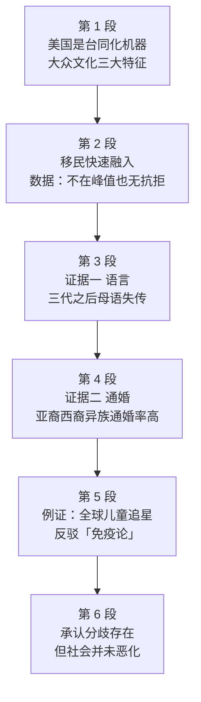

# Passage 11 · 美国同化机器

## 答题记录

| 轮次  | 日期       | 题号  | 正确  | 错误  | 正确率 | 用时  | 错题归因 |
| --- | -------- | --- | --- | --- | --- | --- | ---- |
| 1   | 20261018 | 1-5 | 1   | 4   |     | 12m |      |
| 2   |          | 1-5 |     |     |     |     |      |
| 3   |          | 1-5 |     |     |     |     |      |

> [!tip] 填写口径
> - **用时**以分钟计，只计做题时间，不含精读复盘。
> - **错题归因**填「题型·错误类型」，如：细节题·定位错、推理判断·过度推断、主旨大意·以偏概全。
> - 纵向看趋势：正确率升而用时过长 → 熟练度不足；用时降而正确率波动 → 定位不稳。

> [!info] 文章档案
> - **来源**：考研英语（一）2006 年 Text 1
> - **题材**：美国社会的大众文化同化力与移民融入
> - **结构**：6 段 / 18 句 ＋ 5 题
> - **难度**：★★★☆☆
> - **一句话主旨**：美国是一台强大的同化机器——移民在语言、住房自有率、异族通婚三项指标上快速融入，所谓「移民抗拒同化」的担忧并无根据。

## 一、篇章脉络

- **第 1 段**：立论——美国是一台惊人的同化机器，大众文化「民主化趋同、人人可入」。
- **第 2 段**：总判断——移民正在快速融入且无害，历史数据否定了「移民潮空前」的担忧。
- **第 3 段**：证据一——语言同化（第三代母语消失）与住房自有率高于本土美国人。
- **第 4 段**：证据二——异族通婚率高，高于本土白人与黑人的通婚率。
- **第 5 段**：例证——全球偏远村庄的孩子都在追美国巨星，反衬「对同化免疫」之说的荒谬。
- **第 6 段**：收束——问题确实存在，但与动荡的历史相比，大局无恙。

> [!tip] 行文逻辑
> 立论（同化机器）→ 总判断（融入快且无害）→ 分项举证（语言 / 住房 / 通婚）→ 例证（全球追星）→ 让步收束（问题存在但大局无恙）。典型的「总—分—总 + 让步」议论结构；第 5 题观点题考的是全篇语气——吸收是成功的。

## 二、逐段精读

### 第 1 段 · 立论：同化机器与大众文化

**原文**

① In spite of "endless talk of difference", American society is an amazing machine for homogenizing people.
② There is "the democratizing uniformity of dress and discourse, and the casualness and absence of deference" characteristic of popular culture.
③ People are absorbed into "a culture of consumption" launched by the 19th-century department stores that offered "vast arrays of goods in an elegant atmosphere.
④ Instead of intimate shops catering to a knowledgeable elite," these were stores "anyone could enter, regardless of class or background.
⑤ This turned shopping into a public and democratic act."
⑥ The mass media, advertising and sports are other forces for homogenization.

**译文**

① 尽管人们「无休止地谈论差异」，美国社会却是一台令人惊叹的同化机器。
② 大众文化具有「着装与谈吐的民主化趋同、随性随意、不拘礼节」的特点。
③ 人们被吸入「消费文化」——它由 19 世纪的百货商店发起，那些商店「在优雅的氛围中提供琳琅满目的商品」。
④ 「不同于为博学的精英阶层服务的私密小店」，这些商店「任何人都可以进入，无论阶层或出身」。
⑤ 「这使购物成为一种公共的、民主的行为。」
⑥ 大众传媒、广告和体育是同化人的其他力量。

> [!note] 段落要点
> - 功能：首段即全文主旨——美国社会同化力惊人。
> - ②—⑤ 句借引语给出大众文化的三个特征（民主化趋同、消费文化、全民可入），⑥ 句补齐传媒 / 广告 / 体育三条同化渠道。
> - ③ 句的百货商店是第 2 题的考点。

#### 长难句 · 本段

> [!abstract] 本段第 ② 句 · There is "the democratizing uniformity of dress and discourse, and the casualness and absence of deference" characteristic of popular culture.

**结构拆解**

- **主干**：There is + 名词短语（存在句）
- **难点**：characteristic of popular culture 是形容词短语后置定语，修饰前面整个引语内容（= which is characteristic of popular culture）。
- **并列结构**：the democratizing uniformity of A and B, and the casualness and absence of C——两团并列，各带 of 短语。

**参考译文**

大众文化具有「着装与谈吐的民主化趋同、随性随意、不拘礼节」的特点。

> [!tip] 拆解要点
> `名词短语 + characteristic of...` 是后置定语，不要误当成表语从句；deference（敬意）的否定 absence of deference = 不拘礼节。

> [!abstract] 本段第 ③ 句 · People are absorbed into "a culture of consumption" launched by the 19th-century department stores that offered "vast arrays of goods in an elegant atmosphere."

**结构拆解**

- **主干**：People are absorbed into a culture of consumption（被动语态）
- **后置定语一**：launched by... 过去分词短语修饰 a culture of consumption。
- **后置定语二**：that offered... 定语从句修饰 department stores。

**参考译文**

人们被吸入「消费文化」——它由 19 世纪的百货商店发起，那些商店在优雅的氛围中提供琳琅满目的商品。

> [!tip] 拆解要点
> 连续两层后置定语（分词短语 + that 从句）像「套娃」，从外往里读。

#### 本段重点词汇

| 单词 / 短语 | 词性 | 文中意 | 常用考义与拓展 | 英文示例搭配（中译） |
| --- | --- | --- | --- | --- |
| **in spite of** | （短语） | 尽管 | 介词短语，后接名词 / 动名词 | In spite of "endless talk of difference"（尽管人们无休止地谈论差异） |
| **homogenizing** | v.-ing | 同化 | homogenize v. 使均质；homogeneity n. 同质性 | a machine for homogenizing people（同化人的机器） |
| **democratizing** | adj. | 民主化的 | democratize v. 使民主化 | the democratizing uniformity（民主化的趋同） |
| **uniformity** | n. | 统一，一致 | uniform adj. 统一的；n. 制服 | uniformity of dress and discourse（着装与谈吐的趋同） |
| **discourse** | n. | 谈吐，话语 | 论述；语篇 | dress and discourse（着装与谈吐） |
| **casualness** | n. | 随意 | casual adj. 随便的；漫不经心的 | the casualness of popular culture（大众文化的随意性） |
| **absence** | n. | 缺乏 | 熟词僻义：缺席 → 缺少 | the absence of deference（不拘礼节） |
| **deference** | n. | 恭敬，尊重 | show deference to 对……表示敬意 | the absence of deference（不拘礼节） |
| **characteristic of** | （短语） | ……所特有的 | typical of 近义 | characteristic of popular culture（大众文化所特有的） |
| **be absorbed into** | （短语） | 被吸入，被同化 | absorb v. 吸收 | People are absorbed into a culture.（人们被吸入一种文化。） |
| **consumption** | n. | 消费 | consume v. 消耗 | a culture of consumption（消费文化） |
| **launch** | v. | 发起，推出 | 发射；上市 | launched by the 19th-century department stores（由 19 世纪百货商店发起） |
| **department store** | n. | 百货商店 | 大型综合商场 | the 19th-century department stores（19 世纪的百货商店） |
| **vast arrays of** | （短语） | 大量的，琳琅满目的 | array n. 一系列；排列 | vast arrays of goods（琳琅满目的商品） |
| **elegant** | adj. | 优雅的 | 精美的；雅致的 | an elegant atmosphere（优雅的氛围） |
| **atmosphere** | n. | 氛围 | 大气层 | in an elegant atmosphere（在优雅的氛围中） |
| **instead of** | （短语） | 而不是 | 介词短语表替代 | Instead of intimate shops（不同于私密小店） |
| **intimate** | adj. | 私密的 | 亲密的；精通的（have an intimate knowledge of） | intimate shops（私密小店） |
| **cater to** | （短语） | 迎合，服务 | 迎合（需求 / 口味） | catering to a knowledgeable elite（迎合博学的精英） |
| **knowledgeable elite** | n. | 博学的精英阶层 | knowledge n. 知识；elite n. 精英 | a knowledgeable elite（博学的精英阶层） |
| **regardless of** | （短语） | 无论，不管 | 不顾 | regardless of class or background（无论阶层或出身） |
| **mass media** | n. | 大众传媒 | medium 的复数 media | The mass media, advertising and sports（传媒、广告和体育） |
| **force** | n. | 力量 | 熟词僻义：武力 → 势力 | other forces for homogenization（其他同化力量） |

### 第 2 段 · 移民正在快速融入

**原文**

① Immigrants are quickly fitting into this common culture, which may not be altogether elevating but is hardly poisonous.
② Writing for the National Immigration Forum, Gregory Rodriguez reports that today's immigration is neither at unprecedented levels nor resistant to assimilation.
③ In 1998 immigrants were 9.8 percent of the population; in 1900, 13.6 percent.
④ In the 10 years prior to 1990, 3.1 immigrants arrived for every 1,000 residents; in the 10 years prior to 1890, 9.2 for every 1,000.
⑤ Now, consider three indices of assimilation—language, home ownership and intermarriage.

**译文**

① 移民正迅速融入这个共同文化——它或许算不上多高尚，但也绝没有毒害性。
② 格雷戈里·罗德里格斯为全国移民论坛撰稿时写道，如今的移民既未达到前所未有的规模，也没有抗拒同化。
③ 1998 年移民占人口的 9.8%；1900 年则是 13.6%。
④ 1990 年之前的十年里，每 1000 名居民中迁入 3.1 名移民；而 1890 年之前的十年里，这一数字是每 1000 人 9.2 名。
⑤ 现在，请看同化的三项指标——语言、住房所有权和异族通婚。

> [!note] 段落要点
> - 功能：承接首段的「machine」，先给出移民融入的总判断（快、无害），再用两组历史数据否定「移民潮空前 + 抗拒同化」的流行担忧。
> - ⑤ 句以「三项指标」开启下文的分项论证。

#### 长难句 · 本段

> [!abstract] 本段第 ② 句 · Writing for the National Immigration Forum, Gregory Rodriguez reports that today's immigration is neither at unprecedented levels nor resistant to assimilation.

**结构拆解**

- **主干**：Gregory Rodriguez reports that...（that 引导宾语从句）
- **状语**：Writing for... 现在分词短语作伴随 / 身份状语（= As he writes for...）。
- **并列**：neither... nor... 连接表语 at unprecedented levels 与 resistant to assimilation。

**参考译文**

格雷戈里·罗德里格斯为全国移民论坛撰稿时写道，如今的移民既未达到前所未有的规模，也没有抗拒同化。

> [!tip] 拆解要点
> neither A nor B 中 A、B 结构要对称；此处 A 是介词短语、B 是形容词短语，都作表语。

#### 本段重点词汇

| 单词 / 短语 | 词性 | 文中意 | 常用考义与拓展 | 英文示例搭配（中译） |
| --- | --- | --- | --- | --- |
| **fit into** | （短语） | 融入 | 适应；放得进 | Immigrants are quickly fitting into this common culture.（移民正迅速融入共同文化。） |
| **elevating** | adj. | 有教益的，高尚的 | elevate v. 提升；抬高 | may not be altogether elevating（或许算不上高尚） |
| **hardly** | adv. | 几乎不 | 半否定词 | is hardly poisonous（几乎无毒害） |
| **poisonous** | adj. | 有毒的，有害的 | poison n. 毒 | hardly poisonous（几乎无毒害） |
| **unprecedented** | adj. | 空前的 | 前所未有的；反义 precedented | at unprecedented levels（处于空前水平） |
| **resistant** | adj. | 抵抗的 | resist v. 抵抗；resistance n. | nor resistant to assimilation（也不抗拒同化） |
| **assimilation** | n. | 同化 | assimilate v. 同化（= 第 1 段 homogenize 的近义） | resistant to assimilation（抗拒同化） |
| **prior to** | （短语） | 在……之前 | 先于；介词短语 | in the 10 years prior to 1990（1990 年前的十年） |
| **resident** | n. | 居民 | reside v. 居住 | for every 1,000 residents（每 1000 名居民） |
| **index** | n. | 指标 | 复数 indices；指数 | three indices of assimilation（同化的三项指标） |
| **ownership** | n. | 所有权 | own v. 拥有 | home ownership（住房自有率） |
| **intermarriage** | n. | 异族通婚 | inter- 前缀「相互」 | three indices—language, home ownership and intermarriage（语言、购房、通婚） |

### 第 3 段 · 证据一：语言同化

**原文**

① The 1990 Census revealed that "a majority of immigrants from each of the fifteen most common countries of origin spoke English 'well' or 'very well' after ten years of residence."
② The children of immigrants tend to be bilingual and proficient in English.
③ "By the third generation, the original language is lost in the majority of immigrant families."
④ Hence the description of America as a "graveyard" for languages.
⑤ By 1996 foreign-born immigrants who had arrived before 1970 had a home ownership rate of 75.6 percent, higher than the 69.8 percent rate among native-born Americans.

**译文**

① 1990 年的人口普查显示，「来自十五个最主要移民国的大多数移民，居住十年后英语都说得『好』或『非常好』。」
② 移民的子女往往双语流利，且英语娴熟。
③ 「到了第三代，大多数移民家庭中母语就消失了。」
④ 因此美国被形容为语言的「墓地」。
⑤ 到 1996 年，1970 年之前抵达的外国出生移民的住房自有率达到 75.6%，高于本土出生美国人的 69.8%。

> [!note] 段落要点
> - 功能：三项指标的前两项集中举证——语言（①—④句，第三代母语消失）+ 住房自有率（⑤句，高于本土美国人）。
> - ④ 句的「墓地」比喻是本文著名修辞：母语在美国死去。

#### 长难句 · 本段

> [!abstract] 本段第 ④ 句 · Hence the description of America as a "graveyard" for languages.

**结构拆解**

- **结构**：省略句——完整的句子是 Hence comes the description... / 这是一种「Hence + 名词短语」的无动词倒装省略，表结果。
- **核心**：describe A as B（把 A 描述成 B）→ the description of A as B（名词化），America 与 as a graveyard 被 of 隔开。

**参考译文**

因此美国被形容为语言的「墓地」。

> [!tip] 拆解要点
> `Hence + n.` 是议论文引出结论的高频省略式，读到 Hence 直接找前文的因果关系。

> [!abstract] 本段第 ⑤ 句 · By 1996 foreign-born immigrants who had arrived before 1970 had a home ownership rate of 75.6 percent, higher than the 69.8 percent rate among native-born Americans.

**结构拆解**

- **主干**：foreign-born immigrants had a home ownership rate of 75.6 percent
- **定语从句**：who had arrived before 1970 修饰 immigrants；从句用过去完成时（过去的过去）。
- **比较结构**：higher than... 形容词短语作非限制性补充，相当于 which was higher than...

**参考译文**

到 1996 年，1970 年之前抵达的外国出生移民的住房自有率达到 75.6%，高于本土出生美国人的 69.8%。

> [!tip] 拆解要点
> 数据对比句先抓「谁高谁低」——higher than 的主语是移民的 75.6%，被比对象是本土人的 69.8%。

#### 本段重点词汇

| 单词 / 短语 | 词性 | 文中意 | 常用考义与拓展 | 英文示例搭配（中译） |
| --- | --- | --- | --- | --- |
| **census** | n. | 人口普查 | 官方统计 | The 1990 Census（1990 年人口普查） |
| **reveal** | v. | 显示，揭示 | 揭露 | revealed that...（显示……） |
| **country of origin** | n. | 原籍国 | 同义 source country（来源国）；origin n. 出身、来源 | the fifteen most common countries of origin（十五个最主要移民国） |
| **residence** | n. | 居住 | 住所；reside v. 居住 | after ten years of residence（居住十年后） |
| **tend to** | （短语） | 往往会 | 倾向于 | The children tend to be bilingual.（移民子女往往双语。） |
| **bilingual** | adj. | 双语的 | bi- 前缀「双」；bilingualism n. | tend to be bilingual（往往是双语的） |
| **proficient** | adj. | 熟练的 | proficiency n. 熟练度 | proficient in English（英语娴熟） |
| **generation** | n. | 一代人 | 世代；the third generation 第三代 | By the third generation（到第三代） |
| **hence** | adv. | 因此 | 正式书面语；= therefore | Hence the description of America as...（因此美国被形容为……） |
| **description of ... as** | （短语） | 把……描述为 | describe A as B 的名词化 | the description of America as a "graveyard"（把美国形容为「墓地」） |
| **graveyard** | n. | 墓地 | 同义 burial ground（墓地）；文中比喻「语言的葬身之地」 | a "graveyard" for languages（语言的「墓地」） |
| **foreign-born** | adj. | 外国出生的 | 复合形容词：X-born | foreign-born immigrants（外国出生的移民） |
| **rate** | n. | 比率 | 速度；费率 | a home ownership rate of 75.6 percent（75.6% 的住房自有率） |
| **native-born** | adj. | 本土出生的 | native adj. 本地的 | native-born Americans（本土出生的美国人） |

### 第 4 段 · 证据二：异族通婚

**原文**

① Foreign-born Asians and Hispanics "have higher rates of intermarriage than do U.S.-born whites and blacks."
② By the third generation, one third of Hispanic women are married to non-Hispanics, and 41 percent of Asian-American women are married to non-Asians.

**译文**

① 外国出生的亚裔和西语裔「异族通婚率高于美国本土出生的白人和黑人」。
② 到第三代，三分之一的西语裔女性与非西语裔通婚，41% 的亚裔美国女性与非亚裔通婚。

> [!note] 段落要点
> - 功能：第三项指标「通婚」的数据页——一句定性比较（①句）+ 一组具体百分比（②句）。
> - 语法：①句 than 后为倒装（than do U.S.-born whites and blacks）。

#### 长难句 · 本段

> [!abstract] 本段第 ① 句 · Foreign-born Asians and Hispanics "have higher rates of intermarriage than do U.S.-born whites and blacks."

**结构拆解**

- **主干**：Asians and Hispanics have higher rates of intermarriage than...（比较级 + than）
- **倒装**：than do U.S.-born whites and blacks 是比较状语从句中的主谓倒装（正常语序 than U.S.-born whites and blacks do），do 代替 have，避免重复。

**参考译文**

外国出生的亚裔和西语裔的异族通婚率高于美国本土出生的白人和黑人。

> [!tip] 拆解要点
> than 后出现「do + 主语」即倒装比较；辨认要点是助动词提前。

#### 本段重点词汇

| 单词 / 短语 | 词性 | 文中意 | 常用考义与拓展 | 英文示例搭配（中译） |
| --- | --- | --- | --- | --- |
| **Hispanic** | n./adj. | 西语裔（的） | 拉美裔美国人 | Foreign-born Asians and Hispanics（外国出生的亚裔与西语裔） |
| **intermarriage** | n. | 异族通婚 | 与第 2 段⑤呼应，此处展开论证 | higher rates of intermarriage（更高的通婚率） |
| **be married to** | （短语） | 与……结婚 | 同义 marry sb / get married to sb（与某人结婚）；to 后接对象 | are married to non-Hispanics（与非西语裔通婚） |
| **one third** | （数词） | 三分之一 | 分数表达：基数词 + 序数词 | one third of Hispanic women（三分之一的西语裔女性） |

### 第 5 段 · 例证：全球追星与「免疫论」的反驳

**原文**

① Rodriguez notes that children in remote villages around the world are fans of superstars like Arnold Schwarzenegger and Garth Brooks, yet "some Americans fear that immigrants living within the United States remain somehow immune to the nation's assimilative power."

**译文**

① 罗德里格斯指出，世界各地偏远村庄的儿童都是阿诺德·施瓦辛格、加斯·布鲁克斯这类巨星的支持者，然而「一些美国人却担心，生活在美国境内的移民不知怎么就是对国家的同化力量免疫」。

> [!note] 段落要点
> - 功能：用「全球儿童都在追美国巨星」反衬「移民对美国同化力免疫」说法的荒谬。
> - yet 前后对照是第 4 题（举例目的题）的答案所在——例子证明的是美国文化影响力之大。

#### 长难句 · 本段

> [!abstract] 本段第 ① 句 · Rodriguez notes that children in remote villages around the world are fans of superstars like Arnold Schwarzenegger and Garth Brooks, yet "some Americans fear that immigrants living within the United States remain somehow immune to the nation's assimilative power."

**结构拆解**

- **结构**：yet 连接的两个分句：① 全球儿童爱美国巨星（事实）；② 一些美国人却怕移民对同化免疫（担忧）。
- **宾语从句**：notes that... 与 fear that... 各带一个宾语从句；living within the United States 是现在分词后置定语修饰 immigrants。

**参考译文**

罗德里格斯指出，世界各地偏远村庄的儿童都是施瓦辛格、布鲁克斯这类巨星的粉丝，然而「一些美国人却担心，住在美国的移民不知怎么就是对国家同化力免疫」。

> [!tip] 拆解要点
> yet 是本句的灵魂——「事实 vs 担忧」的落差即作者的反讽。

#### 本段重点词汇

| 单词 / 短语 | 词性 | 文中意 | 常用考义与拓展 | 英文示例搭配（中译） |
| --- | --- | --- | --- | --- |
| **note** | v. | 指出 | 熟词僻义：笔记 → 注意到 / 指出 | Rodriguez notes that...（罗德里格斯指出……） |
| **remote** | adj. | 偏远的 | 遥远的；remote control 遥控 | remote villages around the world（世界各地偏远村庄） |
| **fan of** | n. | ……的拥护者 | fan n. 粉丝 | are fans of superstars（是巨星的粉丝） |
| **superstar** | n. | 超级巨星 | super- 前缀「超级」 | superstars like Schwarzenegger（施瓦辛格这类巨星） |
| **fear that** | v. | 担心 | fear n. 恐惧；for fear of 生怕 | some Americans fear that...（一些美国人担心……） |
| **somehow** | adv. | 不知怎么地 | 以某种方式 | remain somehow immune（不知怎么就免疫了） |
| **immune to** | （短语） | 对……免疫 | 不受影响的；immunity n. 免疫力 | immune to the nation's assimilative power（对国家同化力免疫） |
| **assimilative power** | n. | 同化力 | assimilate v. 同化 | the nation's assimilative power（国家的同化力） |

### 第 6 段 · 收束：问题存在，但大局无恙

**原文**

① Are there divisive issues and pockets of seething anger in America?
② Indeed.
③ It is big enough to have a bit of everything.
④ But particularly when viewed against America's turbulent past, today's social indices hardly suggest a dark and deteriorating social environment.

**译文**

① 美国有没有分歧性的问题和局部涌动的怒火？
② 当然有。
③ 国家足够大，什么样的事都有一点。
④ 但尤其若与美国动荡的过去相比，今天的社会指标几乎表明：社会环境既不黑暗，也没有在恶化。

> [!note] 段落要点
> - 功能：让步式收尾——先自问自答承认问题（①—③句），再以「与动荡历史相比」的时间纵深把分歧正常化。
> - ④ 句与第 2 段的「hardly poisonous」遥相呼应；第 5 题观点题答案（吸收是成功的）即从全篇语气推出。

#### 长难句 · 本段

> [!abstract] 本段第 ④ 句 · But particularly when viewed against America's turbulent past, today's social indices hardly suggest a dark and deteriorating social environment.

**结构拆解**

- **主干**：today's social indices hardly suggest a dark and deteriorating social environment
- **状语**：when viewed against... 是「when + 过去分词」的省略结构（= when they are viewed against...），against 此处意为「对照、比照」。

**参考译文**

但尤其若与美国动荡的过去相比，今天的社会指标几乎表明社会环境既不黑暗、也没有在恶化。

> [!tip] 拆解要点
> `when/while + 过去分词` 省略主语和 be 动词，前提是主句主语与从句逻辑主语一致。

#### 本段重点词汇

| 单词 / 短语 | 词性 | 文中意 | 常用考义与拓展 | 英文示例搭配（中译） |
| --- | --- | --- | --- | --- |
| **divisive** | adj. | 造成分裂的 | divide v. 分裂；division n. | divisive issues（分歧性问题） |
| **pocket** | n. | 小片区域，一小撮 | 熟词僻义：口袋 → 孤立小块 | pockets of seething anger（局部涌动的怒火） |
| **seething** | adj. | 涌动的，沸腾的 | seethe v. 翻腾；强压怒火 | pockets of seething anger（局部涌动的怒火） |
| **anger** | n. | 怒火 | angry adj. 生气的 | pockets of seething anger（局部涌动的怒火） |
| **indeed** | adv. | 的确 | 确实；用于让步承认 | Indeed.（当然有。） |
| **view ... against** | （短语） | 对照……来看 | 熟词僻义：观看 → 对照背景审视 | viewed against America's turbulent past（与美国动荡的过去相比） |
| **against** | prep. | 对照，比照 | 熟词僻义：反对 → 衬托背景 | when viewed against the past（与过去相比） |
| **turbulent** | adj. | 动荡的 | turbulence n. 动荡 | America's turbulent past（美国动荡的过去） |
| **hardly** | adv. | 几乎不 | 半否定，与第 2 段呼应 | hardly suggest（几乎不能说明） |
| **deteriorating** | adj. | 不断恶化的 | deteriorate v. 恶化 | a deteriorating social environment（不断恶化的社会环境） |

## 三、全篇重点词汇汇总（自测用）

> [!info] 说明
> 本表只列「单词 / 词性 / 所在段」，不含释义与搭配，用于遮表自测：说出词义后再回该段核对。
> 收录**全篇所有段落词汇，共 71 条，不删减**，与各段「本段重点词汇」等长同源。

| 单词 / 短语 | 词性 | 所在段 |
| --- | --- | --- |
| **in spite of** | （短语） | 第 1 段 |
| **homogenizing** | v.-ing | 第 1 段 |
| **democratizing** | adj. | 第 1 段 |
| **uniformity** | n. | 第 1 段 |
| **discourse** | n. | 第 1 段 |
| **casualness** | n. | 第 1 段 |
| **absence** | n. | 第 1 段 |
| **deference** | n. | 第 1 段 |
| **characteristic of** | （短语） | 第 1 段 |
| **be absorbed into** | （短语） | 第 1 段 |
| **consumption** | n. | 第 1 段 |
| **launch** | v. | 第 1 段 |
| **department store** | n. | 第 1 段 |
| **vast arrays of** | （短语） | 第 1 段 |
| **elegant** | adj. | 第 1 段 |
| **atmosphere** | n. | 第 1 段 |
| **instead of** | （短语） | 第 1 段 |
| **intimate** | adj. | 第 1 段 |
| **cater to** | （短语） | 第 1 段 |
| **knowledgeable elite** | n. | 第 1 段 |
| **regardless of** | （短语） | 第 1 段 |
| **mass media** | n. | 第 1 段 |
| **force** | n. | 第 1 段 |
| **fit into** | （短语） | 第 2 段 |
| **elevating** | adj. | 第 2 段 |
| **hardly** | adv. | 第 2 段 |
| **poisonous** | adj. | 第 2 段 |
| **unprecedented** | adj. | 第 2 段 |
| **resistant** | adj. | 第 2 段 |
| **assimilation** | n. | 第 2 段 |
| **prior to** | （短语） | 第 2 段 |
| **resident** | n. | 第 2 段 |
| **index** | n. | 第 2 段 |
| **ownership** | n. | 第 2 段 |
| **intermarriage** | n. | 第 2 段 |
| **census** | n. | 第 3 段 |
| **reveal** | v. | 第 3 段 |
| **country of origin** | n. | 第 3 段 |
| **residence** | n. | 第 3 段 |
| **tend to** | （短语） | 第 3 段 |
| **bilingual** | adj. | 第 3 段 |
| **proficient** | adj. | 第 3 段 |
| **generation** | n. | 第 3 段 |
| **hence** | adv. | 第 3 段 |
| **description of ... as** | （短语） | 第 3 段 |
| **graveyard** | n. | 第 3 段 |
| **foreign-born** | adj. | 第 3 段 |
| **rate** | n. | 第 3 段 |
| **native-born** | adj. | 第 3 段 |
| **Hispanic** | n./adj. | 第 4 段 |
| **be married to** | （短语） | 第 4 段 |
| **one third** | （数词） | 第 4 段 |
| **note** | v. | 第 5 段 |
| **remote** | adj. | 第 5 段 |
| **fan of** | n. | 第 5 段 |
| **superstar** | n. | 第 5 段 |
| **fear that** | v. | 第 5 段 |
| **somehow** | adv. | 第 5 段 |
| **immune to** | （短语） | 第 5 段 |
| **assimilative power** | n. | 第 5 段 |
| **divisive** | adj. | 第 6 段 |
| **pocket** | n. | 第 6 段 |
| **seething** | adj. | 第 6 段 |
| **anger** | n. | 第 6 段 |
| **indeed** | adv. | 第 6 段 |
| **view ... against** | （短语） | 第 6 段 |
| **against** | prep. | 第 6 段 |
| **turbulent** | adj. | 第 6 段 |
| **deteriorating** | adj. | 第 6 段 |
| **intermarriage** | n. | 第 4 段 |
| **hardly** | adv. | 第 6 段 |

> [!warning] 熟词僻义专列
> - **force**（第 1 段）：n. 力量、势力（同化的力量），非动词「强迫」。
> - **note**（第 5 段）：v. 指出、提到，非「笔记 / 便条」。
> - **pocket**（第 6 段）：n. 孤立的小片区域（pockets of anger 局部怒火），非「口袋」。
> - **against**（第 6 段）：prep. 对照、以……为背景，非「反对」。
> - **absence**（第 1 段）：n. 缺乏（absence of deference 没有礼数），非「缺席」。
> - **intimate**（第 1 段）：adj. 私密的；另有熟词僻义「精通的」（an intimate knowledge of）。
> - **index**（第 2 段）：n. 指标，复数不规则 indices，勿与 degree 混。
> - **rate**（第 3 段）：n. 比率，home ownership rate 住房自有率。

> [!example] 同义替换链（阅读题高频）
> - **同化**：homogenize（第 1 段）↔ assimilation（第 2 段）↔ assimilative power（第 5 段）
> - **几乎不**：hardly（第 2 段）↔ hardly（第 6 段）——首尾呼应的半否定
> - **无休止的**：endless（第 1 段）↔ unprecedented（第 2 段）——注意区分：「无限」≠「空前」
> - **有害**：poisonous（第 2 段）↔ dark and deteriorating（第 6 段）

## 四、知识点补充

> [!question] 背景知识
> - **homogenize（同化）**：源自「均质化」，本文核心概念——美国像机器一样把不同族裔「搅匀」成同一种大众文化。
> - **19 世纪百货商店**：美国消费文化的重要推手，论文常引 case；文中引语出自社会学家对大众文化的经典论述。
> - **Gregory Rodriguez**：美国记者、移民问题学者，本文观点转述自他为 National Immigration Forum 所写的报告。
> - **三项同化指标**：语言（language）、住房自有率（home ownership）、异族通婚（intermarriage）是社会学衡量移民融入的经典维度。
> - **本文出处**：《经济学人》/ Newsweek 系评论，考研英语（一）2006 年 Text 1，主旨题高频素材。

> [!warning] 语法点
> - **形容词短语后置定语**：...characteristic of popular culture（第 1 段②）。
> - **名词化结构**：the description of America as a graveyard（第 3 段④）= describe America as a graveyard。
> - **比较从句倒装**：than do U.S.-born whites and blacks（第 4 段①）。
> - **when + 过去分词省略**：when viewed against...（第 6 段④）。
> - **Hence + 名词短语的省略句**：Hence the description...（第 3 段④）。

> [!success] 写作可迁移句型
> - `In spite of "endless talk of difference", ... is an amazing machine for...` —— 让步开篇 + 核心比喻。
> - `Now, consider three indices of A—X, Y and Z.` —— 分项论证的总起句。
> - `Hence the description of A as B.` —— 由前文推出结论的省略式。
> - `But particularly when viewed against..., today's indices hardly suggest...` —— 历史对照式让步收尾。

> [!danger] 易混辨析
> - **homogenize vs assimilate**：前者强调「变均匀」（结果），后者强调「吸收并入」（过程），本文中可互换。
> - **resident vs residence**：resident 是「居民」（人），residence 是「居住 / 住所」（状态或地点）。
> - **prior to vs previous to**：均「在……之前」，prior to 更正式，都是介词短语。
> - **divisive vs divided**：divisive「造成分裂的」（主动），divided「被分裂的」（状态）。

## 五、题目分析

> [!info] 题目总览
> | 题号 | 题型 | 定位 | 答案 |
> | --- | --- | --- | --- |
> | 1 | 词义题 | 第 1 段①句及后文 | C |
> | 2 | 细节题 | 第 1 段③⑤句 | A |
> | 3 | 推断题 | 第 2 段①②句 | C |
> | 4 | 例证题 | 第 5 段 | D |
> | 5 | 观点态度题 | 第 2、5、6 段 | B |

### 第 1 题 · 词义题

> [!question] 原题
> The word "homogenizing" (Line 1, Paragraph 1) most probably means
> - A. identifying.
> - B. associating.
> - C. assimilating.
> - D. monopolizing.

**正确答案**：**C. assimilating.（同化）**

**定位与依据**
- 定位到第 1 段①句及后文：②句大众文化的「统一性」（uniformity）、③句 people are absorbed into（被吸入）、⑥句 forces for homogenization。
- 同义替换：machine for homogenizing people = 把人变得相同 = assimilating（第 2 段⑤句的三项 indices of assimilation 直接给了印证）。

**干扰项分析**

| 选项 | 选项内容 | 判断 | 排除理由 |
| --- | --- | --- | --- |
| A | identifying. | ✗ | 辨别：文中无「识别身份」含义。 |
| B | associating. | ✗ | 联系：只是「关联」并未「变同」。 |
| D | monopolizing. | ✗ | 垄断：文中无任何「独占」语义。 |

> [!tip] 解题思路
> 词义题不靠词根猜，靠**上下文同义印证**：homogenizing 后文紧接着 uniformity（统一）、absorbed into（吸入），第 2 段又出现 assimilation——四点连成一条证据链，直接锁定 C。

### 第 2 题 · 细节题

> [!question] 原题
> According to the author, the department stores of the 19th century
> - A. played a role in the spread of popular culture.
> - B. became intimate shops for common consumers.
> - C. satisfied the needs of a knowledgeable elite.
> - D. owed its emergence to the culture of consumption.

**正确答案**：**A. played a role in the spread of popular culture.（在大众文化传播中起了作用）**

**定位与依据**
- 定位到第 1 段③ ⑤ 句：百货商店 launch 了「消费文化」，让购物成为「public and democratic act」。
- 同义替换：发起消费文化 + 购物民主化 = 在大众文化传播中起了作用。

**干扰项分析**

| 选项 | 选项内容 | 判断 | 排除理由 |
| --- | --- | --- | --- |
| B | became intimate shops for common consumers. | ✗ | 与原文相反：「intimate shops」恰是它们所替代的对象（④句 Instead of intimate shops）。 |
| C | satisfied the needs of a knowledgeable elite. | ✗ | 与原文相反：cater to a knowledgeable elite 是被否定的旧模式。 |
| D | owed its emergence to the culture of consumption. | ✗ | 因果倒置：是百货商店 launched 消费文化，不是消费文化催生了百货商店。 |

> [!tip] 解题思路
> 细节题注意 Instead of / rather than 引导的「新旧对照」——正确项描述「新」，干扰项常把「旧」的特征安到「新」头上；因果倒置（D 项）也是高频陷阱。

### 第 3 题 · 推断题

> [!question] 原题
> The text suggests that immigrants now in the U.S.
> - A. are resistant to homogenization.
> - B. exert a great influence on American culture.
> - C. are hardly a threat to the common culture.
> - D. constitute the majority of the population.

**正确答案**：**C. are hardly a threat to the common culture.（几乎不对共同文化构成威胁）**

**定位与依据**
- 定位到第 2 段① ② 句：融入「may not be altogether elevating but is hardly poisonous」；移民「neither at unprecedented levels nor resistant to assimilation」。
- 同义替换：hardly poisonous + 不抗拒同化 = are hardly a threat to the common culture。

**干扰项分析**

| 选项 | 选项内容 | 判断 | 排除理由 |
| --- | --- | --- | --- |
| A | are resistant to homogenization. | ✗ | 与原文相反：nor resistant to assimilation 明确否定。 |
| B | exert a great influence on American culture. | ✗ | 无中生有：是「被影响」而非「影响他人」。 |
| D | constitute the majority of the population. | ✗ | 与原文相反：9.8% 远非多数。 |

> [!tip] 解题思路
> suggests（暗示）题的答案常是原文半否定句的改写：hardly poisonous → hardly a threat；而含绝对化动词（exert a great influence / constitute the majority）的选项要与数据核对。

### 第 4 题 · 例证题

> [!question] 原题
> Why are Arnold Schwarzenegger and Garth Brooks mentioned in Paragraph 5?
> - A. To prove their popularity around the world.
> - B. To reveal the public's fear of immigrants.
> - C. To give examples of successful immigrants.
> - D. To show the powerful influence of American culture.

**正确答案**：**D. To show the powerful influence of American culture.（展示美国文化的强大影响力）**

**定位与依据**
- 定位到第 5 段：全球偏远村庄的儿童都是美国巨星粉丝——例子服务于「美国同化力 / 影响力无处不在」。
- 同义替换：全球追星 = the powerful influence of American culture。

**干扰项分析**

| 选项 | 选项内容 | 判断 | 排除理由 |
| --- | --- | --- | --- |
| A | To prove their popularity around the world. | ✗ | 以偏概全：明星人气只是表象，论证对象是美国文化而非明星本人。 |
| B | To reveal the public's fear of immigrants. | ✗ | 张冠李戴：「一些美国人的担心」是 yet 后被反驳的对象，非举例目的。 |
| C | To give examples of successful immigrants. | ✗ | 无中生有：两人是巨星（施瓦辛格是移民），但文中未谈其成功史。 |

> [!tip] 解题思路
> 例证题答案在例子**之外**而非例子里：先找段落观点句（本段是 yet 转折后的对比逻辑），凡复述例子表面信息（A、C）的选项直接排除。

### 第 5 题 · 观点态度题

> [!question] 原题
> In the author's opinion, the absorption of immigrants into American society is
> - A. rewarding.
> - B. successful.
> - C. fruitless.
> - D. harmful.

**正确答案**：**B. successful.（成功的）**

**定位与依据**
- 定位到第 2 段（移民快速融入、三项指标全部达标）+ 第 5 段（反驳免疫论）+ 第 6 段④句（社会指标几乎不显示恶化）。
- 同义替换：快速融入 + 指标向好 + 大局无恙 = absorption is successful。

**干扰项分析**

| 选项 | 选项内容 | 判断 | 排除理由 |
| --- | --- | --- | --- |
| A | rewarding. | ✗ | 无中生有：作者只说「无害」，未评价「有回报」。 |
| C | fruitless. | ✗ | 与原文相反：与「成功融入」相反。 |
| D | harmful. | ✗ | 与原文相反：hardly poisonous 明确否定「有害」。 |

> [!tip] 解题思路
> 全篇态度题用「首段立论 + 末段收束」双点定位：首段 machine for homogenizing（同化机器）+ 末段 hardly suggest deteriorating——中性偏正的语气对应 successful，而非更强的 rewarding。

## 六、复盘清单

- [ ] 过汇总表 71 词，遮住「所在段」列自测，重点过 8 个熟词僻义
- [ ] 重做 8 个长难句的口头翻译，特别是形容词后置定语（第 1 段②）与 than 倒装（第 4 段①）
- [ ] 整理本文三项同化指标的论证链：语言 → 购房 → 通婚
- [ ] 记住例证题铁律：答案在例子之外的观点句里
- [ ] 把答题记录填进顶部表格，对照正确率决定是否二刷

## 七、关联笔记

- [[Passage12-穷国教育之谜]]
- [[考研英语 · 阅读六大题型方法论]]
- [[考研英语 · 熟词僻义汇总]]
