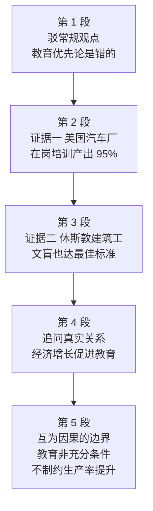

# Passage 12 · 穷国教育之谜

## 答题记录

| 轮次  | 日期       | 题号  | 正确  | 错误  | 正确率 | 用时  | 错题归因 |
| --- | -------- | --- | --- | --- | --- | --- | ---- |
| 1   | 20261019 | 1-5 | 3   | 2   |     | 14m |      |
| 2   |          | 1-5 |     |     |     |     |      |
| 3   |          | 1-5 |     |     |     |     |      |

> [!tip] 填写口径
> - **用时**以分钟计，只计做题时间，不含精读复盘。
> - **错题归因**填「题型·错误类型」，如：细节题·定位错、推理判断·过度推断、主旨大意·以偏概全。
> - 纵向看趋势：正确率升而用时过长 → 熟练度不足；用时降而正确率波动 → 定位不稳。

> [!info] 文章档案
> - **来源**：考研英语（一）2009 年 Text 3
> - **题材**：贫困国家中正规教育与经济发展的真实关系
> - **结构**：5 段 / 17 句 ＋ 5 题
> - **难度**：★★★★☆
> - **一句话主旨**：「穷国应优先发展教育」的传统观点是错的——两个实证说明缺教育也不碍生产率，真正的因果是经济增长之后才腾出手办教育，教育只是政治现代化的必要非充分条件。

## 一、篇章脉络

- **第 1 段**：破题——「穷国应优先办教育」的传统观点是错的，周期太长，不如在岗培训。
- **第 2 段**：证据一——被讥为教育不足的美国工人，在日系工厂达到日本同行 95% 的生产率。
- **第 3 段**：证据二——连文盲且语言不通的建筑工都能达标，教育与生产率的相关性再被削弱。
- **第 4 段**：追问因果——不是教育带来增长，而是增长之后才腾出手办教育。
- **第 5 段**：厘清边界——教育是政治现代化的必要非充分条件，缺了它也不碍生产率。

> [!tip] 行文逻辑
> 破题（教育优先论是错的）→ 实证一（日系工厂）→ 实证二（文盲工人）→ 追问（因果倒置）→ 厘清边界（必要非充分）。典型的「反常识立论 + 两例递进 + 因果翻转」结构；第 5 题答案句落在末段的收束处。

## 二、逐段精读

### 第 1 段 · 破题：教育优先论是错的

**原文**

① The relationship between formal education and economic growth in poor countries is widely misunderstood by economists and politicians alike.
② Progress in both areas is undoubtedly necessary for the social, political and intellectual development of these and all other societies; however, the conventional view that education should be one of the very highest priorities for promoting rapid economic development in poor countries is wrong.
③ We are fortunate that it is, because building new educational systems there and putting enough people through them to improve economic performance would require two or three generations.
④ The findings of a research institution have consistently shown that workers in all countries can be trained on the job to achieve radically higher productivity and, as a result, radically higher standards of living.

**译文**

① 经济学家和政治家们都普遍误解了贫困国家正规教育与经济增长之间的关系。
② 这两个领域的进步对这些国家及所有其他社会的社会、政治和智力发展无疑都是必要的；然而，那种认为教育应当是促进贫困国家经济快速发展的最优先事项之一的传统看法是错误的。
③ 我们庆幸它错了，因为在那些国家建立新的教育体制、让足够多的人接受教育以改善经济表现，需要两三代人的时间。
④ 一家研究机构的发现一贯表明：所有国家的工人都可以通过在岗培训实现大幅提高的生产率，并随之获得大幅提高的生活水平。

> [!note] 段落要点
> - 功能：破题立论——②句后半「is wrong」否定教育优先论，③句给理由（周期太长），④句亮出替代方案（在岗培训）。
> - ①句的 misunderstood 与②句的 wrong 是第 1 题（has been overestimated 被高估）的直接出处。

#### 长难句 · 本段

> [!abstract] 本段第 ② 句 · Progress in both areas is undoubtedly necessary...; however, the conventional view that education should be one of the very highest priorities for promoting rapid economic development in poor countries is wrong.

**结构拆解**

- **结构**：分号连接两个并列分句，however 表转折。
- **难点**：第二个分句的主语是 the conventional view，谓语是 is wrong——主谓被长长的同位语从句（that education should be...）分隔。

**参考译文**

这两个领域的进步无疑都是必要的；然而，那种认为教育应当是促进穷国经济快速发展的最优先事项之一的传统看法是错误的。

> [!tip] 拆解要点
> `名词 + that 从句` 若从句成分完整，是同位语从句；先跳过从句找谓语，再回头理解。

> [!abstract] 本段第 ③ 句 · We are fortunate that it is, because building new educational systems there and putting enough people through them to improve economic performance would require two or three generations.

**结构拆解**

- **主干**：We are fortunate that it is（it is 后省略 wrong，指「教育优先论是错的」）
- **原因状语**：because 引导；从句主语是两个并列动名词短语 building... and putting...，谓语 would require。

**参考译文**

我们庆幸它错了，因为在那些国家建立新的教育体制、让足够多的人接受教育以改善经济表现，需要两三代人的时间。

> [!tip] 拆解要点
> it is 后的省略（= it is wrong）是本题理解关键；动名词短语作主语时谓语用单数（此处虚拟语气 would）。

#### 本段重点词汇

| 单词 / 短语 | 词性 | 文中意 | 常用考义与拓展 | 英文示例搭配（中译） |
| --- | --- | --- | --- | --- |
| **formal education** | n. | 正规教育 | 学校教育；反义 informal | the relationship between formal education and economic growth（正规教育与经济增长的关系） |
| **misunderstand** | v. | 误解 | misunderstanding n. 误会 | is widely misunderstood by...（被……普遍误解） |
| **alike** | adv. | 同样地 | 熟词僻义：放在名词后「两者都」 | economists and politicians alike（经济学家和政治家都） |
| **intellectual** | adj. | 智力的 | n. 知识分子 | intellectual development（智力发展） |
| **conventional** | adj. | 传统的，公认的 | convention n. 惯例 | the conventional view（传统观点） |
| **priority** | n. | 优先事项 | prioritize v. 排优先级 | one of the very highest priorities（最优先事项之一） |
| **promote** | v. | 促进 | 促销；晋升 | promoting rapid economic development（促进经济快速发展） |
| **put ... through** | （短语） | 使完成学业 | put through 接通电话；使经历 | putting enough people through them（让足够多的人完成学业） |
| **performance** | n. | 表现，绩效 | 演出；性能 | economic performance（经济表现） |
| **findings** | n. | 研究发现 | find 的名词化复数 | The findings of a research institution（一家研究机构的发现） |
| **institution** | n. | 机构 | 熟词僻义：制度；惯例 | a research institution（研究机构） |
| **consistently** | adv. | 一贯地 | consistent adj. 一致的 | have consistently shown（一贯表明） |
| **be trained on the job** | （短语） | 接受在岗培训 | 同义 on-the-job training（在岗培训）；on the job 在工作中 | workers can be trained on the job（工人可在岗培训） |
| **radically** | adv. | 根本地，大幅地 | radical adj. 激进的 | radically higher productivity（大幅提高的生产率） |
| **productivity** | n. | 生产率 | produce v. 生产 | achieve radically higher productivity（实现大幅提高的生产率） |
| **as a result** | （短语） | 结果，因此 | 与 result in / result from 辨析 | and, as a result, radically higher standards of living（并因此获得更高的生活水平） |
| **standards of living** | n. | 生活水平 | 同义 living standards（生活水平），注意 standard 用复数 | radically higher standards of living（大幅提高的生活水平） |

### 第 2 段 · 证据一：美国日系工厂

**原文**

① Ironically, the first evidence for this idea appeared in the United States.
② Not long ago, with the country entering a recession and Japan at its pre-bubble peak, the U.S. workforce was derided as poorly educated and one of the primary causes of the poor U.S. economic performance.
③ Japan was, and remains, the global leader in automotive-assembly productivity.
④ Yet the research revealed that the U.S. factories of Honda, Nissan, and Toyota achieved about 95 percent of the productivity of their Japanese counterparts—a result of the training that U.S. workers received on the job.

**译文**

① 具有讽刺意味的是，这一观点的首个证据出现在美国。
② 不久前，正值美国步入衰退、日本处于泡沫破裂前的顶峰，美国劳动力被讥讽为受教育程度低，是美国经济表现不佳的主要原因之一。
③ 日本过去是、现在仍是汽车装配生产率的全球领导者。
④ 然而研究表明，本田、日产和丰田设在美国的工厂实现了其日本本土工厂约 95% 的生产率——这是美国工人接受在岗培训的结果。

> [!note] 段落要点
> - 功能：第一个实证——教育水平被讥讽的美国工人（②句）在日系工厂经在岗培训达到日本同行 95% 的生产率（④句）。
> - ironically（①句）点明反讽：反驳「教育不足 = 经济差」的证据，恰来自教育被嘲讽的美国。
> - ④句是第 3 题的定位句。

#### 长难句 · 本段

> [!abstract] 本段第 ② 句 · Not long ago, with the country entering a recession and Japan at its pre-bubble peak, the U.S. workforce was derided as poorly educated and one of the primary causes of the poor U.S. economic performance.

**结构拆解**

- **主干**：the U.S. workforce was derided as poorly educated and one of the primary causes...（be derided as 被讥讽为）
- **with 复合结构**：with the country entering a recession and Japan at its pre-bubble peak——两个并列的独立小句（名词 + 现在分词 / 介词短语）作背景状语。

**参考译文**

不久前，正值美国步入衰退、日本处于泡沫破裂前的顶峰，美国劳动力被讥讽为受教育程度低，是美国经济表现不佳的主要原因之一。

> [!tip] 拆解要点
> `with + n. + doing / prep.` 是最经典的背景状语；第二个并列项 Japan at its peak 省略了 entering。

#### 本段重点词汇

| 单词 / 短语 | 词性 | 文中意 | 常用考义与拓展 | 英文示例搭配（中译） |
| --- | --- | --- | --- | --- |
| **ironically** | adv. | 具有讽刺意味的是 | irony n. 反讽 | Ironically, the first evidence appeared in the U.S.（讽刺的是证据首现于美国） |
| **evidence** | n. | 证据 | evident adj. 明显的 | the first evidence for this idea（该观点的首个证据） |
| **recession** | n. | 衰退 | 经济衰退；=recession 的动词形式 recede 后退 | entering a recession（步入衰退） |
| **pre-bubble peak** | n. | 泡沫破裂前的顶峰 | bubble n. 泡沫；peak n. 顶点 | Japan at its pre-bubble peak（日本处于泡沫前顶峰） |
| **workforce** | n. | 劳动力 | 劳动人口总数 | the U.S. workforce was derided（美国劳动力被讥讽） |
| **deride as** | （短语） | 把……讥讽为 | ridicule 近义；derision n. | was derided as poorly educated（被讥讽为受教育程度低） |
| **primary** | adj. | 主要的 | 初级的；primary school 小学 | one of the primary causes（主要原因之一） |
| **remain** | v. | 仍然是 | 保持；逗留 | Japan was, and remains, the global leader.（日本过去是、现在仍是全球领头羊。） |
| **automotive-assembly** | adj. | 汽车装配的 | assembly line 流水线 | automotive-assembly productivity（汽车装配生产率） |
| **counterpart** | n. | 对应的人 / 物 | 职位相当者 | the productivity of their Japanese counterparts（其日本同行工厂的生产率） |

### 第 3 段 · 证据二：休斯敦的文盲建筑工

**原文**

① More recently, while examining housing construction, the researchers discovered that illiterate, non-English-speaking Mexican workers in Houston, Texas, consistently met best-practice labor productivity standards despite the complexity of the building industry's work.

**译文**

① 更近一些时候，在考察住房建设时，研究人员发现，得克萨斯州休斯敦那些不识字、不会说英语的墨西哥工人，尽管建筑业工作复杂，却始终达到了最佳实践的劳动生产率标准。

> [!note] 段落要点
> - 功能：把证据推到极致——连文盲且语言不通的工人都能达标，教育（尤其正规教育）与生产率的相关性被进一步削弱。
> - 全段仅一句，是第 2 题「takes efforts of generations」类选项的对照素材。

#### 本段重点词汇

| 单词 / 短语 | 词性 | 文中意 | 常用考义与拓展 | 英文示例搭配（中译） |
| --- | --- | --- | --- | --- |
| **examine** | v. | 考察，检查 | 检查；审问 | while examining housing construction（在考察住房建设时） |
| **housing construction** | n. | 住房建设 | 建筑；建造业 | while examining housing construction（考察住房建设时） |
| **illiterate** | adj. | 不识字的 | literacy n. 读写能力；反义 literate | illiterate, non-English-speaking Mexican workers（不识字、不说英语的墨西哥工人） |
| **consistently** | adv. | 始终，一贯 | 与第 1 段④呼应 | consistently met... standards（始终达到标准） |
| **best-practice** | adj. | 最佳实践的 | 最佳范例的 | best-practice labor productivity standards（最佳实践劳动生产率标准） |
| **despite** | prep. | 尽管 | in spite of 近义 | despite the complexity of the work（尽管工作复杂） |
| **complexity** | n. | 复杂性 | complex adj. 复杂的 | the complexity of the building industry's work（建筑行业工作的复杂性） |

### 第 4 段 · 追问：谁催生谁

**原文**

① What is the real relationship between education and economic development?
② We have to suspect that continuing economic growth promotes the development of education even when governments don't force it.
③ After all, that's how education got started.
④ When our ancestors were hunters and gatherers 10,000 years ago, they didn't have time to wonder much about anything besides finding food.
⑤ Only when humanity began to get its food in a more productive way was there time for other things.

**译文**

① 教育与经济发展之间真正的关系是什么？
② 我们不得不猜想：即便政府不强行推动，持续的经济增长也会促进教育的发展。
③ 毕竟，教育当初就是这么起源的。
④ 一万年前当我们的祖先还是狩猎采集者时，除了寻找食物，他们没有时间想别的。
⑤ 只有人类开始以更高效的方式获取食物之后，才有时间去关注其他事情。

> [!note] 段落要点
> - 功能：提出作者的真命题——因果倒置，是经济增长带来教育（②句）。
> - ③—⑤ 句用人类学起源佐证：先有生产方式进步（余粮），后有教育闲暇。
> - ⑤句的倒装是语法考点，也是第 4 题的答案句。

#### 长难句 · 本段

> [!abstract] 本段第 ⑤ 句 · Only when humanity began to get its food in a more productive way was there time for other things.

**结构拆解**

- **结构**：Only + when 时间状语从句置于句首，主句部分倒装——was there time for other things（正常语序 there was time for...）。

**参考译文**

只有当人类开始以更高效的方式获取食物，才有时间顾及别的事情。

> [!tip] 拆解要点
> `Only when... + 助动词/系动词 + 主语` 是最常考的部分倒装之一；写作中可用 Only in this way can we... 句型。

#### 本段重点词汇

| 单词 / 短语 | 词性 | 文中意 | 常用考义与拓展 | 英文示例搭配（中译） |
| --- | --- | --- | --- | --- |
| **suspect** | v. | 猜想 | 熟词僻义：怀疑某人有罪 → 推测 | We have to suspect that...（我们不得不猜想……） |
| **promote** | v. | 促进 | 与第 1 段重复，此处构成「经济促进教育」的新方向 | continuing economic growth promotes the development of education（持续经济增长促进教育发展） |
| **get started** | （短语） | 起源，开始 | get + 过去分词表状态变化 | that's how education got started（教育就是这么起源的） |
| **ancestor** | n. | 祖先 | ancestry n. 血统；反义 descendant | our ancestors were hunters and gatherers（我们的祖先曾是狩猎采集者） |
| **hunter and gatherer** | n. | 狩猎采集者 | 人类学术语 | when our ancestors were hunters and gatherers（当祖先还是狩猎采集者时） |
| **wonder about** | （短语） | 思考，琢磨 | wonder v. 想知道；奇迹 n. | wonder much about anything besides finding food（除了找食物还琢磨别的） |
| **besides** | prep. | 除……之外（还有） | 辨析 except「除去」 | anything besides finding food（找食物之外的任何事） |
| **humanity** | n. | 人类 | 熟词僻义：人性；人道 | Only when humanity began to...（只有当人类开始……） |
| **productive** | adj. | 高效的，多产的 | produce v.；productivity n. 生产率 | in a more productive way（以更高效的方式） |

### 第 5 段 · 厘清边界：必要而非充分

**原文**

① As education improved, humanity's productivity potential increased as well.
② When the competitive environment pushed our ancestors to achieve that potential, they could in turn afford more education.
③ This increasingly high level of education is probably a necessary, but not a sufficient, condition for the complex political systems required by advanced economic performance.
④ Thus poor countries might not be able to escape their poverty traps without political changes that may be possible only with broader formal education.
⑤ A lack of formal education, however, doesn't constrain the ability of the developing world's workforce to substantially improve productivity for the foreseeable future.
⑥ On the contrary, constraints on improving productivity explain why education isn't developing more quickly there than it is.

**译文**

① 随着教育改善，人类的生产率潜能也随之提高。
② 当竞争环境推动我们的祖先去实现那种潜能时，他们反过来又能负担更多教育。
③ 对先进经济表现所需的复杂政治体制而言，这种越来越高的教育水平或许是一个必要但非充分的条件。
④ 因此，若没有政治变革——而这种变革可能只有靠更广泛的正规教育才能实现——穷国或许无法逃脱贫困陷阱。
⑤ 然而，缺乏正规教育并不制约发展中世界的劳动力在可预见的未来大幅提高生产率。
⑥ 恰恰相反，是生产率提升所受的制约解释了为什么那里的教育发展得没那么快。

> [!note] 段落要点
> - 功能：全文逻辑闭环——教育 ⇄ 生产率互为因果（①②句），但教育只是政治现代化的必要非充分条件（③句）。
> - 结论落在⑤⑥句：缺教育不碍生产率，慢的是教育自身（第 5 题答案句）。

#### 长难句 · 本段

> [!abstract] 本段第 ③ 句 · This increasingly high level of education is probably a necessary, but not a sufficient, condition for the complex political systems required by advanced economic performance.

**结构拆解**

- **主干**：This level of education is a condition for the complex political systems（be necessary but not sufficient 插入并列定语）
- **难点**：a necessary, but not a sufficient, condition 中两个逗号间的 but not a sufficient 是插入的对照定语，核心名词是 condition。
- **后置定语**：required by advanced economic performance 过去分词短语修饰 political systems。

**参考译文**

对先进经济表现所需的复杂政治体制而言，这种越来越高的教育水平或许是一个必要但非充分的条件。

> [!tip] 拆解要点
> necessary / sufficient condition（必要 / 充分条件）是逻辑论证高频术语，抓住「插在逗号间的对照语不改变句子主干」。

> [!abstract] 本段第 ④ 句 · Thus poor countries might not be able to escape their poverty traps without political changes that may be possible only with broader formal education.

**结构拆解**

- **主干**：poor countries might not be able to escape their poverty traps
- **条件**：without political changes（介词短语表隐含条件）
- **定语从句**：that may be possible only with broader formal education 修饰 political changes。

**参考译文**

因此，若没有政治变革——而这种变革可能只有靠更广泛的正规教育才能实现——穷国或许无法逃脱贫困陷阱。

> [!tip] 拆解要点
> might not... without... 是双重否定的委婉断言（= 只有政治变革才能逃出贫困陷阱）。

#### 本段重点词汇

| 单词 / 短语 | 词性 | 文中意 | 常用考义与拓展 | 英文示例搭配（中译） |
| --- | --- | --- | --- | --- |
| **potential** | n. | 潜能 | adj. 潜在的 | humanity's productivity potential（人类的生产率潜能） |
| **competitive** | adj. | 竞争的 | 派生 compete v. 竞争；competition n. 竞争；competitor n. 竞争者 | the competitive environment（竞争环境） |
| **in turn** | （短语） | 反过来 | 依次；转而 | they could in turn afford more education（他们反过来能负担更多教育） |
| **afford** | v. | 负担得起 | 承担得起（损失 / 后果） | afford more education（负担更多教育） |
| **necessary** | adj. | 必要的 | necessity n. 必需品 | a necessary condition（必要条件） |
| **sufficient** | adj. | 充分的 | sufficiency n. 足够；反义 insufficient | but not a sufficient condition（但非充分条件） |
| **condition** | n. | 条件 | 状况；条款 | a necessary, but not a sufficient, condition（必要非充分条件） |
| **political systems** | n. | 政治体制 | system n. 体系 | the complex political systems（复杂的政治体制） |
| **advanced** | adj. | 先进的 | 高级的；发达的 | required by advanced economic performance（先进经济表现所需的） |
| **poverty trap** | n. | 贫困陷阱 | trap n. 陷阱；v. 困住 | escape their poverty traps（逃脱贫困陷阱） |
| **constrain** | v. | 制约，限制 | constraint n. 制约因素 | doesn't constrain the ability（并不制约能力） |
| **substantially** | adv. | 大幅地，实质性地 | substance n. 实质 | substantially improve productivity（大幅提高生产率） |
| **for the foreseeable future** | （短语） | 在可预见的将来 | 固定表达 | for the foreseeable future（可预见的将来） |
| **on the contrary** | （短语） | 恰恰相反 | 辨析 on the other hand | On the contrary, constraints... explain...（恰恰相反，制约因素解释了……） |

## 三、全篇重点词汇汇总（自测用）

> [!info] 说明
> 本表只列「单词 / 词性 / 所在段」，不含释义与搭配，用于遮表自测：说出词义后再回该段核对。
> 收录**全篇所有段落词汇，共 57 条，不删减**，与各段「本段重点词汇」等长同源。

| 单词 / 短语 | 词性 | 所在段 |
| --- | --- | --- |
| **formal education** | n. | 第 1 段 |
| **misunderstand** | v. | 第 1 段 |
| **alike** | adv. | 第 1 段 |
| **intellectual** | adj. | 第 1 段 |
| **conventional** | adj. | 第 1 段 |
| **priority** | n. | 第 1 段 |
| **promote** | v. | 第 1 段 |
| **put ... through** | （短语） | 第 1 段 |
| **performance** | n. | 第 1 段 |
| **findings** | n. | 第 1 段 |
| **institution** | n. | 第 1 段 |
| **consistently** | adv. | 第 1 段 |
| **be trained on the job** | （短语） | 第 1 段 |
| **radically** | adv. | 第 1 段 |
| **productivity** | n. | 第 1 段 |
| **as a result** | （短语） | 第 1 段 |
| **standards of living** | n. | 第 1 段 |
| **ironically** | adv. | 第 2 段 |
| **evidence** | n. | 第 2 段 |
| **recession** | n. | 第 2 段 |
| **pre-bubble peak** | n. | 第 2 段 |
| **workforce** | n. | 第 2 段 |
| **deride as** | （短语） | 第 2 段 |
| **primary** | adj. | 第 2 段 |
| **remain** | v. | 第 2 段 |
| **automotive-assembly** | adj. | 第 2 段 |
| **counterpart** | n. | 第 2 段 |
| **examine** | v. | 第 3 段 |
| **housing construction** | n. | 第 3 段 |
| **illiterate** | adj. | 第 3 段 |
| **best-practice** | adj. | 第 3 段 |
| **despite** | prep. | 第 3 段 |
| **complexity** | n. | 第 3 段 |
| **suspect** | v. | 第 4 段 |
| **get started** | （短语） | 第 4 段 |
| **ancestor** | n. | 第 4 段 |
| **hunter and gatherer** | n. | 第 4 段 |
| **wonder about** | （短语） | 第 4 段 |
| **besides** | prep. | 第 4 段 |
| **humanity** | n. | 第 4 段 |
| **productive** | adj. | 第 4 段 |
| **potential** | n. | 第 5 段 |
| **competitive** | adj. | 第 5 段 |
| **in turn** | （短语） | 第 5 段 |
| **afford** | v. | 第 5 段 |
| **necessary** | adj. | 第 5 段 |
| **sufficient** | adj. | 第 5 段 |
| **condition** | n. | 第 5 段 |
| **political systems** | n. | 第 5 段 |
| **advanced** | adj. | 第 5 段 |
| **poverty trap** | n. | 第 5 段 |
| **constrain** | v. | 第 5 段 |
| **substantially** | adv. | 第 5 段 |
| **for the foreseeable future** | （短语） | 第 5 段 |
| **on the contrary** | （短语） | 第 5 段 |
| **promote** | v. | 第 4 段 |
| **consistently** | adv. | 第 3 段 |

> [!warning] 熟词僻义专列
> - **alike**（第 1 段）：adv. 放名词后「两者都」（economists and politicians alike），非形容词「相似的」。
> - **institution**（第 1 段）：n. 机构，另有僻义「制度 / 惯例」。
> - **suspect**（第 4 段）：v. 猜想、推测（suspect that...），非「怀疑某人有罪」。
> - **humanity**（第 4 段）：n. 人类，另有「人性 / 人道」义。
> - **afford**（第 5 段）：v. 负担得起；另有「承担得起后果」义（can ill afford）。
> - **counterpart**（第 2 段）：n. 对应物（日本本土工厂），指「职能相当的另一方」。

> [!example] 同义替换链（阅读题高频）
> - **大幅地**：radically（第 1 段）↔ substantially（第 5 段）
> - **促进**：promote（第 1 段）↔ continuing economic growth promotes...（第 4 段）
> - **尽管**：despite（第 3 段）↔ in spite of
> - **制约**：constrain（第 5 段⑤）↔ constraints（第 5 段⑥）——同段名词化呼应

## 四、知识点补充

> [!question] 背景知识
> - **本文核心命题**：教育优先论（education-first）错在因果倒置——经济发展催生教育需求，教育是经济发展的结果多于原因。
> - **日系在美工厂**：1980—90 年代 Honda / Nissan / Toyota 在美国设厂，美国工人在岗培训后生产率接近日本本土，是「干中学」（learning by doing）的经典案例。
> - **necessary vs sufficient condition**：必要条件（没有它不行）≠ 充分条件（有它就够）；教育对政治现代化是前者。
> - **poverty trap（贫困陷阱）**：发展经济学概念——低收入导致低储蓄、低投资，从而无法增长的循环。
> - **本文出处**：2009 年考研英语（一）Text 3，观点来自 McKinsey 全球研究院等机构的研究综述。

> [!warning] 语法点
> - **同位语从句分隔主谓**：the conventional view that... is wrong（第 1 段②）。
> - **with 复合结构**：with the country entering a recession and Japan at its pre-bubble peak（第 2 段②）。
> - **Only 状语从句部分倒装**：Only when... was there time for other things（第 4 段⑤）。
> - **插入对照定语**：a necessary, but not a sufficient, condition（第 5 段③）。
> - **双重否定委婉断言**：might not be able to escape... without...（第 5 段④）。

> [!success] 写作可迁移句型
> - `The conventional view that... is wrong.` —— 立靶驳论开篇。
> - `Ironically, the first evidence for this idea appeared in...` —— 引出反例证据。
> - `Only when humanity began to... was there time for other things.` —— Only 倒装强调句。
> - `A lack of A, however, doesn't constrain...` —— 让步 + 反转的论证句。

> [!danger] 易混辨析
> - **suspect vs doubt**：suspect that...「猜想（偏信其真）」；doubt「怀疑其真」。
> - **necessary vs sufficient**：必要 ≠ 充分；教育是政治现代化的 necessary condition。
> - **despite vs although**：despite 是介词（后接名词），although 是连词（后接从句）。
> - **on the contrary vs on the other hand**：前者「恰恰相反」（否定前文），后者「另一方面」（并列补充）。

## 五、题目分析

> [!info] 题目总览
> | 题号 | 题型 | 定位 | 答案 |
> | --- | --- | --- | --- |
> | 1 | 观点细节题 | 第 1 段①②句 | D |
> | 2 | 细节题 | 第 1 段③句 | B |
> | 3 | 比较细节题 | 第 2 段③④句 | B |
> | 4 | 例证题 | 第 4 段④⑤句 | C |
> | 5 | 细节推断题 | 第 5 段①②⑥句 | C |

### 第 1 题 · 观点细节题

> [!question] 原题
> The author holds in Paragraph 1 that the importance of education in poor countries
> - A. is subject to groundless doubts.
> - B. has fallen victim of bias.
> - C. is conventionally downgraded.
> - D. has been overestimated.

**正确答案**：**D. has been overestimated.（被高估了）**

**定位与依据**
- 定位到第 1 段① ② 句：这一关系被 widely misunderstood；「教育应是最优先事项」的传统观点 is wrong。
- 同义替换：把教育摆到过高优先级的传统观点是错的 = the importance of education has been overestimated。

**干扰项分析**

| 选项 | 选项内容 | 判断 | 排除理由 |
| --- | --- | --- | --- |
| A | is subject to groundless doubts. | ✗ | 与原文相反：误解的是「关系」，且作者的质疑有据（下文实证），并非 groundless。 |
| B | has fallen victim of bias. | ✗ | 无中生有：原文未提「偏见」。 |
| C | is conventionally downgraded. | ✗ | 与原文相反：传统观点是「高估」，不是「贬低」。 |

> [!tip] 解题思路
> 观点题抓 wrong / misunderstood 的**方向**：作者反对的是「把教育放得太高」，对应 overestimate；干扰项 A、C 恰好把方向写反——做完先核对方向再选。

### 第 2 题 · 细节题

> [!question] 原题
> It is stated in Paragraph 1 that the construction of a new educational system
> - A. challenges economists and politicians.
> - B. takes efforts of generations.
> - C. demands priority from the government.
> - D. requires sufficient labor force.

**正确答案**：**B. takes efforts of generations.（需要几代人的努力）**

**定位与依据**
- 定位到第 1 段③句：building new educational systems... would require two or three generations。
- 同义替换：require two or three generations = takes efforts of generations。

**干扰项分析**

| 选项 | 选项内容 | 判断 | 排除理由 |
| --- | --- | --- | --- |
| A | challenges economists and politicians. | ✗ | 无中生有：经济学家是被误解方，不是被挑战方。 |
| C | demands priority from the government. | ✗ | 与原文相反：「优先级」正是被作者否定的传统观点。 |
| D | requires sufficient labor force. | ✗ | 偷换概念：require 的是「两三代人（时间）」，不是「劳动力」。 |

> [!tip] 解题思路
> 细节题的数字 / 时间信息最易出「偷换」干扰项：原文 two or three generations 指**时间跨度**，D 项把它偷换成**劳动力数量**——看到 require 就核对宾语。

### 第 3 题 · 比较细节题

> [!question] 原题
> A major difference between the Japanese and U.S. workforces is that
> - A. the Japanese workforce is better disciplined.
> - B. the Japanese workforce is more productive.
> - C. the U.S. workforce has a better education.
> - D. the U.S. workforce is more organized.

**正确答案**：**B. the Japanese workforce is more productive.（日本劳动力生产率更高）**

**定位与依据**
- 定位到第 2 段③ ④ 句：日本仍是汽车装配生产率的全球领导者；美国工厂达到日本同行「约 95%」的生产率。
- 同义替换：global leader in productivity + 95% 而非 100% = the Japanese workforce is more productive。

**干扰项分析**

| 选项 | 选项内容 | 判断 | 排除理由 |
| --- | --- | --- | --- |
| A | the Japanese workforce is better disciplined. | ✗ | 无中生有：原文并无比纪律信息。 |
| C | the U.S. workforce has a better education. | ✗ | 与原文相反：美国工人曾被讥讽为 poorly educated。 |
| D | the U.S. workforce is more organized. | ✗ | 无中生有：原文无「组织性」信息。 |

> [!tip] 解题思路
> 比较细节题先锁定**比较维度**：本文唯一的维度是 productivity（95% vs 100%），A、D 的维度（纪律、组织）原文根本不存在——凡换了维度的选项直接排除。

### 第 4 题 · 例证题

> [!question] 原题
> The author quotes the example of our ancestors to show that education emerged
> - A. when people had enough time.
> - B. prior to better ways of finding food.
> - C. when people no longer went hungry.
> - D. as a result of pressure on government.

**正确答案**：**C. when people no longer went hungry.（当人们不再挨饿时）**

**定位与依据**
- 定位到第 4 段④ ⑤ 句：祖先忙于觅食无暇他顾；只有以更高效方式获得食物（不再挨饿）之后，才有时间关注其他事情（包括教育）。
- 同义替换：get food in a more productive way = no longer went hungry。

**干扰项分析**

| 选项 | 选项内容 | 判断 | 排除理由 |
| --- | --- | --- | --- |
| A | when people had enough time. | ✗ | 以偏概全：「有时间」是结果的表现，原因（食物充足）才是答案。 |
| B | prior to better ways of finding food. | ✗ | 与原文相反：教育出现在觅食方式进步**之后**。 |
| D | as a result of pressure on government. | ✗ | 无中生有：原文无政府压力信息。 |

> [!tip] 解题思路
> 例证题回归例子的**论点**：本例论证「经济增长（食物生产率）→ 教育」的因果方向，答案必须同时含「教育」与「食物/经济」的先后关系——C 是唯一方向正确的选项。

### 第 5 题 · 细节推断题

> [!question] 原题
> According to the last paragraph, development of education
> - A. results directly from competitive environments.
> - B. does not depend on economic performance.
> - C. follows improved productivity.
> - D. cannot afford political changes.

**正确答案**：**C. follows improved productivity.（伴随生产率提高而发生）**

**定位与依据**
- 定位到第 5 段① ② 句：教育改善 → 潜能提高 → 反过来负担更多教育；以及⑥句：是生产率的制约解释了教育发展不快。
- 同义替换：教育发展滞后由生产率制约解释 = development of education follows improved productivity。

**干扰项分析**

| 选项 | 选项内容 | 判断 | 排除理由 |
| --- | --- | --- | --- |
| A | results directly from competitive environments. | ✗ | 偷换概念：竞争环境推动的是「实现潜能」，不是教育本身，且原文无 directly。 |
| B | does not depend on economic performance. | ✗ | 与原文相反：教育与经济互为因果。 |
| D | cannot afford political changes. | ✗ | 张冠李戴：afford 的主语是「实现潜能后的人们」，且政治变革需要的是教育而非教育需要变革。 |

> [!tip] 解题思路
> 尾段推断题抓最后一句的**因果解释句**（constraints explain why...）：「X 解释了 Y」意味着 Y 随 X 变——即教育（Y）跟随生产率（X）；凡是把原文 A、B 项的主宾对调（如 D）的选项都是「张冠李戴」。

## 六、复盘清单

- [ ] 过汇总表 57 词，遮住「所在段」列自测，重点过 6 个熟词僻义
- [ ] 重做 6 个长难句的口头翻译，特别是同位语从句分隔主谓（第 1 段②）与 Only 倒装（第 4 段⑤）
- [ ] 画出全文因果链：经济增长 → 生产率 → 教育；教育 →（必要非充分）→ 政治体制
- [ ] 整理本文干扰项类型：与原文相反 ×4、无中生有 ×4、偷换概念 ×2、张冠李戴 ×2、以偏概全 ×1
- [ ] 把答题记录填进顶部表格，对照正确率决定是否二刷

## 七、关联笔记

- [[Passage13-同伴压力的社会疗法]]
- [[考研英语 · 阅读六大题型方法论]]
- [[考研英语 · 熟词僻义汇总]]
