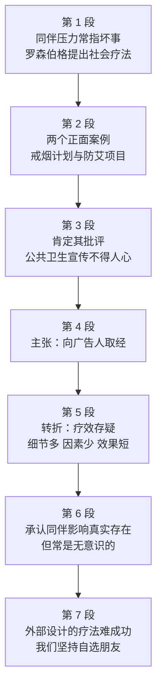

# Passage 13 · 同伴压力的社会疗法

## 答题记录

| 轮次  | 日期       | 题号  | 正确  | 错误  | 正确率 | 用时  | 错题归因 |
| --- | -------- | --- | --- | --- | --- | --- | ---- |
| 1   | 20261021 | 1-5 | 1   | 4   |     | 8   |      |
| 2   |          | 1-5 |     |     |     |     |      |
| 3   |          | 1-5 |     |     |     |     |      |

> [!tip] 填写口径
> - **用时**以分钟计，只计做题时间，不含精读复盘。
> - **错题归因**填「题型·错误类型」，如：细节题·定位错、推理判断·过度推断、主旨大意·以偏概全。
> - 纵向看趋势：正确率升而用时过长 → 熟练度不足；用时降而正确率波动 → 定位不稳。

> [!info] 文章档案
> - **来源**：考研英语（一）2012 年 Text 1
> - **题材**：书评——Tina Rosenberg《Join the Club》与「社会疗法」的得失
> - **结构**：7 段 / 19 句 ＋ 5 题
> - **难度**：★★★★☆
> - **一句话主旨**：作者肯定《Join the Club》用同伴压力做社会疗法的方向，却批评其论证失衡、疗效短暂，并最终判定——靠外部设计操纵同伴关系行不通。

## 一、篇章脉络

- **第 1 段**：引入——同伴压力的负面印象，以及书中提出的「社会疗法」概念。
- **第 2 段**：正面案例两则，说明社会疗法的具体形态。
- **第 3 段**：肯定——作者的第一次好评：反吸烟广告搞反了青少年的心理。
- **第 4 段**：主张——公共卫生倡导者该向广告人取经。
- **第 5 段**：转折——疗效存疑：论证失衡、效果短暂、案例翻车。
- **第 6 段**：承认——同伴影响真实存在，且好坏双向传播。
- **第 7 段**：收束——操纵同伴压力的外部设计行不通，因为朋友是我们自己选的。

> [!tip] 行文逻辑
> 引入概念（社会疗法）→ 举例（两个案例）→ 肯定（批评旧宣传）→ 主张（向广告人学）→ 转折（疗效存疑）→ 让步（影响真实）→ 终审（外部设计失灵）。书评典型的「述—褒—贬—断」四段式；第 5 题态度题考的是末段的存疑语气。

## 二、逐段精读

### 第 1 段 · 引入：同伴压力与社会疗法

**原文**

① Come on—Everybody's doing it.
② That whispered message, half invitation and half forcing, is what most of us think of when we hear the words peer pressure.
③ It usually leads to no good—drinking, drugs and casual sex.
④ But in her new book *Join the Club*, Tina Rosenberg contends that peer pressure can also be a positive force through what she calls the social cure, in which organizations and officials use the power of group dynamics to help individuals improve their lives and possibly the world.

**译文**

① 「来吧——大家都这么干。」
② 这句低声耳语，半是邀请半是逼迫，是我们大多数人听到「同伴压力」一词时想到的东西。
③ 它通常不会有好结果——酗酒、吸毒和随意的性行为。
④ 但蒂娜·罗森伯格在新书《加入俱乐部》中主张，同伴压力也可以成为一种积极的力量，途径是她所说的「社会疗法」：组织者和官员们利用群体动力的力量，帮助个人改善自己的生活，甚至可能改变世界。

> [!note] 段落要点
> - 功能：开篇先给「同伴压力」的日常负面印象（②③句），④句 But 一转，亮出全书核心概念 social cure。
> - 注意这是「书中的观点」，作者的评判要到后文才出现。

#### 长难句 · 本段

> [!abstract] 本段第 ② 句 · That whispered message, half invitation and half forcing, is what most of us think of when we hear the words peer pressure.

**结构拆解**

- **主干**：That whispered message is what...（what 引导表语从句）
- **插入语**：half invitation and half forcing 是主语的同位语，双逗号隔开。

**参考译文**

这句低声耳语，半是邀请半是逼迫，是我们大多数人听到「同伴压力」一词时想到的东西。

> [!tip] 拆解要点
> `half A and half B` 的同位插入是新闻体常见的节奏修饰，先跳过再读主干。

> [!abstract] 本段第 ④ 句 · But in her new book Join the Club, Tina Rosenberg contends that peer pressure can also be a positive force through what she calls the social cure, in which organizations and officials use the power of group dynamics to help individuals improve their lives and possibly the world.

**结构拆解**

- **主干**：Tina Rosenberg contends that...（that 引导宾语从句）
- **从句内部**：peer pressure can be a positive force through what she calls the social cure——what she calls... 是介词 through 的宾语从句。
- **非限定定语从句**：in which organizations and officials use... 修饰 the social cure。

**参考译文**

但罗森伯格在新书《加入俱乐部》中主张，同伴压力也可以成为积极力量，途径是她所说的「社会疗法」：组织者和官员们利用群体动力帮助个人改善生活，甚至改变世界。

> [!tip] 拆解要点
> `through what sb calls...` 是引介新术语的高频结构；in which 从句长，抓 use the power of A to do B 即可。

#### 本段重点词汇

| 单词 / 短语 | 词性 | 文中意 | 常用考义与拓展 | 英文示例搭配（中译） |
| --- | --- | --- | --- | --- |
| **whispered** | adj. | 低语的，耳语的 | whisper v. 低语；流言 | That whispered message（那句耳语） |
| **invitation** | n. | 邀请 | 招引；invite v. | half invitation and half forcing（半是邀请半是逼迫） |
| **forcing** | n. | 强迫 | force v. 强迫；forcible adj. 强行的 | half invitation and half forcing（半是邀请半是强迫） |
| **peer pressure** | n. | 同伴压力 | peer n. 同龄人，同辈 | the words peer pressure（「同伴压力」这个词） |
| **lead to** | （短语） | 导致 | 通向；造成 | It usually leads to no good.（通常没好结果。） |
| **no good** | n. | 没有好处 | 坏结果；do no good 无济于事 | leads to no good—drinking, drugs（导致酗酒、吸毒） |
| **casual** | adj. | 随意的 | 随便的；临时的 | casual sex（随意性行为） |
| **contend** | v. | 主张，认为 | contention n. 论点 | contends that peer pressure can also be...（主张同伴压力也可以是……） |
| **positive force** | n. | 积极力量 | force n. 力量 | a positive force（一种积极的力量） |
| **social cure** | n. | 社会疗法 | 本文核心术语 | what she calls the social cure（她所说的社会疗法） |
| **in which** | （连词） | 在其中 | 介词 + which 非限定从句 | a social cure, in which organizations use...（社会疗法：在其中组织者……） |
| **group dynamics** | n. | 群体动力 | dynamic adj. 动态的 | the power of group dynamics（群体动力的力量） |
| **individual** | n. | 个人 | adj. 个别的 | help individuals improve their lives（帮助个人改善生活） |

### 第 2 段 · 正面案例两则

**原文**

① Rosenberg, the recipient of a Pulitzer Prize, offers a host of examples of the social cure in action:
② In South Carolina, a state-sponsored antismoking program called *Rage Against the Haze* sets out to make cigarettes uncool.
③ In South Africa, an HIV-prevention initiative known as loveLife recruits young people to promote safe sex among their peers.

**译文**

① 普利策奖得主罗森伯格给出了许多「社会疗法」付诸实践的例子：
② 在南卡罗来纳州，一个名为「向烟雾宣战」的州资助戒烟计划，试图让香烟变得不酷。
③ 在南非，一项名为 loveLife 的艾滋病预防行动招募年轻人，在同伴中推广安全性行为。

> [!note] 段落要点
> - 功能：用书中的两个案例充实「社会疗法」的具体形态（②③句平行结构）。
> - 伏笔：这两个案例在第 5 段会重新出场——这次是作为「失败证据」。

#### 长难句 · 本段

> [!abstract] 本段第 ① 句 · Rosenberg, the recipient of a Pulitzer Prize, offers a host of examples of the social cure in action.

**结构拆解**

- **主干**：Rosenberg offers a host of examples of the social cure in action
- **插入语**：the recipient of a Pulitzer Prize 是主语同位语，双逗号隔开。

**参考译文**

普利策奖得主罗森伯格给出了许多社会疗法付诸实践的例子。

> [!tip] 拆解要点
> `人名, 同位语, 谓语...` 先跳过逗号对；in action 此处意为「在实践中」。

#### 本段重点词汇

| 单词 / 短语 | 词性 | 文中意 | 常用考义与拓展 | 英文示例搭配（中译） |
| --- | --- | --- | --- | --- |
| **recipient** | n. | 获得者 | 接受者；the recipient of an award 获奖者 | the recipient of a Pulitzer Prize（普利策奖得主） |
| **Pulitzer Prize** | n. | 普利策奖 | 美国新闻 / 文学大奖 | the recipient of a Pulitzer Prize（普利策奖得主） |
| **a host of** | （短语） | 大量，许多 | 同义 a number of / scores of（许多）；host 此处为「一大群」 | a host of examples（大量例子） |
| **in action** | （短语） | 在实践中 | 在运转中；起作用 | examples of the social cure in action（社会疗法实践的例子） |
| **state-sponsored** | adj. | 州资助的 | sponsor v. 赞助；n. 主办方 | a state-sponsored antismoking program（州资助的戒烟计划） |
| **antismoking** | adj. | 戒烟的，反吸烟的 | anti- 前缀「反对」 | an antismoking program（戒烟计划） |
| **set out to** | （短语） | 试图，着手 | 打算做；启程 | sets out to make cigarettes uncool（试图让香烟变不酷） |
| **uncool** | adj. | 不酷的 | 反义 cool；un- 否定前缀 | make cigarettes uncool（让香烟变得不酷） |
| **initiative** | n. | 行动，倡议 | 熟词僻义：主动性 | an HIV-prevention initiative（艾滋病预防行动） |
| **recruit** | v. | 招募 | 招聘；征募 | recruits young people（招募年轻人） |
| **promote** | v. | 推广 | 促进；晋升 | promote safe sex among their peers（在同伴中推广安全性行为） |

### 第 3 段 · 肯定：批评公共卫生宣传

**原文**

① The idea seems promising, and Rosenberg is a perceptive observer.
② Her critique of the lameness of many public-health campaigns is spot-on: they fail to mobilize peer pressure for healthy habits, and they demonstrate a seriously flawed understanding of psychology.
③ "Dare to be different, please don't smoke!" pleads one billboard campaign aimed at reducing smoking among teenagers—teenagers, who desire nothing more than fitting in.

**译文**

① 这个想法似乎很有前景，罗森伯格也是一位敏锐的观察者。
② 她对许多公共卫生宣传之拙劣的批评一针见血：这些宣传没能动员同伴压力来培养健康习惯，而且表现出对心理学的严重误解。
③ 「要敢于与众不同，请不要吸烟！」一场旨在减少青少年吸烟的广告牌运动如此恳求——而青少年，最渴望的恰恰是融入群体。

> [!note] 段落要点
> - 功能：作者对书的第一次正面评价（promising / perceptive / spot-on）——青少年最想 fit in，反吸烟广告却叫他们 be different，驴唇不对马嘴。
> - ②句的「心理学误解」是第 2、3 题的铺垫。

#### 长难句 · 本段

> [!abstract] 本段第 ③ 句 · "Dare to be different, please don't smoke!" pleads one billboard campaign aimed at reducing smoking among teenagers—teenagers, who desire nothing more than fitting in.

**结构拆解**

- **结构**：引语提前 + pleads 谓语 + 主语（倒装），正常语序为 One billboard campaign... pleads "Dare to be different..."。
- **后置定语**：aimed at reducing... 过去分词短语修饰 campaign。
- **破折号 + 同位复指**：—teenagers, who... 重复 teenagers 并以非限定定语从句补充（修辞强调）。

**参考译文**

「要敢于与众不同，请不要吸烟！」一场旨在减少青少年吸烟的广告牌运动如此恳求——而青少年，最渴望的恰恰是融入群体。

> [!tip] 拆解要点
> `nothing more than` = 只不过、恰恰就是；desire nothing more than fitting in 意为「最想要的就是合群」。

#### 本段重点词汇

| 单词 / 短语 | 词性 | 文中意 | 常用考义与拓展 | 英文示例搭配（中译） |
| --- | --- | --- | --- | --- |
| **promising** | adj. | 有前景的 | promise n. 前途；v. 承诺 | The idea seems promising.（这个想法似乎有前景。） |
| **perceptive** | adj. | 敏锐的 | perception n. 感知 | a perceptive observer（敏锐的观察者） |
| **critique** | n. | 批评，评论 | critic n. 批评家；critical adj. | her critique of the lameness（她对拙劣之处的批评） |
| **lameness** | n. | 拙劣，缺乏说服力 | lame adj. 跛的；站不住脚的 | the lameness of many campaigns（许多宣传的拙劣） |
| **public-health** | adj. | 公共卫生的 | 复合形容词 | public-health campaigns（公共卫生宣传） |
| **spot-on** | adj. | 一针见血的 | 恰好准确的（口语） | Her critique is spot-on.（她的批评一针见血。） |
| **mobilize** | v. | 动员 | 调动 | mobilize peer pressure for healthy habits（动员同伴压力培养健康习惯） |
| **flawed** | adj. | 有缺陷的 | flaw n. 缺陷；flawless adj. 无瑕的 | a seriously flawed understanding（严重错误的认知） |
| **plead** | v. | 恳求 | 辩护；plead guilty 认罪 | "Dare to be different!" pleads one campaign.（一场运动如此恳求。） |
| **billboard** | n. | 广告牌 | bill n. 海报；board n. 板 | a billboard campaign（广告牌运动） |
| **aimed at** | （短语） | 旨在 | aim at doing 介词后接动名词 | aimed at reducing smoking（旨在减少吸烟） |
| **desire nothing more than** | （短语） | 最渴望的莫过于 | nothing more than 只不过是 | desire nothing more than fitting in（最渴望融入群体） |
| **fit in** | （短语） | 融入，合群 | 适应；相处融洽 | teenagers, who desire fitting in（渴望合群的青少年） |

### 第 4 段 · 主张：向广告人取经

**原文**

① Rosenberg argues convincingly that public-health advocates ought to take a page from advertisers, so skilled at applying peer pressure.

**译文**

① 罗森伯格令人信服地主张，公共卫生倡导者应当向广告人取经——他们极擅长运用同伴压力。

> [!note] 段落要点
> - 功能：单句段，第 2 题的定位句——公共卫生倡导者该向广告人取经。
> - 语法：take a page from（向……学习）+ so skilled at 过去分词短语后置修饰 advertisers。

#### 本段重点词汇

| 单词 / 短语 | 词性 | 文中意 | 常用考义与拓展 | 英文示例搭配（中译） |
| --- | --- | --- | --- | --- |
| **convincingly** | adv. | 令人信服地 | convincing adj. 有说服力的 | argues convincingly that...（令人信服地主张……） |
| **advocate** | n. | 倡导者 | 熟词僻义：v. 提倡 | public-health advocates（公共卫生倡导者） |
| **take a page from** | （短语） | 向……学习 / 取经 | 原义「从……书上摘一页」 | take a page from advertisers（向广告人取经） |
| **skilled at** | adj. | 擅长 | skill n. 技能；skilled worker 熟练工 | so skilled at applying peer pressure（极擅长运用同伴压力） |
| **apply** | v. | 运用 | 申请；涂抹 | applying peer pressure（运用同伴压力） |

### 第 5 段 · 转折：疗效存疑

**原文**

① But on the general effectiveness of the social cure, Rosenberg is less persuasive.
② *Join the Club* is filled with too much irrelevant detail and not enough exploration of the social and biological factors that make peer pressure so powerful.
③ The most glaring flaw of the social cure as it's presented here is that it doesn't work very well for very long.
④ *Rage Against the Haze* failed once state funding was cut.
⑤ Evidence that the loveLife program produces lasting changes is limited and mixed.

**译文**

① 但就社会疗法的总体效果而言，罗森伯格的说服力就弱多了。
② 《加入俱乐部》充斥着太多无关的细节，却缺少对那些使同伴压力如此强大的社会与生物因素的探究。
③ 书中所呈现的社会疗法最刺眼的缺陷在于：它不能长久地发挥作用。
④ 州拨款一停，「向烟雾宣战」就失败了。
⑤ 证明 loveLife 项目能带来持久变化的证据既有限又含混。

> [!note] 段落要点
> - 功能：全文转折点（①句 But），作者批评三层展开——论证失衡（②句）→ 疗效短暂（③句）→ 案例翻车（④⑤句）。
> - ②句是第 3 题的出处；③⑤句是「lasting changes」干扰项的出处。

#### 长难句 · 本段

> [!abstract] 本段第 ② 句 · Join the Club is filled with too much irrelevant detail and not enough exploration of the social and biological factors that make peer pressure so powerful.

**结构拆解**

- **主干**：Join the Club is filled with A and not B（be filled with 充满）
- **并列**：too much irrelevant detail ↔ not enough exploration；of 短语修饰 exploration。
- **定语从句**：that make peer pressure so powerful 修饰 factors。

**参考译文**

《加入俱乐部》充斥着太多无关细节，却缺少对那些使同伴压力如此强大的社会与生物因素的探究。

> [!tip] 拆解要点
> too much... and not enough... 的失衡并列即「详略不当」的批评句式。

> [!abstract] 本段第 ⑤ 句 · Evidence that the loveLife program produces lasting changes is limited and mixed.

**结构拆解**

- **主干**：Evidence is limited and mixed（主系表）
- **同位语从句**：that the loveLife program produces lasting changes 解释 evidence 的内容，从句完整 → 同位语从句（非定语从句），且它把主谓 evidence... is 隔开。

**参考译文**

证明 loveLife 项目能带来持久变化的证据既有限又含混。

> [!tip] 拆解要点
> evidence / fact / news + that 完整从句 = 同位语从句；谓语在被分隔的后方。

#### 本段重点词汇

| 单词 / 短语 | 词性 | 文中意 | 常用考义与拓展 | 英文示例搭配（中译） |
| --- | --- | --- | --- | --- |
| **effectiveness** | n. | 有效性 | effective adj. 有效的 | the general effectiveness of the social cure（社会疗法的总体效果） |
| **persuasive** | adj. | 有说服力的 | persuade v. 说服；persuasion n. | Rosenberg is less persuasive.（罗森伯格说服力较弱。） |
| **irrelevant** | adj. | 无关的 | irrelevant to 与……无关；反义 relevant | too much irrelevant detail（太多无关细节） |
| **exploration** | n. | 探究 | explore v. 探索 | not enough exploration of the factors（缺少对因素的探究） |
| **factor** | n. | 因素 | 要素 | social and biological factors（社会与生物因素） |
| **glaring** | adj. | 刺眼的，明显的 | glare v. 怒视；glaring error 明显错误 | the most glaring flaw（最刺眼的缺陷） |
| **flaw** | n. | 缺陷 | 瑕疵；破绽 | the most glaring flaw of the social cure（社会疗法最明显的缺陷） |
| **funding** | n. | 拨款，资金 | fund v. 资助 | once state funding was cut（州拨款一停） |
| **lasting** | adj. | 持久的 | last v. 持续 | produces lasting changes（带来持久变化） |
| **limited and mixed** | adj. | 有限且含混的 | mixed evidence 证据不一 | is limited and mixed（既有限又含混） |

### 第 6 段 · 承认：同伴影响真实存在

**原文**

① There's no doubt that our peer groups exert enormous influence on our behavior.
② An emerging body of research shows that positive health habits—as well as negative ones—spread through networks of friends via social communication.
③ This is a subtle form of peer pressure: we unconsciously imitate the behavior we see every day.

**译文**

① 毫无疑问，同伴群体对我们的行为施加着巨大影响。
② 一批新兴的研究表明，良好的健康习惯——和坏习惯一样——会通过社交在朋友网络中传播。
③ 这是同伴压力的一种微妙形式：我们会无意识地模仿每天看到的行为。

> [!note] 段落要点
> - 功能：让步性承认——同伴影响是真的（①句），且双向传播（好习惯坏习惯都传染，②句）。
> - ③句的 subtly + unconsciously 是第 4 题的答案句：说的是「影响存在」，不是「社会疗法有效」。

#### 长难句 · 本段

> [!abstract] 本段第 ② 句 · An emerging body of research shows that positive health habits—as well as negative ones—spread through networks of friends via social communication.

**结构拆解**

- **主干**：An emerging body of research shows that...（that 引导宾语从句；主语核心是 body，谓语用单数）
- **插入**：—as well as negative ones—双破折号补充，ones 指代 habits。

**参考译文**

一批新兴的研究表明，良好的健康习惯——和坏习惯一样——会通过社交在朋友网络中传播。

> [!tip] 拆解要点
> `a body of + n.` 作主语时谓语单数（body 是核心名词）；as well as 插入语不改变主谓一致。

#### 本段重点词汇

| 单词 / 短语 | 词性 | 文中意 | 常用考义与拓展 | 英文示例搭配（中译） |
| --- | --- | --- | --- | --- |
| **exert** | v. | 施加 | exert influence/pressure on 对……施加影响 | exert enormous influence on our behavior（对行为施加巨大影响） |
| **enormous** | adj. | 巨大的 | 庞大的 | enormous influence（巨大影响） |
| **emerging** | adj. | 新兴的 | emerge v. 出现 | an emerging body of research（一批新兴研究） |
| **a body of** | （短语） | 一批，大量 | body n. 一堆；主体 | a body of research shows...（一批研究表明……） |
| **spread** | v. | 传播 | 蔓延；spread-spread-spread | spread through networks of friends（在朋友网络中传播） |
| **via** | prep. | 通过，经由 | 凭借 | via social communication（通过社交） |
| **subtle** | adj. | 微妙的 | 隐约的；细微的 | a subtle form of peer pressure（同伴压力的微妙形式） |
| **unconsciously** | adv. | 无意识地 | conscious adj. 有意识的 | we unconsciously imitate the behavior（我们无意识地模仿行为） |
| **imitate** | v. | 模仿 | imitation n. 模仿；近义 copy / mimic | imitate the behavior we see（模仿看到的行为） |

### 第 7 段 · 收束：外部设计行不通

**原文**

① Far less certain, however, is how successfully experts and bureaucrats can select our peer groups and steer their activities in virtuous directions.
② It's like the teacher who breaks up the troublemakers in the back row by pairing them with better-behaved classmates.
③ The tactic never really works.
④ And that's the problem with a social cure engineered from the outside: in the real world, as in school, we insist on choosing our own friends.

**译文**

① 然而，更难确定的是：专家和官僚们能否成功地为我们挑选同伴群体，并把他们的活动引向向善的方向。
② 这就像老师把后排的捣蛋鬼拆开、和表现好的同学配座。
③ 这一招从未真正奏效。
④ 这正是「从外部设计」的社会疗法的问题所在：在现实世界里，就像在学校一样，我们坚持自己选朋友。

> [!note] 段落要点
> - 功能：终审——用「拆开捣蛋鬼同桌」的类比（②句）宣告社会疗法的外部设计必然失灵，因为朋友是我们自选的（④句）。
> - ①句倒装 + how successfully 的存疑语气，是第 5 题「questionable」态度的来源。

#### 长难句 · 本段

> [!abstract] 本段第 ① 句 · Far less certain, however, is how successfully experts and bureaucrats can select our peer groups and steer their activities in virtuous directions.

**结构拆解**

- **结构**：表语 + 系动词 + 主语从句的完全倒装（正常语序：How successfully experts... can select... is far less certain）。
- **主语从句**：how successfully... 引导，从句内 select... and steer... 并列。

**参考译文**

然而，更难确定的是：专家和官僚们能否成功地为我们挑选同伴群体，并把他们的活动引向向善的方向。

> [!tip] 拆解要点
> 承上启下的倒装句先译倒装后的表语（less certain 存疑），再补主语从句内容。

#### 本段重点词汇

| 单词 / 短语 | 词性 | 文中意 | 常用考义与拓展 | 英文示例搭配（中译） |
| --- | --- | --- | --- | --- |
| **bureaucrat** | n. | 官僚 | bureaucracy n. 官僚机构 | experts and bureaucrats（专家和官僚） |
| **steer** | v. | 引导，驾驶 | 掌舵；steer clear of 避开 | steer their activities in virtuous directions（把活动引向善的方向） |
| **virtuous** | adj. | 向善的，有德行的 | virtue n. 美德 | in virtuous directions（朝向善的方向） |
| **break up** | （短语） | 拆散，分开 | 分手；解散 | breaks up the troublemakers（拆散捣蛋鬼） |
| **troublemaker** | n. | 捣蛋鬼 | trouble n. 麻烦 | the troublemakers in the back row（后排的捣蛋鬼） |
| **pair with** | （短语） | 与……配对 | pair n. 一对；a pair of | pairing them with better-behaved classmates（让他们和表现好的同学配座） |
| **better-behaved** | adj. | 表现更好的 | behave v. 举止 | better-behaved classmates（表现更好的同学） |
| **tactic** | n. | 手段，策略 | tactics 战术 | The tactic never really works.（这招从未奏效。） |
| **engineer** | v. | 设计，策划 | 熟词僻义：工程师 → 精心设计 | a social cure engineered from the outside（从外部设计的社会疗法） |
| **insist on** | （短语） | 坚持 | 后接动名词 | we insist on choosing our own friends（我们坚持自选朋友） |

## 三、全篇重点词汇汇总（自测用）

> [!info] 说明
> 本表只列「单词 / 词性 / 所在段」，不含释义与搭配，用于遮表自测：说出词义后再回该段核对。
> 收录**全篇所有段落词汇，共 71 条，不删减**，与各段「本段重点词汇」等长同源。

| 单词 / 短语 | 词性 | 所在段 |
| --- | --- | --- |
| **whispered** | adj. | 第 1 段 |
| **invitation** | n. | 第 1 段 |
| **forcing** | n. | 第 1 段 |
| **peer pressure** | n. | 第 1 段 |
| **lead to** | （短语） | 第 1 段 |
| **no good** | n. | 第 1 段 |
| **casual** | adj. | 第 1 段 |
| **contend** | v. | 第 1 段 |
| **positive force** | n. | 第 1 段 |
| **social cure** | n. | 第 1 段 |
| **in which** | （连词） | 第 1 段 |
| **group dynamics** | n. | 第 1 段 |
| **individual** | n. | 第 1 段 |
| **recipient** | n. | 第 2 段 |
| **Pulitzer Prize** | n. | 第 2 段 |
| **a host of** | （短语） | 第 2 段 |
| **in action** | （短语） | 第 2 段 |
| **state-sponsored** | adj. | 第 2 段 |
| **antismoking** | adj. | 第 2 段 |
| **set out to** | （短语） | 第 2 段 |
| **uncool** | adj. | 第 2 段 |
| **initiative** | n. | 第 2 段 |
| **recruit** | v. | 第 2 段 |
| **promote** | v. | 第 2 段 |
| **promising** | adj. | 第 3 段 |
| **perceptive** | adj. | 第 3 段 |
| **critique** | n. | 第 3 段 |
| **lameness** | n. | 第 3 段 |
| **public-health** | adj. | 第 3 段 |
| **spot-on** | adj. | 第 3 段 |
| **mobilize** | v. | 第 3 段 |
| **flawed** | adj. | 第 3 段 |
| **plead** | v. | 第 3 段 |
| **billboard** | n. | 第 3 段 |
| **aimed at** | （短语） | 第 3 段 |
| **desire nothing more than** | （短语） | 第 3 段 |
| **fit in** | （短语） | 第 3 段 |
| **convincingly** | adv. | 第 4 段 |
| **advocate** | n. | 第 4 段 |
| **take a page from** | （短语） | 第 4 段 |
| **skilled at** | adj. | 第 4 段 |
| **apply** | v. | 第 4 段 |
| **effectiveness** | n. | 第 5 段 |
| **persuasive** | adj. | 第 5 段 |
| **irrelevant** | adj. | 第 5 段 |
| **exploration** | n. | 第 5 段 |
| **factor** | n. | 第 5 段 |
| **glaring** | adj. | 第 5 段 |
| **flaw** | n. | 第 5 段 |
| **funding** | n. | 第 5 段 |
| **lasting** | adj. | 第 5 段 |
| **limited and mixed** | adj. | 第 5 段 |
| **exert** | v. | 第 6 段 |
| **enormous** | adj. | 第 6 段 |
| **emerging** | adj. | 第 6 段 |
| **a body of** | （短语） | 第 6 段 |
| **spread** | v. | 第 6 段 |
| **via** | prep. | 第 6 段 |
| **subtle** | adj. | 第 6 段 |
| **unconsciously** | adv. | 第 6 段 |
| **imitate** | v. | 第 6 段 |
| **bureaucrat** | n. | 第 7 段 |
| **steer** | v. | 第 7 段 |
| **virtuous** | adj. | 第 7 段 |
| **break up** | （短语） | 第 7 段 |
| **troublemaker** | n. | 第 7 段 |
| **pair with** | （短语） | 第 7 段 |
| **better-behaved** | adj. | 第 7 段 |
| **tactic** | n. | 第 7 段 |
| **engineer** | v. | 第 7 段 |
| **insist on** | （短语） | 第 7 段 |

> [!warning] 熟词僻义专列
> - **initiative**（第 2 段）：n. 行动、倡议，非「主动性」。
> - **advocate**（第 4 段）：n. 倡导者；作动词才是「提倡」。
> - **engineer**（第 7 段）：v. 精心设计，非「工程师」。
> - **spot-on**（第 3 段）：adj. 完全准确的（口语），spot 无「地点」义。
> - **lame / lameness**（第 3 段）：（论据）站不住脚、蹩脚，非「跛」。
> - **fit in**（第 3 段）：融入群体，青少年心理关键词。
> - **a body of**（第 6 段）：一批（研究），谓语用单数。
> - **take a page from**（第 4 段）：向……学习，非「撕一页」。

> [!example] 同义替换链（阅读题高频）
> - **主张**：contend（第 1 段）↔ argue（第 4 段）
> - **推动 / 推广**：promote（第 2 段）↔ mobilize（第 3 段）
> - **招募**：recruit（第 2 段）↔ pair with（第 7 段，反向拆散）
> - **缺陷**：flaw（第 5 段）↔ flawed understanding（第 3 段）↔ lameness（第 3 段）

## 四、知识点补充

> [!question] 背景知识
> - **《Join the Club》**：Tina Rosenberg 2011 年出版，主张用同侪压力解决社会问题，本文即其书评，考研英语（一）2012 Text 1。
> - **Pulitzer Prize**：普利策奖，美国新闻界与文学界最高荣誉之一，罗森伯格 1996 年获奖。
> - **social cure（社会疗法）**：借群体动力改造个体行为的干预手段，与「医疗 cure」双关。
> - **Rage Against the Haze**：南卡罗来纳州的青少年反吸烟运动，本义「向烟雾怒吼」。
> - **本文评价结构**：先扬后抑——第 3—4 段肯定，第 5 段 But 转折，阅读时首现 But 必须标记。

> [!warning] 语法点
> - **what 表语从句**：is what most of us think of（第 1 段②）。
> - **through what sb calls...**：介词 + what 从句引介新术语（第 1 段④）。
> - **倒装引语**：引语 + pleads + 主语（第 3 段③）。
> - **同位语从句分隔主谓**：Evidence that... is limited and mixed（第 5 段⑤）。
> - **完全倒装**：Far less certain, however, is how...（第 7 段①）。

> [!success] 写作可迁移句型
> - `X seems promising, and sb is a perceptive observer.` —— 先扬。
> - `But on the general effectiveness of..., sb is less persuasive.` —— 后抑。
> - `It's like the teacher who...` —— 生活类比说理。
> - `in the real world, as in school, we insist on...` —— 类比收束点题。

> [!danger] 易混辨析
> - **contend vs content**：contend「主张」，content「满足的 / 内容」。
> - **persuasive vs convincing**：近义「有说服力的」；本文 convincingingly 修饰罗森伯格，less persuasive 也修饰罗森伯格——前者指论证技巧，后者指总体效果。
> - **exert vs ascend**：exert influence on 施加影响；无 ascend influence 搭配。
> - **initiative vs initial**：initiative n. 行动 / 主动性；initial adj. 最初的。

## 五、题目分析

> [!info] 题目总览
> | 题号 | 题型 | 定位 | 答案 |
> | --- | --- | --- | --- |
> | 1 | 细节题 | 第 1 段③句 | D |
> | 2 | 观点细节题 | 第 4 段①句 | B |
> | 3 | 细节题 | 第 5 段②句 | A |
> | 4 | 细节题 | 第 6 段③句 | C |
> | 5 | 态度推断题 | 第 7 段 | D |

### 第 1 题 · 细节题

> [!question] 原题
> According to the first paragraph, peer pressure often emerges as
> - A. a supplement to the social cure.
> - B. a stimulus to group dynamics.
> - C. an obstacle to social progress.
> - D. a cause of undesirable behaviors.

**正确答案**：**D. a cause of undesirable behaviors.（不良行为的诱因）**

**定位与依据**
- 定位到第 1 段③句：It usually leads to no good—drinking, drugs and casual sex。
- 同义替换：leads to no good + 酗酒 / 吸毒 = a cause of undesirable behaviors。

**干扰项分析**

| 选项 | 选项内容 | 判断 | 排除理由 |
| --- | --- | --- | --- |
| A | a supplement to the social cure. | ✗ | 与原文相反：社交疗法是 peer pressure 的应用，非其补充。 |
| B | a stimulus to group dynamics. | ✗ | 因果颠倒：群体动力是社会疗法运用的力量，不是被 peer pressure 刺激。 |
| C | an obstacle to social progress. | ✗ | 无中生有：「社会进步」未在第一段出现。 |

> [!tip] 解题思路
> 细节题问「以什么形式出现」时锁定一般现在时描述句（usually leads to）；把破折号后的实例（drinking, drugs）归到「不良行为」这一上位词即可。

### 第 2 题 · 观点细节题

> [!question] 原题
> Rosenberg holds that public-health advocates should
> - A. recruit professional advertisers.
> - B. learn from advertisers' experience.
> - C. stay away from commercial advertisers.
> - D. recognize the limitations of advertisements.

**正确答案**：**B. learn from advertisers' experience.（学习广告商的经验）**

**定位与依据**
- 定位到第 4 段①句：public-health advocates ought to take a page from advertisers, so skilled at applying peer pressure。
- 同义替换：take a page from = learn from。

**干扰项分析**

| 选项 | 选项内容 | 判断 | 排除理由 |
| --- | --- | --- | --- |
| A | recruit professional advertisers. | ✗ | 偷换概念：是「学经验」，不是「招人」。 |
| C | stay away from commercial advertisers. | ✗ | 与原文相反：恰恰要接近学习。 |
| D | recognize the limitations of advertisements. | ✗ | 无中生有：原文谈的是广告的「长处」。 |

> [!tip] 解题思路
> 观点题抓习语动词（take a page from），四个选项中含同义改写（learn from）的即答案；「招募 / 远离 / 识别局限」都是对该习语的形近意远改写。

### 第 3 题 · 细节题

> [!question] 原题
> In the author's view, Rosenberg's book fails to
> - A. adequately probe social and biological factors.
> - B. effectively evade the flaws of the social cure.
> - C. illustrate the functions of state funding.
> - D. produce a long-lasting social effect.

**正确答案**：**A. adequately probe social and biological factors.（充分探究社会与生物因素）**

**定位与依据**
- 定位到第 5 段②句：too much irrelevant detail and **not enough exploration** of the social and biological factors。
- 同义替换：not enough exploration = fails to adequately probe。

**干扰项分析**

| 选项 | 选项内容 | 判断 | 排除理由 |
| --- | --- | --- | --- |
| B | effectively evade the flaws of the social cure. | ✗ | 偷换概念：书「呈现了」疗法的缺陷（但叙述有偏），不是「躲开缺陷」这一任务失败。 |
| C | illustrate the functions of state funding. | ✗ | 无中生有：州拨款只是第 4 段案例的细节，非书的功能说明。 |
| D | produce a long-lasting social effect. | ✗ | 张冠李戴：produce lasting changes 的主语是 loveLife 项目，不是书。 |

> [!tip] 解题思路
> fails to 题先在原文找否定词（not enough / fail / never）：②句的 not enough exploration 与 A 项 adequately probe 完美对位；注意主语边界——书不「生产」社会效果（D 项主体错位）。

### 第 4 题 · 细节题

> [!question] 原题
> Paragraph 5 shows that our imitation of behaviors
> - A. is harmful to our networks of friends.
> - B. will mislead behavioral studies.
> - C. occurs without our realizing it.
> - D. can produce negative health habits.

**正确答案**：**C. occurs without our realizing it.（在我们不知不觉中发生）**

**定位与依据**
- 定位到第 6 段③句：This is a subtle form of peer pressure: we **unconsciously** imitate the behavior we see every day。
- 同义替换：unconsciously = without our realizing it。

**干扰项分析**

| 选项 | 选项内容 | 判断 | 排除理由 |
| --- | --- | --- | --- |
| A | is harmful to our networks of friends. | ✗ | 与原文相反：②句明说好习惯坏习惯都会传播，模仿本身无害。 |
| B | will mislead behavioral studies. | ✗ | 无中生有：原文未提行为研究被误导。 |
| D | can produce negative health habits. | ✗ | 以偏概全：只取 as well as negative ones 的一半，且模仿是「传播」既有习惯而非「产生」习惯。 |

> [!tip] 解题思路
> 细节题最强对应是无副词替换（unconsciously → without realizing）；D 项是典型的「截取插入语」陷阱——as well as negative ones 只是让步补充，不是段落的论断。

### 第 5 题 · 态度推断题

> [!question] 原题
> The author suggests in the last paragraph that the effect of peer pressure is
> - A. harmful.
> - B. desirable.
> - C. profound.
> - D. questionable.

**正确答案**：**D. questionable.（可疑的，存疑的）**

**定位与依据**
- 定位到第 7 段：①句 Far less certain（能否成功存疑）+ ③句 The tactic never really works（从未奏效）+ ④句 that's the problem。
- 同义替换：far less certain + never really works = questionable。

**干扰项分析**

| 选项 | 选项内容 | 判断 | 排除理由 |
| --- | --- | --- | --- |
| A | harmful. | ✗ | 与原文相反：第 6 段承认同伴影响未必有害，本段质疑的是「外部设计的疗效」。 |
| B | desirable. | ✗ | 与原文相反：正面评价与存疑语气相反。 |
| C | profound. | ✗ | 无中生有：「深远」无从体现。 |

> [!tip] 解题思路
> 尾段态度题抓三连否定信号（Far less certain / never really works / the problem）——三个信号都指向「怀疑」；注意区分「影响本身」（第 6 段：真实存在）与「人为干预的影响」（第 7 段：存疑）。

## 六、复盘清单

- [ ] 过汇总表 71 词，遮住「所在段」列自测，重点过 8 个熟词僻义
- [ ] 重做 7 个长难句的口头翻译，特别是同位语从句分隔主谓（第 5 段⑤）与完全倒装（第 7 段①）
- [ ] 画出书评结构：立（1-4 段）→ 破（5 段）→ 分层收束（6-7 段）
- [ ] 整理本文干扰项类型：与原文相反 ×3、无中生有 ×3、偷换概念 ×2、张冠李戴 ×2、以偏概全 ×1、因果颠倒 ×1
- [ ] 把答题记录填进顶部表格，对照正确率决定是否二刷

## 七、关联笔记

- [[Passage14-被低估的人类嗅觉]]
- [[考研英语 · 阅读六大题型方法论]]
- [[考研英语 · 熟词僻义汇总]]
