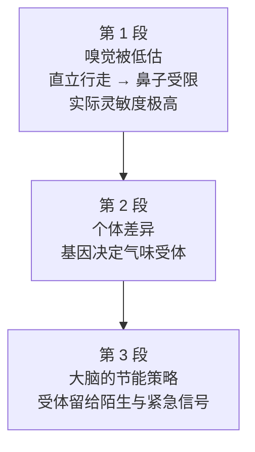

# Passage 14 · 被低估的人类嗅觉

## 答题记录

| 轮次  | 日期         | 题号  | 正确  | 错误  | 正确率 | 用时    | 错题归因 |
| --- | --- | --- | --- | --- | --- | --- | --- |
| 1 |  | 1-20 |  |  |  |  |  |
| 2 |  | 1-20 |  |  |  |  |  |
| 3 |  | 1-20 |  |  |  |  |  |

> [!tip] 填写口径
> - **用时**以分钟计，只计做题时间，不含精读复盘。
> - **错题归因**填「题型·错误类型」，如：细节题·定位错、推理判断·过度推断、主旨大意·以偏概全。
> - 纵向看趋势：正确率升而用时过长 → 熟练度不足；用时降而正确率波动 → 定位不稳。

> [!info] 文章档案
> - **来源**：考研英语（一）2005 年完形填空
> - **题材**：人类嗅觉常被低估——灵敏度、个体差异与大脑机制
> - **结构**：3 段 / 12 句 / 20 个挖空
> - **难度**：★★★☆☆
> - **一句话主旨**：人类嗅觉其实相当灵敏（可察觉百万分之一的气味），差异源于受体基因；大脑为节省算力只给陌生与紧急的气味留通道，而不敏感也可以通过经常接触来改变。

## 一、篇章脉络

- **第 1 段**：推翻成见——人类嗅觉并不差，直立行走只是让「嗅觉迟钝」的说法有了借口。
- **第 2 段**：解释个体差异——嗅觉受体基因决定灵敏度，不过不敏感者经常接触后也能变敏感。
- **第 3 段**：揭示大脑机制——为节省算力，熟悉的气味被关闭，陌生而紧急的气味（如烟味）保留通道。

> [!tip] 行文逻辑
> 成见（人类嗅觉差）→ 反转（其实极灵敏）→ 差异（基因与受体）→ 机制（大脑节能：熟悉的关闭、紧急的保留）。典型的「破成见 + 科学解释」科普说明结构；完形的连词与逻辑题几乎全押在三处转折上（but / though / whereas / however）。

## 二、逐段精读

### 第 1 段 · 嗅觉为何被低估，以及真相

**原文**

① The human nose is an underrated tool.
② Humans are often thought to be insensitive smellers compared with animals, **but**〔1〕 this is largely because, **unlike**〔2〕 animals, we stand upright.
③ This means that our noses are **limited**〔3〕 to perceiving those smells which float through the air, **missing**〔4〕 the majority of smells which stick to surfaces.
④ In fact, **though**〔5〕, we are extremely sensitive to smells, **even if**〔6〕 we do not generally realize it.
⑤ Our noses are capable of **detecting**〔7〕 human smells even when these are **diluted**〔8〕 to far below one part in one million.

**译文**

① 人类的鼻子是一种被低估的工具。
② 人们通常认为，与动物相比人类的嗅觉不灵敏，但这很大程度上是因为：与动物不同，我们是直立行走的。
③ 这意味着我们的鼻子局限于感知那些飘浮在空气中的气味，错过了大部分附着在物体表面的气味。
④ 不过事实上，我们对气味极其敏感，尽管我们通常意识不到这一点。
⑤ 我们的鼻子能够察觉人类的气味，即使这些气味被稀释到远低于百万分之一。

> [!note] 段落要点
> - 功能：「成见 → 解释 → 反转」三步——②句解释成见的由来（直立行走），④句 though 一转宣告「其实很灵敏」，⑤句用百万分之一的数据坐实。
> - 第 1、5、6 题的连词选择全看这几处逻辑转换。

#### 长难句 · 本段

> [!abstract] 本段第 ③ 句 · This means that our noses are limited to perceiving those smells which float through the air, missing the majority of smells which stick to surfaces.

**结构拆解**

- **主干**：This means that our noses are limited to perceiving those smells（be limited to 中 to 是介词，后接动名词）
- **定语从句**：which float through the air 修饰 smells。
- **伴随状语**：missing... 现在分词短语，逻辑主语是 our noses。

**参考译文**

这意味着我们的鼻子局限于感知飘浮在空气中的气味，错过了大部分附着在物体表面的气味。

> [!tip] 拆解要点
> `limited to doing` 与 `missing...` 的分词状语是本句双考点。

> [!abstract] 本段第 ⑤ 句 · Our noses are capable of detecting human smells even when these are diluted to far below one part in one million.

**结构拆解**

- **主干**：Our noses are capable of detecting human smells
- **让步状语从句**：even when these are diluted to...（these 指代 human smells）

**参考译文**

我们的鼻子能够察觉人类的气味，即使这些气味被稀释到远低于百万分之一。

> [!tip] 拆解要点
> even when = 即使在……的时候，比 when 语气更强；`to + 数量` 表稀释后的浓度。

#### 本段重点词汇

| 单词 / 短语 | 词性 | 文中意 | 常用考义与拓展 | 英文示例搭配（中译） |
| --- | --- | --- | --- | --- |
| **underrated** | adj. | 被低估的 | rate v. 评估；overrated 被高估的 | an underrated tool（被低估的工具） |
| **insensitive** | adj. | 不敏感的 | insensitive to 对……不敏感 | insensitive smellers（嗅觉不灵敏者） |
| **smeller** | n. | 嗅闻者 | smell v. 闻；n. 气味 | insensitive smellers（嗅觉迟钝者） |
| **compared with** | （短语） | 与……相比 | compare...to... 把……比作 | compared with animals（与动物相比） |
| **stand upright** | （短语） | 直立行走 | upright adj. 直立的 | we stand upright（我们是直立行走的） |
| **perceive** | v. | 感知 | perception n. 感知 | perceiving those smells（感知那些气味） |
| **float through** | （短语） | 飘浮于 | float v. 漂浮 | smells which float through the air（飘在空气中的气味） |
| **stick to** | （短语） | 粘附于 | 坚持（stick to one's plan） | smells which stick to surfaces（附着在表面的气味） |
| **surface** | n. | 表面 | 物体表面；水面 | stick to surfaces（粘附在表面） |
| **extremely** | adv. | 极其 | extreme adj. 极端的 | extremely sensitive to smells（对气味极其敏感） |
| **be capable of** | （短语） | 能够 | 后接动名词；capability n. | are capable of detecting human smells（能察觉人的气味） |
| **far below** | （短语） | 远低于 | far 修饰比较级 / 低于 | diluted to far below one part（稀释到远低于百万分之一） |

### 第 2 段 · 个体差异：受体与基因

**原文**

① Strangely, some people find that they can smell one type of flower but not another, **whereas**〔9〕 others are sensitive to the smells of both flowers.
② This may be because some people do not have the genes necessary to generate **particular**〔10〕 smell receptors in the nose.
③ These receptors are the cells which sense smells and send **messages**〔11〕 to the brain.
④ However, it has been found that even people insensitive to a certain smell **at first**〔12〕 can suddenly become sensitive to it when **exposed**〔13〕 to it often enough.

**译文**

① 奇怪的是，有些人发现自己闻得到一种花却闻不到另一种，而另一些人对两种花的气味都敏感。
② 这可能是因为一些人不具备在鼻腔中生成特定气味受体的基因。
③ 这些受体是一些细胞，它们感知气味并把信号传送到大脑。
④ 然而，研究发现，即使起初对某种气味不敏感的人，在足够频繁地接触它之后，也会突然变得敏感。

> [!note] 段落要点
> - 功能：先摆差异现象（①句 whereas 对比），再给机制解释（基因 → 受体 → 传信号）。
> - 末句 however 再反转：不敏感可以后天改变（exposed to it often enough）。

#### 长难句 · 本段

> [!abstract] 本段第 ④ 句 · However, it has been found that even people insensitive to a certain smell at first can suddenly become sensitive to it when exposed to it often enough.

**结构拆解**

- **主干**：it has been found that...（it 作形式主语，真正主语是 that 从句）
- **从句主干**：people can suddenly become sensitive to it
- **修饰**：insensitive to a certain smell at first 形容词短语后置修饰 people；when exposed to it often enough 是 when + 过去分词的省略状语（= when they are exposed to it）。

**参考译文**

然而，研究发现，即使起初对某种气味不敏感的人，在足够频繁地接触它之后，也会突然变得敏感。

> [!tip] 拆解要点
> `形容词短语 + can + 谓语` 中间隔得很远，先跳过形容词短语找谓语 can become。

#### 本段重点词汇

| 单词 / 短语 | 词性 | 文中意 | 常用考义与拓展 | 英文示例搭配（中译） |
| --- | --- | --- | --- | --- |
| **strangely** | adv. | 奇怪的是 | strange adj. 奇怪的 | Strangely, some people find that...（奇怪的是……） |
| **be sensitive to** | （短语） | 对……敏感 | sensitivity n. 敏感度 | sensitive to the smells of both flowers（对两种花的气味都敏感） |
| **gene** | n. | 基因 | genetic adj. 遗传的 | the genes necessary to generate...（生成……所必需的基因） |
| **necessary to** | （短语） | ……所必需的 | 后接动词原形（必要条件） | genes necessary to generate receptors（生成受体所必需的基因） |
| **generate** | v. | 生成 | 产生（电 / 利润） | generate smell receptors（生成气味受体） |
| **receptor** | n. | 受体 | receive v. 接收 | smell receptors in the nose（鼻腔中的气味受体） |
| **sense** | v. | 感知 | 熟词僻义：n. 感觉 → v. 觉察 | the cells which sense smells（感知气味的细胞） |
| **brain** | n. | 大脑 | 脑力；头脑 | send messages to the brain（把信号传给大脑） |
| **suddenly** | adv. | 突然 | sudden adj. 突然的 | can suddenly become sensitive（会突然变得敏感） |
| **often enough** | （短语） | 足够频繁 | enough 后置修饰副词 | when exposed to it often enough（足够频繁接触后） |

### 第 3 段 · 大脑的节能机制

**原文**

① The explanation for insensitivity to smell seems to be that brain find it **inefficient**〔14〕 to keep all smell receptors working all the time but can **create**〔15〕 new receptors if necessary.
② This may **also**〔16〕 explain why we are not usually sensitive to our own smells—we simply do not need to be.
③ We are not **aware**〔17〕 of the usual smell of our own house, but we **notice**〔18〕 new smells when we visit someone else's.
④ The brain finds it best to keep smell receptors **available**〔19〕 for unfamiliar and emergency signals **such as**〔20〕 the smell of smoke, which might indicate the danger of fire.

**译文**

① 对气味不敏感的解释似乎是：让所有气味受体一直工作，大脑觉得效率太低，但在必要时它能够生成新的受体。
② 这也可以解释为什么我们通常对自己的气味不敏感——我们根本不需要敏感。
③ 我们闻不到自己家里的惯常气味，但去别人家做客时就会注意到新的气味。
④ 大脑认为最好的策略是让气味受体保持可用状态，以应对陌生和紧急的信号——比如烟味，它可能预示着火灾的危险。

> [!note] 段落要点
> - 功能：全文收束于机制解释——大脑「省着用」受体，熟悉的气味关掉、陌生而紧急的保留通道（烟味预警火灾）。
> - ②③句把机制落到生活体验，④句 which 非限定从句补出「烟味」实例。

#### 长难句 · 本段

> [!abstract] 本段第 ④ 句 · The brain finds it best to keep smell receptors available for unfamiliar and emergency signals such as the smell of smoke, which might indicate the danger of fire.

**结构拆解**

- **主干**：The brain finds it best to keep smell receptors available（find it + adj. + to do，it 为形式宾语）
- **宾补**：available for... 形容词作 receptors 的补足语。
- **举例**：such as the smell of smoke。
- **非限定定语从句**：which might indicate the danger of fire 修饰 the smell of smoke。

**参考译文**

大脑认为最好让气味受体保持可用，以应对陌生和紧急的信号——比如烟味，它可能预示火灾的危险。

> [!tip] 拆解要点
> `find it + adj. + to do` 与 `keep + n. + adj.` 两个结构叠用；which 从句紧跟 smoke，就近修饰。

#### 本段重点词汇

| 单词 / 短语 | 词性 | 文中意 | 常用考义与拓展 | 英文示例搭配（中译） |
| --- | --- | --- | --- | --- |
| **explanation** | n. | 解释 | explain v. 解释 | the explanation for insensitivity（对不敏感的解释） |
| **keep ... working** | （短语） | 使……持续运转 | keep + 宾语 + 现在分词 | keep all receptors working（让所有受体持续工作） |
| **all the time** | （短语） | 一直 | 始终 | working all the time（一直工作） |
| **if necessary** | （短语） | 如有必要 | 状语从句省略（if it is necessary） | can create new receptors if necessary（必要时能生成新受体） |
| **simply** | adv. | 根本，简直 | 熟词僻义：仅仅 → 用于强调 | we simply do not need to be（我们根本不需要） |
| **usual** | adj. | 惯常的 | as usual 像往常一样 | the usual smell of our own house（自家熟悉的气味） |
| **visit** | v. | 做客 | 拜访；参观 | visit someone else's house（去别人家做客） |
| **unfamiliar** | adj. | 陌生的 | unfamiliar to 对……陌生 | unfamiliar and emergency signals（陌生和紧急的信号） |
| **emergency** | n. | 紧急情况 | emergency exit 紧急出口 | emergency signals（紧急信号） |
| **signal** | n. | 信号 | 暗号；标志 | keep receptors available for signals（让受体对信号保持可用） |
| **indicate** | v. | 预示，表明 | indication n. 指示 | indicate the danger of fire（预示火灾危险） |
| **danger** | n. | 危险 | dangerous adj. 危险的 | the danger of fire（火灾危险） |

## 三、全篇重点词汇汇总（自测用）

> [!info] 说明
> 本表只列「单词 / 词性 / 所在段」，不含释义与搭配，用于遮表自测：说出词义后再回该段核对。
> 收录**全篇所有段落词汇，共 34 条，不删减**，与各段「本段重点词汇」等长同源。

| 单词 / 短语 | 词性 | 所在段 |
| --- | --- | --- |
| **underrated** | adj. | 第 1 段 |
| **insensitive** | adj. | 第 1 段 |
| **smeller** | n. | 第 1 段 |
| **compared with** | （短语） | 第 1 段 |
| **stand upright** | （短语） | 第 1 段 |
| **perceive** | v. | 第 1 段 |
| **float through** | （短语） | 第 1 段 |
| **stick to** | （短语） | 第 1 段 |
| **surface** | n. | 第 1 段 |
| **extremely** | adv. | 第 1 段 |
| **be capable of** | （短语） | 第 1 段 |
| **far below** | （短语） | 第 1 段 |
| **strangely** | adv. | 第 2 段 |
| **be sensitive to** | （短语） | 第 2 段 |
| **gene** | n. | 第 2 段 |
| **necessary to** | （短语） | 第 2 段 |
| **generate** | v. | 第 2 段 |
| **receptor** | n. | 第 2 段 |
| **sense** | v. | 第 2 段 |
| **brain** | n. | 第 2 段 |
| **suddenly** | adv. | 第 2 段 |
| **often enough** | （短语） | 第 2 段 |
| **explanation** | n. | 第 3 段 |
| **keep ... working** | （短语） | 第 3 段 |
| **all the time** | （短语） | 第 3 段 |
| **if necessary** | （短语） | 第 3 段 |
| **simply** | adv. | 第 3 段 |
| **usual** | adj. | 第 3 段 |
| **visit** | v. | 第 3 段 |
| **unfamiliar** | adj. | 第 3 段 |
| **emergency** | n. | 第 3 段 |
| **signal** | n. | 第 3 段 |
| **indicate** | v. | 第 3 段 |
| **danger** | n. | 第 3 段 |

> [!warning] 熟词僻义专列
> - **sense**（第 2 段）：v. 感知、觉察，非「感觉 / 意义」。
> - **simply**（第 3 段）：adv. 简直、根本（强调否定），非「简单地」。
> - **tool**（第 1 段）：n. 嗅觉器官（比喻用法），非「工具箱里的工具」。
> - **stick to**（第 1 段）：附着于物体表面，另有熟词僻义「坚持」。

> [!example] 同义替换链（阅读题高频）
> - **感知**：perceive（第 1 段）↔ sense（第 2 段）↔ detect（第 1 段⑦题答案词）
> - **不敏感**：insensitive（第 1 段）↔ insensitivity（第 3 段）↔ not aware of（第 3 段⑰题）
> - **生成**：generate（第 2 段）↔ create（第 3 段⑮题答案词）

## 四、知识点补充

> [!question] 背景知识
> - **气味受体（smell receptors）**：鼻腔中的嗅觉感觉神经细胞，人类约有 400 种，2004 年诺贝尔生理学奖即授予嗅觉受体研究。
> - **直立行走的代价**：直立使鼻子上移，气流直达肺部的比例增加，贴地 / 贴面气味进入鼻腔的机会减少——本文对「人类嗅觉差」的解释。
> - **百万分之一**：即浓度 1 ppm，说明嗅觉阈值极低。
> - **本文出处**：2005 年考研英语（一）完形填空，原文出自科普类文章，讲嗅觉心理物理学。

> [!warning] 语法点
> - **be limited to doing**：to 为介词（第 1 段③）。
> - **find it + adj. + to do**：形式宾语（第 3 段① ④）。
> - **when + 过去分词省略**：when exposed to it often enough（第 2 段④）。
> - **it has been found that...**：形式主语（第 2 段④）。

> [!success] 写作可迁移句型
> - `X is an underrated tool.` —— 开篇立论、为「被低估者」正名。
> - `This may also explain why...` —— 由一机制推广解释另一现象。
> - `We are not A of ..., but we B ... when...` —— 对照句式说明适应性。

> [!danger] 易混辨析（本篇核心考点）
> - **dilute / dissolve / disperse / diffuse**：dilute 稀释（加溶剂）；dissolve 溶解；disperse 驱散；diffuse 扩散。
> - **limited / committed / dedicated / confined**：只有 be limited to 表「局限于」；confined 多指外部强制限制。
> - **catch / ignore / miss / track**：miss「错过」才能与「闻到空气中味、错过表面味」对应。
> - **sign / stimulus / message / impulse**：受体发给大脑的是 message（信息）；impulse 是神经冲动但发送主体是神经元。

## 五、题目分析

> [!info] 题目总览
> | 题号 | 题型 | 定位 | 答案 |
> | --- | --- | --- | --- |
> | 1 | 逻辑连词题 | 第 1 段②句 | C |
> | 2 | 介词辨析题 | 第 1 段②句 | B |
> | 3 | 动词短语搭配题 | 第 1 段③句 | A |
> | 4 | 动词辨析题 | 第 1 段③句 | C |
> | 5 | 逻辑连词题 | 第 1 段④句 | B |
> | 6 | 逻辑连词题 | 第 1 段④句 | A |
> | 7 | 动词辨析题 | 第 1 段⑤句 | D |
> | 8 | 动词辨析题 | 第 1 段⑤句 | A |
> | 9 | 逻辑连词题 | 第 2 段①句 | D |
> | 10 | 形容词辨析题 | 第 2 段②句 | B |
> | 11 | 名词辨析题 | 第 2 段③句 | C |
> | 12 | 短语辨析题 | 第 2 段④句 | A |
> | 13 | 动词辨析题 | 第 2 段④句 | D |
> | 14 | 形容词辨析题 | 第 3 段①句 | B |
> | 15 | 动词辨析题 | 第 3 段①句 | C |
> | 16 | 逻辑副词题 | 第 3 段②句 | D |
> | 17 | 形容词搭配题 | 第 3 段③句 | B |
> | 18 | 动词辨析题 | 第 3 段③句 | A |
> | 19 | 形容词辨析题 | 第 3 段④句 | B |

### 第 1 题 · 逻辑连词题

> [!question] 原题
> Humans are often thought to be insensitive smellers compared with animals, __1__ this is largely because, __2__ animals, we stand upright.
> - A. although
> - B. as
> - C. but
> - D. while

**正确答案**：**C. but（但是）**

**辨析**：前半「人类嗅觉不如动物」与后半「原因在于直立」之间是转折修正关系——but。although / as / while 均表让步，与 largely because 的解释逻辑不符。

### 第 2 题 · 介词辨析题

> [!question] 原题
> ...this is largely because, __2__ animals, we stand upright.
> - A. above
> - B. unlike
> - C. excluding
> - D. besides

**正确答案**：**B. unlike（不像）**

**辨析**：句意是「与动物不同，我们直立行走」，unlike 引出对比对象。above（在上方）、excluding（排除）、besides（除之外还有）均无法表达「人与动物的差异」。

### 第 3 题 · 动词短语搭配题

> [!question] 原题
> This means that our noses are __3__ to perceiving those smells which float through the air.
> - A. limited
> - B. committed
> - C. dedicated
> - D. confined

**正确答案**：**A. limited（局限于）**

**辨析**：be limited to doing「局限于做」。committed / dedicated to 表「献身于」；confined to 多指外部强加的限制，气味受限是生理结构所致，且 confined 语气过重。

### 第 4 题 · 动词辨析题

> [!question] 原题
> ...our noses are limited to perceiving those smells which float through the air, __4__ the majority of smells which stick to surfaces.
> - A. catching
> - B. ignoring
> - C. missing
> - D. tracking

**正确答案**：**C. missing（错过）**

**辨析**：只闻到空气中的味 → 「错过」表面上的味，属无意识的感知不及，非故意 ignore（忽略）、更非 catch（抓住）/ track（追踪）。

### 第 5 题 · 逻辑连词题

> [!question] 原题
> In fact, __5__, we are extremely sensitive to smells, __6__ we do not generally realize it.
> - A. anyway
> - B. though
> - C. instead
> - D. therefore

**正确答案**：**B. though（不过，可是）**

**辨析**：插在 In fact 之后、句中的让步转折副词，呼应②句的成见与④句的反转。anyway（总之）、instead（代替）、therefore（因此）逻辑不通；In fact, though 为固定节奏。

### 第 6 题 · 逻辑连词题

> [!question] 原题
> ...we are extremely sensitive to smells, __6__ we do not generally realize it.
> - A. even if
> - B. if only
> - C. only if
> - D. as if

**正确答案**：**A. even if（即使）**

**辨析**：「很灵敏」与「意识不到」是让步关系——even if。if only（要是……就好了）虚拟、only if（只有）条件、as if（好像）比喻，均不合句意。

### 第 7 题 · 动词辨析题

> [!question] 原题
> Our noses are capable of __7__ human smells even when these are __8__ to far below one part in one million.
> - A. distinguishing
> - B. discovering
> - C. determining
> - D. detecting

**正确答案**：**D. detecting（察觉，发现）**

**辨析**：语境强调「闻到极淡的气味」，detecting 指察觉不易觉察之物。distinguishing（区分）、determining（测定）都含「比较 / 测定」义，与「察觉」不符；discovering（发现）对象通常是事实。

### 第 8 题 · 动词辨析题

> [!question] 原题
> ...even when these are __8__ to far below one part in one million.
> - A. diluted
> - B. dissolved
> - C. dispersed
> - D. diffused

**正确答案**：**A. diluted（稀释）**

**辨析**：气味变淡 = 被稀释（加水 / 空气稀释浓度）。dissolve 溶解（固体入液体）、disperse 驱散、diffuse 弥散，均不能表达「浓度变低」。

### 第 9 题 · 逻辑连词题

> [!question] 原题
> Strangely, some people find that they can smell one type of flower but not another, __9__ others are sensitive to the smells of both flowers.
> - A. when
> - B. since
> - C. for
> - D. whereas

**正确答案**：**D. whereas（然而）**

**辨析**：「有人只闻得到一种」vs「有人两种都敏感」是对比关系——whereas 专门表对比。when 时间、since 原因、for 补充原因，均不构成对比。

### 第 10 题 · 形容词辨析题

> [!question] 原题
> This may be because some people do not have the genes necessary to generate __10__ smell receptors in the nose.
> - A. unusual
> - B. particular
> - C. unique
> - D. typical

**正确答案**：**B. particular（特定的）**

**辨析**：缺的是「针对某种气味的」特定受体，particular 合适。unusual（不寻常的）、typical（典型的）与文意无关；unique（独一无二的）语义过强。

### 第 11 题 · 名词辨析题

> [!question] 原题
> These receptors are the cells which sense smells and send __11__ to the brain.
> - A. signs
> - B. stimuli
> - C. messages
> - D. impulses

**正确答案**：**C. messages（信息）**

**辨析**：受体细胞向大脑「发送信息」。signs（迹象）、stimuli（刺激物）不与 send to the brain 构成「传递信息」搭配；impulses（神经冲动）的发送主体是神经元而非受体细胞整体，且 messages 与后文构成搭配。

### 第 12 题 · 短语辨析题

> [!question] 原题
> However, it has been found that even people insensitive to a certain smell __12__ can suddenly become sensitive to it when __13__ to it often enough.
> - A. at first
> - B. at all
> - C. at large
> - D. at times

**正确答案**：**A. at first（起初）**

**辨析**：insensitive（先出现）→ sensitive（后出现）的时间对比，at first 最贴切。at all 用于否定 / 疑问句；at large（详细地 / 逍遥法外）代入不合；at times（有时）与 suddenly 的突变逻辑不搭。

### 第 13 题 · 动词辨析题

> [!question] 原题
> ...can suddenly become sensitive to it when __13__ to it often enough.
> - A. subjected
> - B. left
> - C. drawn
> - D. exposed

**正确答案**：**D. exposed（接触到）**

**辨析**：be exposed to「接触到（气味）」，嗅觉语境的标配动词。be subjected to（遭受）、be left（被留下）、be drawn to（被吸引）均不合「闻多了就敏感」的文意。

### 第 14 题 · 形容词辨析题

> [!question] 原题
> The explanation for insensitivity to smell seems to be that brain find it __14__ to keep all smell receptors working all the time but can __15__ new receptors if necessary.
> - A. ineffective
> - B. incompetent
> - C. inefficient
> - D. insufficient

**正确答案**：**C. inefficient（效率低的）**

**辨析**：让所有受体全天开机「浪费资源、效率低」——inefficient（效率不高）。ineffective（无效的，但工作并非没有效果）、incompetent（无能力的，主语是人）、insufficient（数量不足的）均不合语境。

### 第 15 题 · 动词辨析题

> [!question] 原题
> ...but can __15__ new receptors if necessary.
> - A. introduce
> - B. summon
> - C. trigger
> - D. create

**正确答案**：**D. create（创造，产生）**

**辨析**：与第 10 题 generate（生成）前后呼应，create 同义复现。introduce（引进）、summon（召唤）、trigger（触发）均无「生成新受体」之义。

### 第 16 题 · 逻辑副词题

> [!question] 原题
> This may __16__ explain why we are not usually sensitive to our own smells—we simply do not need to be.
> - A. still
> - B. also
> - C. otherwise
> - D. nevertheless

**正确答案**：**B. also（也）**

**辨析**：上句解释了个体差异，本句把同一机制再解释「对自身体味不敏感」，是递进并列——also。still（仍然）、nevertheless（然而）表转折，otherwise（否则）表条件，均与递进逻辑相悖。

### 第 17 题 · 形容词搭配题

> [!question] 原题
> We are not __17__ of the usual smell of our own house, but we __18__ new smells when we visit someone else's.
> - A. sure
> - B. sick
> - C. aware
> - D. tired

**正确答案**：**C. aware（意识到的）**

**辨析**：be aware of「察觉到」，与上下句「察觉不到自家气味 / 察觉别人家新气味」的逻辑配套。be sure of（确信）、be sick of（厌倦）、be tired of（疲惫）均不合「嗅觉察觉」的文意。

### 第 18 题 · 动词辨析题

> [!question] 原题
> ...but we __18__ new smells when we visit someone else's.
> - A. tolerate
> - B. repel
> - C. neglect
> - D. notice

**正确答案**：**D. notice（注意到）**

**辨析**：与⑰题 be aware of 形成「不察觉 ↔ 察觉」的对仗，notice（注意到）最合适。tolerate（忍受）、repel（驱逐）感情色彩相反，neglect（忽视）与主题导向相违。

### 第 19 题 · 形容词辨析题

> [!question] 原题
> The brain finds it best to keep smell receptors __19__ for unfamiliar and emergency signals __20__ the smell of smoke, which might indicate the danger of fire.
> - A. available
> - B. reliable
> - C. identifiable
> - D. suitable

**正确答案**：**A. available（可用的）**

**辨析**：让受体保持「可用 / 待命」状态以应对陌生紧急信号。reliable（可靠的）指受体性能，identifiable（可辨认的）与 suitable（合适的）都偏离「保持可用」的节能逻辑。

### 第 20 题 · 逻辑短语题

> [!question] 原题
> ...keep smell receptors available for unfamiliar and emergency signals __20__ the smell of smoke, which might indicate the danger of fire.
> - A. similar to
> - B. such as
> - C. along with
> - D. aside from

**正确答案**：**B. such as（例如）**

**辨析**：smoke 是 emergency signals 的**例举**——such as。similar to 表相似、along with 表伴随、aside from 表「除……之外」，均非例举关系。

## 六、复盘清单

- [ ] 过汇总表 34 词，遮住「所在段」列自测，重点过 4 个熟词僻义
- [ ] 20 个答案词单独过一遍：but / unlike / limited / missing / though / even if / detecting / diluted / whereas / particular / messages / at first / exposed / inefficient / create / also / aware / notice / available / such as
- [ ] 整理本篇逻辑连词考点：but（转折）×1、though（让步）×1、even if（让步）×1、whereas（对比）×1、such as（例举）×1、also（递进）×1
- [ ] 背下四组近义词辨析：dilute 族、limited 族、miss 族、message 族
- [ ] 把答题记录填进顶部表格，对照正确率决定是否二刷

## 七、关联笔记

- [[Passage15-科克伦的争议假说]]
- [[考研英语 · 完形填空方法论]]
- [[考研英语 · 熟词僻义汇总]]
