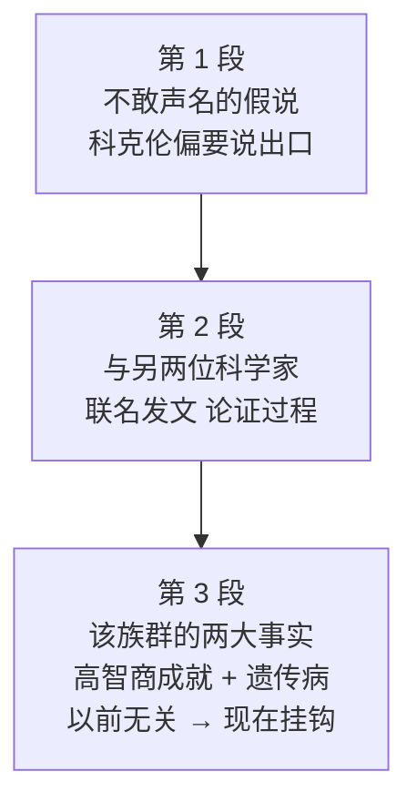

# Passage 15 · 科克伦的争议假说

## 答题记录

| 轮次  | 日期         | 题号  | 正确  | 错误  | 正确率 | 用时    | 错题归因 |
| --- | --- | --- | --- | --- | --- | --- | --- |
| 1 |  | 1-20 |  |  |  |  |  |
| 2 |  | 1-20 |  |  |  |  |  |
| 3 |  | 1-20 |  |  |  |  |  |

> [!tip] 填写口径
> - **用时**以分钟计，只计做题时间，不含精读复盘。
> - **错题归因**填「题型·错误类型」，如：细节题·定位错、推理判断·过度推断、主旨大意·以偏概全。
> - 纵向看趋势：正确率升而用时过长 → 熟练度不足；用时降而正确率波动 → 定位不稳。

> [!info] 文章档案
> - **来源**：考研英语（一）2008 年完形填空
> - **题材**：科克伦等人关于「某族群高智商与遗传病同源」的争议论文
> - **结构**：3 段 / 14 句 / 20 个挖空
> - **难度**：★★★★☆
> - **一句话主旨**：独立科学家科克伦偏要公开一个「不敢声名」的假说——某族群的高智商与其高发的遗传病并非无关，而是同一段进化压力下的产物。

## 一、篇章脉络

- **第 1 段**：造悬念——这个假说没人敢公开，科克伦偏要说；借其人设与战绩说明他敢碰争议话题。
- **第 2 段**：交代论文——连他自己都发怵，论文要同时给出论断与机制，对象是中欧某族群。
- **第 3 段**：核心论证——高智商贡献与高遗传病率两大事实，旧说认为无关，新论认为同源。

> [!tip] 行文逻辑
> 悬念（不敢声名的假说）→ 人设（敢言的独立科学家）→ 论文（论断 + 机制）→ 论证（两大事实 + 旧说 vs 新论）。典型的「人物切入 + 科学假说」科普结构；完形的逻辑关系题集中在 Even / however / previously 三处。

## 二、逐段精读

### 第 1 段 · 不敢声名的假说与敢言者

**原文**

① The idea that some groups of people may be more intelligent than others is one of those hypotheses that dare not speak its name.
② But Gregory Cochran is **selected**〔1〕 to say it anyway.
③ He is that **rare**〔2〕 bird, a scientist who works independently **of**〔3〕 any institution.
④ He helped popularize the idea that some diseases not **previously**〔4〕 thought to have a bacterial cause were actually infections, which aroused much controversy when it was first suggested.

**译文**

① 某些人群可能比其他人群更聪明——这一想法属于那种「不敢声名」的假说。
② 但格雷戈里·科克伦准备把它说出来。
③ 他是那种罕见的角色：一位不隶属于任何机构的独立科学家。
④ 他曾帮助普及这样一个观点：一些以前被认为病因不是细菌的疾病其实是传染病——该观点初次提出时引起过巨大争议。

> [!note] 段落要点
> - 功能：开篇造悬念——假说「不敢声名」（①句），科克伦偏要说（②句）。
> - 人设是「不隶属任何机构的独立科学家」（③句），并用其过往战绩（④句）证明他敢碰争议话题；第 2、3 题的人设考点即在此。

#### 长难句 · 本段

> [!abstract] 本段第 ④ 句 · He helped popularize the idea that some diseases not previously thought to have a bacterial cause were actually infections, which aroused much controversy when it was first suggested.

**结构拆解**

- **主干**：He helped popularize the idea（help + 动词原形）
- **同位语从句**：that some diseases... were actually infections 解释 idea；not previously thought to... 过去分词插入修饰 diseases，把主语与谓语 were 隔开。
- **非限定定语从句**：which aroused much controversy...，which 指代前面整个观点。

**参考译文**

他曾帮助普及这样一个观点：一些以前被认为病因不是细菌的疾病其实是传染病——该观点初次提出时引起过巨大争议。

> [!tip] 拆解要点
> `名词 + not p.p. + to do` 插入语是「过去分词定语」的否定形态，跳过后找谓语 were。

#### 本段重点词汇

| 单词 / 短语 | 词性 | 文中意 | 常用考义与拓展 | 英文示例搭配（中译） |
| --- | --- | --- | --- | --- |
| **intelligent** | adj. | 聪明的 | intelligence n. 智力 | more intelligent than others（比别人更聪明） |
| **hypothesis** | n. | 假说 | 复数 hypotheses；假设 | one of those hypotheses（那些假说之一） |
| **independently** | adv. | 独立地 | independent adj. 独立的 | works independently of any institution（不隶属任何机构） |
| **institution** | n. | 机构 | 熟词僻义：制度 | independently of any institution（不隶属于任何机构） |
| **popularize** | v. | 普及，推广 | popular adj. 流行的 | helped popularize the idea（帮助普及该观点） |
| **bacterial** | adj. | 细菌的 | bacteria n. 细菌 | a bacterial cause（细菌性病因） |
| **cause** | n. | 病因，原因 | v. 导致 | not thought to have a bacterial cause（被认为病因不是细菌） |
| **infection** | n. | 传染病 | infect v. 感染 | were actually infections（其实是传染病） |
| **arouse** | v. | 引起 | 唤起（arouse interest） | aroused much controversy（引起巨大争议） |
| **controversy** | n. | 争议 | controversial adj. 有争议的 | aroused much controversy（引起巨大争议） |
| **suggest** | v. | 提出 | 熟词僻义：建议 → 提出（观点） | when it was first suggested（首次被提出时） |

### 第 2 段 · 联名论文与论证对象

**原文**

① **Even**〔5〕 he, however, might tremble at the **thought**〔6〕 of what he is about to do.
② Together with another two scientists, he is publishing a paper which not only **suggests**〔7〕 that one group of humanity is more intelligent than the others, but explains the process that has brought this about.
③ The group in **question**〔8〕 are a particular people originated from central Europe.
④ The process is natural selection.

**译文**

① 然而，即使是他也可能在想到自己即将要做的事情时不寒而栗。
② 他正与另外两位科学家一起发表一篇论文，论文不仅提出「人类某个族群比其他族群更聪明」，而且解释了造成这一情况的过程。
③ 论文中的这一特殊族群起源于中欧。
④ 这个过程就是自然选择。

> [!note] 段落要点
> - 功能：承接「敢言」人设并埋伏笔——连他都「发怵」（①句 Even + tremble），足见话题之敏感。
> - ②句 not only...but 平行结构点出论文双重任务（论断 + 机制），③④句亮出对象（中欧族群）与机制（自然选择）。

#### 长难句 · 本段

> [!abstract] 本段第 ② 句 · Together with another two scientists, he is publishing a paper which not only suggests that one group of humanity is more intelligent than the others, but explains the process that has brought this about.

**结构拆解**

- **主干**：he is publishing a paper
- **定语从句**：which not only suggests... but explains...（not only...but 连接两个谓语，共用主语 which / a paper）。
- **宾语从句**：that one group of humanity is more intelligent... 作 suggests 的宾语。
- **定语从句**：that has brought this about 修饰 the process。

**参考译文**

他正与另两位科学家发表一篇论文，不仅提出某族群更聪明，而且解释了造成这一情况的过程。

> [!tip] 拆解要点
> not only A but B 中 A、B 必须对仗——此处都是「which + 动词」。

#### 本段重点词汇

| 单词 / 短语 | 词性 | 文中意 | 常用考义与拓展 | 英文示例搭配（中译） |
| --- | --- | --- | --- | --- |
| **tremble** | v. | 发抖，战栗 | tremble at the thought of 一想到……就发抖 | might tremble at the thought（想到就不寒而栗） |
| **together with** | （短语） | 与……一起 | 就远原则：谓语随主语 | Together with another two scientists（与另两位科学家一起） |
| **publish** | v. | 发表 | 出版 | is publishing a paper（正在发表一篇论文） |
| **humanity** | n. | 人类 | 熟词僻义：人性；人道 | one group of humanity（人类的一个族群） |
| **bring about** | （短语） | 造成，导致 | 引起（变化） | the process that has brought this about（造成这一情况的过程） |
| **particular** | adj. | 特定的，某个 | 特别的；挑剔的 | a particular people（某个特定族群） |
| **originate from** | （短语） | 起源于 | origin n. 起源 | originated from central Europe（起源于中欧） |
| **natural selection** | n. | 自然选择 | 达尔文学说核心术语 | The process is natural selection.（这个过程就是自然选择。） |

### 第 3 段 · 两大事实的重新关联

**原文**

① This group generally do well in IQ test, **scoring**〔9〕 12-15 points above the **mean**〔10〕 value of 100, and have contributed **disproportionately**〔11〕 to the intellectual and cultural life of the West, as the **careers**〔12〕 of their elites, including several world-renowned scientists, **affirms**〔13〕.
② They also suffer more often than most people from a number of nasty genetic diseases, such as breast cancer.
③ These facts, **however**〔14〕, have previously been thought unrelated.
④ The former has been **put down**〔15〕 to social effects, such as a strong tradition of **valuing**〔16〕 education.
⑤ The latter was seen as a(an) **consequence**〔17〕 of genetic isolation.
⑥ Dr. Cochran suggests that the intelligence and diseases are intimately **linked**〔18〕.
⑦ His argument is that the unusual history of these people has **subjected**〔19〕 them to unique evolutionary pressures that have resulted in this **paradoxical**〔20〕 state of affairs.

**译文**

① 这一族群通常在智商测试中表现优秀，比 100 分这一平均值高出 12 至 15 分，并且对西方的智力与文化生活做出了不成比例的巨大贡献——他们精英人物（包括几位世界知名科学家）的事业可以证明这一点。
② 他们也比大多数人更常患多种严重的遗传病，比如乳腺癌。
③ 然而，这两个事实以前一直被认为互不相关。
④ 前者被归因于社会影响，例如重视教育的强大传统。
⑤ 后者则被视为基因隔离的后果。
⑥ 科克伦博士指出，高智商与这些疾病是紧密相关的。
⑦ 他的论点是：这些人不寻常的历史使他们遭受了独特的进化压力，从而造成了这种看似矛盾的局面。

> [!note] 段落要点
> - 功能：全文核心段——摆出两大事实（高智商贡献 + 高遗传病率，①②句），指出旧解释「两者无关」（③—⑤句），再抛出新论点「紧密相关」（⑥句）及机制（历史 → 进化压力，⑦句）。
> - however（③句）是事实与观点的分界线。

#### 长难句 · 本段

> [!abstract] 本段第 ① 句 · This group generally do well in IQ test, scoring 12-15 points above the mean value of 100, and have contributed disproportionately to the intellectual and cultural life of the West, as the careers of their elites, including several world-renowned scientists, affirm.

**结构拆解**

- **主干**：This group do well... and have contributed...（两个并列谓语；group 此处按复数处理，指「族群里的人」）
- **伴随状语**：scoring 12-15 points above... 现在分词补充「好到什么程度」。
- **非限定定语从句**：as the careers... affirm（as 指代前面整个陈述）。
- **插入语**：including several world-renowned scientists。

**参考译文**

这一族群通常智商测试成绩优秀，比平均值 100 高出 12—15 分，并且对西方智力与文化生活做出不成比例的巨大贡献——他们精英（包括几位世界知名科学家）的事业可以证明。

> [!tip] 拆解要点
> as 引导的非限定从句 = 「正如……所证明的那样」；including 插入语先跳过。

> [!abstract] 本段第 ⑦ 句 · His argument is that the unusual history of these people has subjected them to unique evolutionary pressures that have resulted in this paradoxical state of affairs.

**结构拆解**

- **主干**：His argument is that...（that 引导表语从句）
- **从句主干**：the unusual history has subjected them to unique pressures（subject...to... 使遭受）
- **定语从句**：that have resulted in this paradoxical state of affairs 修饰 pressures。

**参考译文**

他的论点是：这些人不寻常的历史使他们遭受了独特的进化压力，从而造成了这种看似矛盾的局面。

> [!tip] 拆解要点
> subject A to B（使 A 承受 B）是考研高频动词短语；两层 that 从句别混淆——第一个是表语从句，第二个是定语从句。

#### 本段重点词汇

| 单词 / 短语 | 词性 | 文中意 | 常用考义与拓展 | 英文示例搭配（中译） |
| --- | --- | --- | --- | --- |
| **intellectual** | adj. | 智力的 | n. 知识分子 | the intellectual and cultural life（智力与文化生活） |
| **elite** | n. | 精英 | 精英阶层 | the careers of their elites（他们精英人物的事业） |
| **suffer from** | （短语） | 患（病），受苦 | 遭受 | suffer more often from genetic diseases（更常患遗传病） |
| **nasty** | adj. | 严重的，讨厌的 | 脏的；恶意的 | a number of nasty genetic diseases（多种严重的遗传病） |
| **genetic** | adj. | 遗传的 | gene n. 基因 | nasty genetic diseases（严重的遗传病） |
| **disease** | n. | 疾病 | illness 近义 | genetic diseases（遗传病） |
| **breast cancer** | n. | 乳腺癌 | cancer n. 癌症 | such as breast cancer（比如乳腺癌） |
| **unrelated** | adj. | 互不相关的 | related adj. 有关的 | have previously been thought unrelated（以前被认为无关） |
| **social effects** | n. | 社会影响 | 社会因素 | put down to social effects（归因于社会影响） |
| **isolation** | n. | 隔离 | isolate v. 隔离 | a consequence of genetic isolation（基因隔离的后果） |
| **intimately** | adv. | 紧密地 | intimate adj. 亲密的 | intimately linked（紧密相关） |
| **evolutionary** | adj. | 进化的 | evolve v. 进化 | unique evolutionary pressures（独特的进化压力） |
| **pressure** | n. | 压力 | 压强；施压 | unique evolutionary pressures（独特的进化压力） |
| **state of affairs** | n. | 事态，局面 | 固定表达 | this paradoxical state of affairs（这种看似矛盾的局面） |

## 三、全篇重点词汇汇总（自测用）

> [!info] 说明
> 本表只列「单词 / 词性 / 所在段」，不含释义与搭配，用于遮表自测：说出词义后再回该段核对。
> 收录**全篇所有段落词汇，共 33 条，不删减**，与各段「本段重点词汇」等长同源。

| 单词 / 短语 | 词性 | 所在段 |
| --- | --- | --- |
| **intelligent** | adj. | 第 1 段 |
| **hypothesis** | n. | 第 1 段 |
| **independently** | adv. | 第 1 段 |
| **institution** | n. | 第 1 段 |
| **popularize** | v. | 第 1 段 |
| **bacterial** | adj. | 第 1 段 |
| **cause** | n. | 第 1 段 |
| **infection** | n. | 第 1 段 |
| **arouse** | v. | 第 1 段 |
| **controversy** | n. | 第 1 段 |
| **suggest** | v. | 第 1 段 |
| **tremble** | v. | 第 2 段 |
| **together with** | （短语） | 第 2 段 |
| **publish** | v. | 第 2 段 |
| **humanity** | n. | 第 2 段 |
| **bring about** | （短语） | 第 2 段 |
| **particular** | adj. | 第 2 段 |
| **originate from** | （短语） | 第 2 段 |
| **natural selection** | n. | 第 2 段 |
| **intellectual** | adj. | 第 3 段 |
| **elite** | n. | 第 3 段 |
| **suffer from** | （短语） | 第 3 段 |
| **nasty** | adj. | 第 3 段 |
| **genetic** | adj. | 第 3 段 |
| **disease** | n. | 第 3 段 |
| **breast cancer** | n. | 第 3 段 |
| **unrelated** | adj. | 第 3 段 |
| **social effects** | n. | 第 3 段 |
| **isolation** | n. | 第 3 段 |
| **intimately** | adv. | 第 3 段 |
| **evolutionary** | adj. | 第 3 段 |
| **pressure** | n. | 第 3 段 |
| **state of affairs** | n. | 第 3 段 |

> [!warning] 熟词僻义专列
> - **suggest**（第 1 段）：「提出（观点）」，此处理解为 propose，非「建议」。
> - **question**（第 2 段⑧题）：in question「讨论中的」，非「问题」。
> - **mean**（第 3 段⑩题）：n. 平均值，非动词「意味着」。
> - **subject**（第 3 段⑲题）：v. subject A to B「使 A 遭受 B」，非名词「主题 / 科目」。
> - **people**（第 2 段③）：a particular people「某个民族 / 族群」，people 表民族时可数。
> - **career**（第 3 段⑫题）：n. 事业、成就，非仅「职业」。

> [!example] 同义替换链（阅读题高频）
> - **引起**：arouse（第 1 段）↔ bring about（第 2 段）↔ result in（第 3 段⑦句）
> - **提出**：suggest（第 1 段）↔ affirm（第 3 段⑬题）↔ argue（第 3 段⑦句）
> - **归因**：put down to（第 3 段⑮题）↔ be seen as（第 3 段⑤句）↔ be subjected to（第 3 段⑲题）

## 四、知识点补充

> [!question] 背景知识
> - **Gregory Cochran**：美国人类学家 / 物理学家，以跨领域「独立科学家」著称，2006 年与 Harpending 等发表争议论文。
> - **论文对象**：阿什肯纳兹犹太人（起源于中欧）——论文称其平均智商高于常值 12—15 分，但泰-萨克斯病等遗传病发病率也偏高，两者或同为自然选择的产物。
> - **dare not speak its name**：化用王尔德诗句「the love that dare not speak its name」，指「不能宣之于口的话题」。
> - **rare bird**：固定表达「罕见的人物」，源自拉丁语 rara avis。
> - **本文出处**：2008 年考研英语（一）完形填空，原文出自 The Economist 的书评。

> [!warning] 语法点
> - **同位语从句分隔主谓**：the idea that some diseases not previously thought to... were actually infections（第 1 段④）。
> - **not only...but 平行谓语**：which not only suggests... but explains...（第 2 段②）。
> - **as 引导的非限定从句**：as the careers of their elites... affirm（第 3 段①）。
> - **表语从句 + 定语从句嵌套**：His argument is that... pressures that have resulted in...（第 3 段⑦）。
> - **就远原则**：Together with another two scientists, he is publishing...（谓语随 he 用单数）。

> [!success] 写作可迁移句型
> - `The idea that... is one of those hypotheses that dare not speak its name.` —— 引出禁忌话题。
> - `He is that rare bird, a scientist who works independently of any institution.` —— 人物特写。
> - `These facts, however, have previously been thought unrelated.` —— 先破后立的过渡句。
> - `His argument is that A has subjected B to C that have resulted in D.` —— 因果链论点句。

> [!danger] 易混辨析（本篇核心考点）
> - **selected / prepared / obliged / pleased**：只有 be selected to do「被选中去做」与 dare not speak its name 的语境相容。
> - **unique / particular / special / rare**：只有 rare bird 是固定搭配（罕见人物）。
> - **attaining / scoring / reaching / calculating**：与 points（分数）搭配的是 scoring。
> - **linked / integrated / woven / combined**：表「两者相关联」用 be linked；其余均含「合为一体」义。

## 五、题目分析

> [!info] 题目总览
> | 题号 | 题型 | 定位 | 答案 |
> | --- | --- | --- | --- |
> | 1 | 动词辨析题 | 第 1 段②句 | B |
> | 2 | 形容词搭配题 | 第 1 段③句 | D |
> | 3 | 介词搭配题 | 第 1 段③句 | A |
> | 4 | 逻辑副词题 | 第 1 段④句 | C |
> | 5 | 逻辑副词题 | 第 2 段①句 | C |
> | 6 | 固定短语题 | 第 2 段①句 | A |
> | 7 | 动词辨析题 | 第 2 段②句 | B |
> | 8 | 名词短语题 | 第 2 段③句 | D |
> | 9 | 动词搭配题 | 第 3 段①句 | B |
> | 10 | 名词辨析题 | 第 3 段①句 | C |
> | 11 | 副词辨析题 | 第 3 段①句 | B |
> | 12 | 名词辨析题 | 第 3 段①句 | D |
> | 13 | 动词辨析题 | 第 3 段①句 | A |
> | 14 | 逻辑连词题 | 第 3 段③句 | C |
> | 15 | 动词短语题 | 第 3 段④句 | D |
> | 16 | 动词辨析题 | 第 3 段④句 | D |
> | 17 | 名词辨析题 | 第 3 段⑤句 | C |
> | 18 | 动词辨析题 | 第 3 段⑥句 | A |
> | 19 | 动词短语题 | 第 3 段⑦句 | B |
> | 20 | 形容词辨析题 | 第 3 段⑦句 | A |

### 第 1 题 · 动词辨析题

> [!question] 原题
> But Gregory Cochran is __1__ to say it anyway.
> - A. selected
> - B. prepared
> - C. obliged
> - D. pleased

**正确答案**：**B. prepared（准备好，打算）**

**辨析**：be prepared to do「愿意 / 打算做」，呼应敢言人设。selected（被选中）、obliged（被迫）与「独立科学家」人设矛盾；pleased（乐于）语法通但丢掉了「明知争议仍要说」的意味。

### 第 2 题 · 形容词搭配题

> [!question] 原题
> He is that __2__ bird, a scientist who works independently of any institution.
> - A. unique
> - B. particular
> - C. special
> - D. rare

**正确答案**：**D. rare（罕见的）**

**辨析**：rare bird 是固定习语「罕见的人（物）」。unique / particular / special 均无法与 bird 构成习语。

### 第 3 题 · 介词搭配题

> [!question] 原题
> He is that rare bird, a scientist who works independently __3__ any institution.
> - A. of
> - B. with
> - C. in
> - D. against

**正确答案**：**A. of（不隶属于）**

**辨析**：independently of...「独立于……之外」，固定搭配。independently 不与 with / in / against 搭配。

### 第 4 题 · 逻辑副词题

> [!question] 原题
> He helped popularize the idea that some diseases not __4__ thought to have a bacterial cause were actually infections.
> - A. subsequently
> - B. presently
> - C. previously
> - D. lately

**正确答案**：**C. previously（以前）**

**辨析**：以前认为不是细菌病 → 其实是传染病，「新旧观点」的时间先后由 previously 标记。subsequently（随后）方向相反；presently（目前）、lately（最近，常配完成时）与「首次提出时引争议」的逻辑冲突。

### 第 5 题 · 逻辑副词题

> [!question] 原题
> __5__, he, however, might tremble at the __6__ of what he is about to do.
> - A. Only
> - B. So
> - C. Even
> - D. Hence

**正确答案**：**C. Even（甚至）**

**辨析**：连「敢言的他」都可能发怵——Even he 递进强调。Only / So / Hence 均不能与 he...however 构成「连他都……」的让步强调。

### 第 6 题 · 固定短语题

> [!question] 原题
> ...he, however, might tremble at the __6__ of what he is about to do.
> - A. thought
> - B. sight
> - C. cost
> - D. risk

**正确答案**：**A. thought（一想到）**

**辨析**：tremble at the thought of「一想到……就发抖」固定搭配。sight 需「看见」（事情还没做）、cost / risk 接具体代价 / 风险名词，均不合「为将做之事心惊」的文意。

### 第 7 题 · 动词辨析题

> [!question] 原题
> ...he is publishing a paper which not only __7__ that one group of humanity is more intelligent than the others, but explains the process.
> - A. advises
> - B. suggests
> - C. protests
> - D. objects

**正确答案**：**B. suggests（提出）**

**辨析**：论文「提出」观点，suggests that + 陈述句。advises 主语多为人且表「建议」；protests / objects 表反对，与后文 but explains 的并列论说语气相悖。

### 第 8 题 · 名词短语题

> [!question] 原题
> The group in __8__ are a particular people originated from central Europe.
> - A. progress
> - B. fact
> - C. need
> - D. question

**正确答案**：**D. question（讨论中的）**

**辨析**：in question「所讨论的那个」，回指上文的 one group。in progress（进行中，不修饰人）、in fact（事实上，表强调）、in need（贫困的 / 有困难的）均不符。

### 第 9 题 · 动词搭配题

> [!question] 原题
> This group generally do well in IQ test, __9__ 12-15 points above the __10__ value of 100.
> - A. attaining
> - B. scoring
> - C. reaching
> - D. calculating

**正确答案**：**B. scoring（得分）**

**辨析**：智商测试的「得分」用 scoring points。attain / reach 与 points 不搭配；calculating 是「计算」的动作，主语应是施动者。

### 第 10 题 · 名词辨析题

> [!question] 原题
> ...scoring 12-15 points above the __10__ value of 100.
> - A. normal
> - B. common
> - C. mean
> - D. total

**正确答案**：**C. mean（平均的）**

**辨析**：the mean value of 100「100 这一平均值」——统计学标准说法。normal value（正常值）不指统计均值；common value（共同价值观，歧义）；total value（总值，高于总值更不通）。

### 第 11 题 · 副词辨析题

> [!question] 原题
> ...and have contributed __11__ to the intellectual and cultural life of the West.
> - A. unconsciously
> - B. disproportionately
> - C. indefinitely
> - D. unaccountably

**正确答案**：**B. disproportionately（不成比例地，格外多）**

**辨析**：人口占比小、贡献占比大——disproportionately 精准表达「贡献超大」。unconsciously（无意识）、indefinitely（不明确）、unaccountably（莫名其妙）都与「贡献突出」无关。

### 第 12 题 · 名词辨析题

> [!question] 原题
> ...as the __12__ of their elites, including several world-renowned scientists, __13__.
> - A. missions
> - B. fortunes
> - C. interests
> - D. careers

**正确答案**：**D. careers（事业，成就）**

**辨析**：精英的「事业成就」证明其贡献，careers of their elites。missions（使命）、fortunes（运气 / 财富）、interests（利益）都不能由 world-renowned scientists 的例子佐证。

### 第 13 题 · 动词辨析题

> [!question] 原题
> ...as the careers of their elites, including several world-renowned scientists, __13__.
> - A. affirm
> - B. witness
> - C. observe
> - D. approve

**正确答案**：**A. affirm（证实，确认）**

**辨析**：as 引导非限定从句，事业成就「证实」前述贡献。witness 多作及物动词「见证」（宾语是事件）；observe（看到）/ approve（赞成）主语通常是人。

### 第 14 题 · 逻辑连词题

> [!question] 原题
> These facts, __14__, have previously been thought unrelated.
> - A. moreover
> - B. therefore
> - C. however
> - D. meanwhile

**正确答案**：**C. however（然而）**

**辨析**：前文摆事实（智商高 + 病多），后文旧认识是「无关」——叙述与旧观点转折，however。moreover（递进）、therefore（因果）、meanwhile（并列）皆不符。

### 第 15 题 · 动词短语题

> [!question] 原题
> The former has been __15__ to social effects, such as a strong tradition of __16__ education.
> - A. given up
> - B. got over
> - C. carried on
> - D. put down

**正确答案**：**D. put down（把……归因于）**

**辨析**：be put down to「被归因于」固定搭配。given up to / got over to / carried on to 均非固定搭配且语义不通。

### 第 16 题 · 动词辨析题

> [!question] 原题
> ...a strong tradition of __16__ education.
> - A. assessing
> - B. supervising
> - C. administering
> - D. valuing

**正确答案**：**D. valuing（重视）**

**辨析**：重视教育的传统 → valuing education。assessing（评估）、supervising（监督）、administering（管理）虽可搭配 education，但与「社会因素解释高智商」的论证逻辑不符。

### 第 17 题 · 名词辨析题

> [!question] 原题
> The latter was seen as a(an) __17__ of genetic isolation.
> - A. development
> - B. origin
> - C. consequence
> - D. instrument

**正确答案**：**C. consequence（后果）**

**辨析**：遗传病是基因隔离的「后果」，与④句 has been put down to（归因）平行呼应。development（发展）、origin（起源，方向反了）、instrument（工具）均不合「隔离 → 疾病」的因果方向。

### 第 18 题 · 动词辨析题

> [!question] 原题
> Dr. Cochran suggests that the intelligence and diseases are intimately __18__.
> - A. linked
> - B. integrated
> - C. woven
> - D. combined

**正确答案**：**A. linked（关联）**

**辨析**：be linked「有联系的」，表两者相关。integrated / woven / combined 均含「合为一体」，无法体现逻辑上的关联义。

### 第 19 题 · 动词短语题

> [!question] 原题
> His argument is that the unusual history of these people has __19__ them to unique evolutionary pressures.
> - A. limited
> - B. subjected
> - C. converted
> - D. directed

**正确答案**：**B. subjected（使遭受）**

**辨析**：subject A to B「使 A 遭受 B」固定搭配。limited...to（局限于）、converted...to（转变为）、directed...to（指向）语义均不通。

### 第 20 题 · 形容词辨析题

> [!question] 原题
> ...unique evolutionary pressures that have resulted in this __20__ state of affairs.
> - A. paradoxical
> - B. incompatible
> - C. inevitable
> - D. continuous

**正确答案**：**A. paradoxical（看似矛盾的）**

**辨析**：「既聪明又多病」正是自相矛盾的局面——paradoxical。incompatible（不相容的）脱离语境信息、inevitable（不可避免的）、continuous（连续的）都只是对 state of affairs 的空泛修饰。

## 六、复盘清单

- [ ] 过汇总表 33 词，遮住「所在段」列自测，重点过 6 个熟词僻义
- [ ] 20 个答案词单独过一遍：prepared / rare / of / previously / Even / thought / suggests / question / scoring / mean / disproportionately / careers / affirm / however / put down / valuing / consequence / linked / subjected / paradoxical
- [ ] 整理本文逻辑关系考点：Even（让步强调）、however（转折）、previously（时间先后）
- [ ] 背下四组固定搭配：rare bird / in question / tremble at the thought of / subject...to...
- [ ] 把答题记录填进顶部表格，对照正确率决定是否二刷

## 七、关联笔记

- [[Passage16-霍桑效应的再审视]]
- [[考研英语 · 完形填空方法论]]
- [[考研英语 · 熟词僻义汇总]]
