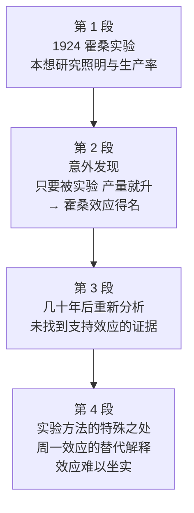

# Passage 16 · 霍桑效应的再审视

## 答题记录

| 轮次  | 日期         | 题号  | 正确  | 错误  | 正确率 | 用时    | 错题归因 |
| --- | --- | --- | --- | --- | --- | --- | --- |
| 1 |  | 1-20 |  |  |  |  |  |
| 2 |  | 1-20 |  |  |  |  |  |
| 3 |  | 1-20 |  |  |  |  |  |

> [!tip] 填写口径
> - **用时**以分钟计，只计做题时间，不含精读复盘。
> - **错题归因**填「题型·错误类型」，如：细节题·定位错、推理判断·过度推断、主旨大意·以偏概全。
> - 纵向看趋势：正确率升而用时过长 → 熟练度不足；用时降而正确率波动 → 定位不稳。

> [!info] 文章档案
> - **来源**：考研英语（一）2010 年完形填空
> - **题材**：霍桑实验本想研究照明与生产率，却催生了「霍桑效应」；数十年后计量经济学再分析发现，所谓效应恐怕只是「周一效应」的误导
> - **结构**：4 段 / 16 句 / 20 个挖空
> - **难度**：★★★★☆
> - **一句话主旨**：1924 年的霍桑实验没回答原问题，却留下「被实验即改变行为」的著名效应；几十年后用更严格的方法重检数据，却发现照明与生产率并无系统关联，产量上升也许只是周一效应。

## 一、篇章脉络

- **第 1 段**：交代实验缘起——本想弄清照明如何影响生产率，结果却「留名」于一个意外发现。
- **第 2 段**：效应的由来——无论调亮调暗产量都上升，结论遂推进到「被实验的意识本身就足以改变行为」。
- **第 3 段**：几十年后重检数据，宣布照明与生产率的系统关联找不到证据。
- **第 4 段**：替代解释——产量上升可能只是「周一效应」，与实验无关，效应难以坐实。

> [!tip] 行文逻辑
> 缘起（照明实验）→ 意外（效应诞生）→ 重检（找不到证据）→ 替代解释（周一效应）。典型的「经典结论被新证据推翻」科普结构；完形的逻辑题集中在 Instead / However / so long as / Contrary to 四处。

## 二、逐段精读

### 第 1 段 · 实验缘起与「霍桑效应」的诞生

**原文**

① In 1924 America's National Research Council sent two engineers to supervise a series of experiments at a telephone-parts factory called the Hawthorne Plant near Chicago.
② It hoped they would learn how shop-floor lighting **affected**〔1〕 workers' productivity.
③ Instead, the studies **ended up**〔2〕 giving their name to the "Hawthorne effect", the extremely influential idea that the very **act**〔3〕 of being experimented upon changed subjects' behavior.

**译文**

① 1924 年，美国国家研究委员会派两名工程师去监督在芝加哥附近一家名为霍桑工厂的电话配件厂进行的一系列实验。
② 委员会希望他们能弄清车间照明是如何影响工人的生产效率的。
③ 出人意料的是，这些研究最终以「霍桑效应」命名——「受试者行为会因自己成为实验对象而改变」这一影响极为深远的观点，正是由这批研究得名。

> [!note] 段落要点
> - 功能：开篇交代实验的时间、地点、执行者与研究目的（①②句），③句用 Instead 急转——研究没回答原问题，反而「留名」于一个意外发现。
> - 先立靶子，为后文推翻它做铺垫。

#### 长难句 · 本段

> [!abstract] 本段第 ③ 句 · Instead, the studies ended up giving their name to the "Hawthorne effect", the extremely influential idea that the very act of being experimented upon changed subjects' behavior.

**结构拆解**

- **主干**：the studies ended up giving their name to the "Hawthorne effect"（end up + 动名词）
- **同位语**：the extremely influential idea 是 the "Hawthorne effect" 的同位语，解释这个概念的内容。
- **同位语从句**：that the very act of being experimented upon changed subjects' behavior 解释 idea；从句主语中心词是 act，of being experimented upon（被动动名词）作其后置定语。

**参考译文**

出人意料的是，这些研究最终以「霍桑效应」命名——「受试者行为会因自己成为实验对象而改变」这一影响极为深远的观点，正是由这批研究得名。

> [!tip] 拆解要点
> 看见「名词 + , + the ... idea that ...」就切同位语；that 从句谓语是 changed，往前找主语中心词（act），别被 of 介词短语带跑。

#### 本段重点词汇

| 单词 / 短语 | 词性 | 文中意 | 常用考义与拓展 | 英文示例搭配（中译） |
| --- | --- | --- | --- | --- |
| **supervise** | v. | 监督；指导 | 监督（人/工作）；名词 supervision | sent two engineers to supervise experiments（派两名工程师监督实验） |
| **a series of** | （短语） | 一系列 | 后接复数可数名词 | a series of experiments（一系列实验） |
| **shop-floor** | adj. | 车间的 | 名词 shop floor 车间；生产一线 | shop-floor lighting（车间照明） |
| **productivity** | n. | 生产率；生产效率 | 动词 produce → product → productivity 词族 | workers' productivity（工人的生产率） |
| **give one's name to** | （短语） | 使…以…命名 | 也可说 lend one's name to | giving their name to the "Hawthorne effect"（使研究以「霍桑效应」之名留世） |
| **influential** | adj. | 有影响力的 | 名词 influence；have an influence on | the extremely influential idea（影响极为深远的观点） |
| **experiment upon** | （短语） | 对…做实验；拿…做实验 | 被动 be experimented upon；同 experiment on | being experimented upon（被当作实验对象） |
| **subject** | n. | 受试者；实验对象 | 熟词僻义：常用义「主题；学科；使遭受」 | changed subjects' behavior（改变了受试者的行为） |
| **behavior** | n. | 行为 | 动词 behave；behavioral adj. 行为的 | changed subjects' behavior（改变了受试者的行为） |

### 第 2 段 · 意外发现：只要被实验，产量就上升

**原文**

① The idea arose because of the **perplexing**〔4〕 behavior of the women in the plant.
② According to **accounts**〔5〕 of the experiments, their hourly output rose when lighting was increased, but also when it was dimmed.
③ It did not **matter**〔6〕 what was done in the experiment; **so long as**〔7〕 something was changed, productivity rose.
④ A(n) **awareness**〔8〕 that they were being experimented upon seemed to be **enough**〔9〕 to alter workers' behavior **by**〔10〕 itself.

**译文**

① 这一观点的产生，是因为厂里女工们令人困惑的行为。
② 据对实验的记述，无论照明调亮还是调暗，她们每小时的产量都会上升。
③ 实验中做了什么并不重要；只要有变化，生产率就会上升。
④ 似乎仅仅是「意识到自己正被当作实验对象」这一点，就足以单凭其本身改变工人的行为。

> [!note] 段落要点
> - 功能：解释「霍桑效应」的由来——女工行为反常（①句）→ 数据显示无论调亮调暗产量都升（②句）→ 结论推进到「做什么不重要，有变化就行」（③句）→ 凝练成效应表述：被实验的意识本身就足以改变行为（④句）。
> - ②③④层递收紧，是理解全文批驳对象的证据链。

#### 长难句 · 本段

> [!abstract] 本段第 ③ 句 · It did not matter what was done in the experiment; so long as something was changed, productivity rose.

**结构拆解**

- **主干**：It did not matter（It 形式主语）
- **主语从句**：what was done in the experiment 是真正主语，被形式主语 It 顶替。
- **分号并列**：后半句 so long as 引导条件状语从句「只要有变化」，主句 productivity rose。

**参考译文**

实验中做了什么并不重要；只要有变化，生产率就会上升。

> [!tip] 拆解要点
> It did not matter what/whether... 是高频句型：先认出 It 是形式主语，再把真正主语（what 从句）还原到句首理解。

> [!abstract] 本段第 ④ 句 · A(n) awareness that they were being experimented upon seemed to be enough to alter workers' behavior by itself.

**结构拆解**

- **主干**：awareness seemed to be enough to alter...（seem to be + adj. + to do）
- **同位语从句**：that they were being experimented upon（过去进行时被动）解释 awareness 的内容。
- **by itself**：介词 + 反身代词，修饰 alter 的方式——「单凭这一意识本身」。

**参考译文**

似乎仅仅是「意识到自己正被当作实验对象」这一点，就足以单凭其本身改变工人的行为。

> [!tip] 拆解要点
> 抽象名词（awareness / fact / notion）后接 that 从句，九成是同位语从句而非定语从句：判断方法是看 that 在从句中是否缺主语或宾语——不缺即同位语从句。

#### 本段重点词汇

| 单词 / 短语 | 词性 | 文中意 | 常用考义与拓展 | 英文示例搭配（中译） |
| --- | --- | --- | --- | --- |
| **arise** | v. | 产生；出现 | 不规则：arose-arisen；表示「问题/机会/想法」出现 | The idea arose because of...（这一观点源于…） |
| **according to** | （短语） | 根据；按照 | 后接名词或代词，不接从句 | According to accounts of the experiments（根据对实验的记述） |
| **hourly** | adj. | 每小时的 | 类构词：daily / weekly / monthly | their hourly output（她们每小时的产量） |
| **output** | n. | 产量；产出 | 与 productivity 同现；熟词僻义「输出」 | their hourly output rose（她们每小时产量上升） |
| **dim** | v. | 调暗；使变暗暗 | 形容词 dim 昏暗的；反义 brighten | when it was dimmed（当照明被调暗时） |
| **alter** | v. | 改变；更改 | alter / change / shift 辨析 | alter workers' behavior（改变工人的行为） |

### 第 3 段 · 几十年后：重新分析找不到证据

**原文**

① After several decades, the same data were **subjected**〔11〕 to econometric analysis.
② The Hawthorne experiments had another surprise in store.
③ **Contrary to**〔12〕 the descriptions on record, no systematic **evidence**〔13〕 was found that levels of productivity were related to changes in lighting.

**译文**

① 几十年后，同一批数据被用于计量经济学分析。
② 霍桑实验还藏着一个意想不到的发现。
③ 与记录在案的描述相反，没有发现任何系统性证据表明生产率水平与照明变化有关。

> [!note] 段落要点
> - 功能：全文反转点——几十年后用更严格的方法重检数据（①句），宣布还有「意外」（②句），③句亮出结论：效应的核心主张（生产率随照明变化）找不到系统证据。
> - ②句的 surprise in store 是承上启下的预告。

#### 长难句 · 本段

> [!abstract] 本段第 ③ 句 · Contrary to the descriptions on record, no systematic evidence was found that levels of productivity were related to changes in lighting.

**结构拆解**

- **主干**：no systematic evidence was found（被动语态）
- **分隔结构**：that levels of productivity were related to... 是 evidence 的同位语从句，被谓语 was found 与主语隔开——「主语 + 谓语 + that 同位语从句」的分隔是本题句法考点。
- **形容词短语开头**：Contrary to the descriptions on record 作状语，表「与…相反」。

**参考译文**

与记录在案的描述相反，没有发现任何系统性证据表明生产率水平与照明变化有关。

> [!tip] 拆解要点
> 看到 evidence / fact / notion 等词后先找谓语，若谓语后冒出 that 从句，多半是被分隔的同位语从句，阅读时把它「搬回」名词后面理解。

#### 本段重点词汇

| 单词 / 短语 | 词性 | 文中意 | 常用考义与拓展 | 英文示例搭配（中译） |
| --- | --- | --- | --- | --- |
| **decade** | n. | 十年 | several decades 数十年；for decades 几十年来 | After several decades（几十年后） |
| **data** | n. | 数据 | 单复数同形（正式文体接复数动词） | the same data were subjected to analysis（同一批数据被用于分析） |
| **econometric analysis** | （n.） | 计量经济分析 | econometrics 计量经济学；econometric adj. | the same data were subjected to econometric analysis（同一批数据被用于计量经济分析） |
| **surprise in store** | （短语） | 蓄而待发的意外 | in store 即将发生；have... in store 藏有… | had another surprise in store（还有一个意想不到的发现） |
| **on record** | （短语） | 记录在案的 | 反义 off record；set/put the record straight 澄清事实 | the descriptions on record（记录在案的描述） |
| **systematic** | adj. | 系统的；有条理的 | 名词 system → systematic（系统的）/ systematics | no systematic evidence（没有任何系统性证据） |
| **be related to** | （短语） | 与…相关 | relate v. 联系；relative n. 亲戚 adj. 相对的 | levels of productivity were related to changes in lighting（生产率水平与照明变化相关） |

### 第 4 段 · 替代解释：也许只是「周一效应」

**原文**

① It turns out that the peculiar way of conducting the experiments may have led to **misleading**〔14〕 interpretations of what happened.
② **For example**〔15〕, lighting was always changed on a Sunday.
③ When work started again on Monday, output **duly**〔16〕 rose compared with the previous Saturday and **continued**〔17〕 to rise for the next couple of days.
④ **However**〔18〕, a comparison with data for weeks when there was no experimentation showed that output always went up on Mondays.
⑤ Workers **tended**〔19〕 to be diligent for the first few days of the week in any case, before **hitting**〔20〕 a plateau and then slackening off.
⑥ This suggests that the alleged "Hawthorne effect" is hard to pin down.

**译文**

① 结果表明，进行实验的特殊方式可能导致了人们对所发生情况的误导性解读。
② 例如，照明总是在周日被调整。
③ 周一重新开工时，产量相比上一个周六如期上升，并在随后几天里继续上升。
④ 然而，与没有进行实验的几周的数据对比显示，产量本来每周一都会上升。
⑤ 无论如何，工人们在一周的头几天往往比较勤奋，随后达到停滞期，继而开始松懈。
⑥ 这表明，所谓的「霍桑效应」恐怕难以坐实。

> [!note] 段落要点
> - 功能：拆招段——先总说「实验方式特殊 → 解读被误导」（①句），再举「周日调灯」为例（②③句），随即用无实验周的数据对照（④句）揭穿规律：周一起产量本就回升，与实验无关（⑤句），最后收束于「效应难以坐实」（⑥句）。
> - ①句总起、⑥句总结，中间是完整的例证与反驳。

#### 长难句 · 本段

> [!abstract] 本段第 ④ 句 · However, a comparison with data for weeks when there was no experimentation showed that output always went up on Mondays.

**结构拆解**

- **主干**：a comparison ... showed that ...（主语 comparison + 谓语 showed + 宾语从句）
- **定语从句**：when there was no experimentation 修饰 weeks——「没有做实验的那些周」。
- **宾语从句**：that output always went up on Mondays 作 showed 的宾语。

**参考译文**

然而，与没有进行实验的几周的数据对比显示，产量本来每周一都会上升。

> [!tip] 拆解要点
> 主语 a comparison 被介词短语「with data for weeks + when 定从」拉得很长，先抓住 comparison...showed 主干，再回头看修饰成分。

> [!abstract] 本段第 ⑤ 句 · Workers tended to be diligent for the first few days of the week in any case, before hitting a plateau and then slackening off.

**结构拆解**

- **主干**：Workers tended to be diligent（tend to do 往往会）
- **时间状语**：before hitting a plateau and then slackening off——before + 动名词，两个动名词并列（hitting... and then slackening...）。
- **插入语**：in any case「无论如何」，强调这一规律与实验无关。

**参考译文**

无论如何，工人们在一周的头几天往往比较勤奋，随后达到停滞期，继而开始松懈。

> [!tip] 拆解要点
> before doing sth. 表「还没…就 / 之后才」，暗含先后两阶段：头几天勤奋 → 触顶 → 松懈，三个阶段在一句内完成。

#### 本段重点词汇

| 单词 / 短语 | 词性 | 文中意 | 常用考义与拓展 | 英文示例搭配（中译） |
| --- | --- | --- | --- | --- |
| **turn out** | （短语） | 结果是；原来 | It turns out that... 结果表明；turn out to be | It turns out that the peculiar way... may have led to...（结果表明，特殊的实验方式可能导致了…） |
| **peculiar** | adj. | 奇特的；特殊的 | 熟词僻义：peculiar to... …特有的 | the peculiar way of conducting the experiments（进行实验的特殊方式） |
| **conduct** | v. | 实施；进行 | 熟词僻义：n. 行为；conductor 指挥/售票员 | conducting the experiments（进行实验） |
| **lead to** | （短语） | 导致；招致 | to 是介词，后接名词/动名词 | may have led to misleading interpretations（可能造成了误导性解读） |
| **interpretation** | n. | 解读；解释 | 动词 interpret；interpret...as... 把…理解为 | misleading interpretations of what happened（对所发生情况的误导性解读） |
| **compare with** | （短语） | 与…相比 | compared with/to... 与…相比（作状语） | output duly rose compared with the previous Saturday（与上周六相比产量如期上升） |
| **previous** | adj. | 先前的；上一个的 | 副词 previously | the previous Saturday（上一个周六） |
| **in any case** | （短语） | 无论如何 | 近义 at any rate；辨析 in case（万一） | Workers tended to be diligent in any case（工人们无论如何都会头几天勤奋） |
| **diligent** | adj. | 勤奋的；勤勉的 | 名词 diligence；近义 hard-working | Workers tended to be diligent（工人们往往很勤奋） |
| **plateau** | n. | 停滞期；平台期 | 本义「高原」；hit/reach a plateau 触顶停滞 | before hitting a plateau（在触及停滞期之前） |
| **slacken off** | （短语） | 松懈；放缓 | slack adj. 松弛的；近义 ease off / slow down | and then slackening off（继而开始松懈） |
| **alleged** | adj. | 所谓的；被宣称的 | 动词 allege（声称，无证据地）；allegation n. 指控 | the alleged "Hawthorne effect"（所谓的「霍桑效应」） |
| **pin down** | （短语） | 坐实；确定；说清 | hard/difficult to pin down 难以确定 | the alleged effect is hard to pin down（这一所谓的效应难以坐实） |

## 三、全篇重点词汇汇总（自测用）

> [!info] 说明
> 本表只列「单词 / 词性 / 所在段」，不含释义与搭配，用于遮表自测：说出词义后再回该段核对。
> 收录**全篇所有段落词汇，共 35 条，不删减**，与各段「本段重点词汇」等长同源。

| 单词 / 短语 | 词性 | 所在段 |
| --- | --- | --- |
| **supervise** | v. | 第 1 段 |
| **a series of** | （短语） | 第 1 段 |
| **shop-floor** | adj. | 第 1 段 |
| **productivity** | n. | 第 1 段 |
| **give one's name to** | （短语） | 第 1 段 |
| **influential** | adj. | 第 1 段 |
| **experiment upon** | （短语） | 第 1 段 |
| **subject** | n. | 第 1 段 |
| **behavior** | n. | 第 1 段 |
| **arise** | v. | 第 2 段 |
| **according to** | （短语） | 第 2 段 |
| **hourly** | adj. | 第 2 段 |
| **output** | n. | 第 2 段 |
| **dim** | v. | 第 2 段 |
| **alter** | v. | 第 2 段 |
| **decade** | n. | 第 3 段 |
| **data** | n. | 第 3 段 |
| **econometric analysis** | （n.） | 第 3 段 |
| **surprise in store** | （短语） | 第 3 段 |
| **on record** | （短语） | 第 3 段 |
| **systematic** | adj. | 第 3 段 |
| **be related to** | （短语） | 第 3 段 |
| **turn out** | （短语） | 第 4 段 |
| **peculiar** | adj. | 第 4 段 |
| **conduct** | v. | 第 4 段 |
| **lead to** | （短语） | 第 4 段 |
| **interpretation** | n. | 第 4 段 |
| **compare with** | （短语） | 第 4 段 |
| **previous** | adj. | 第 4 段 |
| **in any case** | （短语） | 第 4 段 |
| **diligent** | adj. | 第 4 段 |
| **plateau** | n. | 第 4 段 |
| **slacken off** | （短语） | 第 4 段 |
| **alleged** | adj. | 第 4 段 |
| **pin down** | （短语） | 第 4 段 |

> [!warning] 熟词僻义专列（挖空答案词，详见「五、题目分析」）
> - **act** n. 行为；举动（第 3 题答案，常用义 v. 行动、n. 法案）
> - **account** n. 描述；记述（第 5 题答案，常用义「账户；解释；占比」）
> - **matter** v. 要紧；有关系（第 6 题答案，常用义 n. 事情；物质）
> - **awareness** n. 意识（第 8 题答案，aware adj. 意识到的）
> - **subject** v. 使遭受（be subjected to，第 11 题答案；文中另一义 n. 受试者已入词汇表）
> - **duly** adv. 如期地；果然（第 16 题答案，due adj. 到期的；应有的）
> - **hit** v. 达到（hit a plateau，第 20 题答案；常用义「打击」）

> [!example] 同义替换链（阅读题高频）
> - **改变**：alter = change（第 2 段 alter ↔ 第 3 段 changes in lighting）
> - **产量**：output ≈ productivity（第 2 段 hourly output ↔ 第 1 段 workers' productivity）
> - **困惑的**：perplexing = puzzling = confusing（第 4 题 [B] 与干扰项辨析）
> - **勤奋的**：diligent = hard-working（第 4 段⑤句）
> - **实施**：conduct = carry out = perform（第 4 段 conducting the experiments）

## 四、知识点补充

> [!question] 背景知识
> - **霍桑实验（Hawthorne experiments）**：1924—1932 年，美国国家研究委员会在西方电气公司霍桑工厂（芝加哥附近）进行的管理学实验，最初研究照明等物理条件与工人效率的关系，结果催生了工业心理学。
> - **霍桑效应（Hawthorne effect）**：指人们知道自己正被观察/实验时，行为会因此改变的现象。本文的看点是：这一教科书级概念在 2009 年被计量经济学再分析（Steven Levitt 与 John List 的研究）质疑——所谓效应可能是「周一效应」的假象。
> - **计量经济学（econometrics）**：用统计方法对经济数据进行定量分析的学科，此处指用更严谨的统计手段重检当年原始数据。
> - 本篇为 2010 年考研英语（一）真题完形填空，是「用新证据修正经典结论」类科普说明文的典型样本。

> [!warning] 语法点
> - **end up + doing**：end up 后必须接动名词（ended up giving），表「最终却落得…」，与初衷相反（呼应③句的 Instead）。
> - **the very + 名词**：very 作形容词强调「正是、恰恰是」，the very act =「正是这一行为本身」，不是副词。
> - **It did not matter what...**：It 形式主语 + what 主语从句；同类句型 It doesn't matter whether/how...。
> - **so long as / as long as**：引导条件状语从句「只要」，区别于 as far as（就…而言）、in case（万一）。
> - **before + doing**：介词 before 接动名词表「（一段时间）之后才…」，句中 hitting 与 slackening off 两个动名词并列。
> - **by itself**：介词 + 反身代词＝「独自；单凭自身」，反身代词必须与主语（awareness）同指。

> [!success] 写作可迁移句型
> - **It turns out that...**：「结果表明…」，用于引出与预期不同的结论。
> - **Contrary to..., no systematic evidence was found that...**：「与…相反，没有发现系统性证据表明…」，议论文反驳段利器。
> - **This suggests that... is hard to pin down.**：「这表明…难以坐实」，结尾表达审慎质疑。
> - **A comparison with... showed that...**：「与…的对比显示…」，数据论证句型。

> [!danger] 易混辨析
> - **affect / effect**：affect 是动词「影响」（第 1 题答案方向）；effect 是名词「影响；效果」，注意第 1 段③句 Hawthorne effect 中的 effect 是名词。
> - **arise / rise / raise / arouse**：arise（arose-arisen）不及物「产生、出现」；rise 不及物「上升」（文中 output rose）；raise 及物「举起、提高」；arouse 及物「唤起」（Passage 15 出现过 aroused controversy）。
> - **subject...to / be subjected to / be compared to**：subject sb/sth to 使遭受；be subjected to 被用于/经受（第 11 题）；be compared to 被比作。
> - **plateau / peak / slump**：plateau 停滞期（升至高位后走平）；peak 顶峰；slump 骤降（Passage 06 出现过）。

## 五、题目分析

> [!info] 题目总览
> | 题号 | 题型 | 定位 | 答案 |
> | --- | --- | --- | --- |
> | 1 | 动词辨析 | 第 1 段②句 | A |
> | 2 | 介词 / 固定短语 | 第 1 段③句 | B |
> | 3 | 名词辨析 | 第 1 段③句 | C |
> | 4 | 形容词辨析 | 第 2 段①句 | B |
> | 5 | 名词辨析 | 第 2 段②句 | C |
> | 6 | 动词辨析 | 第 2 段③句 | B |
> | 7 | 逻辑关系题 | 第 2 段③句 | D |
> | 8 | 名词辨析 | 第 2 段④句 | A |
> | 9 | 形容词辨析 | 第 2 段④句 | C |
> | 10 | 介词搭配 | 第 2 段④句 | D |
> | 11 | 动词辨析 | 第 3 段①句 | C |
> | 12 | 逻辑关系题 | 第 3 段③句 | A |
> | 13 | 名词辨析 | 第 3 段③句 | A |
> | 14 | 形容词辨析 | 第 4 段①句 | A |
> | 15 | 逻辑关系题 | 第 4 段②句 | B |
> | 16 | 副词辨析 | 第 4 段③句 | A |
> | 17 | 动词辨析 | 第 4 段③句 | D |
> | 18 | 逻辑关系题 | 第 4 段④句 | C |
> | 19 | 动词辨析 | 第 4 段⑤句 | B |
> | 20 | 动词辨析 | 第 4 段⑤句 | D |

### 第 1 题 · 动词辨析

> [!question] 原题
> It hoped they would learn how shop-floor lighting ____ workers' productivity.
> - A. affected
> - B. achieved
> - C. extracted
> - D. restored

**正确答案**：**A. affected（影响）**

**辨析**：空所在句是研究目的「弄清车间照明如何____工人的生产效率」，所填动词须使「照明」与「生产效率」构成合理主谓搭配。affected（影响）代入通顺。[B] achieved（达到）的主语一般为人，且表「（长期努力）达到某目标、地位、标准」，不符合语境；[C] extracted（提取）与 [D] restored（恢复）代入文中，均与「照明」和「生产效率」之间的逻辑关系不符，故均排除。

### 第 2 题 · 介词 / 固定短语

> [!question] 原题
> Instead, the studies ended ____ giving their name to the "Hawthorne effect".
> - A. at
> - B. up
> - C. with
> - D. off

**正确答案**：**B. up（end up doing 最终成为；结果却）**

**辨析**：句首 Instead 表明实验结果与预期不同。end up doing sth. 表「最终却成了…」，强调意想不到的结果，故为正确答案。[A] end at 接结束的时间或时刻；[C] end with 表「以…作为最后部分」；[D] end off / end off with 表「当或顺利地结束某事物」，代入后与「意外得名」的语境逻辑不符。

### 第 3 题 · 名词辨析

> [!question] 原题
> ...the extremely influential idea that the very ____ of being experimented upon changed subjects' behavior.
> - A. truth
> - B. sight
> - C. act
> - D. proof

**正确答案**：**C. act（行为；举动）**

**辨析**：空所填名词既被 of being experimented upon（被当作实验对象）修饰，又要能发出「改变受试者行为」的动作。act（行为）恰好指「被实验这件事本身」，代入通顺。[A] truth（真相）指人们探索发现的对象，非动作；[B] sight（看见）是瞬时动作且受试者并看不到实验本身，只是被动承担研究的载体；[D] proof（证据）无法改变自身行为，均排除。

### 第 4 题 · 形容词辨析

> [!question] 原题
> The idea arose because of the ____ behavior of the women in the plant.
> - A. controversial
> - B. perplexing
> - C. mischievous
> - D. ambiguous

**正确答案**：**B. perplexing（令人困惑的）**

**辨析**：空所在句总起「这个观点源于女工们____的行为」，后文对其具体解释：无论调亮调暗、无论做什么，产量都会上升——难以解释、令人费解，故 perplexing 正确。上下文并未说女工的行为「有争议」「淘气」或「模棱两可」，[A]、[C]、[D] 均排除。

### 第 5 题 · 名词辨析

> [!question] 原题
> According to ____ of the experiments, their hourly output rose when lighting was increased, but also when it was dimmed.
> - A. requirements
> - B. explanations
> - C. accounts
> - D. assessments

**正确答案**：**C. accounts（描述；记述）**

**辨析**：空后内容是对实验现象的客观转述（产量随照明变化而升），既非对实验的「要求」，也非对现象的「解释」或「评估」——它只是记述发生了什么。accounts 表「描述；记述」时为可数名词，代入通顺；[A]、[B]、[D] 代入后均不合语境。

### 第 6 题 · 动词辨析

> [!question] 原题
> It did not ____ what was done in the experiment.
> - A. conclude
> - B. matter
> - C. indicate
> - D. work

**正确答案**：**B. matter（要紧；有关系）**

**辨析**：前句说无论调亮调暗产量都升，本句顺势概括「实验中做了什么并不____」，即 It does not matter（无关紧要），matter 与 it doesn't 是固定搭配。[A] conclude（得出结论）、[C] indicate（表明）虽可接从句，但「实验做了什么并不得出结论/并不表明」语义不通；[D] work 表「起作用」时为不及物动词，不接主语从句，排除。

### 第 7 题 · 逻辑关系题

> [!question] 原题
> It did not matter what was done in the experiment; ____ something was changed, productivity rose.
> - A. as far as
> - B. for fear that
> - C. in case that
> - D. so long as

**正确答案**：**D. so long as（只要）**

**辨析**：分号前「做什么不重要」与空后「有某种变化，生产率就提高」之间是条件关系：变化是充分条件。so long as 表「只要」，常用于引导条件状语从句，符合逻辑。[A] as far as（就…而言）、[B] for fear that（唯恐）、[C] in case that（万一）代入后均不合该处的逻辑关系。

### 第 8 题 · 名词辨析

> [!question] 原题
> A(n) ____ that they were being experimented upon seemed to be enough to alter workers' behavior by itself.
> - A. awareness
> - B. expectation
> - C. sentiment
> - D. illusion

**正确答案**：**A. awareness（意识）**

**辨析**：空后 that 同位语从句「她们正被当作实验对象」是客观发生的事实；女工因为知道自己在被实验而改变了行为——这是一种自我意识，故 awareness 正确。[B] expectation 表「对未来的预期」，与从句的过去进行时态（were being experimented）不符；「她们正在被当做实验对象」是客观事实而非一种观点或错觉，[C] sentiment（观点）、[D] illusion（错觉）均排除。

### 第 9 题 · 形容词辨析

> [!question] 原题
> ...seemed to be ____ to alter workers' behavior by itself.
> - A. suitable
> - B. excessive
> - C. enough
> - D. abundant

**正确答案**：**C. enough（足够的）**

**辨析**：前句指出「做什么不重要，有变化就升」，本句顺势收束：似乎仅「意识到被实验」这一点，就____改变女工们的行为——即「仅凭它本身就足够」，enough 表「足够」，故先排除贬义的 [B] excessive（过分的）；[A] suitable（适合的）通常形容某物适合某用途，修饰「意识改变行为」不当；[D] abundant（丰富的）一般形容数量多，代入后不合语境。

### 第 10 题 · 介词搭配

> [!question] 原题
> ...seemed to be enough to alter workers' behavior ____ itself.
> - A. about
> - B. for
> - C. on
> - D. by

**正确答案**：**D. by（by itself 独自；单凭自身）**

**辨析**：空后的 itself 代指句子主语 awareness。此处考查「介词 + 反身代词」的固定搭配：by itself＝「独自地；单凭它本身」，与句中 enough（仅凭这一点就足以改变行为）语义吻合。[D] 为正确答案。[A]、[B]、[C] 均不与 itself 构成「独自、单凭自身」的固定搭配，且代入后与语境不合。

### 第 11 题 · 动词辨析

> [!question] 原题
> After several decades, the same data were ____ to econometric analysis.
> - A. compared
> - B. shown
> - C. subjected
> - D. conveyed

**正确答案**：**C. subjected（be subjected to 使经受；被用于）**

**辨析**：空所在句为「同一批数据被____计量经济学分析」。「数据」是「分析」的对象，subject...to 表「使…经受/被用于」，代入后意为「同一批数据被用于计量经济学分析」，符合语境。[A] be compared to 表「被比作…」，用于同类事物的比较，「数据」为内容、「分析」为方式，没有可比性；[B] be shown to 与 [D] be conveyed to 后者接被展示或传递的对象，代入后与语境不符，均排除。

### 第 12 题 · 逻辑关系题

> [!question] 原题
> ____ the descriptions on record, no systematic evidence was found that levels of productivity were related to changes in lighting.
> - A. Contrary to
> - B. Consistent with
> - C. Parallel with
> - D. Peculiar to

**正确答案**：**A. Contrary to（与…相反）**

**辨析**：上文已知霍桑效应最初的实验结论是「生产率与照明变化有关联」；空所在句说「没有找到系统性的证据表明二者相关」——几十年后的新结论与以前记录的数据不一致，是相反的逻辑关系，故 Contrary to 正确。[B] Consistent with（与…一致）、[C] Parallel with（与…平行）感情色彩为正面，与新结论「推翻旧说」相悖；[D] Peculiar to（…特有的）不表逻辑关系，均排除。

### 第 13 题 · 名词辨析

> [!question] 原题
> ...no systematic ____ was found that levels of productivity were related to changes in lighting.
> - A. evidence
> - B. guidance
> - C. implication
> - D. source

**正确答案**：**A. evidence（证据）**

**辨析**：空后 that 同位语从句解释空所填名词的内容——「生产率水平与照明变化有关」。上句已知新的分析结果与之前的结论相反，此处要表达「新的分析没有发现二者关联的系统性证据」。systematic 与 evidence 搭配为「系统性的证据」，符合语境；该搭配也呼应「被分隔的同位语从句」句型。[B] guidance（指导）、[C] implication（暗指；含意）、[D] source（来源）与「发现」和「关联」的语义场不符，均排除。

### 第 14 题 · 形容词辨析

> [!question] 原题
> It turns out that the peculiar way of conducting the experiments may have led to ____ interpretations of what happened.
> - A. disputable
> - B. enlightening
> - C. reliable
> - D. misleading

**正确答案**：**D. misleading（误导的）**

**辨析**：空所在句意为「进行实验的特殊方式可能导致了人们对所发生情况的____解读」。该句是对第三段「以前的结论遭质疑」的具体解释，所填词应带负面含义。[A] disputable（有争议的）与 [D] misleading 都偏负面，但此前的结论在当时被公认为正确、并不存在争议，只是后来被证明是「被误导的解读」，故 misleading 更贴切；[B] enlightening（启发性的）、[C] reliable（可靠的）感情色彩为正面，均排除。

### 第 15 题 · 逻辑关系题

> [!question] 原题
> ____, lighting was always changed on a Sunday.
> - A. In contrast
> - B. For example
> - C. In consequence
> - D. As usual

**正确答案**：**B. For example（例如）**

**辨析**：第 4 段①句提出「进行实验的特殊方式可能导致了对所发生情况的误导性解读」，②③句指出照明总是在周日被调整、周一重新开工时产量与上周六相比上升——②③句是对①句「特殊方式」从概括到具体的关系，故 For example 表举例，为正确答案。[A] In contrast 表相反、[C] In consequence 表因果、[D] As usual 表某事经常发生，均不符合此处「总说 → 例证」的逻辑关系。

### 第 16 题 · 副词辨析

> [!question] 原题
> When work started again on Monday, output ____ rose compared with the previous Saturday.
> - A. duly
> - B. accidentally
> - C. unpredictably
> - D. suddenly

**正确答案**：**A. duly（如期地；果然）**

**辨析**：空所在句为「周一重新开工时，产量与上周六相比____上升」。前句指出「照明总是在周日被调整」，always（总是）表明实验结果具有规律性、是一种常态；且结合第 2 段②句「只要光线改变，产量就会上升」，可知产量的变化具有可预测性，故 duly（如期地）正确。其他三项均表示无规律的意外情况，与语境不符。

### 第 17 题 · 动词辨析

> [!question] 原题
> ...output duly rose compared with the previous Saturday and ____ to rise for the next couple of days.
> - A. failed
> - B. ceased
> - C. started
> - D. continued

**正确答案**：**D. continued（继续）**

**辨析**：根据空前的 and 可知，duly rose 与 ____ to rise 是语义一致的关系——所填部分应表达「产量在接下来的几天里保持或继续上升」。continued 表「继续」，符合语境；[D] 为正确答案。[A] failed（未能）和 [B] ceased（停止）代入后表「未能上升」「停止上升」，与「duly rose」相悖；[C] started（开始）代入后表「产量在接下来的几天开始上升」，与前文「周一重新开工时产量就上升」相矛盾，均排除。

### 第 18 题 · 逻辑关系题

> [!question] 原题
> ____, a comparison with data for weeks when there was no experimentation showed that output always went up on Mondays.
> - A. Therefore
> - B. Furthermore
> - C. However
> - D. Meanwhile

**正确答案**：**C. However（然而）**

**辨析**：上一句描述实验结果——周一重新开工时产量与上周六相比上升，并且接下来几天继续上升；空所在句转而给出对照数据——没有实验的几周里，产量也总是在周一上升。空所在句是对前述「上升源于照明变化」解读的转折反驳，故 However 表转折，为正确答案。[A] Therefore（因此）表因果、[B] Furthermore（此外）表递进、[D] Meanwhile（与此同时）表并列，均不符合此处的转折逻辑。

### 第 19 题 · 动词辨析

> [!question] 原题
> Workers ____ to be diligent for the first few days of the week in any case.
> - A. attempted
> - B. tended
> - C. chose
> - D. intended

**正确答案**：**B. tended（tend to 往往；倾向）**

**辨析**：空所在句指出「无论什么情况，工人们____在一周的头几天比较勤奋」，且上文已给出：无论实验与否，产量都会在周一上升——这是一种客观存在的规律性现象。tend to 表「往往」，符合语境，故为正确答案。[A] attempted to（试图）、[C] chose to（选择）、[D] intended to（打算）均为主观动作，与本句所描述的客观存在的现象相悖，均排除。

### 第 20 题 · 动词辨析

> [!question] 原题
> Workers tended to be diligent for the first few days of the week in any case, before ____ a plateau and then slackening off.
> - A. breaking
> - B. climbing
> - C. surpassing
> - D. hitting

**正确答案**：**D. hitting（hit a plateau 达到停滞期）**

**辨析**：空所在句描述了工人一周内的工作状态变化：「工人们往往在一周的前几天比较勤奋，之后____稳定状态，然后就会懈怠下来」，即「先上升，再平稳，最后下降」。由此可知，空所填词应与 a plateau 构成搭配，表「达到平台/停滞状态」，hit a plateau 是固定搭配，故 hitting 为正确答案。[A] breaking（突破）代入后表「突破瓶颈」，与后文 slackening off（松懈）在感情色彩上相矛盾；[B] climbing（攀登）代入后表「继续上升状态」；[C] surpassing（超过）代入后不合语境，均排除。

## 六、复盘清单

- [ ] 通读全文，能不看译文复述「效应诞生 → 被质疑 → 被替代解释」的三段论证链
- [ ] 过汇总表 35 词，遮住「所在段」列自测，重点过 7 个熟词僻义
- [ ] 复写三个句型：It turns out that... / Contrary to..., no systematic evidence was found that... / ...is hard to pin down
- [ ] 整理本题四类逻辑关系词的分布：举例（For example）、转折（However）、条件（so long as）、相反（Contrary to）
- [ ] 重做错题，重点复盘「固定搭配 + 语境色彩」双重判断：end up doing、by itself、be subjected to、hit a plateau

## 七、关联笔记

- [[Passage15-科克伦的争议假说]]
- [[考研英语 · 完形填空方法论]]
- [[考研英语 · 熟词僻义汇总]]
