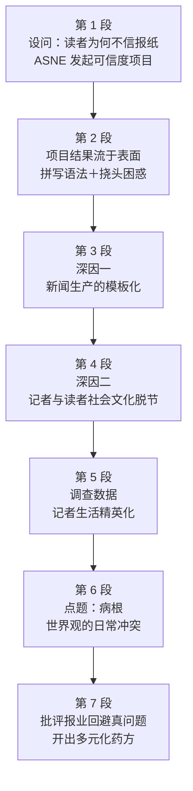

# Passage 17 · 报业信任危机的病根

## 答题记录

| 轮次  | 日期  | 题号  | 正确  | 错误  | 正确率 | 用时  | 错题归因 |
| --- | --- | --- | --- | --- | --- | --- | ---- |
| 1   |     | 1-4 |     |     |     |     |      |
| 2   |     | 1-4 |     |     |     |     |      |
| 3   |     | 1-4 |     |     |     |     |      |

> [!tip] 填写口径
> - **用时**以分钟计，只计做题时间，不含精读复盘。
> - **错题归因**填「题型·错误类型」，如：细节题·定位错、推理判断·过度推断、主旨大意·以偏概全。
> - 纵向看趋势：正确率升而用时过长 → 熟练度不足；用时降而正确率波动 → 定位不稳。

> [!info] 文章档案
> - **来源**：考研英语（一）2001 年 Text 3
> - **题材**：社会生活——美国报业的读者信任危机
> - **结构**：7 段 / 18 句 ＋ 4 题
> - **难度**：★★★☆☆
> - **一句话主旨**：美国读者不信任报纸，表面看是报道差错，病根却在新闻生产的模板化与记者—读者的世界观冲突，而报业至今没有正视这一真问题。

## 一、篇章脉络

- **第 1 段**：设问开篇——美国人为何不信报纸？ASNE 由此发起可信度项目。
- **第 2 段**：项目结果令人失望——只查到拼写语法等低层次问题。
- **第 3 段**：根源之一——记者用标准模板看世界，新闻叙事套路化。
- **第 4 段**：根源之二——记者与读者存在社会文化脱节，引出问卷调查。
- **第 5 段**：数据佐证——记者生活远比读者精英化。
- **第 6 段**：点明病根——不信任源于世界观的日常冲突，而非报道失实。
- **第 7 段**：批评报业只办研讨会却不正视偏见，并用虚拟语气开出药方。

> [!tip] 行文逻辑
> 设问（为什么不信）→ 初步答案流于表面 → 层层深挖（模板化 → 脱节 → 数据 → 世界观冲突）→ 末段归因＋建议。「现象 → 浅因否定 → 深因递进 → 处方」的探因式结构：第 1 题主旨、第 4 题末段推断考的都是这条「病根在哪」的主线。

## 二、逐段精读

### 第 1 段 · 引入：美国的报纸信任之问

**原文**

① Why do so many Americans distrust what they read in their newspapers?
② The American Society of Newspaper Editors is trying to answer this painful question.
③ The organization is deep into a long self-analysis known as the journalism credibility project.

**译文**

① 为什么这么多美国人不相信他们在报纸上读到的内容？
② 美国报纸编辑协会正试图回答这个令人头疼的问题。
③ 该组织正深入进行一场漫长的自我剖析，即「新闻业可信度项目」。

> [!note] 段落要点
> - 功能：设问开篇，抛出全文要回答的问题——美国人为何不信报纸；②③句引出 ASNE 与可信度项目。
> - 注意项目是「行业自查」（self-analysis），为后文「自查不彻底」埋下伏笔。

#### 本段重点词汇

| 单词 / 短语 | 词性 | 文中意 | 常用考义与拓展 | 英文示例搭配（中译） |
| --- | --- | --- | --- | --- |
| **distrust** | v. / n. | 不信任 | 反义 trust；mistrust 与 distrust 基本同义 | distrust what they read（不相信读到的内容） |
| **painful** | adj. | 令人难堪的，棘手的 | 派生 pain n. 痛苦；a painful lesson 惨痛的教训 | this painful question（这个棘手的问题） |
| **be deep into** | （短语） | 深陷于，正忙于 | 同义 be engaged in（从事于）；deep into the night 深夜 | is deep into a long self-analysis（正进行漫长的自我剖析） |
| **self-analysis** | n. | 自我剖析 | self- 前缀：self-criticism 自我批评、self-review 自查 | a long self-analysis（漫长的自我剖析） |
| **credibility** | n. | 可信度 | 派生 credible adj. 可信的；反义 incredibility | the journalism credibility project（新闻业可信度项目） |

### 第 2 段 · 项目结果流于表面

**原文**

① Sad to say, this project has turned out to be mostly low-level findings about factual errors and spelling and grammar mistakes, combined with lots of head-scratching puzzlement about what in the world those readers really want.

**译文**

① 遗憾的是，该项目最终得出的多半是关于事实错误和拼写、语法错误的低层次发现，还夹杂着大量令人挠头的困惑：那些读者到底想要什么？

> [!note] 段落要点
> - 功能：给出项目的初步结果并作出评价——low-level（低层次），为下文 But「根源更深」让路。
> - head-scratching puzzlement 暗示：连行业自己都没弄明白读者要什么。

#### 长难句 · 本段

> [!abstract] 本段第 ① 句 · Sad to say, this project has turned out to be mostly low-level findings about factual errors and spelling and grammar mistakes, combined with lots of head-scratching puzzlement about what in the world those readers really want.

**结构拆解**

- **主干**：this project has turned out to be mostly low-level findings（主谓 + 表语）
- **后置定语**：about factual errors and spelling and grammar mistakes（修饰 findings，and 并列两类错误）
- **伴随修饰**：combined with lots of head-scratching puzzlement（分词短语，附加说明）
- **介词宾语从句**：about [what in the world those readers really want]（what 引导；in the world 为强调插入语「究竟」）

**参考译文**

遗憾的是，该项目最终得出的多半是关于事实错误和拼写、语法错误的低层次发现，还夹杂着大量令人挠头的困惑：那些读者到底想要什么？

> [!tip] 拆解要点
> turned out to be 后接名词短语作表语；combined with 是附加成分，不改变谓语单复数——主谓一致看 combined 前面的主语。

#### 本段重点词汇

| 单词 / 短语 | 词性 | 文中意 | 常用考义与拓展 | 英文示例搭配（中译） |
| --- | --- | --- | --- | --- |
| **sad to say** | （短语） | 遗憾的是 | 同义 unfortunately / regrettably | Sad to say, ...（遗憾的是……） |
| **turn out (to be)** | （短语） | 结果是，最终成为 | 熟词僻义：turn out 还可表「外出；熄灭；到场」 | has turned out to be mostly...（结果多半是……） |
| **low-level** | adj. | 低层次的 | 复合词反义：high-level 高层次的 | low-level findings（低层次的发现） |
| **factual** | adj. | 事实的，与事实相关的 | 派生 fact n. 事实；factual account 如实叙述 | factual errors（事实性错误） |
| **combined with** | （短语） | 连同，加上 | = together with；谓语随其前的主语变化 | combined with lots of puzzlement（还夹杂着大量困惑） |
| **head-scratching** | adj. | 令人挠头的，费解的 | scratch one's head 挠头（表困惑） | head-scratching puzzlement（令人挠头的困惑） |
| **puzzlement** | n. | 困惑 | 派生 puzzle v. / n.；in puzzlement 一脸茫然 | puzzlement about what readers want（对读者想要什么的困惑） |
| **in the world** | （短语） | 究竟，到底 | 用于疑问词后加强语气，= on earth | what in the world...（到底想要什么） |

### 第 3 段 · 深因一：新闻生产的模板化

**原文**

① But the sources of distrust go way deeper.
② Most journalists learn to see the world through a set of standard templates (patterns) into which they plug each day's events.
③ In other words, there is a conventional story line in the newsroom culture that provides a backbone and a ready-made narrative structure for otherwise confusing news.

**译文**

① 但不信任的根源要深得多。
② 大多数记者学会了一套标准模板（套路）来看待世界，每天都把新闻事件往这套模板里填。
③ 换句话说，新闻编辑室文化中存在一种惯常的故事线，为原本纷乱的消息提供骨架和现成的叙事结构。

> [!note] 段落要点
> - 功能：But 转折，提出根源之一——记者用标准模板看世界，新闻叙事套路化。
> - ③句 in other words 是对②句的解释，考场上可用它快速做同义替换定位。

#### 长难句 · 本段

> [!abstract] 本段第 ② 句 · Most journalists learn to see the world through a set of standard templates (patterns) into which they plug each day's events.

**结构拆解**

- **主干**：Most journalists learn to see the world（主谓 + 不定式宾语）
- **方式状语**：through a set of standard templates（透过一套标准模板）
- **介词前置定语从句**：into which they plug each day's events（= they plug each day's events into the templates）

**参考译文**

大多数记者学会了一套标准模板（套路）来看待世界，每天都把新闻事件往这套模板里填。

> [!tip] 拆解要点
> 「介词 + which」里的介词来自从句末尾的动词搭配（plug... into），把搭配还原成陈述句即可看懂。

> [!abstract] 本段第 ③ 句 · In other words, there is a conventional story line in the newsroom culture that provides a backbone and a ready-made narrative structure for otherwise confusing news.

**结构拆解**

- **主干**：there is a conventional story line（there be 存在句）
- **地点状语**：in the newsroom culture
- **定语从句**：that provides a backbone and a ready-made narrative structure（修饰 story line，被状语分隔）
- **后置定语**：for otherwise confusing news（otherwise = 要不是这套故事线）

**参考译文**

换句话说，新闻编辑室文化中存在一种惯常的故事线，为原本纷乱的消息提供骨架和现成的叙事结构。

> [!tip] 拆解要点
> that 从句没有紧贴 story line，中间隔了 in the newsroom culture——「先行词 + 状语 + 定语从句」的分隔结构：看到 provides 先往回找它修饰谁。

#### 本段重点词汇

| 单词 / 短语 | 词性 | 文中意 | 常用考义与拓展 | 英文示例搭配（中译） |
| --- | --- | --- | --- | --- |
| **source** | n. | 根源，来源 | 熟词僻义：源头 → 根源；source of news 消息来源 | the sources of distrust（不信任的根源） |
| **template** | n. | 模板，套路 | 同义 pattern（模式）；templet 异拼 | standard templates（标准模板） |
| **plug** | v. | 硬塞进，套用 | 熟词僻义：插头/插座 → 塞入、嵌入 | plug each day's events into templates（把每日事件往模板里套） |
| **conventional** | adj. | 惯常的，因循守旧的 | 派生 convention n. 惯例；反义 unconventional | a conventional story line（惯常的故事线） |
| **story line** | n. | 故事线，叙事套路 | 同义 plot（情节） | a conventional story line（惯常的故事线） |
| **newsroom** | n. | 新闻编辑室 | 复合词：news + room | the newsroom culture（新闻编辑室文化） |
| **backbone** | n. | 骨架，支柱 | 熟词僻义：脊梁 → 骨干、支柱；the backbone of... ……的支柱 | provides a backbone（提供骨架） |
| **ready-made** | adj. | 现成的 | 复合词：ready-made clothes 成衣 | a ready-made narrative structure（现成的叙事结构） |
| **narrative** | adj. / n. | 叙事的；叙事 | 派生 narrate v. 叙述；narration n. 叙述 | narrative structure（叙事结构） |
| **otherwise** | adv. | 要不是这样，在其他情况下 | 熟词僻义：否则 → 在相反情况下 | otherwise confusing news（原本令人迷惑的新闻） |
| **confusing** | adj. | 令人困惑的 | 派生 confuse v.；confused adj.（人）感到困惑的 | otherwise confusing news（原本纷乱的消息） |

### 第 4 段 · 深因二：记者与读者的社会文化脱节

**原文**

① There exists a social and cultural disconnect between journalists and their readers, which helps explain why the "standard templates" of the newsroom seem alien to many readers.
② In a recent survey, questionnaires were sent to reporters in five middle-size cities around the country, plus one large metropolitan area.
③ Then residents in these communities were phoned at random and asked the same questions.

**译文**

① 记者与读者之间存在一种社会和文化上的脱节，这有助于解释为什么新闻编辑室的「标准模板」在许多读者看来如此陌生。
② 在最近的一项调查中，问卷被寄给了全国五座中等城市外加一个大都市区的记者。
③ 随后，随机致电这些社区的居民，向他们提出同样的问题。

> [!note] 段落要点
> - 功能：提出根源之二——记者与读者的社会文化脱节；②③句引入问卷调查，交代证据来源。
> - 本段调查与第 5 段数据是「方法—结果」关系。

#### 长难句 · 本段

> [!abstract] 本段第 ① 句 · There exists a social and cultural disconnect between journalists and their readers, which helps explain why the "standard templates" of the newsroom seem alien to many readers.

**结构拆解**

- **主干**：There exists a social and cultural disconnect（There exists 完全倒装的存在句）
- **后置定语**：between journalists and their readers（修饰 disconnect）
- **非限定定语从句**：which helps explain why...（which 指代前面整个主句事实）
- **宾语从句**：why the "standard templates" of the newsroom seem alien to many readers

**参考译文**

记者与读者之间存在一种社会和文化上的脱节，这有助于解释为什么新闻编辑室的「标准模板」在许多读者看来如此陌生。

> [!tip] 拆解要点
> which 指代整个主句（这件事）而非某个名词——非限定定语从句的「句级指代」，通常译作「这……」。

#### 本段重点词汇

| 单词 / 短语 | 词性 | 文中意 | 常用考义与拓展 | 英文示例搭配（中译） |
| --- | --- | --- | --- | --- |
| **disconnect** | n. | 脱节，隔阂 | 熟词僻义：断开（v.）→ 隔阂、差距（n.） | a social and cultural disconnect（社会文化脱节） |
| **alien** | adj. | 陌生的，格格不入的 | 熟词僻义：外星的 → 陌生的；be alien to 与……格格不入 | seem alien to many readers（在读者看来陌生） |
| **questionnaire** | n. | 问卷 | 派生 question；fill out a questionnaire 填问卷 | questionnaires were sent to...（问卷被寄给……） |
| **metropolitan** | adj. | 大都市的 | 派生 metropolis n. 大都市；metro n. 地铁 | one large metropolitan area（一个大都市区） |
| **resident** | n. | 居民 | 派生 reside v. 居住；residence n. 住所 | residents in these communities（这些社区的居民） |
| **at random** | （短语） | 随机地 | 同义 randomly；random adj. 随意的 | were phoned at random（被随机致电） |
| **community** | n. | 社区，群体 | 熟词僻义：社群、界（the academic community 学术界） | residents in these communities（社区的居民） |

### 第 5 段 · 数据佐证：记者生活的精英化

**原文**

① Replies show that compared with other Americans, journalists are more likely to live in upscale neighborhoods, have maids, own Mercedes, and trade stocks, and they're less likely to go to church, do volunteer work, or put down roots in a community.

**译文**

① 调查回复显示，与其他美国人相比，记者更有可能住在高档社区、雇女佣、开奔驰、炒股，而不太可能去教堂做礼拜、做志愿服务，或在某个社区扎根。

> [!note] 段落要点
> - 功能：用调查数据坐实第 4 段的「脱节」——more likely... less likely... 的对比罗列。
> - 正负两组清单 = 记者与主流读者生活方式的距离，为第 6 段「精英」定性。

#### 长难句 · 本段

> [!abstract] 本段第 ① 句 · Replies show that compared with other Americans, journalists are more likely to live in upscale neighborhoods, have maids, own Mercedes, and trade stocks, and they're less likely to go to church, do volunteer work, or put down roots in a community.

**结构拆解**

- **主干**：Replies show that...（that 引导宾语从句）
- **从句骨架**：journalists are more likely to do A, B, C, D and less likely to do E, F, G（more likely... and less likely... 对称并列）
- **插入状语**：compared with other Americans（过去分词短语，交代比较对象）

**参考译文**

调查回复显示，与其他美国人相比，记者更有可能住在高档社区、雇女佣、开奔驰、炒股，而不太可能去教堂做礼拜、做志愿服务，或在某个社区扎根。

> [!tip] 拆解要点
> 遇到 more likely to A, B, C and D 的罗列，先按 likely 分「正面清单 / 负面清单」两组，再核对组内并列项，长句立刻变短。

#### 本段重点词汇

| 单词 / 短语 | 词性 | 文中意 | 常用考义与拓展 | 英文示例搭配（中译） |
| --- | --- | --- | --- | --- |
| **upscale** | adj. | 高档的，高端的 | 同义 upmarket（英式）；反义 downscale | upscale neighborhoods（高档社区） |
| **neighborhood** | n. | 街区，社区 | 派生 neighbor n. 邻居；in the neighborhood of 大约 | live in upscale neighborhoods（住在高档街区） |
| **maid** | n. | 女佣，保姆 | 同义 housemaid / servant | have maids（雇女佣） |
| **trade stocks** | （短语） | 炒股 | trade 熟词僻义：贸易 → 买卖、交易 | own Mercedes, and trade stocks（开奔驰、炒股） |
| **volunteer** | adj. / n. / v. | 志愿的；志愿者；自愿做 | 派生 voluntary adj. 自愿的；voluntarily adv. | do volunteer work（做志愿工作） |
| **put down roots** | （短语） | 扎根，定居 | 同义 settle down（安顿下来） | put down roots in a community（在社区扎根） |

### 第 6 段 · 点题：病根是世界观的日常冲突

**原文**

① Reporters tend to be part of a broadly defined social and cultural elite, so their work tends to reflect the conventional values of this elite.
② The astonishing distrust of the news media isn't rooted in inaccuracy or poor reportorial skills but in the daily clash of world views between reporters and their readers.

**译文**

① 记者往往是广义上的社会文化精英群体的一员，因此他们的作品往往反映这个精英群体的传统价值观。
② 人们对新闻媒体的惊人不信任，并非根源于报道失实或报道水平低下，而是根源于记者与读者之间世界观的日常冲突。

> [!note] 段落要点
> - 功能：全篇点题段——①句小结精英身份，②句 not...but... 先排除表面原因（报道失实、技能差），再锁定病根（世界观冲突）。
> - ②句是第 3 题的定位句，答案就在 but 之后。

#### 长难句 · 本段

> [!abstract] 本段第 ② 句 · The astonishing distrust of the news media isn't rooted in inaccuracy or poor reportorial skills but in the daily clash of world views between reporters and their readers.

**结构拆解**

- **主干**：The astonishing distrust isn't rooted in A but in B（not...but... 平行结构）
- **否定项 A**：in inaccuracy or poor reportorial skills（表面原因）
- **肯定项 B**：in the daily clash of world views（真正病根）
- **后置定语**：of the news media（修饰 distrust）；between reporters and their readers（修饰 clash）

**参考译文**

人们对新闻媒体的惊人不信任，并非根源于报道失实或报道水平低下，而是根源于记者与读者之间世界观的日常冲突。

> [!tip] 拆解要点
> not A but B 结构的命题点永远在 but 之后的 B；A、B 形式对称（都是 in + 名词短语），可据此快速切分两半。

#### 本段重点词汇

| 单词 / 短语 | 词性 | 文中意 | 常用考义与拓展 | 英文示例搭配（中译） |
| --- | --- | --- | --- | --- |
| **tend to** | （短语） | 往往，倾向于 | 注意区分 attend to（照料）；tendency n. 趋势 | tend to be part of...（往往是……的一员） |
| **broadly defined** | （短语） | 广义界定的 | broadly speaking 广义而言；broadly adv. 大体上 | a broadly defined elite（广义上的精英群体） |
| **elite** | n. | 精英（群体） | 集合名词；elitist n. / adj. 精英主义的 | a social and cultural elite（社会文化精英） |
| **reflect** | v. | 反映，体现 | 熟词僻义：反射 → 反映；reflection n. 反射；反思 | work tends to reflect the values（作品反映价值观） |
| **astonishing** | adj. | 令人吃惊的 | 派生 astonish v. 使惊讶；astonishment n. 惊讶 | the astonishing distrust（惊人的不信任） |
| **be rooted in** | （短语） | 根源于，植根于 | root n. 根；同义 stem from / derive from | isn't rooted in inaccuracy（并非根源于失实报道） |
| **inaccuracy** | n. | 不准确，失实 | 反义 accuracy；inaccurate adj. 不准确的 | inaccuracy or poor reportorial skills（失实或报道水平差） |
| **reportorial** | adj. | 记者报道的 | 派生 reporter n. 记者；report v. / n. 报道 | poor reportorial skills（糟糕的报道水平） |
| **clash** | n. | 冲突，抵触 | 同义 conflict / collision；clash with 与……冲突 | the daily clash of world views（世界观的日常冲突） |
| **world view** | n. | 世界观 | = world outlook（第 3 题考点） | the clash of world views（世界观冲突） |

### 第 7 段 · 收束：批评报业回避真问题并开出药方

**原文**

① This is an explosive situation for any industry, particularly a declining one.
② Here is a troubled business that keeps hiring employees whose attitudes vastly annoy the customers.
③ Then it sponsors lots of symposiums and a credibility project dedicated to wondering why customers are annoyed and fleeing in large numbers.
④ But it never seems to get around to noticing the cultural and class biases that so many former buyers are complaining about.
⑤ If it did, it would open up its diversity program, now focused narrowly on race and gender, and look for reporters who differ broadly by outlook, values, education, and class.

**译文**

① 对任何行业来说，这都是一个一触即发的局面，对一个正在衰退的行业尤甚。
② 这里有这么一家麻烦缠身的公司：它不断雇用那些态度让顾客极度恼火的员工。
③ 然后它又出资举办大量研讨会，还搞了一个可信度项目，专门琢磨顾客为什么恼火、为什么大批流失。
④ 但它似乎从来就没有腾出时间，去注意一下那么多老主顾所抱怨的文化和阶级偏见。
⑤ 如果它注意了，就会开放自己目前只局限于种族和性别的多元化项目，去寻找在世界观、价值观、教育和阶层上大不相同的记者。

> [!note] 段落要点
> - 功能：把新闻业放进「问题公司」的比喻里批评——只办研讨会、做项目（③句），却从不正视文化与阶级偏见（④句）；⑤句用虚拟语气开出药方。
> - ④⑤句是第 4 题的定位句；never get around to noticing = failure to realize。

#### 长难句 · 本段

> [!abstract] 本段第 ② 句 · Here is a troubled business that keeps hiring employees whose attitudes vastly annoy the customers.

**结构拆解**

- **主干**：Here is a troubled business（Here 引导的倒装：表语提前）
- **定语从句一**：that keeps hiring employees（keep doing 反复做）
- **定语从句二**：whose attitudes vastly annoy the customers（whose 修饰 employees）

**参考译文**

这里有这么一家麻烦缠身的公司：它不断雇用那些态度让顾客极度恼火的员工。

> [!tip] 拆解要点
> Here is... 是新闻评论「举出现成例子」的手法；从句套从句时逐层剥：business → that（雇员工）→ whose（员工的态度）。

> [!abstract] 本段第 ③ 句 · Then it sponsors lots of symposiums and a credibility project dedicated to wondering why customers are annoyed and fleeing in large numbers.

**结构拆解**

- **主干**：it sponsors lots of symposiums and a credibility project（and 并列两个宾语）
- **后置定语**：dedicated to wondering...（过去分词短语修饰 project）
- **动名词宾语从句**：wondering [why customers are annoyed and fleeing]
- **从句内并列**：are annoyed and (are) fleeing（为什么恼火 + 为什么流失）

**参考译文**

然后它又出资举办大量研讨会，还搞了一个可信度项目，专门琢磨顾客为什么恼火、为什么大批流失。

> [!tip] 拆解要点
> be dedicated to 的 to 是介词，后面必须接 doing；why 从句里两个表语并列，说的是顾客流失的两个「为什么」。

> [!abstract] 本段第 ⑤ 句 · If it did, it would open up its diversity program, now focused narrowly on race and gender, and look for reporters who differ broadly by outlook, values, education, and class.

**结构拆解**

- **虚拟条件句**：If it did...（did 代指上句 get around to noticing，对现在事实的虚拟）
- **主句**：it would open up its diversity program and look for reporters（would + 两个并列谓语）
- **插入语**：now focused narrowly on race and gender（过去分词短语，交代项目现状）
- **定语从句**：who differ broadly by outlook, values, education, and class（四项并列 differ by）

**参考译文**

如果它注意了，就会开放自己目前只局限于种族和性别的多元化项目，去寻找在世界观、价值观、教育和阶层上大不相同的记者。

> [!tip] 拆解要点
> If it did 是省略式虚拟，did 指代上句动词短语；两个逗号间的 focused on... 是插入的现状说明，先跳过再读主干。

#### 本段重点词汇

| 单词 / 短语 | 词性 | 文中意 | 常用考义与拓展 | 英文示例搭配（中译） |
| --- | --- | --- | --- | --- |
| **explosive** | adj. | 一触即发的，爆炸性的 | 熟词僻义：炸药 → 棘手的；explode v. 爆炸 | an explosive situation（一触即发的局面） |
| **declining** | adj. | 衰退中的 | 派生 decline v. / n. 下降、衰退；on the decline 在衰退 | a declining industry（衰退中的行业） |
| **troubled** | adj. | 麻烦缠身的，陷入困境的 | in trouble 陷入麻烦；troublesome adj. 烦人的 | a troubled business（一家麻烦缠身的公司） |
| **business** | n. | 企业，行业 | 熟词僻义：生意 → 行业、公司 | Here is a troubled business（这里有家麻烦缠身的公司） |
| **vastly** | adv. | 极其，非常 | 派生 vast adj. 巨大的；vastly different 天壤之别 | attitudes vastly annoy（态度极度惹恼顾客） |
| **annoy** | v. | 惹恼，使烦恼 | annoyed adj.（人）恼火的；annoying adj. 恼人的 | attitudes that annoy the customers（惹恼顾客的态度） |
| **sponsor** | v. | 出资，赞助 | 熟词僻义：赞助人（n.）→ 主办、出资（v.） | sponsors lots of symposiums（出资办大量研讨会） |
| **symposium** | n. | 研讨会，专题讨论会 | 复数 symposiums / symposia | lots of symposiums（大量研讨会） |
| **be dedicated to** | （短语） | 专门用于，致力于 | to 为介词，后接动名词；dedication n. 奉献 | a project dedicated to wondering（专门琢磨的项目） |
| **flee** | v. | 逃离，（顾客）大量流失 | 不规则过去式 fled；同义 escape / run away | fleeing in large numbers（大批流失） |
| **get around to** | （短语） | 抽出时间做，终于着手 | to 为介词；同义 find time to do | never seems to get around to noticing（似乎从未注意到） |
| **bias** | n. | 偏见，偏向 | biased adj. 有偏见的；同义 prejudice | cultural and class biases（文化与阶级偏见） |
| **complain about** | （短语） | 抱怨，投诉 | complaint n. 抱怨；complain that + 从句 | buyers are complaining about（老主顾抱怨的） |
| **diversity** | n. | 多元化，多样性 | 派生 diverse adj. 各不相同的 | open up its diversity program（开放多元化项目） |
| **narrowly** | adv. | 局限于，狭隘地 | 熟词僻义：另有「勉强地」（narrowly escape 死里逃生） | now focused narrowly on（现在只局限于） |
| **outlook** | n. | 世界观，看法 | 熟词僻义：景色 → 观点、前景（economic outlook 经济前景） | differ by outlook（世界观不同） |

## 三、全篇重点词汇汇总（自测用）

> [!info] 说明
> 本表只列「单词 / 词性 / 所在段」，不含释义与搭配，用于遮表自测：说出词义后再回该段核对。
> 收录**全篇所有段落词汇，共 63 条，不删减**，与各段「本段重点词汇」等长同源。

| 单词 / 短语 | 词性 | 所在段 |
| --- | --- | --- |
| **distrust** | v. / n. | 第 1 段 |
| **painful** | adj. | 第 1 段 |
| **be deep into** | （短语） | 第 1 段 |
| **self-analysis** | n. | 第 1 段 |
| **credibility** | n. | 第 1 段 |
| **sad to say** | （短语） | 第 2 段 |
| **turn out (to be)** | （短语） | 第 2 段 |
| **low-level** | adj. | 第 2 段 |
| **factual** | adj. | 第 2 段 |
| **combined with** | （短语） | 第 2 段 |
| **head-scratching** | adj. | 第 2 段 |
| **puzzlement** | n. | 第 2 段 |
| **in the world** | （短语） | 第 2 段 |
| **source** | n. | 第 3 段 |
| **template** | n. | 第 3 段 |
| **plug** | v. | 第 3 段 |
| **conventional** | adj. | 第 3 段 |
| **story line** | n. | 第 3 段 |
| **newsroom** | n. | 第 3 段 |
| **backbone** | n. | 第 3 段 |
| **ready-made** | adj. | 第 3 段 |
| **narrative** | adj. / n. | 第 3 段 |
| **otherwise** | adv. | 第 3 段 |
| **confusing** | adj. | 第 3 段 |
| **disconnect** | n. | 第 4 段 |
| **alien** | adj. | 第 4 段 |
| **questionnaire** | n. | 第 4 段 |
| **metropolitan** | adj. | 第 4 段 |
| **resident** | n. | 第 4 段 |
| **at random** | （短语） | 第 4 段 |
| **community** | n. | 第 4 段 |
| **upscale** | adj. | 第 5 段 |
| **neighborhood** | n. | 第 5 段 |
| **maid** | n. | 第 5 段 |
| **trade stocks** | （短语） | 第 5 段 |
| **volunteer** | adj. / n. / v. | 第 5 段 |
| **put down roots** | （短语） | 第 5 段 |
| **tend to** | （短语） | 第 6 段 |
| **broadly defined** | （短语） | 第 6 段 |
| **elite** | n. | 第 6 段 |
| **reflect** | v. | 第 6 段 |
| **astonishing** | adj. | 第 6 段 |
| **be rooted in** | （短语） | 第 6 段 |
| **inaccuracy** | n. | 第 6 段 |
| **reportorial** | adj. | 第 6 段 |
| **clash** | n. | 第 6 段 |
| **world view** | n. | 第 6 段 |
| **explosive** | adj. | 第 7 段 |
| **declining** | adj. | 第 7 段 |
| **troubled** | adj. | 第 7 段 |
| **business** | n. | 第 7 段 |
| **vastly** | adv. | 第 7 段 |
| **annoy** | v. | 第 7 段 |
| **sponsor** | v. | 第 7 段 |
| **symposium** | n. | 第 7 段 |
| **be dedicated to** | （短语） | 第 7 段 |
| **flee** | v. | 第 7 段 |
| **get around to** | （短语） | 第 7 段 |
| **bias** | n. | 第 7 段 |
| **complain about** | （短语） | 第 7 段 |
| **diversity** | n. | 第 7 段 |
| **narrowly** | adv. | 第 7 段 |
| **outlook** | n. | 第 7 段 |

> [!warning] 熟词僻义专列
> - **plug** v. 硬塞进、套用（非「插头」）
> - **alien** adj. 陌生的、格格不入的（非「外星的」）
> - **explosive** adj. 一触即发的、棘手的（非「爆炸的」）
> - **backbone** n. 骨架、支柱（非「脊梁骨」）
> - **business** n. 行业、公司（非「生意」）
> - **flee** v. （顾客）大量流失（非仅「逃跑」）
> - **narrowly** adv. 局限于（另义「勉强地」）
> - **outlook** n. 世界观、前景（非「景色」）

> [!example] 同义替换链（阅读题高频）
> - distrust = disappointment = complain about（读者对报纸的负面态度，第 1 题主线）
> - low-level = rather superficial（第 2 题考点）
> - world views = world outlook（第 3 题考点）
> - sources of distrust = basic problem = real problem（第 3、4 题线索）
> - never get around to noticing = failure to realize（第 4 题考点）

## 四、知识点补充

> [!question] 背景知识
> - **ASNE（American Society of Newspaper Editors，美国报纸编辑协会）**：1922 年成立的美国报纸主编行业组织，1997 年发起「新闻业可信度项目」（Journalism Credibility Project），即本文讨论的调查。
> - 本文是 2001 年考研英语（一）真题。当时美国报业发行量连年下滑、读者流失严重——这正是第 7 段 a declining one 的行业背景。

> [!warning] 语法点
> - **介词前置的定语从句**：templates into which they plug...（= plug... into the templates）。「介词 + which」只能紧邻先行词。
> - **There exists... 完全倒装**：真主语 a disconnect 后置，与 there be 同理，但更书面。
> - **not...but... 平行结构**：isn't rooted in A but in B——not 与 but 后的结构必须对称。
> - **虚拟语气**：If it did, it would...——对现在事实的虚拟；did 指代上句 get around to noticing。
> - **whose 定语从句**：employees whose attitudes...，whose 既可指人也可指物。

> [!success] 写作可迁移句型
> - `The astonishing X isn't rooted in A but in B` → 议论文归因：真正的原因不在表面（A）而在深层（B）。
> - `Here is a troubled business/organization that keeps doing sth` → 列举某机构反复出现的坏毛病。
> - `If it did, it would do A, now focused narrowly on B, and look for C` → 提出假设性建议，插入语补充现状。

> [!danger] 易混辨析
> - **credible vs credulous**：credible（可信的，形容事物）；credulous（轻信的，形容人易被骗）。
> - **alien vs foreign**：alien 强调「格格不入的陌生感」（be alien to）；foreign 只表「外国的」。
> - **symposium vs seminar vs forum**：symposium 专题研讨会；seminar（大学）研讨课；forum 公开论坛。

## 五、题目分析

> [!info] 题目总览
> | 题号 | 题型 | 定位 | 答案 |
> | --- | --- | --- | --- |
> | 1 | 主旨大意题 | 全文（第 1 段①句设问） | B |
> | 2 | 细节题 | 第 2 段①句 | D |
> | 3 | 细节题 | 第 6 段②句 | C |
> | 4 | 推理判断题 | 第 7 段④⑤句 | A |

### 第 1 题 · 主旨大意题

> [!question] 原题
> What is the passage mainly about?
> - A. Needs of the readers all over the world.
> - B. Causes of the public disappointment about newspapers.
> - C. Origins of the declining newspaper industry.
> - D. Aims of a journalism credibility project.

**正确答案**：**B. Causes of the public disappointment about newspapers.（公众对报纸失望的原因）**

**定位与依据**
- 全文七段都在回答第 1 段①句的设问：Why do so many Americans distrust what they read in their newspapers?
- 同义替换：distrust what they read = disappointment about newspapers；③—⑦ 段给出的正是「原因」：模板化 → 脱节 → 精英化 → 世界观冲突。

**干扰项分析**

| 选项 | 选项内容 | 判断 | 排除理由 |
| --- | --- | --- | --- |
| A | Needs of the readers all over the world. | ✗ | 无中生有：「全世界读者的需求」未提及，文中只说读者需求没被弄懂。 |
| C | Origins of the declining newspaper industry. | ✗ | 偷换概念：报业衰退只是第 7 段的背景一笔带过，文章谈的是「信任危机」的原因，不是「行业衰退」的起因。 |
| D | Aims of a journalism credibility project. | ✗ | 以偏概全：项目只是第 1—2 段的引子，其「目的」并非全文重心。 |

> [!tip] 解题思路
> 首段设问句即全文主线；主旨题的选项若只覆盖开头的引子（D）或背景（C），都撑不起 mainly about。B 的 causes 与全文探因结构严丝合缝。

### 第 2 题 · 细节题

> [!question] 原题
> The results of the journalism credibility project turned out to be
> - A. quite trustworthy.
> - B. somewhat contradictory.
> - C. very illuminating.
> - D. rather superficial.

**正确答案**：**D. rather superficial.（相当肤浅）**

**定位与依据**
- 定位到第 2 段①句：this project has turned out to be mostly low-level findings about factual errors and spelling and grammar mistakes...
- 同义替换：low-level = rather superficial。

**干扰项分析**

| 选项 | 选项内容 | 判断 | 排除理由 |
| --- | --- | --- | --- |
| A | quite trustworthy. | ✗ | 偷换概念：trustworthy（可信）是话题词，但原文没说项目结果「可信」。 |
| B | somewhat contradictory. | ✗ | 无中生有：「自相矛盾」无对应信息。 |
| C | very illuminating. | ✗ | 与原文相反：illuminating（有启发性）与 low-level（低层次）的评价正好相反。 |

> [!tip] 解题思路
> 本题是「同义替换」型细节题：抓 turned out（结果是）后的评价词 low-level，再认出 low-level → superficial 的上位替换。四个选项都是「副词 + 评价形容词」，比的就是这一处改写。

### 第 3 题 · 细节题

> [!question] 原题
> The basic problem of journalists as pointed out by the writer lies in their
> - A. working attitude.
> - B. conventional lifestyle.
> - C. world outlook.
> - D. educational background.

**正确答案**：**C. world outlook.（世界观）**

**定位与依据**
- 定位到第 6 段②句：The astonishing distrust of the news media isn't rooted in inaccuracy or poor reportorial skills but in the daily clash of world views between reporters and their readers.
- 同义替换：world views = world outlook；basic problem = the daily clash of world views。

**干扰项分析**

| 选项 | 选项内容 | 判断 | 排除理由 |
| --- | --- | --- | --- |
| A | working attitude. | ✗ | 张冠李戴：「态度惹恼顾客」是第 7 段的比喻说法，且原文明确说问题 isn't rooted in reportorial skills。 |
| B | conventional lifestyle. | ✗ | 以偏概全：第 5 段生活方式精英化只是佐证数据，不是 basic problem。 |
| D | educational background. | ✗ | 无中生有：education 只在第 7 段药方里出现，不是问题所在。 |

> [!tip] 解题思路
> not A but B 结构里，答案永远在 but 之后。题干问 basic problem，直接锁定 but in the daily clash of world views，再同义替换成 outlook。

### 第 4 题 · 推理判断题

> [!question] 原题
> Despite its efforts, the newspaper industry still cannot satisfy the readers owing to its
> - A. failure to realize its real problem.
> - B. tendency to hire annoying reporters.
> - C. likelihood to do inaccurate reporting.
> - D. prejudice in matters of race and gender.

**正确答案**：**A. failure to realize its real problem.（没有意识到真正的问题）**

**定位与依据**
- 定位到第 7 段④⑤句：But it never seems to get around to noticing the cultural and class biases that so many former buyers are complaining about. If it did, it would open up its diversity program...
- 同义替换：never seems to get around to noticing = failure to realize its real problem。

**干扰项分析**

| 选项 | 选项内容 | 判断 | 排除理由 |
| --- | --- | --- | --- |
| B | tendency to hire annoying reporters. | ✗ | 字面拼贴：第 7 段②句虽有 hiring employees whose attitudes annoy，但那是「问题公司」的比喻，不是「无法满足读者」的原因。 |
| C | likelihood to do inaccurate reporting. | ✗ | 与原文相反：第 6 段明确说问题 isn't rooted in inaccuracy。 |
| D | prejudice in matters of race and gender. | ✗ | 偷换概念：报业的多元化项目才只关注 race and gender（第 7 段⑤句），读者抱怨的是 cultural and class biases。 |

> [!tip] 解题思路
> Despite its efforts + still cannot satisfy 提示答案在「努力的盲区」：③句先罗列努力（研讨会、项目），④句 But 一转点出盲区（从不正视偏见）；⑤句虚拟语气 If it did, it would... 反证它没做到。

## 六、复盘清单

- [ ] 过汇总表 63 词，遮住「所在段」列自测，重点过 8 个熟词僻义
- [ ] 重做 9 个长难句的口头翻译，特别是介词前置定语从句（第 3 段②）与虚拟语气（第 7 段⑤）
- [ ] 画出探因式结构：设问（第 1 段）→ 浅因否定（第 2 段）→ 深因递进（第 3—6 段）→ 批评 + 药方（第 7 段）
- [ ] 整理本文干扰项类型：无中生有 ×3、偷换概念 ×3、以偏概全 ×2、与原文相反 ×2、张冠李戴 ×1、字面拼贴 ×1
- [ ] 把答题记录填进顶部表格，对照正确率决定是否二刷

## 七、关联笔记

- [[Passage16-霍桑效应的再审视]]
- [[考研英语 · 阅读六大题型方法论]]
- [[考研英语 · 熟词僻义汇总]]
