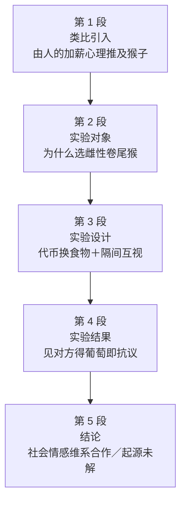

# Passage 18 · 猴子的公平意识

## 答题记录

| 轮次  | 日期         | 题号  | 正确  | 错误  | 正确率 | 用时    | 错题归因 |
| --- | --- | --- | --- | --- | --- | --- | --- |
| 1 |  | 1-5 |  |  |  |  |  |
| 2 |  | 1-5 |  |  |  |  |  |
| 3 |  | 1-5 |  |  |  |  |  |

> [!tip] 填写口径
> - **用时**以分钟计，只计做题时间，不含精读复盘。
> - **错题归因**填「题型·错误类型」，如：细节题·定位错、推理判断·过度推断、主旨大意·以偏概全。
> - 纵向看趋势：正确率升而用时过长 → 熟练度不足；用时降而正确率波动 → 定位不稳。

> [!info] 文章档案
> - **来源**：考研英语（一）2005 年 Text 1
> - **题材**：社会生活——动物实验揭示的公平意识起源
> - **结构**：5 段 / 23 句 ＋ 5 题
> - **难度**：★★★☆☆
> - **一句话主旨**：卷尾猴和人一样会因「同工不同酬」而愤慨、拒绝合作，说明公平感并非人类独有，只是它的演化来源至今仍是未解之谜。

## 一、篇章脉络

- **第 1 段**：引入——从「别人涨得比你多你就不爽」说到研究结论：猴子也是如此。
- **第 2 段**：交代实验对象——为什么偏偏选雌性卷尾猴。
- **第 3 段**：实验设计——花两年训练猴子用代币换食物，再让两只猴隔间互视。
- **第 4 段**：实验结果——待遇不均立刻引发消极抗议，哪怕只是「看见」葡萄。
- **第 5 段**：结论与留白——社会情感维系合作，但公平感的起源尚无答案。

> [!tip] 行文逻辑
> 类比引入（人 → 猴）→ 交代对象（为何是雌猴）→ 实验（设计 + 结果）→ 结论 + 留白。这是科普实验报道的经典结构：第 1 题考开篇手法（comparison 而非 contrast），第 4 题考「结论句而非过程句」，第 5 题考末句那个「未解之谜」。

## 二、逐段精读

### 第 1 段 · 引入：从人的加薪心理推及猴子

**原文**

① Everybody loves a fat pay rise.
② Yet pleasure at your own can vanish if you learn that a colleague has been given a bigger one.
③ Indeed, if he has a reputation for slacking, you might even be outraged.
④ Such behaviour is regarded as "all too human," with the underlying assumption that other animals would not be capable of this finely developed sense of grievance.
⑤ But a study by Sarah Brosnan and Frans de Waal of Emory University in Atlanta, Georgia, which has just been published in *Nature*, suggests that it is all too monkey, as well.

**译文**

① 人人都喜欢大幅加薪。
② 然而，一旦得知某位同事涨得比你多，你对自己那份的欣喜就可能烟消云散。
③ 事实上，如果那人还出了名的偷懒，你甚至会义愤填膺。
④ 这种行为被视为「人之常情」，其潜藏的假定是：其他动物不可能具备这种高度发达的不满意识。
⑤ 但萨拉·布鲁斯南与弗兰斯·德·瓦尔（亚特兰大埃默里大学）刚发表在《自然》上的一项研究表明：这同样是「猴之常情」。

> [!note] 段落要点
> - 功能：用每个人都有的加薪心理做类比，引出全文话题——公平感；⑤句 But 一转，把话题从人推到猴。
> - ④句的 underlying assumption 正是⑤句要推翻的对象，是第 1、2 题的共同抓手。

#### 长难句 · 本段

> [!abstract] 本段第 ④ 句 · Such behaviour is regarded as "all too human," with the underlying assumption that other animals would not be capable of this finely developed sense of grievance.

**结构拆解**

- **主干**：Such behaviour is regarded as "all too human"（被动语态）
- **with 复合结构**：with the underlying assumption that...（with + 名词 + 同位语从句，作伴随状语）
- **同位语从句**：that other animals would not be capable of...（解释 assumption 的具体内容）
- **后置定语**：finely developed（修饰 sense of grievance）

**参考译文**

这种行为被视为「人之常情」，其潜藏的假定是：其他动物不可能具备这种高度发达的不满意识。

> [!tip] 拆解要点
> `be regarded as + 引号短语` 常译作「被视为所谓的……」；with + 抽象名词（assumption / belief / idea）+ that 从句，是议论文里补充说明「隐含前提」的固定套路。

> [!abstract] 本段第 ⑤ 句 · But a study by Sarah Brosnan and Frans de Waal of Emory University in Atlanta, Georgia, which has just been published in Nature, suggests that it is all too monkey, as well.

**结构拆解**

- **主干**：a study ... suggests that...（主谓宾从句）
- **后置定语**：by Sarah Brosnan and Frans de Waal of Emory University in Atlanta, Georgia（修饰 study，被 which 从句隔断）
- **非限定定语从句**：which has just been published in *Nature*
- **宾语从句**：that it is all too monkey（it 指代上文的 such behaviour）

**参考译文**

但萨拉·布鲁斯南与弗兰斯·德·瓦尔（亚特兰大埃默里大学）刚发表在《自然》上的一项研究表明：这同样是「猴之常情」。

> [!tip] 拆解要点
> 先行词 study 后拖了很长的人名地名定语，which 从句插在中间——先砍掉 `by...Georgia` 与 `which...` 抓出 a study suggests that...，再回填修饰语。

#### 本段重点词汇

| 单词 / 短语 | 词性 | 文中意 | 常用考义与拓展 | 英文示例搭配（中译） |
| --- | --- | --- | --- | --- |
| **fat** | adj. | 丰厚的，可观的 | 熟词僻义：肥胖 → 丰厚的；a fat profit 厚利 | a fat pay rise（大幅加薪） |
| **pay rise** | n. | 加薪 | 美式 raise；give sb a pay rise 给某人加薪 | Everybody loves a fat pay rise（人人都爱大幅加薪） |
| **vanish** | v. | 消失，不复存在 | 同义 disappear；vanish into thin air 不翼而飞 | pleasure can vanish（欣喜可能消失） |
| **colleague** | n. | 同事 | 同义 coworker；a colleague of mine 我的一位同事 | a colleague has been given a bigger one（同事涨得更多） |
| **reputation** | n. | 名声，声誉 | have a reputation for 因……而出名；repute n. 名誉 | a reputation for slacking（出了名的偷懒） |
| **slacking** | n. | 偷懒，懈怠 | slack adj. 松懈的；v. 偷懒；slack off 松懈 | a reputation for slacking（以偷懒闻名） |
| **outraged** | adj. | 义愤的，愤怒的 | 派生 outrage n. 义愤 / v. 激怒；outrageous adj. 骇人的 | you might even be outraged（你甚至会愤慨） |
| **all too human** | （短语） | 人之常情 | all too + adj. 表示「太……了（虽令人遗憾）」 | is regarded as "all too human"（被视为人之常情） |
| **underlying** | adj. | 潜在的，根本的 | 派生 underlie v. 构成……的基础 | the underlying assumption（潜藏的假定） |
| **assumption** | n. | 假定，臆断 | 派生 assume v. 假定；make an assumption 做假设 | the underlying assumption that...（……这一隐含假定） |
| **be capable of** | （短语） | 能够，有能力做 | 反义 be incapable of；capable adj. 有能力的 | would not be capable of this sense（不可能具备这种意识） |
| **grievance** | n. | 不满，委屈 | grieve v. 悲伤；同义 complaint | a sense of grievance（不满意识） |
| **all too monkey** | （短语） | 猴子亦如是 | 仿 all too human 的造词，第 2 题考点 | it is all too monkey（这同样是猴之常情） |

### 第 2 段 · 实验对象：为什么选雌性卷尾猴

**原文**

① The researchers studied the behaviour of female brown capuchin monkeys.
② They look cute.
③ They are good-natured, co-operative creatures, and they share their food readily.
④ Above all, like their female human counterparts, they tend to pay much closer attention to the value of "goods and services" than males.

**译文**

① 研究人员研究的是雌性棕色卷尾猴的行为。
② 它们模样可爱。
③ 它们性情温顺、乐于合作，并且很乐意分享食物。
④ 最重要的是，与人类女性一样，它们往往比雄性更在意「商品和服务」的价值。

> [!note] 段落要点
> - 功能：交代实验对象并说明理由——可爱、温顺、爱分享只是铺垫，④句 Above all 之后才是主因。
> - Above all 对应第 3 题题干的 most probably，是「主因 / 次因」的识别标志。

#### 长难句 · 本段

> [!abstract] 本段第 ④ 句 · Above all, like their female human counterparts, they tend to pay much closer attention to the value of "goods and services" than males.

**结构拆解**

- **主干**：they tend to pay much closer attention to the value（tend to do 倾向于做）
- **插入比较状语**：like their female human counterparts（像人类女性 counterparts 一样）
- **比较级 + than**：much closer attention ... than males（与雄性相比更关注）
- **后置定语**：of "goods and services"（修饰 the value）

**参考译文**

最重要的是，与人类女性一样，它们往往比雄性更在意「商品和服务」的价值。

> [!tip] 拆解要点
> `pay attention to` 被 much closer 隔断成 `pay much closer attention to`，比较级 than 的比较对象在句末——先把 much closer 摘出来看，句意立刻清楚。

#### 本段重点词汇

| 单词 / 短语 | 词性 | 文中意 | 常用考义与拓展 | 英文示例搭配（中译） |
| --- | --- | --- | --- | --- |
| **capuchin** | n. | 卷尾猴 | brown capuchin monkey 棕色卷尾猴 | female brown capuchin monkeys（雌性棕色卷尾猴） |
| **cute** | adj. | 可爱的，讨人喜欢的 | 同义 lovely / adorable | They look cute（它们模样可爱） |
| **good-natured** | adj. | 性情温顺的 | 复合词：good + natured；反义 ill-natured | good-natured creatures（性情温顺的动物） |
| **co-operative** | adj. | 合作的，配合的 | 派生 co-operate v. 合作；co-operation n. | co-operative creatures（乐于合作的动物） |
| **readily** | adv. | 乐意地，毫不迟疑地 | 熟词僻义：容易地 → 乐意地；readily agree 欣然同意 | share their food readily（很乐意分享食物） |
| **above all** | （短语） | 最重要的是 | 同义 most importantly；after all 毕竟 | Above all, like...（最重要的是，如同……） |
| **counterpart** | n. | 对应的人或物 | 复合词 counter + part；their female human counterparts 人类女性同类 | like their female human counterparts（像人类女性一样） |
| **pay attention to** | （短语） | 关注，在意 | 同义 attach importance to；attention n. 注意力 | pay much closer attention to the value（更在意价值） |
| **goods and services** | （短语） | 商品与服务 | 经济/实验常用语，文中戏指食物等「报酬」 | the value of "goods and services"（商品与服务的价值） |

### 第 3 段 · 实验设计：代币换食物

**原文**

① Such characteristics make them perfect candidates for Dr. Brosnan's and Dr. de Waal's study.
② The researchers spent two years teaching their monkeys to exchange tokens for food.
③ Normally, the monkeys were happy enough to exchange pieces of rock for slices of cucumber.
④ However, when two monkeys were placed in separate but adjoining chambers, so that each could observe what the other was getting in return for its rock, their behaviour became markedly different.

**译文**

① 这些特征使它们成为布鲁斯南博士和德·瓦尔博士研究的理想对象。
② 研究人员花了两年时间教这些猴子用代币换取食物。
③ 通常情况下，猴子们挺乐意用石子换黄瓜片。
④ 然而，当两只猴子被放进彼此分开但相邻的房间、可以互相看到对方用石子换到了什么时，它们的行为就明显不同了。

> [!note] 段落要点
> - 功能：交代实验方法与基线——先建立「代币换食物」的规则（②③句），④句制造「可互相观察」的条件，引出第 4 段的结果。
> - 本段是实验「过程」，不是结论：第 4 题的 B 项（can be taught to exchange things）就出自②句，属过程性干扰。

#### 长难句 · 本段

> [!abstract] 本段第 ④ 句 · However, when two monkeys were placed in separate but adjoining chambers, so that each could observe what the other was getting in return for its rock, their behaviour became markedly different.

**结构拆解**

- **主干**：their behaviour became markedly different（主系表）
- **时间状语从句**：when two monkeys were placed in separate but adjoining chambers
- **目的/结果状语从句**：so that each could observe what...（so that 以便、以至于）
- **宾语从句**：what the other was getting in return for its rock（what 作 getting 的宾语）

**参考译文**

然而，当两只猴子被放进彼此分开但相邻的房间、可以互相看到对方用石子换到了什么时，它们的行为就明显不同了。

> [!tip] 拆解要点
> 主干被 when 从句和 so that 从句前后夹住：先跳到句末找 their behaviour became different，再回头补条件，句意立刻成型。

#### 本段重点词汇

| 单词 / 短语 | 词性 | 文中意 | 常用考义与拓展 | 英文示例搭配（中译） |
| --- | --- | --- | --- | --- |
| **characteristic** | n. | 特征，特性 | 也可作 adj. 典型的（be characteristic of） | Such characteristics make them...（这些特征使它们……） |
| **candidate** | n. | 候选者，理想对象 | 熟词僻义：候选人 → 合适的人选/对象 | perfect candidates for the study（研究的理想对象） |
| **token** | n. | 代币，筹码 | 熟词僻义：标志、象征 → 代币；token gesture 象征性姿态 | exchange tokens for food（用代币换食物） |
| **exchange...for** | （短语） | 用……换取…… | 派生 exchange n. 交换；in exchange for 以换取 | exchange pieces of rock for slices of cucumber（用石子换黄瓜片） |
| **happy enough** | （短语） | 挺乐意的，还算配合 | enough 修饰形容词后置；good enough 够好 | were happy enough to exchange（挺乐意交换） |
| **slice** | n. | 一片，薄片 | a slice of bread 一片面包；slice v. 切片 | slices of cucumber（黄瓜片） |
| **cucumber** | n. | 黄瓜 | cool as a cucumber 镇定自若 | slices of cucumber（黄瓜片） |
| **adjoining** | adj. | 相邻的，毗连的 | 派生 adjoin v. 邻接 | separate but adjoining chambers（分开但相邻的房间） |
| **chamber** | n. | 房间，室 | 同义 room；the chamber of commerce 商会 | adjoining chambers（相邻的房间） |
| **observe** | v. | 观察，看到 | observation n. 观察；observer n. 观察者 | each could observe what the other was getting（各自能看到对方得到什么） |
| **in return for** | （短语） | 作为……的回报，换取 | return n. 回报；in return 作为回报 | what ... was getting in return for its rock（用石子换到的东西） |
| **markedly** | adv. | 显著地，明显地 | 派生 marked adj. 显著的；同义 notably | became markedly different（明显不同） |

### 第 4 段 · 实验结果：同工不同酬即抗议

**原文**

① In the world of capuchins, grapes are luxury goods (and much preferable to cucumbers).
② So when one monkey was handed a grape in exchange for her token, the second was reluctant to hand hers over for a mere piece of cucumber.
③ And if one received a grape without having to provide her token in exchange at all, the other either tossed her own token at the researcher or out of the chamber, or refused to accept the slice of cucumber.
④ Indeed, the mere presence of a grape in the other chamber (without an actual monkey to eat it) was enough to induce resentment in a female capuchin.

**译文**

① 在卷尾猴的世界里，葡萄是奢侈品（而且远比黄瓜得宠）。
② 于是，当一只猴子用代币换到一颗葡萄时，另一只就不愿意再把自己的代币交出去，只换回一片黄瓜。
③ 而如果一只猴子根本不必交出代币就得到了葡萄，另一只要么把自己的代币朝研究者扔过去、要么扔出房间，要么干脆拒绝接受那片黄瓜。
④ 事实上，另一间屋子里只要摆着一颗葡萄（哪怕并没有猴子真的去吃它），就足以引起雌性卷尾猴的愤恨。

> [!note] 段落要点
> - 功能：给出实验结果——报酬不对等立刻引发消极抵抗；④句把条件降到最低（只看得见葡萄）仍然有效，说明反应之强烈。
> - 三层递进：兑换不等（②）→ 白得葡萄（③）→ 只看见葡萄（④）。

#### 长难句 · 本段

> [!abstract] 本段第 ③ 句 · And if one received a grape without having to provide her token in exchange at all, the other either tossed her own token at the researcher or out of the chamber, or refused to accept the slice of cucumber.

**结构拆解**

- **条件状语从句**：if one received a grape without having to provide her token in exchange at all（without + 动名词）
- **主干**：the other either tossed her own token ... or refused to accept...（either A or B 并列谓语）
- **并列省略**：either tossed her own token at the researcher or (tossed it) out of the chamber, or refused...（either...or...or 三项并列）

**参考译文**

而如果一只猴子根本不必交出代币就得到了葡萄，另一只要么把自己的代币朝研究者扔过去、要么扔出房间，要么干脆拒绝接受那片黄瓜。

> [!tip] 拆解要点
> `either A or B or C` 三项并列时，B 项常省略与前项相同的动词（tossed her own token）：读的时候把省略的动词补回去，就不会把 out of the chamber 当成新谓语。

#### 本段重点词汇

| 单词 / 短语 | 词性 | 文中意 | 常用考义与拓展 | 英文示例搭配（中译） |
| --- | --- | --- | --- | --- |
| **luxury** | n. / adj. | 奢侈品；奢华的 | luxury goods 奢侈品；luxurious adj. 奢华的 | grapes are luxury goods（葡萄是奢侈品） |
| **preferable to** | （短语） | 比……更可取、更受欢迎 | 派生 prefer v. 更喜欢；preferably adv. 最好是 | much preferable to cucumbers（远比黄瓜得宠） |
| **hand over** | （短语） | 交出，移交 | hand in 提交；hand out 分发 | hand hers over for a mere piece of cucumber（交出代币只换一片黄瓜） |
| **reluctant** | adj. | 不情愿的 | be reluctant to do 不愿做；reluctance n. 不情愿 | was reluctant to hand hers over（不愿交出她的代币） |
| **mere** | adj. | 仅仅的，只不过的 | merely adv. 仅仅；a mere child 只不过是个孩子 | a mere piece of cucumber（区区一片黄瓜） |
| **toss** | v. | 扔，抛 | toss and turn 辗转反侧；toss a coin 抛硬币 | tossed her own token（把自己的代币扔出去） |
| **presence** | n. | 存在，出现 | 派生 present adj. 在场的；反义 absence | the mere presence of a grape（仅仅葡萄的存在） |
| **induce** | v. | 引起，诱发 | induction n. 诱导；同义 cause / bring about | induce resentment in a female capuchin（引起雌猴的愤恨） |
| **resentment** | n. | 愤恨，怨恨 | 派生 resent v. 怨恨；resentful adj. 愤恨的 | induce resentment（引起愤恨） |

### 第 5 段 · 结论：社会情感与未解的起源

**原文**

① The researchers suggest that capuchin monkeys, like humans, are guided by social emotions.
② In the wild, they are a co-operative, group-living species.
③ Such co-operation is likely to be stable only when each animal feels it is not being cheated.
④ Feelings of righteous indignation, it seems, are not the preserve of people alone.
⑤ Refusing a lesser reward completely makes these feelings abundantly clear to other members of the group.
⑥ However, whether such a sense of fairness evolved independently in capuchins and humans, or whether it stems from the common ancestor that the species had 35 million years ago, is, as yet, an unanswered question.

**译文**

① 研究者认为，卷尾猴与人类一样，也受社会情感的指引。
② 在野外，它们是一种合作、群居的物种。
③ 只有当每只猴子都觉得自己没有被欺骗时，这种合作才可能是稳定的。
④ 看来，义愤之情并非人类所独有。
⑤ 断然拒绝较低的报酬，把这种情绪向群体中的其他成员表达得淋漓尽致。
⑥ 然而，这种公平感究竟是在卷尾猴和人类身上各自独立演化而来，还是源自二者 3500 万年前共同的祖先，迄今为止仍是一个未解之谜。

> [!note] 段落要点
> - 功能：结论段——①②③句给出研究结论（社会情感维系合作），④句回应首段，⑥句以「未解之谜」收尾留白。
> - ③句是第 4 题定位句（eventually found 的结论），⑥句是第 5 题定位句（unanswered question）。

#### 长难句 · 本段

> [!abstract] 本段第 ③ 句 · Such co-operation is likely to be stable only when each animal feels it is not being cheated.

**结构拆解**

- **主干**：Such co-operation is likely to be stable（be likely to do 可能……）
- **时间/条件状语从句**：only when each animal feels...（only when 只有当……时）
- **宾语从句**：it is not being cheated（现在进行时的被动）

**参考译文**

只有当每只猴子都觉得自己没有被欺骗时，这种合作才可能是稳定的。

> [!tip] 拆解要点
> `only when` 是「必要条件」标记，同义改写常变成 `if not...will not...`——第 4 题 C 项 will not be co-operative if feeling cheated 正是它的反向替换。

> [!abstract] 本段第 ⑥ 句 · However, whether such a sense of fairness evolved independently in capuchins and humans, or whether it stems from the common ancestor that the species had 35 million years ago, is, as yet, an unanswered question.

**结构拆解**

- **主干**：whether A or whether B ... is an unanswered question（两个 whether 从句并列作主语，谓语用单数 is）
- **主语从句 A**：whether such a sense of fairness evolved independently in capuchins and humans
- **主语从句 B**：whether it stems from the common ancestor that...（that 定语从句修饰 ancestor）
- **插入语**：as yet（迄今为止，常用于否定或疑问语境）

**参考译文**

然而，这种公平感究竟是在卷尾猴和人类身上各自独立演化而来，还是源自二者 3500 万年前共同的祖先，迄今为止仍是一个未解之谜。

> [!tip] 拆解要点
> 判断主语从句的办法：看句末那个孤零零的 is——它的主语不在前面某个名词，而在句首两个 whether 从句。as yet 是插入语，先跳过再读。

#### 本段重点词汇

| 单词 / 短语 | 词性 | 文中意 | 常用考义与拓展 | 英文示例搭配（中译） |
| --- | --- | --- | --- | --- |
| **be guided by** | （短语） | 受……指引、驱动 | guide v. 引导；guideline n. 指导方针 | are guided by social emotions（受社会情感指引） |
| **social emotion** | n. | 社会情感 | 同义 social feeling；emotional adj. 情感的 | guided by social emotions（受社会情感驱动） |
| **group-living** | adj. | 群居的 | 复合词：group + living；solitary adj. 独居的 | a co-operative, group-living species（合作的群居物种） |
| **stable** | adj. | 稳定的 | stability n. 稳定；反义 unstable | co-operation is likely to be stable（合作可能稳定） |
| **cheat** | v. | 欺骗，蒙骗 | cheat sb out of sth 骗取；cheater n. 骗子 | feels it is not being cheated（觉得自己没被骗） |
| **righteous indignation** | n. | 义愤 | righteous adj. 正当的；indignation n. 愤慨（indignant adj.） | Feelings of righteous indignation（义愤之情） |
| **preserve** | n. | 专属领域，独有之物 | 熟词僻义：保护区 → 专属；be the preserve of 为……所独有 | not the preserve of people alone（非人类所独有） |
| **abundantly** | adv. | 充分地，十足地 | abundant adj. 丰富的；abundance n. 充裕 | makes these feelings abundantly clear（表达得淋漓尽致） |
| **evolve** | v. | 演化，进化 | evolution n. 演化；evolutionary adj. 演化的 | evolved independently（各自独立演化而来） |
| **independently** | adv. | 独立地，各自地 | 派生 independent adj. 独立的；反义 dependently | evolved independently in capuchins and humans（各自独立演化） |
| **stem from** | （短语） | 源于，来自 | 同义 derive from / originate from | whether it stems from the common ancestor（是否源于共同祖先） |
| **ancestor** | n. | 祖先 | 反义 descendant 后代；ancestry n. 世系 | the common ancestor（共同的祖先） |
| **as yet** | （短语） | 迄今为止（多用于否定、疑问） | = so far / up to now | is, as yet, an unanswered question（迄今仍是未解之谜） |
| **unanswered** | adj. | 未解答的，悬而未决的 | 派生 answer；unanswered question 悬案 | an unanswered question（一个未解之谜） |

## 三、全篇重点词汇汇总（自测用）

> [!info] 说明
> 本表只列「单词 / 词性 / 所在段」，不含释义与搭配，用于遮表自测：说出词义后再回该段核对。
> 收录**全篇所有段落词汇，共 57 条，不删减**，与各段「本段重点词汇」等长同源。

| 单词 / 短语 | 词性 | 所在段 |
| --- | --- | --- |
| **fat** | adj. | 第 1 段 |
| **pay rise** | n. | 第 1 段 |
| **vanish** | v. | 第 1 段 |
| **colleague** | n. | 第 1 段 |
| **reputation** | n. | 第 1 段 |
| **slacking** | n. | 第 1 段 |
| **outraged** | adj. | 第 1 段 |
| **all too human** | （短语） | 第 1 段 |
| **underlying** | adj. | 第 1 段 |
| **assumption** | n. | 第 1 段 |
| **be capable of** | （短语） | 第 1 段 |
| **grievance** | n. | 第 1 段 |
| **all too monkey** | （短语） | 第 1 段 |
| **capuchin** | n. | 第 2 段 |
| **cute** | adj. | 第 2 段 |
| **good-natured** | adj. | 第 2 段 |
| **co-operative** | adj. | 第 2 段 |
| **readily** | adv. | 第 2 段 |
| **above all** | （短语） | 第 2 段 |
| **counterpart** | n. | 第 2 段 |
| **pay attention to** | （短语） | 第 2 段 |
| **goods and services** | （短语） | 第 2 段 |
| **characteristic** | n. | 第 3 段 |
| **candidate** | n. | 第 3 段 |
| **token** | n. | 第 3 段 |
| **exchange...for** | （短语） | 第 3 段 |
| **happy enough** | （短语） | 第 3 段 |
| **slice** | n. | 第 3 段 |
| **cucumber** | n. | 第 3 段 |
| **adjoining** | adj. | 第 3 段 |
| **chamber** | n. | 第 3 段 |
| **observe** | v. | 第 3 段 |
| **in return for** | （短语） | 第 3 段 |
| **markedly** | adv. | 第 3 段 |
| **luxury** | n. / adj. | 第 4 段 |
| **preferable to** | （短语） | 第 4 段 |
| **hand over** | （短语） | 第 4 段 |
| **reluctant** | adj. | 第 4 段 |
| **mere** | adj. | 第 4 段 |
| **toss** | v. | 第 4 段 |
| **presence** | n. | 第 4 段 |
| **induce** | v. | 第 4 段 |
| **resentment** | n. | 第 4 段 |
| **be guided by** | （短语） | 第 5 段 |
| **social emotion** | n. | 第 5 段 |
| **group-living** | adj. | 第 5 段 |
| **stable** | adj. | 第 5 段 |
| **cheat** | v. | 第 5 段 |
| **righteous indignation** | n. | 第 5 段 |
| **preserve** | n. | 第 5 段 |
| **abundantly** | adv. | 第 5 段 |
| **evolve** | v. | 第 5 段 |
| **independently** | adv. | 第 5 段 |
| **stem from** | （短语） | 第 5 段 |
| **ancestor** | n. | 第 5 段 |
| **as yet** | （短语） | 第 5 段 |
| **unanswered** | adj. | 第 5 段 |

> [!warning] 熟词僻义专列
> - **fat** adj. 丰厚的、可观的（a fat pay rise），非「肥胖」
> - **slack** v. / adj. 偷懒、懈怠（slacking），非「松弛」
> - **readily** adv. 乐意地（share ... readily），不只有「容易地」
> - **token** n. 代币、筹码（非「标志、象征」）
> - **preserve** n. 专属领域（be the preserve of），非「保护区」
> - **mere** adj. 仅仅的、只不过的（a mere piece of）
> - **candidate** n. 合适的人选 / 对象（非「候选人」）

> [!example] 同义替换链（阅读题高频）
> - all too human = all too monkey（第 2 题考点）
> - outrage / grievance / resentment = indignation = sense of fairness（第 2、5 题）
> - pay much closer attention to the value of = weigh what they get（第 3 题考点）
> - not being cheated = co-operation is stable（第 4 题考点）
> - an unanswered question = an uncertain source（第 5 题考点）

## 四、知识点补充

> [!question] 背景知识
> - **《自然》（*Nature*）**：国际顶级综合性学术期刊；本文所述研究由美国埃默里大学（Emory University）的 Sarah Brosnan 与 Frans de Waal 于 2003 年发表。
> - **卷尾猴（capuchin）**：分布于中南美洲的新世界猴，常被用于社会认知实验。本文的「代币换食物 + 隔间互视」范式，后来成为研究动物公平感的经典设计。

> [!warning] 语法点
> - **with 复合结构**：with the underlying assumption that...（with + 名词 + 同位语从句），作伴随状语。
> - **先行词与关系词分隔**：a study by A and B ..., which has just been published in *Nature*, suggests that...——超长定语把 which 从句与 study 隔开。
> - **either...or...or... 三项并列与省略**：either tossed..., or (tossed...) out of the chamber, or refused...。
> - **whether 主语从句**：两个 whether 从句并列作主语，谓语用单数 is。
> - **only when 必要条件**：Such co-operation is likely to be stable only when...（只有……才可能……）。

> [!success] 写作可迁移句型
> - `Everybody loves / hates ...` → 用「人人皆有的心理」开篇，迅速建立共鸣（本文第 1 段①句）。
> - `Such behaviour is regarded as "...", with the underlying assumption that...` → 先摆普遍看法，再点出它的隐含前提，便于下文推翻。
> - `X is likely to be stable only when ...` → 议论文限定条件：只有满足某条件，某状态才成立。
> - `Whether A or whether B ... is, as yet, an unanswered question.` → 结论段以「悬而未决」收尾，体现学术谨慎。

> [!danger] 易混辨析
> - **comparison vs contrast**：comparison 比较异同（可同可异）；contrast 强调对照差异——第 1 题考点。
> - **jealousy vs resentment**：jealousy 嫉妒（眼红别人的好处）；resentment 因受到不公平待遇而愤恨——第 2 题考点。
> - **preserve vs reserve**：preserve n. 专属领域（be the preserve of）；reserve n. 储备、自然保护区（nature reserve）。

## 五、题目分析

> [!info] 题目总览
> | 题号 | 题型 | 定位 | 答案 |
> | --- | --- | --- | --- |
> | 1 | 篇章结构题 | 第 1 段 | C |
> | 2 | 词义句意题 | 第 1 段⑤句 | B |
> | 3 | 细节题（因果） | 第 2 段④句 | A |
> | 4 | 细节题（研究结论） | 第 5 段③句 | C |
> | 5 | 推理判断题 | 第 5 段⑥句 | B |

### 第 1 题 · 篇章结构题

> [!question] 原题
> In the opening paragraph, the author introduces his topic by
> - A. posing a contrast.
> - B. justifying an assumption.
> - C. making a comparison.
> - D. explaining a phenomenon.

**正确答案**：**C. making a comparison.（作比较）**

**定位与依据**
- 定位到第 1 段：①②③句先写人的反应（加薪不均则不满甚至义愤），⑤句 But 引出猴子的研究，指出同一现象在猴身上也存在。
- 关键词辨析：comparison（比较异同，可同可异）对 contrast（对照差异）；本文强调的是人与猴的**相同点**，故为 comparison。

**干扰项分析**

| 选项 | 选项内容 | 判断 | 排除理由 |
| --- | --- | --- | --- |
| A | posing a contrast. | ✗ | 偷换概念：contrast 强调对立与差异，人与猴在此是「相似」的类比。 |
| B | justifying an assumption. | ✗ | 与原文相反：④句的假设（其他动物不具备）被⑤句 But 的研究推翻，不是「证明」。 |
| D | explaining a phenomenon. | ✗ | 无中生有：首段只做类比引出话题，没有解释现象成因。 |

> [!tip] 解题思路
> 开篇手法题先判「作者在类比还是对比」：把人与猴并置且强调共同点 → comparison；若强调差异才是 contrast。另外，首段假设被 But 推翻，可直接排除含 assumption 的选项。

### 第 2 题 · 词义句意题

> [!question] 原题
> The statement "it is all too monkey" (Last line, Paragraph 1) implies that
> - A. monkeys are also outraged by slack rivals.
> - B. resenting unfairness is also monkeys' nature.
> - C. monkeys, like humans, tend to be jealous of each other.
> - D. no animals other than monkeys can develop such emotions.

**正确答案**：**B. resenting unfairness is also monkeys' nature.（对不公平感到不满也是猴子的天性）**

**定位与依据**
- 定位到第 1 段⑤句：it is all too monkey 与④句 all too human 遥相呼应；all too human 指的正是③句「对不公待遇的义愤」（outraged）。
- 同义替换：outraged / sense of grievance = resenting unfairness；human nature → monkeys' nature。

**干扰项分析**

| 选项 | 选项内容 | 判断 | 排除理由 |
| --- | --- | --- | --- |
| A | monkeys are also outraged by slack rivals. | ✗ | 断章取义：slacking（偷懒）只是③句人的情境，猴实验中并无「懒散的对手」。 |
| C | monkeys, like humans, tend to be jealous of each other. | ✗ | 偷换概念：jealous（嫉妒）≠ 对不公平的义愤，全文围绕 fairness 而非嫉妒。 |
| D | no animals other than monkeys can develop such emotions. | ✗ | 与原文相反：④句说其他动物「不具备」，研究恰恰推翻了它；且 no other animals 无从推出。 |

> [!tip] 解题思路
> 句意推断题抓「仿写对应」：all too monkey 是仿 all too human 造的词，把 human 那一侧的语义（对不公待遇的义愤）平移过来即可；与全文主旨最接近的选项往往就是答案。

### 第 3 题 · 细节题（因果）

> [!question] 原题
> Female capuchin monkeys were chosen for the research most probably because they are
> - A. more inclined to weigh what they get.
> - B. attentive to researchers' instructions.
> - C. nice in both appearance and temperament.
> - D. more generous than their male companions.

**正确答案**：**A. more inclined to weigh what they get.（更倾向于权衡自己所得）**

**定位与依据**
- 定位到第 2 段④句：Above all, like their female human counterparts, they tend to pay much closer attention to the value of "goods and services" than males.
- 同义替换：Above all（最重要的是）对应题干 most probably because；pay much closer attention to the value of... = more inclined to weigh what they get。

**干扰项分析**

| 选项 | 选项内容 | 判断 | 排除理由 |
| --- | --- | --- | --- |
| B | attentive to researchers' instructions. | ✗ | 无中生有：「听从研究者指令」原文未提及。 |
| C | nice in both appearance and temperament. | ✗ | 以偏概全：②③句（cute、good-natured）是次要理由，题干问的是主因。 |
| D | more generous than their male companions. | ✗ | 无中生有：③句 share their food readily 不等于 generous，文中也无雌雄对比。 |

> [!tip] 解题思路
> 因果细节题认准 Above all / most probably 这类「主因标记」，把次要特征（可爱、温顺、爱分享）与核心原因（会权衡所得）分开；选项中出现「次要原因」是最常见的陷阱。

### 第 4 题 · 细节题（研究结论）

> [!question] 原题
> Dr. Brosnan and Dr. de Waal have eventually found in their study that the monkeys
> - A. prefer grapes to cucumbers.
> - B. can be taught to exchange things.
> - C. will not be co-operative if feeling cheated.
> - D. are unhappy when separated from others.

**正确答案**：**C. will not be co-operative if feeling cheated.（感到受骗就不会合作）**

**定位与依据**
- 定位到第 5 段③句：Such co-operation is likely to be stable only when each animal feels it is not being cheated.（题干 eventually 对应研究的最终结论）
- 反向同义替换：only when ... not being cheated → stable；feeling cheated → 不再合作。

**干扰项分析**

| 选项 | 选项内容 | 判断 | 排除理由 |
| --- | --- | --- | --- |
| A | prefer grapes to cucumbers. | ✗ | 以偏概全：第 4 段①句的偏好只是实验前提，不是研究结论。 |
| B | can be taught to exchange things. | ✗ | 以偏概全：第 3 段②句的训练是实验手段，不是 eventually found 的结果。 |
| D | are unhappy when separated from others. | ✗ | 无中生有：分离焦虑文中完全没有；猴子的不满源于待遇不公。 |

> [!tip] 解题思路
> 题干出现 eventually（最终）时，定位要落到结论段（末段）而非实验过程段。A、B 都取自过程性信息，正是这类题的常规陷阱。

### 第 5 题 · 推理判断题

> [!question] 原题
> What can we infer from the last paragraph?
> - A. Monkeys can be trained to develop social emotions.
> - B. Human indignation evolved from an uncertain source.
> - C. Animals usually show their feelings openly as humans do.
> - D. Cooperation among monkeys remains stable only in the wild.

**正确答案**：**B. Human indignation evolved from an uncertain source.（人类义愤感的来源不明）**

**定位与依据**
- 定位到第 5 段⑥句：whether such a sense of fairness evolved independently in capuchins and humans, or whether it stems from the common ancestor... is, as yet, an unanswered question.
- 同义替换：an unanswered question = an uncertain source；sense of fairness = indignation。

**干扰项分析**

| 选项 | 选项内容 | 判断 | 排除理由 |
| --- | --- | --- | --- |
| A | Monkeys can be trained to develop social emotions. | ✗ | 与原文相反：①句说猴子本就受社会情感指引；第 3 段②句的训练只是学换代币，不是培养情感。 |
| C | Animals usually show their feelings openly as humans do. | ✗ | 扩大范围：本文只讲卷尾猴，不能推及所有动物（usually / animals）。 |
| D | Cooperation among monkeys remains stable only in the wild. | ✗ | 偷换条件：③句稳定的条件是「不觉得受骗」，不是「在野外」。 |

> [!tip] 解题思路
> 末段推断题优先看最后一句的「未定论」表述（unanswered question）；它常与 uncertain / unknown / unclear source 同义替换。四个选项逐一回原文找关键词，即可逐一排除。

## 六、复盘清单

- [ ] 过汇总表 57 词，遮住「所在段」列自测，重点过 7 个熟词僻义
- [ ] 重做 7 个长难句的口头翻译，特别是 whether 主语从句（第 5 段⑥）与 either...or...or 省略（第 4 段③）
- [ ] 画出科普实验报道结构：类比引入（第 1 段）→ 对象（第 2 段）→ 实验（第 3—4 段）→ 结论＋留白（第 5 段）
- [ ] 整理本文干扰项类型：无中生有 ×4、以偏概全 ×4、偷换概念 ×3、与原文相反 ×3、断章取义 ×1、扩大范围 ×1
- [ ] 把答题记录填进顶部表格，对照正确率决定是否二刷

## 七、关联笔记

- [[Passage17-报业信任危机的病根]]
- [[考研英语 · 阅读六大题型方法论]]
- [[考研英语 · 熟词僻义汇总]]
