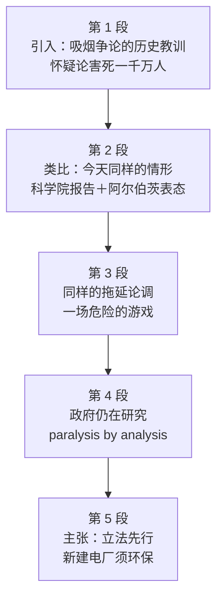

# Passage 19 · 全球变暖与研究瘫痪

## 答题记录

| 轮次  | 日期         | 题号  | 正确  | 错误  | 正确率 | 用时    | 错题归因 |
| --- | --- | --- | --- | --- | --- | --- | --- |
| 1 |  | 1-5 |  |  |  |  |  |
| 2 |  | 1-5 |  |  |  |  |  |
| 3 |  | 1-5 |  |  |  |  |  |

> [!tip] 填写口径
> - **用时**以分钟计，只计做题时间，不含精读复盘。
> - **错题归因**填「题型·错误类型」，如：细节题·定位错、推理判断·过度推断、主旨大意·以偏概全。
> - 纵向看趋势：正确率升而用时过长 → 熟练度不足；用时降而正确率波动 → 定位不稳。

> [!info] 文章档案
> - **来源**：考研英语（一）2005 年 Text 2
> - **题材**：社会生活——全球变暖与「分析瘫痪」
> - **结构**：5 段 / 21 句 ＋ 5 题
> - **难度**：★★★★☆
> - **一句话主旨**：以吸烟争论的历史教训作类比，作者批评美国政府在全球变暖问题上只研究不行动，呼吁立法先行、新建电厂必须环保无害。

## 一、篇章脉络

- **第 1 段**：以吸烟争论的历史引入——怀疑论者拖了三十年，代价是一千万人早逝。
- **第 2 段**：转入当下——全球变暖出现令人不安的相似情形，引用科学院报告与阿尔伯茨的「科学是最佳指引」。
- **第 3 段**：指出今天同样有一批声音以「证据不足」为由拖延，作者称之为危险的游戏。
- **第 4 段**：批评政府——白宫虽开始关注，但顾问们不认真，只要求更多研究而不拿行动计划。
- **第 5 段**：提出主张——研究之外必须立法，并让新建电厂做到环保无害。

> [!tip] 行文逻辑
> 历史教训（吸烟）→ 当下类比（全球变暖）→ 点破拖延（危险游戏）→ 批评政府（只研究）→ 提出主张（立法 + 环保）。「类比说理」是全文骨架，第 5 题直接考它的写作目的；第 1 段与第 3 段构成「过去—现在」的平行结构（parallels / Just as）。

## 二、逐段精读

### 第 1 段 · 引入：吸烟争论的历史教训

**原文**

① Do you remember all those years when scientists argued that smoking would kill us but the doubters insisted that we didn't know for sure?
② That the evidence was inconclusive, the science uncertain?
③ That the antismoking lobby was out to destroy our way of life and the government should stay out of the way?
④ Lots of Americans bought that nonsense, and over three decades, some 10 million smokers went to early graves.

**译文**

① 你还记得那些年吗——科学家说吸烟会要人命，而怀疑者们却坚持说我们还不能确定？
② （坚持说）证据不足、科学尚不确定？
③ （坚持说）反对吸烟的游说团体是要毁掉我们的生活方式，政府应当置身事外？
④ 许多美国人相信了这套胡话，于是三十多年间，约一千万吸烟者早早地进了坟墓。

> [!note] 段落要点
> - 功能：用一个共同的历史记忆作类比铺垫——怀疑论如何把吸烟问题拖了三十年，代价惨重。
> - ②③句是省略疑问句（承①句省略 Do you remember），记录的是怀疑者的原话，是第 1 题的定位区。

#### 长难句 · 本段

> [!abstract] 本段第 ① 句 · Do you remember all those years when scientists argued that smoking would kill us but the doubters insisted that we didn't know for sure?

**结构拆解**

- **主干**：Do you remember all those years（remember + 名词短语）
- **定语从句**：when scientists argued that... but the doubters insisted that...（修饰 years）
- **并列宾语从句**：argued that smoking would kill us；insisted that we didn't know for sure
- **对比连词**：but 连接科学家与怀疑者两种立场

**参考译文**

你还记得那些年吗——科学家说吸烟会要人命，而怀疑者们却坚持说我们还不能确定？

> [!tip] 拆解要点
> `Do you remember ... ?` 后面挂 when 从句，是「用共同记忆开篇」的固定写法；抓 argued 与 insisted 两个谓语动词，就能把正反两方立场一次拆清。

#### 本段重点词汇

| 单词 / 短语 | 词性 | 文中意 | 常用考义与拓展 | 英文示例搭配（中译） |
| --- | --- | --- | --- | --- |
| **doubter** | n. | 怀疑者 | 派生 doubt n./v. 怀疑；doubtful adj. 怀疑的 | the doubters insisted that...（怀疑者们坚持说……） |
| **inconclusive** | adj. | 不确定的，无定论的 | 反义 conclusive（结论性的）；conclusion n. 结论 | the evidence was inconclusive（证据不足） |
| **antismoking** | adj. | 反对吸烟的 | 前缀 anti- 表「反对」：antiwar 反战的 | the antismoking lobby（反对吸烟的游说团体） |
| **lobby** | n. | 游说团体，利益集团 | 熟词僻义：大厅 → 游说集团；lobbyist n. 说客 | the antismoking lobby（反吸烟游说团体） |
| **be out to do** | （短语） | 企图做，一心要做 | be out for sth 追求某物；非 be out（外出） | was out to destroy our way of life（企图毁掉我们的生活方式） |
| **stay out of the way** | （短语） | 置身事外，不干预 | 同义 keep out of / stay away from | the government should stay out of the way（政府应当置身事外） |
| **nonsense** | n. | 胡说，谬论 | talk nonsense 胡说八道；nonsensical adj. 荒唐的 | bought that nonsense（相信了那套胡话） |
| **go to early graves** | （短语） | 早逝，过早死亡 | grave n. 坟墓；dig one's own grave 自掘坟墓 | some 10 million smokers went to early graves（约一千万人早逝） |

### 第 2 段 · 类比：今天的全球变暖与科学院报告

**原文**

① There are upsetting parallels today, as scientists in one wave after another try to awaken us to the growing threat of global warming.
② The latest was a panel from the National Academy of Sciences, enlisted by the White House, to tell us that the Earth's atmosphere is definitely warming and that the problem is largely man-made.
③ The clear message is that we should get moving to protect ourselves.
④ The president of the National Academy, Bruce Alberts, added this key point in the preface to the panel's report: "Science never has all the answers.
⑤ But science does provide us with the best available guide to the future, and it is critical that our nation and the world base important policies on the best judgments that science can provide concerning the future consequences of present actions."

**译文**

① 今天出现了令人不安的相似情形：科学家们一波又一波地试图唤醒我们，正视日益严重的全球变暖威胁。
② 最近的一次，是受白宫委托的美国国家科学院专家小组告诉我们：地球大气确实在变暖，而这一问题在很大程度上是人为造成的。
③ 它传达的明确信息是：我们应当赶紧行动起来保护自己。
④ 美国国家科学院院长布鲁斯·阿尔伯茨在该小组报告的前言中补充了关键的一点：「科学永远不会给出全部的答案。
⑤ 但科学确实为我们提供了关于未来的最佳指引；至关重要的是，我们国家乃至全世界都要把重大政策，建立在科学就「当前行为的未来后果」所能提供的最佳判断之上。」

> [!note] 段落要点
> - 功能：由历史转入当下——parallel（相似情形）一词点明类比关系，②句给权威报告，④⑤句引阿尔伯茨为「科学」定性。
> - ⑤句 best available guide to the future 是第 2 题答案 guide 的出处。

#### 长难句 · 本段

> [!abstract] 本段第 ② 句 · The latest was a panel from the National Academy of Sciences, enlisted by the White House, to tell us that the Earth's atmosphere is definitely warming and that the problem is largely man-made.

**结构拆解**

- **主干**：The latest was a panel（主系表）
- **后置定语**：from the National Academy of Sciences
- **插入定语**：enlisted by the White House（过去分词短语，修饰 panel）
- **目的状语**：to tell us that... and that...（两个并列宾语从句）

**参考译文**

最近的一次，是受白宫委托的美国国家科学院专家小组告诉我们：地球大气确实在变暖，而这一问题在很大程度上是人为造成的。

> [!tip] 拆解要点
> 两个逗号之间的 enlisted by... 是插入的过去分词定语，先跳过；不定式 to tell us 后并列 that A and that B，是「机构 + 结论」报道句型的高频写法。

> [!abstract] 本段第 ⑤ 句 · But science does provide us with the best available guide to the future, and it is critical that our nation and the world base important policies on the best judgments that science can provide concerning the future consequences of present actions.

**结构拆解**

- **并列句 1**：science does provide us with the best available guide to the future（does 强调谓语）
- **并列句 2**：it is critical that...（it 形式主语，that 从句为真正主语）
- **主语从句内部**：our nation and the world base important policies on the best judgments（base A on B）
- **定语从句**：that science can provide（修饰 judgments）
- **后置定语**：concerning the future consequences of present actions（修饰 judgments）

**参考译文**

但科学确实为我们提供了关于未来的最佳指引；至关重要的是，我们国家乃至全世界都要把重大政策，建立在科学就「当前行为的未来后果」所能提供的最佳判断之上。

> [!tip] 拆解要点
> `it is critical that ...` 后的从句用虚拟语气（base 前省略 should）；拆长句按「provide sb with A → base A on B → that 从句修饰 B」三级推进，一层层往里挂。

#### 本段重点词汇

| 单词 / 短语 | 词性 | 文中意 | 常用考义与拓展 | 英文示例搭配（中译） |
| --- | --- | --- | --- | --- |
| **upsetting** | adj. | 令人不安的 | 派生 upset v. 使心烦 / adj. 心烦的 | There are upsetting parallels（出现了令人不安的相似情形） |
| **parallel** | n. | 相似之处，可比拟的事 | draw a parallel between A and B 把 A 与 B 类比 | There are upsetting parallels today（今天有令人不安的相似情形） |
| **in one wave after another** | （短语） | 一波又一波地 | wave n. 波、浪潮；a wave of... 一波…… | scientists in one wave after another（科学家们一波又一波） |
| **awaken sb to** | （短语） | 使某人意识到 | awaken to the threat 意识到威胁；awake adj. 醒着的 | awaken us to the growing threat（唤醒我们去正视威胁） |
| **panel** | n. | 专家小组，专门委员会 | 熟词僻义：面板 → 专家小组；a panel of experts 专家组 | a panel from the National Academy of Sciences（科学院专家小组） |
| **enlist** | v. | 委托，请来协助 | 熟词僻义：入伍 → 争取/请来；enlist sb's help 请某人帮忙 | enlisted by the White House（受白宫委托） |
| **man-made** | adj. | 人为的，人造的 | 同义 artificial；natural-born 天生的（反义色彩） | the problem is largely man-made（问题主要是人为的） |
| **get moving** | （短语） | 赶紧行动起来 | get going 开始行动；move on 继续前进 | we should get moving to protect ourselves（我们该赶紧行动自保） |
| **preface** | n. | 前言，序言 | preface to sth ……的序言；preface v. 以……开篇 | in the preface to the panel's report（在小组报告的前言中） |
| **critical** | adj. | 至关重要的 | 熟词僻义：批评的 → 关键的；it is critical that...（虚拟） | it is critical that our nation...（至关重要的是……） |
| **base...on** | （短语） | 把……建立在……基础上 | be based on 以……为基础；basis n. 基础 | base important policies on the best judgments（把政策建立在最佳判断上） |
| **consequence** | n. | 后果，结果 | consequent adj. 随之发生的；as a consequence 因此 | the future consequences of present actions（当前行为的未来后果） |

### 第 3 段 · 同样的拖延：一场危险的游戏

**原文**

① Just as on smoking, voices now come from many quarters insisting that the science about global warming is incomplete, that it's OK to keep pouring fumes into the air until we know for sure.
② This is a dangerous game: by the time 100 percent of the evidence is in, it may be too late.
③ With the risks obvious and growing, a prudent people would take out an insurance policy now.

**译文**

① 正如在吸烟问题上一样，如今来自方方面面的声音都在坚称：关于全球变暖的科学依据尚不完整，在我们弄清楚之前，继续向大气排放废气也无妨。
② 这是一场危险的游戏：等到百分之百的证据都齐备时，恐怕为时已晚。
③ 在风险显而易见且不断加大的情况下，一个审慎的民族现在就该先买好保险。

> [!note] 段落要点
> - 功能：点破当下的拖延论调与吸烟当年如出一辙（Just as on smoking），并用「危险的游戏」「买保险」两个比喻表明作者立场。
> - ①句是全文类比结构的第二处标记（第一处是第 2 段①句的 parallels），第 5 题由此入手。

#### 长难句 · 本段

> [!abstract] 本段第 ① 句 · Just as on smoking, voices now come from many quarters insisting that the science about global warming is incomplete, that it's OK to keep pouring fumes into the air until we know for sure.

**结构拆解**

- **主干**：voices now come from many quarters（主语 + 谓语 + 状语）
- **比较状语**：Just as on smoking（正如在吸烟问题上，承前省略）
- **后置定语**：insisting that...（现在分词短语修饰 voices）
- **并列宾语从句**：that the science ... is incomplete；that it's OK to keep pouring...（it 形式主语，真正主语是不定式）

**参考译文**

正如在吸烟问题上一样，如今来自方方面面的声音都在坚称：关于全球变暖的科学依据尚不完整，在我们弄清楚之前，继续向大气排放废气也无妨。

> [!tip] 拆解要点
> `Just as on smoking` 是省略式比较状语，补全是 Just as (voices came) on smoking；insisting 后两个 that 从句并列，都是「拖延派」的具体说法。

#### 本段重点词汇

| 单词 / 短语 | 词性 | 文中意 | 常用考义与拓展 | 英文示例搭配（中译） |
| --- | --- | --- | --- | --- |
| **just as** | （短语） | 正如，正像 | just as...so... 正如……也…… | Just as on smoking（正如在吸烟问题上） |
| **quarters** | n. | 方面，各界（人士） | 熟词僻义：季度 / 住处 → 各界；from all quarters 来自四面八方 | voices come from many quarters（来自各方面的声音） |
| **insist** | v. | 坚持说，坚称 | insist on doing 坚持做；insistence n. 坚持 | insisting that the science is incomplete（坚称科学依据不完整） |
| **incomplete** | adj. | 不完整的 | 反义 complete；incompletely adv. 不完全地 | the science is incomplete（科学依据不完整） |
| **pour fumes into** | （短语） | 向……排放废气 | fume n. 烟气；pour v. 倾倒、排放 | keep pouring fumes into the air（继续向大气排放废气） |
| **dangerous game** | （短语） | 危险的游戏，冒险做法 | play a dangerous game 玩火 | This is a dangerous game（这是一场危险的游戏） |
| **prudent** | adj. | 审慎的，谨慎的 | prudence n. 审慎；反义 imprudent | a prudent people would...（一个审慎的民族会……） |
| **take out an insurance policy** | （短语） | 投保，买保险 | insurance n. 保险；policy n. 保险单；take out 办理（取得） | take out an insurance policy now（现在就买好保险） |

### 第 4 段 · 政府的暧昧态度与研究瘫痪

**原文**

① Fortunately, the White House is starting to pay attention.
② But it's obvious that a majority of the president's advisers still don't take global warming seriously.
③ Instead of a plan of action, they continue to press for more research — a classic case of "paralysis by analysis".

**译文**

① 所幸的是，白宫开始关注这一问题了。
② 但显而易见，总统的多数顾问仍未认真对待全球变暖。
③ 他们没有拿出行动计划，反而继续要求做更多的研究——这是「分析瘫痪」的典型案例。

> [!note] 段落要点
> - 功能：批评政府——态度有松动（①句）但实质不作为（②③句）；③句末的 paralysis by analysis 是第 3 题考点。
> - 破折号后的短语是对前半句的解释，做猜词题时往前读一句即可。

#### 长难句 · 本段

> [!abstract] 本段第 ③ 句 · Instead of a plan of action, they continue to press for more research — a classic case of "paralysis by analysis".

**结构拆解**

- **主干**：they continue to press for more research
- **介词短语作对照**：Instead of a plan of action（不是……而是……）
- **破折号同位语**：a classic case of "paralysis by analysis"（对前半句作总结性解释）

**参考译文**

他们没有拿出行动计划，反而继续要求做更多的研究——这是「分析瘫痪」的典型案例。

> [!tip] 拆解要点
> 破折号后的名词短语常是对前文的概括：这里用 paralysis（瘫痪）对应「没有行动」，用 analysis 对应 press for more research，词义由此推出。

#### 本段重点词汇

| 单词 / 短语 | 词性 | 文中意 | 常用考义与拓展 | 英文示例搭配（中译） |
| --- | --- | --- | --- | --- |
| **pay attention** | （短语） | 关注，重视 | pay attention to sth 关注某事；attentive adj. 留心的 | the White House is starting to pay attention（白宫开始关注） |
| **a majority of** | （短语） | 大多数 | majority n. 多数；反义 a minority of 少数 | a majority of the president's advisers（总统的多数顾问） |
| **adviser** | n. | 顾问 | 同拼 advisor；advise v. 建议；advisory adj. 咨询的 | the president's advisers（总统的顾问们） |
| **take...seriously** | （短语） | 认真对待 | take sth lightly 不当回事；serious adj. 严肃的 | don't take global warming seriously（不认真对待全球变暖） |
| **instead of** | （短语） | 而不是，取代 | 介词短语，后接名词/动名词 | Instead of a plan of action（不是拿出行动计划） |
| **press for** | （短语） | 一再要求，敦促 | press v. 催促、施压；press on 继续推进 | press for more research（一再要求做更多研究） |
| **paralysis by analysis** | （短语） | 分析瘫痪（研究不止、行动停滞） | paralysis n. 瘫痪；paralyze v. 使瘫痪 | a classic case of "paralysis by analysis"（典型的分析瘫痪） |

### 第 5 段 · 主张：立法先行，新建电厂须环保

**原文**

① To serve as responsible stewards of the planet, we must press forward on deeper atmospheric and oceanic research.
② But research alone is inadequate.
③ If the Administration won't take the legislative initiative, Congress should help to begin fashioning conservation measures.
④ A bill by Democratic Senator Robert Byrd of West Virginia, which would offer financial incentives for private industry, is a promising start.
⑤ Many see that the country is getting ready to build lots of new power plants to meet our energy needs.
⑥ If we are ever going to protect the atmosphere, it is crucial that those new plants be environmentally sound.

**译文**

① 要成为地球负责任的管理者，我们必须推进更深入的大气和海洋研究。
② 但仅靠研究是不够的。
③ 如果政府不采取立法上的主动行动，国会就应当协助着手制定（资源）保护措施。
④ 西弗吉尼亚州民主党参议员罗伯特·伯德提出的一项法案——它将为私营企业提供经济激励——是一个有希望的开端。
⑤ 许多人注意到，这个国家正准备修建大批新电厂以满足能源需求。
⑥ 如果我们真的要保护大气，那么这些新电厂必须是环保无害的，这一点至关重要。

> [!note] 段落要点
> - 功能：给出作者主张——研究要推进但不够（①②句），关键是立法（③句），并以伯德法案与新建电厂为例（④⑤⑥句）。
> - ③句是第 4 题定位句：take the legislative initiative = take some legislative measures。

#### 长难句 · 本段

> [!abstract] 本段第 ③ 句 · If the Administration won't take the legislative initiative, Congress should help to begin fashioning conservation measures.

**结构拆解**

- **条件状语从句**：If the Administration won't take the legislative initiative（won't 此处表「不肯、不愿」，非单纯将来）
- **主句**：Congress should help to begin fashioning conservation measures
- **宾语结构**：help (to) begin doing；fashion 作动词「制定、形成」

**参考译文**

如果政府不采取立法上的主动行动，国会就应当协助着手制定（资源）保护措施。

> [!tip] 拆解要点
> won't 在条件句里常表「拒绝、不肯」，带批评色彩；`help (to) begin doing` 三层动词连用，抓最外层 help 即可。

> [!abstract] 本段第 ④ 句 · A bill by Democratic Senator Robert Byrd of West Virginia, which would offer financial incentives for private industry, is a promising start.

**结构拆解**

- **主干**：A bill ... is a promising start
- **后置定语**：by Democratic Senator Robert Byrd of West Virginia（修饰 bill）
- **非限定定语从句**：which would offer financial incentives for private industry（修饰 bill，与谓语 is 分隔）

**参考译文**

西弗吉尼亚州民主党参议员罗伯特·伯德提出的一项法案——它将为私营企业提供经济激励——是一个有希望的开端。

> [!tip] 拆解要点
> 主语 bill 后拖了人名定语 + which 从句，谓语 is 一直到句中才出现：读长主语时先找后面的 be 动词，再回填修饰语。

> [!abstract] 本段第 ⑥ 句 · If we are ever going to protect the atmosphere, it is crucial that those new plants be environmentally sound.

**结构拆解**

- **条件状语从句**：If we are ever going to protect the atmosphere（be going to 表打算；ever 加强语气）
- **主句**：it is crucial that...（it 形式主语）
- **主语从句（虚拟语气）**：those new plants be environmentally sound（省略 should）

**参考译文**

如果我们真的要保护大气，那么这些新电厂必须是环保无害的，这一点至关重要。

> [!tip] 拆解要点
> `it is crucial / critical / essential that ...` 后一律接虚拟语气（动词原形或 should do），写作中可直接使用这一句型强调必要性。

#### 本段重点词汇

| 单词 / 短语 | 词性 | 文中意 | 常用考义与拓展 | 英文示例搭配（中译） |
| --- | --- | --- | --- | --- |
| **steward** | n. | 管理者，看护人 | 熟词僻义：乘务员 → 管家、管理者；stewardship n. 管理责任 | responsible stewards of the planet（地球负责任的管理者） |
| **press forward** | （短语） | 推进，继续推进 | press forward with 加紧推进；press ahead 勇往直前 | press forward on deeper research（推进更深入的研究） |
| **atmospheric** | adj. | 大气的 | atmosphere n. 大气、氛围 | atmospheric and oceanic research（大气与海洋研究） |
| **oceanic** | adj. | 海洋的 | ocean n. 海洋；oceanography n. 海洋学 | oceanic research（海洋研究） |
| **inadequate** | adj. | 不充分的，不够的 | 反义 adequate；inadequacy n. 不足 | research alone is inadequate（仅靠研究不够） |
| **legislative** | adj. | 立法的 | legislature n. 立法机关；legislation n. 法规 | take the legislative initiative（采取立法主动） |
| **initiative** | n. | 主动行动，倡议 | take the initiative 带头、主动；注意与 incentive 区分 | won't take the legislative initiative（不肯立法主动） |
| **fashion** | v. | 制定，形成 | 熟词僻义：时尚（n.）→ 制定（v.） | begin fashioning conservation measures（着手制定保护措施） |
| **conservation** | n. | （资源、环境）保护，节约 | conserve v. 保护、节约；conservationist n. 环保人士 | conservation measures（保护/节约措施） |
| **bill** | n. | 法案 | 熟词僻义：账单 → 法案；pass a bill 通过法案 | A bill by Democratic Senator Robert Byrd（伯德参议员提出的法案） |
| **incentive** | n. | 激励，奖励 | financial incentives 经济激励；incentive to do 做某事的动力 | offer financial incentives for private industry（为私企提供经济激励） |
| **promising** | adj. | 有希望的，有前途的 | promise n./v. 承诺、希望；promise well 前景看好 | a promising start（一个有希望的开端） |
| **power plant** | n. | 发电厂，电站 | 同义 power station；nuclear plant 核电站 | build lots of new power plants（修建大批新电厂） |
| **environmentally sound** | adj. | 对环境无害的，环保的 | sound adj. 熟词僻义：合理的、无损的（非「声音」） | those new plants be environmentally sound（新电厂须环保无害） |
| **crucial** | adj. | 至关重要的 | 同义 critical / vital；crucially adv. 关键地 | it is crucial that those new plants be...（……至关重要） |

## 三、全篇重点词汇汇总（自测用）

> [!info] 说明
> 本表只列「单词 / 词性 / 所在段」，不含释义与搭配，用于遮表自测：说出词义后再回该段核对。
> 收录**全篇所有段落词汇，共 50 条，不删减**，与各段「本段重点词汇」等长同源。

| 单词 / 短语 | 词性 | 所在段 |
| --- | --- | --- |
| **doubter** | n. | 第 1 段 |
| **inconclusive** | adj. | 第 1 段 |
| **antismoking** | adj. | 第 1 段 |
| **lobby** | n. | 第 1 段 |
| **be out to do** | （短语） | 第 1 段 |
| **stay out of the way** | （短语） | 第 1 段 |
| **nonsense** | n. | 第 1 段 |
| **go to early graves** | （短语） | 第 1 段 |
| **upsetting** | adj. | 第 2 段 |
| **parallel** | n. | 第 2 段 |
| **in one wave after another** | （短语） | 第 2 段 |
| **awaken sb to** | （短语） | 第 2 段 |
| **panel** | n. | 第 2 段 |
| **enlist** | v. | 第 2 段 |
| **man-made** | adj. | 第 2 段 |
| **get moving** | （短语） | 第 2 段 |
| **preface** | n. | 第 2 段 |
| **critical** | adj. | 第 2 段 |
| **base...on** | （短语） | 第 2 段 |
| **consequence** | n. | 第 2 段 |
| **just as** | （短语） | 第 3 段 |
| **quarters** | n. | 第 3 段 |
| **insist** | v. | 第 3 段 |
| **incomplete** | adj. | 第 3 段 |
| **pour fumes into** | （短语） | 第 3 段 |
| **dangerous game** | （短语） | 第 3 段 |
| **prudent** | adj. | 第 3 段 |
| **take out an insurance policy** | （短语） | 第 3 段 |
| **pay attention** | （短语） | 第 4 段 |
| **a majority of** | （短语） | 第 4 段 |
| **adviser** | n. | 第 4 段 |
| **take...seriously** | （短语） | 第 4 段 |
| **instead of** | （短语） | 第 4 段 |
| **press for** | （短语） | 第 4 段 |
| **paralysis by analysis** | （短语） | 第 4 段 |
| **steward** | n. | 第 5 段 |
| **press forward** | （短语） | 第 5 段 |
| **atmospheric** | adj. | 第 5 段 |
| **oceanic** | adj. | 第 5 段 |
| **inadequate** | adj. | 第 5 段 |
| **legislative** | adj. | 第 5 段 |
| **initiative** | n. | 第 5 段 |
| **fashion** | v. | 第 5 段 |
| **conservation** | n. | 第 5 段 |
| **bill** | n. | 第 5 段 |
| **incentive** | n. | 第 5 段 |
| **promising** | adj. | 第 5 段 |
| **power plant** | n. | 第 5 段 |
| **environmentally sound** | adj. | 第 5 段 |
| **crucial** | adj. | 第 5 段 |

> [!warning] 熟词僻义专列
> - **lobby** n. 游说团体、利益集团（非「大厅」）
> - **panel** n. 专家小组、专门委员会（非「面板」）
> - **enlist** v. 委托、请来协助（非「入伍」）
> - **fashion** v. 制定、形成（非「时尚」）
> - **bill** n. 法案（非「账单」）
> - **steward** n. 管理者、看护人（非「乘务员」）
> - **quarters** n. 各界、方面（from many quarters，非「季度」）
> - **sound** adj. 合理的、无害的（environmentally sound，非「声音」）
> - **game** n. 冒险做法（a dangerous game，非「游戏」）

> [!example] 同义替换链（阅读题高频）
> - stay out of the way = freedom to choose one's way of life（第 1 题考点）
> - provide the best available guide to the future = serve as a guide（第 2 题考点）
> - press for more research = paralysis by analysis = endless studies kill action（第 3 题考点）
> - take the legislative initiative = take some legislative measures（第 4 题考点）
> - parallels / Just as = a lesson from the latter is applicable to the former（第 5 题考点）

## 四、知识点补充

> [!question] 背景知识
> - **美国国家科学院（National Academy of Sciences）**：1863 年设立的民间科学机构，常受政府委托出具权威评估报告；文中的 panel 即受白宫委托评估全球变暖的专家小组。
> - **Bruce Alberts（布鲁斯·阿尔伯茨）**：美国国家科学院时任院长、曾任《科学》杂志主编，文中引语出自他为小组报告所写的前言。
> - **Robert Byrd（罗伯特·伯德）**：西弗吉尼亚州民主党参议员，提出过对私营企业提供经济激励的环保法案。
> - **paralysis by analysis**：英语习语，指因过度分析、反复研究而迟迟不采取行动。

> [!warning] 语法点
> - **省略疑问句**：That the evidence was inconclusive...?（承前省略 Do you remember，记录对方原话）
> - **it 作形式主语 + 虚拟语气**：it is critical / crucial that ... (should) do。
> - **破折号的解释用法**：more research — a classic case of "paralysis by analysis"（后项概括前项）。
> - **非限定定语从句分隔主谓**：A bill by ..., which would offer ..., is a promising start.
> - **won't 表「拒绝」**：If the Administration won't take...（条件句中表不肯，带批评色彩）。

> [!success] 写作可迁移句型
> - `Do you remember all those years when ... ?` → 用共同记忆开篇，迅速拉近距离（议论/演讲开头）。
> - `There are upsetting parallels today, as ...` → 由历史案例过渡到当下问题，建立类比。
> - `Instead of a plan of action, they continue to press for more research.` → 批评「只研究不行动」。
> - `If we are ever going to ..., it is crucial that ...` → 强调必要条件（后接虚拟语气）。

> [!danger] 易混辨析
> - **initiative vs incentive**：initiative 主动行动、倡议（take the legislative initiative）；incentive 激励、奖励（financial incentives）——本文两词都出现。
> - **conservation vs preservation**：conservation 指资源/环境的保护与节约（conservation measures）；preservation 指维持原状、保存（preservation of historic buildings）。
> - **inconclusive vs incomplete**：inconclusive 证据不足以得出结论；incomplete 内容不完整——第 1 段与第 3 段各用其一，都服务于「证据不足」这一拖延借口。

## 五、题目分析

> [!info] 题目总览
> | 题号 | 题型 | 定位 | 答案 |
> | --- | --- | --- | --- |
> | 1 | 细节题 | 第 1 段③句 | C |
> | 2 | 观点细节题 | 第 2 段④⑤句 | D |
> | 3 | 词义句意题 | 第 4 段③句 | A |
> | 4 | 观点细节题 | 第 5 段③句 | D |
> | 5 | 推理判断题 | 第 2 段①句 / 第 3 段①句 | B |

### 第 1 题 · 细节题

> [!question] 原题
> An argument made by supporters of smoking was that
> - A. there was no scientific evidence of the correlation between smoking and death.
> - B. the number of early deaths of smokers in the past decades was insignificant.
> - C. people had the freedom to choose their own way of life.
> - D. antismoking people were usually talking nonsense.

**正确答案**：**C. people had the freedom to choose their own way of life.（人们有选择自己生活方式的自由）**

**定位与依据**
- 定位到第 1 段③句：That the antismoking lobby was out to destroy our way of life and the government should stay out of the way?
- 同义替换：destroy our way of life + government should stay out of the way = 支持吸烟者主张「生活方式自由、政府不该干预」。

**干扰项分析**

| 选项 | 选项内容 | 判断 | 排除理由 |
| --- | --- | --- | --- |
| A | there was no scientific evidence of the correlation between smoking and death. | ✗ | 过于绝对：怀疑者只说 the evidence was inconclusive（证据不足），并未全盘否定相关性。 |
| B | the number of early deaths of smokers in the past decades was insignificant. | ✗ | 无中生有：④句的「一千万人早逝」是作者给出的后果，不是支持者的论点。 |
| D | antismoking people were usually talking nonsense. | ✗ | 张冠李戴：nonsense 是作者对怀疑者言论的评价（④句），不是支持者自己的论点。 |

> [!tip] 解题思路
> 题干问「某方论点」时，先锁定记录该方原话的句子（本段那组省略疑问句 That...? That...?），再逐项比对。「过于绝对」与「张冠李戴」是这类题的最常见陷阱。

### 第 2 题 · 观点细节题

> [!question] 原题
> According to Bruce Alberts, science can serve as
> - A. a protector.
> - B. a judge.
> - C. a critic.
> - D. a guide.

**正确答案**：**D. a guide.（指引者）**

**定位与依据**
- 定位到第 2 段④⑤句：Bruce Alberts ... added this key point ... "Science never has all the answers. But science does provide us with the best available guide to the future..."
- 同义替换：provide the best available guide to the future = serve as a guide（guide 原词复现）。

**干扰项分析**

| 选项 | 选项内容 | 判断 | 排除理由 |
| --- | --- | --- | --- |
| A | a protector. | ✗ | 无中生有：文中未说科学能保护人类。 |
| B | a judge. | ✗ | 偷换概念：原文说科学提供 best judgments（最佳判断依据），不等于科学本身充当「裁判」。 |
| C | a critic. | ✗ | 无中生有：「批评者」在文中无对应。 |

> [!tip] 解题思路
> 人名定位题先找人名所在句，再读其后的直接引语；选项若为名词喻体（protector / judge / guide），要到原文找对应的比喻词——best available guide to the future 直接给出答案。

### 第 3 题 · 词义句意题

> [!question] 原题
> What does the author mean by "paralysis by analysis" (Last line, Paragraph 4)?
> - A. Endless studies kill action.
> - B. Careful investigation reveals truth.
> - C. Prudent planning hinders progress.
> - D. Extensive research helps decision-making.

**正确答案**：**A. Endless studies kill action.（无休止的研究扼杀了行动）**

**定位与依据**
- 定位到第 4 段③句：Instead of a plan of action, they continue to press for more research — a classic case of "paralysis by analysis".
- 破折号提示：该短语是对前半句的解释——不做行动计划（plan of action），只一味要求更多研究（more research）。

**干扰项分析**

| 选项 | 选项内容 | 判断 | 排除理由 |
| --- | --- | --- | --- |
| B | Careful investigation reveals truth. | ✗ | 望文生义：把 analysis 当成正面的「调查」，与作者的批评语气相反。 |
| C | Prudent planning hinders progress. | ✗ | 偷换概念：原文缺的是 plan of action，被「瘫痪」的是行动，而不是计划本身。 |
| D | Extensive research helps decision-making. | ✗ | 与原文相反：作者认为只研究不行动有害无益。 |

> [!tip] 解题思路
> 破折号后的短语多为对前文的概括，往前读一句即可解词；同时注意作者的评价词（a classic case of... 带贬义），可一次排除所有正面表述的选项。

### 第 4 题 · 观点细节题

> [!question] 原题
> According to the author, what should the Administration do about global warming?
> - A. Offer aid to build cleaner power plants.
> - B. Raise public awareness of conservation.
> - C. Press for further scientific research.
> - D. Take some legislative measures.

**正确答案**：**D. Take some legislative measures.（采取立法措施）**

**定位与依据**
- 定位到第 5 段③句：If the Administration won't take the legislative initiative, Congress should help to begin fashioning conservation measures.
- 同义替换：take the legislative initiative = take some legislative measures。

**干扰项分析**

| 选项 | 选项内容 | 判断 | 排除理由 |
| --- | --- | --- | --- |
| A | Offer aid to build cleaner power plants. | ✗ | 断章取义：⑥句只说新建电厂必须环保，未说政府出资援建。 |
| B | Raise public awareness of conservation. | ✗ | 断章取义：conservation measures 是「保护/节约措施」，不是「提高公众意识」。 |
| C | Press for further scientific research. | ✗ | 与作者观点相反：press for more research 正是作者在第 4 段批评的做法。 |

> [!tip] 解题思路
> 建议类题抓情态与虚拟线索：`If the Administration won't..., Congress should...` 表明作者希望政府先立法。凡选项出现作者批评过的做法（继续研究），一律排除。

### 第 5 题 · 推理判断题

> [!question] 原题
> The author associates the issue of global warming with that of smoking because
> - A. they both suffered from the government's negligence.
> - B. a lesson from the latter is applicable to the former.
> - C. the outcome of the latter aggravates the former.
> - D. both of them have turned from bad to worse.

**正确答案**：**B. a lesson from the latter is applicable to the former.（后者的教训适用于前者）**

**定位与依据**
- 定位到第 2 段①句 There are upsetting parallels today... 与第 3 段①句 Just as on smoking, voices now come from many quarters...
- 全文结构：第 1 段先用吸烟的历史教训（怀疑者拖了三十年、一千万人早逝）作类比，说明今天对全球变暖的同样怀疑会造成同样的灾难——即「吸烟的教训适用于全球变暖」。

**干扰项分析**

| 选项 | 选项内容 | 判断 | 排除理由 |
| --- | --- | --- | --- |
| A | they both suffered from the government's negligence. | ✗ | 与原文不符：文中只说吸烟问题上政府被要求置身事外（第 1 段③句），全球变暖并非「都被政府忽视」。 |
| C | the outcome of the latter aggravates the former. | ✗ | 无中生有：吸烟的后果不会加剧全球变暖，两者之间没有因果链。 |
| D | both of them have turned from bad to worse. | ✗ | 无中生有：这只是现象描述，不是作者把两者联系起来的原因。 |

> [!tip] 解题思路
> 问「作者为什么把 A 与 B 相提并论」时，找 parallel / Just as / similarly 这类类比标志词，答案通常是「A 的教训适用于 B」。凡是把两件事说成因果（C）或只作共性描述（D）的选项都要排除。

## 六、复盘清单

- [ ] 过汇总表 50 词，遮住「所在段」列自测，重点过 9 个熟词僻义
- [ ] 重做 8 个长难句的口头翻译，特别是 it is critical that 虚拟语气（第 2 段⑤、第 5 段⑥）与破折号解释（第 4 段③）
- [ ] 画出类比说理结构：历史教训（第 1 段）→ 当下相似（第 2 段）→ 拖延（第 3 段）→ 批评（第 4 段）→ 主张（第 5 段）
- [ ] 整理本文干扰项类型：无中生有 ×4、断章取义 ×3、偷换概念 ×3、与原文相反 ×2、张冠李戴 ×1、望文生义 ×1、过于绝对 ×1
- [ ] 把答题记录填进顶部表格，对照正确率决定是否二刷

## 七、关联笔记

- [[Passage18-猴子的公平意识]]
- [[考研英语 · 阅读六大题型方法论]]
- [[考研英语 · 熟词僻义汇总]]
