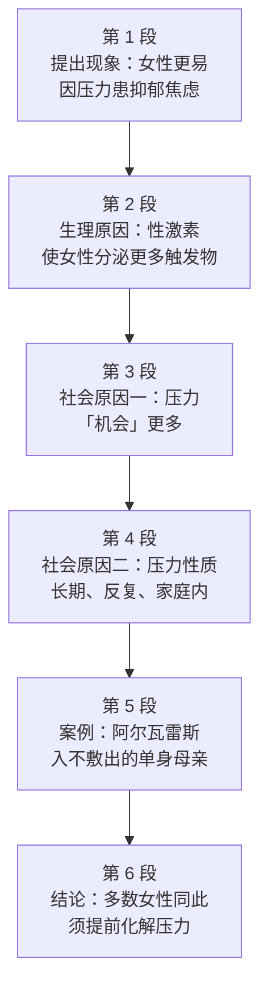

# Passage 20 · 女性承压更甚的根源

## 答题记录

| 轮次  | 日期         | 题号  | 正确  | 错误  | 正确率 | 用时    | 错题归因 |
| --- | --- | --- | --- | --- | --- | --- | --- |
| 1 |  | 1-5 |  |  |  |  |  |
| 2 |  | 1-5 |  |  |  |  |  |
| 3 |  | 1-5 |  |  |  |  |  |

> [!tip] 填写口径
> - **用时**以分钟计，只计做题时间，不含精读复盘。
> - **错题归因**填「题型·错误类型」，如：细节题·定位错、推理判断·过度推断、主旨大意·以偏概全。
> - 纵向看趋势：正确率升而用时过长 → 熟练度不足；用时降而正确率波动 → 定位不稳。

> [!info] 文章档案
> - **来源**：考研英语（一）2008 年 Text 1
> - **题材**：社会生活——性别与压力（女性为何更易被压力击垮）
> - **结构**：6 段 / 23 句 ＋ 5 题
> - **难度**：★★★☆☆
> - **一句话主旨**：女性在现代生活中某一方面「遥遥领先」——面对压力时更易患抑郁与焦虑，根源既有性激素造成的生理易感，也有社会赋予她们更多、更长期反复的压力源。

## 一、篇章脉络

- **第 1 段**：用让步对比开篇——女性在现代生活的若干领域仍在追赶男性，却在「不良类别」上遥遥领先，引出 Yehuda 的研究结论。
- **第 2 段**：给出生理层面的解释——性激素影响压力反应，雌性在同等压力下分泌更多触发化学物质，并以切除卵巢的雌鼠实验佐证。
- **第 3 段**：转到社会层面——除化学剂量更高外，女性还有更多压力「机会」，先澄清误解（不是应对能力差），再点明是事情太多。
- **第 4 段**：指出女性压力的第二个特点——并非一次性事件，而是长期、反复、发生在家庭内部的人际暴力。
- **第 5 段**：落到具体人物 Adeline Alvarez——求学、育儿、养家三头受压，靠工资勉强维生。
- **第 6 段**：收束全文——并非人人如此，但多数女性都承担着多重义务，应在压力损害健康之前设法化解。

> [!tip] 行文逻辑
> 提出现象（第 1 段）→ 生理原因（第 2 段）→ 社会原因递进（第 3、4 段：量更多 → 性更持久）→ 个案印证（第 5 段）→ 普遍化与建议（第 6 段）。全文是典型的「现象—原因—案例—建议」说明文骨架：第 1 题考前两段主旨，第 2、3 题分别对应第 3、4 段两个原因，第 4 题考案例细节，第 5 题考全篇标题。

## 二、逐段精读

### 第 1 段 · 提出现象：女性在「不良类别」上领先

**原文**

① While still catching up to men in some spheres of modern life, women appear to be way ahead in at least one undesirable category.
② "Women are particularly susceptible to developing depression and anxiety disorders in response to stress compared to men," according to Dr. Yehuda, chief psychiatrist at New York's Veteran's Administration Hospital.

**译文**

① 尽管在现代生活的某些领域仍在追赶男性，女性似乎至少在一个不受欢迎的类别上遥遥领先。
② 「与男性相比，女性在压力下特别容易患上抑郁和焦虑类疾病，」纽约退伍军人管理局医院的精神科主任 Yehuda 博士说。

> [!note] 段落要点
> - 功能：以让步对比句开篇，用一个反差（追赶 vs. 领先）抛出全文要解释的现象，并借专家引语给出权威依据。
> - ①句的 while 表让步，undesirable category 是反讽说法；②句是第 1 题的答案来源（biologically more vulnerable = susceptible to ... in response to stress）。

#### 长难句 · 本段

> [!abstract] 本段第 ① 句 · While still catching up to men in some spheres of modern life, women appear to be way ahead in at least one undesirable category.

**结构拆解**

- **主干**：women appear to be way ahead（主语 + 系动词 + 表语）
- **让步状语**：While still catching up to men in some spheres of modern life（while + 现在分词短语，省略 women are）
- **范围状语**：in at least one undesirable category
- **对比焦点**：catching up to（追赶）↔ way ahead（遥遥领先）

**参考译文**

尽管在现代生活的某些领域仍在追赶男性，女性似乎至少在一个不受欢迎的类别上遥遥领先。

> [!tip] 拆解要点
> `While + 分词` 是考研高频的让步省略结构（省去与主句相同的主语和 be 动词）；way 在此是副词「大大地、远远地」，way ahead = far ahead。抓 while 与 ahead 的反差，就抓住了全文的「反讽开局」。

#### 本段重点词汇

| 单词 / 短语 | 词性 | 文中意 | 常用考义与拓展 | 英文示例搭配（中译） |
| --- | --- | --- | --- | --- |
| **catch up to** | （短语） | 赶上，追上 | 同义 catch up with sb；catch up on sth 补做（工作等） | still catching up to men（仍在追赶男性） |
| **sphere** | n. | 领域，范围 | 熟词僻义：球体 → 领域、圈子；同义 field / domain | in some spheres of modern life（在现代生活的某些领域） |
| **way ahead** | （短语） | 遥遥领先 | way 作副词表「大大地、远远地」；ahead of 领先于 | appear to be way ahead（似乎遥遥领先） |
| **undesirable** | adj. | 不受欢迎的，不良的 | 反义 desirable（称心的）；desire n./v. 渴望 | one undesirable category（一个不良类别） |
| **category** | n. | 种类，类别 | categorize v. 分类；fall into the category of 属于……类 | in at least one category（至少在一个类别上） |
| **susceptible** | adj. | 易受影响的，易患病的 | be susceptible to sth 易受……影响；同义 vulnerable / prone | susceptible to developing depression（易患抑郁） |
| **depression** | n. | 抑郁（症） | 也指「经济萧条」；depress v. 使沮丧；depressed adj. 沮丧的 | developing depression and anxiety disorders（患上抑郁与焦虑症） |
| **anxiety** | n. | 焦虑 | anxious adj. 焦虑的、渴望的；anxiety disorder 焦虑症 | anxiety disorders（焦虑类疾病） |
| **disorder** | n. | 紊乱，疾病 | 前缀 dis- 表否定；order n. 秩序 → disorder 失调 | mental disorder（精神疾病） |
| **in response to** | （短语） | 作为对……的反应 | respond v. 反应；response n. 回应；in response to stress（在压力下） | in response to stress（面对压力时） |
| **psychiatrist** | n. | 精神科医生 | psychiatry n. 精神病学；psychologist n. 心理学家 | chief psychiatrist（精神科主任） |
| **Veteran's Administration** | （专有） | （美国）退伍军人管理局 | 缩写 VA，负责退伍军人医疗等事务的联邦机构 | New York's Veteran's Administration Hospital（纽约退伍军人管理局医院） |

### 第 2 段 · 生理原因：性激素与雌鼠实验

**原文**

① Studies of both animals and humans have shown that sex hormones somehow affect the stress response, causing females under stress to produce more of the trigger chemicals than do males under the same conditions.
② In several of the studies, when stressed-out female rats had their ovaries (the female reproductive organs) removed, their chemical responses became equal to those of the males.

**译文**

① 对动物和人类的研究都表明，性激素以某种方式影响着压力反应，使得处于压力下的雌性比处于同等条件下的雄性分泌更多能引发反应的化学物质。
② 在其中几项研究中，当压力过大的雌鼠被切除卵巢（雌性生殖器官）后，它们的化学反应变得与雄性相当。

> [!note] 段落要点
> - 功能：从生理机制上解释第 1 段的现象——性激素导致雌性在压力下分泌更多触发化学物质，并用切除卵巢的实验反向验证。
> - ①句是第 1 题的核心依据（biologically）；②句的对照实验是典型的「变量控制」论证法，考研常考其目的。

#### 长难句 · 本段

> [!abstract] 本段第 ① 句 · Studies of both animals and humans have shown that sex hormones somehow affect the stress response, causing females under stress to produce more of the trigger chemicals than do males under the same conditions.

**结构拆解**

- **主干**：Studies have shown that...（主谓宾从）
- **宾语从句**：that sex hormones somehow affect the stress response
- **结果状语**：causing females under stress to produce more of the trigger chemicals（现在分词短语表结果）
- **比较结构**：more ... than do males under the same conditions（than 后助动词 do 提前，代指 produce，构成倒装）
- **后置定语**：under stress / under the same conditions（介词短语分别修饰 females 与 males）

**参考译文**

对动物和人类的研究都表明，性激素以某种方式影响着压力反应，使得处于压力下的雌性比处于同等条件下的雄性分泌更多能引发反应的化学物质。

> [!tip] 拆解要点
> `more ... than do males` 是比较状语从句中的倒装：than 之后主语 males 为名词、谓语又需省略，故把助动词 do 提到主语前（do 代 produce）。同理还有 than do males / as do women 一类写法；识别标志是 than + 助动词 + 名词。

#### 本段重点词汇

| 单词 / 短语 | 词性 | 文中意 | 常用考义与拓展 | 英文示例搭配（中译） |
| --- | --- | --- | --- | --- |
| **hormone** | n. | 荷尔蒙，激素 | hormonal adj. 激素的；sex hormone 性激素 | sex hormones affect the stress response（性激素影响压力反应） |
| **somehow** | adv. | 以某种方式，不知怎地 | 同义 in some way；somewhat adv. 有点儿（易混） | somehow affect the stress response（以某种方式影响压力反应） |
| **stress response** | n. | 压力反应 | respond v. 作出反应；response n. 反应 | affect the stress response（影响压力反应） |
| **trigger** | n. / v. | 引发物；引发，触发 | 熟词僻义：扳机 → 诱因、触发因素；trigger a war 引发战争 | the trigger chemicals（引发反应的化学物质） |
| **stressed-out** | adj. | 压力过大的，心力交瘁的 | 口语化合成词；stress sb out 使某人压力很大 | stressed-out female rats（压力过大的雌鼠） |
| **ovaries** | n. | 卵巢 | 单 ovary；ovum n. 卵子 | had their ovaries removed（被切除卵巢） |
| **reproductive** | adj. | 生殖的，繁殖的 | reproduce v. 繁殖；reproduction n. 生殖 | the female reproductive organs（雌性生殖器官） |
| **remove** | v. | 切除，移除；免去 | removal n. 移除、免职；remove sb from office 免职 | had their ovaries removed（切除卵巢） |
| **be equal to** | （短语） | 与……相等，相当于 | equal adj. 相等的、胜任的（be equal to the task）；equality n. 平等 | became equal to those of the males（变得与雄性的相当） |

### 第 3 段 · 社会原因一：压力的「机会」更多

**原文**

① Adding to a woman's increased dose of stress chemicals, are her increased "opportunities" for stress.
② "It's not necessarily that women don't cope as well.
③ It's just that they have so much more to cope with," says Dr. Yehuda.
④ "Their capacity for tolerating stress may even be greater than men's," she observes, "it's just that they're dealing with so many more things that they become worn out from it more visibly and sooner."

**译文**

① 在女性本已增加的压力化学物质剂量之上，雪上加霜的是她们增多了的压力「机会」。
② 「这未必是因为女性应对得不好。
③ 只不过是她们要应对的事情多得多，」Yehuda 博士说。
④ 「她们承受压力的能力甚至可能比男性更强，」她评论道，「只不过她们要处理的事情多得多，因此会更快、也更明显地为此筋疲力尽。」

> [!note] 段落要点
> - 功能：从「量」的维度补上第二个原因——女性面对的压力源更多；同时先堵住一种误读（不是能力差，是事情多）。
> - ①句是全部倒装句，opportunities 加引号是反讽用法；③④句是第 2 题的定位区（are exposed to more stress），也是第 2 题 B 项「limited capacity」的排除依据。

#### 长难句 · 本段

> [!abstract] 本段第 ① 句 · Adding to a woman's increased dose of stress chemicals, are her increased "opportunities" for stress.

**结构拆解**

- **倒装主干**：are her increased "opportunities" for stress（主语在后，谓语 are 在前）
- **前置表语**：Adding to a woman's increased dose of stress chemicals（现在分词短语前置，引起全部倒装）
- **逻辑主语**：adding to 的逻辑对象是 opportunities，即「压力机会增多」叠加在「化学剂量增多」之上
- **引号用法**："opportunities" 表反讽，实指「更多负担」

**参考译文**

在女性本已增加的压力化学物质剂量之上，雪上加霜的是她们增多了的压力「机会」。

> [!tip] 拆解要点
> 正常语序为 `Her increased "opportunities" for stress are adding to a woman's increased dose of stress chemicals.`，因主语带长修饰语而把分词短语提到句首、主谓全部倒装。识别标志：句首 -ing 短语 + 逗号 + 谓语动词（are / come / stand 等）+ 名词主语。

#### 长难句 · 本段

> [!abstract] 本段第 ④ 句 · "Their capacity for tolerating stress may even be greater than men's," she observes, "it's just that they're dealing with so many more things that they become worn out from it more visibly and sooner."

**结构拆解**

- **引语一**：Their capacity for tolerating stress may even be greater than men's（比较级 + 名词性物主代词 men's 代 men's capacity）
- **插入主句**：she observes（observe 此处为「评论说」，非「观察」）
- **引语二**：it's just that they're dealing with so many more things that they become worn out...
- **结果状语从句**：so many more things that ...（so ... that 结构，that 前可视为省略）
- **并列副词**：more visibly and sooner（比较级并列作状语）

**参考译文**

「她们承受压力的能力甚至可能比男性更强，」她评论道，「只不过她们要处理的事情多得多，因此会更快、也更明显地为此筋疲力尽。」

> [!tip] 拆解要点
> 一句之内是「先扬后抑」：capacity ... greater（能力更强）→ it's just that ...（只不过……）。`It's not (necessarily) that ... It's just that ...` 是考研高频的对照句式，用于否定一种解释、给出另一种解释，几乎每年都在选项里做同义替换。

#### 本段重点词汇

| 单词 / 短语 | 词性 | 文中意 | 常用考义与拓展 | 英文示例搭配（中译） |
| --- | --- | --- | --- | --- |
| **add to** | （短语） | 增加，加剧 | add up to 合计达；add...to... 把……加到…… | adding to a woman's increased dose（使女性的剂量进一步增加） |
| **dose** | n. | 剂量，一份 | dosage n. 用量；a dose of 一剂、一番（a dose of reality 一剂现实） | increased dose of stress chemicals（增加的压力化学物质剂量） |
| **opportunity** | n. | 机会，时机 | 文中为反讽义「（压力的）可乘之机」；take the opportunity to do 趁机做 | increased "opportunities" for stress（增多的压力「机会」） |
| **not necessarily** | （短语） | 未必，不一定 | necessarily adv. 必然地；not necessarily so 未必如此 | It's not necessarily that...（未必是因为……） |
| **cope** | v. | （成功地）应对，处理 | 不及物，须接 with：cope with stress；同义 deal with / handle | women don't cope as well（女性应对得没那么好） |
| **cope with** | （短语） | 应对，对付 | 同义 deal with / manage；cope with pressure 应对压力 | so much more to cope with（要多得多的东西要应付） |
| **capacity** | n. | 承受力，能力；容量 | 熟词僻义：容量 → 能力、承受力；capable adj. 有能力的 | capacity for tolerating stress（承受压力的能力） |
| **tolerate** | v. | 忍受，容忍 | tolerance n. 忍耐力；tolerant adj. 宽容的 | tolerating stress（承受压力） |
| **observe** | v. | 评论说，说；观察 | 熟词僻义：观察 → （引用前）评论、说；observation n. 观察、评论 | "...," she observes（「……，」她评论道） |
| **worn out** | adj. | 筋疲力尽的，磨损的 | wear out 用坏、使疲惫；wear-and-tear n. 损耗 | become worn out from it（为此筋疲力尽） |
| **visibly** | adv. | 明显地，看得出来地 | visible adj. 可见的；反义 invisibly；sight n. 视力 | more visibly and sooner（更明显、也更早） |

### 第 4 段 · 社会原因二：压力长期、反复且来自家庭

**原文**

① Dr. Yehuda notes another difference between the sexes.
② "I think that the kinds of things that women are exposed to tend to be in more of a chronic or repeated nature.
③ Men go to war and are exposed to combat stress.
④ Men are exposed to more acts of random physical violence.
⑤ The kinds of interpersonal violence that women are exposed to tend to be in domestic situations, by, unfortunately, parents or other family members, and they tend not to be one-shot deals.
⑥ The wear-and-tear that comes from these longer relationships can be quite devastating."

**译文**

① Yehuda 博士指出了两性之间的另一个差异。
② 「我认为，女性所遭受的这类事情往往更具有长期性或反复性。
③ 男性上战场，承受的是战斗压力。
④ 男性更多地遭受随机的肢体暴力。
⑤ 女性所遭受的人际暴力往往发生在家庭场景中——不幸的是，施暴者是父母或其他家庭成员——而且往往不是一次性的。
⑥ 这些更长久的关系带来的磨损可能相当具有毁灭性。」

> [!note] 段落要点
> - 功能：从「性质」的维度给出第三个原因——女性的压力不是一次性的突发，而是长期、反复的家庭内人际暴力。
> - 段落用「女性 vs. 男性」对照展开：②句给结论（chronic or repeated），③④句说男性（random / one-shot），⑤⑥句说女性（domestic / longer relationships / devastating）。②句是第 3 题的定位句。

#### 长难句 · 本段

> [!abstract] 本段第 ② 句 · "I think that the kinds of things that women are exposed to tend to be in more of a chronic or repeated nature."

**结构拆解**

- **主句**：I think that...
- **宾语从句**：the kinds of things tend to be in more of a chronic or repeated nature
- **定语从句**：that women are exposed to（修饰 things，省略关系代词亦可写作 things women are exposed to）
- **系表结构**：be of a ... nature = 具有……性质；more of a ... 表「更接近、更像是」

**参考译文**

「我认为，女性所遭受的这类事情往往更具有长期性或反复性。」

> [!tip] 拆解要点
> `be of + 抽象名词`（be of a chronic nature）＝ `be + 对应形容词`（be chronic），是书面语的常见包装方式，也是命题人爱做同义替换的地方：chronic or repeated → durable and frequent（第 3 题答案）。

#### 长难句 · 本段

> [!abstract] 本段第 ⑤ 句 · The kinds of interpersonal violence that women are exposed to tend to be in domestic situations, by, unfortunately, parents or other family members, and they tend not to be one-shot deals.

**结构拆解**

- **并列主干**：The kinds of interpersonal violence tend to be in domestic situations, and they tend not to be one-shot deals（and 连接两个分句）
- **定语从句**：that women are exposed to（修饰 violence）
- **插入语**：unfortunately（副词插入，表作者态度）
- **方式状语**：by parents or other family members（by 引出施动者）
- **省略**：第二个分句承前省略 in domestic situations 之类成分，只保留表语

**参考译文**

女性所遭受的人际暴力往往发生在家庭场景中——不幸的是，施暴者是父母或其他家庭成员——而且往往不是一次性的。

> [!tip] 拆解要点
> 抓 and 就能把长句切成两半：前半讲「发生在哪儿」（domestic），后半讲「是不是一次性的」（not one-shot deals）。one-shot deal 是口语表达，指「一锤子买卖 / 一次性事件」，正好与 chronic、longer relationships 形成反义呼应。

#### 本段重点词汇

| 单词 / 短语 | 词性 | 文中意 | 常用考义与拓展 | 英文示例搭配（中译） |
| --- | --- | --- | --- | --- |
| **note** | v. | 指出，特别提到 | 熟词僻义：笔记 → 指出、提及；note that... 值得注意 | notes another difference（指出另一个差异） |
| **be exposed to** | （短语） | 遭受，接触，暴露于 | exposure n. 暴露、接触；expose v. 揭露、使暴露 | are exposed to combat stress（承受战斗压力） |
| **chronic** | adj. | 长期的，慢性的 | 反义 acute（急性的）；chronic disease 慢性病 | in more of a chronic or repeated nature（更具长期性或反复性） |
| **repeated** | adj. | 反复的，重复的 | repeat v. 重复；repeatedly adv. 反复地 | chronic or repeated nature（长期或反复的性质） |
| **combat** | n. / v. | 战斗；与……斗争 | combat stress 战斗压力；combat inflation 对抗通胀 | exposed to combat stress（承受战斗压力） |
| **random** | adj. | 随机的，偶然的 | at random 随机地；randomly adv. 随机地 | acts of random physical violence（随机的肢体暴力行为） |
| **interpersonal** | adj. | 人际的 | 前缀 inter- 表「之间」；interpersonal skills 人际交往能力 | interpersonal violence（人际暴力） |
| **domestic** | adj. | 家庭的；国内的 | 熟词僻义：常考「国内的」→ 此处为「家庭的」；domestic violence 家庭暴力 | in domestic situations（在家庭场景中） |
| **one-shot deal** | （短语） | 一次性事件 | one-shot adj. 一次的；deal n. 交易、事件 | tend not to be one-shot deals（往往不是一次性的） |
| **wear-and-tear** | n. | 磨损，损耗 | 由 wear out 派生；文中比喻长期关系对人的消耗 | the wear-and-tear from these relationships（这些关系带来的损耗） |
| **devastating** | adj. | 毁灭性的，破坏力极强的 | devastate v. 摧毁；devastation n. 毁灭 | can be quite devastating（可能相当具有毁灭性） |

### 第 5 段 · 案例：阿尔瓦雷斯的三重压力

**原文**

① Adeline Alvarez married at 18 and gave birth to a son, but was determined to finish college,
② "I struggled a lot to get the college degree.
③ I was living in so much frustration that that was my escape, to go to school, and get ahead and do better"
④ Later, her marriage ended and she became a single mother.
⑤ "It's the hardest thing to take care of a teenager, have a job, pay the rent, pay the car payment, and pay the debt.
⑥ I lived from paycheck to paycheck."

**译文**

① Adeline Alvarez 十八岁结婚并生下一个儿子，但她下定决心要读完大学，
② 「为了拿到大学学位，我吃了很多苦。
③ 我当时生活在极大的挫败感中，上学就是我的解脱——去上学、出人头地、做得更好。」
④ 后来，她的婚姻走到了尽头，她成了单身母亲。
⑤ 「一边照顾一个十几岁的孩子，一边工作，还要付房租、付车贷、还债，这是最难的事。
⑥ 我就是靠一份工资撑到下一份工资。」

> [!note] 段落要点
> - 功能：把一个抽象结论落到具体人物身上——求学、育儿、养家三头受压，印证第 3、4 段所说的「更多」且「长期」的压力。
> - ⑤⑥句是第 4 题的定位区：先罗列开支（rent / car payment / debt），再用 from paycheck to paycheck 收束，答案在其「入不敷出」的含义上。

#### 长难句 · 本段

> [!abstract] 本段第 ③ 句 · I was living in so much frustration that that was my escape, to go to school, and get ahead and do better.

**结构拆解**

- **主干**：I was living in so much frustration
- **结果状语从句**：that that was my escape（第一个 that 为连词，第二个 that 为指示代词，指代「上学」这件事）
- **同位/补充说明**：to go to school, and get ahead and do better（不定式短语说明 escape 的具体内容）
- **并列不定式**：to go to school / (to) get ahead / (to) do better（后两项省略 to）

**参考译文**

我当时生活在极大的挫败感中，上学就是我的解脱——去上学、出人头地、做得更好。

> [!tip] 拆解要点
> `so much + 名词 + that` 引导结果状语从句（注意不是 so...that 接形容词的用法）；`that that` 连用不必怕，第一个是连词、第二个是指代词。escape 在此是名词「解脱、逃避方式」，不是动词「逃跑」。

#### 本段重点词汇

| 单词 / 短语 | 词性 | 文中意 | 常用考义与拓展 | 英文示例搭配（中译） |
| --- | --- | --- | --- | --- |
| **give birth to** | （短语） | 生下，引起 | 引申 give birth to an idea 催生一个想法 | gave birth to a son（生下一个儿子） |
| **be determined to** | （短语） | 下定决心做 | determine v. 决定、查明；determination n. 决心 | was determined to finish college（决心读完大学） |
| **struggle** | v. / n. | 奋力，挣扎 | struggle to do 艰难地做；struggle for 为……而奋斗 | struggled a lot to get the degree（为拿学位吃了不少苦） |
| **frustration** | n. | 挫败，沮丧 | frustrate v. 使沮丧；frustrated adj. 懊恼的；frustrating adj. 令人沮丧的 | living in so much frustration（生活在极大的挫败中） |
| **escape** | n. | 解脱（的方式），逃避 | 熟词僻义：逃跑 → 解脱、消遣；escape from reality 逃避现实 | that was my escape（那便是我的解脱） |
| **get ahead** | （短语） | 取得进步，出人头地 | ahead adv. 向前；get ahead of sb 超过某人 | get ahead and do better（出人头地、做得更好） |
| **single mother** | n. | 单身母亲 | single parent 单亲家长；single adj. 单身的、单一的 | she became a single mother（她成了单身母亲） |
| **take care of** | （短语） | 照顾，照料 | 同义 look after / care for；也表「处理」 | take care of a teenager（照顾一个十几岁的孩子） |
| **paycheck** | n. | 工资支票，薪水 | pay + check；paycheck to paycheck 靠工资度日 | lived from paycheck to paycheck（靠工资勉强维生） |
| **from paycheck to paycheck** | （短语） | 月光，入不敷出 | 固定习语：靠这一份工资撑到下一份 | I lived from paycheck to paycheck（我入不敷出） |

### 第 6 段 · 结论：把压力化解在损害健康之前

**原文**

① Not everyone experiences the kinds of severe chronic stresses Alvarez describes.
② But most women today are coping with a lot of obligations, with few breaks, and feeling the strain.
③ Alvarez's experience demonstrates the importance of finding ways to diffuse stress before it threatens your health and your ability to function.

**译文**

① 并非每个人都会经历阿尔瓦雷斯所描述的那种严重的长期压力。
② 但如今大多数女性都在应付着大量义务，少有喘息，并感到压力重重。
③ 阿尔瓦雷斯的经历表明，在压力威胁到你的健康和生活能力之前，找到化解压力的方法有多重要。

> [!note] 段落要点
> - 功能：由个案回到普遍——先退一步（并非人人都如此），再指出多数女性的共同处境，最后给出可操作的建议。
> - ③句是全文的结论句，也是第 5 题「标题题」的落脚点：文章不是要说明「无路可逃」，而是强调女性承压更重，需要及早化解。

#### 长难句 · 本段

> [!abstract] 本段第 ③ 句 · Alvarez's experience demonstrates the importance of finding ways to diffuse stress before it threatens your health and your ability to function.

**结构拆解**

- **主干**：Alvarez's experience demonstrates the importance（主谓宾）
- **后置定语**：of finding ways to diffuse stress（介词短语修饰 importance）
- **时间状语从句**：before it threatens your health and your ability to function
- **并列宾语**：your health 与 your ability to function（threatens 带两个宾语）
- **不定式定语**：ability to function（ability 后接 to do）

**参考译文**

阿尔瓦雷斯的经历表明，在压力威胁到你的健康和生活能力之前，找到化解压力的方法有多重要。

> [!tip] 拆解要点
> `the importance of doing sth` + `before 从句` 是说明文结尾的标准建议句式；diffuse 在此是「化解、缓解」（不是「扩散」），ability to function 指「正常生活、工作的能力」。抓 demonstrates 的宾语 importance，就能把句子切成「案例 → 启示」两层。

#### 本段重点词汇

| 单词 / 短语 | 词性 | 文中意 | 常用考义与拓展 | 英文示例搭配（中译） |
| --- | --- | --- | --- | --- |
| **severe** | adj. | 严重的，严峻的 | severity n. 严重性；severe weather 恶劣天气 | severe chronic stresses（严重的长期压力） |
| **obligation** | n. | 义务，责任 | oblige v. 迫使；be obliged to do 有义务做；同义 duty / responsibility | coping with a lot of obligations（应付大量义务） |
| **break** | n. | 间歇，喘息 | 熟词僻义：打破 → 休息、间隙；take a break 休息一下 | with few breaks（少有喘息） |
| **strain** | n. | 压力，负担 | 熟词僻义：拉紧 → 压力、劳损；under strain 处于压力下 | feeling the strain（感到压力） |
| **demonstrate** | v. | 表明，证明；演示 | demonstration n. 证明、示威；同义 show / illustrate | experience demonstrates the importance（经历表明了重要性） |
| **diffuse** | v. | 化解，消散 | 熟词僻义：扩散 → 缓解、化解；diffuse tension 缓和紧张 | find ways to diffuse stress（找到化解压力的方法） |
| **threaten** | v. | 威胁，危及 | threat n. 威胁；threatening adj. 威胁性的 | before it threatens your health（在它危及健康之前） |
| **function** | v. | 正常运转，发挥作用 | 熟词僻义：功能 → 运转、起作用；functional adj. 实用的 | ability to function（正常生活与工作的能力） |

## 三、全篇重点词汇汇总（自测用）

> [!info] 说明
> 本表只列「单词 / 词性 / 所在段」，不含释义与搭配，用于遮表自测：说出词义后再回该段核对。
> 收录**全篇所有段落词汇，共 61 条，不删减**，与各段「本段重点词汇」等长同源。

| 单词 / 短语 | 词性 | 所在段 |
| --- | --- | --- |
| **catch up to** | （短语） | 第 1 段 |
| **sphere** | n. | 第 1 段 |
| **way ahead** | （短语） | 第 1 段 |
| **undesirable** | adj. | 第 1 段 |
| **category** | n. | 第 1 段 |
| **susceptible** | adj. | 第 1 段 |
| **depression** | n. | 第 1 段 |
| **anxiety** | n. | 第 1 段 |
| **disorder** | n. | 第 1 段 |
| **in response to** | （短语） | 第 1 段 |
| **psychiatrist** | n. | 第 1 段 |
| **Veteran's Administration** | （专有） | 第 1 段 |
| **hormone** | n. | 第 2 段 |
| **somehow** | adv. | 第 2 段 |
| **stress response** | n. | 第 2 段 |
| **trigger** | n. / v. | 第 2 段 |
| **stressed-out** | adj. | 第 2 段 |
| **ovaries** | n. | 第 2 段 |
| **reproductive** | adj. | 第 2 段 |
| **remove** | v. | 第 2 段 |
| **be equal to** | （短语） | 第 2 段 |
| **add to** | （短语） | 第 3 段 |
| **dose** | n. | 第 3 段 |
| **opportunity** | n. | 第 3 段 |
| **not necessarily** | （短语） | 第 3 段 |
| **cope** | v. | 第 3 段 |
| **cope with** | （短语） | 第 3 段 |
| **capacity** | n. | 第 3 段 |
| **tolerate** | v. | 第 3 段 |
| **observe** | v. | 第 3 段 |
| **worn out** | adj. | 第 3 段 |
| **visibly** | adv. | 第 3 段 |
| **note** | v. | 第 4 段 |
| **be exposed to** | （短语） | 第 4 段 |
| **chronic** | adj. | 第 4 段 |
| **repeated** | adj. | 第 4 段 |
| **combat** | n. / v. | 第 4 段 |
| **random** | adj. | 第 4 段 |
| **interpersonal** | adj. | 第 4 段 |
| **domestic** | adj. | 第 4 段 |
| **one-shot deal** | （短语） | 第 4 段 |
| **wear-and-tear** | n. | 第 4 段 |
| **devastating** | adj. | 第 4 段 |
| **give birth to** | （短语） | 第 5 段 |
| **be determined to** | （短语） | 第 5 段 |
| **struggle** | v. / n. | 第 5 段 |
| **frustration** | n. | 第 5 段 |
| **escape** | n. | 第 5 段 |
| **get ahead** | （短语） | 第 5 段 |
| **single mother** | n. | 第 5 段 |
| **take care of** | （短语） | 第 5 段 |
| **paycheck** | n. | 第 5 段 |
| **from paycheck to paycheck** | （短语） | 第 5 段 |
| **severe** | adj. | 第 6 段 |
| **obligation** | n. | 第 6 段 |
| **break** | n. | 第 6 段 |
| **strain** | n. | 第 6 段 |
| **demonstrate** | v. | 第 6 段 |
| **diffuse** | v. | 第 6 段 |
| **threaten** | v. | 第 6 段 |
| **function** | v. | 第 6 段 |

> [!warning] 熟词僻义专列
> - **sphere** n. 领域、范围（非「球体」）
> - **trigger** n. 诱因、引发物（非「扳机」）
> - **observe** v. 评论说、说（非「观察」）
> - **capacity** n. 承受力、能力（非「容量」）
> - **note** v. 指出、提及（非「笔记」）
> - **domestic** adj. 家庭的（非「国内的」）
> - **escape** n. 解脱、消遣（非「逃跑」）
> - **break** n. 间歇、喘息（非「打破」）
> - **strain** n. 压力、负担（非「拉紧」）
> - **diffuse** v. 化解、缓解（非「扩散」）
> - **function** v. 正常运转、起作用（非「功能」）
> - **opportunity** n. 文中为反讽义「（压力的）机会」

> [!example] 同义替换链（阅读题高频）
> - susceptible to developing depression and anxiety disorders in response to stress = biologically more vulnerable to stress（第 1 题考点）
> - increased "opportunities" for stress = are exposed to more stress（第 2 题考点）
> - chronic or repeated = durable and frequent（第 3 题考点）
> - lived from paycheck to paycheck = salary barely covered household expenses（第 4 题考点）
> - women appear to be way ahead in one undesirable category = Gender Inequality: Women Under Stress（第 5 题考点）
> - not one-shot deals = longer relationships = devastating wear-and-tear

## 四、知识点补充

> [!question] 背景知识
> - **Dr. Yehuda（耶胡达博士）**：纽约退伍军人管理局医院精神科主任，长期研究创伤后应激障碍（PTSD）与压力生理机制，本文引语出自她的临床观察。
> - **退伍军人管理局（Veteran's Administration，VA）**：美国为退伍军人提供医疗、教育等福利的联邦机构，其医院体系是美国应激与创伤研究的重要阵地。
> - **性激素与应激反应**：研究认为雌激素会放大下丘脑—垂体—肾上腺轴（HPA 轴）的反应，使女性在同等心理压力下分泌更多与压力相关的化学物质；文中用切除卵巢的雌鼠实验反向验证这一机制。
> - **chronic stress（慢性压力）**：与突发的急性压力（acute stress）相对，指长期、反复出现的压力，与抑郁、焦虑的关联更强；文中女性所承受的家庭内人际暴力即属此类。

> [!warning] 语法点
> - **比较状语从句中的倒装**：more of the trigger chemicals than do males（than + 助动词 do + 名词主语，do 代 produce）。
> - **全部倒装**：Adding to ... are her increased "opportunities" for stress（-ing 短语前置，主谓倒装）。
> - **be of + 抽象名词**：be of a chronic or repeated nature ＝ be chronic or repeated。
> - **so much + 名词 + that 结果状语**：I was living in so much frustration that that was my escape（that that 连用：连词 + 指示代词）。
> - **省略关系代词的定语从句**：the kinds of severe chronic stresses Alvarez describes。

> [!success] 写作可迁移句型
> - `While still ... in some spheres, ... appear to be way ahead in at least one ... category.` → 让步对比开篇，制造反差。
> - `It's not necessarily that ... It's just that ...` → 否定一种解释、给出真实原因。
> - `The kinds of ... tend to be in more of a ... nature.` → 描述一类事物的属性。
> - `... demonstrates the importance of finding ways to ... before it threatens ...` → 由案例升华到建议。
> - `I lived from paycheck to paycheck.` → 形容入不敷出、靠工资勉强维生。

> [!danger] 易混辨析
> - **susceptible / vulnerable**：susceptible to 强调「易受影响、易患病」；vulnerable to 强调「防御薄弱、易受伤害」。
> - **chronic / severe**：chronic 指时间维度上的长期反复；severe 指程度上的严重。
> - **capacity / capability**：capacity 偏「容纳量、承受力」（capacity for tolerating stress）；capability 偏「才干、能力」。
> - **diffuse / relieve**：diffuse 指把压力化解、消散（本文用法）；relieve 指减轻痛苦或压力（relieve stress）。
> - **domestic / household**：domestic 既可指「家庭的」也可指「国内的」；household 只指「家庭的、家用的」。

## 五、题目分析

> [!info] 题目总览
> | 题号 | 题型 | 定位 | 答案 |
> | --- | --- | --- | --- |
> | 1 | 细节判断题 | 第 1 段②句 / 第 2 段①句 | A |
> | 2 | 观点细节题 | 第 3 段①③④句 | D |
> | 3 | 细节题 | 第 4 段②⑤⑥句 | C |
> | 4 | 词义句意题 | 第 5 段⑤⑥句 | B |
> | 5 | 主旨大意题 | 全篇（第 1 段 + 第 6 段③句） | D |

### 第 1 题 · 细节判断题

> [!question] 原题
> Which of the following is true according to the first two paragraphs?
> - A. Women are biologically more vulnerable to stress.
> - B. Women are still suffering much stress caused by men.
> - C. Women are more experienced than men in coping with stress.
> - D. Men and women show different inclinations when faced with stress.

**正确答案**：**A. Women are biologically more vulnerable to stress.（女性在生理上更容易受到压力的影响）**

**定位与依据**
- 定位到第 1 段②句：Women are particularly susceptible to developing depression and anxiety disorders in response to stress compared to men。
- 再由第 2 段①句确认原因：sex hormones somehow affect the stress response, causing females under stress to produce more of the trigger chemicals than do males——这是**生理层面**的解释，正好对应 biologically。
- 同义替换：susceptible to ... in response to stress = more vulnerable to stress。

**干扰项分析**

| 选项 | 选项内容 | 判断 | 排除理由 |
| --- | --- | --- | --- |
| B | Women are still suffering much stress caused by men. | ✗ | 望文生义：由第 1 段①句 catching up to men 臆造出「男性造成的压力」，原文只说女性在若干领域仍在追赶男性。 |
| C | Women are more experienced than men in coping with stress. | ✗ | 无中生有且越界：第 3 段④句说女性容忍压力的能力甚至可能更强，但「更有经验」文中无据，且第 3 段不在题干限定的前两段之内。 |
| D | Men and women show different inclinations when faced with stress. | ✗ | 偷换概念：原文讲的是性激素造成的客观生理差异（produce more of the trigger chemicals），inclinations 指主观倾向，与文意不符。 |

> [!tip] 解题思路
> 题干限定 first two paragraphs，答案必须能由前两段直接推出，凡需借助第 3 段以后内容的选项（C）先排除。前两段是「现象 + 生理机制」的组合，正确项往往就是带 biologically / physically 一类概括词的那个。

### 第 2 题 · 观点细节题

> [!question] 原题
> Dr. Yehuda's research suggests that women
> - A. need extra doses of chemicals to handle stress.
> - B. have limited capacity for tolerating stress.
> - C. are more capable of avoiding stress.
> - D. are exposed to more stress.

**正确答案**：**D. are exposed to more stress.（面对更多的压力）**

**定位与依据**
- 定位到第 3 段①句：her increased "opportunities" for stress（引号为反讽，实指压力源更多）。
- ③句印证：they have so much more to cope with（要应付的事情多得多）。
- ④句印证：dealing with so many more things that they become worn out from it more visibly and sooner。
- 同义替换：more opportunities for stress / so much more to cope with = are exposed to more stress。

**干扰项分析**

| 选项 | 选项内容 | 判断 | 排除理由 |
| --- | --- | --- | --- |
| A | need extra doses of chemicals to handle stress. | ✗ | 因果倒置：第 2 段①句是压力**导致**女性分泌更多化学物质（produce more of the trigger chemicals），不是她们需要额外剂量来应对压力。 |
| B | have limited capacity for tolerating stress. | ✗ | 与原文相反：第 3 段④句明确说 capacity for tolerating stress may even be greater than men's（承受力甚至可能更强）。 |
| C | are more capable of avoiding stress. | ✗ | 无中生有：文中从未说女性更能**避免**压力，相反她们面对得更多。 |

> [!tip] 解题思路
> 人名定位 + 题文同序：第 1 题考完前两段，本题自然落到第 3 段。注意 B 项几乎是原文关键词的原词复现（capacity for tolerating stress），却把 greater 换成了 limited——这是考研最爱设的「原文词 + 反向判断」陷阱，务必回到句中核对比较方向。

### 第 3 题 · 细节题

> [!question] 原题
> According to Paragraph 4, the stress women confront tends to be
> - A. domestic and temporary.
> - B. irregular and violent.
> - C. durable and frequent.
> - D. trivial and random.

**正确答案**：**C. durable and frequent.（持久的、频繁的）**

**定位与依据**
- 定位到第 4 段②句：the kinds of things that women are exposed to tend to be in more of a chronic or repeated nature。
- ⑤⑥句进一步印证：not ... one-shot deals、these longer relationships、devastating。
- 同义替换：chronic = durable（长期的）；repeated = frequent（反复的、频繁的）。

**干扰项分析**

| 选项 | 选项内容 | 判断 | 排除理由 |
| --- | --- | --- | --- |
| A | domestic and temporary. | ✗ | 半对半错：domestic 对应⑤句的家庭场景，但 temporary 与原文的 chronic、not one-shot deals 正好相反。 |
| B | irregular and violent. | ✗ | 张冠李戴：irregular and violent 改写的是④句 Men are exposed to more acts of random physical violence，说的是男性面临的压力。 |
| D | trivial and random. | ✗ | 与原文相反 + 张冠李戴：trivial（琐碎）与⑥句的 devastating（毁灭性的）矛盾；random 也是男性压力的特征（④句）。 |

> [!tip] 解题思路
> 本题考段落内的「男女对照」结构：②句给结论，③④句讲男性（random、one-shot），⑤⑥句讲女性（domestic、longer relationships）。凡是描述男性特征的词（random / violent / irregular）一律是干扰项；带 chronic 同义替换的 C 才是答案。

### 第 4 题 · 词义句意题

> [!question] 原题
> The sentence "I lived from paycheck to paycheck." (Line 4, Paragraph 5) shows that
> - A. Alvarez cared about nothing but making money.
> - B. Alvarez's salary barely covered her household expenses.
> - C. Alvarez got paychecks from different jobs.
> - D. Alvarez paid practically everything by check.

**正确答案**：**B. Alvarez's salary barely covered her household expenses.（阿尔瓦雷斯的收入几乎不够支付家庭开支）**

**定位与依据**
- 定位到第 5 段⑤句，先罗列开支：take care of a teenager, have a job, pay the rent, pay the car payment, and pay the debt。
- ⑥句用 from paycheck to paycheck 收束：靠这一份工资撑到下一份工资，即入不敷出、没有余钱。
- 同义替换：from paycheck to paycheck = salary barely covered household expenses。

**干扰项分析**

| 选项 | 选项内容 | 判断 | 排除理由 |
| --- | --- | --- | --- |
| A | Alvarez cared about nothing but making money. | ✗ | 望文生义：把 paycheck 直解为「一心赚钱」，与单身母亲疲于奔命、靠上学求解脱的语境完全相反。 |
| C | Alvarez got paychecks from different jobs. | ✗ | 无中生有：文中只有一份工作（have a job），未提多份工作或多处收入。 |
| D | Alvarez paid practically everything by check. | ✗ | 望文生义：把 paycheck 拆成 pay + check，误读为「用支票付款」，属字面陷阱。 |

> [!tip] 解题思路
> 句意题不能只看被考句本身，必须往上读一句找「语境支撑」——本题答案就藏在⑤句那一串开支里。凡是把固定习语拆开按字面解释的选项（A、D）都是典型干扰项。

### 第 5 题 · 主旨大意题

> [!question] 原题
> Which of the following would be the best title for the text?
> - A. Strain of Stress: No Way Out?
> - B. Responses to Stress: Gender Difference.
> - C. Stress Analysis: What Chemicals Say.
> - D. Gender Inequality: Women Under Stress.

**正确答案**：**D. Gender Inequality: Women Under Stress.（性别不平等：压力下的女性）**

**定位与依据**
- 开篇（第 1 段）即通过男女对比提出现象：女性尤其容易因压力而患抑郁与焦虑。
- 第 2 至 5 段从生理（性激素）与社会（压力更多、更长期反复、Alvarez 个案）两方面分析成因。
- 末段（第 6 段③句）给出建议：在压力损害健康之前设法化解。
- 综合主旨：女性承受着比男性更重、更持久的压力这一不平等现实。

**干扰项分析**

| 选项 | 选项内容 | 判断 | 排除理由 |
| --- | --- | --- | --- |
| A | Strain of Stress: No Way Out? | ✗ | 与原文相反：末段③句明确说可以找到 diffuse stress 的办法，「无路可逃」与作者态度相悖。 |
| B | Responses to Stress: Gender Difference. | ✗ | 以偏概全：文章重点是女性承压**更重**这一不平等，而非两性对压力的反应差异；且第 3 段④句说两性承受力差别不大。 |
| C | Stress Analysis: What Chemicals Say. | ✗ | 以偏概全：只覆盖第 2 段的化学物质研究，漏掉第 3—5 段的社会成因与案例。 |

> [!tip] 解题思路
> 标题题用「覆盖面 + 态度」双筛：正确标题必须同时容纳生理线（第 2 段）与社会线（第 3—5 段），且与末段的建议语气一致。只覆盖一段的（C）、态度与结论相反的（A）、把视角换成对比双方的（B）都要排除。

## 六、复盘清单

- [ ] 过汇总表 61 词，遮住「所在段」列自测，重点过 12 个熟词僻义
- [ ] 重做 8 个长难句的口头翻译，特别是 than do 倒装（第 2 段①）与 Adding to... are... 全部倒装（第 3 段①）
- [ ] 画出「生理—社会」双线论证结构：激素（第 2 段）→ 量更多（第 3 段）→ 性更持久（第 4 段）→ 案例（第 5 段）→ 建议（第 6 段）
- [ ] 整理本文干扰项类型：望文生义 ×3、无中生有 ×3、与原文相反 ×3、偷换概念 ×2、张冠李戴 ×2、以偏概全 ×2、因果倒置 ×1
- [ ] 把答题记录填进顶部表格，对照正确率决定是否二刷

## 七、关联笔记

- [[Passage19-全球变暖与研究瘫痪]]
- [[考研英语 · 阅读六大题型方法论]]
- [[考研英语 · 熟词僻义汇总]]
