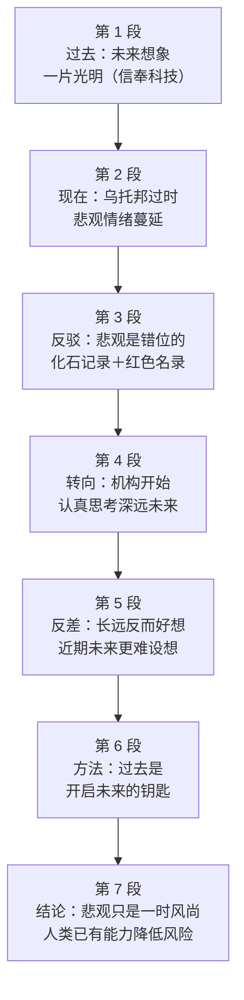

# Passage 21 · 人类前景并不悲观

## 答题记录

| 轮次  | 日期         | 题号  | 正确  | 错误  | 正确率 | 用时    | 错题归因 |
| --- | --- | --- | --- | --- | --- | --- | --- |
| 1 |  | 1-5 |  |  |  |  |  |
| 2 |  | 1-5 |  |  |  |  |  |
| 3 |  | 1-5 |  |  |  |  |  |

> [!tip] 填写口径
> - **用时**以分钟计，只计做题时间，不含精读复盘。
> - **错题归因**填「题型·错误类型」，如：细节题·定位错、推理判断·过度推断、主旨大意·以偏概全。
> - 纵向看趋势：正确率升而用时过长 → 熟练度不足；用时降而正确率波动 → 定位不稳。

> [!info] 文章档案
> - **来源**：考研英语（一）2013 年 Text 3
> - **题材**：社会生活——人类对未来的想象与长远前景
> - **结构**：7 段 / 19 句 ＋ 5 题
> - **难度**：★★★★☆
> - **一句话主旨**：人类对未来的想象曾因信奉科技而一片光明，如今因各种威胁而转为悲观；但化石记录与濒危物种红色名录都表明人类是可持续存续的物种，只要借鉴历史、着眼长远，前景其实越来越光明。

## 一、篇章脉络

- **第 1 段**：今昔对比开篇——几十年前人们对未来的想象大体是光明的，因为相信科技能治愈人类的一切弊病。
- **第 2 段**：转入当下——乌托邦已不合时宜，随着对各类威胁的认识加深，人们甚至觉得人类没什么未来可言。
- **第 3 段**：正面反驳这种悲观：化石记录显示许多物种存续了数百万年，红色名录更把人类列为「无危」。
- **第 4 段**：由「是否悲观」转向「如何思考深远未来」——研究机构与万年钟项目开始认真对待这个问题。
- **第 5 段**：指出一种反差——遥远的未来反而比眼前的未来更好设想，近期未来因技术与社会的复杂而难以预测。
- **第 6 段**：给出方法——放长眼光，过去就是开启未来的钥匙，可凭已识别的长期模式做有据的预测。
- **第 7 段**：收束全文——悲观论调只是一时风尚；未来虽非一片玫瑰色，但人类已有能力降低风险、改善后代境遇。

> [!tip] 行文逻辑
> 乐观（第 1 段）→ 悲观（第 2 段）→ 反驳悲观（第 3 段）→ 如何研究未来（第 4、5 段）→ 方法（第 6 段）→ 结论（第 7 段）。全文是一条「U 型态度曲线」：先扬、后抑、再扬，第 5 题的标题正取决于对末段「再扬」的把握；第 3 题考第 5 段首句的「反差」，第 4 题考第 6 段②句的「过去是钥匙」。

## 二、逐段精读

### 第 1 段 · 过去：对未来的一片乐观

**原文**

① Up until a few decades ago, our visions of the future were largely—though by no means uniformly—glowingly positive.
② Science and technology would cure all the ills of humanity, leading to lives of fulfillment and opportunity for all.

**译文**

① 直到几十年前，我们对未来的想象大体上是——尽管绝非千篇一律地——极为乐观的。
② 科学与技术会治愈人类的一切弊病，从而让所有人过上充实而充满机会的生活。

> [!note] 段落要点
> - 功能：以今昔对比开篇，交代「过去为何乐观」，为第 2 段的转折和第 1 题的因果设问埋下伏笔。
> - ①句的破折号插入语 though by no means uniformly 是让步限定；②句给出原因（科技），是第 1 题的答案所在。

#### 长难句 · 本段

> [!abstract] 本段第 ② 句 · Science and technology would cure all the ills of humanity, leading to lives of fulfillment and opportunity for all.

**结构拆解**

- **主干**：Science and technology would cure all the ills（主谓宾）
- **后置定语**：of humanity（修饰 ills）
- **结果状语**：leading to lives of fulfillment and opportunity（现在分词短语，表前文动作带来的结果）
- **后置定语**：of fulfillment and opportunity（修饰 lives）；for all（修饰 lives）

**参考译文**

科学与技术会治愈人类的一切弊病，从而让所有人过上充实而充满机会的生活。

> [!tip] 拆解要点
> `would` 在此不是过去将来时，而是「过去惯性、过去常常」的情态用法（与第 1 段的 Up until a few decades ago 呼应）；`leading to ...` 是结果分词短语，把「科技 → 弊病消失 → 美好生活」这条因果链一次串完。命题人最爱把 lives of fulfillment / opportunity for all 这些「结果」包装成「原因」做成干扰项（第 1 题 A、D 项）。

#### 本段重点词汇

| 单词 / 短语 | 词性 | 文中意 | 常用考义与拓展 | 英文示例搭配（中译） |
| --- | --- | --- | --- | --- |
| **vision** | n. | 想象，构想，愿景 | 熟词僻义：视力 → 构想、展望；vision of the future 对未来的想象 | our visions of the future（我们对未来的想象） |
| **up until** | （短语） | 直到……为止 | 同义 up to / until；up until now 直到现在 | up until a few decades ago（直到几十年前） |
| **by no means** | （短语） | 决不，绝不 | 同义 in no way / not at all；means n. 方式、手段 | though by no means uniformly（尽管绝非一律如此） |
| **uniformly** | adv. | 一律地，一致地 | uniform adj. 统一的；n. 制服 | by no means uniformly（绝非千篇一律地） |
| **glowingly** | adv. | 热情洋溢地，极为（正面）地 | glow v. 发光、洋溢；glowing adj. 热烈赞扬的 | glowingly positive（极为乐观的） |
| **ill** | n. | 弊病，祸患 | 熟词僻义：生病的 → 弊端、祸害（常用复数 ills）；ills of society 社会弊病 | cure all the ills of humanity（治愈人类的一切弊病） |
| **fulfillment** | n. | 满足感，成就感 | fulfill v. 实现、满足；fulfilling adj. 令人满足的 | lives of fulfillment（充实的生活） |
| **lead to** | （短语） | 导致，带来 | lead-led-led；同义 result in / give rise to | leading to lives of fulfillment（带来充实的生活） |

### 第 2 段 · 现在：乌托邦过时，悲观蔓延

**原文**

① Now utopia has grown unfashionable, as we have gained a deeper appreciation of the range of threats facing us, from asteroid strike to epidemic flu and to climate change.
② You might even be tempted to assume that humanity has little future to look forward to.

**译文**

① 如今乌托邦已变得不合时宜，因为我们越来越深刻地认识到摆在我们面前的一系列威胁——从小行星撞击到流感大流行，再到气候变化。
② 你甚至可能会忍不住认为，人类没什么未来值得期待。

> [!note] 段落要点
> - 功能：完成「今昔对比」的另一半——由乐观转为悲观，并点明转变的原因是对威胁的认识加深。
> - ①句的 as 引导原因状语从句，from ... to ... and to ... 是举例链；②句的 gloominess 是第 3 段①句 misplaced 的回指对象，两句要连起来读。

#### 长难句 · 本段

> [!abstract] 本段第 ① 句 · Now utopia has grown unfashionable, as we have gained a deeper appreciation of the range of threats facing us, from asteroid strike to epidemic flu and to climate change.

**结构拆解**

- **主句**：Now utopia has grown unfashionable（系表结构，grow 作系动词「变得」）
- **原因状语从句**：as we have gained a deeper appreciation of the range of threats
- **后置定语**：facing us（现在分词短语修饰 threats）
- **举例成分**：from asteroid strike to epidemic flu and to climate change（from ... to ... and to ... 三连举例）

**参考译文**

如今乌托邦已变得不合时宜，因为我们越来越深刻地认识到摆在我们面前的一系列威胁——从小行星撞击到流感大流行，再到气候变化。

> [!tip] 拆解要点
> `grow + adj.` 表示「逐渐变得」（grow unfashionable / grow old）；`appreciation of` 在此取「认识、理解」而非「欣赏」；`from A to B and to C` 是三连举例结构，读到一个就能预判后面还有两项，遇到这种列举常考「细节题·以偏概全」型干扰项。

#### 本段重点词汇

| 单词 / 短语 | 词性 | 文中意 | 常用考义与拓展 | 英文示例搭配（中译） |
| --- | --- | --- | --- | --- |
| **utopia** | n. | 乌托邦，理想社会 | utopian adj. 乌托邦式的、空想的；反义 dystopia 反乌托邦 | Now utopia has grown unfashionable（如今乌托邦已不合时宜） |
| **unfashionable** | adj. | 不再流行的，不合时宜的 | 反义 fashionable（流行的）；fashion n. 时尚、方式 | utopia has grown unfashionable（乌托邦已不合时宜） |
| **appreciation** | n. | 认识，理解；欣赏 | 熟词僻义：欣赏 → 认识、体会；appreciate v. 理解、感激、增值 | a deeper appreciation of the range of threats（对一系列威胁更深刻的认识） |
| **range** | n. | 一系列，范围 | a range of 一系列；range from A to B 在 A 与 B 之间变化 | the range of threats facing us（我们面临的一系列威胁） |
| **threat** | n. | 威胁，威胁源 | threaten v. 威胁；threatening adj. 威胁性的 | a range of threats（一系列威胁） |
| **asteroid** | n. | 小行星 | asteroid belt 小行星带；asteroid strike 小行星撞击 | from asteroid strike to epidemic flu（从小行星撞击到流感大流行） |
| **strike** | n. / v. | 撞击；袭击；罢工 | 熟词僻义：罢工 → 撞击、侵袭；strike terror into 使……恐惧 | asteroid strike（小行星撞击） |
| **epidemic** | adj. / n. | 流行性的；流行病 | epidemic flu 流感大流行；epidemic of ... ……的泛滥 | epidemic flu（流感大流行） |
| **be tempted to** | （短语） | 忍不住想，倾向于 | tempt v. 诱惑；temptation n. 诱惑 | might even be tempted to assume（甚至会忍不住认为） |
| **look forward to** | （短语） | 期待，盼望 | to 是介词，后接名词或动名词；同义 expect | has little future to look forward to（没什么未来可期待） |

### 第 3 段 · 反驳：悲观是错位的

**原文**

① But such gloominess is misplaced.
② The fossil record shows that many species have endured for millions of years—so why shouldn't we?
③ Take a broader look at our species' place in the universe, and it becomes clear that we have an excellent chance of surviving for tens, if not hundreds, of thousands of years.
④ Look up Homo sapiens in the "Red List" of threatened species of the International Union for the Conservation of Nature (IUCN), and you will read: "Listed as Least Concern as the species is very widely distributed, adaptable, currently increasing, and there are no major threats resulting in an overall population decline."

**译文**

① 但这种悲观是错位的。
② 化石记录表明，许多物种已经存续了数百万年——那么我们为什么不能？
③ 更宽广地看一看我们这个物种在宇宙中的位置，就会清楚：即使不是几十万年，我们也有极大的机会存活好几万年。
④ 在国际自然保护联盟（IUCN）的濒危物种「红色名录」中查一查智人，你会读到：「列为无危，因为该物种分布极广、适应性强、数量目前仍在增长，且不存在导致种群总量下降的主要威胁。」

> [!note] 段落要点
> - 功能：全文的转折点——用两条客观证据（化石记录、红色名录）正面反驳第 2 段的悲观论。
> - ①句是段落主旨句（But 转折 + misplaced 定性）；④句是第 2 题的定位句，四个形容词 widely distributed / adaptable / currently increasing / no major threats 共同指向 a sustained species。

#### 长难句 · 本段

> [!abstract] 本段第 ③ 句 · Take a broader look at our species' place in the universe, and it becomes clear that we have an excellent chance of surviving for tens, if not hundreds, of thousands of years.

**结构拆解**

- **并列结构**：祈使句 + and + 陈述句（祈使句相当于条件从句，and 后为结果）
- **祈使句**：Take a broader look at our species' place in the universe
- **形式主语**：it becomes clear that ...（it 指代 that 从句）
- **插入语**：if not hundreds（＝ if not hundreds of thousands of years，省略与前文相同的部分）
- **数量修饰**：tens of thousands（数万）／hundreds of thousands（数十万）

**参考译文**

更宽广地看一看我们这个物种在宇宙中的位置，就会清楚：即使不是几十万年，我们也有极大的机会存活好几万年。

> [!tip] 拆解要点
> `祈使句 + and + 句子` = `If you ..., ... will ...`，是考研高频句式（第 4 句同样如此）；`if not ...` 是插入型递进，先说保守估计 tens，再抬到 hundreds，属「先退后进」的修辞，翻译时补出「即使不是……」。

#### 长难句 · 本段

> [!abstract] 本段第 ④ 句 · Look up Homo sapiens in the "Red List" of threatened species of the International Union for the Conservation of Nature (IUCN), and you will read: "Listed as Least Concern as the species is very widely distributed, adaptable, currently increasing, and there are no major threats resulting in an overall population decline."

**结构拆解**

- **并列结构**：祈使句 + and + 陈述句（Look up ..., and you will read ...）
- **后置定语链**：in the "Red List" of threatened species of the International Union for the Conservation of Nature（层层限定）
- **冒号引语**：冒号后为读到的原文内容
- **原因状语从句**：as the species is very widely distributed, adaptable, currently increasing（as 表「因为」）
- **并列分句**：and there are no major threats（与前三项并列，共同解释 Least Concern）
- **后置定语**：resulting in an overall population decline（现在分词短语修饰 threats）

**参考译文**

在国际自然保护联盟（IUCN）的濒危物种「红色名录」中查一查智人，你会读到：「列为无危，因为该物种分布极广、适应性强、数量目前仍在增长，且不存在导致种群总量下降的主要威胁。」

> [!tip] 拆解要点
> 引语内部是「结论 + 三条理由」：Listed as Least Concern ← widely distributed / adaptable / currently increasing / no major threats。第 2 题的正确项 a sustained species（可持续存续的物种）正是对这四条的整体概括，而 B、C、D 三项都只抓住其中一条往外推。

#### 本段重点词汇

| 单词 / 短语 | 词性 | 文中意 | 常用考义与拓展 | 英文示例搭配（中译） |
| --- | --- | --- | --- | --- |
| **gloominess** | n. | 悲观，阴郁 | gloomy adj. 阴郁的、悲观的；gloom n. 忧郁 | such gloominess is misplaced（这种悲观是错位的） |
| **misplaced** | adj. | 错位的，不恰当的 | mis- 前缀表「错误」；misplace v. 把……放错地方 | such gloominess is misplaced（悲观情绪放错了地方） |
| **fossil record** | n. | 化石记录 | fossil n. 化石；record n. 记录、记载 | the fossil record shows that...（化石记录表明……） |
| **endure** | v. | 存续，持久；忍受 | 熟词僻义：忍受 → 长期存续；endurance n. 耐力、持久 | have endured for millions of years（已存续数百万年） |
| **species** | n. | 物种 | 单复数同形；endangered species 濒危物种 | many species have endured（许多物种得以存续） |
| **survive** | v. | 存活，继续存在 | survival n. 幸存；survivor n. 幸存者 | an excellent chance of surviving（极大的存活机会） |
| **Homo sapiens** | （专有） | 智人（现代人的学名） | 拉丁语，意为「有智慧的人」 | Look up Homo sapiens（查一查智人） |
| **Red List** | （专有） | （IUCN）濒危物种红色名录 | 等级含 Least Concern 无危、Vulnerable 易危、Endangered 濒危等 | in the "Red List" of threatened species（在濒危物种红色名录中） |
| **widely distributed** | （短语） | 分布广泛的 | distribute v. 分布、分发；distribution n. 分布 | the species is very widely distributed（该物种分布极广） |
| **adaptable** | adj. | 适应性强的 | adapt v. 适应；adaptation n. 适应；adaptive adj. 适应的 | adaptable, currently increasing（适应性强、数量在增长） |
| **decline** | n. / v. | 下降，衰退 | a decline in ... ……的下降；同义 decrease / drop | an overall population decline（种群总量的下降） |

### 第 4 段 · 转向：机构开始认真研究深远未来

**原文**

① So what does our deep future hold?
② A growing number of researchers and organisations are now thinking seriously about that question.
③ For example, the Long Now Foundation has as its flagship project a mechanical clock that is designed to still be marking time thousands of years hence.

**译文**

① 那么，我们遥远的未来会是什么样？
② 越来越多的研究者和机构正在认真思考这个问题。
③ 例如，「长远现在基金会」的旗舰项目是一台机械钟，其设计目标是数千年后仍在走时。

> [!note] 段落要点
> - 功能：由「悲观与否」的争论转向「如何研究深远未来」，用提问引出研究现状与实例。
> - ①句是承上启下的设问句；③句的万年钟是「长远视角」的具象化，与第 5 段的 lengthy timescales 呼应。

#### 长难句 · 本段

> [!abstract] 本段第 ③ 句 · For example, the Long Now Foundation has as its flagship project a mechanical clock that is designed to still be marking time thousands of years hence.

**结构拆解**

- **主干**：the Long Now Foundation has a mechanical clock（has 的宾语因带长定语而后置）
- **宾语前置标志**：as its flagship project（介词短语提前，形成 `has as + 宾语补足成分 + 宾语` 的倒装式表达）
- **定语从句**：that is designed to still be marking time thousands of years hence（修饰 clock）
- **不定式被动进行式**：to still be marking time（be designed to be doing，强调「持续走时」）

**参考译文**

例如，「长远现在基金会」的旗舰项目是一台机械钟，其设计目标是数千年后仍在走时。

> [!tip] 拆解要点
> `have ... as ...` 的常见变体是 `have as ... + 宾语`（has as its flagship project a mechanical clock），识别办法是看到 as 后接名词、句末还有一个名词；`hence` 在此不是「因此」而是「从此以后、今后」，thousands of years hence ＝ 数千年之后。

#### 本段重点词汇

| 单词 / 短语 | 词性 | 文中意 | 常用考义与拓展 | 英文示例搭配（中译） |
| --- | --- | --- | --- | --- |
| **deep future** | n. | 遥远的未来，深远未来 | deep 此处表「时间上深远」；反义 the near / immediate future 近期未来 | what does our deep future hold（我们遥远的未来会怎样） |
| **a growing number of** | （短语） | 越来越多的 | 接可数名词复数，谓语用复数；同义 an increasing number of | a growing number of researchers（越来越多的研究者） |
| **think seriously about** | （短语） | 认真思考，严肃对待 | seriously adv. 认真地、严肃地；take sth seriously 重视某事 | thinking seriously about that question（认真思考那个问题） |
| **flagship** | n. / adj. | 旗舰（项目），最重要的 | 本义「旗舰」，引申为「王牌、最重要的事物」 | has as its flagship project（把它作为旗舰项目） |
| **mechanical** | adj. | 机械的 | mechanism n. 机械装置、机制；mechanic n. 技工 | a mechanical clock（一台机械钟） |
| **mark time** | （短语） | （钟）走时，标示时间 | 另有 idiom 义「原地踏步、拖延待机」，文中取本义 | still be marking time（仍在走时） |
| **hence** | adv. | 今后，此后；因此 | 熟词僻义：因此 → 此后（thousands of years hence 数千年后） | thousands of years hence（数千年之后） |
| **Long Now Foundation** | （专有） | 长远现在基金会 | 1996 年成立于旧金山，倡导以千年尺度思考的组织 | the Long Now Foundation（长远现在基金会） |

### 第 5 段 · 反差：长远好想，近期难想

**原文**

① Perhaps willfully, it may be easier to think about such lengthy timescales than about the more immediate future.
② The potential evolution of today's technology, and its social consequences, is dazzlingly complicated, and it's perhaps best left to science fiction writers and futurologists to explore the many possibilities we can envisage.
③ That's one reason why we have launched Arc, a new publication dedicated to the near future.

**译文**

① 或许是出于某种执意，思考如此漫长的时间跨度似乎比思考更为眼前的未来要容易些。
② 当今技术的潜在演变及其社会后果复杂得令人眼花缭乱，也许最好还是交给科幻作家和未来学家，去探索我们能够设想的种种可能。
③ 这也是我们推出 Arc 这一全新出版物的原因之一，它专门致力于研究近期未来。

> [!note] 段落要点
> - 功能：提出一个反直觉的观察——长远未来反而比近期未来更好设想，并交代办刊物 Arc 的缘由。
> - ①句是段落中心句，也是第 3 题的定位句（反过来说：近期未来难以设想）；③句的 dedicated to the near future 是第 3 题 B 项的排除依据。

#### 长难句 · 本段

> [!abstract] 本段第 ② 句 · The potential evolution of today's technology, and its social consequences, is dazzlingly complicated, and it's perhaps best left to science fiction writers and futurologists to explore the many possibilities we can envisage.

**结构拆解**

- **并列主干**：The potential evolution ... is dazzlingly complicated, and it's perhaps best left to ...（and 连接两个分句）
- **并列主语**：The potential evolution of today's technology, and its social consequences（谓语用单数 is，视作一个整体）
- **固定结构**：it's best left to sb to do（最好交给某人去做）
- **定语从句**：we can envisage（修饰 the many possibilities，省略关系代词 that）
- **程度副词**：dazzlingly（由 dazzle「使眼花」派生）

**参考译文**

当今技术的潜在演变及其社会后果复杂得令人眼花缭乱，也许最好还是交给科幻作家和未来学家，去探索我们能够设想的种种可能。

> [!tip] 拆解要点
> 抓 and 把句子切成两半：前半讲「太复杂」，后半讲「交给谁」。`leave sth to sb`（把……交给某人）的被动式 `it's best left to sb to do` 是书面常用结构；envisage（设想、想象）与 imagine 同义，是 futurologist 一类话题的高频词。

#### 本段重点词汇

| 单词 / 短语 | 词性 | 文中意 | 常用考义与拓展 | 英文示例搭配（中译） |
| --- | --- | --- | --- | --- |
| **willfully** | adv. | 执意地，刻意地；任性地 | 熟词僻义：常作「蓄意地」→ 此处偏「偏偏、执意」；willful adj. 任性的 | Perhaps willfully, it may be easier to...（或许是执意如此，……反而更容易） |
| **timescale** | n. | 时间跨度，时段 | time + scale；on a longer timescale 在更长的时段上 | such lengthy timescales（如此漫长的时间跨度） |
| **immediate** | adj. | 眼前的，最近的 | 熟词僻义：立即的 → 紧接的、最近的；the immediate future 近期未来 | the more immediate future（更为眼前的未来） |
| **potential** | adj. / n. | 潜在的；潜力 | potentially adv. 潜在地；potential risks 潜在风险 | the potential evolution of today's technology（当今技术的潜在演变） |
| **evolution** | n. | 演变，进化 | evolve v. 演变、进化；evolutionary adj. 进化的 | the potential evolution of technology（技术的潜在演变） |
| **consequence** | n. | 后果，结果 | consequently adv. 因此；as a consequence of 由于 | its social consequences（它的社会后果） |
| **dazzlingly** | adv. | 令人眼花缭乱地，极其 | dazzle v. 使目眩；dazzling adj. 耀眼的、令人惊叹的 | dazzlingly complicated（复杂得令人眼花缭乱） |
| **complicated** | adj. | 复杂的 | complicate v. 使复杂化；complex adj. 复杂的（近义） | is dazzlingly complicated（复杂得令人眼花缭乱） |
| **futurologist** | n. | 未来学家 | futurology n. 未来学；词根 futur- 未来 + -ology 学科 | left to futurologists to explore（交给未来学家去探索） |
| **envisage** | v. | 设想，想象 | 同义 imagine / envision；envisage doing 设想做 | the many possibilities we can envisage（我们能设想的诸多可能） |
| **publication** | n. | 出版物，刊物 | publish v. 出版；publisher n. 出版商 | a new publication（一份新刊物） |
| **be dedicated to** | （短语） | 致力于，专门用于 | dedicate v. 奉献、把……用于；dedication n. 奉献、专注 | a publication dedicated to the near future（致力于近期未来的刊物） |

### 第 6 段 · 方法：过去是开启未来的钥匙

**原文**

① But take a longer view and there is a surprising amount that we can say with considerable assurance.
② As so often, the past holds the key to the future: we have now identified enough of the long-term patterns shaping the history of the planet, and our species, to make evidence-based forecasts about the situations in which our descendants will find themselves.

**译文**

① 但如果放长眼光来看，我们能以相当的把握说出的东西多得惊人。
② 一如往常，过去是开启未来的钥匙：我们现在已经识别出足够多的、塑造着地球与人类历史的长期模式，足以就我们的后代将置身其中的处境做出有据可依的预测。

> [!note] 段落要点
> - 功能：给出研究未来的可行方法——放长眼光、借鉴历史，凭已识别的长期模式做有据预测。
> - ②句是第 4 题的定位句：the past holds the key to the future = draw on our experience from the past。冒号后是对这句话的具体展开。

#### 长难句 · 本段

> [!abstract] 本段第 ② 句 · As so often, the past holds the key to the future: we have now identified enough of the long-term patterns shaping the history of the planet, and our species, to make evidence-based forecasts about the situations in which our descendants will find themselves.

**结构拆解**

- **主句**：the past holds the key to the future
- **插入语**：As so often（＝ as is so often the case，正如常有的情形）
- **冒号解释**：冒号后整句说明「过去为何是钥匙」
- **主干**：we have now identified enough of the long-term patterns
- **后置定语**：shaping the history of the planet, and our species（现在分词短语修饰 patterns）
- **结果状语**：to make evidence-based forecasts（enough ... to do 结构）
- **定语从句**：in which our descendants will find themselves（修饰 the situations）

**参考译文**

一如往常，过去是开启未来的钥匙：我们现在已经识别出足够多的、塑造着地球与人类历史的长期模式，足以就我们的后代将置身其中的处境做出有据可依的预测。

> [!tip] 拆解要点
> 拆成三层：① 观点句（past holds the key）；② 依据（identified enough long-term patterns）；③ 结论（enough ... to make forecasts）。`enough ... to do` 中的 enough 修饰 patterns，是「识别得足够多，以至于能预测」；`find oneself in a situation` 是固定搭配，in which 把 situation 提前。

#### 本段重点词汇

| 单词 / 短语 | 词性 | 文中意 | 常用考义与拓展 | 英文示例搭配（中译） |
| --- | --- | --- | --- | --- |
| **take a longer view** | （短语） | 从更长远的角度看 | 同义 take a long-term view / take the long view | take a longer view（放长眼光来看） |
| **considerable** | adj. | 相当大的，相当多的 | consider v. 考虑；considerably adv. 相当地 | with considerable assurance（以相当的把握） |
| **assurance** | n. | 把握，确信；保证 | assure v. 使确信、保证；assure sb of sth 向某人保证某事 | say with considerable assurance（相当有把握地说） |
| **hold the key to** | （短语） | 是……的关键 | key to sth ……的关键（to 为介词）；the key to solving 解决……的关键 | the past holds the key to the future（过去是开启未来的钥匙） |
| **identify** | v. | 识别，确认 | identification n. 识别、身份；identify with 认同 | identified enough of the patterns（识别出足够多的模式） |
| **long-term patterns** | n. | 长期模式 | long-term adj. 长期的；pattern n. 模式、规律 | the long-term patterns shaping the history（塑造历史的长期模式） |
| **shape** | v. | 塑造，决定……的形成 | shape n. 形状；shaping the history 塑造历史 | shaping the history of the planet（塑造地球的历史） |
| **evidence-based** | adj. | 有证据支撑的 | -based 复合词：market-based 以市场为基础的 | make evidence-based forecasts（做出有据可依的预测） |
| **forecast** | n. / v. | 预测，预报 | 过去式 forecast 或 forecasted；weather forecast 天气预报 | make evidence-based forecasts（做出有据的预测） |
| **descendant** | n. | 后代，后裔 | descend v. 下降、遗传；descend from 起源于 | our descendants will find themselves（我们的后代将置身其中） |

### 第 7 段 · 结论：悲观只是一时风尚

**原文**

① This long perspective makes the pessimistic view of our prospects seem more likely to be a passing fad.
② To be sure, the future is not all rosy.
③ But we are now knowledgeable enough to reduce many of the risks that threatened the existence of earlier humans, and to improve the lot of those to come.

**译文**

① 这种长远视角使得对我们前景的悲观看法更像是某种一时的风尚。
② 诚然，未来并非一片玫瑰色。
③ 但我们如今已有足够的认知，可以降低许多曾威胁早期人类生存的风险，并改善后来者的命运。

> [!note] 段落要点
> - 功能：给出全文结论——悲观不过是一时风尚，未来虽非尽善尽美，但人类已有能力降低风险、改善后代境遇。
> - ①句回扣第 3 段的 misplaced；②句先让步、③句再转折，是典型的「让步—转折」收尾，也是第 5 题判断作者态度的依据（正向）。

#### 长难句 · 本段

> [!abstract] 本段第 ③ 句 · But we are now knowledgeable enough to reduce many of the risks that threatened the existence of earlier humans, and to improve the lot of those to come.

**结构拆解**

- **主干**：we are now knowledgeable enough（主系表 + 副词 enough）
- **并列结果状语**：(enough) to reduce many of the risks ... and to improve the lot of those to come（两个不定式并列）
- **定语从句**：that threatened the existence of earlier humans（修饰 the risks）
- **后置定语**：of those to come（to come 不定式作定语，表「将要到来的」）

**参考译文**

但我们如今已有足够的认知，可以降低许多曾威胁早期人类生存的风险，并改善后来者的命运。

> [!tip] 拆解要点
> `adj. + enough + to do` 中 enough 后置修饰形容词（knowledgeable enough to do）；and 连接的两个不定式共用同一个 enough，读成「足以 A，也足以 B」。the lot of those to come 是全文最后的价值落点：作者并非盲目乐观，而是「有能力的乐观」。

#### 本段重点词汇

| 单词 / 短语 | 词性 | 文中意 | 常用考义与拓展 | 英文示例搭配（中译） |
| --- | --- | --- | --- | --- |
| **perspective** | n. | （观察的）视角，眼光 | 也指「透视法」；from a ... perspective 从……角度看 | this long perspective（这种长远视角） |
| **pessimistic** | adj. | 悲观的 | 反义 optimistic（乐观的）；pessimism n. 悲观主义 | the pessimistic view of our prospects（对我们前景的悲观看法） |
| **prospect** | n. | 前景，前途 | 常用复数 prospects；prospective adj. 预期的、未来的 | the view of our prospects（对我们前景的看法） |
| **passing fad** | （短语） | 一时的风尚，昙花一现 | fad n. 一时的狂热；passing adj. 短暂的、过路的 | more likely to be a passing fad（更像是一时的风尚） |
| **to be sure** | （短语） | 诚然，的确 | 让步型插入语，同义 admittedly / it is true that | To be sure, the future is not all rosy（诚然，未来并非一片玫瑰色） |
| **rosy** | adj. | 美好的，乐观的 | 本义「玫瑰色的」；rosy picture 美好图景 | the future is not all rosy（未来并非一片美好） |
| **knowledgeable** | adj. | 知识丰富的，有见识的 | knowledge n. 知识；knowledgeable about 对……在行 | now knowledgeable enough（如今已有足够的认知） |
| **reduce** | v. | 降低，减少 | reduction n. 减少；reduce risks 降低风险 | reduce many of the risks（降低许多风险） |
| **existence** | n. | 生存，存在 | exist v. 存在；existing adj. 现存的 | threatened the existence of earlier humans（威胁早期人类的生存） |
| **lot** | n. | 命运，境遇 | 熟词僻义：许多 / 抽签 → （生活）境遇、命运；improve the lot of 改善……的境遇 | improve the lot of those to come（改善后来者的命运） |

## 三、全篇重点词汇汇总（自测用）

> [!info] 说明
> 本表只列「单词 / 词性 / 所在段」，不含释义与搭配，用于遮表自测：说出词义后再回该段核对。
> 收录**全篇所有段落词汇，共 69 条，不删减**，与各段「本段重点词汇」等长同源。

| 单词 / 短语 | 词性 | 所在段 |
| --- | --- | --- |
| **vision** | n. | 第 1 段 |
| **up until** | （短语） | 第 1 段 |
| **by no means** | （短语） | 第 1 段 |
| **uniformly** | adv. | 第 1 段 |
| **glowingly** | adv. | 第 1 段 |
| **ill** | n. | 第 1 段 |
| **fulfillment** | n. | 第 1 段 |
| **lead to** | （短语） | 第 1 段 |
| **utopia** | n. | 第 2 段 |
| **unfashionable** | adj. | 第 2 段 |
| **appreciation** | n. | 第 2 段 |
| **range** | n. | 第 2 段 |
| **threat** | n. | 第 2 段 |
| **asteroid** | n. | 第 2 段 |
| **strike** | n. / v. | 第 2 段 |
| **epidemic** | adj. / n. | 第 2 段 |
| **be tempted to** | （短语） | 第 2 段 |
| **look forward to** | （短语） | 第 2 段 |
| **gloominess** | n. | 第 3 段 |
| **misplaced** | adj. | 第 3 段 |
| **fossil record** | n. | 第 3 段 |
| **endure** | v. | 第 3 段 |
| **species** | n. | 第 3 段 |
| **survive** | v. | 第 3 段 |
| **Homo sapiens** | （专有） | 第 3 段 |
| **Red List** | （专有） | 第 3 段 |
| **widely distributed** | （短语） | 第 3 段 |
| **adaptable** | adj. | 第 3 段 |
| **decline** | n. / v. | 第 3 段 |
| **deep future** | n. | 第 4 段 |
| **a growing number of** | （短语） | 第 4 段 |
| **think seriously about** | （短语） | 第 4 段 |
| **flagship** | n. / adj. | 第 4 段 |
| **mechanical** | adj. | 第 4 段 |
| **mark time** | （短语） | 第 4 段 |
| **hence** | adv. | 第 4 段 |
| **Long Now Foundation** | （专有） | 第 4 段 |
| **willfully** | adv. | 第 5 段 |
| **timescale** | n. | 第 5 段 |
| **immediate** | adj. | 第 5 段 |
| **potential** | adj. / n. | 第 5 段 |
| **evolution** | n. | 第 5 段 |
| **consequence** | n. | 第 5 段 |
| **dazzlingly** | adv. | 第 5 段 |
| **complicated** | adj. | 第 5 段 |
| **futurologist** | n. | 第 5 段 |
| **envisage** | v. | 第 5 段 |
| **publication** | n. | 第 5 段 |
| **be dedicated to** | （短语） | 第 5 段 |
| **take a longer view** | （短语） | 第 6 段 |
| **considerable** | adj. | 第 6 段 |
| **assurance** | n. | 第 6 段 |
| **hold the key to** | （短语） | 第 6 段 |
| **identify** | v. | 第 6 段 |
| **long-term patterns** | n. | 第 6 段 |
| **shape** | v. | 第 6 段 |
| **evidence-based** | adj. | 第 6 段 |
| **forecast** | n. / v. | 第 6 段 |
| **descendant** | n. | 第 6 段 |
| **perspective** | n. | 第 7 段 |
| **pessimistic** | adj. | 第 7 段 |
| **prospect** | n. | 第 7 段 |
| **passing fad** | （短语） | 第 7 段 |
| **to be sure** | （短语） | 第 7 段 |
| **rosy** | adj. | 第 7 段 |
| **knowledgeable** | adj. | 第 7 段 |
| **reduce** | v. | 第 7 段 |
| **existence** | n. | 第 7 段 |
| **lot** | n. | 第 7 段 |

> [!warning] 熟词僻义专列
> - **vision** n. 想象、构想、愿景（非「视力」）
> - **ill** n. 弊病、祸患，常用复数 ills（非「生病的」）
> - **appreciation** n. 认识、理解（非「欣赏、感激」）
> - **strike** n. 撞击、侵袭（非「罢工」）
> - **endure** v. 长期存续（非「忍受」）
> - **mark time** （钟）走时、标示时间（非「原地踏步」）
> - **hence** adv. 此后、今后，thousands of years hence（非「因此」）
> - **immediate** adj. 眼前的、紧接的（非「立即的」）
> - **willfully** adv. 偏偏、执意地（非「蓄意作恶地」）
> - **lot** n. 命运、境遇（非「许多、抽签」）
> - **rosy** adj. 美好的、乐观的（本义「玫瑰色的」）
> - **flagship** n./adj. 王牌、最重要的项目（本义「旗舰」）
> - **misplaced** adj. 错位的、不恰当的（非「放错地方的」字面义）

> [!example] 同义替换链（阅读题高频）
> - Science and technology would cure all the ills of humanity = our faith in science and technology（第 1 题考点）
> - widely distributed, adaptable, currently increasing, no major threats = a sustained species（第 2 题考点）
> - easier to think about lengthy timescales than about the more immediate future = our immediate future is hard to conceive（第 3 题考点）
> - the past holds the key to the future = draw on our experience from the past（第 4 题考点）
> - gloominess is misplaced / a passing fad / improve the lot of those to come = The Ever-bright Prospects of Mankind（第 5 题考点）
> - deep future = lengthy timescales；the near future = the immediate future

## 四、知识点补充

> [!question] 背景知识
> - **IUCN 与国际自然保护联盟**：International Union for the Conservation of Nature，1948 年成立、总部在瑞士格朗的国际组织，以《濒危物种红色名录》（Red List）评估物种灭绝风险；等级由轻到重依次为 Least Concern（无危）、Near Threatened（近危）、Vulnerable（易危）、Endangered（濒危）、Critically Endangered（极危）。文中人类被列为 Least Concern。
> - **Homo sapiens（智人）**：人属现存唯一物种，学名意为「有智慧的人」。文中借红色名录的评估口径说明人类分布广、适应性强、数量仍在增长。
> - **Long Now Foundation（长远现在基金会）**：1996 年成立于旧金山，倡导以千年、万年为尺度思考问题；其旗舰项目是「万年钟」（Clock of the Long Now），设计目标是运行上万年仍能走时。
> - **Arc**：《新科学家》（New Scientist）推出的数字刊物，专注「近期未来」；文中的 futurologist（未来学家）一词即来自这一研究领域。

> [!warning] 语法点
> - **祈使句 + and + 陈述句**：Take a broader look ..., and it becomes clear that ...（祈使句相当于 if 条件从句）。
> - **破折号插入语**：were largely—though by no means uniformly—glowingly positive（中间为让步限定）。
> - **冒号的解释用法**：the past holds the key to the future: we have now identified ...（后项展开前项）。
> - **adj./adv. + enough + to do**：knowledgeable enough to reduce ... and to improve ...（两个不定式共用 enough）。
> - **have as + 补足成分 + 宾语**：has as its flagship project a mechanical clock（宾语因定语过长而后置）。
> - **would 表过去的惯常**：Science and technology would cure all the ills（过去人们相信……）。

> [!success] 写作可迁移句型
> - `Up until a few decades ago, our visions of ... were largely ... .` → 今昔对比开篇，迅速建立时间轴。
> - `... has grown unfashionable, as we have gained a deeper appreciation of ...` → 说明观念转变及其原因。
> - `Take a broader look at ..., and it becomes clear that ...` → 由视角切换引出结论。
> - `As so often, the past holds the key to the future.` → 由历史推未来的万能过渡句。
> - `To be sure, ... is not all rosy. But we are now ... enough to ...` → 先让步后转折的积极收尾。

> [!danger] 易混辨析
> - **vision / prospect**：vision 是对未来的想象、构想（our visions of the future）；prospect 是（将要发生的）前景，常含可能性判断（our prospects）。
> - **endure / survive**：endure 强调长时间持续存在（也可指忍受）；survive 强调经历危险后仍然存活。
> - **hence / therefore**：hence 作副词可表「因此」，也可表「从此以后」（thousands of years hence 数千年后）。
> - **immediate / instant**：immediate 指时间上「最近的、紧接的」（the immediate future）；instant 指「立即的、瞬间的」。
> - **lot / fate**：lot 指（生活）境遇、命运（improve the lot of those to come）；fate 偏「宿命、注定」。

## 五、题目分析

> [!info] 题目总览
> | 题号 | 题型 | 定位 | 答案 |
> | --- | --- | --- | --- |
> | 1 | 细节题（因果） | 第 1 段①②句 | B |
> | 2 | 推理判断题 | 第 3 段④句 | A |
> | 3 | 细节判断题 | 第 5 段①句 | D |
> | 4 | 细节题 | 第 6 段②句 | B |
> | 5 | 主旨大意题 | 全篇（第 3 段①句 / 第 7 段） | A |

### 第 1 题 · 细节题（因果）

> [!question] 原题
> Our vision of the future used to be inspired by
> - A. our desire for lives of fulfillment.
> - B. our faith in science and technology.
> - C. our awareness of potential risks.
> - D. our belief in equal opportunity.

**正确答案**：**B. our faith in science and technology.（我们对科学与技术的信心）**

**定位与依据**
- 定位到第 1 段①句：Up until a few decades ago, our visions of the future were largely ... glowingly positive（先给现象）。
- 题干问 inspired by（被什么激发，即问原因），原因在下文的②句：Science and technology would cure all the ills of humanity, leading to lives of fulfillment and opportunity for all。
- 同义替换：Science and technology would cure all the ills = our faith in science and technology。

**干扰项分析**

| 选项 | 选项内容 | 判断 | 排除理由 |
| --- | --- | --- | --- |
| A | our desire for lives of fulfillment. | ✗ | 因果倒置：lives of fulfillment 是科学技术带来的**结果**，不是激发乐观想象的原因。 |
| C | our awareness of potential risks. | ✗ | 时代错位：对潜在威胁的认识出自第 2 段（utopia has grown unfashionable），说的是当下，不是过去。 |
| D | our belief in equal opportunity. | ✗ | 断章取义：opportunity for all 是②句结果的组成部分，「人人有机会」的信念文中并未提及。 |

> [!tip] 解题思路
> 题干出现 inspired by / because / due to 一类词时，答案通常不在定位句本身，而在紧接着的下一句——「先说现象、后给原因」是说明文的默认顺序。凡是把「结果」写成「原因」的选项（A、D）一律排除。

### 第 2 题 · 推理判断题

> [!question] 原题
> The IUCN's "Red List" suggests that human beings are
> - A. a sustained species.
> - B. the world's dominant power.
> - C. a threat to the environment.
> - D. a misplaced race.

**正确答案**：**A. a sustained species.（一种可以持久存续的物种）**

**定位与依据**
- 由专有名词 IUCN / "Red List" 定位到第 3 段④句。
- 引语列出四条依据：very widely distributed、adaptable、currently increasing、no major threats resulting in an overall population decline。
- 同义替换：分布广 + 适应性强 + 数量增长 + 无主要威胁 = a sustained species（可持续存续的物种）；③句的 excellent chance of surviving for tens, if not hundreds, of thousands of years 亦印证。

**干扰项分析**

| 选项 | 选项内容 | 判断 | 排除理由 |
| --- | --- | --- | --- |
| B | the world's dominant power. | ✗ | 过度推理：由「分布极广、无主要威胁」推不出「主导世界」，原文只是对物种存续状况的客观评估。 |
| C | a threat to the environment. | ✗ | 偏离文意：红色名录评估的是**人类这一物种的存续状况**；the Conservation of Nature 只是机构名，并非说人类威胁环境。 |
| D | a misplaced race. | ✗ | 张冠李戴：misplaced 在第 3 段①句修饰 gloominess（悲观是错位的），不是形容人类种群。 |

> [!tip] 解题思路
> 推理题的正确答案一定是「原文若干条信息的整体概括」，而不是其中一条的外推。把四个形容词合起来看才能得出 sustained；只抓住一条往极端推（B）、或把修饰语挪到别的对象上（D）都是典型陷阱。

### 第 3 题 · 细节判断题

> [!question] 原题
> Which of the following is true according to Paragraph 5?
> - A. The interest in science fiction is on the rise.
> - B. Arc helps limit the scope of futurological studies.
> - C. Technology offers solutions to social problems.
> - D. Our immediate future is hard to conceive.

**正确答案**：**D. Our immediate future is hard to conceive.（我们很难设想眼前的未来）**

**定位与依据**
- 定位到第 5 段①句（段落中心句）：it may be easier to think about such lengthy timescales than about the more immediate future。
- 反面表述即为答案：长远比近期好想 → 近期未来更难设想（hard to conceive）。
- ②句解释原因：技术的潜在演变及其社会后果 dazzlingly complicated（复杂到令人眼花缭乱）。

**干扰项分析**

| 选项 | 选项内容 | 判断 | 排除理由 |
| --- | --- | --- | --- |
| A | The interest in science fiction is on the rise. | ✗ | 断章取义：②句提到 science fiction writers 只是说「最好交给他们去探索」，并未说人们对科幻的兴趣在上升。 |
| B | Arc helps limit the scope of futurological studies. | ✗ | 与原文相反：③句说 Arc 是 dedicated to the near future 的新刊物，是**拓展**对近期未来的研究，而非缩小范围。 |
| C | Technology offers solutions to social problems. | ✗ | 断章取义：②句说技术演变及其社会后果极为复杂，恰恰没说技术能提供解决方案。 |

> [!tip] 解题思路
> 段落中心句常以「比较级」形式出现（easier ... than ...），正确选项往往是把它反过来表述。凡是把段中某个名词（science fiction、Arc、technology）单独拎出来做陈述的，多半是断章取义。

### 第 4 题 · 细节题

> [!question] 原题
> To ensure the future of mankind, it is crucial to
> - A. adopt an optimistic view of the world.
> - B. draw on our experience from the past.
> - C. explore our planet's abundant resources.
> - D. curb our ambition to reshape history.

**正确答案**：**B. draw on our experience from the past.（借鉴我们过去的经验）**

**定位与依据**
- 定位到第 6 段②句：As so often, the past holds the key to the future。
- 冒号后展开：we have now identified enough of the long-term patterns shaping the history of the planet, and our species, to make evidence-based forecasts ...
- 同义替换：the past holds the key to the future = draw on our experience from the past。

**干扰项分析**

| 选项 | 选项内容 | 判断 | 排除理由 |
| --- | --- | --- | --- |
| A | adopt an optimistic view of the world. | ✗ | 曲解结论：第 7 段①句说悲观看法更像一时风尚，作者并未把「抱乐观态度」当作**保障**未来的手段；乐观是判断，不是方法。 |
| C | explore our planet's abundant resources. | ✗ | 无中生有：借②句的 planet 一词生造「开采地球资源」，文中从未提及资源开发。 |
| D | curb our ambition to reshape history. | ✗ | 偷换概念：②句的 shaping the history of the planet 指「塑造地球与人类历史的长期模式」，作者主张**借鉴**历史，而非抑制重塑历史的雄心。 |

> [!tip] 解题思路
> 题干 To ensure ... it is crucial to ... 问的是「方法」，直接找段落中的建议句（the past holds the key）。干扰项惯用手法是抓住定位句中的某个名词（planet、history）另造一个动作（C、D），凡动作在原文查无实据的一律排除。

### 第 5 题 · 主旨大意题

> [!question] 原题
> Which of the following would be the best title for the text?
> - A. The Ever-bright Prospects of Mankind.
> - B. Science, Technology and Humanity.
> - C. Evolution of the Human Species.
> - D. Uncertainty about Our Future.

**正确答案**：**A. The Ever-bright Prospects of Mankind.（人类越来越光明的前景）**

**定位与依据**
- 第 1 段：过去因信奉科技而乐观；第 2 段：当下因威胁增多而悲观。
- 第 3 段①句转折定性：such gloominess is misplaced（悲观是错位的），并用化石记录与红色名录论证。
- 第 4—6 段：转向如何研究未来，给出方法（过去是钥匙、做有据预测）。
- 第 7 段结论：悲观更像是 passing fad；未来虽 not all rosy，但人类已有能力降低风险、改善后代境遇（improve the lot of those to come）。
- 综合判断：全文态度是「先抑后扬」的正向，故选 A。

**干扰项分析**

| 选项 | 选项内容 | 判断 | 排除理由 |
| --- | --- | --- | --- |
| B | Science, Technology and Humanity. | ✗ | 偏离核心：只覆盖第 1 段与第 5 段的技术话题，遗漏贯穿全文的主线「人类未来」。 |
| C | Evolution of the Human Species. | ✗ | 以偏概全：取自第 3 段的化石记录与智人，但作者引这些是为证明「人类无重大生存威胁」，不是介绍人类的进化史。 |
| D | Uncertainty about Our Future. | ✗ | 与作者态度相反：文章明确说 gloominess is misplaced、悲观是 passing fad，且人类已能做出 evidence-based forecasts，并非「不确定」。 |

> [!tip] 解题思路
> 标题题用「高频词 + 态度」双筛：先由各题干反复出现的 future / mankind 缩小到 A、D，再凭末段的转折（not all rosy, but ... improve the lot）判断作者态度偏正向，从而定 A。凡与结论段态度相反的（D）、只覆盖局部段落的（B、C）都排除。

## 六、复盘清单

- [ ] 过汇总表 69 词，遮住「所在段」列自测，重点过 13 个熟词僻义
- [ ] 重做 8 个长难句的口头翻译，特别是祈使句 + and（第 3 段③④）与冒号解释（第 6 段②）
- [ ] 画出「乐观—悲观—再乐观」的 U 型态度曲线，并标出每个转折句（第 2 段①、第 3 段①、第 7 段②③）
- [ ] 整理本文干扰项类型：断章取义 ×3、偷换/张冠李戴 ×3、过度推理 ×2、以偏概全 ×2、与态度相反 ×2、无中生有 ×1、因果倒置 ×1、时代错位 ×1
- [ ] 把答题记录填进顶部表格，对照正确率决定是否二刷

## 七、关联笔记

- [[Passage20-女性承压更甚的根源]]
- [[考研英语 · 阅读六大题型方法论]]
- [[考研英语 · 熟词僻义汇总]]
