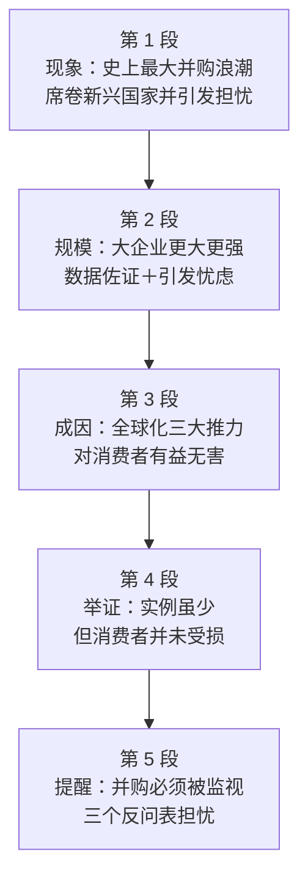

# Passage 22 · 全球并购浪潮的是与非

## 答题记录

| 轮次  | 日期         | 题号  | 正确  | 错误  | 正确率 | 用时    | 错题归因 |
| --- | --- | --- | --- | --- | --- | --- | --- |
| 1 |  | 1-4 |  |  |  |  |  |
| 2 |  | 1-4 |  |  |  |  |  |
| 3 |  | 1-4 |  |  |  |  |  |

> [!tip] 填写口径
> - **用时**以分钟计，只计做题时间，不含精读复盘。
> - **错题归因**填「题型·错误类型」，如：细节题·定位错、推理判断·过度推断、主旨大意·以偏概全。
> - 纵向看趋势：正确率升而用时过长 → 熟练度不足；用时降而正确率波动 → 定位不稳。

> [!info] 文章档案
> - **来源**：考研英语（一）2001 年 Text 4
> - **题材**：商业经济——全球企业并购浪潮及其争议
> - **结构**：5 段 / 22 句 ＋ 4 题
> - **难度**：★★★★☆
> - **一句话主旨**：世界正经历前所未有的并购浪潮，其动力来自全球化带来的成本下降与市场扩大；作者既肯定它对消费者有益无害，又提醒这股力量必须受到监视，态度客观。

## 一、篇章脉络

- **第 1 段**：抛出话题——世界正经历有史以来最大的并购浪潮，从美国席卷欧洲、波及新兴国家，并引出人们的担忧。
- **第 2 段**：用数据说明规模——跨国公司在国际贸易中的占比持续上升，阿根廷等国的例子尤其典型，引发对小企业与世界经济稳定的担忧。
- **第 3 段**：分析成因——推动并购的力量与推动全球化的力量相同：运输与通讯成本下降、贸易与投资壁垒降低、市场扩大要求更大规模的经营。
- **第 4 段**：举证回应——虽「利弊实例不多」，但石油、电信、汽车三例都说明合并并未伤及消费者。
- **第 5 段**：转折提醒——并购运动必须被监视，并以格林斯潘的警告和三个反问收尾。

> [!tip] 行文逻辑
> 现象（第 1 段）→ 规模（第 2 段）→ 成因（第 3 段）→ 举证（第 4 段）→ 提醒（第 5 段），是标准的「是什么—有多大—为什么—怎么看—要注意什么」经济评论结构。作者态度呈「肯定 + 警惕」两面兼顾：第 3 段②③句说有益，第 4 段说未伤及消费者，第 5 段说必须监视——这正是第 4 题答 objective 的依据。

## 二、逐段精读

### 第 1 段 · 现象：史上最大的并购浪潮

**原文**

① The world is going through the biggest wave of mergers and acquisitions ever witnessed.
② The process sweeps from hyperactive America to Europe and reaches the emerging countries with unsurpassed might.
③ Many in these countries are looking at this process and worrying: "Won't the wave of business concentration turn into an uncontrollable anti-competitive force?"

**译文**

① 世界正在经历一场有史以来规模最大的合并与收购浪潮。
② 这一进程从异常活跃的美国席卷到欧洲，并以无可匹敌的威力抵达那些新兴国家。
③ 这些国家中的许多人正注视着这一进程并心生忧虑：「企业集中化的浪潮难道不会变成一股无法控制的反竞争力量吗？」

> [!note] 段落要点
> - 功能：开篇点题，用「史上最大」「席卷」「无可匹敌」三个词渲染浪潮之猛，并立刻引出担忧，为后文的辩证讨论定调。
> - ③句的反问（Won't ...?）不是真问，而是表达担忧，等效于一个否定性的陈述；concentration / anti-competitive 是全篇的核心概念词。

#### 长难句 · 本段

> [!abstract] 本段第 ① 句 · The world is going through the biggest wave of mergers and acquisitions ever witnessed.

**结构拆解**

- **主干**：The world is going through the biggest wave（主谓宾，go through 经历）
- **后置定语**：of mergers and acquisitions（说明是什么样的 wave）
- **后置定语**：ever witnessed（过去分词短语修饰 wave，＝ that has ever been witnessed）
- **最高级标志**：the biggest ... ever ...（最高级 + ever + 分词，表「有史以来最……的」）

**参考译文**

世界正在经历一场有史以来规模最大的合并与收购浪潮。

> [!tip] 拆解要点
> `the + 最高级 + 名词 + ever + 过去分词` 是考研阅读开篇的高频句式（the biggest ... ever witnessed / the largest ... ever recorded），见到即可判定作者在做「程度强调」；witness 在此是动词「目睹、见证」，其主语本应是人，这里以 wave 作主语，属拟人化用法。

#### 本段重点词汇

| 单词 / 短语 | 词性 | 文中意 | 常用考义与拓展 | 英文示例搭配（中译） |
| --- | --- | --- | --- | --- |
| **merger** | n. | （企业）合并 | merge v. 合并；merge with 与……合并 | a wave of mergers and acquisitions（并购浪潮） |
| **acquisition** | n. | 收购；获得 | acquire v. 收购、获得；acquisitive adj. 贪得的 | mergers and acquisitions（合并与收购） |
| **witness** | v. | 目睹，见证 | 熟词僻义：目击者 → 见证、目睹；也作插入语「看看……就知道」 | the biggest wave ever witnessed（有史以来见证过的最大浪潮） |
| **sweep** | v. | 席卷，迅速蔓延 | sweep-swept-swept；sweep across 席卷 | sweeps from America to Europe（从美国席卷到欧洲） |
| **hyperactive** | adj. | 极度活跃的 | 前缀 hyper- 表「过度」；hyperactive America 异常活跃的美国 | from hyperactive America（从极度活跃的美国） |
| **emerging** | adj. | 新兴的，新出现的 | emerge v. 出现；emerging countries / markets 新兴国家 / 市场 | reaches the emerging countries（抵达新兴国家） |
| **unsurpassed** | adj. | 无可匹敌的，未被超越的 | surpass v. 超越；surpassing adj. 出众的 | with unsurpassed might（以无可匹敌的威力） |
| **might** | n. | 威力，力量 | 熟词僻义：情态动词「可能」→ 名词「力量」；military might 军事力量 | with unsurpassed might（以无可匹敌的威力） |
| **concentration** | n. | 集中（化） | 熟词僻义：专注 → （资本、市场的）集中；concentrate v. 集中 | the wave of business concentration（企业集中化浪潮） |
| **uncontrollable** | adj. | 无法控制的 | 反义 controllable；control n./v. 控制 | an uncontrollable anti-competitive force（无法控制的反竞争力量） |
| **anti-competitive** | adj. | 反竞争的 | 前缀 anti- 表「反对」；anti-competitive behavior 反竞争行为 | turn into an anti-competitive force（变成反竞争的力量） |

### 第 2 段 · 规模：大企业更大更强

**原文**

① There's no question that the big are getting bigger and more powerful.
② Multinational corporations accounted for less than 20% of international trade in 1982.
③ Today the figure is more than 25% and growing rapidly.
④ International affiliates account for a fast-growing segment of production in economies that open up and welcome foreign investment.
⑤ In Argentina, for instance, after the reforms of the early 1990s, multinationals went from 43% to almost 70% of the industrial production of the 200 largest firms.
⑥ This phenomenon has created serious concerns over the role of smaller economic firms, of national businessmen and over the ultimate stability of the world economy.

**译文**

① 毫无疑问，大企业正在变得更大更强。
② 1982 年，跨国公司在国际贸易中所占的比例还不到 20%。
③ 如今这个数字已超过 25%，并且还在迅速增长。
④ 在那些对外开放、欢迎外资的经济体中，跨国公司的附属机构占生产的份额正在快速增长。
⑤ 例如在阿根廷，经过 1990 年代初的改革，跨国公司在 200 家最大企业工业生产中的占比从 43% 上升到近 70%。
⑥ 这一现象引发了严重担忧：规模较小的企业将扮演什么角色、本国企业家将扮演什么角色，以及世界经济的最终稳定。

> [!note] 段落要点
> - 功能：用三组数据（20%→25%、附属机构份额、阿根廷 43%→70%）把第 1 段的「浪潮」坐实为可量化的趋势。
> - ⑥句由数据转向担忧，与第 1 段③句的担忧呼应；其中的 concerns over A, of B and over C 是三项并列的忧虑对象，第 1 题的定位区。

#### 长难句 · 本段

> [!abstract] 本段第 ⑥ 句 · This phenomenon has created serious concerns over the role of smaller economic firms, of national businessmen and over the ultimate stability of the world economy.

**结构拆解**

- **主干**：This phenomenon has created serious concerns（主谓宾）
- **并列后置定语**：over the role of smaller economic firms, of national businessmen and over the ultimate stability of the world economy（三项由 and 连接）
- **省略**：第二项承前省略 over the role，完整为 over the role of smaller economic firms, (over the role) of national businessmen and over the ... stability
- **层层限定**：the ultimate stability of the world economy

**参考译文**

这一现象引发了严重担忧：规模较小的企业将扮演什么角色、本国企业家将扮演什么角色，以及世界经济的最终稳定。

> [!tip] 拆解要点
> 抓 and 把 concerns 的三个对象切出来：① smaller economic firms ② national businessmen ③ the ultimate stability of the world economy。命题人常把其中一项单独拿出来说成「全文唯一的忧虑」，属以偏概全型干扰。

#### 本段重点词汇

| 单词 / 短语 | 词性 | 文中意 | 常用考义与拓展 | 英文示例搭配（中译） |
| --- | --- | --- | --- | --- |
| **There's no question that** | （句型） | 毫无疑问…… | 同义 beyond question / undoubtedly；反义 There's some question whether | There's no question that the big are getting bigger（毫无疑问大企业正变得更大） |
| **powerful** | adj. | 强大的，有力量的 | power n. 力量、权力；powerless adj. 无力的 | getting bigger and more powerful（变得更大更强） |
| **multinational** | n. / adj. | 跨国公司（的） | 前缀 multi- 表「多」；multinational corporations 跨国公司 | Multinational corporations accounted for...（跨国公司占……） |
| **account for** | （短语） | 占（比例）；解释 | account n. 账户、说明；take into account 考虑到 | accounted for less than 20% of international trade（占国际贸易不到 20%） |
| **figure** | n. | 数字，数值 | 熟词僻义：人物、身材 → 数字；figure out 弄明白 | Today the figure is more than 25%（如今这个数字超过 25%） |
| **affiliate** | n. | 附属公司，分支机构 | 熟词僻义：使隶属（动词）→ 附属机构（名词）；affiliation n. 隶属关系 | International affiliates（跨国公司的海外附属机构） |
| **segment** | n. | 部分，份额 | segment v. 分割；a segment of the market 细分市场 | a fast-growing segment of production（快速增长的生产份额） |
| **open up** | （短语） | 开放，开放市场 | open up to foreign investment 向外资开放 | economies that open up（对外开放的经济体） |
| **for instance** | （短语） | 例如 | 同义 for example；instance n. 实例、事例 | In Argentina, for instance（例如在阿根廷） |
| **reform** | n. / v. | 改革 | reformer n. 改革者；economic reform 经济改革 | after the reforms of the early 1990s（在 1990 年代初的改革之后） |
| **concern** | n. | 担忧；关切的事 | concern v. 涉及、使担忧；concerns over / about 对……的担忧 | created serious concerns over...（引发了对……的严重担忧） |
| **ultimate** | adj. | 最终的，根本的 | ultimately adv. 最终；同义 final / eventual | the ultimate stability（最终的稳定） |
| **stability** | n. | 稳定（性） | stable adj. 稳定的；stabilize v. 使稳定 | the stability of the world economy（世界经济的稳定） |

### 第 3 段 · 成因：全球化的三大推力

**原文**

① I believe that the most important forces behind the massive M&A wave are the same that underlie the globalization process: falling transportation and communication costs, lower trade and investment barriers and enlarged markets that require enlarged operations capable of meeting customers' demands.
② All these are beneficial, not detrimental, to consumers.
③ As productivity grows, the world's wealth increases.

**译文**

① 我认为，推动这场大规模并购浪潮的最重要力量，与支撑全球化进程的那些力量是相同的：不断下降的运输与通讯成本，更低的贸易与投资壁垒，以及要求更大规模经营才能满足客户需求的扩大化市场。
② 所有这些对消费者来说都是有益而无害的。
③ 随着生产力提高，世界的财富也随之增长。

> [!note] 段落要点
> - 功能：由「有多大」转入「为什么」——并购的动力与全球化的动力同源，并顺势给出作者的第一层评价（有益无害）。
> - ①句冒号后是三项并列的推力，其中第三项「市场扩大 → 要求更大规模经营 → 满足客户需求」是第 2 题的答案所在；②句的评价是第 4 题「客观」态度的一半依据。

#### 长难句 · 本段

> [!abstract] 本段第 ① 句 · I believe that the most important forces behind the massive M&A wave are the same that underlie the globalization process: falling transportation and communication costs, lower trade and investment barriers and enlarged markets that require enlarged operations capable of meeting customers' demands.

**结构拆解**

- **主句**：I believe that...（主谓宾从）
- **宾语从句**：the most important forces are the same（主系表）
- **定语从句**：that underlie the globalization process（修饰 the same）
- **冒号列举**：三项并列名词短语共同说明 the same 的具体内容
  - ① falling transportation and communication costs
  - ② lower trade and investment barriers
  - ③ enlarged markets that require enlarged operations capable of meeting customers' demands
- **嵌套定语**：that require enlarged operations（修饰 markets）+ capable of meeting customers' demands（形容词短语修饰 operations）

**参考译文**

我认为，推动这场大规模并购浪潮的最重要力量，与支撑全球化进程的那些力量是相同的：不断下降的运输与通讯成本，更低的贸易与投资壁垒，以及要求更大规模经营才能满足客户需求的扩大化市场。

> [!tip] 拆解要点
> 先抓 `are the same that ...` 这一「等同」判断（并购动力 = 全球化动力），再看冒号后的三项列举。第三项里 `markets → require → operations → capable of → demands` 是一串 4 层限定，读时要逐层剥离：市场需要经营，经营要能足够大，大到能满足客户需求。第 2 题的正确项 the greater customer demands 正来自这一串的最末端。

#### 本段重点词汇

| 单词 / 短语 | 词性 | 文中意 | 常用考义与拓展 | 英文示例搭配（中译） |
| --- | --- | --- | --- | --- |
| **force** | n. | 推动力，驱动力；力量 | 熟词僻义：武力 → 推动力；driving force 驱动力 | the most important forces behind the M&A wave（并购浪潮背后最重要的推动力） |
| **massive** | adj. | 大规模的，巨大的 | mass n. 大量、群众；massive scale 大规模 | the massive M&A wave（大规模的并购浪潮） |
| **underlie** | v. | 是……的基础，支撑 | under- + lie；underlying adj. 根本的、潜在的 | the same that underlie the globalization process（支撑全球化进程的同样力量） |
| **globalization** | n. | 全球化 | globalize v. 使全球化；global adj. 全球的 | the globalization process（全球化进程） |
| **transportation** | n. | 运输，交通 | transport v./n. 运输；transportation costs 运输成本 | falling transportation costs（不断下降的运输成本） |
| **barrier** | n. | 壁垒，障碍 | trade barrier 贸易壁垒；barrier to entry 进入壁垒 | lower trade and investment barriers（更低的贸易与投资壁垒） |
| **enlarged** | adj. | 扩大的 | enlarge v. 扩大；en- 前缀使动用法 | enlarged markets（扩大化的市场） |
| **operation** | n. | 经营，业务；运作 | operate v. 经营、运转；operational adj. 运营的 | require enlarged operations（需要更大规模的经营） |
| **capable of** | （短语） | 能够，有能力做 | capability n. 能力；incapable of 无能力做 | operations capable of meeting demands（能满足需求的经营规模） |
| **meet one's demands** | （短语） | 满足某人的需求 | meet 此处为「满足」；demand n. 需求 | meeting customers' demands（满足客户的需求） |
| **beneficial** | adj. | 有益的，有利的 | benefit n./v. 益处、受益；beneficial to 对……有益 | are beneficial, not detrimental, to consumers（对消费者有益而无害） |
| **detrimental** | adj. | 有害的，不利的 | detriment n. 损害；be detrimental to 对……有害 | not detrimental to consumers（对消费者无害） |
| **productivity** | n. | 生产力，生产率 | productive adj. 多产的；produce v. 生产 | As productivity grows（随着生产力提高） |

### 第 4 段 · 举证：消费者并未受损

**原文**

① Examples of benefits or costs of the current concentration wave are scanty.
② Yet it is hard to imagine that the merger of a few oil firms today could re-create the same threats to competition that were feared nearly a century ago in the U.S., when the Standard Oil Trust was broken up.
③ The mergers of telecom companies, such as WorldCom, hardly seem to bring higher prices for consumers or a reduction in the pace of technical progress.
④ On the contrary, the price of communications is coming down fast.
⑤ In cars, too, concentration is increasing—witness Daimler and Chrysler, Renault and Nissan—but it does not appear that consumers are being hurt.

**译文**

① 能够证明当前这波集中化浪潮是利是弊的实例并不多。
② 然而很难想象，如今几家石油公司的合并会再次造成近一个世纪前美国所担心的那种竞争威胁——当年标准石油托拉斯正是因此被拆分。
③ 世界通信这类电信公司的合并，似乎既没有给消费者带来更高的价格，也没有造成技术进步速度的放缓。
④ 相反，通讯资费正在快速下降。
⑤ 在汽车行业，集中化程度同样在提高——看看戴姆勒与克莱斯勒、雷诺与日产就知道——但消费者似乎并没有受到损害。

> [!note] 段落要点
> - 功能：以「承认证据不足 → 举三例说明无害」的方式回应第 1 段的担忧，是作者客观态度的实证部分。
> - ②句是第 3 题的定位句（Standard Oil Trust 当年被拆分，即曾被认为威胁竞争）；⑤句的破折号插入 witness ... 是「举例」的特殊写法。

#### 长难句 · 本段

> [!abstract] 本段第 ② 句 · Yet it is hard to imagine that the merger of a few oil firms today could re-create the same threats to competition that were feared nearly a century ago in the U.S., when the Standard Oil Trust was broken up.

**结构拆解**

- **形式主语**：it is hard to imagine that ...（it 指代 that 从句）
- **宾语从句**：that the merger of a few oil firms today could re-create the same threats to competition
- **定语从句**：that were feared nearly a century ago in the U.S.（修饰 threats）
- **非限定定语从句**：when the Standard Oil Trust was broken up（修饰 a century ago / the U.S. 所指的时代）
- **构词**：re-create 前缀 re- 表「再次」，非 recreate（消遣）

**参考译文**

然而很难想象，如今几家石油公司的合并会再次造成近一个世纪前美国所担心的那种竞争威胁——当年标准石油托拉斯正是因此被拆分。

> [!tip] 拆解要点
> `it is hard to imagine that ...` 表面否定「想象」，实则表达作者的判断「不会发生」；`the same threats ... that were feared ... when ...` 三层定语环环相扣：威胁 → 曾被担心 → 当年托拉斯被拆分。推断题常在这一层上设问：既然当年因为担心威胁竞争而拆分，就可推知它**可能**威胁过竞争（第 3 题 D 项）。

#### 长难句 · 本段

> [!abstract] 本段第 ⑤ 句 · In cars, too, concentration is increasing—witness Daimler and Chrysler, Renault and Nissan—but it does not appear that consumers are being hurt.

**结构拆解**

- **并列主干**：concentration is increasing ..., but it does not appear that ...（but 连接两个分句）
- **破折号插入语**：witness Daimler and Chrysler, Renault and Nissan（祈使句作插入语，＝ just look at ...）
- **形式主语**：it does not appear that consumers are being hurt（it 指代 that 从句）
- **被动进行式**：are being hurt（正在受到损害）

**参考译文**

在汽车行业，集中化程度同样在提高——看看戴姆勒与克莱斯勒、雷诺与日产就知道——但消费者似乎并没有受到损害。

> [!tip] 拆解要点
> `witness + 名词` 作插入语是本文最特别的写法，相当于「看看……就知道」，翻译时补出括号即可；`it does not appear that ...` 是委婉否定（＝ apparently ... not），常用于表达作者克制、留有余地的判断，与 objective 的态度一致。

#### 本段重点词汇

| 单词 / 短语 | 词性 | 文中意 | 常用考义与拓展 | 英文示例搭配（中译） |
| --- | --- | --- | --- | --- |
| **scanty** | adj. | 不足的，稀少的 | 熟词僻义：常作「（衣物）裸露的」→ 此处指证据、数量不足；scant adj. 不足的 | Examples ... are scanty（实例不多） |
| **re-create** | v. | 再次造成，重现 | 注意与 recreate（消遣）区分，re-create 常带连字符 | could re-create the same threats（可能再次造成同样的威胁） |
| **break up** | （短语） | 拆分，解体；分手 | break-broke-broken；break up a monopoly 拆分垄断 | the Standard Oil Trust was broken up（标准石油托拉斯被拆分） |
| **telecom** | n. | 电信（业） | 全称 telecommunications；telecom companies 电信公司 | the mergers of telecom companies（电信公司的合并） |
| **reduction** | n. | 降低，减少 | reduce v. 减少；a reduction in ... ……的下降 | a reduction in the pace of technical progress（技术进步速度的放缓） |
| **pace** | n. | 速度，节奏 | 熟词僻义：一步、步伐 → 速度；keep pace with 跟上 | the pace of technical progress（技术进步的速度） |
| **on the contrary** | （短语） | 正相反 | 用于否定前文并引出对立事实；对比 in contrast（仅表差异） | On the contrary, the price is coming down（相反，价格在下降） |
| **hurt** | v. | 损害，伤害 | hurt-hurt-hurt；be hurt 受损 | consumers are being hurt（消费者正受到损害） |

### 第 5 段 · 提醒：并购必须被监视

**原文**

① Yet the fact remains that the merger movement must be watched.
② A few weeks ago, Alan Greenspan warned against the megamergers in the banking industry.
③ Who is going to supervise, regulate and operate as lender of last resort with the gigantic banks that are being created?
④ Won't multinationals shift production from one place to another when a nation gets too strict about infringements to fair competition?
⑤ And should one country take upon itself the role of "defending competition" on issues that affect many other nations, as in the U.S. vs. Microsoft case?

**译文**

① 然而，事实依然是：这股并购运动必须受到监视。
② 几周前，艾伦·格林斯潘曾对银行业的大型合并提出警告。
③ 谁将来监管、管理这些正在被创造出来的巨型银行，并在必要时充当最后贷款人？
④ 当某个国家对损害公平竞争的行为管得过严时，跨国公司难道不会把生产从一个地方转移到另一个地方吗？
⑤ 而且，在牵涉许多其他国家的问题上，一个国家是否应当自己揽下「维护竞争」的角色——就像美国诉微软案那样？

> [!note] 段落要点
> - 功能：由肯定转向提醒——并购虽有益，但必须被监视；末三句连用反问，把担忧推向高潮后戛然而止。
> - ①句是全文态度的第二面（警惕），与第 3 段②③句（肯定）共同构成 objective；③④⑤句三个反问都不需回答，答案已隐含在语气中。

#### 长难句 · 本段

> [!abstract] 本段第 ① 句 · Yet the fact remains that the merger movement must be watched.

**结构拆解**

- **主干**：the fact remains（主谓，remain 作系动词「依然是」）
- **同位语从句**：that the merger movement must be watched（说明 fact 的具体内容）
- **转折副词**：Yet（与第 4 段的「无害」结论形成转折）
- **被动语态**：must be watched（情态动词被动）

**参考译文**

然而，事实依然是：这股并购运动必须受到监视。

> [!tip] 拆解要点
> `the fact remains that ...` 是「让步之后立论」的常用句式（＝ 尽管如此，事实仍然是……），Yet 一出现就说明作者要补上另一面。判断态度题时，这类「Yet + 必须/应当」的句子是作者立场的关键落点。

#### 长难句 · 本段

> [!abstract] 本段第 ③ 句 · Who is going to supervise, regulate and operate as lender of last resort with the gigantic banks that are being created?

**结构拆解**

- **主干**：Who is going to supervise, regulate and operate（三项并列谓语）
- **方式状语**：as lender of last resort（as 引出「以……身份」）
- **伴随状语**：with the gigantic banks（with 引出动作对象）
- **定语从句**：that are being created（被动进行式，修饰 banks）

**参考译文**

谁将来监管、管理这些正在被创造出来的巨型银行，并在必要时充当最后贷款人？

> [!tip] 拆解要点
> 三个动词 supervise（监督）、regulate（监管）、operate as ...（充当……角色）共用主语 Who，读时一次性并列带过即可；`lender of last resort`（最后贷款人）是金融固定术语，指危机时提供流动性的央行角色。

#### 长难句 · 本段

> [!abstract] 本段第 ⑤ 句 · And should one country take upon itself the role of "defending competition" on issues that affect many other nations, as in the U.S. vs. Microsoft case?

**结构拆解**

- **主干**：should one country take upon itself the role（情态动词疑问句，宾语 the role 因带长定语而后置）
- **后置定语**：of "defending competition" 与 on issues（双重限定 the role）
- **定语从句**：that affect many other nations（修饰 issues）
- **举例短语**：as in the U.S. vs. Microsoft case（as + 介词短语，表「正如……那样」）

**参考译文**

而且，在牵涉许多其他国家的问题上，一个国家是否应当自己揽下「维护竞争」的角色——就像美国诉微软案那样？

> [!tip] 拆解要点
> `take upon oneself the role of ...` 中宾语后置，正常语序为 take the role upon itself；`as in ...` 是省略型举例（＝ as is the case in ...）。全段末三问连用，是典型的「反问收尾」修辞，问而不答，把判断权留给读者，也正体现了作者的客观克制。

#### 本段重点词汇

| 单词 / 短语 | 词性 | 文中意 | 常用考义与拓展 | 英文示例搭配（中译） |
| --- | --- | --- | --- | --- |
| **watch** | v. | 监视，密切关注 | 熟词僻义：观看 → 监视、看管；watch out 当心 | the merger movement must be watched（并购运动必须受到监视） |
| **megamerger** | n. | 超大型合并 | 前缀 mega- 表「巨大」；megacity 特大城市 | warned against the megamergers（对大型合并提出警告） |
| **supervise** | v. | 监督，监管 | supervision n. 监督；supervisor n. 监管人 | supervise, regulate and operate（监督、管理并运作） |
| **regulate** | v. | 监管，调节 | regulation n. 规章、监管；regulator n. 监管机构 | regulate the banks（监管银行） |
| **lender of last resort** | （短语） | 最后贷款人 | 金融术语：危机时向金融机构提供流动性的角色（通常为央行） | operate as lender of last resort（充当最后贷款人） |
| **gigantic** | adj. | 巨大的，庞大的 | 同义 enormous / huge；giant n. 巨人 | the gigantic banks（巨型银行） |
| **shift** | v. / n. | 转移，转移（生产） | shift production 转移生产；night shift 夜班 | shift production from one place to another（把生产从一地转移到另一地） |
| **infringement** | n. | 违反，侵害 | infringe v. 侵犯；infringement of/on 对……的侵犯 | infringements to fair competition（对公平竞争的损害） |
| **take upon oneself** | （短语） | 自己承担，揽下 | 同义 take on；take upon oneself the role of 揽下……的角色 | take upon itself the role（自己揽下这个角色） |
| **defend** | v. | 维护，捍卫；辩护 | defence/defense n. 防御、辩护；defendant n. 被告 | the role of "defending competition"（维护竞争的角色） |

## 三、全篇重点词汇汇总（自测用）

> [!info] 说明
> 本表只列「单词 / 词性 / 所在段」，不含释义与搭配，用于遮表自测：说出词义后再回该段核对。
> 收录**全篇所有段落词汇，共 55 条，不删减**，与各段「本段重点词汇」等长同源。

| 单词 / 短语 | 词性 | 所在段 |
| --- | --- | --- |
| **merger** | n. | 第 1 段 |
| **acquisition** | n. | 第 1 段 |
| **witness** | v. | 第 1 段 |
| **sweep** | v. | 第 1 段 |
| **hyperactive** | adj. | 第 1 段 |
| **emerging** | adj. | 第 1 段 |
| **unsurpassed** | adj. | 第 1 段 |
| **might** | n. | 第 1 段 |
| **concentration** | n. | 第 1 段 |
| **uncontrollable** | adj. | 第 1 段 |
| **anti-competitive** | adj. | 第 1 段 |
| **There's no question that** | （句型） | 第 2 段 |
| **powerful** | adj. | 第 2 段 |
| **multinational** | n. / adj. | 第 2 段 |
| **account for** | （短语） | 第 2 段 |
| **figure** | n. | 第 2 段 |
| **affiliate** | n. | 第 2 段 |
| **segment** | n. | 第 2 段 |
| **open up** | （短语） | 第 2 段 |
| **for instance** | （短语） | 第 2 段 |
| **reform** | n. / v. | 第 2 段 |
| **concern** | n. | 第 2 段 |
| **ultimate** | adj. | 第 2 段 |
| **stability** | n. | 第 2 段 |
| **force** | n. | 第 3 段 |
| **massive** | adj. | 第 3 段 |
| **underlie** | v. | 第 3 段 |
| **globalization** | n. | 第 3 段 |
| **transportation** | n. | 第 3 段 |
| **barrier** | n. | 第 3 段 |
| **enlarged** | adj. | 第 3 段 |
| **operation** | n. | 第 3 段 |
| **capable of** | （短语） | 第 3 段 |
| **meet one's demands** | （短语） | 第 3 段 |
| **beneficial** | adj. | 第 3 段 |
| **detrimental** | adj. | 第 3 段 |
| **productivity** | n. | 第 3 段 |
| **scanty** | adj. | 第 4 段 |
| **re-create** | v. | 第 4 段 |
| **break up** | （短语） | 第 4 段 |
| **telecom** | n. | 第 4 段 |
| **reduction** | n. | 第 4 段 |
| **pace** | n. | 第 4 段 |
| **on the contrary** | （短语） | 第 4 段 |
| **hurt** | v. | 第 4 段 |
| **watch** | v. | 第 5 段 |
| **megamerger** | n. | 第 5 段 |
| **supervise** | v. | 第 5 段 |
| **regulate** | v. | 第 5 段 |
| **lender of last resort** | （短语） | 第 5 段 |
| **gigantic** | adj. | 第 5 段 |
| **shift** | v. / n. | 第 5 段 |
| **infringement** | n. | 第 5 段 |
| **take upon oneself** | （短语） | 第 5 段 |
| **defend** | v. | 第 5 段 |

> [!warning] 熟词僻义专列
> - **witness** v. 目睹、见证；祈使式插入语「看看……就知道」（非「目击者」）
> - **might** n. 威力、力量（非情态动词「可能」）
> - **concentration** n. （资本、市场的）集中（非「专注」）
> - **figure** n. 数字、数值（非「人物、身材」）
> - **affiliate** n. 附属公司、分支机构（非动词「使隶属」）
> - **segment** n. 部分、份额（非动词「分割」）
> - **force** n. 推动力、驱动力（非「武力」）
> - **scanty** adj. 稀少的、不足的（非「（衣物）暴露的」）
> - **pace** n. 速度、节奏（非「一步、踱步」）
> - **watch** v. 监视、密切关注（非「观看」）
> - **resort** n. 凭借、可求助的对象（lender of last resort 最后贷款人，非「度假地」）
> - **emerging** adj. 新兴的（emerging countries 新兴国家）

> [!example] 同义替换链（阅读题高频）
> - mergers and acquisitions = combine and become bigger（第 1 题考点）
> - enlarged markets that require enlarged operations capable of meeting customers' demands = the greater customer demands（第 2 题考点）
> - the same threats to competition ... when the Standard Oil Trust was broken up = the Standard Oil Trust might have threatened competition（第 3 题考点）
> - beneficial, not detrimental / consumers are not being hurt / must be watched = objective（第 4 题考点）
> - anti-competitive force = threats to competition = infringements to fair competition
> - Examples ... are scanty = few examples of benefits or costs

## 四、知识点补充

> [!question] 背景知识
> - **M&A（并购）**：mergers and acquisitions。merger 指两家或多家公司合并为一家；acquisition 指一家公司收购另一家。文中的 business concentration 指市场份额与资本向少数巨头集中。
> - **标准石油托拉斯（Standard Oil Trust）**：洛克菲勒于 1879 年建立的石油垄断组织，一度控制美国九成炼油能力；1911 年因违反《谢尔曼反托拉斯法》被美国最高法院判决拆分。
> - **世界通信（WorldCom）**：美国电信公司，1990 年代通过一连串并购迅速扩张，2002 年因财务造假申请破产；文中用作「并购未损害消费者」的例子。
> - **艾伦·格林斯潘（Alan Greenspan）**：1987—2006 年任美国联邦储备委员会主席，文中引用他对银行业巨型合并的警告。
> - **lender of last resort（最后贷款人）**：金融术语，指金融机构无法从市场融资时，由中央银行出面提供流动性的机制。

> [!warning] 语法点
> - **修辞性反问**：Won't the wave ... turn into ...? / Won't multinationals shift ...? / And should one country ...?（问而不答，答案隐含在语气中）
> - **the same + that 从句**：the most important forces ... are the same that underlie the globalization process。
> - **三项并列名词短语**：falling ... costs, lower ... barriers and enlarged markets that ...（冒号后整体列举）
> - **破折号插入语**：concentration is increasing—witness Daimler and Chrysler, Renault and Nissan—but ...（祈使句作插入举例）
> - **形式主语 + that 从句**：it is hard to imagine that ...；it does not appear that ...
> - **the fact remains that ...**：the fact remains that the merger movement must be watched（同位语从句说明 fact）

> [!success] 写作可迁移句型
> - `The world is going through the biggest wave of ... ever witnessed.` → 开篇写某种席卷全球的潮流。
> - `There's no question that ...` → 强调无可争议的事实，增强语气。
> - `Examples of ... are scanty.` → 承认证据不足，显得客观克制。
> - `On the contrary, ...` → 反向推进论证。
> - `Yet the fact remains that ... must be watched.` → 让步之后提出必须警惕的一面。

> [!danger] 易混辨析
> - **merger / acquisition**：merger 指平等合并为一家新公司；acquisition 指一方收购另一方（被收购方通常失去独立地位）。
> - **beneficial / profitable**：beneficial 有益的（对谁有好处）；profitable 有利可图的（赚钱）。
> - **detrimental / harmful**：detrimental 有害的、不利的（正式书面）；harmful 通用的「有害的」。
> - **scanty / scarce**：scanty 指（数量、证据、衣着）不足、稀少；scarce 指（资源、物品）稀缺、供不应求。
> - **stability / security**：stability 稳定（不波动、不动摇）；security 安全、保障（不受威胁）。

## 五、题目分析

> [!info] 题目总览
> | 题号 | 题型 | 定位 | 答案 |
> | --- | --- | --- | --- |
> | 1 | 细节题（趋势概括） | 第 1 段①句 / 第 2 段①句 | C |
> | 2 | 细节题（因果） | 第 3 段①句 | A |
> | 3 | 推理判断题 | 第 4 段②句 | D |
> | 4 | 观点态度题 | 第 3 段②③句 / 第 4 段 / 第 5 段①句 | B |

### 第 1 题 · 细节题（趋势概括）

> [!question] 原题
> What is the typical trend of businesses today?
> - A. To take in more foreign funds.
> - B. To invest more abroad.
> - C. To combine and become bigger.
> - D. To trade with more countries.

**正确答案**：**C. To combine and become bigger.（合并并变得更大）**

**定位与依据**
- 定位到第 1 段①句：The world is going through the biggest wave of mergers and acquisitions ever witnessed（开篇即点明潮流是并购）。
- 第 2 段①句印证：There's no question that the big are getting bigger and more powerful。
- 同义替换：mergers and acquisitions = combine；getting bigger = become bigger。

**干扰项分析**

| 选项 | 选项内容 | 判断 | 排除理由 |
| --- | --- | --- | --- |
| A | To take in more foreign funds. | ✗ | 偷换概念：第 2 段④句说的是一些国家开放并欢迎外资（open up and welcome foreign investment），那是这些国家的政策，不是企业发展潮流本身。 |
| B | To invest more abroad. | ✗ | 无中生有：文中只说跨国公司的生产份额上升、并购浪潮席卷各国，未提「增加海外投资」是企业趋势。 |
| D | To trade with more countries. | ✗ | 无中生有：文中说并购浪潮从美国席卷到欧洲、新兴国家，讲的是资本集中，不是与更多国家做贸易。 |

> [!tip] 解题思路
> 问「当今企业的典型趋势」时，答案往往就是全文反复出现的那个核心概念词——本文即 mergers and acquisitions / concentration。干扰项通常是把文中出现过的某个名词（foreign investment、countries）包装成「趋势」，凡核心概念词没有出现的选项都要警惕。

### 第 2 题 · 细节题（因果）

> [!question] 原题
> According to the author, one of the driving forces behind M&A wave is
> - A. the greater customer demands.
> - B. a surplus supply for the market.
> - C. a growing productivity.
> - D. the increase of the world's wealth.

**正确答案**：**A. the greater customer demands.（更大的客户需求）**

**定位与依据**
- 定位到第 3 段①句：the most important forces behind the massive M&A wave are the same that underlie the globalization process: ... enlarged markets that require enlarged operations capable of meeting customers' demands。
- 同义替换：meeting customers' demands = the greater customer demands（三项推力中的第三项）。

**干扰项分析**

| 选项 | 选项内容 | 判断 | 排除理由 |
| --- | --- | --- | --- |
| B | a surplus supply for the market. | ✗ | 无中生有：原文说的是 enlarged markets（市场扩大）与 enlarged operations（经营规模扩大），不是「供过于求」。 |
| C | a growing productivity. | ✗ | 因果倒置：第 3 段③句 As productivity grows ... 是并购带来的**结果**，不是推动并购的力量。 |
| D | the increase of the world's wealth. | ✗ | 因果倒置：同样出自③句 the world's wealth increases，也是结果而非原因。 |

> [!tip] 解题思路
> 题干出现 driving forces / behind 等词时，答案必在「原因清单」里；同一段末尾那句「随着……，……就增长」几乎都是结果，命题人最爱把它挑出来冒充原因（C、D）。区分办法：问 forces 就找 forces 后面冒号引出的那串名词。

### 第 3 题 · 推理判断题

> [!question] 原题
> From Paragraph 4 we can infer that
> - A. the increasing concentration is certain to hurt consumers.
> - B. WorldCom serves as a good example of both benefits and costs.
> - C. the costs of the globalization process are enormous.
> - D. the Standard Oil Trust might have threatened competition.

**正确答案**：**D. the Standard Oil Trust might have threatened competition.（标准石油托拉斯可能曾对竞争构成威胁）**

**定位与依据**
- 定位到第 4 段②句：... could re-create the same threats to competition that were feared nearly a century ago in the U.S., when the Standard Oil Trust was broken up。
- 推理链：当年人们担心（feared）它对竞争造成威胁，它才被拆分（broken up）→ 可推断它可能曾威胁过竞争。
- 语气对应：选项用 might have（可能），与推断题所需的不确定性语气一致。

**干扰项分析**

| 选项 | 选项内容 | 判断 | 排除理由 |
| --- | --- | --- | --- |
| A | the increasing concentration is certain to hurt consumers. | ✗ | 与原文相反 + 过于绝对：④⑤句说通讯价格在下降、消费者并未受损（does not appear that consumers are being hurt）；certain 更与作者的克制语气相悖。 |
| B | WorldCom serves as a good example of both benefits and costs. | ✗ | 断章取义：③句举 WorldCom 只是为了说明合并**没有**带来高价格与技术放缓，是「有利」的例子，不是利弊兼有。 |
| C | the costs of the globalization process are enormous. | ✗ | 无中生有：第 4 段讨论的是合并的利与弊实例，并未提及全球化的成本。 |

> [!tip] 解题思路
> infer 题的答案一定「推一步即到」：原文说「当年因担心威胁竞争而拆分」，推一步就是「它可能威胁过竞争」。凡是把作者明确否定的说法再肯定一遍（A）、或把单项例子说成两面兼顾（B）的，都是干扰；出现 might / may / could 这类缓和的语气词，往往正合推断题要求。

### 第 4 题 · 观点态度题

> [!question] 原题
> Toward the new business wave, the writer's attitude can be said to be
> - A. optimistic.
> - B. objective.
> - C. pessimistic.
> - D. biased.

**正确答案**：**B. objective.（客观的）**

**定位与依据**
- **肯定面**：第 3 段②句 All these are beneficial, not detrimental, to consumers；③句 As productivity grows, the world's wealth increases。
- **举证面**：第 4 段①句先承认 Examples ... are scanty，再以石油、电信、汽车三例说明消费者并未受损。
- **警惕面**：第 5 段①句 Yet the fact remains that the merger movement must be watched；②句引用格林斯潘的警告；③④⑤句连用三个反问提出隐忧。
- 综合：作者既讲利也讲弊，用大量数据与事实说话，措辞克制，故为客观。

**干扰项分析**

| 选项 | 选项内容 | 判断 | 排除理由 |
| --- | --- | --- | --- |
| A | optimistic. | ✗ | 以偏概全：第 5 段明确提醒并购必须受到监视并提出三个隐忧，并非一味乐观。 |
| C | pessimistic. | ✗ | 以偏概全：第 3 段明确肯定并购对消费者有益无害，第 4 段又说很难想象会重现竞争威胁，并非悲观。 |
| D | biased. | ✗ | 与原文相反：全文列举数据与事实、正反两面兼顾，并多次使用 it does not appear 一类克制表达，不带偏见。 |

> [!tip] 解题思路
> 态度题看三处：段首段尾、转折词（Yet / But）、以及情态与措辞强度。本文在肯定之后立刻用 Yet 补上「必须被监视」，A、C 都只取了一半；凡出现大量数据、实例与缓和措辞（it is hard to imagine / does not appear）的，答案基本就是 objective。

## 六、复盘清单

- [ ] 过汇总表 55 词，遮住「所在段」列自测，重点过 12 个熟词僻义
- [ ] 重做 8 个长难句的口头翻译，特别是三项并列（第 3 段①）与破折号插入语 witness（第 4 段⑤）
- [ ] 画出「现象—规模—成因—举证—提醒」的论证链，并标出态度两极：第 3 段②③（有益）与第 5 段①（必须监视）
- [ ] 整理本文干扰项类型：无中生有 ×3、因果倒置 ×2、以偏概全 ×2、与原文相反 ×2、偷换概念 ×1、断章取义 ×1、过于绝对 ×1
- [ ] 把答题记录填进顶部表格，对照正确率决定是否二刷

## 七、关联笔记

- [[Passage21-人类前景并不悲观]]
- [[考研英语 · 阅读六大题型方法论]]
- [[考研英语 · 熟词僻义汇总]]
