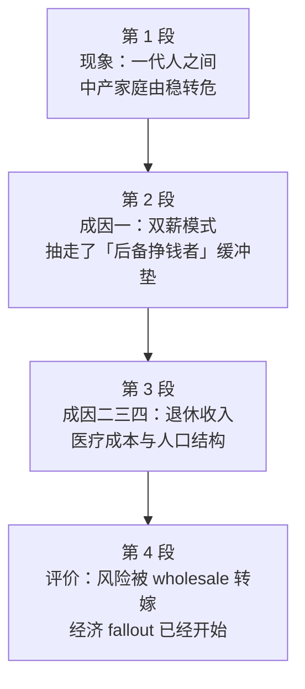

# Passage 23 · 中产家庭的经济风险

## 答题记录

| 轮次  | 日期         | 题号  | 正确  | 错误  | 正确率 | 用时    | 错题归因 |
| --- | --- | --- | --- | --- | --- | --- | --- |
| 1 |  | 1-5 |  |  |  |  |  |
| 2 |  | 1-5 |  |  |  |  |  |
| 3 |  | 1-5 |  |  |  |  |  |

> [!tip] 填写口径
> - **用时**以分钟计，只计做题时间，不含精读复盘。
> - **错题归因**填「题型·错误类型」，如：细节题·定位错、推理判断·过度推断、主旨大意·以偏概全。
> - 纵向看趋势：正确率升而用时过长 → 熟练度不足；用时降而正确率波动 → 定位不稳。

> [!info] 文章档案
> - **来源**：考研英语（一）2007 年 Text 3
> - **题材**：商业经济——美国中产家庭经济风险的全面上调
> - **结构**：4 段 / 16 句 ＋ 5 题
> - **难度**：★★★☆☆
> - **一句话主旨**：双薪、社保私有化、健康储蓄与人口结构变化正把过去由雇主和国家承担的风险转嫁到中产家庭肩上，家庭财务「缓冲垫」被抽走，其后果已开始显现。

## 一、篇章脉络

- **第 1 段**：用对比开篇——过去一代人靠勤劳与公平就能财务安稳，如今一张解聘单、一次坏诊断、一个离去的配偶，几个月内就能把稳固的中产之家打成新贫。
- **第 2 段**：成因之一是双薪。母亲大规模就业改变了家庭经济的基本模式，家庭按双份收入把预算顶到极限，于是失去了「后备挣钱者（通常是妈妈）」这层降落伞。
- **第 3 段**：其余三重压力——退休收入要求家庭自担风险（布什推社保转型）、医疗成本与健康储蓄计划把投资风险塞给家庭、老龄化让「有个年老体弱的父母」的概率一代内翻了八倍。
- **第 4 段**：总结评价——这一切在中产家庭看来远不是「行使更多财务责任」的机会，而是把金融风险全面转嫁到他们已经不堪重负的肩膀上；经济后果已经开始，政治后果可能不远。

> [!tip] 行文逻辑
> 现象（第 1 段）→ 成因（第 2、3 段）→ 评价（第 4 段），是「提出问题—分析原因—给出判断」的典型议论结构。第 2 段用 But 转折、第 3 段用 the same period / For younger families 平行推进，第 4 段以 fallouts 双收。第 4 题就落在最后一句的双 fallout 上，第 5 题则要求把四段合成一个意象。

## 二、逐段精读

### 第 1 段 · 一代人之间，中产之家由稳转危

**原文**

① During the past generation, the American middle-class family that once could count on hard work and fair play to keep itself financially secure has been transformed by economic risk and new realities.
② Now a pink slip, a bad diagnosis, or a disappearing spouse can reduce a family from solidly middle class to newly poor in a few months.

**译文**

① 在过去的一代人里，那个曾经可以依靠勤劳与公平竞争来维持财务安稳的美国家庭，已经被经济风险与新现实彻底改变。
② 如今，一张解聘通知书、一次糟糕的诊断，或一个离去的配偶，就能在几个月之内把一个稳固的中产之家打成新近贫困。

> [!note] 段落要点
> - 功能：开篇用时间对比定调——that once could... 与 has been transformed by... 形成今昔反差，第一段就抛出全文核心词 risk。
> - ②句是排比举证：三个看似普通的日常事件（pink slip / bad diagnosis / disappearing spouse）对应 reduce...to... 的剧烈后果，语气夸张却正是文章要的效果。
> - economically secure 是全文讨论的起点状态，后文所有变化都在拆解这种「安稳」。

#### 长难句 · 本段

> [!abstract] 本段第 ① 句 · During the past generation, the American middle-class family that once could count on hard work and fair play to keep itself financially secure has been transformed by economic risk and new realities.

**结构拆解**

- **时间状语**：During the past generation（在过去一代人里）
- **主语**：the American middle-class family（美国中产家庭）
- **定语从句**：that once could count on hard work and fair play to keep itself financially secure（once 曾经；count on 依靠；不定式表目的）
- **谓语**：has been transformed（现在完成时的被动）
- **施动者**：by economic risk and new realities

**参考译文**

在过去的一代人里，那个曾经可以依靠勤劳与公平竞争来维持财务安稳的美国家庭，已经被经济风险与新现实彻底改变。

> [!tip] 拆解要点
> 长主语被定语从句撑开时，先抓 `the ... family ... has been transformed by ...` 这条主干；`that once could count on A and B to do` 是高频定语从句框架，once 与完成时呼应，正是「今昔对比」句式的标志。本句全文只有一处谓语，别被中间的 hard work / fair play 干扰。

> [!abstract] 本段第 ② 句 · Now a pink slip, a bad diagnosis, or a disappearing spouse can reduce a family from solidly middle class to newly poor in a few months.

**结构拆解**

- **主语**：a pink slip, a bad diagnosis, or a disappearing spouse（三项并列，or 连接）
- **谓语**：can reduce
- **宾语**：a family
- **状语**：from solidly middle class to newly poor（from...to... 表转变）
- **时间状语**：in a few months

**参考译文**

如今，一张解聘通知书、一次糟糕的诊断，或一个离去的配偶，就能在几个月之内把一个稳固的中产之家打成新近贫困。

> [!tip] 拆解要点
> 三项并列主语共用一个 can reduce，是「一个小事件就足够酿成大后果」的典型写法；`reduce A from B to C` 是考研高频搭配（reduce a family from solidly middle class to newly poor）。注意 solidly 与 newly 这一对反义副词，把「稳固」与「新晋」的落差写尽了。

#### 本段重点词汇

| 单词 / 短语 | 词性 | 文中意 | 常用考义与拓展 | 英文示例搭配（中译） |
| --- | --- | --- | --- | --- |
| **generation** | n. | 一代人 | generational adj. 代际的；generation gap 代沟 | during the past generation（在过去一代人里） |
| **middle-class** | adj. | 中产阶级的 | middle class n. 中产阶层；反义 upper / lower class | the American middle-class family（美国中产家庭） |
| **count on** | 短语 | 依靠，指望 | 同义 rely on / depend on；count on sb to do | count on hard work and fair play（依靠勤劳与公平竞争） |
| **fair play** | n. | 公平竞争，公平对待 | fair adj. 公平的；反义 foul play 犯规、阴谋 | hard work and fair play（勤劳与公平竞争） |
| **secure** | adj. | 安稳的，无忧虑的 | 熟词僻义：安全的（物理）→（经济上）安稳的；security n. 保障 | keep itself financially secure（维持财务安稳） |
| **transform** | v. | 彻底改变 | transformation n. 变革；transform A into B 把 A 变成 B | has been transformed by economic risk（被经济风险改变） |
| **pink slip** | n. | 解聘通知书 | 文化负载词：美式裁员通知，色浅如粉；同义 lay-off notice | a pink slip（一张解聘通知书） |
| **diagnosis** | n. | 诊断（结论） | diagnose v. 诊断；复数 diagnoses | a bad diagnosis（一次糟糕的诊断） |
| **spouse** | n. | 配偶 | 正式用语，等同 husband / wife；surviving spouse 未亡配偶 | a disappearing spouse（一个离去的配偶） |
| **reduce** | v. | 使陷入（某种境况） | 熟词僻义：减少 → 使沦落到；reduce A to B 使 A 沦为 B | reduce a family to newly poor（使家庭陷入新贫） |
| **solidly** | adv. | 稳固地，实实在在地 | solid adj. 稳固的；solidly middle class 稳稳的中产 | from solidly middle class（从稳固的中产阶层） |

### 第 2 段 · 双薪模式抽走了「后备挣钱者」这块缓冲垫

**原文**

① In just one generation, millions of mothers have gone to work, transforming basic family economics.
② Scholars, policymakers, and critics of all stripes have debated the social implications of these changes, but few have looked at the side effect: family risk has risen as well.
③ Today's families have budgeted to the limits of their new two-paycheck status.
④ As a result, they have lost the parachute they once had in times of financial setback — a back-up earner (usually Mom) who could go into the workforce if the primary earner got laid off or fell sick.
⑤ This "added-worker effect" could support the safety net offered by unemployment insurance or disability insurance to help families weather bad times.
⑥ But today, a disruption to family fortunes can no longer be made up with extra income from an otherwise-stay-at-home partner.

**译文**

① 就在这一代人之内，数百万母亲走出家门去工作，改变了家庭经济的基本模式。
② 学者、政策制定者和各路批评者都曾争论这些变化的社会影响，但很少有人注意到其中的副作用：家庭风险同样上升了。
③ 如今的家庭已经按新的双薪身份把预算顶到了极限。
④ 结果，他们失去了曾经在经济挫折时期拥有的降落伞——一个后备挣钱者（通常是妈妈），如果家里的主要挣钱者被解雇或病倒，她可以出去工作。
⑤ 这种「附加劳动者效应」本可以支撑由失业保险或伤残保险构成的安全网，帮助家庭渡过难关。
⑥ 但如今，家庭财运一旦中断，再也无法靠那个原本会居家的伴侣的额外收入来弥补。

> [!note] 段落要点
> - 功能：给出第一个成因——双薪化。全段是一条因果链：母亲就业 → 家庭按双份收入顶格预算 → 失去后备挣钱者 → 风险无处转嫁。
> - ②句是段旨句：but 转折 + side effect 引出本文真正的议题「家庭风险上升」，注意 few have looked at 的对照写法。
> - ④句的比喻 parachute 与⑤句的 added-worker effect 是全段核心概念；⑥句的 But 把「过去能补」翻转为「如今补不上」，第 1 题的答案就在这一翻转上。

#### 长难句 · 本段

> [!abstract] 本段第 ④ 句 · As a result, they have lost the parachute they once had in times of financial setback — a back-up earner (usually Mom) who could go into the workforce if the primary earner got laid off or fell sick.

**结构拆解**

- **状语**：As a result（表因果承接）
- **主谓宾**：they have lost the parachute
- **定语从句**：they once had（省略 that，修饰 parachute）
- **时间状语**：in times of financial setback
- **破折号同位语**：a back-up earner（usually Mom）（解释 parachute 指什么）
- **定语从句**：who could go into the workforce
- **条件状语从句**：if the primary earner got laid off or fell sick（or 并列两个谓语）

**参考译文**

结果，他们失去了曾经在经济挫折时期拥有的降落伞——一个后备挣钱者（通常是妈妈），如果家里的主要挣钱者被解雇或病倒，她可以出去工作。

> [!tip] 拆解要点
> 破折号后的同位语是「抽象比喻的具体化」，parachute 是喻体，back-up earner 是本体；阅读时遇到 `名词 — 名词 + 定语从句` 结构，要意识到后面才是可操作的定义。`got laid off or fell sick` 用一般过去时代替虚拟（＝ if ... were to get laid off），表假设，别误读为已发生。

> [!abstract] 本段第 ⑥ 句 · But today, a disruption to family fortunes can no longer be made up with extra income from an otherwise-stay-at-home partner.

**结构拆解**

- **转折状语**：But today
- **主语**：a disruption to family fortunes（财运的中断）
- **谓语**：can no longer be made up（被动，make up 弥补）
- **方式状语**：with extra income from an otherwise-stay-at-home partner

**参考译文**

但如今，家庭财运一旦中断，再也无法靠那个原本会居家的伴侣的额外收入来弥补。

> [!tip] 拆解要点
> `be made up with` 是被动结构，别把 made up 误读为「编造」；此处 = 被弥补。`otherwise-stay-at-home` 是个压缩表达：otherwise 修饰后面整个形容词短语，意为「若非变故本会居家的」，是考研作者爱用的浓缩写法。no longer 与⑤句的 could support 形成时态对照，正是「今不如昔」的落点。

#### 本段重点词汇

| 单词 / 短语 | 词性 | 文中意 | 常用考义与拓展 | 英文示例搭配（中译） |
| --- | --- | --- | --- | --- |
| **policymaker** | n. | 政策制定者 | 复合词 policy + maker；policy-making n. 决策 | scholars, policymakers, and critics（学者、政策制定者与批评者） |
| **stripe** | n. | 种类，类型 | 熟词僻义：条纹 →（人或物的）一类；of all stripes 各种各样的 | critics of all stripes（各路批评者） |
| **implication** | n. | （可能的）影响 | imply v. 暗示、意味着；复数 implications 深远影响 | the social implications of these changes（这些变化的社会影响） |
| **side effect** | n. | 副作用 | 原为医药用语；side effect of ... ……的副作用 | the side effect: family risk has risen（副作用：家庭风险也上升了） |
| **budget** | v. | 编列预算，按预算开支 | 名词预算；budget to the limits 把预算顶到极限 | have budgeted to the limits（已把预算顶到极限） |
| **two-paycheck** | adj. | 双薪的 | 复合词 two + paycheck；two-paycheck family 双收入家庭 | their new two-paycheck status（他们新的双薪身份） |
| **parachute** | n. | 降落伞；（喻）保护伞 | golden parachute 金降落伞（高管解职补偿）；动词用 parachute | the parachute they once had（他们曾拥有的降落伞） |
| **setback** | n. | 挫折，倒退 | set + back；set back 阻碍；suffer a setback 受挫 | in times of financial setback（在经济挫折时期） |
| **back-up** | adj. | 备用的，后备的 | 名词备份；back-up earner 后备挣钱者 | a back-up earner（一个后备挣钱者） |
| **lay off** | 短语 | 解雇，裁员 | lay-off n. 裁员；be laid off 被解雇 | the primary earner got laid off（主要挣钱者被解雇） |
| **added-worker effect** | n. | 附加劳动者效应 | 经济学固定术语：家庭遇困时第二人出来就业的现象 | this "added-worker effect"（这种「附加劳动者效应」） |
| **safety net** | n. | 安全网 | 喻社会保障体系；a safety net of ... ……的安全网 | support the safety net（支撑这张安全网） |
| **weather** | v. | 经受住，渡过 | 熟词僻义：天气 →（动词）经受风雨、挺过 | help families weather bad times（帮助家庭渡过难关） |
| **disruption** | n. | 中断，扰乱 | disrupt v. 打乱；disruptive adj. 颠覆性的 | a disruption to family fortunes（家庭财运的中断） |
| **fortune** | n. | 财运，大量钱财 | 熟词僻义：运气 → 钱财；make a fortune 发财 | family fortunes（家庭财运 / 家计） |
| **make up** | 短语 | 弥补，补足 | 多义短语：组成、编造、化妆；make up for 弥补 | be made up with extra income（靠额外收入补上） |
| **otherwise** | adv. | 原本会……的，在其他方面 | 此处修饰后面整串形容词短语，表「若非变故」 | an otherwise-stay-at-home partner（原本会居家的伴侣） |

### 第 3 段 · 退休、医疗、老龄化：三重风险同时加压

**原文**

① During the same period, families have been asked to absorb much more risk in their retirement income.
② Steelworkers, airline employees, and now those in the auto industry are joining millions of families who must worry about interest rates, stock market fluctuation, and the harsh reality that they may outlive their retirement money.
③ For much of the past year, President Bush campaigned to move Social Security to a saving-account model, with retirees trading much or all of their guaranteed payments for payments depending on investment returns.
④ For younger families, the picture is not any better.
⑤ Both the absolute cost of healthcare and the share of it borne by families have risen — and newly fashionable health-saving plans are spreading from legislative halls to Wal-Mart workers, with much higher deductibles and a large new dose of investment risk for families' future healthcare.
⑥ Even demographics are working against the middle-class family, as the odds of having a weak elderly parent — and all the attendant need for physical and financial assistance — have jumped eightfold in just one generation.

**译文**

① 同一时期，家庭被要求在自己的退休收入上承担多得多的风险。
② 钢铁工人、航空公司雇员，以及如今汽车业的从业者，正在加入数百万家庭的行列——他们不得不担心利率、股市波动，以及自己的退休金可能不够花的严酷现实。
③ 过去一年的大部分时间里，布什总统一直在推动把社会保障制度转成储蓄账户模式，让退休人员把大部分或全部有保障的收入换成依赖投资回报的收入。
④ 对年轻一些的家庭来说，情况也没有好到哪里去。
⑤ 医疗保健的绝对成本和由家庭承担的份额都已上升——而且新近流行的健康储蓄计划正从立法大厅扩展到沃尔玛员工，随之而来的是高得多的免赔额，以及家庭未来医疗保健方面一大笔新增的投资风险。
⑥ 甚至人口结构也在与中产家庭作对，因为拥有一个年老体弱的父母——以及随之而来的全部物质与资金援助需求——的概率，就在这一代人之内翻了八倍。

> [!note] 段落要点
> - 功能：把风险拆成三条——退休收入市场化（①②③）、医疗成本与健康储蓄（④⑤）、人口老龄化（⑥）。①句 absorb much more risk 是段旨句。
> - ③句的 with 复合结构是全段关键：trading A for B 把「有保障」换成「看投资脸色」，第 2 题答案即出。
> - ⑤句的 and 并列双主语（absolute cost / share）+ 破折号后的 spreading，把医疗风险翻倍；⑥句的 eightfold 用数字把老龄压力量化，语气极具冲击力。

#### 长难句 · 本段

> [!abstract] 本段第 ② 句 · Steelworkers, airline employees, and now those in the auto industry are joining millions of families who must worry about interest rates, stock market fluctuation, and the harsh reality that they may outlive their retirement money.

**结构拆解**

- **主语**：Steelworkers, airline employees, and now those in the auto industry（三项并列）
- **谓语**：are joining
- **宾语**：millions of families
- **定语从句**：who must worry about A, B, and C（三项并列宾语）
- **同位语从句**：that they may outlive their retirement money（解释 harsh reality）

**参考译文**

钢铁工人、航空公司雇员，以及如今汽车业的从业者，正在加入数百万家庭的行列——他们不得不担心利率、股市波动，以及自己的退休金可能不够花的严酷现实。

> [!tip] 拆解要点
> 句中套了三层：主句 → who 定语从句 → that 同位语从句。抓主干只认 `Steelworkers... are joining millions of families`，后面都是修饰。`outlive their retirement money` 是「活得比钱久」的形象说法，即退休金不够用；harsh reality 后的 that 从句不是定语而是同位语，因为 reality 是抽象名词，that 讲的就是它的内容。

> [!abstract] 本段第 ③ 句 · For much of the past year, President Bush campaigned to move Social Security to a saving-account model, with retirees trading much or all of their guaranteed payments for payments depending on investment returns.

**结构拆解**

- **时间状语**：For much of the past year
- **主谓宾**：President Bush campaigned to move Social Security to a saving-account model（campaign to do 致力于做；move A to B 推动 A 转向 B）
- **with 复合结构**：with retirees trading A for B（retirees 是逻辑主语，trading 是现在分词）
- **介词 for 的宾语**：payments depending on investment returns（depends on 作后置定语）

**参考译文**

过去一年的大部分时间里，布什总统一直在推动把社会保障制度转成储蓄账户模式，让退休人员把大部分或全部有保障的收入换成依赖投资回报的收入。

> [!tip] 拆解要点
> 全句语义枢纽是 `trading A for B`：A 是 guaranteed payments（有保障的），B 是 payments depending on investment returns（看投资的），一换就把风险从国家转给个人——第 2 题问的正是 B 的性质。`with + 名词 + doing` 是伴随状语高频结构，读到它要追问「谁在做什么、与主句什么关系」。

> [!abstract] 本段第 ⑤ 句 · Both the absolute cost of healthcare and the share of it borne by families have risen — and newly fashionable health-saving plans are spreading from legislative halls to Wal-Mart workers, with much higher deductibles and a large new dose of investment risk for families' future healthcare.

**结构拆解**

- **主语一**：Both the absolute cost of healthcare（and 连接，Both...and... 结构）
- **主语二**：the share of it borne by families（过去分词短语作后置定语）
- **谓语**：have risen
- **and 并列第二分句**：newly fashionable health-saving plans are spreading from A to B
- **with 复合结构**：with much higher deductibles and a large new dose of investment risk（伴随结果）

**参考译文**

医疗保健的绝对成本和由家庭承担的份额都已上升——而且新近流行的健康储蓄计划正从立法大厅扩展到沃尔玛员工，随之而来的是高得多的免赔额，以及家庭未来医疗保健方面一大笔新增的投资风险。

> [!tip] 拆解要点
> `Both A and B have risen` 是「成本 + 自付比例双升」的强调句式；`borne by families` 是 bear 的过去分词，作 the share 的后置定语，读时还原成 which is borne by families。破折号后的 and 不是并列主语，而是并列分句，语义上「递进加码」。句中 health-saving plans 的考法见第 3 题：新计划带来的是 dose of investment risk，而不是省钱。

> [!abstract] 本段第 ⑥ 句 · Even demographics are working against the middle-class family, as the odds of having a weak elderly parent — and all the attendant need for physical and financial assistance — have jumped eightfold in just one generation.

**结构拆解**

- **主句**：Even demographics are working against the middle-class family（work against 对……不利）
- **as 引导原因状语从句**：as the odds of having a weak elderly parent ... have jumped eightfold
- **插入的同位语**：and all the attendant need for physical and financial assistance（补充 elderly parent 带来的需求）
- **程度状语**：in just one generation

**参考译文**

甚至人口结构也在与中产家庭作对，因为拥有一个年老体弱的父母——以及随之而来的全部物质与资金援助需求——的概率，就在这一代人之内翻了八倍。

> [!tip] 拆解要点
> `the odds of doing sth` 表示「做某事的可能性、概率」，odds 单复数同形（the odds are...）；`attendant` 是形容词「伴随而来的」，别当成「出席的」；`eightfold` 是倍数副词（-fold 后缀：threefold / tenfold）。as 引导原因时相当于 because，位置在前句之后。

#### 本段重点词汇

| 单词 / 短语 | 词性 | 文中意 | 常用考义与拓展 | 英文示例搭配（中译） |
| --- | --- | --- | --- | --- |
| **absorb** | v. | 承担，吸收 | absorption n. 吸收；absorb a cost / risk 承担费用 / 风险 | families have been asked to absorb much more risk（家庭被要求承担更多风险） |
| **retirement income** | n. | 退休收入 | retirement n. 退休；retire v. 退休 | risk in their retirement income（退休收入上的风险） |
| **steelworker** | n. | 钢铁工人 | 复合词 steel + worker；同类 steel plant 钢铁厂 | steelworkers, airline employees（钢铁工人、航空公司雇员） |
| **interest rate** | n. | 利率 | interest n. 利息、利益；rates fluctuate 利率波动 | worry about interest rates（担心利率） |
| **fluctuation** | n. | 波动 | fluctuate v. 波动；market fluctuation 市场波动 | stock market fluctuation（股市波动） |
| **harsh** | adj. | 严酷的，残酷的 | harshly adv.；harsh reality 严酷现实 | the harsh reality that...（……的严酷现实） |
| **outlive** | v. | 比……活得久；度过……之后犹存 | out- + live；outlive one's money 钱不够花 | they may outlive their retirement money（退休金可能不够他们花） |
| **campaign** | v. | 发起运动，积极推动 | 熟词僻义：战役 →（为某目标）奔走游说；campaign to do 致力于 | President Bush campaigned to move...（布什总统推动……） |
| **Social Security** | n. | （美国）社会保障制度 | 专有名词首字母大写；social security benefits 社保福利 | move Social Security to a saving-account model（把社保改成储蓄账户模式） |
| **retiree** | n. | 退休人员 | retire v. 退休 + -ee 表承受者；pensioner 同义 | with retirees trading...（让退休人员把……换成……） |
| **trade... for...** | 短语 | 用……换取…… | trade A for B；trade places 交换位置 | trading guaranteed payments for payments depending on returns（用有保障的收入换依赖投资的收入） |
| **guaranteed** | adj. | 有保障的 | guarantee v./n. 保证；a guaranteed future 有保障的前途 | much or all of their guaranteed payments（他们大部分或全部有保障的收入） |
| **depend on** | 短语 | 取决于，依赖 | dependent adj. 依赖的；反义 independent | payments depending on investment returns（依赖投资回报的收入） |
| **absolute** | adj. | 绝对的（总额） | 反义 relative 相对的；absolute cost 绝对成本（非相对值） | the absolute cost of healthcare（医疗保健的绝对成本） |
| **share** | n. | 份额，比例 | 熟词僻义：分享 → 份额；share of ... ……的占比 | the share of it borne by families（由家庭承担的份额） |
| **bear** | v. | 承担（费用、责任） | bear-borne-borne；同义 shoulder / assume；bear the cost 承担费用 | the share of it borne by families（由家庭承担的份额） |
| **deductible** | n. | 免赔额 | deduct v. 扣除；deduction n. 扣除额；much higher deductibles 高得多的免赔额 | with much higher deductibles（伴随着高得多的免赔额） |
| **dose** | n. | 一份，一定数量 | 原为医药「剂量」；a dose of ... 一份…… | a large new dose of investment risk（一大份新增的投资风险） |
| **demographics** | n. | 人口统计（特征） | demographic adj. 人口统计的；demographic shift 人口结构变化 | Even demographics are working against...（甚至人口结构也在与……作对） |
| **odds** | n. | 可能性，概率 | 单复数同形；the odds of doing sth 做某事的概率；against all odds 冲破万难 | the odds of having a weak elderly parent（有个年老体弱父母的概率） |
| **attendant** | adj. | 伴随而来的 | attend v. 出席、照料；attendant risks 附带风险 | all the attendant need for...（随之而来的全部……需求） |
| **eightfold** | adv./adj. | 八倍地（的） | 后缀 -fold 表倍数：threefold 三倍；jump eightfold 翻八倍 | have jumped eightfold in just one generation（一代人之内翻了八倍） |

### 第 4 段 · 评价：风险被整体转嫁，后果已经显现

**原文**

① From the middle-class family perspective, much of this, understandably, looks far less like an opportunity to exercise more financial responsibility, and a good deal more like a frightening acceleration of the wholesale shift of financial risk onto their already overburdened shoulders.
② The financial fallout has begun, and the political fallout may not be far behind.

**译文**

① 从中产家庭的视角看，这一切大半可以理解地远不像一个行使更多财务责任的机会，而更像一场把金融风险整体转嫁到他们已经不堪重负的肩膀上的可怕加速。
② 经济后果已经开始显现，政治后果可能也为期不远。

> [!note] 段落要点
> - 功能：全文收束——用家庭的视角给前面所有成因定性，并把影响从经济层面推向政治层面。
> - ①句的 `far less like A ... and a good deal more like B` 是全篇最重要的态度句式：官方话语的「责任」被家庭的感受判定为「转嫁」。
> - ②句两个 fallout 对仗，第 4 题直接考这一句；同时它是标题题（第 5 题）的落点——不是 alert、不是 conflict、不是 ruins，而是 on the cliff。

#### 长难句 · 本段

> [!abstract] 本段第 ① 句 · From the middle-class family perspective, much of this, understandably, looks far less like an opportunity to exercise more financial responsibility, and a good deal more like a frightening acceleration of the wholesale shift of financial risk onto their already overburdened shoulders.

**结构拆解**

- **状语**：From the middle-class family perspective（视角状语）
- **主语**：much of this
- **插入语**：understandably
- **系动词**：looks
- **表语一**：far less like an opportunity to exercise more financial responsibility
- **并列表语二**：and a good deal more like a frightening acceleration
- **后置定语**：of the wholesale shift of financial risk onto their already overburdened shoulders（三层 of / onto 嵌套）

**参考译文**

从中产家庭的视角看，这一切大半可以理解地远不像一个行使更多财务责任的机会，而更像一场把金融风险整体转嫁到他们已经不堪重负的肩膀上的可怕加速。

> [!tip] 拆解要点
> `far less like A, and a good deal more like B` 是「否定官方说法、肯定民间体感」的对照句式，两个 like 共用一个 looks，读时要在 B 前补上「而更像」。尾部 `the wholesale shift of financial risk onto their shoulders` 是「A 的 B 到 C 上」的嵌套链条，逐层拆：shift（转移）→ of financial risk（转移的是什么）→ onto their shoulders（转移到谁身上）。wholesale 此处是形容词「大规模的、全面的」，与零售无关。

#### 本段重点词汇

| 单词 / 短语 | 词性 | 文中意 | 常用考义与拓展 | 英文示例搭配（中译） |
| --- | --- | --- | --- | --- |
| **perspective** | n. | 视角，观点 | from... perspective 从……角度看；同义 viewpoint | from the middle-class family perspective（从中产家庭的视角看） |
| **understandably** | adv. | 可以理解地 | understandable adj.；修饰全句，表「这种感受情有可原」 | much of this, understandably（这一切，可以理解地） |
| **opportunity** | n. | 机会 | opportunity to do sth 做某事的机会；反义 challenge | an opportunity to exercise more financial responsibility（行使更多财务责任的机会） |
| **exercise** | v. | 行使，运用 | 熟词僻义：锻炼 → 行使（权利、责任）；exercise control 行使控制 | exercise more financial responsibility（行使更多财务责任） |
| **responsibility** | n. | 责任 | responsible adj. 负责的；take responsibility for 对……负责 | financial responsibility（财务责任） |
| **frightening** | adj. | 可怕的，令人担忧的 | frighten v. 使害怕；frighteningly adv. | a frightening acceleration（一场可怕的加速） |
| **acceleration** | n. | 加速（过程） | accelerate v. 加速；accelerate the shift 加速转移 | a frightening acceleration of the shift（对这场转移的可怕加速） |
| **wholesale** | adj. | 大规模的，全面的 | 熟词僻义：批发（的）→ 全面的、大规模的；wholesale change 全面变革 | the wholesale shift of financial risk（金融风险的全面转嫁） |
| **shift** | n./v. | 转移，转变 | shift A onto B 把 A 转嫁到 B；paradigm shift 范式转移 | the wholesale shift of financial risk（金融风险的全面转移） |
| **overburdened** | adj. | 负担过重的 | over- + burden；burden n./v. 负担 | their already overburdened shoulders（他们已经不堪重负的肩膀） |
| **shoulder** | n. | 肩膀；（喻）担子 | 熟词僻义：肩 →（喻）承担的责任；a shoulder to cry on 倾诉对象 | onto their already overburdened shoulders（转嫁到他们不堪重负的肩上） |
| **fallout** | n. | 后果，余波 | 熟词僻义：核沉降物 →（事件的）不良后果；the fallout has begun 后果已开始显现 | The financial fallout has begun（经济后果已经开始显现） |

## 三、全篇重点词汇汇总（自测用）

> [!info] 说明
> 本表只列「单词 / 词性 / 所在段」，不含释义与搭配，用于遮表自测：说出词义后再回该段核对。
> 收录**全篇所有段落词汇，共 62 条，不删减**，与各段「本段重点词汇」等长同源。

| 单词 / 短语 | 词性 | 所在段 |
| --- | --- | --- |
| **generation** | n. | 第 1 段 |
| **middle-class** | adj. | 第 1 段 |
| **count on** | 短语 | 第 1 段 |
| **fair play** | n. | 第 1 段 |
| **secure** | adj. | 第 1 段 |
| **transform** | v. | 第 1 段 |
| **pink slip** | n. | 第 1 段 |
| **diagnosis** | n. | 第 1 段 |
| **spouse** | n. | 第 1 段 |
| **reduce** | v. | 第 1 段 |
| **solidly** | adv. | 第 1 段 |
| **policymaker** | n. | 第 2 段 |
| **stripe** | n. | 第 2 段 |
| **implication** | n. | 第 2 段 |
| **side effect** | n. | 第 2 段 |
| **budget** | v. | 第 2 段 |
| **two-paycheck** | adj. | 第 2 段 |
| **parachute** | n. | 第 2 段 |
| **setback** | n. | 第 2 段 |
| **back-up** | adj. | 第 2 段 |
| **lay off** | 短语 | 第 2 段 |
| **added-worker effect** | n. | 第 2 段 |
| **safety net** | n. | 第 2 段 |
| **weather** | v. | 第 2 段 |
| **disruption** | n. | 第 2 段 |
| **fortune** | n. | 第 2 段 |
| **make up** | 短语 | 第 2 段 |
| **otherwise** | adv. | 第 2 段 |
| **absorb** | v. | 第 3 段 |
| **retirement income** | n. | 第 3 段 |
| **steelworker** | n. | 第 3 段 |
| **interest rate** | n. | 第 3 段 |
| **fluctuation** | n. | 第 3 段 |
| **harsh** | adj. | 第 3 段 |
| **outlive** | v. | 第 3 段 |
| **campaign** | v. | 第 3 段 |
| **Social Security** | n. | 第 3 段 |
| **retiree** | n. | 第 3 段 |
| **trade... for...** | 短语 | 第 3 段 |
| **guaranteed** | adj. | 第 3 段 |
| **depend on** | 短语 | 第 3 段 |
| **absolute** | adj. | 第 3 段 |
| **share** | n. | 第 3 段 |
| **bear** | v. | 第 3 段 |
| **deductible** | n. | 第 3 段 |
| **dose** | n. | 第 3 段 |
| **demographics** | n. | 第 3 段 |
| **odds** | n. | 第 3 段 |
| **attendant** | adj. | 第 3 段 |
| **eightfold** | adv./adj. | 第 3 段 |
| **perspective** | n. | 第 4 段 |
| **understandably** | adv. | 第 4 段 |
| **opportunity** | n. | 第 4 段 |
| **exercise** | v. | 第 4 段 |
| **responsibility** | n. | 第 4 段 |
| **frightening** | adj. | 第 4 段 |
| **acceleration** | n. | 第 4 段 |
| **wholesale** | adj. | 第 4 段 |
| **shift** | n./v. | 第 4 段 |
| **overburdened** | adj. | 第 4 段 |
| **shoulder** | n. | 第 4 段 |
| **fallout** | n. | 第 4 段 |

> [!example] 同义替换链（阅读题高频）
> - **secure 安稳 ↔ at greater financial risk**：第 1 段说家庭 financially secure，题干问「风险更大」时答案常在这组反义转换上。
> - **count on 依靠 ↔ can no longer be made up with**：第 1 段「靠勤劳与公平」与第 2 段⑥「再也补不上」是同一语义场的两半。
> - **guaranteed payments 有保障的收入 ↔ payments depending on investment returns**：第 3 段③句 trading A for B 的内部对换，第 2 题的答案入口。
> - **opportunity to exercise more financial responsibility ↔ wholesale shift of financial risk**：第 4 段①句 far less like... more like... 的对照，官方说法与家庭体感是同一事件的两种命名。
> - **fallout 后果 ↔ consequence / aftermath**：末句双 fallout 是第 4 题的同义替换源。

> [!warning] 熟词僻义专列
> - **pink slip**：粉色纸条 → 解聘通知书（美国裁员惯例，不是「粉色的纸」）。
> - **secure**：物理安全 → 经济上安稳（financially secure）。
> - **weather**：天气 → 经受住、渡过（weather bad times）。
> - **fortune**：运气 → 钱财、家计（family fortunes）。
> - **otherwise**：否则 → 原本会……的（otherwise-stay-at-home partner）。
> - **absorb**：吸收 → 承担（成本、风险）。
> - **bear**：熊、忍受 → 承担（费用、责任）。
> - **campaign**：战役 → 奔走游说、力推（campaign to do）。
> - **share**：分享 → 份额、占比。
> - **exercise**：锻炼 → 行使（权利、责任）。
> - **wholesale**：批发 → 全面的、大规模的。
> - **fallout**：核沉降物 →（事件的）不良后果。

## 四、知识点补充

> [!question] 背景知识
> - **Social Security（社会保障制度）**：美国 1935 年建立的联邦养老与遗属保险体系，由工资税支撑，属「待遇确定型」（defined benefit）。文中布什力推的「私有化」即把部分工资税导入个人投资账户，收益随市场浮动——这正是 2005 年前后美国国内激烈辩论的议题，本文「把有保障的收入换成依赖投资回报的收入」即指此。
> - **健康储蓄计划（Health Savings Account, HSA）**：与高免赔额医保捆绑的税前储蓄账户，使用者先用账户余额支付医疗费。文中把它列为风险源，因为免赔额（deductibles）高、账户余额可能被花光，等于把医疗支出的波动转给家庭。
> - **added-worker effect（附加劳动者效应）**：劳动经济学概念，指家庭主要收入者失业或患病时，原本不就业的家庭成员（历史上多为已婚女性）进入劳动力市场以补贴家用。文中说双薪家庭已无此后备，正是「家庭安全网」变薄的核心机制。

> [!warning] 语法点
> - **Both A and B + 复数谓语**（第 3 段⑤）：Both the absolute cost... and the share... have risen——注意 and 连接时谓语用复数，别被靠近的 the share 误导写成 has risen。
> - **with + 名词 + 现在分词**（第 3 段③⑤）：with retirees trading... / with much higher deductibles...，前者是「让某人做某事」的伴随，后者是「随之带来」的结果，功能不同但结构同形。
> - **同位语从句 vs 定语从句**（第 3 段②）：the harsh reality that they may outlive their retirement money 中 that 不充当从句成分、只解释 reality 的内容，是同位语从句；若 that 在从句中作主语或宾语才是定语从句。
> - **倍数副词 -fold**（第 3 段⑥）：eightfold 与 threefold / tenfold 同族，-fold 表「倍数」，可作形容词或副词。
> - **far less like A, and a good deal more like B**（第 4 段①）：look like 的并列表语，比较级 + like 的比喻结构，是态度表达的高频句式。
> - **一般过去时代替虚拟**（第 2 段④）：if the primary earner got laid off or fell sick，从句用 got / fell 表假设，等于 if... were to get laid off。

> [!success] 写作可迁移句型
> - `X that once could... has been transformed by...`（第 1 段①）——今昔对比开篇句式，适用于任何「变化与代价」类话题。
> - `Now A, B, or C can reduce... from... to... in a few...`（第 1 段②）——三项并列举证 + from...to... 结果，节奏感强。
> - `Both... and... have risen — and... are spreading from... to..., with...`（第 3 段⑤）——双升 + 扩散 + 伴随结果的复合句，适合描述趋势与影响。
> - `Even X are working against..., as...`（第 3 段⑥）——「连 X 都在起反作用，因为……」的递进解释句式。
> - `X looks far less like A, and a good deal more like B.`（第 4 段①）——先破后立的评价句式，写议论文「表面 vs 实质」时极好用。

> [!danger] 易混辨析
> - **unemployment insurance（失业保险）vs disability insurance（伤残保险）**：前者对应 laid off，后者对应 fell sick，第 1 题 D 项把它们混为「被剥夺」。
> - **guaranteed（有保障的）vs secure（安稳的）vs safe（安全的）**：guaranteed 指合同/制度承诺；secure 多指经济境况安稳；safe 指无危险。第 2 题考的是 guaranteed payments 的性质变化。
> - **make up（弥补）vs make up for（补偿）vs make up of（由……组成）**：第 2 段⑥的 be made up with 表「被弥补」，别与「编造」或「组成」混淆。
> - **health-saving plans vs health-savings plans**：正文作 health-saving plans（省钱计划），题干与部分解析作 health-savings plans，指同一事物（HSA），不必纠结拼写。
> - **opportunity（机会）vs responsibility（责任）vs shift（转嫁）**：第 4 段①用 far less like / more like 把前两个词划到「官方叙事」、把 shift 划到「家庭体感」，这是作者态度的分水岭。

## 五、题目分析

> [!info] 题目总览
> | 题号 | 题型 | 定位 | 答案 |
> | --- | --- | --- | --- |
> | 1 | 细节题（因果） | 第 2 段④⑤⑥句 | C |
> | 2 | 细节题（结果推断） | 第 3 段③句 | B |
> | 3 | 细节题（作者观点） | 第 3 段⑤句 | D |
> | 4 | 推理判断题 | 第 4 段②句 | C |
> | 5 | 主旨大意题（标题） | 全文（重点第 1 段②、第 4 段） | B |

### 第 1 题 · 细节题（因果）

> [!question] 原题
> Today's double-income families are at greater financial risk in that
> - A. the safety net they used to enjoy has disappeared.
> - B. their chances of being laid off have greatly increased.
> - C. they are more vulnerable to changes in family economics.
> - D. they are deprived of unemployment or disability insurance.

**正确答案**：**C. they are more vulnerable to changes in family economics.（他们更容易受家庭经济情况变化的影响）**

**定位与依据**
- 定位到第 2 段⑥句：But today, a disruption to family fortunes can no longer be made up with extra income from an otherwise-stay-at-home partner（家庭财运一旦中断就补不上）。
- 第 2 段④⑤句给出机制：双薪家庭失去了 parachute（后备挣钱者），added-worker effect 无从发挥，于是任何 disruption 都直接冲击家庭。
- 题干 in that 问原因，答案须是「机制」而非「现象」：vulnerable to changes in family economics 正是「经不起家庭经济变动」的概括。

**干扰项分析**

| 选项 | 选项内容 | 判断 | 排除理由 |
| --- | --- | --- | --- |
| A | the safety net they used to enjoy has disappeared. | ✗ | 偷换概念：第 2 段⑤句说失业保险与伤残保险构成的 safety net 依然存在（could support），消失的是 parachute 这层「后备挣钱者」保护，不是 safety net 本身。 |
| B | their chances of being laid off have greatly increased. | ✗ | 无中生有：文中 laid off 只是④句 if 条件从句里的假设性例子，全篇没有任何地方说被解雇的概率上升。 |
| D | they are deprived of unemployment or disability insurance. | ✗ | 与原文相反：第 2 段⑤句明确 these insurances 构成 safety net，保险并未被剥夺；变的只是家庭已无第二份收入可兜底。 |

> [!tip] 解题思路
> 问「为什么风险更大」，答案要给「因果机制」。本文的机制链是：双薪 → 预算顶格 → 无后备挣钱者 → 一经 disruption 无法弥补。干扰项最爱拿文中出现的名词（safety net、laid off、insurance）做「偷换」或「反向」，凡选项把文中并列概念之一夸成整体（parachute ≠ safety net），都要警惕。

### 第 2 题 · 细节题（结果推断）

> [!question] 原题
> As a result of President Bush's reform, retired people may have
> - A. a higher sense of security.
> - B. less secured payments.
> - C. less chance to invest.
> - D. a guaranteed future.

**正确答案**：**B. less secured payments.（不再那么有保障的收入）**

**定位与依据**
- 定位到第 3 段③句：President Bush campaigned to move Social Security to a saving-account model, with retirees trading much or all of their guaranteed payments for payments depending on investment returns。
- 句内对换一目了然：guaranteed payments（有保障的）→ payments depending on investment returns（看投资回报的），保障随之消失。
- 题干 as a result 问改革结果，答案就是这笔「交易」中被换掉的那一侧的性质。

**干扰项分析**

| 选项 | 选项内容 | 判断 | 排除理由 |
| --- | --- | --- | --- |
| A | a higher sense of security. | ✗ | 与原文相反：改革正是把有保障的 payments 换成依赖投资的 payments，安全感只会下降不会上升。 |
| C | less chance to invest. | ✗ | 无中生有：新模式恰恰是让退休人员进入投资账户（saving-account model），投资机会是增加了，而非减少。 |
| D | a guaranteed future. | ✗ | 与原文相反：guaranteed 是改革「前」的属性（trading much or all of their guaranteed payments），改革后它正被换掉，不可能仍是未来状态。 |

> [!tip] 解题思路
> 遇到 `trading A for B` 结构，答案几乎总在 A 与 B 的性质对比上：A 是「有保障」，B 是「看市场」，问结果就是 A 的丧失。干扰项 C 是典型的「反向捏造」——把「投资风险进入生活」误写成「投资机会变少」。

### 第 3 题 · 细节题（作者观点）

> [!question] 原题
> According to the author, health-savings plans will
> - A. help reduce the cost of healthcare.
> - B. popularize among the middle class.
> - C. compensate for the reduced pensions.
> - D. increase the families' investment risk.

**正确答案**：**D. increase the families' investment risk.（增加家庭的投资风险）**

**定位与依据**
- 定位到第 3 段⑤句：newly fashionable health-saving plans are spreading from legislative halls to Wal-Mart workers, with much higher deductibles and a large new dose of investment risk for families' future healthcare。
- with 复合结构直接点明后果：更高免赔额 + 一大份新增投资风险。
- 题干 According to the author 问作者判断，作者把该计划列为本段「风险来源」之一，与①句 absorb much more risk 同向。

**干扰项分析**

| 选项 | 选项内容 | 判断 | 排除理由 |
| --- | --- | --- | --- |
| A | help reduce the cost of healthcare. | ✗ | 与原文相反：句中说的是 absolute cost of healthcare 已上升、免赔额更高，没有任何「降费」表述。 |
| B | popularize among the middle class. | ✗ | 无中生有：spreading from legislative halls to Wal-Mart workers 说的是计划在推广，作者并未评价它「在中产中普及」，更未把它说成正面结果。 |
| C | compensate for the reduced pensions. | ✗ | 无中生有：养老金问题在③句（退休收入），健康储蓄计划在⑤句（医疗支出），二者在同一段却不相干，文中没有任何「补偿」关系。 |

> [!tip] 解题思路
> 作者观点题的答案通常是句中带评价色彩的尾巴（a large new dose of investment risk）。spreading 一词容易被误读为「普及 = 好事」，但作者用 newly fashionable 略带保留，随后立刻用 with 引出代价——注意「传播范围」与「价值判断」是两回事。

### 第 4 题 · 推理判断题

> [!question] 原题
> It can be inferred from the last paragraph that
> - A. financial risks tend to outweigh political risks.
> - B. the middle class may face greater political challenges.
> - C. financial problems may bring about political problems.
> - D. financial responsibility is an indicator of political status.

**正确答案**：**C. financial problems may bring about political problems.（经济问题可能带来政治问题）**

**定位与依据**
- 定位到第 4 段②句：The financial fallout has begun, and the political fallout may not be far behind。
- fallout 一词两用：经济的后果已开始，政治的后果「可能不远」，后者正是「经济问题引发政治问题」的推断。
- 题干 can be inferred 要求的是「句意之外一步之内的合理推断」，而非句面复述。

**干扰项分析**

| 选项 | 选项内容 | 判断 | 排除理由 |
| --- | --- | --- | --- |
| A | financial risks tend to outweigh political risks. | ✗ | 偷换概念：文中只说两种 fallout 先后出现，没有比较二者的量级或「谁压过谁」，outweigh 是无据的比较级。 |
| B | the middle class may face greater political challenges. | ✗ | 过度推断：may not be far behind 只表示政治后果可能出现，没有说中产阶层会「面临更大的」政治挑战，greater 属程度加码。 |
| D | financial responsibility is an indicator of political status. | ✗ | 无中生有：financial responsibility 出现在第 4 段①句，是官方话语中的概念，与「政治地位的指标」毫无关系。 |

> [!tip] 解题思路
> 推断题的标尺是「一步」：句面是「经济 fallout 已开始，政治 fallout 可能不远」，合法推断就是「经济问题可能引发政治问题」。凡选项出现句中未有的比较级（outweigh、greater）或全新关系（indicator），基本都是过度推断。

### 第 5 题 · 主旨大意题（标题）

> [!question] 原题
> Which of the following is the best title for this text?
> - A. The Middle Class on the Alert.
> - B. The Middle Class on the Cliff.
> - C. The Middle Class in Conflict.
> - D. The Middle Class in Ruins.

**正确答案**：**B. The Middle Class on the Cliff.（悬崖边上的中产阶层）**

**定位与依据**
- 第 1 段②句定调：一张解聘单、一次坏诊断、一个离去的配偶，几个月内就把稳固中产打成新贫——处境是「险」而非「警」。
- 第 2、3 段给出三重推力（无后备挣钱者、退休收入市场化、医疗与老龄加压），第 4 段①句总结为 risk 被 wholesale 转嫁到 overburdened shoulders。
- 第 4 段②句双 fallout 收尾：危险已开始兑现。全篇的意象是「悬于崖边」，与 B 项的 on the Cliff 对应。

**干扰项分析**

| 选项 | 选项内容 | 判断 | 排除理由 |
| --- | --- | --- | --- |
| A | The Middle Class on the Alert. | ✗ | 以偏概全：alert 强调「警惕、戒备」，但文章写的是中产被动承受风险转嫁，并未写他们警觉或采取防范，态度基调是「险」不是「警」。 |
| C | The Middle Class in Conflict. | ✗ | 无中生有：文中没有中产与任何一方的冲突或对抗，overburdened shoulders 是承受而非抗争。 |
| D | The Middle Class in Ruins. | ✗ | 过于绝对：ruins 意为毁灭、废墟，而文中是风险上升、缓冲垫被抽走、后果初现，尚未「毁灭」，程度远超原文。 |

> [!tip] 解题思路
> 标题题双筛：一看「覆盖度」——A 只覆盖态度、C 覆盖不存在的关系、D 把程度夸到顶；二看「意象与语气」——全文的隐喻系统（parachute 丢失、shoulders 不堪重负、fallout 开始）都指向「悬于崖边」的临界感。B 既覆盖四段内容，又保住了作者的分寸。

## 六、复盘清单

- [ ] 过汇总表 62 词，遮住「所在段」列自测，重点过 12 个熟词僻义
- [ ] 重做 9 个长难句的口头翻译，特别是 Both...and... 双升（第 3 段⑤）与 far less like... more like...（第 4 段①）
- [ ] 画出「双薪—退休—医疗—老龄」四因链条，并标出每段首句的推进词（During the same period / For younger families / Even）
- [ ] 整理本文干扰项类型：与原文相反 ×4、无中生有 ×4、偷换概念 ×2、过度推断 ×2、以偏概全 ×1、过于绝对 ×1
- [ ] 把答题记录填进顶部表格，对照正确率决定是否二刷

## 七、关联笔记

- [[Passage22-全球并购浪潮的是与非]]
- [[考研英语 · 阅读六大题型方法论]]
- [[考研英语 · 熟词僻义汇总]]
