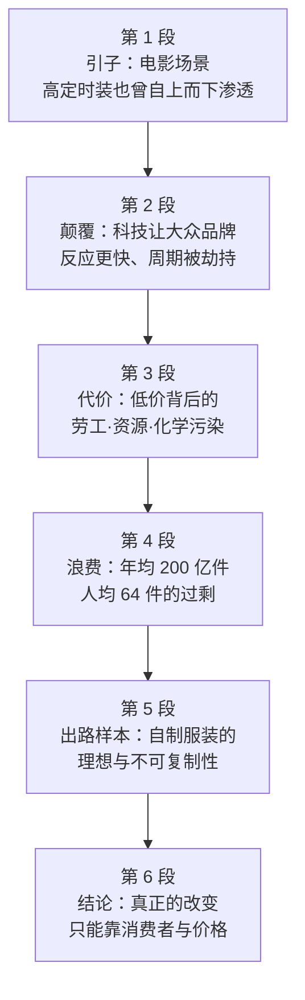

# Passage 24 · 快时尚的代价

## 答题记录

| 轮次  | 日期         | 题号  | 正确  | 错误  | 正确率 | 用时    | 错题归因 |
| --- | --- | --- | --- | --- | --- | --- | --- |
| 1 |  | 1-5 |  |  |  |  |  |
| 2 |  | 1-5 |  |  |  |  |  |
| 3 |  | 1-5 |  |  |  |  |  |

> [!tip] 填写口径
> - **用时**以分钟计，只计做题时间，不含精读复盘。
> - **错题归因**填「题型·错误类型」，如：细节题·定位错、推理判断·过度推断、主旨大意·以偏概全。
> - 纵向看趋势：正确率升而用时过长 → 熟练度不足；用时降而正确率波动 → 定位不稳。

> [!info] 文章档案
> - **来源**：考研英语（一）2013 年 Text 1
> - **题材**：商业经济——快时尚行业的运作逻辑及其劳工、环境代价
> - **结构**：6 段 / 17 句 ＋ 5 题
> - **难度**：★★★☆☆
> - **一句话主旨**：以《穿普拉达的女王》引出「时尚只关乎圈内人」的旧观念已被 Zara、H&M 等快时尚颠覆，而这场革命的账单——廉价劳工、资源消耗与海量废弃——最终要由消费者和地球支付。

## 一、篇章脉络

- **第 1 段**：借电影《穿普拉达的女王》开场——米兰达训斥助手「以为高定时装影响不到她」，并解释她毛衣的深蓝如何从秀场一路降到百货商店、再降到打折筐。
- **第 2 段**：这种「自上而下」的时尚观已经过时。科技进步让 Zara、H&M、Uniqlo 等大众品牌反应更快、预测更准，把时装周期从「按季」压缩到「按周」，并成功让消费者把衣服看成一次性用品。
- **第 3 段**：受害者不止设计师——5.95 美元的针织迷你裙铺到全球 2300 多家门店，靠的是低薪海外劳工、超量订单压榨自然资源和大量有害化学品。
- **第 4 段**：《着装过度》对标《杂食者的困境》，指出量产服装像快餐一样填饱需求却不耐用、浪费惊人；美国人年购约 200 亿件、人均 64 件。
- **第 5 段**：Cline 给出理想样本——布鲁克林女子 Sarah Kate Beaumont 自 2008 年起自制全部衣物，但手艺需数十年打磨，无法被「山寨」。
- **第 6 段**：结论落在消费者身上：虚荣心是恒量，只有当人们负担不起「不持续购物」时，真正的改变才会发生。

> [!tip] 行文逻辑
> 引子（第 1 段）→ 现象（第 2 段）→ 代价（第 3、4 段）→ 样本（第 5 段）→ 出路（第 6 段），是「讲故事—摆事实—给方案」的书评结构。第 1 段与第 2 段构成观念对照：couldn't be more out of date 一句话把旧观念推翻。第 5 题问主旨，答案 C（对快时尚业的批评）来自全篇的批判性用词（indictment、victims、harmful、wasteful、excess），而 A、B 的批判对象都被第 1、2 段的对照关系排除。

## 二、逐段精读

### 第 1 段 · 引子：一件毛衣的「下行」之路

**原文**

① In the 2006 film version of The Devil Wears Prada, Miranda Priestly, played by Meryl Streep, scolds her unattractive assistant for imagining that high fashion doesn't affect her.
② Priestly explains how the deep blue color of the assistant's sweater descended over the years from fashion shows to department stores and to the bargain bin in which the poor girl doubtless found her garment.

**译文**

① 在 2006 年电影版《穿普拉达的女王》中，由梅丽尔·斯特里普饰演的米兰达·普莱斯特利训斥了那位不起眼的助手，因为她以为高定时装影响不到她。
② 普莱斯特利解释道，助手毛衣的深蓝色这些年来是如何从时装发布会一路下行到百货商店，再下行到打折筐——那个可怜的女孩无疑就是在那里买到这件衣服的。

> [!note] 段落要点
> - 功能：用一个具体场景开场，把「时尚的影响」具象成一件毛衣的颜色，为第 2 段的观念翻转做铺垫。
> - ②句的 descended...from...to...and to... 是本文最重要的空间隐喻：颜色自上而下流动，说明「高定—百货—打折筐」是一条完整的渗透链。
> - ①句的 doesn't affect her 是被后文推翻的「旧观念」，第 1 题的答案即由它反推而来。

#### 长难句 · 本段

> [!abstract] 本段第 ① 句 · In the 2006 film version of The Devil Wears Prada, Miranda Priestly, played by Meryl Streep, scolds her unattractive assistant for imagining that high fashion doesn't affect her.

**结构拆解**

- **状语**：In the 2006 film version of The Devil Wears Prada
- **主语**：Miranda Priestly
- **插入语**：played by Meryl Streep（过去分词短语，说明扮演者）
- **谓语**：scolds
- **宾语**：her unattractive assistant
- **原因状语**：for imagining that high fashion doesn't affect her（for + 动名词）

**参考译文**

在 2006 年电影版《穿普拉达的女王》中，由梅丽尔·斯特里普饰演的米兰达·普莱斯特利训斥了那位不起眼的助手，因为她以为高定时装影响不到她。

> [!tip] 拆解要点
> 主语与谓语被 `played by Meryl Streep` 隔开，是典型的「人物 + 插入语」结构，抓主干只需认 `Priestly scolds her assistant`。`scold sb for doing sth`（因做某事而训斥）是固定框架；句尾 that 从句是 imagining 的宾语，其中的 doesn't affect her 正是第 1 题要反向处理的点——她批评助手「以为不影响」，说明实际影响很大。

> [!abstract] 本段第 ② 句 · Priestly explains how the deep blue color of the assistant's sweater descended over the years from fashion shows to department stores and to the bargain bin in which the poor girl doubtless found her garment.

**结构拆解**

- **主谓宾**：Priestly explains how...
- **宾语从句**：how the deep blue color... descended over the years
- **主语**：the deep blue color of the assistant's sweater
- **路径状语**：from fashion shows to department stores and to the bargain bin（from...to...and to... 三级下行）
- **定语从句**：in which the poor girl doubtless found her garment（修饰 bargain bin）

**参考译文**

普莱斯特利解释道，助手毛衣的深蓝色这些年来是如何从时装发布会一路下行到百货商店，再下行到打折筐——那个可怜的女孩无疑就是在那里买到这件衣服的。

> [!tip] 拆解要点
> `descend from A to B and to C` 的链式结构要一口气读完三个落点，这是「阶层下沉」的视觉化写法；句尾 `in which` 是「介词 + which」定语从句，还原成 in the bargain bin。doubtless 是副词「无疑地」，别误当成形容词 doubt + less。

#### 本段重点词汇

| 单词 / 短语 | 词性 | 文中意 | 常用考义与拓展 | 英文示例搭配（中译） |
| --- | --- | --- | --- | --- |
| **version** | n. | 版本，改编版 | the film version of...（……的电影版）；convert v. 改编 | the 2006 film version of The Devil Wears Prada（2006 年电影版《穿普拉达的女王》） |
| **scold** | v. | 训斥，责骂 | scold sb for doing sth 因做某事训斥某人；近义 blame / criticize | scolds her unattractive assistant（训斥她那位不起眼的助手） |
| **unattractive** | adj. | 不起眼的，无吸引力的 | un- + attractive；attractive adj. 有魅力的 | her unattractive assistant（她那位不起眼的助手） |
| **imagine** | v. | 以为，认为 | imagine (that)...；imaginable adj. 可想象的 | for imagining that high fashion doesn't affect her（因为她以为高定时装影响不到她） |
| **affect** | v. | 影响 | 易混 effect n. 效果；affect 是动词 | high fashion doesn't affect her（高定时装影响不到她） |
| **sweater** | n. | 毛衣 | knit v. 编织；sweatshirt 卫衣 | the assistant's sweater（助手的毛衣） |
| **descend** | v. | 下行，下降 | 反义 ascend；descend from...to... 从……下行到…… | descended over the years（这些年来一路下行） |
| **fashion show** | n. | 时装发布会 | 同义 catwalk show；show 此处是「展示会」 | from fashion shows（从时装发布会） |
| **department store** | n. | 百货商店 | department n. 部门；chain store 连锁店 | to department stores（下行到百货商店） |
| **bargain bin** | n. | 打折筐，特价货区 | bargain n. 便宜货；bin n. 箱子 | to the bargain bin（下行到打折筐） |
| **doubtless** | adv. | 无疑地，肯定地 | doubt n./v. 怀疑 + -less； doubtless = without doubt | the poor girl doubtless found her garment（那个可怜女孩无疑就是在那里买到这件衣服的） |
| **garment** | n. | 衣服，服装 | 正式用语，同 clothes；garment industry 服装业 | found her garment（买到她的这件衣服） |

### 第 2 段 · 颠覆：快时尚把「按季」压缩成「按周」

**原文**

① This top-down conception of the fashion business couldn't be more out of date or at odds with the feverish world described in Overdressed, Elizabeth Cline's three-year indictment of "fast fashion."
② In the last decade or so, advances in technology have allowed mass-market labels such as Zara, H&M, and Uniqlo to react to trends more quickly and anticipate demand more precisely.
③ Quicker turnarounds mean less wasted inventory, more frequent releases, and more profit.
④ These labels encourage style-conscious consumers to see clothes as disposable — meant to last only a wash or two, although they don't advertise that — and to renew their wardrobe every few weeks.
⑤ By offering on-trend items at dirt-cheap prices, Cline argues, these brands have hijacked fashion cycles, shaking an industry long accustomed to a seasonal pace.

**译文**

① 时尚界这种自上而下的观念已经再不过时不过了——它与《着装过度》一书所描绘的那个狂热世界格格不入，该书是伊丽莎白·克莱恩历时三年对「快时尚」的控诉。
② 在过去十年左右，技术进步让 Zara、H&M、优衣库等大众品牌能更快地对趋势做出反应、更精准地预判需求。
③ 更快的周转意味着更少的库存浪费、更频繁的新品发布，以及更多利润。
④ 这些品牌鼓励有时尚意识的消费者把衣服看作一次性用品——只打算穿洗一两次，尽管它们并不宣传这一点——并且每隔几周就更新一次衣橱。
⑤ 克莱恩认为，通过以极低的价格销售潮流单品，这些品牌已经劫持了时装周期，动摇了一个长期以来习惯于按季节奏运作的行业。

> [!note] 段落要点
> - 功能：段旨句是①句的 couldn't be more out of date，一句话推翻第 1 段的旧观念，并首次给出全书与作者定位（indictment of "fast fashion"）。
> - ②③句讲技术如何提速（react to trends / anticipate demand / quicker turnarounds），④⑤句讲提速的后果：衣服被当成 disposable、fashion cycles 被 hijacked。
> - ④句的 although they don't advertise that 是作者的旁白，暗示商家刻意隐瞒了「一次性」的真实定位——第 2 题答案就在 encourage...to renew their wardrobe 上。

#### 长难句 · 本段

> [!abstract] 本段第 ① 句 · This top-down conception of the fashion business couldn't be more out of date or at odds with the feverish world described in Overdressed, Elizabeth Cline's three-year indictment of "fast fashion."

**结构拆解**

- **主语**：This top-down conception of the fashion business（自上而下的观念）
- **谓语**：couldn't be more out of date（比较级否定 = 最高级肯定）
- **并列表语**：or at odds with the feverish world（与……格格不入）
- **后置定语**：described in Overdressed（过去分词修饰 world）
- **同位语**：Elizabeth Cline's three-year indictment of "fast fashion"（解释 Overdressed 是什么）

**参考译文**

时尚界这种自上而下的观念已经再不过时不过了——它与《着装过度》一书所描绘的那个狂热世界格格不入，该书是伊丽莎白·克莱恩历时三年对「快时尚」的控诉。

> [!tip] 拆解要点
> `couldn't be more + adj.` 是「再……不过了」的强调式，字面否定义实际最高级；`couldn't be more out of date or at odds with...` 把两个否定并置，语气翻倍。句尾书名后紧跟的同位语是考研阅读介绍著作的固定套路（书名 + 作者 + 定性词），其中 indictment 就是第 3 题的猜词对象。

> [!abstract] 本段第 ④ 句 · These labels encourage style-conscious consumers to see clothes as disposable — meant to last only a wash or two, although they don't advertise that — and to renew their wardrobe every few weeks.

**结构拆解**

- **主谓宾宾补**：These labels encourage style-conscious consumers to see clothes as disposable
- **插入解释**：meant to last only a wash or two（过去分词短语解释 disposable）
- **让步状语从句**：although they don't advertise that
- **并列不定式**：and to renew their wardrobe every few weeks（与 to see 并列）

**参考译文**

这些品牌鼓励有时尚意识的消费者把衣服看作一次性用品——只打算穿洗一两次，尽管它们并不宣传这一点——并且每隔几周就更新一次衣橱。

> [!tip] 拆解要点
> `encourage sb to do A ... and to do B` 的两个不定式被破折号插入语隔开，容易只看到第一个；破折号内的 although 从句是作者立场，与商家的 advertise 形成反差。`a wash or two` 是「洗一两次」的口语表达，别理解成「一两次洗涤剂」。

> [!abstract] 本段第 ⑤ 句 · By offering on-trend items at dirt-cheap prices, Cline argues, these brands have hijacked fashion cycles, shaking an industry long accustomed to a seasonal pace.

**结构拆解**

- **方式状语**：By offering on-trend items at dirt-cheap prices
- **插入语**：Cline argues（标明观点归属）
- **主谓宾**：these brands have hijacked fashion cycles
- **结果状语**：shaking an industry long accustomed to a seasonal pace（现在分词短语，被动意味）

**参考译文**

克莱恩认为，通过以极低的价格销售潮流单品，这些品牌已经劫持了时装周期，动摇了一个长期以来习惯于按季节奏运作的行业。

> [!tip] 拆解要点
> 插入语 `Cline argues` 把状语和主语隔开，读时先跳过；句尾 shaking 是伴随结果，`long accustomed to a seasonal pace` 是「形容词 + 介词短语」作 industry 的后置定语，还原成 an industry which has long been accustomed to...。hijacked 用「劫持」喻「强行改变规律」，是本文批判色彩最重的动词之一。

#### 本段重点词汇

| 单词 / 短语 | 词性 | 文中意 | 常用考义与拓展 | 英文示例搭配（中译） |
| --- | --- | --- | --- | --- |
| **conception** | n. | 观念，看法 | conceive v. 构想；concept n. 概念 | this top-down conception（这种自上而下的观念） |
| **at odds with** | 短语 | 与……格格不入 | odds n. 不和；at odds with sb/sth 与……不一致 | at odds with the feverish world（与那个狂热世界格格不入） |
| **feverish** | adj. | 狂热的，躁动的 | fever n. 发烧；feverishly adv. | the feverish world（那个狂热的世界） |
| **indictment** | n. | 控诉，谴责 | indict v. 起诉、谴责；-ment 名词化 | a three-year indictment of "fast fashion"（对「快时尚」长达三年的控诉） |
| **advance** | n. | 进步，进展 | advances in technology 科技进步；advanced adj. 先进的 | advances in technology（技术进步） |
| **mass-market** | adj. | 面向大众市场的 | mass n. 大众 + market；反义 high-end / luxury | mass-market labels（大众品牌） |
| **react to** | 短语 | 对……做出反应 | reaction n. 反应；react against 反对 | react to trends more quickly（更快对趋势做出反应） |
| **anticipate** | v. | 预判，预料 | anticipation n. 预期；anticipate demand 预判需求 | anticipate demand more precisely（更精准地预判需求） |
| **turnaround** | n. | 周转，周转周期 | 复合词 turn + around；quicker turnarounds 更快的周转 | quicker turnarounds mean less wasted inventory（更快的周转意味着更少的库存浪费） |
| **inventory** | n. | 库存，存货 | take inventory 盘点；inventory management 库存管理 | less wasted inventory（更少的库存浪费） |
| **release** | n. | 发布（新品） | 熟词僻义：释放 →（新品的）发布；release a new model 发布新款 | more frequent releases（更频繁的新品发布） |
| **style-conscious** | adj. | 有时尚意识的 | style + conscious；health-conscious 注重健康的 | style-conscious consumers（有时尚意识的消费者） |
| **disposable** | adj. | 一次性的，用完即弃的 | dispose v. 处理；disposable chopsticks 一次性筷子 | see clothes as disposable（把衣服看成一次性的） |
| **advertise** | v. | 宣传，做广告 | advertisement n. 广告；advertising n. 广告业 | although they don't advertise that（尽管它们并不宣传这一点） |
| **renew** | v. | 更新，更换 | re- + new；renew a wardrobe 更换衣橱 | renew their wardrobe every few weeks（每隔几周更新衣橱） |
| **wardrobe** | n. | 衣橱，（个人的）全部衣物 | wardrobe 亦指「行头」；capsule wardrobe 胶囊衣橱 | renew their wardrobe（更新衣橱） |
| **on-trend** | adj. | 迎合潮流的 | on-trend items 潮流单品；反义 off-trend | offering on-trend items（销售潮流单品） |
| **dirt-cheap** | adj. | 极便宜的，贱价的 | 复合词 dirt + cheap，同 extremely cheap | at dirt-cheap prices（以极低的价格） |
| **hijack** | v. | 劫持；（喻）强行改变 | 原指劫机；hijack the agenda 劫持议程 | have hijacked fashion cycles（已经劫持了时装周期） |
| **accustomed to** | 短语 | 习惯于……的 | accustom v. 使习惯；be accustomed to doing | long accustomed to a seasonal pace（长久习惯于按季节奏的） |
| **seasonal** | adj. | 季节性的 | season n. 季节；seasonal rhythm 季节节律 | a seasonal pace（按季的节奏） |

### 第 3 段 · 代价：低价背后的三重外部性

**原文**

① The victims of this revolution, of course, are not limited to designers.
② For H&M to offer a $5.95 knit miniskirt in all its 2,300-plus stores around the world, it must rely on low-wage overseas labor, order in volumes that strain natural resources, and use massive amounts of harmful chemicals.

**译文**

① 当然，这场革命的受害者并不限于设计师。
② 要让 H&M 在其全球 2300 多家门店里上架一条 5.95 美元的针织迷你裙，它必须依赖低薪的海外劳动力、以压榨自然资源的量级下单，并使用大量有害化学品。

> [!note] 段落要点
> - 功能：从「行业内部影响」转向「外部代价」，是全文论证的关键转折。
> - ①句的 victims 一词把叙事基调从商业成功拉回道德批判；not limited to 提示「不止一类受害者」，为②句的具体清单做铺垫。
> - ②句用一条 5.95 美元迷你裙的价格做锚点，反推背后三项成本（劳工 / 资源 / 化学品），是全篇最典型的「以小见大」论证。

#### 长难句 · 本段

> [!abstract] 本段第 ② 句 · For H&M to offer a $5.95 knit miniskirt in all its 2,300-plus stores around the world, it must rely on low-wage overseas labor, order in volumes that strain natural resources, and use massive amounts of harmful chemicals.

**结构拆解**

- **不定式逻辑主语**：For H&M to offer a $5.95 knit miniskirt...（for sb to do 表条件）
- **地点状语**：in all its 2,300-plus stores around the world
- **主句**：it must rely on A, order B, and use C（三项并列谓语）
- **定语从句**：that strain natural resources（修饰 volumes）

**参考译文**

要让 H&M 在其全球 2300 多家门店里上架一条 5.95 美元的针织迷你裙，它必须依赖低薪的海外劳动力、以压榨自然资源的量级下单，并使用大量有害化学品。

> [!tip] 拆解要点
> `For sb to do sth, ...` 是「要让某人做成某事（就得……）」的条件句式，逗号后才是主句；三项并列谓语 rely on / order / use 共用情态动词 must，中间隔了很长的宾语，容易漏读最后一项。`order in volumes` 中 volume 是「数量、批量」而非「音量」，that 从句说明批量之大到了 strain（使……吃紧）的程度。

#### 本段重点词汇

| 单词 / 短语 | 词性 | 文中意 | 常用考义与拓展 | 英文示例搭配（中译） |
| --- | --- | --- | --- | --- |
| **victim** | n. | 受害者 | victimhood n. 受害者身份；fall victim to 成为……的牺牲品 | the victims of this revolution（这场革命的受害者） |
| **revolution** | n. | （行业）革命，巨变 | revolutionary adj. 革命性的；the industrial revolution 工业革命 | the victims of this revolution（这场革命的受害者） |
| **be limited to** | 短语 | 仅限于…… | limit v. 限制；not limited to 不限于 | are not limited to designers（并不限于设计师） |
| **knit** | v./n. | 针织（的） | knitting n. 编织；knit miniskirt 针织迷你裙 | a $5.95 knit miniskirt（一条 5.95 美元的针织迷你裙） |
| **miniskirt** | n. | 迷你裙 | mini- 前缀表「微」；maxi-skirt 长裙 | a $5.95 knit miniskirt（一条 5.95 美元的针织迷你裙） |
| **rely on** | 短语 | 依赖，依靠 | reliable adj. 可靠的；rely on sb to do 靠某人做 | must rely on low-wage overseas labor（必须依赖低薪海外劳动力） |
| **low-wage** | adj. | 低薪的 | low + wage；minimum wage 最低工资 | low-wage overseas labor（低薪的海外劳动力） |
| **overseas** | adj./adv. | 海外的（地） | overseas labor / market 海外劳动力 / 市场 | low-wage overseas labor（低薪的海外劳动力） |
| **volume** | n. | 数量，批量 | 熟词僻义：音量、卷 → 数量；in large volumes 大批量 | order in volumes（以大批量下单） |
| **strain** | v. | 使吃紧，过度使用 | strain resources 使资源吃紧；strain n. 压力 | volumes that strain natural resources（使自然资源吃紧的批量） |
| **harmful** | adj. | 有害的 | harm n./v. 伤害；harmful chemicals 有害化学品 | massive amounts of harmful chemicals（大量有害化学品） |

### 第 4 段 · 浪费：快餐式消费的过剩账单

**原文**

① Overdressed is the fashion world's answer to consumer-activist bestsellers like Michael Pollan's The Omnivore's Dilemma.
② "Mass-produced clothing, like fast food, fills a hunger and need, yet is non-durable and wasteful," Cline argues.
③ Americans, she finds, buy roughly 20 billion garments a year — about 64 items per person — and no matter how much they give away, this excess leads to waste.

**译文**

① 《着装过度》是时尚界对《杂食者的困境》这类消费者行动派畅销书的回应。
② 克莱恩认为：「量产服装就像快餐一样，填饱了一种饥饿与需求，却并不耐用，而且浪费。」
③ 她发现，美国人每年购买约 200 亿件服装——人均约 64 件——而且无论他们捐赠多少，这种过剩都会导致浪费。

> [!note] 段落要点
> - 功能：用一组数字把「浪费」量化，并借与《杂食者的困境》的类比，把服装问题接入「食品—能源—时尚」的可持续议题。
> - ②句的 like fast food 是跨域类比：服装 ↔ 快餐，都「廉价、即时、不耐用」，这一类比是理解全书立意的钥匙。
> - ③句的 no matter how much they give away 预先堵住「捐赠可以解决问题」的退路，强调 excess 本身即是问题。

#### 长难句 · 本段

> [!abstract] 本段第 ③ 句 · Americans, she finds, buy roughly 20 billion garments a year — about 64 items per person — and no matter how much they give away, this excess leads to waste.

**结构拆解**

- **插入语**：she finds（标明研究发现）
- **主谓宾**：Americans buy roughly 20 billion garments a year
- **插入解释**：about 64 items per person（数字换算）
- **and 并列谓语**：no matter how much they give away, this excess leads to waste
- **让步状语从句**：no matter how much they give away（无论捐赠多少）

**参考译文**

她发现，美国人每年购买约 200 亿件服装——人均约 64 件——而且无论他们捐赠多少，这种过剩都会导致浪费。

> [!tip] 拆解要点
> 句中两个逗号夹一个 she finds、两个破折号夹一个数字换算，读主干只需 `Americans buy 20 billion garments`。`no matter how much` 引导让步从句，主句是 this excess leads to waste——主语是 excess（过剩本身），这就是为什么捐赠无法解决问题：问题出在购买量，而非处理方式。

#### 本段重点词汇

| 单词 / 短语 | 词性 | 文中意 | 常用考义与拓展 | 英文示例搭配（中译） |
| --- | --- | --- | --- | --- |
| **answer to** | 短语 | （对……的）回应、对应物 | an answer to a book / problem 对应之作 | the fashion world's answer to consumer-activist bestsellers（时尚界对消费者行动派畅销书的回应） |
| **consumer-activist** | adj. | 消费者行动派的 | consumer + activist 复合；activism n. 行动主义 | consumer-activist bestsellers（消费者行动派畅销书） |
| **bestseller** | n. | 畅销书 | 复合词 best + seller；best-selling adj. 畅销的 | consumer-activist bestsellers（消费者行动派畅销书） |
| **mass-produced** | adj. | 量产的 | mass + produced；mass production 量产 | mass-produced clothing（量产服装） |
| **hunger** | n. | 渴求，饥渴 | 本义饥饿，此处喻需求；a hunger for sth 对……的渴求 | fills a hunger and need（填饱一种饥渴与需求） |
| **non-durable** | adj. | 不耐用的 | non- + durable；durable adj. 耐用的；durable goods 耐用品 | is non-durable and wasteful（不耐用且浪费） |
| **wasteful** | adj. | 浪费的 | waste n./v. 浪费；wasteful spending 浪费性开支 | is non-durable and wasteful（不耐用且浪费） |
| **give away** | 短语 | 捐赠，赠送 | giveaway n. 赠品；give away clothes 捐衣 | no matter how much they give away（无论他们捐赠多少） |
| **excess** | n. | 过量，过剩 | excessive adj. 过度的；in excess of 超过 | this excess leads to waste（这种过剩导致浪费） |

### 第 5 段 · 样本：自制衣物的理想与不可复制

**原文**

① Towards the end of Overdressed, Cline introduced her ideal, a Brooklyn woman named Sarah Kate Beaumont, who since 2008 has made all of her own clothes — and beautifully.
② But as Cline is the first to note, it took Beaumont decades to perfect her craft; her example can't be knocked off.

**译文**

① 在《着装过度》的结尾部分，克莱恩介绍了她的理想典范——一位名叫 Sarah Kate Beaumont 的布鲁克林女子，她自 2008 年以来一直自制全部衣物——而且做得非常漂亮。
② 但正如克莱恩自己首先指出的，博蒙特花了数十年才把她的手艺磨炼到完美；她的例子是无法被山寨的。

> [!note] 段落要点
> - 功能：给出书中唯一的正面样本，并立刻用②句的 But 给样本设限——理想存在，却不可复制。
> - ①句的 ideal 与②句的 can't be knocked off 构成「可望而不可即」的张力，为末段的结论（改变只能靠消费者与价格）埋线。
> - ②句的 as Cline is the first to note 是「作者自曝其短」的写法，表明书中立场不偏激，这也是它能在观点题里被当作客观批判的原因。

#### 长难句 · 本段

> [!abstract] 本段第 ① 句 · Towards the end of Overdressed, Cline introduced her ideal, a Brooklyn woman named Sarah Kate Beaumont, who since 2008 has made all of her own clothes — and beautifully.

**结构拆解**

- **状语**：Towards the end of Overdressed
- **主谓宾**：Cline introduced her ideal
- **同位语**：a Brooklyn woman named Sarah Kate Beaumont（解释 ideal 是谁）
- **定语从句**：who since 2008 has made all of her own clothes（现在完成时）
- **补充说明**：and beautifully（＝ and she has made them beautifully）

**参考译文**

在《着装过度》的结尾部分，克莱恩介绍了她的理想典范——一位名叫 Sarah Kate Beaumont 的布鲁克林女子，她自 2008 年以来一直自制全部衣物——而且做得非常漂亮。

> [!tip] 拆解要点
> `同位语 + named + 人名` 是介绍人物的标准句式；句尾 `and beautifully` 是省略补全，还原成 and she has made all of her own clothes beautifully，副词升格为「做得很出色」的总结——这种「省主语 + 副词收尾」的写法在书评里很常见。`knock off` 在②句意为「山寨、仿制」，别理解成「击落、下班」。

#### 本段重点词汇

| 单词 / 短语 | 词性 | 文中意 | 常用考义与拓展 | 英文示例搭配（中译） |
| --- | --- | --- | --- | --- |
| **towards** | prep. | 临近，接近（某时点） | towards the end of... 在……的尾声 | towards the end of Overdressed（在《着装过度》的结尾部分） |
| **introduce** | v. | 介绍，引入 | introduction n. 引言；introduce sb to sth 使某人接触 | introduced her ideal（介绍了她的理想典范） |
| **ideal** | n. | 理想典范，榜样 | 形容词「理想的」；ideal type 理想型 | introduced her ideal（介绍了她的理想典范） |
| **beautifully** | adv. | 出色地，漂亮地 | beautiful + -ly；口语中常表「做得好」 | made all of her own clothes — and beautifully（自制全部衣物——而且做得漂亮） |
| **perfect** | v. | 使臻于完美 | 形容词「完美的」；perfect one's craft 磨炼手艺 | decades to perfect her craft（数十年才磨炼出手艺） |
| **craft** | n. | 手艺，技艺 | craftsmanship n. 工匠精神；arts and crafts 手工艺 | perfect her craft（磨炼她的手艺） |
| **knock off** | 短语 | 山寨，仿制 | 熟词僻义：击落、停工 → 仿冒；knock-off n. 山寨货 | her example can't be knocked off（她的例子无法被山寨） |

### 第 6 段 · 结论：改变只能由消费者与价格完成

**原文**

① Though several fast-fashion companies have made efforts to curb their impact on labor and the environment — including H&M, with its green Conscious Collection line — Cline believes lasting change can only be effected by the customer.
② She exhibits the idealism common to many advocates of sustainability, be it in food or in energy.
③ Vanity is a constant; people will only start shopping more sustainably when they can't afford not to.

**译文**

① 尽管几家快时尚公司已经努力控制其对劳工和环境的影响——包括推出了绿色 Conscious Collection 系列的 H&M——克莱恩认为，只有消费者才能带来持久的改变。
② 她展现出许多可持续发展倡导者共有的理想主义，无论涉及食品还是能源领域。
③ 虚荣心是一个恒量；只有当人们负担不起「不持续购物」的时候，他们才会开始以更可持续的方式购物。

> [!note] 段落要点
> - 功能：全文结论段——先让步（企业已有努力）再转折（only by the customer），最后落到末句的价格机制。
> - ③句是全文的「文眼」：can't afford not to 的双重否定＝「非持续不可」，第 4 题答案正由此推出（价格决定可持续消费）。
> - ①句的 Though... 让步 + only 强调，是「破他立己」的标准论证收尾。

#### 长难句 · 本段

> [!abstract] 本段第 ① 句 · Though several fast-fashion companies have made efforts to curb their impact on labor and the environment — including H&M, with its green Conscious Collection line — Cline believes lasting change can only be effected by the customer.

**结构拆解**

- **让步状语从句**：Though several fast-fashion companies have made efforts to curb their impact...
- **插入举例**：including H&M, with its green Conscious Collection line
- **主句**：Cline believes (that) lasting change can only be effected by the customer
- **宾语从句**：lasting change can only be effected by the customer（被动语态）

**参考译文**

尽管几家快时尚公司已经努力控制其对劳工和环境的影响——包括推出了绿色 Conscious Collection 系列的 H&M——克莱恩认为，只有消费者才能带来持久的改变。

> [!tip] 拆解要点
> Though 让步从句里又套了破折号插入的举例，跨度很长，主句要一直找到 `Cline believes`；believes 后省略 that。`can only be effected by` 是被动，effect 此处作动词＝ bring about（实现），别当成名词「效果」——第 4 题 B 项「行业忽视可持续性」正是被 Though 从句否掉的。

> [!abstract] 本段第 ③ 句 · Vanity is a constant; people will only start shopping more sustainably when they can't afford not to.

**结构拆解**

- **分句一**：Vanity is a constant（虚荣心是恒量）
- **分句二**：people will only start shopping more sustainably（only 提前，主句部分倒装的意味）
- **时间状语从句**：when they can't afford not to（负担不起「不持续」）

**参考译文**

虚荣心是一个恒量；只有当人们负担不起「不持续购物」的时候，他们才会开始以更可持续的方式购物。

> [!tip] 拆解要点
> 分号连接两个独立分句，前句给判断、后句给条件。`can't afford not to` 是双重否定，字面「负担不起不去做」，实际语义是「非做不可」；句中 only 与 when 构成「只有当……才会……」的强调条件。末句是全篇唯一给出「出路」的句子，因此第 4 题的推断必须落在这里：价格抬高了，可持续消费才成为可能。

#### 本段重点词汇

| 单词 / 短语 | 词性 | 文中意 | 常用考义与拓展 | 英文示例搭配（中译） |
| --- | --- | --- | --- | --- |
| **curb** | v. | 控制，抑制 | 同义 restrain / check；curb emissions 控制排放 | efforts to curb their impact（努力控制其影响） |
| **impact** | n. | 影响（常指负面） | have an impact on 对……有影响；近义 influence | their impact on labor and the environment（其对劳工和环境的影响） |
| **lasting** | adj. | 持久的，长久的 | last v. 持续；lasting change 持久的改变 | lasting change can only be effected by the customer（只有消费者能带来持久的改变） |
| **effect** | v. | 实现，达成 | 熟词僻义：名词效果 → 动词「使发生」；effect a change 促成改变 | can only be effected by the customer（只能由消费者来实现） |
| **exhibit** | v. | 展现，表现出 | exhibition n. 展览；exhibit signs of... 表现出……的迹象 | she exhibits the idealism（她展现出这种理想主义） |
| **idealism** | n. | 理想主义 | ideal n. 理想 + -ism；反义 realism | the idealism common to many advocates（许多倡导者共有的理想主义） |
| **common to** | 短语 | 为……所共有 | common ground 共同点；in common with 与……一样 | idealism common to many advocates（许多倡导者共有的理想主义） |
| **advocate** | n. | 倡导者，拥护者 | 动词「倡导」；advocate of sth ……的倡导者 | advocates of sustainability（可持续发展的倡导者） |
| **sustainability** | n. | 可持续性 | sustainable adj. 可持续的；sustain v. 维持 | advocates of sustainability（可持续发展的倡导者） |
| **be it** | 短语 | 无论是（＝ whether it be） | 虚拟倒装让步；be it A or B 无论 A 还是 B | be it in food or in energy（无论涉及食品还是能源） |
| **vanity** | n. | 虚荣心 | vain adj. 虚荣的；in vain 徒劳 | vanity is a constant（虚荣心是恒量） |
| **constant** | n./adj. | 恒量；恒定的 | constantly adv. 不断地；a constant 常量 | vanity is a constant（虚荣心是个恒量） |
| **afford** | v. | 负担得起 | afford to do 负担得起做；can't afford to 负担不起 | when they can't afford not to（当他们负担不起「不持续」时） |

## 三、全篇重点词汇汇总（自测用）

> [!info] 说明
> 本表只列「单词 / 词性 / 所在段」，不含释义与搭配，用于遮表自测：说出词义后再回该段核对。
> 收录**全篇所有段落词汇，共 73 条，不删减**，与各段「本段重点词汇」等长同源。

| 单词 / 短语 | 词性 | 所在段 |
| --- | --- | --- |
| **version** | n. | 第 1 段 |
| **scold** | v. | 第 1 段 |
| **unattractive** | adj. | 第 1 段 |
| **imagine** | v. | 第 1 段 |
| **affect** | v. | 第 1 段 |
| **sweater** | n. | 第 1 段 |
| **descend** | v. | 第 1 段 |
| **fashion show** | n. | 第 1 段 |
| **department store** | n. | 第 1 段 |
| **bargain bin** | n. | 第 1 段 |
| **doubtless** | adv. | 第 1 段 |
| **garment** | n. | 第 1 段 |
| **conception** | n. | 第 2 段 |
| **at odds with** | 短语 | 第 2 段 |
| **feverish** | adj. | 第 2 段 |
| **indictment** | n. | 第 2 段 |
| **advance** | n. | 第 2 段 |
| **mass-market** | adj. | 第 2 段 |
| **react to** | 短语 | 第 2 段 |
| **anticipate** | v. | 第 2 段 |
| **turnaround** | n. | 第 2 段 |
| **inventory** | n. | 第 2 段 |
| **release** | n. | 第 2 段 |
| **style-conscious** | adj. | 第 2 段 |
| **disposable** | adj. | 第 2 段 |
| **advertise** | v. | 第 2 段 |
| **renew** | v. | 第 2 段 |
| **wardrobe** | n. | 第 2 段 |
| **on-trend** | adj. | 第 2 段 |
| **dirt-cheap** | adj. | 第 2 段 |
| **hijack** | v. | 第 2 段 |
| **accustomed to** | 短语 | 第 2 段 |
| **seasonal** | adj. | 第 2 段 |
| **victim** | n. | 第 3 段 |
| **revolution** | n. | 第 3 段 |
| **be limited to** | 短语 | 第 3 段 |
| **knit** | v./n. | 第 3 段 |
| **miniskirt** | n. | 第 3 段 |
| **rely on** | 短语 | 第 3 段 |
| **low-wage** | adj. | 第 3 段 |
| **overseas** | adj./adv. | 第 3 段 |
| **volume** | n. | 第 3 段 |
| **strain** | v. | 第 3 段 |
| **harmful** | adj. | 第 3 段 |
| **answer to** | 短语 | 第 4 段 |
| **consumer-activist** | adj. | 第 4 段 |
| **bestseller** | n. | 第 4 段 |
| **mass-produced** | adj. | 第 4 段 |
| **hunger** | n. | 第 4 段 |
| **non-durable** | adj. | 第 4 段 |
| **wasteful** | adj. | 第 4 段 |
| **give away** | 短语 | 第 4 段 |
| **excess** | n. | 第 4 段 |
| **towards** | prep. | 第 5 段 |
| **introduce** | v. | 第 5 段 |
| **ideal** | n. | 第 5 段 |
| **beautifully** | adv. | 第 5 段 |
| **perfect** | v. | 第 5 段 |
| **craft** | n. | 第 5 段 |
| **knock off** | 短语 | 第 5 段 |
| **curb** | v. | 第 6 段 |
| **impact** | n. | 第 6 段 |
| **lasting** | adj. | 第 6 段 |
| **effect** | v. | 第 6 段 |
| **exhibit** | v. | 第 6 段 |
| **idealism** | n. | 第 6 段 |
| **common to** | 短语 | 第 6 段 |
| **advocate** | n. | 第 6 段 |
| **sustainability** | n. | 第 6 段 |
| **be it** | 短语 | 第 6 段 |
| **vanity** | n. | 第 6 段 |
| **constant** | n./adj. | 第 6 段 |
| **afford** | v. | 第 6 段 |

> [!example] 同义替换链（阅读题高频）
> - **high fashion doesn't affect her ↔ insensitivity to fashion**：第 1 段①句的 doesn't affect her 正是第 1 题 A 项的同义改写来源。
> - **couldn't be more out of date ↔ Challenge to a high-fashion myth**：第 2 段①句推翻旧观念，是第 5 题 B 项的诱饵（对象错，它是铺垫而非主旨）。
> - **renew their wardrobe every few weeks ↔ shop for their garments more frequently**：第 2 段④句与第 2 题 B 项的对应。
> - **indictment ↔ accusation**：第 3 题的猜词链，indict v. 起诉、谴责 → accusation 指控。
> - **can't afford not to ↔ Pricing is vital to environment-friendly purchasing**：末句双重否定到第 4 题 C 项的转换。
> - **non-durable and wasteful / excess leads to waste ↔ Criticism of the fast-fashion industry**：批判性词汇链，第 5 题主旨的用词依据。

> [!warning] 熟词僻义专列
> - **version**：版本 →（电影）改编版（film version）。
> - **affect**：影响（动词）——注意与 effect n. 效果区分，别在选项里混用。
> - **descend**：下降 →（由上层社会）向下层流传。
> - **doubtless**：由「无疑的」作副词用，＝ without doubt。
> - **advance**：前进 → 名词「（科技）进步」。
> - **release**：释放 →（新品的）发布。
> - **disposable**：可处理的 → 一次性的、用完即弃的。
> - **knock off**：击落 → 山寨、仿制（knock-off n. 山寨货）。
> - **volume**：音量 → 数量、批量（order in volumes）。
> - **strain**：拉伤 → 使吃紧、过度消耗（strain natural resources）。
> - **effect**：名词效果 → 动词「实现、促成」（effect a change）。
> - **be it**：虚拟倒装，＝ whether it be，用于让步（无论……）。
> - **constant**：形容词「不断的」→ 名词「恒量、常数」。

## 四、知识点补充

> [!question] 背景知识
> - **《穿普拉达的女王》（The Devil Wears Prada）**：2006 年上映的美国时装题材电影，梅丽尔·斯特里普饰演时尚杂志《Runway》主编米兰达·普莱斯特利。文中「深蓝毛衣」一场是影史经典桥段，用来说明「你以为自己与时装无关」只是阶层错觉。
> - **《着装过度》（Overdressed）与 Elizabeth Cline**：2012 年出版的纪实类畅销书，作者伊丽莎白·克莱恩用三年调查快时尚产业链。本文即该书书评，多次引用其观点（Cline argues / she finds）。
> - **《杂食者的困境》（The Omnivore's Dilemma）**：Michael Pollan 2006 年的饮食纪实畅销书，批判工业化食品体系。文中把量产服装比作快餐，正是把服装纳入「食品—能源—时尚」的可持续批判谱系。
> - **快时尚（fast fashion）**：Zara、H&M、Uniqlo 等以「极短的设计—上架周期 + 低价 + 高频上新」为模式的零售业态，与按季推新的传统时装节奏相对。H&M 的 Conscious Collection 是其环保产品线，文中用「including H&M」说明企业的补救性努力仍不够。

> [!warning] 语法点
> - **couldn't be more + adj.**（第 2 段①）：比较级否定表最高级肯定，「再……不过了」，阅读时按最强肯定处理。
- **For sb to do sth, ...**（第 3 段②）：不定式带逻辑主语，置于句首表条件，「要让某人做成某事，就得……」。
> - **插入语三种形式**（第 2 段⑤ / 第 4 段③ / 第 5 段②）：Cline argues / she finds / as Cline is the first to note，都是观点归属标记，读时先跳过再回填。
> - **be it A or B**（第 6 段②）：虚拟语气让步倒装，等于 whether it be A or B，属正式书面语。
> - **can't afford not to**（第 6 段③）：afford 后接不定式的否定，「负担不起不去做」＝「非做不可」。
> - **同位语 + named + 人名**（第 5 段①）：介绍人物的固定句式，同位语后常接 who 定语从句。

> [!success] 写作可迁移句型
> - `X, played by Y, scolds Z for imagining that...`（第 1 段①）——用场景开篇，插入语交代人物身份。
> - `A couldn't be more out of date or at odds with B`（第 2 段①）——双重否定强调的对照句式。
> - `For X to do A, it must rely on B, order C, and use D`（第 3 段②）——以小见大：一个价格反推三项成本。
> - `X, like fast food, fills a hunger and need, yet is non-durable and wasteful`（第 4 段②）——跨域类比 + yet 转折。
> - `Though X have made efforts..., Y believes lasting change can only be effected by Z`（第 6 段①）——先让步再立论，议论文收尾模板。

> [!danger] 易混辨析
> - **affect（v. 影响）vs effect（n. 效果；v. 实现）**：第 1 段①用 affect 作动词，第 6 段①用 effected 作动词「实现」，一词多义跨段呼应。
> - **high fashion vs fast fashion vs mass-market labels**：高定时装（旧秩序）、快时尚（新秩序）、大众品牌（快时尚的执行者）。第 5 题 A、B 的错因就是把批判对象认成前者。
> - **indictment（n. 控诉）vs tolerance（容忍）vs indifference（冷漠）vs enthusiasm（热情）**：第 3 题四选项是「两极 + 两中」，正确答案常与作者批判立场同侧。
> - **give away（捐赠）vs throw away（扔掉）vs excess（过剩）**：第 4 段③用「无论捐赠多少」堵住退路，说明问题在购买量而非处理方式。
> - **knocked off（山寨）vs knocked out（击倒、使淘汰）**：第 5 段② can't be knocked off 指「不可复制」，与服装语境外的短语义差别极大。

## 五、题目分析

> [!info] 题目总览
> | 题号 | 题型 | 定位 | 答案 |
> | --- | --- | --- | --- |
| 1 | 细节题（因果） | 第 1 段①句 | A |
| 2 | 细节题（观点） | 第 2 段④句 | B |
| 3 | 词义猜测题 | 第 2 段①句 | D |
| 4 | 推理判断题 | 第 6 段③句 | C |
| 5 | 主旨大意题（主题） | 全文（重点第 2 段①⑤、第 3 段） | C |

### 第 1 题 · 细节题（因果）

> [!question] 原题
> Priestly criticizes her assistant for her
> - A. insensitivity to fashion.
> - B. obsession with high fashion.
> - C. poor bargaining skill.
> - D. lack of imagination.

**正确答案**：**A. insensitivity to fashion.（对时尚不敏感）**

**定位与依据**
- 定位到第 1 段①句：Miranda Priestly scolds her unattractive assistant for imagining that high fashion doesn't affect her。
- 同义替换：doesn't affect her（影响不到她）＝ insensitivity to fashion（对时尚不敏感）。
- 题干中的 criticizes 对应原文 scolds，属同义改写定位。

**干扰项分析**

| 选项 | 选项内容 | 判断 | 排除理由 |
| --- | --- | --- | --- |
| B | obsession with high fashion. | ✗ | 与原文相反：原文说她以为时装「影响不到」自己，恰好是漠不关心，而非痴迷。 |
| C | poor bargaining skill. | ✗ | 无中生有：文中 bargain 只出现在第 1 段②句的 bargain bin（打折筐），与「砍价技巧」无关。 |
| D | lack of imagination. | ✗ | 偷换概念：imagining 是原句中的动词，但原文说的是她「误以为」时装影响不到她，不是「缺乏想象力」。 |

> [!tip] 解题思路
> 本题是「负负得正」的典型：原文 doesn't affect her 是否定，正确答案把它转成「不敏感」这一负面特质，而 B 项则反向捏造。命题规律：当两个选项语义相反（insensitivity ↔ obsession），答案往往在其中之一，先用方向性筛掉一半。

### 第 2 题 · 细节题（观点）

> [!question] 原题
> According to Cline, mass-market labels urge consumers to
> - A. combat unnecessary waste.
> - B. shop for their garments more frequently.
> - C. resist the influence of advertisements.
> - D. shut out the feverish fashion world.

**正确答案**：**B. shop for their garments more frequently.（更频繁地购买衣服）**

**定位与依据**
- 定位到第 2 段④句：These labels encourage style-conscious consumers to see clothes as disposable... and to renew their wardrobe every few weeks。
- 同义替换：renew their wardrobe every few weeks（每隔几周更新衣橱）＝ shop for their garments more frequently。
- 题干 According to Cline 提示答案须出自 Cline 的观点表述（本段⑤句 Cline argues 亦同向）。

**干扰项分析**

| 选项 | 选项内容 | 判断 | 排除理由 |
| --- | --- | --- | --- |
| A | combat unnecessary waste. | ✗ | 与原文相反：文中 wasteful、excess leads to waste 都是作者批评的对象，大众品牌是制造浪费而非对抗浪费。 |
| C | resist the influence of advertisements. | ✗ | 偷换概念：④句说 although they don't advertise that（不宣传衣服一次性），但并未说品牌教消费者「抵制广告影响」。 |
| D | shut out the feverish fashion world. | ✗ | 偷换概念：feverish world 出现在第 2 段①句，形容快时尚世界的狂热，与「排斥时尚界」无关。 |

> [!tip] 解题思路
> 问「某书 / 某人认为 X 促使消费者做什么」，答案必须落在 encourage / urge 的宾语补足语上；本文即 to see clothes as disposable and to renew their wardrobe。干扰项 A 是「立场反转」（把被批判者说成批判者），C、D 是拿文中词（advertise、feverish）做概念嫁接。

### 第 3 题 · 词义猜测题

> [!question] 原题
> The word "indictment" (Line 2, Paragraph 2) is closest in meaning to
> - A. tolerance.
> - B. indifference.
> - C. enthusiasm.
> - D. accusation.

**正确答案**：**D. accusation.（控诉，谴责）**

**定位与依据**
- 定位到第 2 段①句：Overdressed, Elizabeth Cline's three-year indictment of "fast fashion"。
- 上下文定态度：第 2 段⑤句 Cline argues 用 hijacked、shaking 等贬义词，第 3 段 victims、harmful chemicals，第 4 段 wasteful、excess，全篇对快时尚持批判立场。
- indictment 与 indictment 的批判性语境一致，对应 accusation（谴责）。

**干扰项分析**

| 选项 | 选项内容 | 判断 | 排除理由 |
| --- | --- | --- | --- |
| A | tolerance. | ✗ | 与语境相反：tolerance 是「容忍、宽容」，与全文批判语气完全不符。 |
| B | indifference. | ✗ | 与语境不符：indifference 是「冷漠、漠不关心」，作者对快时尚并非漠然，而是明确谴责。 |
| C | enthusiasm. | ✗ | 与语境相反：enthusiasm 是「热衷、热情」，立场完全颠倒。 |

> [!tip] 解题思路
> 猜词题两步走：先定位该词所在句的「观点归属」（Cline's three-year indictment），再扫描全文的态度词（hijacked、victims、harmful、wasteful）。本题四个选项呈「两反（tolerance / enthusiasm）+ 两中（indifference / accusation）」结构，先用褒贬方向排除三个，剩下的 accusation 即为答案。

### 第 4 题 · 推理判断题

> [!question] 原题
> Which of the following can be inferred from the last paragraph?
> - A. Vanity has more often been found in idealists.
> - B. The fast-fashion industry ignores sustainability.
> - C. Pricing is vital to environment-friendly purchasing.
> - D. People are more interested in unaffordable garments.

**正确答案**：**C. Pricing is vital to environment-friendly purchasing.（定价对于环境友好型购物至关重要）**

**定位与依据**
- 定位到第 6 段③句：Vanity is a constant; people will only start shopping more sustainably when they can't afford not to。
- 语义转换：can't afford not to（负担不起不持续购物）→ 只有价格高到让人「非持续不可」时，行为才会改变，即价格是关键杠杆。
- 与①句的 only by the customer 呼应：改变的开关在消费者一侧，而驱动消费者的正是价格。

**干扰项分析**

| 选项 | 选项内容 | 判断 | 排除理由 |
| --- | --- | --- | --- |
| A | Vanity has more often been found in idealists. | ✗ | 无中生有：vanity 与 idealism 同段出现，但文中只说虚荣心是恒量、许多倡导者有理想主义，未比较二者谁更常出现在谁身上。 |
| B | The fast-fashion industry ignores sustainability. | ✗ | 与原文相反：①句 Though several fast-fashion companies have made efforts to curb their impact... 明确说企业已有努力，只是 Cline 认为不够。 |
| D | People are more interested in unaffordable garments. | ✗ | 无中生有：文中只说负担不起时人们才改变行为，没有说人们对「买不起的衣服」更感兴趣。 |

> [!tip] 解题思路
> 推断题的落点必须是末句的事实（价格影响行为），一步之内的合法推断就是「定价重要」。A 项是两个同段词的机械拼凑，B 项被 Though 让步从句直接否掉，D 项则把「负担不起」偷换成「更感兴趣」——三种都是常见的无据加工。

### 第 5 题 · 主旨大意题（主题）

> [!question] 原题
> What is the subject of the text?
> - A. Satire on an extravagant lifestyle.
> - B. Challenge to a high-fashion myth.
> - C. Criticism of the fast-fashion industry.
> - D. Exposure of a mass-market secret.

**正确答案**：**C. Criticism of the fast-fashion industry.（对快时尚业的批评）**

**定位与依据**
- 第 1 段是引子：电影桥段只为说明「高定也曾自上而下影响普通人」，本身不是论述对象。
- 第 2 段起全文转向：Overdressed 是对 fast fashion 的 indictment（控诉），第 3 段 victims、harmful chemicals，第 4 段 wasteful、excess leads to waste，第 6 段 curb impact、lasting change。
- 各段主线一致：快时尚的运作逻辑（提速、低价、劫持周期）与其代价（劳工、资源、浪费），故 subject 是对该行业的批评。

**干扰项分析**

| 选项 | 选项内容 | 判断 | 排除理由 |
| --- | --- | --- | --- |
| A | Satire on an extravagant lifestyle. | ✗ | 对象错误：文中没有讽刺铺张生活方式，批判的矛头指向生产端（品牌、周期、劳工），而非消费者的奢华生活。 |
| B | Challenge to a high-fashion myth. | ✗ | 以偏概全：第 1、2 段确实推翻了「高定不影响普通人」的旧观念，但那只是引出快时尚话题的铺垫，不能覆盖第 3—6 段。 |
| D | Exposure of a mass-market secret. | ✗ | 无中生有：文中没有「揭秘大众市场秘密」的叙事结构，低价与代价是公开论证的事实，不是被揭露的秘密。 |

> [!tip] 解题思路
> 主旨题先定「批判对象」：A 的对象（奢华生活）、B 的对象（高定神话）都只在开头出现，撑不起全文；D 的「揭秘」框架文中不存在。用「串线法」把各段首尾句连起来——第 2 段 indictment of fast fashion、第 3 段 victims、第 4 段 waste、第 6 段 only by the customer——主线始终是「批评快时尚」，故选 C。

## 六、复盘清单

- [ ] 过汇总表 73 词，遮住「所在段」列自测，重点过 13 个熟词僻义
- [ ] 重做 10 个长难句的口头翻译，特别是 For H&M to offer... 条件句三项并列（第 3 段②）与 can't afford not to（第 6 段③）
- [ ] 默写「引子—现象—代价—浪费—样本—出路」六段链条，并标出观念翻转的位置（第 2 段①）
- [ ] 整理本文干扰项类型：与原文相反 ×4、无中生有 ×4、偷换概念 ×3、以偏概全 ×1、立场反转 ×1
- [ ] 把答题记录填进顶部表格，对照正确率决定是否二刷

## 七、关联笔记

- [[Passage23-中产家庭的经济风险]]
- [[考研英语 · 阅读六大题型方法论]]
- [[考研英语 · 熟词僻义汇总]]
