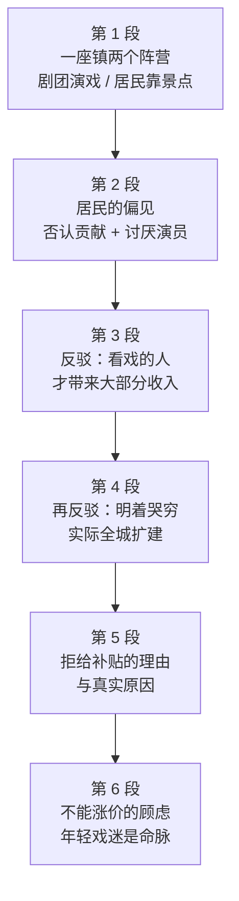

# Passage 25 · 斯特拉特福的莎士比亚之争

## 答题记录

| 轮次  | 日期         | 题号  | 正确  | 错误  | 正确率 | 用时    | 错题归因 |
| --- | --- | --- | --- | --- | --- | --- | --- |
| 1 |  | 1-5 |  |  |  |  |  |
| 2 |  | 1-5 |  |  |  |  |  |
| 3 |  | 1-5 |  |  |  |  |  |

> [!tip] 填写口径
> - **用时**以分钟计，只计做题时间，不含精读复盘。
> - **错题归因**填「题型·错误类型」，如：细节题·定位错、推理判断·过度推断、主旨大意·以偏概全。
> - 纵向看趋势：正确率升而用时过长 → 熟练度不足；用时降而正确率波动 → 定位不稳。

> [!info] 文章档案
> - **来源**：考研英语（一）2006 年 Text 2
> - **题材**：文艺教育——莎士比亚故居小镇上「剧团 vs 居民」的利益与认知之争
> - **结构**：6 段 / 22 句 ＋ 5 题
> - **难度**：★★★☆☆
> - **一句话主旨**：斯特拉特福镇靠莎士比亚吃饭，却分裂成敌对的两支——演戏的皇家莎士比亚剧团与靠观光客谋生的居民；居民一面否认剧团贡献、一面哭穷拒给补贴，而作者用「上座率连破纪录 vs 旅馆争相扩建」的对照，站到了剧团一边。

## 一、篇章脉络

- **第 1 段**：开篇点题——斯特拉特福只有一项产业（莎士比亚），却分成日益敌对的两支：在纪念剧院上演莎剧的皇家莎士比亚剧团，和主要靠看景点的游客过活的小镇居民。
- **第 2 段**：居民的态度：怀疑剧院没给镇上增加一分钱收入，而且毫不掩饰地讨厌剧团演员的长发、胡须、凉鞋与喧闹——讽刺的是，养活他们的莎士比亚本人就是这样一个演员。
- **第 3 段**：作者第一次反驳：两股游客流并非完全分开，看戏的人会顺带观光并在此过夜，正是他们把钱倒进酒店餐馆、带来小镇大部分收入；观光客天黑前就走了。
- **第 4 段**：作者第二次反驳：居民不这么看、地方议会也不给补贴，斯特拉特福历来哭穷，然而镇上每家旅馆都在加建侧厅与酒吧，希尔顿也在建酒店，还配上《哈姆雷特》汉堡吧之类的昂贵装潢。
- **第 5 段**：居民的疑问（上座率连年破纪录，为什么还要补贴？）与作者的回答（成本飞涨而票价压着不涨）。
- **第 6 段**：为什么不涨价——会赶走那些清瘦执着的年轻戏迷，他们只为看戏而来，睡在剧院外的石板上等售票。

> [!tip] 行文逻辑
> 「总起对立（第 1 段）→ 摆反面意见（第 2 段）→ 两次反驳（第 3、4 段）→ 解释症结（第 5 段）→ 收束顾虑（第 6 段）」，是典型的「立靶—驳论」结构。全篇的感情色彩词几乎都偏向剧团：superb productions（第 1 段②）、most attractive clientele（第 6 段①）、It would be a shame（第 6 段①）；而居民的两次说法都被 Nevertheless（第 4 段③）和括号里的上座率数据（第 5 段②）当场拆穿。第 5 题问作者态度，答案 D（同情剧团）就来自这条色彩链。

## 二、逐段精读

### 第 1 段 · 一座小镇，两个敌对阵营

**原文**

① Stratford-on-Avon, as we all know, has only one industry — William Shakespeare — but there are two distinctly separate and increasingly hostile branches.
② There is the Royal Shakespeare Company (RSC), which presents superb productions of the plays at the Shakespeare Memorial Theatre on the Avon.
③ And there are the townsfolk who largely live off the tourists who come, not to see the plays, but to look at Anne Hathaway's Cottage, Shakespeare's birthplace and the other sights.

**译文**

① 众所周知，埃文河畔的斯特拉特福只有一项产业——威廉·莎士比亚——但它却分成两个截然分明且日益敌对的分支。
② 一支是皇家莎士比亚剧团（RSC），它在埃文河畔的莎士比亚纪念剧院里上演莎剧的绝佳制作。
③ 另一支是小镇居民，他们主要靠游客过活——这些游客来此不是为了看戏，而是为了参观安妮·海瑟薇小屋、莎士比亚出生地以及其他景点。

> [!note] 段落要点
> - 功能：一句话立起全篇的对立框架——同一个莎士比亚，养出两支互相敌视的人马。
> - ①句的破折号 — William Shakespeare — 是同位语，把「产业」直接等同「一个人」，既是夸张也是全文的笑点所在。
> - ②③句构成 There is A, which... / And there are B who... 的平行对照，读题时只要分清 A＝剧团、B＝居民，后面四道题的定位就不会串。
> - ③句的 not to see the plays, but to look at... 是「不是……而是……」，直接给出居民与剧团利益不重合的根源。

#### 长难句 · 本段

> [!abstract] 本段第 ① 句 · Stratford-on-Avon, as we all know, has only one industry — William Shakespeare — but there are two distinctly separate and increasingly hostile branches.

**结构拆解**

- **插入语**：as we all know（众所周知，置于主语后）
- **主语**：Stratford-on-Avon
- **谓语**：has
- **宾语**：only one industry
- **同位语**：— William Shakespeare —（破折号成对使用，解释 industry 的内容）
- **转折并列句**：but there are two...branches
- **定语**：distinctly separate and increasingly hostile（两个形容词短语并列修饰 branches）

**参考译文**

众所周知，埃文河畔的斯特拉特福只有一项产业——威廉·莎士比亚——但它却分成两个截然分明且日益敌对的分支。

> [!tip] 拆解要点
> 抓主干只需「Stratford has one industry but two branches」，中间的 as we all know 与破折号都可以先跳过。破折号在这里不是补充说明形容词，而是**把「产业」这个抽象名词直接换成一个人名**，属于「同位语＝等号」的用法，读时要读出其中的幽默与反常。hostile 是本段的情感基调词，后文全部对立都由它派生。

> [!abstract] 本段第 ③ 句 · And there are the townsfolk who largely live off the tourists who come, not to see the plays, but to look at Anne Hathaway's Cottage, Shakespeare's birthplace and the other sights.

**结构拆解**

- **主干**：there are the townsfolk
- **定语从句 1**：who largely live off the tourists（修饰 townsfolk）
- **定语从句 2**：who come, not to see the plays, but to look at...（修饰 tourists，两层 who 从句嵌套）
- **对比结构**：not to do A, but to do B（不是为做 A，而是为做 B）
- **并列宾语**：Anne Hathaway's Cottage, Shakespeare's birthplace and the other sights

**参考译文**

另一支是小镇居民，他们主要靠游客过活——这些游客来此不是为了看戏，而是为了参观安妮·海瑟薇小屋、莎士比亚出生地以及其他景点。

> [!tip] 拆解要点
> 两个 who 从句叠在一起，第一个 who 的宾语 tourists 又带出第二个 who，读时按「居民—游客—游客的目的」三层顺下来即可。`live off` 是「靠……为生」（＝ live on），注意 off 在这里不是「离开」。`not A but B` 的重心永远在 but 之后：游客的目的是看景点，这就埋下了第 3 段「看戏的人才会过夜消费」的反驳伏笔。

#### 本段重点词汇

| 单词 / 短语 | 词性 | 文中意 | 常用考义与拓展 | 英文示例搭配（中译） |
| --- | --- | --- | --- | --- |
| **industry** | n. | 产业，行业 | 熟义「工业」→ 此处「（一个地方的）支柱产业」；industrial adj. 工业的 | the town's only industry（小镇唯一的产业） |
| **distinctly** | adv. | 明显地，截然地 | distinct adj. 截然不同的、清晰的；distinction n. 差别 | two distinctly separate branches（两个截然分开的分支） |
| **separate** | adj. | 分开的，各自独立的 | separate v. 分开；separation n. 分离 | separate branches（各自独立的分支） |
| **hostile** | adj. | 敌对的，敌意的 | hostility n. 敌意；反义 friendly / cordial | increasingly hostile branches（日益敌对的分支） |
| **branch** | n. | 分支，派别 | 熟义「树枝」→ 引申「分支机构、派系」；branch office 分公司 | two hostile branches（两个敌对的分支） |
| **present** | v. | 上演，呈现 | 熟义 adj.「现在的」/ n.「礼物」→ v. 呈现、演出；presentation n. 展示 | present superb productions（上演绝佳的演出） |
| **superb** | adj. | 极好的，一流的 | 近义 excellent / splendid / magnificent；superbly adv. | superb productions of the plays（莎剧的一流制作） |
| **production** | n. | （戏剧）演出，制作 | 熟义「生产」→ 戏剧影视的「制作、出品」；produce v. 制作 | superb productions（绝佳的演出） |
| **townsfolk** | n. | 镇民，小镇居民 | = townspeople；folk n. 人们（folk music 民乐） | the townsfolk who live off the tourists（靠游客为生的镇民） |
| **live off** | 短语 | 靠……为生 | = live on；live off sb 靠某人养活 | live off the tourists（靠游客过活） |
| **sight** | n. | 景点，景观 | the sights 名胜；sightseeing n. 观光；sightseer n. 观光客 | look at the other sights（参观其他景点） |

### 第 2 段 · 居民的偏见与作者的第一次反讽

**原文**

① The worthy residents of Stratford doubt that the theatre adds a penny to their revenue.
② They frankly dislike the RSC's actors, them with their long hair and beards and sandals and noisiness.
③ It's all deliciously ironic when you consider that Shakespeare, who earns their living, was himself an actor (with a beard) and did his share of noise-making.

**译文**

① 斯特拉特福那些体面的居民怀疑，剧院根本没有给他们的收入增加一分钱。
② 他们毫不掩饰地讨厌皇家莎士比亚剧团的演员，讨厌他们留长发、蓄胡须、穿凉鞋、爱喧闹。
③ 可当你想到，靠养活他们的莎士比亚本人就是个演员（还留着胡子），也一样制造过喧闹时，这一切就显得讽刺得妙不可言了。

> [!note] 段落要点
> - 功能：把居民的立场讲足——既否认剧团的经济贡献，又厌恶演员做派。
> - ①句是第 1 题的直接定位句，doubt...adds a penny to their revenue 被选项 A 改写成 deny...contribution to the town's revenue。
> - ②句的 them with their long hair and beards... 是口语化的轻蔑列举，四个名词一口气排下来，模拟居民数落演员的语气。
> - ③句是作者的第一记回马枪：莎士比亚本人恰恰是他们讨厌的那种人，而他们正靠他吃饭——反讽由此成立。

#### 长难句 · 本段

> [!abstract] 本段第 ② 句 · They frankly dislike the RSC's actors, them with their long hair and beards and sandals and noisiness.

**结构拆解**

- **主干**：They frankly dislike the RSC's actors
- **状语**：frankly（坦率地、毫不掩饰地）
- **同位/补充说明**：them with their long hair and beards and sandals and noisiness
- **结构**：代词 them + with 短语，复指 actors，列举其外貌特征
- **并列名词**：long hair / beards / sandals / noisiness（四项，最后一项前不用 and 也可，此处用 and 收尾）

**参考译文**

他们毫不掩饰地讨厌皇家莎士比亚剧团的演员，讨厌他们留长发、蓄胡须、穿凉鞋、爱喧闹。

> [!tip] 拆解要点
> `them with...` 是口语里常见的「代词 + with 短语」复指结构，作用等于一个非限定性定语从句 who are with...，翻译时拆成第二个分句更顺。四项并列里前三项是名词、最后一项是抽象名词（noisiness 喧闹），作者故意把「吵闹」与外貌并列，把居民的偏见写得滑稽可笑——这是态度题里判断作者立场的第一个信号。

> [!abstract] 本段第 ③ 句 · It's all deliciously ironic when you consider that Shakespeare, who earns their living, was himself an actor (with a beard) and did his share of noise-making.

**结构拆解**

- **形式主语**：It
- **谓语**：is
- **表语**：all deliciously ironic
- **时间/条件状语从句**：when you consider that...
- **宾语从句**：that Shakespeare... was himself an actor and did his share of noise-making
- **插入定语从句**：who earns their living（修饰 Shakespeare，主谓被插入语隔开）

**参考译文**

可当你想到，靠养活他们的莎士比亚本人就是个演员（还留着胡子），也一样制造过喧闹时，这一切就显得讽刺得妙不可言了。

> [!tip] 拆解要点
> 主句是 It is ironic，when 从句里套了 that 宾语从句、又套了 who 定语从句，共三层。读法：先取「这很讽刺」→ 再补「当你考虑到……」→ 最后填「莎士比亚本人就是演员」。`earn one's living` 是「谋生」，但这里的主语是 Shakespeare、宾语是 their living，意思是「莎士比亚养活他们」，注意代词 their 指居民。`do one's share of` 是「尽自己的一份、也照样做过」。

#### 本段重点词汇

| 单词 / 短语 | 词性 | 文中意 | 常用考义与拓展 | 英文示例搭配（中译） |
| --- | --- | --- | --- | --- |
| **worthy** | adj. | （表面）可敬的、体面的 | worth n. 价值；worthwhile adj. 值得的；此处带作者反讽 | the worthy residents of Stratford（斯特拉特福可敬的居民们） |
| **resident** | n. | 居民 | reside v. 居住；residence n. 住所；residential adj. 住宅的 | the worthy residents（体面的居民们） |
| **doubt** | v. | 怀疑，不相信 | doubtful adj. 怀疑的；beyond doubt 毫无疑问；doubt 后接 that 从句 | doubt that the theatre adds a penny（怀疑剧院带来一分钱） |
| **add a penny to** | 短语 | 给……增添一分钱 | not add a penny to ＝ 一点也没增加；penny 喻极小额 | adds a penny to their revenue（为他们的收入增加一分钱） |
| **revenue** | n. | （地方/企业）收入，营收 | 与 income（个人收入）、profit（利润）、tax（税）区分 | the town's revenue（小镇的收入） |
| **frankly** | adv. | 坦率地，毫不掩饰地 | frank adj. 坦率的；frankly speaking 坦白说 | They frankly dislike the actors（他们毫不掩饰地讨厌演员） |
| **dislike** | v. | 讨厌，不喜欢 | dis- 否定前缀；unlike prep. 不像（注意别混） | dislike the RSC's actors（讨厌皇家莎士比亚剧团的演员） |
| **beard** | n. | 胡须，络腮胡 | moustache n. 髭（上唇胡）；bearded adj. 蓄须的 | long hair and beards（长发和胡须） |
| **sandals** | n. | 凉鞋 | 常用复数；a pair of sandals 一双凉鞋 | wearing jeans and sandals（穿着牛仔裤和凉鞋） |
| **noisiness** | n. | 喧闹，吵闹 | noisy adj. 吵闹的；noise n. 噪音 | their ... sandals and noisiness（……凉鞋和喧闹） |
| **deliciously** | adv. | 妙极了地，饶有风趣地 | delicious adj. 美味的 → 引申「令人愉悦地」 | It's all deliciously ironic（这一切讽刺得妙极了） |
| **ironic** | adj. | 具有讽刺意味的 | irony n. 反讽；ironically adv. 讽刺地 | deliciously ironic（极富讽刺意味） |
| **earn one's living** | 短语 | 谋生，养活自己 | = make a living / earn a living；living n. 生计 | Shakespeare, who earns their living（养活他们的莎士比亚） |
| **do one's share of** | 短语 | 尽自己的一份，照样做过 | share n. 份额；do one's share 尽本分 | did his share of noise-making（他也一样制造过喧闹） |

### 第 3 段 · 第一次反驳：带来收入的是看戏的人

**原文**

① The tourist streams are not entirely separate.
② The sightseers who come by bus — and often take in Warwick Castle and Blenheim Palace on the side — don't usually see the plays, and some of them are even surprised to find a theatre in Stratford.
③ However, the playgoers do manage a little sight-seeing along with their playgoing.
④ It is the playgoers, the RSC contends, who bring in much of the town's revenue because they spend the night (some of them four or five nights) pouring cash into the hotels and restaurants.
⑤ The sightseers can take in everything and get out of town by nightfall.

**译文**

① 这两股游客流并非完全分开。
② 乘大巴前来的观光客——常常还会顺道去看看沃里克城堡和布伦海姆宫——通常不看戏，有些人甚至惊讶地发现斯特拉特福居然还有一座剧院。
③ 然而，看戏的人在观剧之余，确实也会稍微观光一番。
④ 皇家莎士比亚剧团主张，正是这些看戏的人带来了小镇收入的大部分，因为他们会在此过夜（有些人住上四五晚），把大把钞票倾泻进酒店和餐馆。
⑤ 观光客则可以看完一切，在天黑前离开小镇。

> [!note] 段落要点
> - 功能：用「谁过夜、谁花钱」的事实，正面反驳第 2 段居民「剧院不带来收入」的说法。
> - ①③句构成承认—转折：先承认两股人流不完全分开（①），再用 However 转向看戏者的实际消费（③）。
> - ④句是全段的论断句，也是第 2 题的定位句：强调句型 It is the playgoers... who... 把「看戏的人」顶到句首，重音就落在他们身上。
> - ⑤句与④句对举：观光客「看完就走」，反证他们留不下钱。

#### 长难句 · 本段

> [!abstract] 本段第 ② 句 · The sightseers who come by bus — and often take in Warwick Castle and Blenheim Palace on the side — don't usually see the plays, and some of them are even surprised to find a theatre in Stratford.

**结构拆解**

- **主语**：The sightseers
- **定语从句**：who come by bus — and often take in Warwick Castle and Blenheim Palace on the side —（两个谓语，被破折号成对夹住）
- **插入语**：— and often take in ... on the side —（补充说明顺带的行程）
- **谓语**：don't usually see
- **宾语**：the plays
- **并列句**：and some of them are even surprised to find a theatre in Stratford

**参考译文**

乘大巴前来的观光客——常常还会顺道去看看沃里克城堡和布伦海姆宫——通常不看戏，有些人甚至惊讶地发现斯特拉特福居然还有一座剧院。

> [!tip] 拆解要点
> 主谓被「who + 破折号插入语」隔开，抓主干只要「The sightseers don't usually see the plays」。`take in` 此处是「顺道参观」，不是「吸收、收留、欺骗」；`on the side` 是「顺带、另外」。并列句里的 `be surprised to find` 是细节：观光客根本不知道这里有剧院，直接否定了 A 项「观光客不能分别参观城堡和宫殿」。

> [!abstract] 本段第 ④ 句 · It is the playgoers, the RSC contends, who bring in much of the town's revenue because they spend the night (some of them four or five nights) pouring cash into the hotels and restaurants.

**结构拆解**

- **强调句型**：It is the playgoers... who bring in much of the town's revenue
- **插入语**：the RSC contends（观点归属标记，读时先跳过后回填）
- **原因状语从句**：because they spend the night (some of them four or five nights) pouring cash into the hotels and restaurants
- **伴随状语**：pouring cash into...（现在分词，说明「过夜」期间花钱的方式）
- **括号补充**：(some of them four or five nights)

**参考译文**

皇家莎士比亚剧团主张，正是这些看戏的人带来了小镇收入的大部分，因为他们会在此过夜（有些人住上四五晚），把大把钞票倾泻进酒店和餐馆。

> [!tip] 拆解要点
> 先认出 `It is...who...` 强调句：被强调的是 playgoers，翻译加「正是」。`contend` 在考研里常考「主张、声称」（＝ argue / claim），不只是「竞争」。`pour cash into` 是比喻说法，字面「把现金倒进」，实际「大量花钱于」；`spend the night doing` 是「过夜做某事」。这一句是第 2 题答案 B（看戏的人比观光客花钱多）的直接依据，也是第 5 题判断作者偏袒剧团的关键证据。

#### 本段重点词汇

| 单词 / 短语 | 词性 | 文中意 | 常用考义与拓展 | 英文示例搭配（中译） |
| --- | --- | --- | --- | --- |
| **stream** | n. | （人、车的）流 | 熟义「小河」→ a stream of tourists 一股人流；stream v. 涌流 | The tourist streams（这几股游客流） |
| **entirely** | adv. | 完全地 | entire adj. 全部的；近义 completely / wholly | not entirely separate（不完全分开） |
| **sightseer** | n. | 观光客，看景点的游客 | sightsee v. 观光；sightseeing n. 观光 | The sightseers who come by bus（乘大巴来的观光客） |
| **take in** | 短语 | 顺道参观，顺便看 | 另有「吸收、领会、收留、欺骗」等义，须按语境定 | take in Warwick Castle（顺道参观沃里克城堡） |
| **on the side** | 短语 | 顺带地，另外 | 另有「作为副业、私下地」之义 | take in ... on the side（顺带看看……） |
| **playgoer** | n. | 看戏的人，戏迷 | -goer 表「常去……的人」：moviegoer / churchgoer | the playgoers do manage...（看戏的人确实会……） |
| **sight-seeing** | n. | 观光，游览 | = sightseeing；go sight-seeing 去观光 | do a little sight-seeing（稍微观光一下） |
| **playgoing** | n. | 看戏（的活动） | playgo v.（罕见）+ -ing；与 sight-seeing 对举 | along with their playgoing（在观剧之余） |
| **contend** | v. | 主张，声称 | 熟义「竞争、争夺」→ 此处 argue/claim；contention n. 主张 | the RSC contends（皇家莎士比亚剧团主张） |
| **bring in** | 短语 | 带来，赚得 | bring in revenue/income 带来收入；bring in sb 请某人来 | bring in much of the town's revenue（带来小镇大部分收入） |
| **pour cash into** | 短语 | 把大把钱投入 | pour v. 倾倒；pour money into 大笔投入于 | pouring cash into the hotels（把钱花在酒店里） |
| **nightfall** | n. | 黄昏，夜幕降临 | = dusk；by nightfall 天黑之前 | get out of town by nightfall（天黑前离开小镇） |

### 第 4 段 · 第二次反驳：明着哭穷，实际全城扩建

**原文**

① The townsfolk don't see it this way and local council does not contribute directly to the subsidy of the Royal Shakespeare Company.
② Stratford cries poor traditionally.
③ Nevertheless every hotel in town seems to be adding a new wing or cocktail lounge.
④ Hilton is building its own hotel there, which you may be sure will be decorated with Hamlet Hamburger Bars, the Lear Lounge, the Banquo Banqueting Room, and so forth, and will be very expensive.

**译文**

① 居民们并不这么看，地方议会也不直接出资补贴皇家莎士比亚剧团。
② 斯特拉特福历来爱哭穷。
③ 然而，镇上每一家旅馆似乎都在加建新的侧厅或鸡尾酒吧。
④ 希尔顿正在那里建自己的酒店，而且可以肯定，它将以《哈姆雷特》汉堡吧、《李尔王》休息厅、《班柯》宴会厅之类来装潢，并且会非常昂贵。

> [!note] 段落要点
> - 功能：第二次拆穿居民——一边哭穷拒给补贴，一边全城旅馆大兴土木。
> - ②句是被考的原句，③句的 Nevertheless 是转折标志，**转折后才是作者真正要说的话**，第 3 题答案 C 就出自这个对照。
> - ④句的 Hamlet Hamburger Bars / the Lear Lounge / the Banquo Banqueting Room 是莎剧人物被做成消费场所名字，作者用这种滑稽列举讽刺小镇把莎士比亚彻底商业化。
> - 注意：居民真正反对的是「给补贴」，而他们自己却在大规模扩张——这就是作者的同情所在。

#### 长难句 · 本段

> [!abstract] 本段第 ④ 句 · Hilton is building its own hotel there, which you may be sure will be decorated with Hamlet Hamburger Bars, the Lear Lounge, the Banquo Banqueting Room, and so forth, and will be very expensive.

**结构拆解**

- **主句**：Hilton is building its own hotel there
- **非限定性定语从句**：which you may be sure will be decorated with... and will be very expensive
- **插入语**：you may be sure（＝ 可以肯定，读时先跳过）
- **从句谓语 1**：will be decorated with（被动，后接一串并列宾语）
- **并列宾语**：Hamlet Hamburger Bars, the Lear Lounge, the Banquo Banqueting Room, and so forth
- **从句谓语 2**：and will be very expensive

**参考译文**

希尔顿正在那里建自己的酒店，而且可以肯定，它将以《哈姆雷特》汉堡吧、《李尔王》休息厅、《班柯》宴会厅之类来装潢，并且会非常昂贵。

> [!tip] 拆解要点
> which 从句里套了 `you may be sure` 这个插入语，去掉后结构立刻清爽：which will be decorated with... and will be very expensive（两个并列谓语）。`and so forth` 是举例收尾的固定短语（＝ and so on）。三个专名分别来自《哈姆雷特》《李尔王》《麦克白》（班柯是剧中人物），作者把它们写成汉堡吧、休息厅、宴会厅，是用「高雅文化被做成消费招牌」来讽刺小镇的商业化——这也解释了为什么第 3 题答案是「并不真缺钱」。

#### 本段重点词汇

| 单词 / 短语 | 词性 | 文中意 | 常用考义与拓展 | 英文示例搭配（中译） |
| --- | --- | --- | --- | --- |
| **council** | n. | 委员会，议会 | local council 地方议会；councilor n. 议员；注意与 counsel（劝告）区分 | local council does not contribute（地方议会不出资） |
| **contribute** | v. | 出资，贡献 | contribute to 有助于/捐献；contribution n. 贡献、捐款 | contribute directly to the subsidy（直接出资补贴） |
| **subsidy** | n. | 补贴，津贴 | subsidize v. 补贴；subsidies to farmers 农业补贴 | the subsidy of the RSC（给皇家莎士比亚剧团的补贴） |
| **cry poor** | 短语 | 哭穷，叫穷 | cry 此处为「喊叫」；cry wolf 狼来了 | Stratford cries poor（斯特拉特福哭穷） |
| **traditionally** | adv. | 历来，传统上 | traditional adj. 传统的；tradition n. 传统 | cries poor traditionally（历来爱哭穷） |
| **nevertheless** | adv. | 然而，不过 | 近义 however / nonetheless；转折后为重点 | Nevertheless every hotel...（然而每一家旅馆……） |
| **wing** | n. | （建筑的）侧厅，侧翼 | 熟义「翅膀」→ 建筑的侧翼；the west wing 西翼 | adding a new wing（加建新的侧厅） |
| **cocktail lounge** | n. | 鸡尾酒吧（厅） | lounge n. 休息厅、候机厅；cocktail n. 鸡尾酒 | a new wing or cocktail lounge（新侧厅或鸡尾酒吧） |
| **decorate with** | 短语 | 以……装饰 | decorate v. 装饰；decoration n. 装潢；decorative adj. 装饰性的 | be decorated with Hamlet Hamburger Bars（以「哈姆雷特汉堡吧」装潢） |
| **and so forth** | 短语 | 等等，诸如此类 | = and so on / etc.，用于举例收尾 | ...the Banquo Banqueting Room, and so forth（……《班柯》宴会厅等等） |

### 第 5 段 · 居民的理由与作者的答案

**原文**

① Anyway, the townsfolk can't understand why the Royal Shakespeare Company needs a subsidy.
② (The theatre has broken attendance records for three years in a row.
③ Last year its 1,431 seats were 94 percent occupied all year long and this year they'll do better.)
④ The reason, of course, is that costs have rocketed and ticket prices have stayed low.

**译文**

① 话说回来，小镇居民不明白皇家莎士比亚剧团为什么还需要补贴。
② （这家剧院已经连续三年打破上座率纪录。
③ 去年它的 1431 个座位全年上座率达到 94%，今年还会更好。）
④ 原因当然是：成本飞涨，而票价一直压得很低。

> [!note] 段落要点
> - 功能：先替居民把「不该给补贴」的理由讲完，再给出真正的原因，形成「居民看表象 / 作者看内情」的对照。
> - ①句是第 4 题的定位句（题干 According to the townsfolk），括号内②③句是居民引用的上座率数据 → 对应 D 项「上座率在提高」。
> - ④句才是作者给出的答案：成本暴涨而票价不涨，所以需要补贴。这一句也是第 5 题判断作者立场（同情剧团）的直接证据。
> - 括号的用法值得注意：整段括号是「居民心里的疑问」，不是作者的旁白。

#### 长难句 · 本段

> [!abstract] 本段第 ④ 句 · The reason, of course, is that costs have rocketed and ticket prices have stayed low.

**结构拆解**

- **主干**：The reason is that...（that 引导表语从句）
- **插入语**：of course（当然，表作者语气上的笃定）
- **表语从句**：that costs have rocketed and ticket prices have stayed low
- **并列分句 1**：costs have rocketed（现在完成时，表「已经涨上去」）
- **并列分句 2**：ticket prices have stayed low（stay + adj. 保持某种状态）

**参考译文**

原因当然是：成本飞涨，而票价一直压得很低。

> [!tip] 拆解要点
> `The reason is that...` 是解释因果的万能框架，写作时可迁移；注意不要写成 The reason is because（because 与 reason 重复，是常见错误）。rocket 名词「火箭」→ 动词「猛涨、飙升」，与 soar / surge / shoot up 同义。stay 这里是系动词，后接形容词 low，「保持低位」。成本涨、票价不涨＝入不敷出，这才是需要补贴的真实理由，与居民口中的「上座率高」形成对照。

#### 本段重点词汇

| 单词 / 短语 | 词性 | 文中意 | 常用考义与拓展 | 英文示例搭配（中译） |
| --- | --- | --- | --- | --- |
| **anyway** | adv. | 话说回来，不管怎样 | = anyhow；用于拉回话题或补充 | Anyway, the townsfolk can't understand...（话说回来，居民不明白……） |
| **break a record** | 短语 | 打破纪录 | break attendance records 打破上座纪录；set/hold a record 创/保持纪录 | has broken attendance records（已打破上座率纪录） |
| **attendance** | n. | 上座率，出席人数 | attend v. 出席、照料；attendant n. 服务员；注意与 audience（观众）区分 | attendance records（上座率纪录） |
| **in a row** | 短语 | 连续地 | row 熟义「排、行」→ in a row 连续；three years in a row 连续三年 | for three years in a row（连续三年） |
| **occupy** | v. | 占用，占据 | occupied adj. 被占用的（座位售出）；occupancy n. 入住率/上座率 | 94 percent occupied（94% 被占用／上座率 94%） |
| **rocket** | v. | 猛涨，飙升 | 熟义 n.「火箭」→ v. 急速上升；近义 soar / surge | costs have rocketed（成本飞涨） |
| **stay low** | 短语 | 保持低位 | stay 作系动词 + adj.；stay put 待在原地 | ticket prices have stayed low（票价一直保持低位） |

### 第 6 段 · 不涨价的理由与最动人的戏迷

**原文**

① It would be a shame to raise prices too much because it would drive away the young people who are Stratford's most attractive clientele.
② They come entirely for the plays, not the sights.
③ They all seem to look alike (though they come from all over) — lean, pointed, dedicated faces, wearing jeans and sandals, eating their buns and bedding down for the night on the flagstones outside the theatre to buy the 20 seats and 80 standing-room tickets held for the sleepers and sold to them when the box office opens at 10:30 a.m.

**译文**

① 把票价抬得太高会是件憾事，因为那会赶走年轻人——他们是斯特拉特福最具吸引力的顾客群。
② 他们完全是为看戏而来，不是为了看景点。
③ 他们看上去全都一个样（尽管来自四面八方）——清瘦、棱角分明而神情专注的脸，穿着牛仔裤和凉鞋，啃着自己的小面包，夜里就睡在剧院外的石板上，只为买到留给这些露宿者的 20 个座位和 80 张站票，等上午 10 点半售票处开门时卖给他们。

> [!note] 段落要点
> - 功能：用「最可爱的一群顾客」收尾，把同情彻底交给剧团，也为「不能涨价」给出人情味十足的理由。
> - ①句的 It would be a shame 与 most attractive clientele 是两处明确的褒义色彩词，第 5 题态度题据此定调。
> - ②句的 entirely for the plays, not the sights 呼应第 1 段③句，形成首尾闭环：小镇真正靠莎士比亚（戏剧）吃饭的人，恰恰是被居民讨厌的那群人。
> - ③句的画面（啃面包、睡石板、等 10:30 开门）是全篇最动情处，也解释了第 5 段④句「票价为什么不涨」。

#### 长难句 · 本段

> [!abstract] 本段第 ③ 句 · They all seem to look alike (though they come from all over) — lean, pointed, dedicated faces, wearing jeans and sandals, eating their buns and bedding down for the night on the flagstones outside the theatre to buy the 20 seats and 80 standing-room tickets held for the sleepers and sold to them when the box office opens at 10:30 a.m.

**结构拆解**

- **主干**：They all seem to look alike
- **让步插入**：(though they come from all over)
- **同位语/描写性短语**：— lean, pointed, dedicated faces（破折号后对 alike 的具体化）
- **伴随状语（三项并列）**：wearing jeans and sandals, eating their buns and bedding down for the night on the flagstones outside the theatre
- **目的状语**：to buy the 20 seats and 80 standing-room tickets
- **后置定语**：held for the sleepers and sold to them（两个过去分词并列修饰 tickets）
- **时间状语从句**：when the box office opens at 10:30 a.m.

**参考译文**

他们看上去全都一个样（尽管来自四面八方）——清瘦、棱角分明而神情专注的脸，穿着牛仔裤和凉鞋，啃着自己的小面包，夜里就睡在剧院外的石板上，只为买到留给这些露宿者的 20 个座位和 80 张站票，等上午 10 点半售票处开门时卖给他们。

> [!tip] 拆解要点
> 句子很长但主干极短（They seem to look alike），后面全是一层层往下挂的描写：破折号后的三个形容词是外貌速写，wearing / eating / bedding down 三个现在分词是动作速写，to buy... 说明目的，held... and sold... 是 tickets 的后置定语，when 从句收尾。读法：先把主干和三个分词挑出来，明白「他们睡在剧院外是为了买票」，其余细节自会归位。`bed down` 是「（就地）过夜、露宿」；`hold` 此处是「预留、保留」；`standing-room` 是「站席」；box office 是「售票处／票房」。

#### 本段重点词汇

| 单词 / 短语 | 词性 | 文中意 | 常用考义与拓展 | 英文示例搭配（中译） |
| --- | --- | --- | --- | --- |
| **shame** | n. | 憾事，可惜的事 | 熟义「羞耻」→ It's a shame that... 真是遗憾；shameful adj. 可耻的 | It would be a shame to raise prices（涨价会是件憾事） |
| **drive away** | 短语 | 赶走，吓跑 | 熟义「开车离开」→ 此处「使顾客流失」；drive sb mad 把某人逼疯 | drive away the young people（把年轻人赶走） |
| **clientele** | n. | 顾客群，常客（总称） | client n. 客户；clientele 为集合名词，作单数 | Stratford's most attractive clientele（最具吸引力的顾客群） |
| **lean** | adj. | 清瘦的，精瘦的 | 熟义 v.「倾斜」→ adj. 瘦而结实的；lean meat 瘦肉 | lean, pointed, dedicated faces（清瘦而棱角分明的脸） |
| **pointed** | adj. | 尖的，棱角分明的 | 另有「尖锐的、有针对性的」（a pointed question）；point v. 指向 | pointed faces（棱角分明的脸） |
| **dedicated** | adj. | 专注的，投入的 | dedicate v. 奉献；dedication n. 投入、奉献 | dedicated faces（神情专注的脸） |
| **bun** | n. | 小圆面包 | 另有「发髻」之义；a hot dog bun 热狗面包 | eating their buns（啃着他们的小面包） |
| **bed down** | 短语 | （就地）过夜，露宿 | bed 作动词「安顿睡觉」；bed down for the night 过夜 | bedding down for the night（夜里就地睡下） |
| **flagstone** | n. | 石板（地面） | flag 此处指「铺路石板」；stone flagstones 石板路 | on the flagstones outside the theatre（在剧院外的石板上） |
| **standing-room** | n. | 站席，站票 | standing room only 仅有站票 | 80 standing-room tickets（80 张站票） |
| **hold** | v. | 预留，保留 | 熟义「握住、持有」→ 此处「为某人留着」；hold a seat 留座 | tickets held for the sleepers（为露宿者预留的票） |
| **box office** | n. | 售票处，票房 | box-office hit 票房大片 | when the box office opens at 10:30 a.m.（售票处上午 10 点半开门时） |

## 三、全篇重点词汇汇总（自测用）

> [!info] 说明
> 本表只列「单词 / 词性 / 所在段」，不含释义与搭配，用于遮表自测：说出词义后再回该段核对。
> 收录**全篇所有段落词汇，共 66 条，不删减**，与各段「本段重点词汇」等长同源。

| 单词 / 短语 | 词性 | 所在段 |
| --- | --- | --- |
| **industry** | n. | 第 1 段 |
| **distinctly** | adv. | 第 1 段 |
| **separate** | adj. | 第 1 段 |
| **hostile** | adj. | 第 1 段 |
| **branch** | n. | 第 1 段 |
| **present** | v. | 第 1 段 |
| **superb** | adj. | 第 1 段 |
| **production** | n. | 第 1 段 |
| **townsfolk** | n. | 第 1 段 |
| **live off** | 短语 | 第 1 段 |
| **sight** | n. | 第 1 段 |
| **worthy** | adj. | 第 2 段 |
| **resident** | n. | 第 2 段 |
| **doubt** | v. | 第 2 段 |
| **add a penny to** | 短语 | 第 2 段 |
| **revenue** | n. | 第 2 段 |
| **frankly** | adv. | 第 2 段 |
| **dislike** | v. | 第 2 段 |
| **beard** | n. | 第 2 段 |
| **sandals** | n. | 第 2 段 |
| **noisiness** | n. | 第 2 段 |
| **deliciously** | adv. | 第 2 段 |
| **ironic** | adj. | 第 2 段 |
| **earn one's living** | 短语 | 第 2 段 |
| **do one's share of** | 短语 | 第 2 段 |
| **stream** | n. | 第 3 段 |
| **entirely** | adv. | 第 3 段 |
| **sightseer** | n. | 第 3 段 |
| **take in** | 短语 | 第 3 段 |
| **on the side** | 短语 | 第 3 段 |
| **playgoer** | n. | 第 3 段 |
| **sight-seeing** | n. | 第 3 段 |
| **playgoing** | n. | 第 3 段 |
| **contend** | v. | 第 3 段 |
| **bring in** | 短语 | 第 3 段 |
| **pour cash into** | 短语 | 第 3 段 |
| **nightfall** | n. | 第 3 段 |
| **council** | n. | 第 4 段 |
| **contribute** | v. | 第 4 段 |
| **subsidy** | n. | 第 4 段 |
| **cry poor** | 短语 | 第 4 段 |
| **traditionally** | adv. | 第 4 段 |
| **nevertheless** | adv. | 第 4 段 |
| **wing** | n. | 第 4 段 |
| **cocktail lounge** | n. | 第 4 段 |
| **decorate with** | 短语 | 第 4 段 |
| **and so forth** | 短语 | 第 4 段 |
| **anyway** | adv. | 第 5 段 |
| **break a record** | 短语 | 第 5 段 |
| **attendance** | n. | 第 5 段 |
| **in a row** | 短语 | 第 5 段 |
| **occupy** | v. | 第 5 段 |
| **rocket** | v. | 第 5 段 |
| **stay low** | 短语 | 第 5 段 |
| **shame** | n. | 第 6 段 |
| **drive away** | 短语 | 第 6 段 |
| **clientele** | n. | 第 6 段 |
| **lean** | adj. | 第 6 段 |
| **pointed** | adj. | 第 6 段 |
| **dedicated** | adj. | 第 6 段 |
| **bun** | n. | 第 6 段 |
| **bed down** | 短语 | 第 6 段 |
| **flagstone** | n. | 第 6 段 |
| **standing-room** | n. | 第 6 段 |
| **hold** | v. | 第 6 段 |
| **box office** | n. | 第 6 段 |

> [!example] 同义替换链（阅读题高频）
> - **doubt that the theatre adds a penny to their revenue ↔ deny the RSC's contribution to the town's revenue**：第 1 题 A 项与原文的同义改写（doubt↔deny，adds a penny↔contribution）。
> - **sightseers ↔ tourists who come to look at the sights**；**playgoers ↔ those who come entirely for the plays**：两组人称的对立贯穿全篇，是第 2 题的分组依据。
> - **spend the night pouring cash into the hotels and restaurants ↔ spend more money than the sightseers**：第 2 题 B 项的推理链（过夜 → 花钱多）。
> - **cries poor traditionally ↔ Nevertheless every hotel... adding a new wing**：哭穷与被扩建事实的对照，第 3 题 C 项的依据。
> - **broken attendance records / 94 percent occupied ↔ the theatre attendance is on the rise**：第 4 题 D 项与上座率数据的对应。
> - **costs have rocketed and ticket prices have stayed low ↔ the RSC needs a subsidy**：第 5 段④句给出补贴的真实理由，也是第 5 题同情立场的落脚点。
> - **superb productions / most attractive clientele / It would be a shame ↔ is sympathetic to the RSC**：褒义色彩词链，第 5 题 D 项的判定依据。

> [!warning] 熟词僻义专列
> - **industry**：工业 →（地方赖以生存的）产业、行业。
> - **present**：形容词「现在的」/ 名词「礼物」→ 动词「上演、呈现」。
> - **production**：生产 →（戏剧影视的）制作、演出。
> - **branch**：树枝 → 分支、派别。
> - **worthy**：值得的 →（常带反讽）可敬的、体面的。
> - **stream**：小河 →（人、车的）流、群体。
> - **take in**：吸收、收留 → 顺道参观（景点）。
> - **on the side**：作为副业 → 顺带、另外。
> - **contend**：竞争、争夺 → 主张、声称（＝ argue/claim）。
> - **wing**：翅膀 →（建筑的）侧厅、侧翼。
> - **cry**：哭、喊 → cry poor 哭穷、叫穷。
> - **row**：排、行 → in a row 连续地。
> - **rocket**：火箭 → 动词「猛涨、飙升」。
> - **shame**：羞耻 → 憾事、可惜的事（It's a shame that...）。
> - **drive away**：开车离开 → 赶走、使（顾客）流失。
> - **lean**：倾斜 → 形容词「清瘦的、精瘦的」。
> - **pointed**：尖锐的、有针对性的 → 此处形容面容「棱角分明的」。
> - **hold**：握住、持有 → 预留、保留（座位／票）。

## 四、知识点补充

> [!question] 背景知识
> - **皇家莎士比亚剧团（RSC, Royal Shakespeare Company）**：英国最具声望的剧团之一，1961 年由 Peter Hall 创立，总部在莎士比亚故乡斯特拉特福，专攻莎剧与当代新剧，属接受英国艺术委员会（Arts Council）资助的「受补贴剧团」体系。
> - **埃文河畔斯特拉特福（Stratford-on-Avon）**：英格兰沃里克郡小镇，莎士比亚出生地与安葬地，每年接待数百万游客，旅游业为支柱产业。文中「只有一个产业——莎士比亚」即由此而来。
> - **莎士比亚纪念剧院（Shakespeare Memorial Theatre）**：1879 年落成的剧院，1961 年后成为 RSC 的主场，1986 年更名为皇家莎士比亚剧院。
> - **安妮·海瑟薇小屋（Anne Hathaway's Cottage）**：莎士比亚妻子 Anne Hathaway 的娘家故居，距镇中心约 1.6 公里，是当地最热门的景点之一——文中用来说明游客「看景不看戏」。
> - **沃里克城堡（Warwick Castle）与布伦海姆宫（Blenheim Palace）**：斯特拉特福周边的著名景点，布伦海姆宫是丘吉尔出生地、世界文化遗产；文中作为观光客「顺带」行程的例子。
> - **Hamlet / Lear / Banquo**：莎士比亚《哈姆雷特》《李尔王》与《麦克白》（班柯为剧中人物）的角色名，被希尔顿做成汉堡吧、休息厅、宴会厅的名字，作者以此讽刺小镇把莎士比亚彻底商业化。

> [!warning] 语法点
> - **破折号成对作同位语**（第 1 段①）：— William Shakespeare — 前后呼应，等于「industry ＝ Shakespeare」，读时要读出等号关系。
> - **代词 + with 短语复指**（第 2 段②）：them with their long hair and beards...，口语化的轻蔑列举，作用等同非限定性定语从句。
> - **形式主语 + when 从句 + that 宾语从句 + who 定语从句**（第 2 段③）：四层结构，先取主句「这很讽刺」，再逐层回填。
> - **强调句 It is...who...**（第 3 段④）：被强调部分提前，重音落在 playgoers 上；句中 the RSC contends 是观点归属插入语，读时先跳过。
> - **Nevertheless 转折，转折后为重点**（第 4 段③）：第 3 题据此判定「哭穷是假、不缺钱是真」。
> - **非限定性定语从句 + 插入语**（第 4 段④）：which you may be sure will be decorated with... and will be...，去掉 you may be sure 后两个并列谓语立刻清晰。
> - **括号作「他人内心独白」**（第 5 段②③）：整段括号是居民的理由，不是作者的旁白，做题时不要把括号内容当成作者观点。
> - **The reason is that...**（第 5 段④）：解释因果的框架，注意不可写成 The reason is because。
> - **破折号后的描写性同位语 + 三个现在分词并列**（第 6 段③）：lean, pointed, dedicated faces 之后用 wearing / eating / bedding down 三个分词连续速写，是英语肖像描写的典型手法。

> [!success] 写作可迁移句型
> - **As we all know, ...but...**：开篇先立共识再转折，适合议论段首。
> - **There is A, which...; And there are B who...**：两相对照的交代句式，用于摆出对立的双方。
> - **It is...who/that...**：强调句型，把要说重的一方顶到句首。
> - **A cries poor traditionally. Nevertheless...**：先立反方说辞，再用转折拆穿，是驳论段的高效框架。
> - **The reason, of course, is that...**：解释原因时 of course 表笃定语气，写作中可用于亮明立场。
> - **It would be a shame to do...because...**：表达「不该做某事」的委婉说法，比 we shouldn't 更有温度。
> - **..., and so forth, and will be very...**：举例铺排收尾，可用于讽刺性描写。

> [!danger] 易混辨析
> - **revenue / income / profit**：revenue 是政府或企业的「营收」；income 侧重个人收入；profit 是扣除成本后的「利润」。第 2 段①句的 town's revenue 指小镇的整体收入。
> - **subsidy / pension / allowance**：subsidy 是政府给机构、产业的「补贴」；pension 养老金；allowance 津贴、零用钱。
> - **attendance / audience**：attendance 是「上座率、出席人数」（抽象量）；audience 是「观众」（人）。第 5 段②句用 attendance records。
> - **clientele / client / customer**：clientele 是集合名词「顾客群、常客」，作单数；client 单个客户（专业服务）；customer 普通顾客。
> - **sightseer / playgoer / tourist**：tourist 泛指游客；sightseer 专指「看景点的」；playgoer 专指「看戏的」，本文正是靠这组对立推进论证。
> - **take in / take on / take over**：take in 顺道参观（也有「吸收、欺骗」义）；take on 承担、呈现；take over 接管。
> - **live off / live on**：两者都可表「靠……为生」，live off 后常接人或具体来源（live off the tourists），live on 后可接食物或钱（live on bread / live on ＄50 a week）。
> - **in a row / in rows**：in a row 连续地；in rows 成排地。
> - **nevertheless / however / nonetheless**：三者都表转折；nevertheless 与 nonetheless 可作副词独立使用，however 作副词时需用逗号隔开。

## 五、题目分析

> [!info] 题目总览
> | 题号 | 题型 | 定位 | 答案 |
> | --- | --- | --- | --- |
| 1 | 细节题（前两段综合） | 第 2 段①句 | A |
| 2 | 推理判断题 | 第 3 段③④句 | B |
| 3 | 句意推断题 | 第 4 段②③句 | C |
| 4 | 细节题（因果） | 第 5 段①句（括号内②句） | D |
| 5 | 态度题（作者立场） | 全文（重点第 1 段②、第 3 段④、第 6 段①） | D |

### 第 1 题 · 细节题（前两段综合）

> [!question] 原题
> From the first two paragraphs, we learn that
> - A. the townsfolk deny the RSC's contribution to the town's revenue.
> - B. the actors of the RSC imitate Shakespeare on and off stage.
> - C. the two branches of the RSC are not on good terms.
> - D. the townsfolk earn little from tourism.

**正确答案**：**A. the townsfolk deny the RSC's contribution to the town's revenue.（小镇居民否认皇家莎士比亚剧团对小镇收入的贡献）**

**定位与依据**
- 定位到第 2 段①句：The worthy residents of Stratford doubt that the theatre adds a penny to their revenue。
- 同义替换：doubt ↔ deny；adds a penny to their revenue ↔ contribution to the town's revenue。
- 第 1 段③句已铺垫居民「live off the tourists」（靠游客为生），与第 2 段合起来构成完整立场。

**干扰项分析**

| 选项 | 选项内容 | 判断 | 排除理由 |
| --- | --- | --- | --- |
| B | the actors of the RSC imitate Shakespeare on and off stage. | ✗ | 无中生有：第 2 段③句只说莎士比亚本人也是演员（留胡子、爱喧闹），从未说剧团演员在台上台下模仿莎士比亚。 |
| C | the two branches of the RSC are not on good terms. | ✗ | 偷换主体：敌对的两支是「剧团（RSC）与小镇居民」，不是 RSC 内部的两个分支；原文第 1 段①句的 branches 正好被命题人拿来偷换。 |
| D | the townsfolk earn little from tourism. | ✗ | 与原文相反：第 1 段③句 live off the tourists 说明居民正是靠游客吃饭，收入不少；「赚得少」无从谈起。 |

> [!tip] 解题思路
> 本题考「同义改写识别」。A 项几乎是把原句 doubt...adds a penny to their revenue 逐词换了个说法（doubt→deny，adds a penny→contribution），属于最典型的正确项特征。同时它贴合首段 hostile branches 的敌对基调。C 项是本题最大的陷阱：branch 一词在原文里指「小镇的两支人马」，选项把它挪到 RSC 内部，属于「偷换修饰对象」，凡选项照抄原词却换了所属关系，一律先怀疑。

### 第 2 题 · 推理判断题

> [!question] 原题
> It can be inferred from Paragraph 3 that
> - A. the sightseers cannot visit the Castle and the Palace separately.
> - B. the playgoers spend more money than the sightseers.
> - C. the sightseers do more shopping than the playgoers.
> - D. the playgoers go to no other places in town than the theater.

**正确答案**：**B. the playgoers spend more money than the sightseers.（看戏的人比观光客花钱更多）**

**定位与依据**
- 定位到第 3 段③句：However, the playgoers do manage a little sight-seeing along with their playgoing。（看戏的人也会观光）
- 关键落在第 3 段④句：It is the playgoers, the RSC contends, who bring in much of the town's revenue because they spend the night... pouring cash into the hotels and restaurants。
- 推理链：看戏的人过夜 → 把钱花在酒店餐馆 → 带来小镇大部分收入 → 比「天黑前就走」的观光客花得多。

**干扰项分析**

| 选项 | 选项内容 | 判断 | 排除理由 |
| --- | --- | --- | --- |
| A | the sightseers cannot visit the Castle and the Palace separately. | ✗ | 与原文相反：第 3 段②句说观光客 often take in Warwick Castle and Blenheim Palace on the side，恰恰说明可以顺道分别参观。 |
| C | the sightseers do more shopping than the playgoers. | ✗ | 与原文相反：④句明确是 playgoers 带来大部分收入（bring in much of the town's revenue），购物更多的一方是看戏者。 |
| D | the playgoers go to no other places in town than the theater. | ✗ | 与原文相反：③句 do manage a little sight-seeing 说明他们除了剧院还去景点。 |

> [!tip] 解题思路
> 选项中 B 与 C 语义正好相反，按「反义选项择一」的规律先把范围缩到这两项，再定位 playgoers 所在的③④句。推理题的答案不会照抄原文，而是从「过夜 + pouring cash into」推一步得出「花得更多」——注意推理只能走一步，不能推出「看戏的人比观光客人数多」这类原文没有的结论。三个干扰项全部是「与原文相反」，本篇的干扰项设计非常规整。

### 第 3 题 · 句意推断题

> [!question] 原题
> By saying "Stratford cries poor traditionally" (Line 2, Paragraph 4), the author implies that
> - A. Stratford cannot afford the expansion projects.
> - B. Stratford has long been in financial difficulties.
> - C. the town is not really short of money.
> - D. the townsfolk used to be poorly paid.

**正确答案**：**C. the town is not really short of money.（小镇并非真的缺钱）**

**定位与依据**
- 定位到第 4 段②句：Stratford cries poor traditionally。
- 转折标志在③句：Nevertheless every hotel in town seems to be adding a new wing or cocktail lounge。（转折后才是重点）
- 对照成立：嘴上哭穷，实际全城旅馆都在扩建，希尔顿还在建昂贵的新酒店 → 并不缺钱。

**干扰项分析**

| 选项 | 选项内容 | 判断 | 排除理由 |
| --- | --- | --- | --- |
| A | Stratford cannot afford the expansion projects. | ✗ | 与下文直接矛盾：③句「每家旅馆都在加建侧厅或酒吧」说明扩建正在发生，付得起。 |
| B | Stratford has long been in financial difficulties. | ✗ | 字面复述、未抓反讽：把 cries poor 的表面说法当成事实，忽略了 Nevertheless 后的转折才是作者真意。 |
| D | the townsfolk used to be poorly paid. | ✗ | 无中生有：poor 在句中指小镇财政「穷」，与居民个人工资无关，used to be 也无依据。 |

> [!tip] 解题思路
> 「句意/言外之意」题的固定打法：**定位句本身往往只是表象，答案在它下一句的转折里**。本题②句说哭穷，③句 Nevertheless 立刻翻盘，答案 C 由此得出。另外 A、B 与 C 构成「缺钱／不缺钱」的两组对立，B 与 C 语义相反，按反义选项规律可先锁定在 B、C 之间——凡是带 nevertheless / however / yet 的段落，命题人几乎都在考转折后的内容。

### 第 4 题 · 细节题（因果）

> [!question] 原题
> According to the townsfolk, the RSC deserves no subsidy because
> - A. ticket prices can be raised to cover the spending.
> - B. the company is financially ill-managed.
> - C. the behavior of the actors is not socially acceptable.
> - D. the theatre attendance is on the rise.

**正确答案**：**D. the theatre attendance is on the rise.（剧院上座率在上升）**

**定位与依据**
- 题干关键词 townsfolk 与 subsidy，定位到第 5 段①句：Anyway, the townsfolk can't understand why the Royal Shakespeare Company needs a subsidy。
- 居民的理由在括号内②句：(The theatre has broken attendance records for three years in a row. ...94 percent occupied... this year they'll do better.)
- 同义替换：broken attendance records / 94 percent occupied ↔ the theatre attendance is on the rise。

**干扰项分析**

| 选项 | 选项内容 | 判断 | 排除理由 |
| --- | --- | --- | --- |
| A | ticket prices can be raised to cover the spending. | ✗ | 与原文相反：第 6 段①句说涨价会 drive away the young people，涨价是被排除的方案，不是居民的理由。 |
| B | the company is financially ill-managed. | ✗ | 无中生有：全文只说 costs have rocketed（成本飞涨），从未说管理不善。 |
| C | the behavior of the actors is not socially acceptable. | ✗ | 移花接木：第 2 段②句居民确实讨厌演员，但那是情绪态度，不是「不该给补贴」的理由，答非所问。 |

> [!tip] 解题思路
> 本题的题眼是题干里的 **According to the townsfolk**——问的是「居民的理由」，不是作者的看法。凡是带 According to sb / sb believes that 的题干，答案必须在文中找「该人说的话」，本篇就是括号里的上座率数据。若忽略这个限定，很容易被第 5 段④句的「成本飞涨」或第 6 段的「不能涨价」带偏，从而误选 A。

### 第 5 题 · 态度题（作者立场）

> [!question] 原题
> From the text we can conclude that the author
> - A. is supportive of both sides.
> - B. favors the townsfolk's view.
> - C. takes a detached attitude.
> - D. is sympathetic to the RSC.

**正确答案**：**D. is sympathetic to the RSC.（同情皇家莎士比亚剧团）**

**定位与依据**
- 褒义色彩词集中在剧团一方：第 1 段②句 superb productions（绝佳的制作）、第 6 段①句 Stratford's most attractive clientele（最具吸引力的顾客群）。
- 作者的顾虑站在剧团一边：第 6 段①句 It would be a shame to raise prices too much（涨价会是憾事）。
- 作者两次拆穿居民：第 3 段④句（看戏的人带来大部分收入）、第 4 段③句 Nevertheless（哭穷却全城扩建）。
- 作者为剧团辩护：第 5 段④句 The reason, of course, is that costs have rocketed（解释而非质疑）。

**干扰项分析**

| 选项 | 选项内容 | 判断 | 排除理由 |
| --- | --- | --- | --- |
| A | is supportive of both sides. | ✗ | 与全文基调矛盾：第 1 段①句已写明 two...increasingly hostile branches，双方敌对，作者不可能两边都支持。 |
| B | favors the townsfolk's view. | ✗ | 与第 3、4 段直接矛盾：作者用「看戏者带来收入」和「哭穷却扩建」两次否定居民的说法。 |
| C | takes a detached attitude. | ✗ | 与感情色彩词矛盾：superb、most attractive、It would be a shame 都是明确的倾向性用词，绝非超然中立。 |

> [!tip] 解题思路
> 态度题的三条抓手：**① 首段与各段首尾句；② 转折处（However / Nevertheless）；③ 感情色彩词**。本篇三条全部指向同一处——superb（褒）在第 1 段，Nevertheless（转折拆穿居民）在第 4 段，a shame（惋惜剧团）在第 6 段，于是答案只能是 D。注意 B 与 D 语义相反（站居民 / 站剧团），可先二选一后再用色彩词定夺。

## 六、复盘清单

- [ ] 过汇总表 66 词，遮住「所在段」列自测，重点过 18 个熟词僻义
- [ ] 重做 9 个长难句的口头翻译，特别是 It is the playgoers... who... 强调句（第 3 段④）与 which you may be sure... 双谓语从句（第 4 段④）
- [ ] 默写「立靶（第 1、2 段）— 两次反驳（第 3、4 段）— 解释症结（第 5 段）— 收束顾虑（第 6 段）」四步链条，并标出两处转折（However 第 3 段③、Nevertheless 第 4 段③）
- [ ] 整理本文干扰项类型：与原文相反 ×7、无中生有 ×4、偷换主体 ×2、字面复述未抓言外之意 ×1、答非所问 ×1
- [ ] 把答题记录填进顶部表格，对照正确率决定是否二刷

## 七、关联笔记

- [[Passage24-快时尚的代价]]
- [[考研英语 · 阅读六大题型方法论]]
- [[考研英语 · 熟词僻义汇总]]
