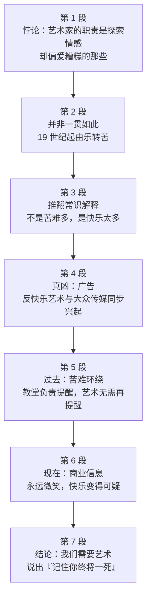

# Passage 26 · 艺术为何偏爱痛苦

## 答题记录

| 轮次  | 日期         | 题号  | 正确  | 错误  | 正确率 | 用时    | 错题归因 |
| --- | --- | --- | --- | --- | --- | --- | --- |
| 1 |  | 1-5 |  |  |  |  |  |
| 2 |  | 1-5 |  |  |  |  |  |
| 3 |  | 1-5 |  |  |  |  |  |

> [!tip] 填写口径
> - **用时**以分钟计，只计做题时间，不含精读复盘。
> - **错题归因**填「题型·错误类型」，如：细节题·定位错、推理判断·过度推断、主旨大意·以偏概全。
> - 纵向看趋势：正确率升而用时过长 → 熟练度不足；用时降而正确率波动 → 定位不稳。

> [!info] 文章档案
> - **来源**：考研英语（一）2006 年 Text 4
> - **题材**：文艺教育——反快乐艺术的成因，以及它为何是当代社会的必需品
> - **结构**：7 段 / 24 句 ＋ 5 题
> - **难度**：★★★★☆
> - **一句话主旨**：艺术家偏爱表达痛苦，并不是因为现代格外多灾多难，恰好相反——广告与大众传媒把「永远快乐」塑造成一种意识形态，快乐反而变得不可信，于是我们需要艺术接替宗教，提醒我们「记住你终将一死」。

## 一、篇章脉络

- **第 1 段**：抛出一个悖论——许多事让人觉得艺术家古怪，而最古怪的是：他们的本分是探索情感，却偏偏挑那些让人难受的下手。
- **第 2 段**：这并非向来如此。最早的艺术形式（绘画、音乐）最适合表达欢乐，但从 19 世纪某个时候起，越来越多的艺术家开始把快乐看作无意义、虚伪甚至乏味——从华兹华斯的《水仙》走到波德莱尔的《恶之花》。
- **第 3 段**：先退一步给出常识解释（现代苦难太多），随即推翻：过去同样有连绵的战争、灾难与对无辜者的屠杀，真正的原因可能恰好相反——当今世界的快乐太多了。
- **第 4 段**：点名真凶——几乎完全致力于描绘幸福的现代表达形式只有一个：广告。反快乐艺术的兴起几乎与大众传媒的出现同步，随之而来的是把幸福当成意识形态的商业文化。
- **第 5 段**：今昔对比之「昔」：过去的人被苦难的提醒物包围（劳作到筋疲力尽、缺乏保障、早逝），大众传播与识字普及之前，最强的大众媒介是教堂，它提醒信徒灵魂有危险、身躯终将喂蛆——所以他们不必再让艺术也来扫兴。
- **第 6 段**：今昔对比之「今」：如今包围普通西方人的信息不是宗教的而是商业的，且永远快乐——快餐食客、新闻主播、发短信的人，全在笑、笑、笑；这些信息别有企图（引诱我们掏钱包），于是让「快乐」这个念头本身变得不可靠；西乐葆广告喊着「庆祝吧」，后来却发现它会增加心脏病风险。
- **第 7 段**：结论——我们遗忘的、也是经济赖以运转的遗忘是：快乐远不止是没有痛苦的享乐；带来最大喜悦的东西也携带最大的失落可能。所以我们需要艺术像宗教曾经做的那样告诉我们：记住你终将一死。这个信息比丁香烟更苦涩，却是一股清新之气。

> [!tip] 行文逻辑
> 「提悖论（第 1 段）→ 摆常识解释并推翻（第 2、3 段）→ 给出真解释（第 4 段）→ 今昔对比举证（第 5、6 段）→ 结论（第 7 段）」，是标准的「驳论 + 对比论证」结构。全篇的枢纽是第 3 段③句的 **the opposite**——它把读者的常识（苦难导致反快乐艺术）整个翻转过来。第 5、6 段构成一组严整的对照：昔＝宗教提醒苦难，今＝商业制造快乐；第 7 段用 as religion once did 收束，让艺术接替宗教的位置。第 4 题的题眼就在末句的双评价结构（bitter... yet... a breath of fresh air）。

## 二、逐段精读

### 第 1 段 · 一个悖论：艺术家偏爱糟糕的情感

**原文**

① Many things make people think artists are weird.
② But the weirdest may be this: artists' only job is to explore emotions, and yet they choose to focus on the ones that feel bad.

**译文**

① 许多事情让人觉得艺术家很古怪。
② 但最古怪的也许要数这一件：艺术家唯一的工作就是探索情感，可他们偏偏选择把注意力放在那些让人难受的情感上。

> [!note] 段落要点
> - 功能：用一个悖论开场，把「艺术为何偏爱痛苦」这个问题抛出来，全篇都在回答它。
> - ①句是让步铺垫（许多事让人觉得艺术家古怪），②句用 But the weirdest 推到最尖锐的一点，重心全在 ②。
> - 冒号在这里是「this ＝」的解释标记，冒号后才是本段的实质内容。
> - and yet 是弱转折，翻译成「可是／偏偏」，用来凸显「本分」与「选择」之间的反差。

#### 长难句 · 本段

> [!abstract] 本段第 ② 句 · But the weirdest may be this: artists' only job is to explore emotions, and yet they choose to focus on the ones that feel bad.

**结构拆解**

- **主干**：the weirdest may be this
- **冒号解释**：artists' only job is to explore emotions（说明 this 的内容）
- **转折并列句**：and yet they choose to focus on the ones
- **定语从句**：that feel bad（修饰 the ones，＝ the emotions that feel bad）
- **对比**：only job is to explore（职责）vs choose to focus on（实际选择）

**参考译文**

但最古怪的也许要数这一件：艺术家唯一的工作就是探索情感，可他们偏偏选择把注意力放在那些让人难受的情感上。

> [!tip] 拆解要点
> 先把冒号前的 `this` 当成占位符，读完冒号后回指即可。`the ones` 是代词，指代前文的 emotions，属于「代词还原」的高频考点。`focus on` 与 `explore` 的对比是本段的逻辑内核：职责是全面地探索，选择却只盯住坏的一面——这个反差就是全文要解释的现象。

#### 本段重点词汇

| 单词 / 短语 | 词性 | 文中意 | 常用考义与拓展 | 英文示例搭配（中译） |
| --- | --- | --- | --- | --- |
| **weird** | adj. | 古怪的，怪异的 | weirdness n. 古怪；近义 odd / strange / bizarre | Many things make people think artists are weird（许多事让人觉得艺术家古怪） |
| **explore** | v. | 探索，探究 | exploration n. 探索；explorer n. 探险者 | artists' only job is to explore emotions（艺术家的唯一职责是探索情感） |
| **emotion** | n. | 情感，情绪 | emotional adj. 情感的、情绪化的；近义 feeling | explore emotions（探索情感） |
| **focus on** | 短语 | 聚焦于，把注意力放在 | focus n. 焦点；focus one's attention on 把注意力集中于 | choose to focus on the ones that feel bad（选择聚焦于那些难受的情感） |
| **feel bad** | 短语 | 令人难受的，糟糕的 | 主语为物时表「让人不舒服」；feel bad about 为……感到愧疚 | the emotions that feel bad（那些让人难受的情感） |

### 第 2 段 · 并非向来如此：由乐转苦的转折点在 19 世纪

**原文**

① This wasn't always so.
② The earliest forms of art, like painting and music, are those best suited for expressing joy.
③ But somewhere from the 19th century onward, more artists began seeing happiness as meaningless, phony or, worst of all, boring, as we went from Wordsworth's Daffodils to Baudelaire's Flowers of Evil.

**译文**

① 事情并非向来如此。
② 最早的艺术形式，比如绘画和音乐，都是最适合用来表达欢乐的。
③ 但从 19 世纪的某个时候起，越来越多的艺术家开始把幸福看作无意义、虚假的，或者最糟糕的——无聊，就像我们从华兹华斯的《水仙》一路走到了波德莱尔的《恶之花》。

> [!note] 段落要点
> - 功能：交代「由乐转苦」的时间节点，为第 1 段的悖论提供历史维度。
> - ①句 This wasn't always so 是典型的过渡句，作用是「翻回过去」，读它就知道下一段要讲历史。
> - ②句是「昔」，③句是「今」，两句合起来就是第 1 题答案 D（艺术家改变了关注点）的完整依据。
> - ③句里的三个贬义形容词 meaningless / phony / boring 层层递进，worst of all 把 boring 顶到最重——在艺术家眼里，「无聊」比「虚伪」更不可忍受。

#### 长难句 · 本段

> [!abstract] 本段第 ③ 句 · But somewhere from the 19th century onward, more artists began seeing happiness as meaningless, phony or, worst of all, boring, as we went from Wordsworth's Daffodils to Baudelaire's Flowers of Evil.

**结构拆解**

- **时间状语**：somewhere from the 19th century onward（从 19 世纪某时起）
- **主干**：more artists began seeing happiness as...
- **宾语补足语（三项并列）**：meaningless, phony or, worst of all, boring
- **插入语**：worst of all（最糟糕的是）
- **方式/伴随状语从句**：as we went from Wordsworth's Daffodils to Baudelaire's Flowers of Evil（as 表「随着」）

**参考译文**

但从 19 世纪的某个时候起，越来越多的艺术家开始把幸福看作无意义、虚假的，或者最糟糕的——无聊，就像我们从华兹华斯的《水仙》一路走到了波德莱尔的《恶之花》。

> [!tip] 拆解要点
> `see A as B` 是「把 A 看作 B」，B 是宾语补足语；B 后面跟了三个并列的形容词，最后一个前插入 worst of all 表递进。句尾的 `as we went from A to B` 不是举例，而是「随着……的推移」的比喻写法：两部作品名（华兹华斯《水仙》＝歌颂自然喜悦，波德莱尔《恶之花》＝书写都市丑恶）代表两个时代，用作品名代替年代，是英语评论文章常见的修辞。本题命题人就是拿这两个诗人名做第 1 题的题干，答案要回到它们所服务的观点句。

#### 本段重点词汇

| 单词 / 短语 | 词性 | 文中意 | 常用考义与拓展 | 英文示例搭配（中译） |
| --- | --- | --- | --- | --- |
| **be suited for** | 短语 | 适合于（做）某事 | suit v. 适合；suitable adj. 合适的（be suitable for） | forms of art best suited for expressing joy（最适合表达欢乐的艺术形式） |
| **express** | v. | 表达，表现 | expression n. 表达、表情；expressive adj. 有表现力的 | suited for expressing joy（适合表达欢乐） |
| **joy** | n. | 欢乐，喜悦 | joyful adj. 喜悦的；近义 delight / happiness | expressing joy（表达欢乐） |
| **onward** | adv. | 向前地，自此以后 | from...onward 自……起；onwards（英式拼法） | from the 19th century onward（自 19 世纪起） |
| **see...as** | 短语 | 把……看作 | = regard...as / view...as；文中为 seeing happiness as... | began seeing happiness as meaningless（开始把幸福看作无意义的） |
| **meaningless** | adj. | 无意义的 | -less 否定后缀；meaning n. 意义；meaningful adj. 有意义的 | happiness as meaningless（幸福是无意义的） |
| **phony** | adj. | 虚假的，假惺惺的 | = fake；phoniness n. 虚伪 | happiness as ... phony（幸福是虚假的） |
| **boring** | adj. | 乏味的，无聊的 | bore v. 使厌烦；bored adj. 感到无聊的（注意-ed/-ing 之别） | or, worst of all, boring（或者最糟糕的，无聊） |

### 第 3 段 · 推翻常识解释：不是苦难太多，是快乐太多

**原文**

① You could argue that art became more skeptical of happiness because modern times have seen so much misery.
② But it's not as if earlier times didn't know perpetual war, disaster and the massacre of innocents.
③ The reason, in fact, may be just the opposite: there is too much damn happiness in the world today.

**译文**

① 你完全可以说，艺术之所以对幸福越来越怀疑，是因为现代目睹了太多的苦难。
② 但并不是说更早的时代就没有连绵的战争、灾难和对无辜者的屠杀。
③ 事实上，原因可能恰恰相反：当今世界上的快乐实在太多了，多得要命。

> [!note] 段落要点
> - 功能：先替读者给出常识解释，再亲手推翻它，引出全文最关键的反转。
> - ①句的 You could argue that... 是「退一步说」的标志，凡见此结构，作者下一步多半要反驳。
> - ②句用 it's not as if... 直接否掉常识解释的前提（过去并不缺苦难）。
> - ③句的 the opposite 是全篇枢纽：反快乐艺术的兴盛不是因为苦难多，而是因为快乐太多——第 4 段起的所有论证都建立在这个反转之上。
> - ③句的 damn 是口语化的强调词，不是骂人，等于「该死的／实在太」，读出作者的情绪力度。

#### 长难句 · 本段

> [!abstract] 本段第 ② 句 · But it's not as if earlier times didn't know perpetual war, disaster and the massacre of innocents.

**结构拆解**

- **主干**：it's not as if...（并不是说……，事实并非如此）
- **as if 从句**：earlier times didn't know perpetual war, disaster and the massacre of innocents
- **从句谓语**：didn't know（此处 know ＝ experience 经历过）
- **三项并列宾语**：perpetual war / disaster / the massacre of innocents
- **后置定语**：of innocents（修饰 massacre）

**参考译文**

但并不是说更早的时代就没有连绵的战争、灾难和对无辜者的屠杀。

> [!tip] 拆解要点
> `it is not as if...` 是高频的否定句式，字面「事情并不像是……那样」，实义「并非……」，后接的从句要用过去式表与事实相反（这里 didn't know 是「不是不知道」＝ 其实知道）。know 在此不是「知道」而是「经历、见识过」，属于熟词僻义。三项并列名词（战争、灾难、屠杀）是作者用来堵住常识解释的证据：苦难古已有之，所以它不能解释「现代」才出现的反快乐艺术。

#### 本段重点词汇

| 单词 / 短语 | 词性 | 文中意 | 常用考义与拓展 | 英文示例搭配（中译） |
| --- | --- | --- | --- | --- |
| **skeptical** | adj. | 怀疑的，持保留态度的 | be skeptical of/about 对……怀疑；skeptic n. 怀疑者；美式亦作 sceptical | art became more skeptical of happiness（艺术对幸福越来越怀疑） |
| **misery** | n. | 苦难，痛苦 | miserable adj. 痛苦的；近义 suffering / distress | modern times have seen so much misery（现代目睹了如此多的苦难） |
| **perpetual** | adj. | 连绵不断的，永久的 | perpetually adv.；近义 constant / endless / permanent | perpetual war（连绵不断的战争） |
| **disaster** | n. | 灾难，灾祸 | disastrous adj. 灾难性的；natural disaster 自然灾害 | perpetual war, disaster and the massacre（连绵的战争、灾难和屠杀） |
| **massacre** | n. | 大屠杀 | massacre v. 屠杀；近义 slaughter | the massacre of innocents（对无辜者的屠杀） |
| **innocent** | adj./n. | 无辜的（人） | innocence n. 无辜、天真；the innocents 指「无辜者」这一类人 | the massacre of innocents（对无辜者的屠杀） |
| **the opposite** | 短语 | 相反（的情况） | opposite adj. 相反的 / prep. 在……对面；just the opposite 恰好相反 | the reason may be just the opposite（原因可能恰好相反） |
| **damn** | adj./adv. | 该死的（强调语） | 口语强调词，表强烈语气，非字面诅咒；damned adj. | too much damn happiness（快乐多得要命） |

### 第 4 段 · 真凶出场：广告与商业文化

**原文**

① After all, what is the one modern form of expression almost completely dedicated to depicting happiness?
② Advertising.
③ The rise of anti-happy art almost exactly tracks the emergence of mass media, and with it, a commercial culture in which happiness is not just an ideal but an ideology.

**译文**

① 毕竟，那一种几乎完全致力于描绘幸福的现代表达形式是什么呢？
② 广告。
③ 反快乐艺术的兴起，几乎与大众传媒的出现严丝合缝地同步，随之而来的还有一种商业文化——在其中，幸福不再只是一种理想，而是一种意识形态。

> [!note] 段落要点
> - 功能：承接第 3 段「快乐太多」的结论，指名道姓把「制造快乐」的源头说出来——广告。
> - ①②句是自问自答，答案只有一个词 Advertising，这种「设问 + 短答」的写法把读者的注意力狠狠钉在这个词上。
> - ③句的 tracks 是本篇最精妙的动词：不是「追踪」而是「与……同步吻合」，它说明反快乐艺术与大众传媒是同一时间出现的伴生现象，而不是因果关系——这正是第 3 题 A 项被排除的关键。
> - ③句末尾的 not just an ideal but an ideology 是全段的论断：幸福被商业文化从「个人追求」升级成「必须遵守的信条」。

#### 长难句 · 本段

> [!abstract] 本段第 ③ 句 · The rise of anti-happy art almost exactly tracks the emergence of mass media, and with it, a commercial culture in which happiness is not just an ideal but an ideology.

**结构拆解**

- **主干**：The rise of anti-happy art tracks the emergence of mass media
- **状语**：almost exactly（几乎精确地）
- **并列补充**：and with it, a commercial culture（＝ and with the emergence of mass media came a commercial culture）
- **定语从句**：in which happiness is not just an ideal but an ideology（修饰 culture）
- **并列结构**：not just A but B（不只是 A 而是 B）

**参考译文**

反快乐艺术的兴起，几乎与大众传媒的出现严丝合缝地同步，随之而来的还有一种商业文化——在其中，幸福不再只是一种理想，而是一种意识形态。

> [!tip] 拆解要点
> `and with it, a commercial culture` 是省略结构，补全为 and with it came a commercial culture（随之而来的是……），it 指前文的 the emergence of mass media。`in which` 是「介词 + which」引导的定语从句，还原为 in a commercial culture。`track` 此处是动词「与……同步、吻合」（由「追踪轨迹」引申），不是名词「小径」。`not just...but...` 的重音在 but 之后：幸福已不只是理想，而是意识形态——这是作者对商业文化最重的一句批评。

#### 本段重点词汇

| 单词 / 短语 | 词性 | 文中意 | 常用考义与拓展 | 英文示例搭配（中译） |
| --- | --- | --- | --- | --- |
| **after all** | 短语 | 毕竟；用于追问或强调 | 置于句首时多表「终究／说到底」，也可引出反问 | After all, what is the one modern form of expression...?（毕竟，那一种现代表达形式是……？） |
| **be dedicated to** | 短语 | 专门用于，致力于 | dedicate v. 奉献（dedicate oneself to）；dedication n. 投入 | almost completely dedicated to depicting happiness（几乎完全致力于描绘幸福） |
| **depict** | v. | 描绘，刻画 | depiction n. 描绘；近义 portray / describe | dedicated to depicting happiness（致力于描绘幸福） |
| **advertising** | n. | 广告（业） | advertisement n.（一则）广告；ad n. 广告（口语） | Advertising.（广告。） |
| **track** | v. | 与……同步，吻合 | 熟义 n.「小径、轨道」→ v. 追踪 → 引申「与……同步变化」；keep track of 记录 | tracks the emergence of mass media（与大众传媒的出现同步） |
| **emergence** | n. | 出现，兴起 | emerge v. 出现；emergent adj. 新兴的 | the emergence of mass media（大众传媒的出现） |
| **mass media** | n. | 大众传媒 | mass n. 大量、大众；media 为 medium 的复数 | the emergence of mass media（大众传媒的出现） |
| **commercial** | adj. | 商业的 | commerce n. 商业；commercialize v. 使商业化 | a commercial culture（一种商业文化） |
| **ideology** | n. | 意识形态，思想体系 | ideological adj. 意识形态的；-ology 表「……学／体系」 | happiness is not just an ideal but an ideology（幸福不只是理想，而是意识形态） |

### 第 5 段 · 今昔对比之「昔」：苦难环绕，教堂负责提醒

**原文**

① People in earlier eras were surrounded by reminders of misery.
② They worked until exhausted, lived with few protections and died young.
③ In the West, before mass communication and literacy, the most powerful mass medium was the church, which reminded worshippers that their souls were in danger and that they would someday be meat for worms.
④ Given all this, they did not exactly need their art to be a bummer too.

**译文**

① 早先时代的人们被种种苦难的提醒物包围着。
② 他们劳作到筋疲力尽，生活几乎没有任何保障，而且早早死去。
③ 在西方，在大众传播与识字普及之前，最有力的大众媒介是教堂，它提醒礼拜者：他们的灵魂处于危险之中，有朝一日他们的身躯将成为蛆虫的食物。
④ 有鉴于这一切，他们实在不必再让艺术也来扫兴了。

> [!note] 段落要点
> - 功能：铺开「昔」的一幅图景，说明过去的人不需要艺术来提醒苦难——因为生活本身和教堂已经提醒够了。
> - ①②③句三层递进：环境（被苦难提醒物包围）→ 生活实况（劳作、无保障、早逝）→ 制度（教堂提醒灵魂与死亡）。
> - ④句的 **too** 是第 2 题的解题钥匙：「不必让艺术也成为一种 bummer」，说明 bummer 与前文所说的苦难同类 → 答案为 unpleasant。
> - ③句也是第 5 题 A 项的直接依据：宗教曾经起到的正是「提醒苦难」的作用。

#### 长难句 · 本段

> [!abstract] 本段第 ③ 句 · In the West, before mass communication and literacy, the most powerful mass medium was the church, which reminded worshippers that their souls were in danger and that they would someday be meat for worms.

**结构拆解**

- **状语**：In the West, before mass communication and literacy
- **主干**：the most powerful mass medium was the church
- **非限定性定语从句**：which reminded worshippers that... and that...
- **两个并列的宾语从句**：that their souls were in danger / that they would someday be meat for worms
- **比喻表语**：meat for worms（蛆虫的食物，＝ 尸身）

**参考译文**

在西方，在大众传播与识字普及之前，最有力的大众媒介是教堂，它提醒礼拜者：他们的灵魂处于危险之中，有朝一日他们的身躯将成为蛆虫的食物。

> [!tip] 拆解要点
> 抓主干只要「the most powerful mass medium was the church」，which 从句里套了两个用 and 连接的 that 宾语从句，是 `remind sb that... and that...` 的标准扩展。`meat for worms` 是中世纪布道里极常见的死亡意象（人终有一死、肉身归于尘土），作者用它来说明：宗教当年传播的不是快乐，而是对死亡与危险的提醒——这正是第 5 题 A 项「宗教曾经充当苦难的提醒者」的原文依据。注意 literacy 是「识字能力」，不是「文学」。

#### 本段重点词汇

| 单词 / 短语 | 词性 | 文中意 | 常用考义与拓展 | 英文示例搭配（中译） |
| --- | --- | --- | --- | --- |
| **era** | n. | 时代，年代 | 近义 age / period；the modern era 现代 | People in earlier eras（早先时代的人们） |
| **be surrounded by** | 短语 | 被……包围、环绕 | surround v. 包围；surrounding adj. 周围的；surroundings n. 环境 | were surrounded by reminders of misery（被苦难的提醒物包围） |
| **reminder** | n. | 提醒物，令人想起之物 | remind v. 提醒（remind sb of/that）；注意与 remainder（剩余部分）区分 | reminders of misery（苦难的提醒物） |
| **exhausted** | adj. | 精疲力竭的 | exhaust v. 耗尽；exhausting adj. 令人疲惫的；exhaustion n. 疲惫 | They worked until exhausted（他们劳作到筋疲力尽） |
| **protection** | n. | 保障，保护 | protect v. 保护；protective adj. 防护的；此处复数指「各种社会保障」 | lived with few protections（生活几乎没有保障） |
| **literacy** | n. | 识字，读写能力 | literate adj. 识字的；illiteracy n. 文盲；注意与 literature（文学）区分 | before mass communication and literacy（在大众传播与识字普及之前） |
| **worshipper** | n. | 礼拜者，信众 | worship v./n. 崇拜、敬奉；worshipper 亦作 worshiper | reminded worshippers that...（提醒礼拜者……） |
| **meat for worms** | 短语 | 蛆虫的食物（指死后肉身） | 中世纪布道的死亡意象；worm n. 蠕虫 | they would someday be meat for worms（有朝一日会成为蛆虫的食物） |
| **given all this** | 短语 | 有鉴于这一切 | given prep. 考虑到；given that... 鉴于…… | Given all this, they did not exactly need...（有鉴于此，他们实在不必……） |
| **bummer** | n. | 令人不快的事物，扫兴的事 | 口语词；近义 a downer / something unpleasant | need their art to be a bummer too（再让艺术也来扫兴） |

### 第 6 段 · 今昔对比之「今」：永远微笑的商业信息

**原文**

① Today the messages the average Westerner is surrounded with are not religious but commercial, and forever happy.
② Fast-food eaters, news anchors, text messengers, all smiling, smiling, smiling.
③ Our magazines feature beaming celebrities and happy families in perfect homes.
④ And since these messages have an agenda — to lure us to open our wallets — they make the very idea of happiness seem unreliable.
⑤ "Celebrate!" commanded the ads for the arthritis drug Celebrex, before we found out it could increase the risk of heart attacks.

**译文**

① 如今，普通西方人被包围其中的信息不是宗教性的而是商业性的，而且永远快乐。
② 吃快餐的人、新闻主播、发短信的人，全都在笑、笑、笑。
③ 我们的杂志以笑容灿烂的明星和完美家庭里的幸福家庭为特写。
④ 而且由于这些信息别有企图——引诱我们打开钱包——它们让「幸福」这个念头本身变得不可靠。
⑤ 「庆祝吧！」——治疗关节炎的药物西乐葆的广告这样号令道，后来我们才发现它可能增加心脏病发作的风险。

> [!note] 段落要点
> - 功能：铺开「今」的一幅图景——商业信息取代宗教，把「永远快乐」灌满日常生活，从而让快乐变得可疑。
> - ①句是全段的对照句：not religious but commercial, and forever happy，与第 5 段的宗教提醒苦难形成正面对撞。
> - ②句的 smiling, smiling, smiling 三次重复，模拟被快乐轰炸的窒息感，是作者最有力的讽刺笔法。
> - ④句是第 3 题的定位句：agenda（别有企图）+ lure us to open our wallets（引诱掏钱）+ make the very idea of happiness seem unreliable → 广告制造的是快乐的假象。
> - ⑤句用西乐葆广告作证：一个只喊「庆祝」却不提风险的药品广告，恰好证明「被贩卖的快乐」不可信。

#### 长难句 · 本段

> [!abstract] 本段第 ④ 句 · And since these messages have an agenda — to lure us to open our wallets — they make the very idea of happiness seem unreliable.

**结构拆解**

- **原因状语从句**：since these messages have an agenda
- **破折号插入语**：— to lure us to open our wallets —（说明 agenda 的具体内容）
- **主句**：they make the very idea of happiness seem unreliable
- **宾语 + 宾补**：make + the very idea of happiness + seem unreliable（make sb/sth do）
- **强调用法**：the very idea（正是这个念头，very 表强调）

**参考译文**

而且由于这些信息别有企图——引诱我们打开钱包——它们让「幸福」这个念头本身变得不可靠。

> [!tip] 拆解要点
> 破折号之间的 `to lure us to open our wallets` 是 agenda 的同位语，等于把「别有企图」的谜底直接揭开，读时不要跳过。`the very + 名词` 中的 very 是形容词「正是、恰恰」，表强调。`make A seem B` 是「使 A 显得 B」。这一句是第 3 题 D 项的直接来源：广告不是带来幸福，而是制造幸福的幻象并让它失去可信度。

> [!abstract] 本段第 ⑤ 句 · "Celebrate!" commanded the ads for the arthritis drug Celebrex, before we found out it could increase the risk of heart attacks.

**结构拆解**

- **引语倒装**："Celebrate!" commanded the ads（主语 the ads 与谓语 commanded 倒装，因引语前置）
- **主语**：the ads for the arthritis drug Celebrex
- **时间状语从句**：before we found out it could increase the risk of heart attacks
- **宾语从句**：it could increase the risk of heart attacks（作 found out 的宾语）

**参考译文**

「庆祝吧！」——治疗关节炎的药物西乐葆的广告这样号令道，后来我们才发现它可能增加心脏病发作的风险。

> [!tip] 拆解要点
> 直接引语前置时，主语和谓语可以倒装（commanded the ads），还原为 the ads commanded "Celebrate!"。`command` 用于广告词是拟人化的讽刺：广告不是「建议」而是「喝令」我们快乐。before 从句是全句的反转——先喊庆祝，后曝风险，作者用这一个真实案例把「商业快乐不可信」钉死。

#### 本段重点词汇

| 单词 / 短语 | 词性 | 文中意 | 常用考义与拓展 | 英文示例搭配（中译） |
| --- | --- | --- | --- | --- |
| **average** | adj. | 普通的，一般的 | 熟义「平均的」→ 此处 the average Westerner 普通西方人；on average 平均而言 | the average Westerner（普通西方人） |
| **anchor** | n. | （新闻）主持人 | 熟义「锚」→ news anchor 新闻主播；anchor v. 主持、稳固 | Fast-food eaters, news anchors, text messengers（吃快餐的人、新闻主播、发短信的人） |
| **text messenger** | n. | 发短信的人 | text v. 发短信；messenger n. 送信人 | news anchors, text messengers（新闻主播、发短信的人） |
| **feature** | v. | 以……为特写，刊载 | 熟义 n.「特征」→ v. 特写、由……主演 | Our magazines feature beaming celebrities（我们的杂志特写笑容灿烂的明星） |
| **beaming** | adj. | 笑容满面的，灿烂的 | beam n. 光束 / v. 绽放笑容；beam with joy 喜形于色 | beaming celebrities and happy families（笑容灿烂的明星与幸福的家庭） |
| **agenda** | n. | （隐含的）目的，企图 | 熟义「议程」→ 引申「隐秘意图」；hidden agenda 别有用心 | these messages have an agenda（这些信息别有企图） |
| **lure** | v. | 引诱，诱使 | lure sb into doing 引诱某人做；lure n. 诱饵；近义 tempt | lure us to open our wallets（引诱我们打开钱包） |
| **unreliable** | adj. | 不可靠的，不可信的 | un- + reliable；rely v. 依赖（rely on）；reliable adj. 可靠的 | make the very idea of happiness seem unreliable（让幸福的念头本身显得不可靠） |
| **command** | v. | 号令，命令 | commander n. 指挥官；command 用于广告词是拟人化讽刺 | "Celebrate!" commanded the ads（广告号令道：「庆祝吧！」） |
| **arthritis** | n. | 关节炎 | arthro- 表「关节」；-itis 表「炎症」 | the arthritis drug Celebrex（治疗关节炎的药物西乐葆） |

### 第 7 段 · 结论：我们需要艺术说出「记住你终将一死」

**原文**

① But what we forget — what our economy depends on us forgetting — is that happiness is more than pleasure without pain.
② The things that bring the greatest joy carry the greatest potential for loss and disappointment.
③ Today, surrounded by promises of easy happiness, we need art to tell us, as religion once did, Memento mori: remember that you will die, that everything ends, and that happiness comes not in denying this but in living with it.
④ It's a message even more bitter than a clove cigarette, yet, somehow, a breath of fresh air.

**译文**

① 但我们遗忘的——我们的经济恰恰依赖着我们遗忘的——是：快乐远不止是没有痛苦的享乐。
② 带来最大喜悦的那些东西，也携带最大的失落与失望的可能。
③ 如今，被轻易可得的幸福承诺所包围，我们需要艺术来告诉我们，就像宗教曾经做过的那样：记住你终将一死——记住你会死，记住一切都会结束，记住幸福不在于否认这一点，而在于与之共存。
④ 这是一个比丁香香烟还要苦涩的信息，然而，不知怎的，它又是一股清新之气。

> [!note] 段落要点
> - 功能：给出全文结论并点明态度——我们需要反快乐艺术，因为它苦涩却清醒。
> - ①句用破折号把「经济依赖我们遗忘」嵌进去，说明「廉价快乐」是被商业有意维持的集体遗忘。
> - ③句的 as religion once did 收束第 5、6 段的今昔对比：艺术接替宗教，承担起提醒死亡与终结的职责。
> - ④句是第 4 题的题眼：bitter（苦涩＝distasteful）与 a breath of fresh air（清新＝refreshing）由 yet 连接，两个形容词分别对应正确选项的两个词。
> - 注意③句的 not in denying this but in living with it：作者主张的不是「享受苦难」，而是「承认并与之共存」——第 4 题 C 项正是这里设的陷阱。

#### 长难句 · 本段

> [!abstract] 本段第 ① 句 · But what we forget — what our economy depends on us forgetting — is that happiness is more than pleasure without pain.

**结构拆解**

- **主语从句**：what we forget
- **破折号插入语**：— what our economy depends on us forgetting —（对前面的强调性重述）
- **插入语内部结构**：our economy depends on us forgetting（depend on sb doing sth）
- **系动词**：is
- **表语从句**：that happiness is more than pleasure without pain
- **比较**：more than（远不止是）

**参考译文**

但我们遗忘的——我们的经济恰恰依赖着我们遗忘的——是：快乐远不止是没有痛苦的享乐。

> [!tip] 拆解要点
> 两个 what 从句叠在一起，第二个是第一个的同位复述，作用是把「遗忘」的责任推给经济体制。抓主干时先删掉破折号部分：What we forget is that happiness is more than pleasure without pain。`depend on sb doing sth` 是「依赖某人做某事」。`more than + 名词` 表「远不止是」，不是比较级。

> [!abstract] 本段第 ③ 句 · Today, surrounded by promises of easy happiness, we need art to tell us, as religion once did, Memento mori: remember that you will die, that everything ends, and that happiness comes not in denying this but in living with it.

**结构拆解**

- **伴随状语**：surrounded by promises of easy happiness（过去分词短语）
- **主干**：we need art to tell us... Memento mori
- **方式插入语**：as religion once did（＝ as religion once told us）
- **冒号解释**：remember that... , that..., and that...
- **三个并列宾语从句**：that you will die / that everything ends / that happiness comes not in denying this but in living with it
- **对比结构**：not in doing A but in doing B（不在于做 A 而在于做 B）

**参考译文**

如今，被轻易可得的幸福承诺所包围，我们需要艺术来告诉我们，就像宗教曾经做过的那样：记住你终将一死——记住你会死，记住一切都会结束，记住幸福不在于否认这一点，而在于与之共存。

> [!tip] 拆解要点
> 主干极短（we need art to tell us Memento mori），后面全是冒号引出的三层解释。`as religion once did` 是本篇的结构枢纽——它把第 5 段的「教堂提醒苦难」与第 7 段的「艺术提醒死亡」接上，形成「艺术接替宗教」的结论。`not in denying this but in living with it` 是典型的「不是……而是……」，其中的 this 指「一切都会结束」。第 4 题 C 项把 living with 偷换成 enjoy（享受），属于语义升级，是典型陷阱。

#### 本段重点词汇

| 单词 / 短语 | 词性 | 文中意 | 常用考义与拓展 | 英文示例搭配（中译） |
| --- | --- | --- | --- | --- |
| **depend on** | 短语 | 依赖，取决于 | depend on sb doing sth 依赖某人做；dependable adj. 可靠的 | what our economy depends on us forgetting（我们的经济依赖我们遗忘的） |
| **pleasure without pain** | 短语 | 无痛的快乐 | without 表「没有」；pleasure n. 愉悦；pain n. 痛苦 | happiness is more than pleasure without pain（快乐远不止无痛的享乐） |
| **potential** | n. | 可能性，潜能 | 熟义 adj.「潜在的」→ n. 可能性；potential for (doing) sth | the greatest potential for loss and disappointment（最大的失落与失望的可能） |
| **disappointment** | n. | 失望 | disappoint v. 使失望；disappointed adj. 感到失望的；disappointing adj. 令人失望的 | potential for loss and disappointment（失落与失望的可能） |
| **promise** | n. | 承诺，许诺 | promise v. 承诺；promising adj. 有前途的 | surrounded by promises of easy happiness（被轻易可得的幸福承诺所包围） |
| **Memento mori** | 短语 | 记住你终将一死（拉丁语） | 西方艺术与宗教中的传统主题；memento n. 纪念物 | we need art to tell us... Memento mori（我们需要艺术告诉我们……记住你终将一死） |
| **deny** | v. | 否认，拒绝承认 | denial n. 否认；deny doing sth 否认做过 | happiness comes not in denying this（幸福不在于否认这一点） |
| **bitter** | adj. | 苦涩的，令人难受的 | bitterness n. 苦涩；bitterly adv. 苦涩地；注意与 better 形近 | a message even more bitter than a clove cigarette（比丁香烟更苦涩的信息） |
| **clove cigarette** | n. | 丁香香烟 | clove n. 丁香（亦为 garlic clove 蒜瓣）；印尼 kretek 香烟 | more bitter than a clove cigarette（比丁香香烟更苦涩） |
| **a breath of fresh air** | 短语 | 一股清新之气，令人耳目一新 | 惯用比喻，指「令人精神一振的新事物」 | yet, somehow, a breath of fresh air（然而，不知怎的，是一股清新之气） |

## 三、全篇重点词汇汇总（自测用）

> [!info] 说明
> 本表只列「单词 / 词性 / 所在段」，不含释义与搭配，用于遮表自测：说出词义后再回该段核对。
> 收录**全篇所有段落词汇，共 60 条，不删减**，与各段「本段重点词汇」等长同源。

| 单词 / 短语 | 词性 | 所在段 |
| --- | --- | --- |
| **weird** | adj. | 第 1 段 |
| **explore** | v. | 第 1 段 |
| **emotion** | n. | 第 1 段 |
| **focus on** | 短语 | 第 1 段 |
| **feel bad** | 短语 | 第 1 段 |
| **be suited for** | 短语 | 第 2 段 |
| **express** | v. | 第 2 段 |
| **joy** | n. | 第 2 段 |
| **onward** | adv. | 第 2 段 |
| **see...as** | 短语 | 第 2 段 |
| **meaningless** | adj. | 第 2 段 |
| **phony** | adj. | 第 2 段 |
| **boring** | adj. | 第 2 段 |
| **skeptical** | adj. | 第 3 段 |
| **misery** | n. | 第 3 段 |
| **perpetual** | adj. | 第 3 段 |
| **disaster** | n. | 第 3 段 |
| **massacre** | n. | 第 3 段 |
| **innocent** | adj./n. | 第 3 段 |
| **the opposite** | 短语 | 第 3 段 |
| **damn** | adj./adv. | 第 3 段 |
| **after all** | 短语 | 第 4 段 |
| **be dedicated to** | 短语 | 第 4 段 |
| **depict** | v. | 第 4 段 |
| **advertising** | n. | 第 4 段 |
| **track** | v. | 第 4 段 |
| **emergence** | n. | 第 4 段 |
| **mass media** | n. | 第 4 段 |
| **commercial** | adj. | 第 4 段 |
| **ideology** | n. | 第 4 段 |
| **era** | n. | 第 5 段 |
| **be surrounded by** | 短语 | 第 5 段 |
| **reminder** | n. | 第 5 段 |
| **exhausted** | adj. | 第 5 段 |
| **protection** | n. | 第 5 段 |
| **literacy** | n. | 第 5 段 |
| **worshipper** | n. | 第 5 段 |
| **meat for worms** | 短语 | 第 5 段 |
| **given all this** | 短语 | 第 5 段 |
| **bummer** | n. | 第 5 段 |
| **average** | adj. | 第 6 段 |
| **anchor** | n. | 第 6 段 |
| **text messenger** | n. | 第 6 段 |
| **feature** | v. | 第 6 段 |
| **beaming** | adj. | 第 6 段 |
| **agenda** | n. | 第 6 段 |
| **lure** | v. | 第 6 段 |
| **unreliable** | adj. | 第 6 段 |
| **command** | v. | 第 6 段 |
| **arthritis** | n. | 第 6 段 |
| **depend on** | 短语 | 第 7 段 |
| **pleasure without pain** | 短语 | 第 7 段 |
| **potential** | n. | 第 7 段 |
| **disappointment** | n. | 第 7 段 |
| **promise** | n. | 第 7 段 |
| **Memento mori** | 短语 | 第 7 段 |
| **deny** | v. | 第 7 段 |
| **bitter** | adj. | 第 7 段 |
| **clove cigarette** | n. | 第 7 段 |
| **a breath of fresh air** | 短语 | 第 7 段 |

> [!example] 同义替换链（阅读题高频）
> - **from Wordsworth's Daffodils to Baudelaire's Flowers of Evil ↔ artists have changed their focus of interest**：第 1 题 D 项与例子的对应关系（观点在前，例子在后）。
> - **reminders of misery / souls were in danger / meat for worms ↔ bummer ＝ unpleasant**：第 2 题的上下文同义链，too 是连接词。
> - **the rise of anti-happy art tracks the emergence of mass media ↔ 伴生而非因果**：第 3 题 A 项「广告随反快乐艺术而来」正是对 tracks 的颠倒。
> - **have an agenda — to lure us to open our wallets / make the very idea of happiness seem unreliable ↔ creates an illusion of happiness rather than happiness itself**：第 3 题 D 项与第 6 段④句的对应。
> - **more bitter than a clove cigarette, yet a breath of fresh air ↔ distasteful but refreshing**：第 4 题 B 项的双形容词替换（bitter→distasteful，fresh air→refreshing）。
> - **the church reminded worshippers that... ↔ Religion once functioned as a reminder of misery**：第 5 题 A 项对第 5 段③句的概括。
> - **we need art to tell us, as religion once did, Memento mori ↔ 艺术接替宗教提醒死亡**：第 7 段③句，全篇结论句。

> [!warning] 熟词僻义专列
> - **weird**：奇怪的 → 此处偏「古怪、不合常理」。
> - **explore**：探险 → 探索（情感、可能性）。
> - **onward**：向前 → from...onward 自……起。
> - **phony**：口语词，假的、虚伪的（＝ fake）。
> - **skeptical**：怀疑的 → be skeptical of 对……持怀疑态度。
> - **perpetual**：永久的 → 连绵不断的（perpetual war）。
> - **innocent**：无辜的（形容词）→ the innocents 名词化「无辜者」。
> - **damn**：诅咒 → 口语强调词「该死的、实在太」。
> - **track**：小径、轨道 → 动词「与……同步吻合」。
> - **ideology**：意识形态（不是「理想」）。
> - **reminder**：提醒物（不是「剩余物」remainder）。
> - **exhausted**：耗尽的 → 精疲力竭的（人）。
> - **protection**：保护 → 复数指「（社会）保障」。
> - **literacy**：读写能力（不是「文学」literature）。
> - **average**：平均的 → 普通的（the average Westerner）。
> - **anchor**：锚 → 新闻主播。
> - **feature**：特征 → 动词「以……为特写、刊载」。
> - **agenda**：议程 →（隐含的）目的、企图。
> - **command**：命令 → 广告词「号令」，拟人化用法。
> - **potential**：潜在的（形容词）→ 名词「可能性、潜能」。
> - **bitter**：苦的 → 苦涩的、令人难受的（注意与 better 形近）。

## 四、知识点补充

> [!question] 背景知识
> - **威廉·华兹华斯《水仙》（Daffodils）**：英国浪漫主义诗人华兹华斯 1804 年名作，通篇歌颂自然带来的喜悦与回忆中的慰藉，文中用来代表「以快乐为主题」的艺术。
> - **夏尔·波德莱尔《恶之花》（Les Fleurs du mal / Flowers of Evil）**：法国诗人波德莱尔 1857 年出版的诗集，以都市的丑恶、忧郁与死亡为题材，被公认为现代主义文学的起点之一，文中代表「转向痛苦」的艺术。
> - **反快乐艺术（anti-happy art）**：本文自造的概括词，指 19 世纪以来以痛苦、荒诞、死亡为主题的艺术潮流，与广告所代表的「永远快乐」相对。
> - **Memento mori**：拉丁语「记住你终将一死」，中世纪基督教艺术与文学中的传统主题，常用骷髅、沙漏、腐尸等意象提醒世人正视死亡，进而珍惜当下。
> - **meat for worms**：中世纪布道中常见的死亡意象，意为人死后肉身归于尘土、被虫蛀食；作者用它说明宗教当年传播的是对危险的提醒，而非廉价的快乐。
> - **西乐葆（Celebrex，塞来昔布）**：一款选择性 COX-2 抑制剂类关节炎止痛药，其广告曾以「Celebrate!」为口号，后被发现可能增加心脏病发作风险。作者用这个真实案例证明「商业贩卖的快乐」隐瞒风险、不可信赖。
> - **丁香香烟（clove cigarette）**：印尼 kretek 香烟，掺入丁香，味道浓烈刺鼻；作者用「比丁香烟还苦涩」形容反快乐艺术的味道，又用 yet 一转说它是清新之气。

> [!warning] 语法点
> - **冒号作解释标记**（第 1 段②）：the weirdest may be this: ...，冒号后就是 this 的内容，读时先占位后回填。
> - **代词还原**（第 1 段②）：the ones 指代 emotions，凡见 the ones / those / that of 都要回指。
> - **最高级 + 过去分词定语**（第 2 段②）：those best suited for expressing joy，＝ those which are best suited for...。
> - **as 引导的伴随从句**（第 2 段③）：as we went from A to B，表「随着……推移」，用作品名代替年代的修辞。
> - **it is not as if... 否定句式**（第 3 段②）：后接过去式表与事实相反，「并非……」。
> - **自问自答 + 单词成句**（第 4 段①②）：After all, what is...? / Advertising.，设问把注意力钉在关键词上。
> - **省略结构 and with it, ...**（第 4 段③）：补全为 and with it came a commercial culture。
> - **not just A but B**（第 4 段③）：重音在 but 之后。
> - **remind sb that... and that...**（第 5 段③）：并列的两个宾语从句。
> - **破折号作同位语**（第 6 段④）：— to lure us to open our wallets — 揭开 agenda 的内容。
> - **引语前置倒装**（第 6 段⑤）："Celebrate!" commanded the ads，还原为 the ads commanded...。
> - **并列 what 从句 + 破折号重述**（第 7 段①）：what we forget — what our economy depends on us forgetting — is that...。
> - **冒号引出三层并列 that 从句**（第 7 段③）：remember that..., that..., and that...。
> - **more...than..., yet...**（第 7 段④）：先比较再转折，两个形容词分别对应第 4 题选项的两个词。

> [!success] 写作可迁移句型
> - **Many things make people think... But the weirdest may be this:...**：先铺陈共识，再用最高级推出最尖锐的一点。
> - **This wasn't always so.**：一句完成「翻回历史」的过渡。
> - **You could argue that... But it's not as if...**：让步—反驳的万能框架。
> - **The reason, in fact, may be just the opposite:...**：引出反转结论。
> - **After all, what is...? X.**：设问自答，把关键词单独成句以示强调。
> - **Given all this, ...**：由前文证据引出推论（＝ In view of all this）。
> - **What we forget — what...depends on us forgetting — is that...**：破折号重述加强语势。
> - **...comes not in doing A but in doing B.**：「不在于做 A 而在于做 B」，议论文收束的常用对称句式。
> - **It's... even more bitter than..., yet, somehow, a breath of fresh air.**：先抑后扬的双评价结尾。

> [!danger] 易混辨析
> - **skeptical / doubtful / suspicious**：skeptical 对观点、主张持怀疑；doubtful 对事情的真实性或可能性怀疑；suspicious 怀疑某人有错、起疑心（语气最重）。
> - **misery / disaster / massacre**：misery 长期性的苦难；disaster 突发的灾难；massacre 针对人的大屠杀。
> - **perpetual / permanent / constant**：perpetual 连绵不绝、没完没了（常带厌烦色彩）；permanent 永久不变的（中性）；constant 持续不断的、恒定的。
> - **reminder / remainder / remains**：reminder 提醒物；remainder 剩余部分；remains 遗骸、遗迹。
> - **exhausted / exhausting**：exhausted（人）精疲力竭的；exhausting（事）令人疲惫的。
> - **literacy / literature**：literacy 读写能力；literature 文学。二者词根同为 litera（字母），极易看错。
> - **track / trace / trail**：track v. 追踪→与……同步；trace v. 追溯、查出，n. 痕迹；trail n. 小径、踪迹。
> - **agenda / schedule / timetable**：agenda 议程，引申「隐秘目的」；schedule 日程安排；timetable 时间表。
> - **lure / tempt / attract**：lure 以利益引诱（常含贬义）；tempt 诱惑（使人做不该做之事）；attract 吸引（中性）。
> - **unreliable / incredible / unbelievable**：unreliable 不可靠的（人或信息）；incredible 难以置信的、极好的；unbelievable 难以相信的。
> - **potential (n.) / potential (adj.)**：名词「可能性、潜能」（potential for sth）；形容词「潜在的」。
> - **deny / refuse / reject**：deny 否认事实、拒绝给予；refuse 拒绝（请求、要求）；reject 驳回、不接受（提议）。
> - **bitter / better**：形近词，bitter 苦涩的，better 更好的，不要看串。

## 五、题目分析

> [!info] 题目总览
> | 题号 | 题型 | 定位 | 答案 |
> | --- | --- | --- | --- |
| 1 | 例证题（写作目的） | 第 2 段②③句 | D |
| 2 | 词义猜测题 | 第 5 段④句 | B |
| 3 | 细节题（作者观点） | 第 6 段④⑤句 | D |
| 4 | 推理判断题（末段） | 第 7 段③④句 | B |
| 5 | 判断正误题（全文） | 第 5 段③句 | A |

### 第 1 题 · 例证题（写作目的）

> [!question] 原题
> By citing the examples of poets Wordsworth and Baudelaire, the author intends to show that
> - A. poetry is not as expressive of joy as painting or music.
> - B. art grows out of both positive and negative feelings.
> - C. poets today are less skeptical of happiness.
> - D. artists have changed their focus of interest.

**正确答案**：**D. artists have changed their focus of interest.（艺术家们改变了自己的关注点）**

**定位与依据**
- 定位到第 2 段③句：But somewhere from the 19th century onward, more artists began seeing happiness as meaningless, phony or, worst of all, boring, as we went from Wordsworth's Daffodils to Baudelaire's Flowers of Evil。
- 例子在句尾（from...to...），观点在句首（more artists began seeing happiness as...），属「观点在前，例子在后」。
- 再往前读②句：The earliest forms of art... are those best suited for expressing joy（最早的艺术表达快乐）→ 与③句合起来正是「关注点由乐转苦」。
- 同义替换：changed their focus of interest ↔ 由 expressing joy 转向 seeing happiness as meaningless / phony / boring。

**干扰项分析**

| 选项 | 选项内容 | 判断 | 排除理由 |
| --- | --- | --- | --- |
| A | poetry is not as expressive of joy as painting or music. | ✗ | 无中生有＋强加比较：②句只说绘画与音乐是最早、最适合表达欢乐的形式，从未把诗歌与绘画作表现力高下的比较。 |
| B | art grows out of both positive and negative feelings. | ✗ | 偷换概念：本段讲的是「关注点的历史变迁」，不是「艺术的源泉」；grow out of（源于）在文中毫无依据。 |
| C | poets today are less skeptical of happiness. | ✗ | 与原文相反：③句说越来越多艺术家把快乐看作无意义、虚伪、无聊，怀疑程度是加深而非减弱。 |

> [!tip] 解题思路
> 例证题的铁律：**例子本身不是答案，答案在例子所服务的观点里**。定位到题干的两位诗人后，往它们所在的那一句的「句首」找观点，再往上一句找「此前的情况」，两句一合并就是「变化」——正好对应 D 项的 changed。凡是选项里出现 change / shift / turn / no longer 这类「变化词」，而原文又存在时间对照（This wasn't always so / from...onward），命中率极高。

### 第 2 题 · 词义猜测题

> [!question] 原题
> The word "bummer" (Line 4, Paragraph 5) most probably means something
> - A. religious.
> - B. unpleasant.
> - C. entertaining.
> - D. commercial.

**正确答案**：**B. unpleasant.（令人不快的）**

**定位与依据**
- 定位到第 5 段④句：Given all this, they did not exactly need their art to be a bummer too。
- 上下文全部指向苦难：①句 reminders of misery，②句 worked until exhausted / died young，③句 souls were in danger / meat for worms。
- 解题钥匙是句末的 **too**：既然生活与教堂已经是苦难的提醒，就不必让艺术「也」成为 bummer → bummer 与苦难同类。

**干扰项分析**

| 选项 | 选项内容 | 判断 | 排除理由 |
| --- | --- | --- | --- |
| A | religious. | ✗ | 张冠李戴：本段确实提到教堂，但 bummer 说的是「艺术会成为的东西」，与宗教性质无关。 |
| C | entertaining. | ✗ | 与上下文逻辑相反：本段满篇苦难，需要的是与「苦难」同向的词，而不是「娱乐的」。 |
| D | commercial. | ✗ | 时代错置：商业性是第 6 段「今天」的特征（not religious but commercial），不是早期艺术的属性。 |

> [!tip] 解题思路
> 词义题不靠背单词，靠**上下文的逻辑关系词**。本题的 too（也）就是并列标记：前文说苦难环绕，所以艺术不必「也」是 bummer，由此锁定 bummer ≈ 苦难／不快。另一个佐证是 did not exactly need（实在不必），说明它是人们不想要的东西，方向为负。注意 C、D 两项分别取自第 6 段（entertaining 与商业文化），属于「跨段摘词」干扰，词义题的答案只在本段内找。

### 第 3 题 · 细节题（作者观点）

> [!question] 原题
> In the author's opinion, advertising
> - A. emerges in the wake of the anti-happy art.
> - B. is a cause of disappointment for the general public.
> - C. replaces the church as a major source of information.
> - D. creates an illusion of happiness rather than happiness itself.

**正确答案**：**D. creates an illusion of happiness rather than happiness itself.（制造的是幸福的假象，而不是幸福本身）**

**定位与依据**
- 定位到第 6 段④句：And since these messages have an agenda — to lure us to open our wallets — they make the very idea of happiness seem unreliable。
- ⑤句用西乐葆广告作证：只喊「Celebrate!」却不提心脏病风险 → 被贩卖的快乐隐瞒风险，因而不可信。
- 溯回第 4 段②③句：Advertising 是几乎完全致力于描绘幸福的形式，而反快乐艺术与大众传媒（含广告）同步兴起。

**干扰项分析**

| 选项 | 选项内容 | 判断 | 排除理由 |
| --- | --- | --- | --- |
| A | emerges in the wake of the anti-happy art. | ✗ | 因果／先后颠倒：第 4 段③句说反快乐艺术的兴起与大众传媒的出现「同步」（tracks），并未说广告出现在反快乐艺术之后；in the wake of 表「紧随其后」，与原文不符。 |
| B | is a cause of disappointment for the general public. | ✗ | 无中生有：第 7 段②句说最大的快乐携带最大的失落可能，那是快乐本身的代价，不是广告造成大众失望。 |
| C | replaces the church as a major source of information. | ✗ | 偷换概念：第 5 段③句说教堂是最有力的「大众媒介」（mass medium），第 6 段①句说今天的信息是商业性的，但选项把「媒介」换成「信息来源」，并加了「取代」这一原文没有的断言。 |

> [!tip] 解题思路
> 题干问 In the author's opinion，答案必须落在作者的评价性用词上，而不是中性描述。定位 advertising 后，作者给它的动词是 lure（引诱）、make...seem unreliable（使之不可信）——全是负面评价，于是 D 项的 illusion（假象）正好对上。A 项是本题最难排除的一项，因为第 4 段③句确实同时提到了 anti-happy art 与 mass media；但只要抓住 tracks ＝ 同步而非先后，就能拆掉它。

### 第 4 题 · 推理判断题（末段）

> [!question] 原题
> We can learn from the last paragraph that the author believes
> - A. happiness more often than not ends in sadness.
> - B. the anti-happy art is distasteful but refreshing.
> - C. misery should be enjoyed rather than denied.
> - D. the anti-happy art flourishes when economy booms.

**正确答案**：**B. the anti-happy art is distasteful but refreshing.（反快乐艺术令人不快，却令人清醒振作）**

**定位与依据**
- 定位到第 7 段③句：we need art to tell us, as religion once did, Memento mori（我们需要艺术提醒死亡）。
- 关键在④句：It's a message even more bitter than a clove cigarette, yet, somehow, a breath of fresh air。
- 双评价对应：bitter（苦涩）＝ distasteful；a breath of fresh air（清新之气）＝ refreshing。

**干扰项分析**

| 选项 | 选项内容 | 判断 | 排除理由 |
| --- | --- | --- | --- |
| A | happiness more often than not ends in sadness. | ✗ | 过度推断：②句说最大的快乐携带最大的失落「可能」（potential），不是「多半以悲伤告终」；more often than not 无依据。 |
| C | misery should be enjoyed rather than denied. | ✗ | 语义升级／偷换：③句说幸福不在于否认死亡而在于「与之共存」（living with it），对象是「终结」，且是 coexist 不是 enjoy（享受）。 |
| D | the anti-happy art flourishes when economy booms. | ✗ | 无中生有：①句只说经济依赖我们遗忘（遗忘快乐远不止无痛享乐），从未说经济繁荣则反快乐艺术兴盛。 |

> [!tip] 解题思路
> 末段题先看末句，而末句的句式本身就是答案：**more bitter than... yet... a breath of fresh air** 是「先抑后扬」的双评价结构，yet 前后各一个形容词，正好对应 B 项由 but 连接的 distasteful 与 refreshing。凡是选项用 and/but 串起两个感情色彩相反的形容词，就回原文找 yet/but 连接的对应词。C 项是典型陷阱：它把原文的 living with（共存）升级成 enjoy（享受），语义走了一步，就是错的。

### 第 5 题 · 判断正误题（全文）

> [!question] 原题
> Which of the following is true of the text?
> - A. Religion once functioned as a reminder of misery.
> - B. Art provides a balance between expectation and reality.
> - C. People feel disappointed at the realities of modern society.
> - D. Mass media are inclined to cover disasters and deaths.

**正确答案**：**A. Religion once functioned as a reminder of misery.（宗教曾经起到提醒人们苦难的作用）**

**定位与依据**
- 定位到第 5 段③句：before mass communication and literacy, the most powerful mass medium was the church, which reminded worshippers that their souls were in danger and that they would someday be meat for worms。
- 概括改写：reminded worshippers that...（提醒信徒……）＝ functioned as a reminder of misery（充当苦难的提醒者）。
- 佐证句在第 7 段③句：we need art to tell us, as religion once did, Memento mori（艺术要像宗教曾经做的那样提醒死亡）。

**干扰项分析**

| 选项 | 选项内容 | 判断 | 排除理由 |
| --- | --- | --- | --- |
| B | Art provides a balance between expectation and reality. | ✗ | 无中生有：全文从未讨论「期望与现实的平衡」，balance 一词无对应。 |
| C | People feel disappointed at the realities of modern society. | ✗ | 无中生有：disappointment 出现在第 7 段②句，指「最大的快乐伴随最大的失落潜能」，不是人们对现代社会感到失望。 |
| D | Mass media are inclined to cover disasters and deaths. | ✗ | 张冠李戴：倾向传播灾难与死亡的是**宗教**（教堂提醒灵魂危险、肉身喂蛆）；大众传媒传播的是盲目的、永远的快乐（第 6 段①句 forever happy）。 |

> [!tip] 解题思路
> true of the text 型题目必须逐项回原文找对应句，不能凭「整体印象」选。本题四项分属不同段落，D 项的陷阱最精妙：它把第 5 段宗教的特征（提醒灾难与死亡）挪到第 6 段的大众传媒身上，而原文恰恰说传媒是 forever happy——**凡是选项把某一方的特征安到另一方头上，就是「张冠李戴」，一律排除**。A 项几乎是对第 5 段③句的直接概括，属最典型的正确项写法。

## 六、复盘清单

- [ ] 过汇总表 60 词，遮住「所在段」列自测，重点过 21 个熟词僻义
- [ ] 重做 9 个长难句的口头翻译，特别是 it's not as if...（第 3 段②）与 what we forget — what...depends on us forgetting — is that...（第 7 段①）
- [ ] 默写「提悖论（第 1 段）— 推翻常识解释（第 2、3 段）— 给出真解释（第 4 段）— 今昔对比举证（第 5、6 段）— 结论（第 7 段）」五步链条，并标出全篇枢纽（第 3 段③句 the opposite）
- [ ] 整理本文干扰项类型：无中生有 ×6、张冠李戴 ×2、偷换概念 ×3、过度推断 ×2、与原文相反 ×2
- [ ] 把答题记录填进顶部表格，对照正确率决定是否二刷

## 七、关联笔记

- [[Passage25-斯特拉特福的莎士比亚之争]]
- [[考研英语 · 阅读六大题型方法论]]
- [[考研英语 · 熟词僻义汇总]]
