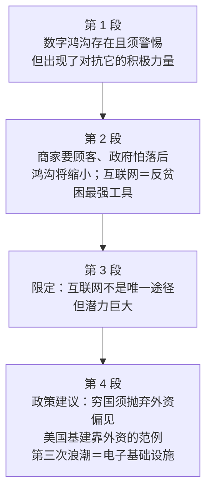

# Passage 28 · 数字鸿沟的乐观预言

## 答题记录

| 轮次  | 日期         | 题号  | 正确  | 错误  | 正确率 | 用时    | 错题归因 |
| --- | --- | --- | --- | --- | --- | --- | --- |
| 1 |  | 1-4 |  |  |  |  |  |
| 2 |  | 1-4 |  |  |  |  |  |
| 3 |  | 1-4 |  |  |  |  |  |

> [!tip] 填写口径
> - **用时**以分钟计，只计做题时间，不含精读复盘。
> - **错题归因**填「题型·错误类型」，如：细节题·定位错、推理判断·过度推断、主旨大意·以偏概全。
> - 纵向看趋势：正确率升而用时过长 → 熟练度不足；用时降而正确率波动 → 定位不稳。

> [!info] 文章档案
> - **来源**：考研英语（一）2001 年 Text 2
> - **题材**：科学技术——数字鸿沟将因商业利益与技术普及而缩小，互联网是对抗世界贫困的最强工具，穷国应利用外资建设电子基础设施
> - **结构**：4 段 / 27 句 ＋ 4 题
> - **难度**：★★★☆☆
> - **一句话主旨**：数字鸿沟确实存在、也确实值得警惕，但互联网的商业化普及与各国「怕落后」的竞争心态正在合力把它缩小；贫穷国家若想借这一最强工具脱贫，就必须抛弃「外资＝侵犯主权」的反殖民成见——毕竟连美国的铁路港口当年都是靠外资建起来的。

## 一、篇章脉络

- **第 1 段**：提出概念、亮明立场——今天人们高度关注所谓「数字鸿沟」（世界被划分为信息富人与信息穷人）；它确实存在，二十年前作者夫妇就把这个迫近的危险挂在嘴边；但当时还不显眼的，是一股对抗数字鸿沟的新的积极力量——所以有理由乐观。
- **第 2 段**：给出技术层面的乐观论证——互联网越商业化，普及接入就越符合商家利益（上网的人越多，潜在顾客越多）；越来越多政府唯恐本国被甩在后面，也想普及互联网；未来一二十年内全球将有十到二十亿人联成网络。结论：数字鸿沟将会缩小而非扩大——这是好消息，因为互联网很可能是我们从未有过的、对抗世界贫困的最有力工具。
- **第 3 段**：先作限定——互联网不是战胜贫困的唯一途径，也不是我们仅有的工具，但它潜力巨大。（防止读者把上一段推到极端。）
- **第 4 段**：政策建议与历史例证——要利用这件工具，贫困国家必须抛弃过时的反殖民偏见：仍把外资视为侵犯主权的国家，不妨研究美国的基础设施建设史——美国第二次浪潮的基础设施（公路、海港、高速、港口等）正是靠外资建起来的；英德法荷投资人出资、移民出力，如今归谁所有？如今第三次浪潮的基础设施是电子基础设施，帮你建设它的外资越多，你的境况就会越好；这并不意味着躺下任人愚弄、放任外国公司不受约束，而是要认识到外资在建设能源与电信基础设施——充分利用互联网所需——方面的分量。

> [!tip] 行文逻辑
> 全篇是「立场先行 → 双重论证（商家利益＋政府竞争）→ 限定 → 政策落地」的结构。第 1 段的 however 是全篇枢纽：把话题从「鸿沟有多可怕」翻转为「谁在对抗它」。第 2 段的论证骨架是利益驱动——不是出于善心，而是 the more people online, the more potential customers（商家）＋ afraid of being left behind（政府）；第 4 段则把「对抗贫困」落成具体政策（引进外资建电子基建），并用美国历史做例证，例证后用 the more...the better off 收紧。四道题分别考枢纽（第 1 题）、利益驱动（第 2 题）、例证目的（第 3 题）与结论句（第 4 题）。

## 二、逐段精读

### 第 1 段 · 鸿沟确实存在，但有理由乐观

**原文**

① A great deal of attention is being paid today to the so-called digital divide—the division of the world into the info (information) rich and the info poor.
② And that divide does exist today.
③ My wife and I lectured about this looming danger twenty years ago.
④ What was less visible then, however, were the new, positive forces that work against the digital divide.
⑤ There are reasons to be optimistic.

**译文**

① 如今，人们正高度关注所谓的「数字鸿沟」——即世界被划分为信息富人与信息穷人。
② 而且这道鸿沟今天确实存在。
③ 二十年前，我和妻子就在演讲中谈论这个迫近的危险。
④ 然而，当时还不太显眼的，是一股对抗数字鸿沟的新的积极力量。
⑤ 所以，我们有理由感到乐观。

> [!note] 段落要点
> - 功能：给出核心概念（数字鸿沟）并亮明立场（有理由乐观），全篇都在为这个乐观立场提供论证。
> - ①句是「概念定义句」：破折号后的同位语就是 digital divide 的定义——division of the world into the info rich and the info poor。
> - ②③句先承认问题的真实性与历史（本人二十年前就预警过），堵住「你轻视问题」的质疑。
> - ④句 however 是全篇枢纽：把视线从「危险」转到「对抗危险的力量」；⑤句顺势收束为立场宣言。

#### 长难句 · 本段

> [!abstract] 本段第 ① 句 · A great deal of attention is being paid today to the so-called digital divide—the division of the world into the info rich and the info poor.

**结构拆解**

- **主干**：attention is being paid to the digital divide（现在进行时被动语态）
- **数量修饰**：A great deal of（大量，修饰不可数名词 attention）
- **时间状语**：today（插在被动结构中间）
- **破折号同位语**：the division of the world into A and B（解释 digital divide）
- **类指结构**：the info rich and the info poor（the＋形容词＝一类人，如 the rich / the poor）

**参考译文**

如今，人们正高度关注所谓的「数字鸿沟」——即把世界划分为信息富人与信息穷人的那道分界。

> [!tip] 拆解要点
> 破折号是「即」的信号：读长定义句时先抓主干（attention is being paid to...），再看破折号后的解释。the info (information) rich / the info poor 是「the＋形容词」的类指活用，补全为 the rich people in information and the poor people in information。is being paid 是现在进行时的被动，「正在、持续地被关注」。

> [!abstract] 本段第 ④ 句 · What was less visible then, however, were the new, positive forces that work against the digital divide.

**结构拆解**

- **主语**：What was less visible then（what 引导的主语从句）
- **插入语**：however（表转折，隔开主语与谓语）
- **系动词**：were（与表语 forces 保持复数一致，而非与 what 一致）
- **表语**：the new, positive forces
- **定语从句**：that work against the digital divide（修饰 forces）

**参考译文**

然而，当时还不太显眼的，是一股对抗数字鸿沟的新的积极力量。

> [!tip] 拆解要点
> what 从句作主语时，真正决定系动词单复数的是**表语**——本句表语 forces 是复数，故用 were。however 夹在主语从句与系动词之间，是阅读时容易「读丢」的转折信号。work against 不是「工作」而是「对抗、起反作用」，与下文的 positive forces 合起来＝「对抗鸿沟的积极力量」。

#### 本段重点词汇

| 单词 / 短语 | 词性 | 文中意 | 常用考义与拓展 | 英文示例搭配（中译） |
| --- | --- | --- | --- | --- |
| **a great deal of** | 短语 | 大量的 | 修饰不可数名词；a great deal 也作副词「大量地」 | a great deal of attention（大量关注） |
| **so-called** | adj. | 所谓的 | 常含轻度质疑或引介新词的意味 | the so-called digital divide（所谓的数字鸿沟） |
| **digital divide** | 短语 | 数字鸿沟 | digital adj. 数字的；divide n. 分歧、分界 | the so-called digital divide（所谓的数字鸿沟） |
| **division** | n. | 划分，分化 | divide v. 划分；division 另义「部门；除法」 | the division of the world into the info rich and the info poor（把世界划分为信息富人与穷人） |
| **lecture** | v. | 作演讲，讲授 | 熟词僻义：名词「讲座」→动词「讲课、告诫」 | My wife and I lectured about this danger（我和妻子就此作过演讲） |
| **looming danger** | 短语 | 迫近的危险 | loom v. 隐隐逼近（loom large 显得突出） | this looming danger（这个迫近的危险） |
| **less visible** | 短语 | 不太显眼的 | visible adj. 看得见的；invisible 看不见的 | What was less visible then（当时还不太显眼的） |
| **work against** | 短语 | 对抗，起反作用于 | 反义 work for / work in favor of | forces that work against the digital divide（对抗数字鸿沟的力量） |
| **optimistic** | adj. | 乐观的 | be optimistic about / that...；反义 pessimistic | There are reasons to be optimistic（有理由乐观） |

### 第 2 段 · 商家要顾客、政府怕落后：鸿沟将缩小

**原文**

① There are technological reasons to hope the digital divide will narrow.
② As the Internet becomes more and more commercialized, it is in the interest of business to universalize access—after all, the more people online, the more potential customers there are.
③ More and more governments, afraid their countries will be left behind, want to spread Internet access.
④ Within the next decade or two, one to two billion people on the planet will be netted together.
⑤ As a result, I now believe the digital divide will narrow rather than widen in the years ahead.
⑥ And that is very good news because the Internet may well be the most powerful tool for combating world poverty that we've ever had.

**译文**

① 我们有技术层面的理由去期待数字鸿沟将会缩小。
② 随着互联网变得越来越商业化，普及网络接入符合商家的利益——毕竟，上网的人越多，潜在的顾客就越多。
③ 越来越多的政府因为担心本国被甩在后面，也都想推广互联网接入。
④ 在未来一二十年里，这个星球上将有十亿到二十亿人被联成网络。
⑤ 因此，我现在相信，未来几年数字鸿沟将会缩小，而不是扩大。
⑥ 而且这是个非常好的消息，因为互联网很可能是我们有史以来对抗世界贫困最强大的工具。

> [!note] 段落要点
> - 功能：用「利益驱动」双重论证第 1 段的乐观立场——商家与政府各有一份自利动机，鸿沟的缩小不需要道德善心。
> - ②句是商家的账：commercialized → universalize access 符合利益，破折号后 after all 给出理由（the more...the more...）。
> - ③句是政府的账：afraid of being left behind（怕落后）——恐惧驱动。
> - ④句给出量化前景（十到二十亿人联网），⑤句用 as a result 收出结论（narrow rather than widen）。
> - ⑥句把结论升维：缩小鸿沟的意义在于互联网是对抗贫困的最强工具——为第 3、4 段的「工具论」搭桥。

#### 长难句 · 本段

> [!abstract] 本段第 ② 句 · As the Internet becomes more and more commercialized, it is in the interest of business to universalize access—after all, the more people online, the more potential customers there are.

**结构拆解**

- **主干**：it is in the interest of business to universalize access
- **时间/伴随状语从句**：As the Internet becomes more and more commercialized（as＝随着）
- **形式主语**：it 代指 to universalize access
- **固定搭配**：in the interest(s) of...（符合……的利益）
- **破折号补充**：after all 引出理由
- **比较级并列**：the more people online, the more potential customers there are（「越……越……」结构，前后各含省略的 there be）

**参考译文**

随着互联网变得越来越商业化，普及网络接入就符合商家的利益——毕竟，上网的人越多，潜在的顾客也就越多。

> [!tip] 拆解要点
> as 引导「随着」的伴随从句，主句用 it 作形式主语。the more..., the more... 是英语的「比例对应」句式，前后分句都作了省略（补全：the more people there are online, the more potential customers there are）。本题第 2 题的定位句正是②③句：商家利益＋政府恐惧，合起来＝「经济潜力」。

> [!abstract] 本段第 ⑥ 句 · And that is very good news because the Internet may well be the most powerful tool for combating world poverty that we've ever had.

**结构拆解**

- **主干**：that is very good news
- **原因状语从句**：because the Internet may well be the most powerful tool
- **情态结构**：may well＋动词原形（「很可能、完全可能」，比 may 语气更强）
- **目的状语**：for combating world poverty（修饰 tool）
- **定语从句**：that we've ever had（修饰 tool，与最高级 the most powerful 呼应）

**参考译文**

而且这是个非常好的消息，因为互联网很可能是我们有史以来对抗世界贫困最强大的工具。

> [!tip] 拆解要点
> may well 是高频情态组合：well 在这里加强 may，「有充分理由可能是」。最高级＋that...ever 结构（the most powerful tool that we've ever had）是「史上之最」的标准表达。注意定语从句修饰的是 tool 而不是 poverty——隔了 for combating world poverty 一层，容易误读。

#### 本段重点词汇

| 单词 / 短语 | 词性 | 文中意 | 常用考义与拓展 | 英文示例搭配（中译） |
| --- | --- | --- | --- | --- |
| **narrow** | v. | （使）缩小，变窄 | 熟词僻义：形容词「窄的」→动词「缩小」；narrow down 缩小范围 | hope the digital divide will narrow（期待鸿沟缩小） |
| **commercialized** | adj. | 商业化的 | commercial adj. 商业的；commerce n. 商业 | As the Internet becomes more and more commercialized（随着互联网日益商业化） |
| **in the interest of** | 短语 | 符合……的利益 | 同义 for the sake of；interest n. 利益 | it is in the interest of business to universalize access（普及接入符合商家利益） |
| **universalize access** | 短语 | 普及（网络）接入 | universal adj. 普遍的；universalize v. 使普遍化；access n. 接入、使用权 | universalize access（普及接入） |
| **after all** | 短语 | 毕竟，别忘了 | 插入语，提示理由 | after all, the more people online...（毕竟，上网的人越多……） |
| **potential** | adj. | 潜在的 | 另可作 n. 潜力（enormous potential）；potentiality n. 可能性 | the more potential customers（越多潜在顾客） |
| **leave behind** | 短语 | 甩在后面，使落后 | leave sb behind 把某人落下；be left behind 被落下 | afraid their countries will be left behind（担心本国被落下） |
| **spread** | v. | 推广，普及 | 本义「涂开、传播」 | want to spread Internet access（想推广互联网接入） |
| **decade** | n. | 十年 | within the next decade or two 未来一二十年 | Within the next decade or two（在未来一二十年里） |
| **net together** | 短语 | 联成一体 | 熟词僻义：net n. 网 → v.「用网联结」 | one to two billion people will be netted together（十到二十亿人将被联成网络） |
| **as a result** | 短语 | 因此，其结果是 | 前果后因链：A → as a result → B | As a result, I now believe...（因此我现在相信……） |
| **widen** | v. | 扩大，变宽 | wide adj. 宽的；反义 narrow | narrow rather than widen（缩小而非扩大） |
| **combat** | v. | 对抗，抗击 | 另可作 n. 战斗；combat corruption 反腐败 | the most powerful tool for combating world poverty（对抗世界贫困的最强工具） |

### 第 3 段 · 限定：不是唯一，但潜力巨大

**原文**

① Of course, the use of the Internet isn't the only way to defeat poverty.
② And the Internet is not the only tool we have.
③ But it has enormous potential.

**译文**

① 当然，使用互联网并不是战胜贫困的唯一途径。
② 互联网也不是我们仅有的工具。
③ 但它有着巨大的潜力。

> [!note] 段落要点
> - 功能：三句话的「限定段」，防止读者把第 2 段⑥句推到极端（互联网≠万能药）。
> - ①②句用两个 only 平行让步：不是唯一途径、不是唯一工具。
> - ③句 But 一转收在 enormous potential 上——让步后的强调才是重心。
> - 本段虽短，却是第 2 题干扰项 C（can soon wipe out world poverty）的排除依据：文中从没说「很快消除」。

#### 本段重点词汇

| 单词 / 短语 | 词性 | 文中意 | 常用考义与拓展 | 英文示例搭配（中译） |
| --- | --- | --- | --- | --- |
| **defeat** | v. | 战胜，消除 | 本义「击败（对手）」→「消除（贫困、疾病）」 | the only way to defeat poverty（战胜贫困的唯一途径） |
| **enormous potential** | 短语 | 巨大的潜力 | enormous adj. 巨大的；potential 此处作名词 | But it has enormous potential（但它潜力巨大） |

### 第 4 段 · 抛弃偏见用外资：美国基建的历史范例

**原文**

① To take advantage of this tool, some impoverished countries will have to get over their outdated anti-colonial prejudices with respect to foreign investment.
② Countries that still think foreign investment is an invasion of their sovereignty might well study the history of infrastructure (the basic structural foundations of a society) in the United States.
③ When the United States built its industrial infrastructure, it didn't have the capital to do so.
④ And that is why America's Second Wave infrastructure—including roads, harbors, highways, ports and so on—were built with foreign investment.
⑤ The English, the Germans, the Dutch and the French were investing in Britain's former colony.
⑥ They financed them.
⑦ Immigrant Americans built them.
⑧ Guess who owns them now?
⑨ The Americans.
⑩ I believe the same thing would be true in places like Brazil or anywhere else for that matter.
⑪ The more foreign capital you have helping you build your Third Wave infrastructure, which today is an electronic infrastructure, the better off you're going to be.
⑫ That doesn't mean lying down and becoming fooled, or letting foreign corporations run uncontrolled.
⑬ But it does mean recognizing how important they can be in building the energy and telecom infrastructures needed to take full advantage of the Internet.

**译文**

① 要利用这件工具，一些贫困国家将不得不克服它们在外国投资问题上过时的反殖民偏见。
② 那些仍然认为外国投资是对本国主权侵犯的国家，不妨研究一下美国的基础设施（一个社会的基本结构基础）建设史。
③ 当年美国建设工业基础设施时，并没有所需的资本。
④ 而这正是美国的第二次浪潮基础设施——包括公路、海港、高速公路、港口等——都是靠外国投资建成的原因。
⑤ 英国人、德国人、荷兰人和法国人当时都在这块英国的前殖民地投资。
⑥ 是他们出的资。
⑦ 是移民来的美国人建的。
⑧ 猜猜这些东西如今归谁所有？
⑨ 美国人。
⑩ 我相信，同样的事情也会发生在巴西或任何其他类似的地方。
⑪ 用来帮助你建设第三次浪潮基础设施（如今也就是电子基础设施）的外资越多，你的境况就会越好。
⑫ 这并不意味着躺下任人愚弄，或放任外国公司不受约束地为所欲为。
⑬ 但这确实意味着要认识到：在建设充分利用互联网所需的能源与电信基础设施方面，外国资本可以有多么重要。

> [!note] 段落要点
> - 功能：把「互联网是对抗贫困的工具」落成具体政策——引进外资建电子基础设施，并用美国历史做例证。
> - ①句是政策句：get over outdated anti-colonial prejudices（抛弃过时偏见）＝「接受外资」这一主张的否定式表达。
> - ②—⑨句是美国例证：没资本 → 靠外资 → 英德法荷出资、移民出力 → 如今归美国人。⑧⑨的设问自答极有修辞力。
> - ⑩句把例子推广到巴西等发展中国家（for that matter「同样地」）。
> - ⑪句是全篇结论句（也是第 4 题的定位句）：the more foreign capital... the better off you're going to be。
> - ⑫⑬句先排除误解（不是任人宰割）、再亮真意（认识到外资的重要性）——「先抑后扬」的收束。

#### 长难句 · 本段

> [!abstract] 本段第 ② 句 · Countries that still think foreign investment is an invasion of their sovereignty might well study the history of infrastructure (the basic structural foundations of a society) in the United States.

**结构拆解**

- **主干**：Countries might well study the history of infrastructure
- **定语从句**：that still think foreign investment is an invasion of their sovereignty（修饰 Countries）
- **宾语从句嵌套**：从句内 think 后又接 (that) foreign investment is an invasion...（省略 that）
- **情态结构**：might well（「不妨、完全可以」，语气委婉的建议）
- **括号解释**：(the basic structural foundations of a society)（infrastructure 的定义）

**参考译文**

那些仍然认为外国投资是对本国主权之侵犯的国家，不妨研究一下美国的基础设施（一个社会的基本结构基础）建设史。

> [!tip] 拆解要点
> 双层从句嵌套：that（定语从句主语）→ think（谓语）→ 省略 that 的宾语从句。might well 与上段的 may well 是同族搭配——may well（很可能）表推断，might well（不妨）表委婉建议，一字之差。括号内是「生词即注」的命题友好写法，考场上见到括号要立刻当作定义提示。

> [!abstract] 本段第 ⑪ 句 · The more foreign capital you have helping you build your Third Wave infrastructure, which today is an electronic infrastructure, the better off you're going to be.

**结构拆解**

- **框架**：the more A..., the better off B...（「越……越……」比例对应结构）
- **从句主干**：you have foreign capital（have＋宾语）
- **宾语补足**：helping you build your Third Wave infrastructure（现在分词作补语，capital 是「帮忙的」主体）
- **非限定性定语从句**：which today is an electronic infrastructure（修饰 Third Wave infrastructure）
- **主句结构**：you're going to be better off（better off 作表语，「境况更好」）

**参考译文**

用来帮助你建设第三次浪潮基础设施（如今也就是电子基础设施）的外资越多，你的境况就会越好。

> [!tip] 拆解要点
> the more..., the more... 的变体（后半换成了 the better off）。have＋宾语＋doing 是「拥有某物正在做某事」的结构：foreign capital 是「helping you build」的执行者。which 非限定从句插在中间，把「第三次浪潮基础设施」即时定义为「电子基础设施」——这半句正是第 4 题答案（how well-developed it is electronically）的原文出处。

> [!abstract] 本段第 ⑬ 句 · But it does mean recognizing how important they can be in building the energy and telecom infrastructures needed to take full advantage of the Internet.

**结构拆解**

- **主干**：it does mean recognizing...
- **强调结构**：does＋动词原形（do 强调，与⑫句的 doesn't mean 形成对照）
- **动名词宾语**：recognizing how important they can be
- **宾语从句**：how important they can be（recognizing 的宾语）
- **状语**：in building the energy and telecom infrastructures
- **过去分词后置定语**：needed to take full advantage of the Internet（修饰 infrastructures，＝ which are needed to...）

**参考译文**

但这确实意味着要认识到：在建设充分利用互联网所需的能源与电信基础设施方面，外国资本可以有多么重要。

> [!tip] 拆解要点
> doesn't mean... / does mean... 的否定—肯定对照是英语「先排除误解、再亮真意」的经典收束（呼应⑫⑬两句）。recognize 后接 how 引导的宾语从句；needed to do 是过去分词作后置定语，字面「被需要的」→「所需的」。写作文时这个三段式（That doesn't mean A. But it does mean B.）可以直接迁移。

#### 本段重点词汇

| 单词 / 短语 | 词性 | 文中意 | 常用考义与拓展 | 英文示例搭配（中译） |
| --- | --- | --- | --- | --- |
| **take advantage of** | 短语 | 利用 | take full advantage of 充分利用 | To take advantage of this tool（要利用这件工具） |
| **impoverished** | adj. | 贫困的，赤贫的 | impowerish v. 使贫困；poverty n. 贫困 | some impoverished countries（一些贫困国家） |
| **get over** | 短语 | 克服，摆脱 | get over an illness / a setback | get over their outdated prejudices（克服过时的偏见） |
| **outdated** | adj. | 过时的 | out-＋date＋-ed；同义 obsolete | their outdated anti-colonial prejudices（过时的反殖民偏见） |
| **anti-colonial** | adj. | 反殖民主义的 | anti- 前缀「反」；colonial adj. 殖民的 | anti-colonial prejudices（反殖民偏见） |
| **prejudice** | n. | 偏见，成见 | prejudice against sb 对……的偏见；同义 bias | get over their prejudices（克服偏见） |
| **with respect to** | 短语 | 在……方面，关于 | 同义 with regard to / concerning | prejudices with respect to foreign investment（在外国投资问题上的偏见） |
| **invasion** | n. | 侵犯，入侵 | invade v. 入侵；invasion of privacy 侵犯隐私 | an invasion of their sovereignty（对主权的侵犯） |
| **sovereignty** | n. | 主权 | sovereign adj. 有主权的；sovereign state 主权国家 | an invasion of their sovereignty（侵犯主权） |
| **might well** | 短语 | 不妨，完全可以 | 与 may well（很可能）相对，表委婉建议 | might well study the history of infrastructure（不妨研究基础设施史） |
| **infrastructure** | n. | 基础设施 | infra-「在下」＋structure 结构 | the history of infrastructure（基础设施建设史） |
| **capital** | n. | 资本，资金 | 熟词僻义：另义「首都、大写字母」 | it didn't have the capital to do so（当时没有所需资本） |
| **Second Wave** | 短语 | 第二次浪潮 | 源自托夫勒《第三次浪潮》：农业→工业→信息 | America's Second Wave infrastructure（美国的第二次浪潮基建） |
| **finance** | v. | 为……出资 | 熟词僻义：名词「财政」→动词「提供资金」 | They financed them.（是他们出的资。） |
| **immigrant** | n. | 移民 | immigrate v. 移入；emigrant 移出者 | Immigrant Americans built them.（移民来的美国人建的。） |
| **former** | adj. | 以前的，前……的 | former colony 前殖民地；former / latter 前者／后者 | Britain's former colony（英国的前殖民地） |
| **for that matter** | 短语 | 就此而言，同样地 | 补充同类情况 | Brazil or anywhere else for that matter（巴西或任何同样情况的地方） |
| **foreign capital** | 短语 | 外国资本，外资 | capital 资本；capital inflow 资本流入 | The more foreign capital you have（你拥有的外资越多） |
| **better off** | 短语 | 境况更好的 | well off 富裕的→比较级 better off | the better off you're going to be（你的境况就会越好） |
| **uncontrolled** | adj. | 不受控制的 | un-＋control＋-ed；run uncontrolled 肆意妄为 | letting foreign corporations run uncontrolled（放任外国公司妄为） |
| **recognize** | v. | 认识到，承认 | 本义「认出」→「意识到、承认」 | it does mean recognizing how important they can be（确实意味着认识到其重要性） |
| **take full advantage of** | 短语 | 充分利用 | advantage n. 优势；full 强化 | needed to take full advantage of the Internet（充分利用互联网所需的） |

## 三、全篇重点词汇汇总（自测用）

> [!info] 说明
> 本表只列「单词 / 词性 / 所在段」，不含释义与搭配，用于遮表自测：说出词义后再回该段核对。
> 收录**全篇所有段落词汇，共 46 条，不删减**，与各段「本段重点词汇」等长同源。

| 单词 / 短语 | 词性 | 所在段 |
| --- | --- | --- |
| **a great deal of** | 短语 | 第 1 段 |
| **so-called** | adj. | 第 1 段 |
| **digital divide** | 短语 | 第 1 段 |
| **division** | n. | 第 1 段 |
| **lecture** | v. | 第 1 段 |
| **looming danger** | 短语 | 第 1 段 |
| **less visible** | 短语 | 第 1 段 |
| **work against** | 短语 | 第 1 段 |
| **optimistic** | adj. | 第 1 段 |
| **narrow** | v. | 第 2 段 |
| **commercialized** | adj. | 第 2 段 |
| **in the interest of** | 短语 | 第 2 段 |
| **universalize access** | 短语 | 第 2 段 |
| **after all** | 短语 | 第 2 段 |
| **potential** | adj. | 第 2 段 |
| **leave behind** | 短语 | 第 2 段 |
| **spread** | v. | 第 2 段 |
| **decade** | n. | 第 2 段 |
| **net together** | 短语 | 第 2 段 |
| **as a result** | 短语 | 第 2 段 |
| **widen** | v. | 第 2 段 |
| **combat** | v. | 第 2 段 |
| **defeat** | v. | 第 3 段 |
| **enormous potential** | 短语 | 第 3 段 |
| **take advantage of** | 短语 | 第 4 段 |
| **impoverished** | adj. | 第 4 段 |
| **get over** | 短语 | 第 4 段 |
| **outdated** | adj. | 第 4 段 |
| **anti-colonial** | adj. | 第 4 段 |
| **prejudice** | n. | 第 4 段 |
| **with respect to** | 短语 | 第 4 段 |
| **invasion** | n. | 第 4 段 |
| **sovereignty** | n. | 第 4 段 |
| **might well** | 短语 | 第 4 段 |
| **infrastructure** | n. | 第 4 段 |
| **capital** | n. | 第 4 段 |
| **Second Wave** | 短语 | 第 4 段 |
| **finance** | v. | 第 4 段 |
| **immigrant** | n. | 第 4 段 |
| **former** | adj. | 第 4 段 |
| **for that matter** | 短语 | 第 4 段 |
| **foreign capital** | 短语 | 第 4 段 |
| **better off** | 短语 | 第 4 段 |
| **uncontrolled** | adj. | 第 4 段 |
| **recognize** | v. | 第 4 段 |
| **take full advantage of** | 短语 | 第 4 段 |

> [!example] 同义替换链（阅读题高频）
> - **looming danger / forces that work against the digital divide ↔ the world must guard against**：第 1 题 C 项，danger（危险）→ guard against（警惕）的动名替换。
> - **in the interest of business / the more potential customers / afraid of being left behind ↔ offers economic potentials**：第 2 题 A 项，商家利益＋潜在顾客＋政府怕落后，三重对应「经济潜力」。
> - **get over outdated anti-colonial prejudices / the more foreign capital...the better off ↔ accepting foreign investment**：第 3 题 D 项，克服「反外资」偏见＋外资越多越好＝接受外资。
> - **Third Wave infrastructure, which today is an electronic infrastructure / the better off you're going to be ↔ how well-developed it is electronically**：第 4 题 A 项，电子基础设施决定境况好坏。
> - **narrow rather than widen ↔ getting worse because of the Internet**：第 1 题 A 项的反向干扰——原文说鸿沟将缩小，A 说因互联网而恶化。

> [!warning] 熟词僻义专列
> - **narrow**：窄的（形容词）→ 动词「缩小」（the divide will narrow）。
> - **lecture**：讲座（名词）→ 动词「作演讲、讲课」。
> - **net**：网（名词）→ 动词「联成网络」（netted together）。
> - **potential**：潜在的（形容词）→ 名词「潜力」（enormous potential）。
> - **capital**：首都、大写 → 资本、资金（foreign capital）。
> - **finance**：财政（名词）→ 动词「为……出资」（They financed them.）。
> - **might well**：might「可能」→「不妨、完全可以」（表委婉建议）。
> - **better off**：well off「富裕的」→ 比较级「境况更好的」。
> - **defeat**：击败（对手）→ 消除（贫困、疾病）。
> - **recognize**：认出 → 认识到、承认。
> - **division**：除法、部门 → 划分、分化。
> - **spread**：涂开、传播 → 推广（互联网接入）。

## 四、知识点补充

> [!question] 背景知识
> - **数字鸿沟（digital divide）**：1990 年代后期流行的概念，指不同国家、地区或人群在互联网与信息技术接入、使用上的差距；美国商务部国家电信与信息管理局（NTIA）1995 年起发布的《在网络中落伍》（Falling Through the Net）系列报告使这一术语广为流传。
> - **托夫勒的「三次浪潮」**：未来学家阿尔文·托夫勒（Alvin Toffler）1980 年在《第三次浪潮》中提出：第一次浪潮是农业革命，第二次浪潮是工业革命（对应公路、海港、高速公路等「旧基建」），第三次浪潮是信息革命。文中 Second Wave infrastructure / Third Wave infrastructure 正借用这一框架——今天的基建就是「电子基础设施」。
> - **美国基建与外资**：19 世纪美国修铁路、建港口时资本匮乏，大量资金来自英国、德国、荷兰、法国等欧洲投资者——文中「英德法荷投资人出资、移民建铁路，如今归美国」说的就是这段史实，美国当时正是「英国的前殖民地」。
> - **反殖民情绪与外资观**：不少曾在殖民时代受剥削的发展中国家（如拉美国家）独立后对外资心存戒备，将其视为对主权的再度侵犯；第 4 段作者针对的正是这种「过时的反殖民偏见」。
> - **作者背景**：本文原载美国《外交》杂志（Foreign Affairs，2001 年），作者 Lugric? —— 原文为 Luc? 通行版本不注名，考点不在作者，背景了解即可。

> [!warning] 语法点
> - **破折号作同位语（第 1 段①）**：—the division of the world into...，即时给出 digital divide 的定义。
> - **the＋形容词类指（第 1 段①）**：the info rich and the info poor＝信息富人与信息穷人，如 the rich / the poor。
> - **what 主语从句＋表语一致（第 1 段④）**：What was less visible... were the forces——系动词与表语 forces 一致，而非与 what 一致。
> - **as＝随着（第 2 段②）**：As the Internet becomes...，引导时间/伴随从句。
> - **the more..., the more...（第 2 段② / 第 4 段⑪）**：比例对应结构，前后分句均含省略；⑪句是其变体（the better off）。
> - **may well / might well（第 2 段⑥ / 第 4 段②）**：may well「很可能」（推断）；might well「不妨」（委婉建议）——一字之差，语气不同。
> - **最高级＋that...ever（第 2 段⑥）**：the most powerful tool that we've ever had「有史以来最强的工具」。
> - **双层从句嵌套（第 4 段②）**：Countries that think (that) foreign investment is...——定语从句里套宾语从句。
> - **设问自答（第 4 段⑧⑨）**：Guess who owns them now? The Americans.——问句起势、短语作答，修辞力极强。
> - **have＋宾语＋doing（第 4 段⑪）**：foreign capital you have helping you build...＝你拥有的「正在帮你建设」的外资。
> - **which 非限定性定语从句（第 4 段⑪）**：which today is an electronic infrastructure，插在主干中间作即时定义。
> - **does 强调（第 4 段⑬）**：But it does mean...，与⑫句 doesn't mean 构成否定—肯定对照。
> - **过去分词后置定语（第 4 段⑬）**：infrastructures needed to take full advantage of the Internet＝which are needed to...「所需的」。

> [!success] 写作可迁移句型
> - **A great deal of attention is being paid today to...**：被动开篇引出热门议题。
> - **There are reasons to be optimistic.**：立场预告句，先给结论再展开。
> - **As A becomes more and more..., it is in the interest of B to do...—after all, the more..., the more...**：利益驱动型论证的完整链条。
> - **As a result, I now believe... rather than...**：用 rather than 一正一反收出结论。
> - **And that is very good news because...**：承上启下，把结论升维到意义层面。
> - **Of course, A isn't the only way to... But...**：先限定再转折，防止观点被极端化。
> - **To take advantage of this tool, ... will have to get over...**：目的状语开头的政策建议句。
> - **Countries that still think... might well study...**：用「不妨看看历史」替代直接反驳，更克制有力。
> - **Guess who owns them now? The Americans.**：设问自答，短句收尾。
> - **The more A you have doing B, the better off you're going to be.**：the more...the more 的实用变体。
> - **That doesn't mean doing A, or doing B. But it does mean doing C.**：先排除误解、再亮真意的三段式收束。

> [!danger] 易混辨析
> - **narrow (adj.) / narrow (v.)**：形容词「窄的」；动词「缩小」（反义 widen）。本文两处作动词。
> - **access / excess / assess**：access 接入、使用权；excess 过量、超额；assess 评估。三词形近极易混。
> - **potential (adj.) / potential (n.)**：形容词「潜在的」（potential customers）；名词「潜力」（enormous potential）。
> - **capital / capitol / capitalism**：capital 资本、首都；capitol（美国）国会大厦；capitalism 资本主义。
> - **finance (n.) / finance (v.)**：名词「财政、金融」；动词「为……提供资金」（They financed them.）。
> - **immigrant / emigrant / migrant**：immigrant（自外移入的）移民；emigrant（向外移出的）移民；migrant 候鸟、流动工人。
> - **former / formal / formerly**：former 以前的、前者；formal 正式的；formerly 从前（副词）。形近三兄弟。
> - **combat / battle / fight**：combat 抗击（贫困、疾病等抽象对象）；battle 战役、斗争；fight 打斗、争斗（最通用）。
> - **prejudice / bias / discrimination**：prejudice 偏见（pre-「预先」＋judge）；bias 倾向、偏袒；discrimination 歧视（外在行为）。
> - **optimistic / optimistic about / optimistic that**：optimistic about sth 对某事乐观；optimistic that...（从句）乐观地认为。

## 五、题目分析

> [!info] 题目总览
> | 题号 | 题型 | 定位 | 答案 |
> | --- | --- | --- | --- |
> | 1 | 细节题（第一段） | 第 1 段③④⑤句 | C |
> | 2 | 细节题（因果） | 第 2 段②③句 | A |
> | 3 | 例证题 | 第 4 段②句（例前）⑪句（例后） | D |
> | 4 | 推断题 | 第 4 段⑪句 | A |

### 第 1 题 · 细节题（第一段）

> [!question] 原题
> Digital divide is something
> - A. getting worse because of the Internet.
> - B. the rich countries are responsible for.
> - C. the world must guard against.
> - D. considered positive today.

**正确答案**：**C. the world must guard against.（全世界都应该警惕的东西）**

**定位与依据**
- 定位到第 1 段③句：My wife and I lectured about this **looming danger** twenty years ago（二十年前我们就在谈论这个**迫近的危险**）。
- ④句再证：positive forces **that work against** the digital divide（对抗数字鸿沟的积极力量）——既需「对抗」，鸿沟本身自然是坏事。
- 同义替换：looming danger ↔ must guard against（危险 → 需警惕）。

**干扰项分析**

| 选项 | 选项内容 | 判断 | 排除理由 |
| --- | --- | --- | --- |
| A | getting worse because of the Internet. | ✗ | 与原文相反：第 2 段①句明说 technological reasons to hope the digital divide will **narrow**（有理由期待鸿沟缩小），互联网是缩小鸿沟的力量，不是使之恶化的原因。 |
| B | the rich countries are responsible for. | ✗ | 无中生有：全文没有讨论鸿沟由谁造成、谁应负责，rich countries 只出现在「info rich」这一概念表述里。 |
| D | considered positive today. | ✗ | 与原文相反：作者乐观（⑤句 optimistic）的对象是「鸿沟将缩小」这一趋势，而非鸿沟本身；鸿沟在③句中始终是 looming danger。 |

> [!tip] 解题思路
> 本题的陷阱在「张冠李戴式乐观」：文章确实通篇乐观，但乐观的是**对抗鸿沟的力量**，不是鸿沟本身——D 项偷换了乐观的对象。A 项则是拿第 2 段的结论反着说。锁定①句「危险」的定性词（looming danger）后，C 项的 guard against 是唯一同向替换。

### 第 2 题 · 细节题（因果）

> [!question] 原题
> Governments attach importance to the Internet because it
> - A. offers economic potentials.
> - B. can bring foreign funds.
> - C. can soon wipe out world poverty.
> - D. connects people all over the world.

**正确答案**：**A. offers economic potentials.（能提供经济潜能）**

**定位与依据**
- 定位到第 2 段②③句：As the Internet becomes more and more commercialized, it is in the interest of business to universalize access—after all, the more people online, the more **potential customers** there are.（商家利益：潜在顾客）More and more governments, **afraid their countries will be left behind**, want to spread Internet access.（政府心态：怕落后＝怕错失经济机会）。
- 商家要顾客、政府怕掉队，合起来指向的都是互联网背后的**经济利益**。

**干扰项分析**

| 选项 | 选项内容 | 判断 | 排除理由 |
| --- | --- | --- | --- |
| B | can bring foreign funds. | ✗ | 因果颠倒：第 4 段说的是贫困国家可以**利用外资**来发展互联网（电子基建），而不是互联网能带来海外投资。 |
| C | can soon wipe out world poverty. | ✗ | 过度推断：第 2 段末句与第 3 段只说互联网「可能是对抗贫困的最强工具」且「不是唯一途径」，从未说「很快消除」贫困。 |
| D | connects people all over the world. | ✗ | 答非所问：netted together（联网）确是功能，但它不是政府重视互联网的**直接原因**——政府关心的是落后的经济后果。 |

> [!tip] 解题思路
> 因果细节题要区分「事实」与「原因」：D 项的内容文中为真，却答非题干所问（because）。A 项的 economic potentials 是对②句「商家利益＋潜在顾客」和③句「怕被落下」的抽象概括——把具体利益表述抽象成一个名词短语，是正确答案的常见形态。B 项是典型的「因果颠倒」：把第 4 段「用外资建互联网」倒过来读成「互联网带来外资」。

### 第 3 题 · 例证题

> [!question] 原题
> The writer mentioned the case of the United States to justify the policy of
> - A. providing financial support overseas.
> - B. preventing foreign capital's control.
> - C. building industrial infrastructure.
> - D. accepting foreign investment.

**正确答案**：**D. accepting foreign investment.（接受外国投资）**

**定位与依据**
- 例前观点（第 4 段①②句）：impoverished countries will have to **get over their outdated anti-colonial prejudices**（须抛弃「反外资」的过时偏见）——即「接受外资」这一主张的否定式表达。
- 例后归纳（第 4 段⑪句）：**The more foreign capital you have** helping you build your Third Wave infrastructure, **the better off you're going to be**（外资越多境况越好）。
- 例子本身（③—⑨句）：美国当年没资本，靠英德法荷外资建起二次浪潮基建，如今归美国——支撑的正是「引进外资是必要且有好处的」。

**干扰项分析**

| 选项 | 选项内容 | 判断 | 排除理由 |
| --- | --- | --- | --- |
| A | providing financial support overseas. | ✗ | 与文意相反：例子讲的是美国**接受**外资（欧洲人出资），不是向海外提供资金援助；方向整个反了。 |
| B | preventing foreign capital's control. | ✗ | 答非所问：⑫句「不是放任外企妄为」只是作者打消顾虑的补充说明，不是美国例子要证明的政策。 |
| C | building industrial infrastructure. | ✗ | 例子本身：修基建只是例子中叙述的史实内容，属于「例子的躯壳」而非「例子的灵魂」——例证题铁律：例子本身不是答案。 |

> [!tip] 解题思路
> 例证题三步走：找例子→向前找观点句→向后找归纳句。本题「前」是①②句的「抛弃反外资偏见」，「后」是⑪句的「外资越多越好」，首尾夹出的政策就是 accepting foreign investment。C 项是最典型的「例子本身」干扰——文中反复出现 infrastructure、built 等词，考生顺着关键词走就中招；记住：**关键词扎堆的地方往往是陷阱，观点句才是答案**。

### 第 4 题 · 推断题

> [!question] 原题
> It seems that now a country's economy depends much on
> - A. how well-developed it is electronically.
> - B. whether it is prejudiced against immigrants.
> - C. whether it adopts America's industrial pattern.
> - D. how much control it has over foreign corporations.

**正确答案**：**A. how well-developed it is electronically.（其电子工业发展的程度）**

**定位与依据**
- 定位到第 4 段⑪句（书中解析所称「最后一段①句」即末段核心句）：The more foreign capital you have helping you build your Third Wave infrastructure, **which today is an electronic infrastructure**, the better off you're going to be.
- 逻辑链：如今的「第三次浪潮基建」＝电子基础设施 → 谁的电子基建建得好，谁的境况（better off）就更好 → 一国经济如今很大程度上取决于其电子化程度。

**干扰项分析**

| 选项 | 选项内容 | 判断 | 排除理由 |
| --- | --- | --- | --- |
| B | whether it is prejudiced against immigrants. | ✗ | 无中生有：文中 prejudice 指反殖民、反外资偏见（第 4 段①句），与「对移民的偏见」无关；immigrant 只在例子中一笔带过。 |
| C | whether it adopts America's industrial pattern. | ✗ | 偷换概念：美国只是作为「利用外资建基建」的成功范例被引用，作者从未提倡效仿美国的产业模式本身。 |
| D | how much control it has over foreign corporations. | ✗ | 未提及：⑫句只说引进外资不等于任外企妄为，并未把「对外企的控制程度」说成经济的决定因素。 |

> [!tip] 解题思路
> - 推断题只推一步：⑪句明说「第三次浪潮基建＝电子基建」且「建得越多境况越好」，推出「经济取决于电子化程度」只走了半步，安全；B、D 则是把文中某个词（prejudice / corporations）拽到无关的判断里，无原文依据。
> - 另外注意题干的 It seems that now——「如今」，正是⑪句 which today is an electronic infrastructure 的 now 的对应：作者特意用 today/now 把「过去的工业基建」与「现在的电子基建」分开，考的就是这个时间切分。

## 六、复盘清单

- [ ] 过汇总表 46 词，遮住「所在段」列自测，重点过 12 个熟词僻义
- [ ] 重做 7 个长难句的口头翻译，特别是 the more foreign capital you have helping you build...（第 4 段⑪）与 what 主语从句（第 1 段④）
- [ ] 默写「概念与立场（第 1 段）— 商家与政府双重论证（第 2 段）— 限定（第 3 段）— 政策与美国例证（第 4 段）」四步链条，并标出全篇枢纽（第 1 段④句 however）
- [ ] 整理本文干扰项类型：与原文相反 ×3、无中生有 ×2、因果颠倒 ×1、过度推断 ×1、答非所问 ×2、例子本身 ×1、偷换概念 ×1、未提及 ×1
- [ ] 把答题记录填进顶部表格，对照正确率决定是否二刷

## 七、关联笔记

- [[Passage27-古典音乐会的生存危机]]
- [[考研英语 · 阅读六大题型方法论]]
- [[考研英语 · 熟词僻义汇总]]
