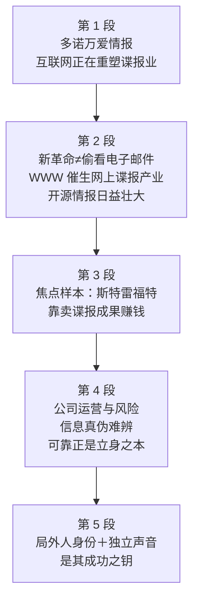

# Passage 29 · 网络谍报的新时代

## 答题记录

| 轮次  | 日期         | 题号  | 正确  | 错误  | 正确率 | 用时    | 错题归因 |
| --- | --- | --- | --- | --- | --- | --- | --- |
| 1 |  | 1-5 |  |  |  |  |  |
| 2 |  | 1-5 |  |  |  |  |  |
| 3 |  | 1-5 |  |  |  |  |  |

> [!tip] 填写口径
> - **用时**以分钟计，只计做题时间，不含精读复盘。
> - **错题归因**填「题型·错误类型」，如：细节题·定位错、推理判断·过度推断、主旨大意·以偏概全。
> - 纵向看趋势：正确率升而用时过长 → 熟练度不足；用时降而正确率波动 → 定位不稳。

> [!info] 文章档案
> - **来源**：考研英语（一）2003 年 Text 1
> - **题材**：科学技术——互联网正在把谍报业改造成「开源情报」产业，私营情报分析公司成为新贵
> - **结构**：5 段 / 24 句 ＋ 5 题
> - **难度**：★★★☆☆
> - **一句话主旨**：从「狂人比尔」多诺万到点击鼠标的网上谍报，互联网催生了完整的开源情报产业；在这个真伪难辨的新行当里，像斯特雷福特这样敢下判断、发独立声音的公司，正是靠「可靠」二字赚取生计。

## 一、篇章脉络

- **第 1 段**：引子——「狂人比尔」多诺万若在世定会爱上互联网：这位缔造战略情报局（OSS）、为中央情报局奠基的间谍大王痴迷信息，信奉谍报是一门可以用一切趁手工具的「大游戏」；如今，已重塑买书寄信等日常消遣的互联网，也正在重塑他曾经从事的行业。
- **第 2 段**：铺开现象——最新革命不只是「君子偷看君子的电子邮件」那种电子谍报（那已进行了几十年）；近三四年万维网催生出完整的「点击式谍报」产业，行内人称之为「开源情报」，随网络壮大而影响日增——1995 年中情局的布隆迪情报竞赛，冠军竟是一家以精通电子世界见长的弗吉尼亚小公司。
- **第 3 段**：聚焦样本——在新世界掀起最大波澜的公司中就有斯特雷福特：这家私营情报分析公司靠向麦克德莫特国际等企业出售谍报成果（覆盖智利到俄罗斯诸国）赚钱，许多预测都在其网站公开可查。
- **第 4 段**：经营之道与风险——总裁弗里德曼视网络为收集与发布信息相互促进的工具；乌克兰危机预测一发布就会有五百新用户注册、还会收到反馈；当然开源谍报有风险——好坏信息难辨，而斯特雷福特正是靠辨别真伪赚取生计。
- **第 5 段**：成功之钥——公司只靠 20 人的精干团队，多员有军情背景；其「局外人」身份正是成功关键：简报不像华盛顿惯常的闪烁其词（官方机构怕说错而避免惊人论断），斯特雷福特以独立的声音为傲。

> [!tip] 行文逻辑
> 全篇是「引子 → 现象 → 样本 → 内功 → 定性」的漏斗结构。第 1 段是新闻特写式的开场：用多诺万这个「旧谍报时代偶像」来引出「互联网改造谍报」的新话题（would have loved 虚拟语气既造趣味又埋下第 1 题 A 项的陷阱）；第 2 段由远及近（几十年的电子谍报 → 三四年的网上谍报产业 → 1995 年竞赛例证）；第 3 段把镜头推到斯特雷福特（make the biggest splash）；第 4 段讲运营与软肋（风险恰是卖点：earns its keep）；第 5 段收在「局外人＋独立声音」——既是第 5 题答案，也是作者对这家公司的定性评价。五道题依次考：词义辨析（第 1 题）、例证目的（第 2 题）、短语猜测（第 3 题）、段落推断（第 4 题）、细节事实（第 5 题）。

## 二、逐段精读

### 第 1 段 · 多诺万若在世，定会爱上互联网

**原文**

① Wild Bill Donovan would have loved the Internet.
② The American spymaster who built the Office of Strategic Services in the World War II and later laid the roots for the CIA was fascinated with information.
③ Donovan believed in using whatever tools came to hand in the great game of espionage—spying as a "profession".
④ These days the Net, which has already re-made such everyday pastimes as buying books and sending mail, is reshaping Donovan's vocation as well.

**译文**

① 「狂人比尔」多诺万若在世，一定会爱上互联网。
② 这位在二战期间创建战略情报局、后来又为中央情报局奠基的美国间谍大王，对信息痴迷不已。
③ 多诺万信奉：在谍报——把间谍当作「职业」——这场「大游戏」里，什么趁手的工具都可以拿来一用。
④ 如今，互联网已经重塑了买书、寄信这样的日常消遣，也正在同样地重塑多诺万曾经从事的这个行业。

> [!note] 段落要点
> - 功能：新闻特写式引子——用传奇人物引出全文话题「互联网正在改造谍报业」，主题句是本段最后一句。
> - ①句虚拟语气 would have loved：多诺万早已作古，「如果他还活着定会爱上」——既制造趣味，又说明他不可能真的「支持」互联网（第 1 题 A 项的陷阱所在）。
> - ②句给多诺万的资历背书（建 OSS、为 CIA 奠基），坐实「间谍大王」身份，让他有资格代表整个谍报行业。
> - ③句引出多诺万的信条「什么工具都可用来谍报」——为下文「互联网这件新工具进入谍报业」预作铺垫。
> - ④句是全段落点句：reshaping Donovan's vocation，其中 vocation 回指 intelligence services（情报服务业）——正是第 1 题的定位句。

#### 长难句 · 本段

> [!abstract] 本段第 ② 句 · The American spymaster who built the Office of Strategic Services in the World War II and later laid the roots for the CIA was fascinated with information.

**结构拆解**

- **主干**：The American spymaster was fascinated with information（主系表结构）
- **定语从句**：who built... and later laid the roots for...（修饰 spymaster，两个并列谓语 built / laid）
- **时态与年代状语**：in the World War II（二战期间）；later（其后）
- **固定搭配**：be fascinated with（对……着迷）

**参考译文**

这位在二战期间创建了战略情报局、后来又为中央情报局奠基的美国间谍大王，对信息痴迷不已。

> [!tip] 拆解要点
> 长主语＋短谓语是英语新闻常用句式：主语 The American spymaster 后挂了 22 个词的定语从句，读到 was 时才发现主干不过是「这位间谍大王痴迷信息」。从句内 built 与 laid 两个过去式并列，用 and later 衔接——先建 OSS（战时机构）、再为 CIA 奠基（战后遗产），一句写完一生功业。lay the roots for 直译「为……播下根」，即「为……奠定基础」。

> [!abstract] 本段第 ④ 句 · These days the Net, which has already re-made such everyday pastimes as buying books and sending mail, is reshaping Donovan's vocation as well.

**结构拆解**

- **时间状语**：These days（如今）
- **主干**：the Net is reshaping Donovan's vocation as well
- **非限定性定语从句**：which has already re-made such everyday pastimes as buying books and sending mail（插入主语与谓语之间，修饰 the Net）
- **such...as...** 结构：such everyday pastimes as buying books and sending mail（诸如买书、寄信之类的日常消遣）
- **状语**：as well（也，同样地）

**参考译文**

如今，互联网已经重塑了买书、寄信这样的日常消遣，也正在同样地重塑多诺万曾经从事的这个行业。

> [!tip] 拆解要点
> which 非限定性定语从句把主语 the Net 与谓语 is reshaping 隔开，先「插叙」互联网的既往战绩（已重塑日常消遣），再回到主干说它现在的动作（正在重塑谍报业）——插入语本身就是「由旧及新」的过渡。as well 收尾轻巧地把谍报业并进互联网改造名单的末尾，是第 1 题定位句：reshaping 的宾语 Donovan's vocation＝intelligence services。

#### 本段重点词汇

| 单词 / 短语 | 词性 | 文中意 | 常用考义与拓展 | 英文示例搭配（中译） |
| --- | --- | --- | --- | --- |
| **spymaster** | n. | 间谍大王，谍报首脑 | 合成词 spy（间谍）＋master（大师）；类似 taskmaster（监工） | The American spymaster（美国间谍大王） |
| **lay the roots for** | 短语 | 为……奠定基础 | 同义 lay the groundwork/foundation for；root n. 根源 | laid the roots for the CIA（为中央情报局奠基） |
| **be fascinated with** | 短语 | 对……着迷 | 同义 be fascinated by；fascinating adj. 迷人的 | was fascinated with information（对信息痴迷不已） |
| **believe in** | 短语 | 信奉，笃信 | 区别 believe sb（相信某人的话）；believe in 后接主义、做法 | Donovan believed in using whatever tools came to hand（多诺万信奉什么工具趁手就用什么） |
| **come to hand** | 短语 | 到手，唾手可得 | = be available / within reach；whatever tools came to hand 任何趁手的工具 | using whatever tools came to hand（使用任何到手的工具） |
| **great game** | 短语 | 大游戏（谍报行话） | the great game 特指谍报界对情报角逐的戏称，大写常为专名 | in the great game of espionage（在谍报这场大游戏里） |
| **espionage / spying** | n. | 谍报（活动）；间谍活动 | 熟词僻义：spy v./n. 间谍 → spying 间谍活动；espionage 为正式用语 | the great game of espionage—spying as a "profession"（谍报——作为「职业」的间谍活动） |
| **pastime** | n. | 消遣，娱乐 | = amusement / recreation；pass（消磨）＋time（时光） | such everyday pastimes as buying books and sending mail（买书寄信之类的日常消遣） |
| **re-make** | v. | 重塑，改造 | = remake；re- 前缀「再、重新」 | has already re-made such everyday pastimes（已经重塑了这些日常消遣） |
| **reshape** | v. | 重塑，改造 | = remould / remold（第 1 题正确项的近义词） | is reshaping Donovan's vocation as well（也正在重塑多诺万的行业） |
| **vocation** | n. | 职业，行当 | 熟词僻义：宗教「天职」→ 泛指职业；勿混 vacation（假期）、avocation（副业、爱好） | Donovan's vocation（多诺万的行业＝情报服务业） |
| **as well** | 短语 | 也，同样地 | = too / also，常置句末 | is reshaping... as well（也正在重塑……） |

### 第 2 段 · 「开源情报」产业应运而生

**原文**

① The latest revolution isn't simply a matter of gentlemen reading other gentlemen's e-mail.
② That kind of electronic spying has been going on for decades.
③ In the past three or four years, the World Wide Web has given birth to a whole industry of point-and-click spying.
④ The spooks call it "open-source intelligence", and as the Net grows, it is becoming increasingly influential.
⑤ In 1995 the CIA held a contest to see who could compile the most data about Burundi.
⑥ The winner, by a large margin, was a tiny Virginia company called Open Source Solutions, whose clear advantage was its mastery of the electronic world.

**译文**

① 最新的这场革命，并不只是「君子偷看君子电子邮件」那么简单。
② 那种电子谍报已经进行了几十年。
③ 而在过去三四年里，万维网孕育出了一个完整的「点击式谍报」产业。
④ 行内人把它称作「开源情报」，并且随着网络的发展壮大，它正变得影响日增。
⑤ 1995 年，中央情报局曾举办一场竞赛，看谁能搜集整理出关于布隆迪的最多资料。
⑥ 以巨大优势获胜的，是一家名叫「开源解决方案」的弗吉尼亚小公司，它的明显优势正是对电子世界的精通。

> [!note] 段落要点
> - 功能：把「互联网改造谍报」从个人逸事升级为产业现象，并用中情局竞赛的例证坐实「新贵已胜过官方」。
> - ①②句先破误解：最新革命 ≠ 老式的偷看邮件（那已搞了几十年）——isn't simply 是「不只」的限定式写法。
> - ③句给现象命名：give birth to（孕育）＋ a whole industry（完整产业），point-and-click 生动描摹「点开即得」的网上谍报。
> - ④句是本段落点：spooks（行话「间谍们」）称之 open-source intelligence，as the Net grows 影响日增。
> - ⑤⑥句例证：中情局出题，小公司夺魁——whose clear advantage was its mastery of the electronic world 一句把「电子能力＝新王牌」写到了明面上。

#### 长难句 · 本段

> [!abstract] 本段第 ④ 句 · The spooks call it "open-source intelligence", and as the Net grows, it is becoming increasingly influential.

**结构拆解**

- **并列句一**：The spooks call it "open-source intelligence"（主谓宾补；call＋宾语＋名称＝「把……称作……」）
- **并列连词**：and
- **并列句二**：it is becoming increasingly influential（现在进行时）
- **时间/伴随状语从句**：as the Net grows（随着网络的发展壮大）

**参考译文**

行内人把它称作「开源情报」，并且随着网络的发展壮大，它正变得影响日增。

> [!tip] 拆解要点
> and 连接的两个分句共用主语语义上的承接（前句「命名」、后句「评价」）。as 在此不是「作为」而是「随着」，引导伴随状语从句；increasingly influential（影响日增）是「副词＋形容词」的渐强搭配，比 more and more influential 更书面。call it "..." 是「命名句」的经典句型，补语直接用引号名词短语。

> [!abstract] 本段第 ⑥ 句 · The winner, by a large margin, was a tiny Virginia company called Open Source Solutions, whose clear advantage was its mastery of the electronic world.

**结构拆解**

- **主干**：The winner was a tiny Virginia company
- **插入语**：by a large margin（以巨大优势，隔开主语与系动词）
- **过去分词后置定语**：called Open Source Solutions（＝which was called...）
- **whose 定语从句**：whose clear advantage was its mastery of the electronic world（修饰 company）

**参考译文**

以巨大优势获胜的，是一家名叫「开源解决方案」的弗吉尼亚小公司，它的明显优势正是对电子世界的精通。

> [!tip] 拆解要点
> 三个修饰层层叠在主干 The winner was a company 上：插入语 by a large margin 交代「赢多少」，called... 交代「叫什么」，whose... 交代「凭什么赢」。by a large margin 是体育与竞赛报道高频短语（反义 by a narrow margin 险胜）；whose 从句中 mastery of A＝「对 A 的精通」，与下文 Straitford 的卖点（电子世界的能力）首尾呼应。

#### 本段重点词汇

| 单词 / 短语 | 词性 | 文中意 | 常用考义与拓展 | 英文示例搭配（中译） |
| --- | --- | --- | --- | --- |
| **revolution** | n. | 革命 | 引申「剧变、大变革」；the latest revolution 最新的一场变革 | The latest revolution isn't simply...（最新的这场变革不只是……） |
| **a matter of** | 短语 | ……的问题 | a matter of time 时间问题；简写 matter 表「事情」 | isn't simply a matter of...（不只是……那么回事） |
| **give birth to** | 短语 | 孕育，催生 | 拟物表达；同义 spawn / bring about | has given birth to a whole industry（催生出一整个产业） |
| **point-and-click** | adj. | 点击式的（鼠标一点即得） | 复合形容词；point（指点）＋click（点击） | a whole industry of point-and-click spying（点击式谍报产业） |
| **spook** | n. | 间谍（行话） | 熟词僻义：本义「鬼、幽灵」→ 俚语「间谍」；the spooks 行内人 | The spooks call it "open-source intelligence"（行内人称之「开源情报」） |
| **open-source intelligence** | 短语 | 开源情报 | 缩写 OSINT：从公开来源收集分析情报；open source 开源 | The spooks call it "open-source intelligence"（行内人称之「开源情报」） |
| **grow** | v. | 发展壮大 | 熟词僻义：种植 → 生长 → 壮大、扩张 | as the Net grows（随着网络的发展壮大） |
| **increasingly** | adv. | 日益，越来越 | increasingly＋形容词＝渐强表达 | is becoming increasingly influential（正变得影响日增） |
| **influential** | adj. | 有影响力的 | influence n./v. 影响；be influential in 在……方面有影响 | increasingly influential（影响日增） |
| **contest** | n. | 竞赛，比赛 | 同义 competition；hold a contest 举办竞赛 | the CIA held a contest（中情局办了一场竞赛） |
| **compile** | v. | 搜集，汇编 | compile data / a report 汇编资料/报告；compiler 编译器 | who could compile the most data（谁能汇编出最多资料） |
| **by a large margin** | 短语 | 以巨大优势（差距） | margin n. 差距、余量；反义 by a narrow margin 险胜 | The winner, by a large margin,...（以巨大优势获胜的……） |
| **clear advantage** | 短语 | 明显优势 | advantage over sb 对某人的优势；take advantage of 利用 | whose clear advantage was its mastery（其明显优势是……的精通） |
| **mastery** | n. | 精通，娴熟掌握 | master v. 掌握；mastery of A 对 A 的精通 | its mastery of the electronic world（对电子世界的精通） |

### 第 3 段 · 样本登场：斯特雷福特公司

**原文**

① Among the firms making the biggest splash in this new world is Straitford, Inc., a private intelligence-analysis firm based in Austin, Texas.
② Straitford makes money by selling the results of spying (covering nations from Chile to Russia) to corporations like energy-services firm McDermott International.
③ Many of its predictions are available online at www.straitford.com.

**译文**

① 在这个新世界里掀起最大波澜的公司当中，就有斯特雷福特公司——一家总部设在得克萨斯州奥斯汀的私营情报分析公司。
② 斯特雷福特靠出售谍报成果赚钱（业务覆盖从智利到俄罗斯的诸多国家），客户包括能源服务企业麦克德莫特国际公司这样的公司。
③ 它的许多预测都公布在网上：www.straitford.com。

> [!note] 段落要点
> - 功能：镜头从产业全景推到具体样本，介绍斯特雷福特是谁、怎么赚钱、成果在哪看。
> - ①句倒装＋同位语一句话完成「江湖地位＋公司性质＋所在地」三件事；making the biggest splash（掀起最大波澜）正是第 3 题的考点短语。
> - ②句商业模式：selling the results of spying to corporations——把「谍报」当商品卖给企业客户，括号里 covering nations from Chile to Russia 交代业务版图。
> - ③句轻巧收尾：预测挂网公开可查——既是营销，也呼应第 2 段「开源情报」的 open（公开）之义；第 3 题解析正是用②③句「覆盖全球、网上可查」反推该公司是「新领域的佼佼者」。

#### 长难句 · 本段

> [!abstract] 本段第 ① 句 · Among the firms making the biggest splash in this new world is Straitford, Inc., a private intelligence-analysis firm based in Austin, Texas.

**结构拆解**

- **表语（介词短语）前置**：Among the firms making the biggest splash in this new world（among 引导的地点范围提前）
- **主干（完全倒装）**：... is Straitford, Inc.（＝Straitford, Inc. is among the firms...）
- **现在分词后置定语**：making the biggest splash（修饰 the firms）
- **同位语**：a private intelligence-analysis firm based in Austin, Texas（解释 Straitford, Inc.）
- **过去分词后置定语**：based in Austin, Texas（修饰 firm）

**参考译文**

在这个新世界里掀起最大波澜的公司当中，就有斯特雷福特公司——一家总部设在得克萨斯州奥斯汀的私营情报分析公司。

> [!tip] 拆解要点
> 本句是全文最漂亮的倒装：介词短语 Among the firms... 提前作表语，主语 Straitford, Inc. 倒装到系动词之后——这样「新世界＋最大波澜」的背景先入画，主角公司后登场，正是新闻引入新角色的惯用笔法（比较：There is Straitford among the firms... 就平淡了）。倒装主语后紧跟同位语，同位语里又嵌 based in... 过去分词定语，一层套一层。make a splash＝「溅起水花」，喻「引起轰动」。

#### 本段重点词汇

| 单词 / 短语 | 词性 | 文中意 | 常用考义与拓展 | 英文示例搭配（中译） |
| --- | --- | --- | --- | --- |
| **make a splash** | 短语 | 引起轰动，掀起波澜 | 熟词僻义：splash 本义「水花」→ 比喻「轰动效应」；make the biggest splash 掀起最大波澜（第 3 题考点） | the firms making the biggest splash（掀起最大波澜的公司） |
| **firm** | n. | 公司 | 熟词僻义：adj. 坚定的 → n. 公司（＝company）；law firm 律所 | Among the firms...（在这些公司当中） |
| **private** | adj. | 私营的 | 熟词僻义：私人的 → 私营的（非官方）；private eye 私家侦探 | a private intelligence-analysis firm（一家私营情报分析公司） |
| **intelligence-analysis** | adj. | 情报分析的 | 复合形容词；intelligence 情报 ↔ intelligences？固定用单数 | a private intelligence-analysis firm（私营情报分析公司） |
| **be based in** | 短语 | 总部设在，驻于 | base v. 以……为基地；based in＋地点 | based in Austin, Texas（总部在得州奥斯汀） |
| **cover** | v. | （业务等）覆盖 | 熟词僻义：覆盖 → 报道（记者）；涵盖； covering nations（业务覆盖诸国） | covering nations from Chile to Russia（覆盖从智利到俄罗斯） |
| **corporation** | n. | 公司，企业 | 缩写 Corp.；multinational corporation 跨国公司 | to corporations like McDermott International（卖给麦克德莫特国际等公司） |
| **prediction** | n. | 预测 | predict v. 预测；predictable adj. 可预测的 | many of its predictions（它的许多预测） |
| **available** | adj. | 可得的，可查阅的 | be available online 网上可查；availability n. | are available online at www.straitford.com（在网站公开可查） |

### 第 4 段 · 经营之道：在真伪难辨处赚取生计

**原文**

① Straitford president George Friedman says he sees the online world as a kind of mutually reinforcing tool for both information collection and distribution, a spymaster's dream.
② Last week his firm was busy vacuuming up data bits from the far corners of the world and predicting a crisis in Ukraine.
③ "As soon as that report runs, we'll suddenly get 500 new Internet sign-ups from Ukraine," says Friedman, a former political science professor.
④ "And we'll hear back from some of them."
⑤ Open-source spying does have its risks, of course, since it can be difficult to tell good information from bad.
⑥ That's where Straitford earns its keep.

**译文**

① 斯特雷福特总裁乔治·弗里德曼说，他把网络世界视为一种对情报收集与发布都相互促进的工具——间谍大王的梦想。
② 上周，他的公司正忙于从世界各个遥远角落吸取数据碎片，并预测乌克兰将出现一场危机。
③ 「那份报告一发布，我们就会突然收到来自乌克兰的五百个新的互联网注册，」曾任政治学教授的弗里德曼说。
④ 「而且我们还会收到其中一些人的反馈。」
⑤ 当然，开源谍报确实有它的风险，因为好的信息与坏的信息很难区分。
⑥ 而这正是斯特雷福特赖以赚取生计的地方。

> [!note] 段落要点
> - 功能：深入公司内功——总裁的经营理念、一单乌克兰业务的现场感，最后点出「风险正是卖点」的商业逻辑。
> - ①句总裁定调：网络是「收集与发布相互促进」的工具（mutually reinforcing），同位语 a spymaster's dream 呼应第 1 段的多诺万。
> - ②③④句现场直播：vacuuming up（吸尘器式吸取）写尽数据采集之狂；弗里德曼的两句直接引语（预测发布 → 500 新注册 → 收到反馈）展示「发布即收集」的飞轮——正是①句 mutually reinforcing 的实例。
> - ⑤⑥句是本段落点、也是第 4 题定位句：开源谍报有风险（难辨真伪）→ That's where Straitford earns its keep（公司正是靠辨别真伪谋生）→ 换言之，它能提供相当可靠的情报。

#### 长难句 · 本段

> [!abstract] 本段第 ① 句 · Straitford president George Friedman says he sees the online world as a kind of mutually reinforcing tool for both information collection and distribution, a spymaster's dream.

**结构拆解**

- **主干**：George Friedman says (that)...（says 后接省略 that 的宾语从句）
- **宾语从句主干**：he sees the online world as a kind of mutually reinforcing tool（see A as B 结构）
- **目的介词短语**：for both information collection and distribution（both...and... 并列两个名词）
- **同位语**：a spymaster's dream（补充说明 tool，独立成逗号后的评注）

**参考译文**

斯特雷福特总裁乔治·弗里德曼说，他把网络世界视为一种对情报收集与发布都相互促进的工具——间谍大王的梦想。

> [!tip] 拆解要点
> 双层从句嵌套：主句谓语 says 里面套一个完整的宾语从句，从句内部又是一个 see A as B 的「看法句」。同位语 a spymaster's dream 放在句末、前有逗号，是对 tool 的评注性补充——「这不就是间谍大王梦寐以求的东西吗」，暗中回扣第 1 段的多诺万，首段引子至此完成呼应。mutually reinforcing＝「相互增强的」，mutually（相互地）修饰 reinforcing（起增强作用的）。

> [!abstract] 本段第 ⑤ 句 · Open-source spying does have its risks, of course, since it can be difficult to tell good information from bad.

**结构拆解**

- **主干**：Open-source spying does have its risks（does 强调肯定）
- **插入语**：of course（当然，夹在宾语 risks 与原因从句之间）
- **原因状语从句**：since it can be difficult to...（since＝因为，引导原因）
- **形式主语结构**：it can be difficult to tell...（it 形式主语，真主语是不定式）
- **固定搭配**：tell A from B（把 A 与 B 区分开）

**参考译文**

当然，开源谍报确实有它的风险，因为好的信息与坏的信息很难区分。

> [!tip] 拆解要点
> does 强调是先让步后转折的铺垫：作者先替对方承认「确实有风险」（does have），再用 since 给出风险根源（难辨真伪），为⑥句「这正是斯特雷福特的生计所在」蓄力——风险不是我方的软肋，而是我方的商机。tell A from B 中 tell 不是「告诉」而是「分辨」（＝distinguish A from B）；句末 bad 后省略了 information（tell good information from bad (information)）。

#### 本段重点词汇

| 单词 / 短语 | 词性 | 文中意 | 常用考义与拓展 | 英文示例搭配（中译） |
| --- | --- | --- | --- | --- |
| **president** | n. | 总裁 | 熟词僻义：总统 → 总裁、行长、校长（公司/机构首脑） | Straitford president George Friedman（斯特雷福特总裁弗里德曼） |
| **see A as B** | 短语 | 把 A 视为 B | 同义 view/regard A as B；be seen as 被视为 | he sees the online world as a kind of tool（他把网络世界视为一种工具） |
| **mutually reinforcing** | adj. | 相互增强的，相互促进的 | mutually adv. 相互地；reinforce v. 增强、加固 | a mutually reinforcing tool（相互促进的工具） |
| **distribution** | n. | 发布，分发 | distribute v. 分发、分布；反义 collection（收集） | information collection and distribution（情报的收集与发布） |
| **vacuum up** | 短语 | 吸取，搜罗 | 熟词僻义：vacuum n. 吸尘器/真空 → v. 用吸尘器吸 → 喻「大量搜刮」 | busy vacuuming up data bits（忙着吸取数据碎片） |
| **far corners of the world** | 短语 | 世界的遥远角落 | corner n. 角落；the four corners of the world 天涯海角 | from the far corners of the world（从世界各个遥远角落） |
| **crisis** | n. | 危机 | 复数 crises；economic/political crisis 经济/政治危机 | predicting a crisis in Ukraine（预测乌克兰将出现危机） |
| **sign-up** | n. | 注册用户（注册行为） | 动词短语 sign up（注册）名词化；sign-up sheet 报名表 | get 500 new Internet sign-ups（收到五百个新注册） |
| **hear back from** | 短语 | 收到……的回音 | hear from sb 收到某人来信；back 强调「回复」 | we'll hear back from some of them（我们会收到其中一些人的反馈） |
| **tell A from B** | 短语 | 把 A 与 B 区分开 | 熟词僻义：tell 告诉 → 分辨（＝distinguish A from B） | difficult to tell good information from bad（难辨信息真伪） |
| **earn its keep** | 短语 | 赚取生计，挣饭吃 | 熟词僻义：keep n. 生计、衣食（earn one's keep）；keep v. 维持 | That's where Straitford earns its keep（这正是它谋生之处） |
| **be busy doing** | 短语 | 忙于做…… | busy 后接 doing（不接 to do）；keep sb busy | was busy vacuuming up data bits（正忙着吸取数据） |

### 第 5 段 · 局外人与独立的声音

**原文**

① Friedman relies on a lean staff of 20 in Austin.
② Several of his staff members have military-intelligence backgrounds.
③ He sees the firm's outsider status as the key to its success.
④ Straitford's briefs don't sound like the usual Washington back-and-forthing, whereby agencies avoid dramatic declarations on the chance they might be wrong.
⑤ Straitford, says Friedman, takes pride in its independent voice.

**译文**

① 弗里德曼依靠的是奥斯汀一个只有 20 人的精干团队。
② 他的几名员工有军事情报工作背景。
③ 他认为，这家公司的「局外人」身份正是其成功的关键。
④ 斯特雷福特的简报听起来不像华盛顿惯常的闪烁其词——各官方机构正是借那种含糊其辞，来避免发布日后可能被证错的惊人之论。
⑤ 「斯特雷福特，」弗里德曼说，「以其独立的声音为傲。」

> [!note] 段落要点
> - 功能：给斯特雷福特定性——小而精、非官方、敢下判断，收束全文对这家公司的评价。
> - ①②句白描班底：lean staff of 20（精干的 20 人）＋ military-intelligence backgrounds（军情背景），人少但专业。
> - ③句亮出成功之钥：outsider status（局外人身份）——不是官方机构，所以不受官僚体制约束。
> - ④句对比官方：华盛顿的 back-and-forthing（闪烁其词）源于「怕说错」，whereby 从句把官方逻辑写透；Straitford 的简报与之相反——敢说。
> - ⑤句收束点题：takes pride in its independent voice——「独立的声音」即「不随大流的形象」，正是第 5 题的答案。

#### 长难句 · 本段

> [!abstract] 本段第 ④ 句 · Straitford's briefs don't sound like the usual Washington back-and-forthing, whereby agencies avoid dramatic declarations on the chance they might be wrong.

**结构拆解**

- **主干**：Straitford's briefs don't sound like the usual Washington back-and-forthing（sound like 听起来像）
- **关系副词从句**：whereby agencies avoid dramatic declarations（whereby＝by which，修饰 back-and-forthing）
- **目的/条件短语**：on the chance (that) they might be wrong（以防自己可能出错；that 省略）

**参考译文**

斯特雷福特的简报听起来不像华盛顿惯常的闪烁其词——各官方机构正是借那种含糊其辞，来避免发布日后可能被证错的惊人之论。

> [!tip] 拆解要点
> whereby 是考研高频关系副词（＝by which / through which），只用于指代「方式、手段」类先行词：back-and-forthing 是「含糊其辞」的做法，agencies 正是**靠**这种做法（by it）来避免惊人论断。on the chance (that)＝「以防、万一」，后面 that 被省略，they might be wrong 是 chance 的同位语从句。本句理解链条：官方怕错 → 所以闪烁其词 → Straitford 偏不这样 → 所以「独立的声音」。

> [!abstract] 本段第 ⑤ 句 · Straitford, says Friedman, takes pride in its independent voice.

**结构拆解**

- **主干**：Straitford takes pride in its independent voice（take pride in 以……为傲）
- **插入语**：says Friedman（引述动词插入，主谓倒装形式的「说话人评注」）

**参考译文**

「斯特雷福特，」弗里德曼说，「以其独立的声音为傲。」

> [!tip] 拆解要点
> 引语类新闻句的变体：直接引语换成陈述句后，「says Friedman」以插入语形式夹在主语与谓语之间（Straitford, **says Friedman**, takes pride in...）。这种「主语—引述—谓语」的断裂式插入是报刊引用的标志性句式，阅读时先跳过 says Friedman 抓主干。take pride in＝be proud of，写作中比 be proud of 更显郑重。

#### 本段重点词汇

| 单词 / 短语 | 词性 | 文中意 | 常用考义与拓展 | 英文示例搭配（中译） |
| --- | --- | --- | --- | --- |
| **rely on** | 短语 | 依靠 | = depend on / count on；reliance n. 依赖 | relies on a lean staff of 20（依靠 20 人的精干团队） |
| **lean** | adj. | 精干的，精简的 | 熟词僻义：倾斜 → （肉）瘦的 → （机构）精简高效的 | a lean staff of 20（20 人的精干团队） |
| **staff** | n. | （全体）员工 | 集合名词，单数形式表复数意；staff member 一名员工 | a lean staff of 20（20 人的团队） |
| **military-intelligence background** | 短语 | 军事情报工作背景 | military intelligence 军情；background 从业背景 | have military-intelligence backgrounds（有军情背景） |
| **outsider** | n. | 局外人 | 熟词僻义：outsider 身份＝非官方、圈外人的立场 | the firm's outsider status（公司的局外人身份） |
| **the key to** | 短语 | ……的关键 | 注意 to 是介词，后接名词/动名词 | the key to its success（其成功的关键） |
| **brief** | n. | 简报 | 熟词僻义：adj. 简短的 → n. 简报、案情摘要；in brief 简言之 | Straitford's briefs（斯特雷福特的简报） |
| **back-and-forthing** | n. | 闪烁其词，来回扯皮 | 由 back and forth（反复来回）名词化，含贬义 | the usual Washington back-and-forthing（华盛顿惯常的闪烁其词） |
| **whereby** | adv. | 借以，凭此 | 关系副词＝by which，正式用语，先行词多为方式方法 | whereby agencies avoid dramatic declarations（官方借以避免惊人论断的做法） |
| **dramatic** | adj. | 惊人的，戏剧性的 | 熟词僻义：戏剧的 → 引人注目的、重大的 | dramatic declarations（惊人的论断） |
| **on the chance (that)** | 短语 | 以防，万一 | = in case；that 常省略 | on the chance they might be wrong（以防他们说错） |
| **take pride in** | 短语 | 以……为傲 | = be proud of；pride n. 骄傲 | takes pride in its independent voice（以独立声音为傲） |
| **independent voice** | 短语 | 独立的声音 | independent adj. 独立的；此处＝不随官方起舞的立场 | its independent voice（它的独立声音） |

## 三、全篇重点词汇汇总（自测用）

> [!info] 说明
> 本表只列「单词 / 词性 / 所在段」，不含释义与搭配，用于遮表自测：说出词义后再回该段核对。
> 收录**全篇所有段落词汇，共 60 条，不删减**，与各段「本段重点词汇」等长同源。

| 单词 / 短语 | 词性 | 所在段 |
| --- | --- | --- |
| **spymaster** | n. | 第 1 段 |
| **lay the roots for** | 短语 | 第 1 段 |
| **be fascinated with** | 短语 | 第 1 段 |
| **believe in** | 短语 | 第 1 段 |
| **come to hand** | 短语 | 第 1 段 |
| **great game** | 短语 | 第 1 段 |
| **espionage / spying** | n. | 第 1 段 |
| **pastime** | n. | 第 1 段 |
| **re-make** | v. | 第 1 段 |
| **reshape** | v. | 第 1 段 |
| **vocation** | n. | 第 1 段 |
| **as well** | 短语 | 第 1 段 |
| **revolution** | n. | 第 2 段 |
| **a matter of** | 短语 | 第 2 段 |
| **give birth to** | 短语 | 第 2 段 |
| **point-and-click** | adj. | 第 2 段 |
| **spook** | n. | 第 2 段 |
| **open-source intelligence** | 短语 | 第 2 段 |
| **grow** | v. | 第 2 段 |
| **increasingly** | adv. | 第 2 段 |
| **influential** | adj. | 第 2 段 |
| **contest** | n. | 第 2 段 |
| **compile** | v. | 第 2 段 |
| **by a large margin** | 短语 | 第 2 段 |
| **clear advantage** | 短语 | 第 2 段 |
| **mastery** | n. | 第 2 段 |
| **make a splash** | 短语 | 第 3 段 |
| **firm** | n. | 第 3 段 |
| **private** | adj. | 第 3 段 |
| **intelligence-analysis** | adj. | 第 3 段 |
| **be based in** | 短语 | 第 3 段 |
| **cover** | v. | 第 3 段 |
| **corporation** | n. | 第 3 段 |
| **prediction** | n. | 第 3 段 |
| **available** | adj. | 第 3 段 |
| **president** | n. | 第 4 段 |
| **see A as B** | 短语 | 第 4 段 |
| **mutually reinforcing** | adj. | 第 4 段 |
| **distribution** | n. | 第 4 段 |
| **vacuum up** | 短语 | 第 4 段 |
| **far corners of the world** | 短语 | 第 4 段 |
| **crisis** | n. | 第 4 段 |
| **sign-up** | n. | 第 4 段 |
| **hear back from** | 短语 | 第 4 段 |
| **tell A from B** | 短语 | 第 4 段 |
| **earn its keep** | 短语 | 第 4 段 |
| **be busy doing** | 短语 | 第 4 段 |
| **rely on** | 短语 | 第 5 段 |
| **lean** | adj. | 第 5 段 |
| **staff** | n. | 第 5 段 |
| **military-intelligence background** | 短语 | 第 5 段 |
| **outsider** | n. | 第 5 段 |
| **the key to** | 短语 | 第 5 段 |
| **brief** | n. | 第 5 段 |
| **back-and-forthing** | n. | 第 5 段 |
| **whereby** | adv. | 第 5 段 |
| **dramatic** | adj. | 第 5 段 |
| **on the chance (that)** | 短语 | 第 5 段 |
| **take pride in** | 短语 | 第 5 段 |
| **independent voice** | 短语 | 第 5 段 |

> [!example] 同义替换链（阅读题高频）
> - **is reshaping Donovan's vocation（as well）↔ remolded the intelligence services**：第 1 题 B 项，reshape ↔ remold 近义替换，vocation ↔ intelligence services 同物异名。
> - **would have loved（虚拟语气）↔ received support from fans like Donovan**：第 1 题 A 项的反向干扰——虚拟≠事实支持。
> - **making the biggest splash / covering nations from Chile to Russia / available online ↔ achieving the greatest success**：第 3 题 C 项，掀最大波澜＋业务覆盖全球＋成果网上可查，合起来＝新领域的最大成功者。
> - **it can be difficult to tell good information from bad / That's where Straitford earns its keep ↔ is able to provide fairly reliable information**：第 4 题 D 项，靠辨别真伪谋生 → 提供的信息相当可靠。
> - **takes pride in its independent voice / don't sound like the usual Washington back-and-forthing ↔ nonconformist image**：第 5 题 B 项，独立的声音＋不像官方闪烁其词＝不随大流的形象。

> [!warning] 熟词僻义专列
> - **spook**：鬼、幽灵 → 间谍（行话）。
> - **vocation**：宗教「天职」→ 职业、行当。
> - **grow**：种植、生长 → 发展壮大。
> - **firm**：坚定的（形容词）→ 公司（名词）。
> - **private**：私人的 → 私营的（非官方）。
> - **cover**：覆盖、报道 → （业务）涵盖（诸国）。
> - **president**：总统 → 总裁、行长、校长。
> - **vacuum**：吸尘器、真空 → 动词「吸取、搜罗」。
> - **tell**：告诉 → 分辨、区分（tell A from B）。
> - **keep**：保持 → 名词「生计」（earn its keep）。
> - **lean**：倾斜 → （机构）精简的、（人）清瘦的。
> - **brief**：简短的（形容词）→ 简报（名词）。
> - **dramatic**：戏剧的 → 惊人的、重大的。
> - **splash**：水花 → 轰动效应（make a splash）。
> - **margin**：页边距 → 差距（by a large margin）。

## 四、知识点补充

> [!question] 背景知识
> - **「狂人比尔」多诺万（Wild Bill Donovan, 1883–1959）**：美国「战略情报局之父」。二战期间受罗斯福之命组建 OSS（Office of Strategic Services，战略情报局，1942–1945），统筹美国的间谍、反间谍与心理战；OSS 战后解散，其人员与档案成为 1947 年成立的 CIA（中央情报局）的家底——文中 built the OSS / laid the roots for the CIA 即指此。
> - **开源情报（OSINT, open-source intelligence）**：从公开来源（网络、媒体、公开出版物等）搜集并分析的情报，区别于人力间谍（HUMINT）与信号情报（SIGINT）。互联网时代 OSINT 地位飙升，如今已是情报界正式类别。
> - **斯特雷福特（Straitford, Inc.）**：文中原型为设于得州奥斯汀的私营情报分析公司 Stratfor（斯特拉特福），1996 年由政治学者乔治·弗里德曼（George Friedman）创立，以地缘政治分析与公开来源情报闻名，客户包括跨国企业；「Straitford」为命题时的改写名。
> - **布隆迪（Burundi）**：非洲中部小国，1990 年代内乱频仍、国际关注度低——CIA 当年以「谁最能编译布隆迪资料」出题，冠军却是一家民间公司，反差感正是作者要的例证。
> - **麦克德莫特国际（McDermott International）**：美国老牌能源工程服务公司，文中作为「购买谍报成果的企业客户」一例。
> - **spook 与行话**：spook 本义「幽灵」，冷战以来一直是谍报圈对「间谍」的俚称——与 spymaster、the great game（谍报界对情报博弈的雅称，源自 19 世纪英俄「大博弈」）同为行话。

> [!warning] 语法点
> - **虚拟语气 would have loved（第 1 段①）**：对过去的虚拟——多诺万已故，「若在世定会爱上」，不可能成为事实的支持者。
> - **who 定语从句并列谓语（第 1 段②）**：who built... and later laid...，一个先行词带两个动作。
> - **which 非限定性定语从句插入（第 1 段④）**：the Net, which has already re-made..., is reshaping...——从句隔开主谓，兼作「由旧及新」的过渡。
> - **and 并列＋as 伴随状语从句（第 2 段④）**：as the Net grows 中的 as＝「随着」。
> - **插入语 by a large margin（第 2 段⑥）**：隔开主语 The winner 与系动词 was。
> - **whose 定语从句（第 2 段⑥）**：whose clear advantage was...，先行词是 company。
> - **完全倒装（第 3 段①）**：Among the firms... is Straitford——介词短语作表语提前，主语后置，新闻引入新角色的笔法。
> - **宾语从句嵌套＋see A as B（第 4 段①）**：says (that) he sees the online world as...。
> - **引述动词插入（第 4 段③ / 第 5 段⑤）**：says Friedman 夹在主语与谓语/引语之间，报刊引用句式。
> - **does 强调（第 4 段⑤）**：does have its risks，「确实有风险」，先让步后转折的铺垫。
> - **it 形式主语（第 4 段⑤）**：it can be difficult to tell...，真主语是不定式。
> - **whereby 关系副词（第 5 段④）**：＝by which，先行词是表方式的 back-and-forthing。
> - **on the chance (that)＋省略 that（第 5 段④）**：＝in case，同位语从句 that 被省略。

> [!success] 写作可迁移句型
> - **A would have loved B.**：虚拟开篇，用一个已故/不在场人物「隔空点赞」新事物，趣味盎然地引出话题。
> - **These days the Net, which has already re-made such everyday pastimes as..., is reshaping... as well.**：非限定从句插入＋as well 收尾，「由旧及新」的推移句。
> - **The latest revolution isn't simply a matter of...**：先排除浅见、再引出深层的开段句。
> - **A has given birth to a whole industry of...**：拟物表达「催生出完整产业」。
> - **The winner, by a large margin, was a tiny company called..., whose clear advantage was...**：插入语＋同位语＋whose 从句的三连修饰句，竞赛报道模板。
> - **Among the firms doing X is A, a ... firm based in...**：倒装引入新角色句，背景先入画、主角后登场。
> - **A says he sees B as a kind of mutually reinforcing tool for both X and Y.**：人物观点句的标准包装。
> - **"As soon as that report runs, we'll suddenly get..."**：直接引语展示因果飞轮，比转述生动。
> - **A does have its risks, of course, since... That's where B earns its keep.**：让步—归因—反转的三步句，把风险写成卖点。
> - **Straitford, says Friedman, takes pride in its independent voice.**：引述动词插入的收束句，以「独立声音」点题。

> [!danger] 易混辨析
> - **reshape / remold / restore / revive**：reshape 与 remold 均「重塑、改造」；restore「恢复原状」（回到从前）；revive「复兴、苏醒」（曾死而复生）——恰是第 1 题四个选项的词义辨析。
> - **vocation / vacation / avocation**：vocation 职业；vacation 假期；avocation 副业、爱好。形近三兄弟，考研常客。
> - **espionage / spying / intelligence**：espionage 谍报（正式）；spying 间谍活动（口语）；intelligence 情报（成品与行业）。
> - **compile / comply / complete**：compile 汇编；comply 遵从（comply with）；complete 完成。形近易混。
> - **brief / briefly / brevity**：brief n. 简报 / adj. 简短的；briefly adv. 简言之；brevity n. 简洁。
> - **lean / thin / slim**：lean 精干无赘的（含褒义「精简」）；thin 一般「瘦」；slim 苗条的（或「渺茫的」机会）。
> - **whereby / thereby**：whereby 关系副词「借以」（＝by which）；thereby 连接副词「由此」（＝by that means）。一字之差，功能完全不同。
> - **margin / edge / fringe**：margin 差距、页边距、余量；edge 边缘、优势（competitive edge）；fringe 边缘（群体）、流苏。
> - **staff / stuff / stiff**：staff 员工；stuff 东西；stiff 僵硬的。拼写三胞胎。

## 五、题目分析

> [!info] 题目总览
> | 题号 | 题型 | 定位 | 答案 |
> | --- | --- | --- | --- |
> | 1 | 细节题（词义辨析） | 第 1 段④句 | B |
> | 2 | 例证题（写作目的） | 第 1 段（篇首引子） | A |
> | 3 | 词义题（短语猜测） | 第 3 段①句＋②③句 | C |
> | 4 | 推断题（段落） | 第 4 段⑤⑥句 | D |
> | 5 | 细节题（事实归纳） | 第 5 段④⑤句 | B |

### 第 1 题 · 细节题（词义辨析）

> [!question] 原题
> The emergence of the Net has
> - A. received support from fans like Donovan.
> - B. remolded the intelligence services.
> - C. restored many common pastimes.
> - D. revived spying as a profession.

**正确答案**：**B. remolded the intelligence services.（重塑了情报服务业）**

**定位与依据**
- 定位到第 1 段④句：These days the Net, which has already re-made such everyday pastimes as buying books and sending mail, is **reshaping** Donovan's **vocation** as well.
- 同义替换：reshaping ↔ **remolded**（近义动词）；Donovan's vocation ↔ **the intelligence services**（多诺万的行业＝情报服务业，②句的 spymaster／③句的 espionage 已交代得清清楚楚）。
- 题干 The emergence of the Net 对应④句主语 the Net（如今正在做的事）。

**干扰项分析**

| 选项 | 选项内容 | 判断 | 排除理由 |
| --- | --- | --- | --- |
| A | received support from fans like Donovan. | ✗ | 与原文相反：①句 would have loved 是**虚拟语气**——多诺万早已作古，「若在世定会爱上」只是设想，他不可能真的「支持」互联网；fans 一词更无从谈起。 |
| C | restored many common pastimes. | ✗ | 偷换概念：④句说的是 re-made（重塑、改变）日常消遣，restore 是「恢复到原来的状态」；且被重塑的是消遣方式本身，不是「恢复」它们——改变 ≠ 恢复。 |
| D | revived spying as a profession. | ✗ | 无中生有：revive（复兴）暗含「此前已消亡」之意，但第 2 段②句明说电子谍报 has been going on for decades（几十年从未中断），全文没有任何「谍报业曾消失」的信息。 |

> [!tip] 解题思路
> 本题是「一词定胜负」的词义辨析题：定位句 is reshaping Donovan's vocation as well 里，reshape 的宾语 vocation 必须回指上文——②句 spymaster、③句 espionage 已经铺好了「多诺万的行业＝谍报业」的语义场。选项动词逐一过筛：remold 与 reshape 同义（√），restore 是「复原」（×），revive 是「复活」（×，行业从未死），A 项则败在虚拟语气 would have loved——虚拟≠事实。近义替换 + 词义辨析双管齐下，答案自明。

### 第 2 题 · 例证题（写作目的）

> [!question] 原题
> Donovan's story is mentioned in the text to
> - A. introduce the topic of online spying.
> - B. show how he fought for the US.
> - C. give an episode of the information war.
> - D. honor his unique services to the CIA.

**正确答案**：**A. introduce the topic of online spying.（引出网络谍报这一主题）**

**定位与依据**
- 篇首引子服务于主题句——第 1 段④句：These days the Net... is reshaping Donovan's vocation as well（互联网也正在重塑谍报业）。
- 多诺万出现在第 1 段，紧接着全文各段都在讲互联网与谍报（第 2 段开源情报产业、第 3–5 段斯特雷福特公司）——引子指向的主题正是「网络谍报」。

**干扰项分析**

| 选项 | 选项内容 | 判断 | 排除理由 |
| --- | --- | --- | --- |
| B | show how he fought for the US. | ✗ | 与主题无关：②句只交代他建 OSS、为 CIA 奠基的履历，并未展开「他如何为美国而战」的任何情节。 |
| C | give an episode of the information war. | ✗ | 张冠李戴：多诺万的生平属于二战传统谍报时代，不是「信息战的一个片段」；information war 概念全文未出现。 |
| D | honor his unique services to the CIA. | ✗ | 与主题无关：文章不是人物纪念文，提多诺万并非表彰其功勋，而是借「旧谍报偶像」引出新话题。 |

> [!tip] 解题思路
> 例证题铁律：例子本身不是答案，例子服务的观点才是。多诺万的故事是「引子型例证」——出现在篇首、篇幅仅一段、后文再未回到他身上；其服务的观点正是引子末尾的主题句（④句「互联网也正在重塑谍报业」）。B、C、D 三项都在「复述或拔高例子本身」（他的战功、他的时代片段、他的功勋），与作者要谈的主题无关——这正是例证题干扰项的典型相貌。

### 第 3 题 · 词义题（短语猜测）

> [!question] 原题
> The phrase "making the biggest splash" (Line 1, Paragraph 3) most probably means
> - A. causing the biggest trouble.
> - B. exerting the greatest effort.
> - C. achieving the greatest success.
> - D. enjoying the widest popularity.

**正确答案**：**C. achieving the greatest success.（取得最大的成功）**

**定位与依据**
- 短语所在：第 3 段①句 Among the firms making the biggest splash in this new world is Straitford, Inc.（在新世界掀起最大波澜的公司中有斯特雷福特）。
- 向下文找释义线索：②句业务覆盖 nations from Chile to Russia（版图遍全球）、客户包括大型企业；③句 many of its predictions are available online（成果公开可查、影响外溢）——合起来说明它是这个新领域的佼佼者。
- 词典义印证：make a splash＝to create a forceful, favorable, and noticeable effect（造成强有力、有利且引人注目的影响）——贬义不成立，指向「成功」。

**干扰项分析**

| 选项 | 选项内容 | 判断 | 排除理由 |
| --- | --- | --- | --- |
| A | causing the biggest trouble. | ✗ | 感情色彩相反：下文②③句全是对该公司的中性偏褒介绍（业务广、成果可查），没有任何「惹麻烦」的信息；make a splash 本身是中性偏褒的短语。 |
| B | exerting the greatest effort. | ✗ | 偷换概念：splash（水花、声势）说的是「造成的客观效果」，不是「付出的主观努力」；且文中也无「它最卖力」的比较信息。 |
| D | enjoying the widest popularity. | ✗ | 过度推断：名气大 ≠ 流行度最广；文中只说它在新行业里声势最大、成果可查，从未说它「最受欢迎」或用户最多。 |

> [!tip] 解题思路
> 猜词/猜短语题的钥匙在上下文：短语所在的第 3 段①句是倒装引入句，真正的释义线索在②③句——覆盖全球的业务、网上可查的预测，都是「做得最大最好」的证据。四个选项中，A 把褒义翻成贬义（反），B 把「效果」偷成「努力」（偷换），D 把「声势」推成「流行度」（过度），只有 C「取得最大的成功」与上下文的褒扬语境严丝合缝。

### 第 4 题 · 推断题（段落）

> [!question] 原题
> It can be learned from Paragraph 4 that
> - A. Straitford's prediction about Ukraine has proved true.
> - B. Straitford guarantees the truthfulness of its information.
> - C. Straitford's business is characterized by unpredictability.
> - D. Straitford is able to provide fairly reliable information.

**正确答案**：**D. Straitford is able to provide fairly reliable information.（斯特雷福特能够提供相当可靠的情报）**

**定位与依据**
- 定位到第 4 段末两句：⑤句 Open-source spying does have its risks, of course, since it can be difficult to tell good information from bad（开源谍报确有风险——好坏信息难辨）。
- ⑥句 That's where Straitford **earns its keep**（斯特雷福特正是靠这个谋生）——「靠辨别真伪吃饭」，即其情报相当可靠。

**干扰项分析**

| 选项 | 选项内容 | 判断 | 排除理由 |
| --- | --- | --- | --- |
| A | Straitford's prediction about Ukraine has proved true. | ✗ | 推断过度：②③句只说公司**做出**了乌克兰危机预测、预测将带来注册量，全段没有任何信息说明预言「已被证实为真」。 |
| B | Straitford guarantees the truthfulness of its information. | ✗ | 过于绝对：作者刚说开源谍报 does have its risks（确实有风险、真伪难辨），公司若「保证真实性」就与⑤句直接矛盾——guarantee 是绝对化陷阱词。 |
| C | Straitford's business is characterized by unpredictability. | ✗ | 偷换概念：⑤句说的是**网络信息**的真伪难辨（这是公司要解决的**问题**），不是公司**生意本身**「以不可预测性为特征」——把对象从信息偷换成生意。 |

> [!tip] 解题思路
> - 本题是「让步—反转」结构的经典考法：⑤句先承认行业风险（does have 强调让步），⑥句一个 That's where 反转——风险恰恰是这家公司的生计来源（earns its keep）。只推一步：能靠辨别真伪谋生 → 提供的信息相当可靠（D 项 fairly 的「相当」也留了余地，与原文语气吻合）。
> - 反观干扰项的三个套路：A 把「做了预测」推成「预测成真」（过度推断）；B 用 guarantee 这种绝对化动词（与 risks 直接冲突）；C 把「信息的不可辨」偷成「生意的不可测」（偷换对象）。推断题「只推半步、不推一步半」，是本题的教训。

### 第 5 题 · 细节题（事实归纳）

> [!question] 原题
> Straitford is most proud of its
> - A. official status.
> - B. nonconformist image.
> - C. efficient staff.
> - D. military background.

**正确答案**：**B. nonconformist image.（不随大流的形象）**

**定位与依据**
- 定位到第 5 段末两句：④句 Straitford's briefs don't sound like the usual Washington back-and-forthing...（简报不像华盛顿惯常的闪烁其词）。
- ⑤句 Straitford, says Friedman, **takes pride in** its **independent voice**（以独立的声音为傲）——takes pride in 直接对应题干 is most proud of。
- 同义替换：independent voice / 不随官方含糊其词 ↔ **nonconformist image**（不随大流的形象）。

**干扰项分析**

| 选项 | 选项内容 | 判断 | 排除理由 |
| --- | --- | --- | --- |
| A | official status. | ✗ | 与原文相反：③句明说该公司的身份是 **outsider** status（局外人），是私营公司（第 3 段①句 private），不是官方机构。 |
| C | efficient staff. | ✗ | 张冠李戴：①②句确实写了 lean staff of 20、有军情背景，但那是**事实陈述**，作者与弗里德曼从未说公司以此为「傲」。 |
| D | military background. | ✗ | 张冠李戴：military-intelligence backgrounds 是**部分员工**的履历（②句 Several of his staff members），既非公司整体属性，也非骄傲所在。 |

> [!tip] 解题思路
> - 本题干干净净的定位题：题干 is most proud of 与⑤句 takes pride in 是「动词短语级」的同义替换，答案句就在段末——independent voice。nonconformist（不随大流的）一词拆开即 non＋conformist（遵从者），「不遵从（主流/官方）的形象」正合④句「不像华盛顿那一套」的对照。
> - C、D 两项的干扰素材（精干团队、军情背景）都来自同段前两句——这是命题人「就近取材」的惯技：段内信息 ≠ 答案句信息，认准题干对应的谓语（takes pride in）才不会被带偏。

## 六、复盘清单

- [ ] 过汇总表 60 词，遮住「所在段」列自测，重点过 15 个熟词僻义
- [ ] 重做 8 个长难句的口头翻译，特别是 Among the firms... is Straitford 完全倒装（第 3 段①）与 whereby＋on the chance 双从句（第 5 段④）
- [ ] 默写「引子（多诺万）→ 产业（开源情报）→ 样本（斯特雷福特）→ 内功（风险即生计）→ 定性（独立之声）」五步链条，并标出全文首尾呼应点（第 1 段多诺万 ↔ 第 4 段 a spymaster's dream）
- [ ] 整理本文干扰项类型：与原文相反 ×2、无中生有 ×2、偷换概念 ×3、过度推断 ×2、过于绝对 ×1、张冠李戴 ×2、与主题无关 ×2
- [ ] 复记三条构词：spook（鬼→间谍）、back-and-forthing（反复来回→闪烁其词）、nonconformist（non＋conform＋ist）
- [ ] 把答题记录填进顶部表格，对照正确率决定是否二刷

## 七、关联笔记

- [[Passage28-数字鸿沟的乐观预言]]
- [[考研英语 · 阅读六大题型方法论]]
- [[考研英语 · 熟词僻义汇总]]
