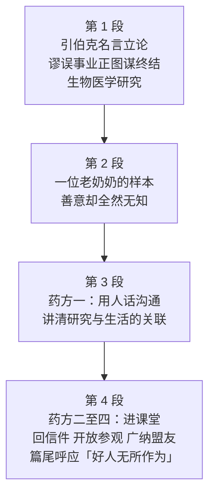

# Passage 30 · 为动物研究一辩

## 答题记录

| 轮次  | 日期         | 题号  | 正确  | 错误  | 正确率 | 用时    | 错题归因 |
| --- | --- | --- | --- | --- | --- | --- | --- |
| 1 |  | 1-5 |  |  |  |  |  |
| 2 |  | 1-5 |  |  |  |  |  |
| 3 |  | 1-5 |  |  |  |  |  |

> [!tip] 填写口径
> - **用时**以分钟计，只计做题时间，不含精读复盘。
> - **错题归因**填「题型·错误类型」，如：细节题·定位错、推理判断·过度推断、主旨大意·以偏概全。
> - 纵向看趋势：正确率升而用时过长 → 熟练度不足；用时降而正确率波动 → 定位不稳。

> [!info] 文章档案
> - **来源**：考研英语（一）2003 年 Text 2
> - **题材**：科学技术——动物权利运动借公众的无知围攻生物医学研究，作者呼吁科学家主动与公众沟通
> - **结构**：4 段 / 19 句 ＋ 5 题
> - **难度**：★★★☆☆
> - **一句话主旨**：动物权利运动的矛头是依赖公共资金的生物医学研究，而公众根本不懂医学研究是怎么回事；作者要求科学家用「人话」把动物研究与老太太的髋关节置换、孩子的疫苗连起来讲清楚，否则「好人无所作为」，医学进步的火种真会被无知扑灭。

## 一、篇章脉络

- **第 1 段**：引伯克名言立论——「谬误的事业若要得逞，只需好人袖手旁观」；眼下就有这么一项事业，正以「动物拥有权利」为由要终结生物医学研究。作者随即下发任务：科学家必须强力回应，因为倡导者的言论正在迷惑公众、危及医学进步；而运动领袖之所以专挑生物医学下手，正因为它靠公共资金、而公众又不懂研究流程——听到「实验虐待动物」的指控，很多人困惑于竟有人会故意伤害动物。
- **第 2 段**：举一个「善意的无知」样本——街头集市上，一位慈眉善目的老太太守着动物权利摊位，散发劝人别用任何动物制品或经动物实验的东西（不食肉、不穿皮、不服药）的小册子；问她是否反对接种，她要先弄清疫苗是否来自动物实验，得到肯定答复后便说「那就得反对」；问瘟疫再来怎么办，她答「别担心，科学家会想办法用电脑解决」。作者一句 Such well-meaning people just don't understand 收束：好心，但不懂。
- **第 3 段**：给出第一条药方——科学家必须以富于同情、通俗易懂的方式向公众传达信息，用人话，而不是分子生物学的行话；要讲清动物研究与老太太的髋关节置换、父亲的搭桥手术、婴儿的疫苗接种乃至宠物的预防针之间的联系；对那些不知道这些疗法与新疗法、新疫苗都靠动物研究才造得出来的人来说，动物研究往好里说是浪费，往坏里说是残忍。
- **第 4 段**：给出其余四条药方并收束全篇——可以做的事很多：认领中学班级去讲自己的研究；及时给读者来信栏目回信，以免动物权利的谬误信息无人质疑、渐渐长得像真理；研究机构可以开放参观，让人看到实验动物受到人道照料；最后，因为最终的利益攸关者是病人，医学研究界应当广纳盟友，不只请斯蒂芬·库珀这样公开肯定动物研究价值的知名人士，也要争取所有接受过治疗的人。结尾回到开篇：如果好人无所作为，一群不明真相的公众真有可能扑灭医学进步的宝贵火种。

> [!tip] 行文逻辑
> 全篇是「立论 → 举证 → 开药方 → 呼应」的檄文结构，首尾用同一句话扣成闭环：第 1 段①句的引语 all that is needed for the triumph of a misguided cause is that good people do nothing，到第 4 段⑥句化作 If good people do nothing, there is a real possibility that...——「引语」与「警告」互为镜像，这正是第 1 题的解题钥匙（引用目的＝号召行动，而不是批评或宣告）。第 1 段先把矛头、原因、危害讲足（advocates / depends on public funding / few people understand），第 2 段用一个人物的两段对话把「无知」具象化（⑤句是段落结论句，也是第 3 题答案句），第 3、4 段则连开五条药方，其中第 3 段①句 Scientists must communicate... 与第 4 段②句（进课堂）合起来支撑第 4 题的 A 项。五道题依次考：引语目的（第 1 题）、观点归纳（第 2 题）、例证目的（第 3 题）、作者建议（第 4 题）、人物身份（第 5 题）。

## 二、逐段精读

### 第 1 段 · 引伯克名言：好人无所作为，谬误便会得胜

**原文**

① To paraphrase 18th-century statesman Edmund Burke, "all that is needed for the triumph of a misguided cause is that good people do nothing."
② One such cause now seeks to end biomedical research because of the theory that animals have rights ruling out their use in research.
③ Scientists need to respond forcefully to animal rights advocates, whose arguments are confusing the public and thereby threatening advances in health knowledge and care.
④ Leaders of the animal rights movement target biomedical research because it depends on public funding, and few people understand the process of health care research.
⑤ Hearing allegations of cruelty to animals in research settings, many are perplexed that anyone would deliberately harm an animal.

**译文**

① 套用 18 世纪政治家埃德蒙·伯克的话来说：「一项被引入歧途的事业若要得逞，只需要好人袖手旁观就够了。」
② 眼下就有这么一项事业，正力图终结生物医学研究，理由是那种认为动物拥有权利、因而不能用之于研究的说法。
③ 科学家必须强力回应动物权利的倡导者——他们的论调正在迷惑公众，从而危及医学知识与医疗照护的进步。
④ 动物权利运动的领袖们把生物医学研究当作靶子，是因为它依赖公共资金，而很少有人了解医学研究的流程。
⑤ 听到研究场合虐待动物的指控，许多人都会困惑：怎么会有人故意伤害动物呢。

> [!note] 段落要点
> - 功能：开篇立论——用一句名言定下「好人必须行动」的基调，随后交代攻击对象、攻击理由与危害，主题句是③句的 Scientists need to respond forcefully。
> - ①句引语是全文的「题眼」：注意引语里说的是「谬误的事业将会得逞（triumph）」这一**假设**，而非既成事实——第 1 题 D 项正栽在这里。
> - ②句用 One such cause 把引语中的 misguided cause 落到实处：指的就是「以动物权利为由终结生物医学研究」这项事业。
> - ③句下发任务＋陈说危害两层：whose 从句带出 confusing the public 与 threatening advances 两个后果，respond forcefully 是作者对科学家的第一要求。
> - ④句剖析运动策略：为何专挑生物医学？depends on public funding（靠纳税人的钱，容易被政治施压）＋ few people understand（公众不懂，容易被说服）——两句因果合起来就是运动的「七寸」。
> - ⑤句以公众视角收尾：Hearing allegations... many are perplexed that...，既解释了公众为何动摇，也为第 2 段的「无知」样本和第 2 题的 misled people 埋线。

#### 长难句 · 本段

> [!abstract] 本段第 ① 句 · To paraphrase 18th-century statesman Edmund Burke, "all that is needed for the triumph of a misguided cause is that good people do nothing."

**结构拆解**

- **目的状语**：To paraphrase 18th-century statesman Edmund Burke（套用……的话来说；paraphrase 意为「意译、换个说法表述」）
- **引语主干**：all that is needed for the triumph of a misguided cause is that good people do nothing
- **主语**：all that is needed for the triumph of a misguided cause（all ＋ that 定语从句；triumph of... ……的胜利/得逞）
- **表语从句**：that good people do nothing（that 引导的表语从句，说明 all 的内容）
- **措辞**：misguided（被引入歧途的、方向错误的）= mis- ＋ guided

**参考译文**

套用 18 世纪政治家埃德蒙·伯克的话来说：「一项被引入歧途的事业若要得逞，只需要好人袖手旁观就够了。」

> [!tip] 拆解要点
> 全句是「状语＋引语」两层：To paraphrase... 表明这并非逐字引用，而是「化用」，因此选项里出现「伯克本人说过……」这类表述时要留神。引语内部是 all that is needed... is that... 的「主系表」套表语从句结构，直译即「所需的一切就是……」。这句话是全篇总纲，第 4 段⑥句 If good people do nothing... 与之遥相呼应——第 1 题考的正是这种「篇首设疑、篇尾呼应」的引用目的。

> [!abstract] 本段第 ③ 句 · Scientists need to respond forcefully to animal rights advocates, whose arguments are confusing the public and thereby threatening advances in health knowledge and care.

**结构拆解**

- **主干**：Scientists need to respond forcefully to animal rights advocates（主谓宾）
- **非限定性定语从句**：whose arguments are confusing the public and thereby threatening advances...（whose 指代 advocates'，两个现在分词 confusing / threatening 由 and 并列，共用 are）
- **结果副词**：thereby（从而、因此）= by that means，正式语体，连接「迷惑公众」与「危及进步」两层因果
- **介宾**：advances in health knowledge and care（医学知识与医疗照护方面的进步）

**参考译文**

科学家必须强力回应动物权利的倡导者——他们的论调正在迷惑公众，从而危及医学知识与医疗照护的进步。

> [!tip] 拆解要点
> 一句里塞进了「作者对科学家的要求」和「倡导者的两重危害」：主句发号施令，whose 从句负责说理。注意 are confusing... and (are) threatening... 的共用结构——第二个 are 被省略，读到 thereby 时要补回「同样在……」。thereby 是考研高频副词，等于 and thus，凡见 thereby 几乎必是「前因后果」的考点提示。

> [!abstract] 本段第 ⑤ 句 · Hearing allegations of cruelty to animals in research settings, many are perplexed that anyone would deliberately harm an animal.

**结构拆解**

- **现在分词短语作状语**：Hearing allegations of cruelty to animals in research settings（听到……的指控时；逻辑主语是主句的 many）
- **主干**：many are perplexed that...（许多人对……感到困惑）
- **宾语从句**：that anyone would deliberately harm an animal（that 从句说明困惑的内容；would 在此表「竟然会」的语气）
- **名词化结构**：allegations of cruelty（虐待的指控）；research settings（研究场所、实验环境）

**参考译文**

听到研究场合虐待动物的指控，许多人都会困惑：怎么会有人故意伤害动物呢。

> [!tip] 拆解要点
> 分词短语 Hearing... 省去了主语，补全即 When many people hear allegations...，逻辑主语须与主句一致——这是分词作状语的硬规则，也是改写题常考处。perplexed 后接 that 从句（也有 be perplexed at/by 的搭配），表示「对某事想不通」。这句的作用是替公众「说句公道话」：他们的动摇源于不了解研究流程，而不是恶意——为第 2 段「善意的无知」铺垫，也提示第 2 题不能选态度最重的选项。

#### 本段重点词汇

| 单词 / 短语 | 词性 | 文中意 | 常用考义与拓展 | 英文示例搭配（中译） |
| --- | --- | --- | --- | --- |
| **paraphrase** | v. | 释义，换个说法表述 | = restate in other words；名词同形 a paraphrase of the quote | To paraphrase Edmund Burke（套用伯克的话来说） |
| **statesman** | n. | 政治家 | 褒义词，区别于 politician（政客，常含贬义）；statesmanship n. 政治家风度 | 18th-century statesman Edmund Burke（18 世纪政治家埃德蒙·伯克） |
| **triumph** | n. | 胜利，得逞 | 熟词僻义：也可作动词 triumph over（战胜）；triumphant adj. 得胜的 | the triumph of a misguided cause（一项歧途事业的得逞） |
| **misguided** | adj. | 被引入歧途的，方向错误的 | 构词 mis-（错误）＋guided；同义 misled | a misguided cause（被引入歧途的事业） |
| **cause** | n. | 事业，主张 | 熟词僻义：常见义「原因」→ 此处「（为之奋斗的）事业」；a good cause 正义事业 | One such cause（这样一项事业） |
| **seek to** | 短语 | 力图，试图 | = try to / attempt to；seek-sought-sought | One such cause now seeks to end biomedical research（这项事业正力图终结生物医学研究） |
| **biomedical** | adj. | 生物医学的 | 构词 bio（生物）＋medical（医学的）；biomedicine n. 生物医学 | end biomedical research（终结生物医学研究） |
| **rule out** | 短语 | 排除，使……成为不可能 | = exclude / make impossible；rule out the possibility 排除可能性 | rights ruling out their use in research（使其不能被用于研究的权利） |
| **respond forcefully to** | 短语 | 强力回应 | respond v. 回应；forcefully adv. 有力地；response n. 回应 | need to respond forcefully to animal rights advocates（必须强力回应动物权利倡导者） |
| **advocate** | n. | 倡导者，拥护者 | 熟词僻义：动名词同形 advocate doing（主张做），重音在首音节 /ˈædvəkət/ | animal rights advocates（动物权利倡导者） |
| **thereby** | adv. | 从而，因此 | = by that means / and thus，正式语体，几乎必表因果 | confusing the public and thereby threatening advances（迷惑公众，从而危及进步） |
| **threaten advances in** | 短语 | 危及……的进步 | threaten v. 威胁；threat n. 威胁；threatening adj. 迫近的 | threatening advances in health knowledge and care（危及医学知识与医疗照护的进步） |
| **target** | v. | 把……作为目标，针对 | 熟词僻义：名词「靶子、目标」→ 动词「瞄准、针对」 | target biomedical research（把生物医学研究当作靶子） |
| **public funding** | n. | 公共资金，财政拨款 | funding n. 资金（不可数）；fund v. 资助；public-funded adj. 公费支持的 | it depends on public funding（它依赖公共资金） |
| **allegation** | n. | 指控，说法（未经证实的） | allege v. 声称；alleged adj. 所谓的 | Hearing allegations of cruelty to animals（听到虐待动物的指控） |
| **cruelty** | n. | 残忍，虐待 | cruel adj. 残忍的；cruelty to animals 虐待动物 | allegations of cruelty to animals（虐待动物的指控） |
| **setting** | n. | 环境，场所 | 熟词僻义：常见义「设置、背景」→ 此处「（实验）场所、环境」；in a research setting 在研究环境中 | in research settings（在研究场所里） |
| **perplexed** | adj. | 困惑的，茫然的 | = puzzled / confused；perplex v. 使困惑；perplexing adj. 令人困惑的 | many are perplexed that anyone would harm an animal（许多人对竟有人伤害动物感到困惑） |
| **deliberately** | adv. | 故意地，蓄意地 | deliberate adj. 蓄意的 / 从容的；= on purpose | would deliberately harm an animal（故意伤害动物） |

### 第 2 段 · 一位老奶奶的「善意无知」

**原文**

① For example, a grandmotherly woman staffing an animal rights booth at a recent street fair was distributing a brochure that encouraged readers not to use anything that comes from or is tested in animals—no meat, no fur, no medicines.
② Asked if she opposed immunizations, she wanted to know if vaccines come from animal research.
③ When assured that they do, she replied, "Then I would have to say yes."
④ Asked what will happen when epidemics return, she said, "Don't worry, scientists will find some way of using computers."
⑤ Such well-meaning people just don't understand.

**译文**

① 比如，在最近一次街头集市上，一位慈眉善目的老太太守着动物权利的摊位，正在散发一本小册子，劝人不要使用任何来自动物或在动物身上试验过的东西——不食肉、不穿皮草、不服药。
② 有人问她是否反对接种疫苗，她要先弄清疫苗是否来自动物研究。
③ 得到「确实如此」的答复后，她答道：「那我就只能说反对了。」
④ 又问瘟疫卷土重来时怎么办，她说：「别担心，科学家总会想办法用电脑解决的。」
⑤ 这些好心人，就是不明白。

> [!note] 段落要点
> - 功能：举例段——把第 1 段末尾的「公众无知」具象成一个人物，段落结论句是⑤句 Such well-meaning people just don't understand（第 3 题答案句）。
> - ①句先铺陈：grandmotherly（慈祥的）、staffing a booth（守摊位）、distributing a brochure（发小册子）——三个细节都在塑造「善良普通人」，不是激进分子，这正是作者要的说服力。
> - ①句破折号后的三项（no meat, no fur, no medicines）是递进：从肉、皮草一路推到**药物**——把动物权利逻辑推到极端，荒谬感自现。
> - ②③句是一组对话：她反对疫苗的唯一理由是「疫苗来自动物研究」，而她对这一来源一无所知（要先问才知道）——**无知**二字由此坐实。
> - ④句是第二组对话：把瘟疫交给「科学家用电脑解决」，看似乐观，实则对医学研发一窍不通。
> - ⑤句是本段的「判词」：well-meaning（善意）与 don't understand（不懂）并置——作者批评的是无知，不是人品；这一分寸决定了第 3 题选 ignorance 而非 discontent 或 anxiety。

#### 长难句 · 本段

> [!abstract] 本段第 ① 句 · For example, a grandmotherly woman staffing an animal rights booth at a recent street fair was distributing a brochure that encouraged readers not to use anything that comes from or is tested in animals—no meat, no fur, no medicines.

**结构拆解**

- **主干**：a grandmotherly woman was distributing a brochure（主谓宾，过去进行时）
- **现在分词作后置定语**：staffing an animal rights booth at a recent street fair（修饰 woman，＝who was staffing...）
- **定语从句**：that encouraged readers not to use anything（修饰 brochure；encourage sb not to do 劝某人不做）
- **嵌套定语从句**：that comes from or is tested in animals（修饰 anything，两个并列谓语 comes from / is tested）
- **破折号列举**：—no meat, no fur, no medicines（具体化 anything，三项并列）

**参考译文**

比如，在最近一次街头集市上，一位慈眉善目的老太太守着动物权利的摊位，正在散发一本小册子，劝人不要使用任何来自动物或在动物身上试验过的东西——不食肉、不穿皮草、不服药。

> [!tip] 拆解要点
> 三层定语层层套：woman ← staffing（分词）→ booth；brochure ← that encouraged（从句）→ anything ← that comes from or is tested（从句）。读长句的惯技是「先抓主干再挂枝叶」：先读到 was distributing a brochure，回头才知道主语被 staffing... 修饰过。破折号后的三项列举是考研高频修辞——用具体名词解释抽象代词 anything，既有画面感又含递进（肉→皮草→药物），把对方的逻辑推到荒谬处。

> [!abstract] 本段第 ② 句 · Asked if she opposed immunizations, she wanted to know if vaccines come from animal research.

**结构拆解**

- **过去分词短语作状语**：Asked if she opposed immunizations（＝When she was asked if...；ask 与主语 she 是被动关系，故用过去分词）
- **宾语从句**：if she opposed immunizations（if ＝ whether 是否）
- **主干**：she wanted to know if...（她想知道是否……）
- **嵌套宾语从句**：if vaccines come from animal research
- **措辞**：oppose v. 反对；immunization n. 免疫接种；vaccine n. 疫苗

**参考译文**

有人问她是否反对接种疫苗，她要先弄清疫苗是否来自动物研究。

> [!tip] 拆解要点
> 一句里有两个 if，都作「是否」讲（＝whether），不要当成条件状语。句首 Asked... 是分词作状语的标志性写法：被动含义用过去分词（asked / assured / told），主动含义用现在分词（hearing / seeing）。本段的②句与④句都以 Asked 开头，形成排比式的「问答」节奏，第四句再用 When assured（省略 she was）变体——同一结构三次出现，是作者刻意营造的「现场采访感」。

#### 本段重点词汇

| 单词 / 短语 | 词性 | 文中意 | 常用考义与拓展 | 英文示例搭配（中译） |
| --- | --- | --- | --- | --- |
| **grandmotherly** | adj. | 慈祥如祖母的，慈眉善目的 | 构词 grandmother＋-ly（形容词后缀，表「具有……特征的」）；类似 fatherly / kindly | a grandmotherly woman（一位慈眉善目的老太太） |
| **staff** | v. | 在……工作，值守 | 熟词僻义：名词「全体职员」→ 动词「为……配备人员／在……任职」 | staffing an animal rights booth（守着动物权利摊位） |
| **booth** | n. | 摊位，展位；亭子 | a ticket booth 售票亭；a phone booth 电话亭 | an animal rights booth（动物权利摊位） |
| **street fair** | n. | 街头集市，庙会式展销 | fair n. 集市、博览会（≠ 形容词「公平的」）；trade fair 商品交易会 | at a recent street fair（在最近一次街头集市上） |
| **distribute** | v. | 分发，散发 | distribution n. 分发；distributor n. 发行商 | was distributing a brochure（正在散发小册子） |
| **brochure** | n. | 小册子，宣传册 | = booklet / pamphlet；travel brochure 旅游手册 | a brochure that encouraged readers not to use...（劝读者不要使用……的小册子） |
| **test** | v. | 试验，测试 | 熟词僻义：名词「测验」→ 动词「在……上做试验」；tested in animals 经动物试验 | anything that comes from or is tested in animals（任何来自动物或在动物身上试验过的东西） |
| **fur** | n. | 毛皮，皮草 | fur coat 皮草大衣；furry adj. 毛茸茸的 | no meat, no fur, no medicines（不食肉、不穿皮草、不服药） |
| **medicine** | n. | 药物 | 熟词僻义：常见义「医学」→ 此处「药」；作「医学」时不可数，作「药」时可数 | no medicines（不服药） |
| **oppose** | v. | 反对 | be opposed to (doing) 反对（做）；opposite adj. 相反的；opposition n. 反对 | Asked if she opposed immunizations（问她是否反对接种） |
| **immunization** | n. | 免疫接种 | immunize v. 使免疫；immune adj. 免疫的（immune to 对……免疫／不受影响） | she opposed immunizations（她反对接种疫苗） |
| **vaccine** | n. | 疫苗 | vaccinate v. 接种；vaccination n. 接种 | if vaccines come from animal research（疫苗是否来自动物研究） |
| **assure** | v. | 使确信，向……保证 | assure sb that...；勿混 ensure（确保）、insure（保险） | When assured that they do（当被告知确有其事时） |
| **epidemic** | n. | 流行病，传染病 | 区别 pandemic（大流行）、endemic（地方性的）；epidemic 亦作形容词「流行的」 | when epidemics return（当流行病卷土重来时） |
| **well-meaning** | adj. | 善意的，本意是好的 | = well-intentioned；同类构词 well-informed（消息灵通的）、well-educated | Such well-meaning people just don't understand（这些好心人就是不明白） |

### 第 3 段 · 药方之一：用人话，讲切身

**原文**

① Scientists must communicate their message to the public in a compassionate, understandable way—in human terms, not in the language of molecular biology.
② We need to make clear the connection between animal research and a grandmother's hip replacement, a father's bypass operation, a baby's vaccinations, and even a pet's shots.
③ To those who are unaware that animal research was needed to produce these treatments, as well as new treatments and vaccines, animal research seems wasteful at best and cruel at worst.

**译文**

① 科学家必须以一种饱含同情、通俗易懂的方式向公众传达他们的信息——用人话来说，而不是用分子生物学的语言。
② 我们需要讲清动物研究与下面这些事的关联：祖母的髋关节置换、父亲的搭桥手术、婴儿的疫苗接种，甚至宠物的预防针。
③ 对那些不知道这些疗法以及新的疗法与疫苗都需要靠动物研究才能造出来的人来说，动物研究往好里说是浪费，往坏里说是残忍。

> [!note] 段落要点
> - 功能：提出第一条药方——改变沟通方式，段落主题句是①句 Scientists must communicate their message to the public（第 4 题 A 项的核心依据）。
> - ①句破折号后的 in human terms, not in the language of molecular biology 是全句锋芒所在：不是要科学家「少说」，而是要「换个说法」——专业语言是隔阂之源。
> - ②句用四个「亲属＋医疗」的具体场景（祖母的髋关节、父亲的搭桥、婴儿的疫苗、宠物的预防针）把抽象研究拉进日常生活，是极佳的论证手法，也可直接化用为写作句式。
> - ③句点破公众误解的根源与后果：unaware that... → seems wasteful at best and cruel at worst；其中 at best / at worst 的对举正是第 2 题 B 项（inhuman and unacceptable）与 D 项（pointless and wasteful）的分野——B 项同时覆盖了 cruel 与 wasteful 两端。
> - 段落逻辑可概括为「怎么说（①）→ 说什么（②）→ 不说会怎样（③）」，是标准的「建议＋理由」结构。

#### 长难句 · 本段

> [!abstract] 本段第 ① 句 · Scientists must communicate their message to the public in a compassionate, understandable way—in human terms, not in the language of molecular biology.

**结构拆解**

- **主干**：Scientists must communicate their message to the public（主谓宾＋介词短语）
- **方式状语**：in a compassionate, understandable way（以一种饱含同情、通俗易懂的方式；两个形容词并列修饰 way）
- **破折号补充说明**：—in human terms, not in the language of molecular biology（对 way 的具体解释；not A but B 的变体，此处用 not 短语作对比）
- **措辞**：in...terms 用……的话来说；molecular biology 分子生物学

**参考译文**

科学家必须以一种饱含同情、通俗易懂的方式向公众传达他们的信息——用人话来说，而不是用分子生物学的语言。

> [!tip] 拆解要点
> 破折号在本句起「具体化」作用：前面的 compassionate, understandable 是抽象要求，破折号后立刻给出可操作的对照（in human terms vs. the language of molecular biology）。考研中凡是「抽象词＋破折号」基本都是命题点——破折号后的内容往往是猜词题或细节题的答案所在。另注意 in...terms 是固定搭配，term 用复数。

> [!abstract] 本段第 ③ 句 · To those who are unaware that animal research was needed to produce these treatments, as well as new treatments and vaccines, animal research seems wasteful at best and cruel at worst.

**结构拆解**

- **介宾短语（状语）**：To those who are unaware that...（对那些不知道……的人来说；to 表「在……看来」）
- **定语从句**：who are unaware that...（修饰 those）
- **嵌套宾语从句**：that animal research was needed to produce these treatments, as well as new treatments and vaccines
- **插入补充**：as well as new treatments and vaccines（＝besides，与 these treatments 并列）
- **主干**：animal research seems wasteful at best and cruel at worst（主系表；两个形容词由 and 并列）
- **对举结构**：at best... at worst...（往好里说……往坏里说……）

**参考译文**

对那些不知道这些疗法以及新的疗法与疫苗都需要靠动物研究才能造出来的人来说，动物研究往好里说是浪费，往坏里说是残忍。

> [!tip] 拆解要点
> 本句是第 2 题的题眼。结构上是「三层包夹」：To those（对象）← who are unaware（定语从句）← that...（宾语从句）。主句被长长的状语推到最后，读到 seems 时才见真章——这种「头重脚轻」的句式是考研长难句的常客。at best / at worst 这对反义短语把公众的评价分成两极，答案必须同时覆盖这两极：B 项 inhuman（对应 cruel）＋ unacceptable（对 wasteful 与 cruel 的定性）最完整，而 D 项只覆盖 wasteful 一半，故落选。

#### 本段重点词汇

| 单词 / 短语 | 词性 | 文中意 | 常用考义与拓展 | 英文示例搭配（中译） |
| --- | --- | --- | --- | --- |
| **communicate** | v. | 传达，沟通 | communicate sth to sb 把某事传达给某人；communication n. 沟通 | communicate their message to the public（向公众传达他们的信息） |
| **compassionate** | adj. | 有同情心的，饱含同情的 | compassion n. 同情（compassion for sb）；= sympathetic | in a compassionate, understandable way（以饱含同情、通俗易懂的方式） |
| **understandable** | adj. | 可理解的，易懂的 | understand v.；understanding n. 理解 / adj. 善解人意的；反义 incomprehensible | in an understandable way（以易懂的方式） |
| **in human terms** | 短语 | 用人话来说，以常人的表达 | in...terms 用……的说法；in terms of 就……而言 | in human terms, not in the language of molecular biology（用人话，而不是分子生物学的语言） |
| **molecular biology** | n. | 分子生物学 | molecule n. 分子；molecular adj. 分子的；biology n. 生物学 | the language of molecular biology（分子生物学的语言） |
| **make clear the connection between** | 短语 | 讲清……与……之间的关联 | make sth clear 讲清；connection between A and B | make clear the connection between animal research and a hip replacement（讲清动物研究与髋关节置换的关联） |
| **hip replacement** | n. | 髋关节置换（手术） | hip n. 髋部；replacement n. 置换、替代品（replace v.） | a grandmother's hip replacement（祖母的髋关节置换） |
| **bypass operation** | n. | （心脏）搭桥手术 | bypass n./v. 旁路、绕道；heart bypass 心脏搭桥 | a father's bypass operation（父亲的搭桥手术） |
| **vaccination** | n. | 接种疫苗 | vaccinate v.；vaccine n. 疫苗（见第 2 段） | a baby's vaccinations（婴儿的疫苗接种） |
| **shot** | n. | （一次）注射，打针 | 熟词僻义：射击、投篮 → 口语「打针」；a flu shot 流感疫苗针 | even a pet's shots（甚至宠物的预防针） |
| **be unaware that** | 短语 | 不知道，未意识到 | unaware adj.（表语形容词，不作定语）＝not conscious of；反义 be aware that | those who are unaware that animal research was needed（那些不知道需要动物研究的人） |
| **produce** | v. | 生产出，研发出 | 熟词僻义：常见义「生产（农产品/工业品）」→ 此处「研发出、造出」疗法 | was needed to produce these treatments（是造出这些疗法所必需的） |
| **treatment** | n. | 疗法，治疗 | 熟词僻义：常见义「对待、处理」→ 医学「疗法」；treat v. 治疗 | produce these treatments（造出这些疗法） |
| **wasteful** | adj. | 浪费的 | waste n./v. 浪费；wasteful of 浪费……的 | animal research seems wasteful（动物研究似乎是浪费） |
| **at best... at worst** | 短语 | 往好里说……往坏里说…… | 固定对举结构，用于给同一事物的两极评价 | wasteful at best and cruel at worst（往好里说是浪费，往坏里说是残忍） |

### 第 4 段 · 还能做什么，以及火种将熄的警告

**原文**

① Much can be done.
② Scientists could "adopt" middle school classes and present their own research.
③ They should be quick to respond to letters to the editor, lest animal rights misinformation go unchallenged and acquire a deceptive appearance of truth.
④ Research institutions could be opened to tours, to show that laboratory animals receive humane care.
⑤ Finally, because the ultimate stakeholders are patients, the health research community should actively recruit to its cause not only well-known personalities such as Stephen Cooper, who has made courageous statements about the value of animal research, but all who receive medical treatment.
⑥ If good people do nothing, there is a real possibility that an uninformed citizenry will extinguish the precious embers of medical progress.

**译文**

① 可以做的事还有很多。
② 科学家可以「认领」中学的班级，去展示自己的研究。
③ 他们应当迅速回复读者来信，以免动物权利的谬误信息无人反驳，渐渐披上真理的假象。
④ 研究机构可以开放参观，让人们看到实验动物受到人道的照料。
⑤ 最后，由于最终的利益攸关者是病人，医学研究界应当积极为这项事业招募盟友：不仅包括斯蒂芬·库珀这样公开肯定动物研究价值的知名人士，也包括所有接受过医疗的人。
⑥ 如果好人无所作为，那么一群不明真相的公众真有可能扑灭医学进步的宝贵火种。

> [!note] 段落要点
> - 功能：收束段——连开四条药方（进课堂、回信件、开放参观、广纳盟友），再以⑥句呼应篇首引语，把「不作为」的后果推到极致。
> - ①句 Much can be done 是段落的「总起短句」，语气乐观，与上文「公众无知」的沉重形成转折；英文议论文常用短句作段落开关。
> - ②句（进课堂）与③句（回信件）是针对**公众**的两手：一手主动科普，一手被动回应；第 4 题 A 项正是这两句的合取。
> - ③句的 lest... go unchallenged and acquire a deceptive appearance of truth 是本篇最漂亮的一句：谬误只要不被质疑，就会「长得像真理」——回应第 1 段③句的 confusing the public。
> - ④句（开放参观）针对的是第 1 段⑤句的「虐待指控」：让人亲眼看 humane care，用事实对冲 allegation。
> - ⑤句把招募对象从名人（Stephen Cooper）扩大到所有病人（all who receive medical treatment）——因为 ultimate stakeholders are patients；此句也是第 5 题的定位句。
> - ⑥句与第 1 段①句构成首尾闭环：good people do nothing 完全复现引语措辞，uninformed citizenry 回扣第 1 段④句的 few people understand，embers of medical progress 则用「火种」意象收束全篇。

#### 长难句 · 本段

> [!abstract] 本段第 ③ 句 · They should be quick to respond to letters to the editor, lest animal rights misinformation go unchallenged and acquire a deceptive appearance of truth.

**结构拆解**

- **主干**：They should be quick to respond to letters to the editor（be quick to do 迅速去做）
- **目的/担心状语**：lest animal rights misinformation go unchallenged and acquire a deceptive appearance of truth
- **lest 从句**：lest ＋ 主语 ＋ 动词原形（美式用虚拟语气 should ＋原形，英式直接用原形）；lest ＝ for fear that 以免
- **并列谓语**：(should) go unchallenged and (should) acquire a deceptive appearance of truth
- **措辞**：go unchallenged 未被质疑就过去了；acquire a deceptive appearance of truth 获得真理的假象

**参考译文**

他们应当迅速回复读者来信，以免动物权利的谬误信息无人反驳，渐渐披上真理的假象。

> [!tip] 拆解要点
> lest 是本篇最难也最值得记的一个词：它引导从句时谓语用**虚拟语气**（原形动词或 should ＋原形），考研中见到 lest / for fear that / in case 就要往虚拟语气上想。本句里 go 与 acquire 两个原形并列，共用 lest 的虚拟。acquire a deceptive appearance of truth 直译「获得一种骗人的、像真理的表象」，翻译时按中文习惯化为「披上真理的假象」——acquire 在此不是「学到」，而是「逐渐具有（某种外观）」，属熟词僻义。

> [!abstract] 本段第 ⑤ 句 · Finally, because the ultimate stakeholders are patients, the health research community should actively recruit to its cause not only well-known personalities such as Stephen Cooper, who has made courageous statements about the value of animal research, but all who receive medical treatment.

**结构拆解**

- **原因状语从句**：because the ultimate stakeholders are patients
- **主干**：the health research community should actively recruit to its cause not only... but...
- **并列宾语（not only... but...）**：not only well-known personalities such as Stephen Cooper, but all who receive medical treatment
- **定语从句**：who has made courageous statements about the value of animal research（修饰 Stephen Cooper）
- **嵌套定语**：all who receive medical treatment（who 从句修饰 all）
- **措辞**：recruit... to its cause 为（某项事业）招募支持者；stakeholder 利益攸关者

**参考译文**

最后，由于最终的利益攸关者是病人，医学研究界应当积极为这项事业招募盟友：不仅包括斯蒂芬·库珀这样公开肯定动物研究价值的知名人士，也包括所有接受过医疗的人。

> [!tip] 拆解要点
> 本句是第 5 题的定位句，也是全篇最长的一句。骨架是「原因从句 ＋ 主句 ＋ not only A but B」，难点在 A、B 两项各自带着后置修饰：A（well-known personalities）后跟 such as ＋ 人名 ＋ who 从句；B（all）后跟 who 从句。阅读策略是先把 not only... but... 的两端找齐，再处理修饰。出题人正是把 A 端的 well-known personalities 抽出来做成第 5 题 A 项 humanist 的干扰素材——「同一句内就近取材」是细节题最常见的干扰手法。

> [!abstract] 本段第 ⑥ 句 · If good people do nothing, there is a real possibility that an uninformed citizenry will extinguish the precious embers of medical progress.

**结构拆解**

- **条件状语从句**：If good people do nothing（复现第 1 段①句引语措辞）
- **主干**：there is a real possibility that...（存在……的现实可能性）
- **同位语从句**：that an uninformed citizenry will extinguish the precious embers of medical progress（说明 possibility 的内容）
- **措辞**：uninformed 未被告知的、不明真相的；citizenry 公民群体（集合名词）；extinguish 扑灭（火）；embers 余烬、火种

**参考译文**

如果好人无所作为，那么一群不明真相的公众真有可能扑灭医学进步的宝贵火种。

> [!tip] 拆解要点
> 全篇的收束句，也是第 1 题的答案锚点：篇首引语说「好人无所作为，谬误就会得逞」，篇尾把它落到具体后果上——医学进步的火种被扑灭。两句的呼应关系说明作者引伯克的话为的是**敦促行动**，而非评论或预告。embers 本义「（燃烧后的）余烬」，与 extinguish（熄灭）搭配构成「火种」意象，precious 一词更把情感推上去。citizenry 是集合名词（＝citizens as a group），不可加 -s。

#### 本段重点词汇

| 单词 / 短语 | 词性 | 文中意 | 常用考义与拓展 | 英文示例搭配（中译） |
| --- | --- | --- | --- | --- |
| **Much can be done** | 句式 | 可以做的事还有很多 | 被动语态表泛指；同类 There is much to be done | Much can be done.（大有可为） |
| **adopt** | v. | 认领，领养；采纳 | 熟词僻义：常见义「采纳（意见）、收养（孩子）」→ 此处「认领（班级）」；勿混 adapt（适应／改编）、adept（精通的） | could "adopt" middle school classes（可以「认领」中学班级） |
| **present** | v. | 展示，呈现 | 熟词僻义：名词「礼物／现在」、形容词「在场的」→ 动词「展示、呈现、陈述」 | present their own research（展示他们自己的研究） |
| **respond to letters to the editor** | 短语 | 回复读者来信 | letters to the editor 是报刊固定栏目「读者来信」；editor n. 编辑 | be quick to respond to letters to the editor（迅速回复读者来信） |
| **lest** | conj. | 以免，唯恐 | = for fear that；后接虚拟语气（动词原形或 should ＋原形），正式用语 | lest misinformation go unchallenged（以免谬误信息无人质疑） |
| **misinformation** | n. | 错误信息，谬误信息 | 构词 mis-（错误）＋information；disinformation 指故意散布的假信息 | animal rights misinformation（动物权利的谬误信息） |
| **go unchallenged** | 短语 | 未受质疑就过去了 | go ＋ 过去分词（作表语）表状态：go unnoticed 未被注意、go unpunished 未受惩罚 | lest misinformation go unchallenged（以免谬误信息无人反驳） |
| **acquire a deceptive appearance of truth** | 短语 | 披上真理的假象 | acquire v. 获得→（逐渐）具有；deceptive adj. 骗人的（deceive v.）；appearance n. 表象 | acquire a deceptive appearance of truth（获得真理的假象） |
| **research institutions** | n. | 研究机构 | institution n. 机构、建制（熟词僻义：亦有「制度、惯例」义） | Research institutions could be opened to tours（研究机构可以开放参观） |
| **be opened to tours** | 短语 | 开放供人参观 | open sth to... 向……开放；tour n. 参观、巡游 | be opened to tours, to show that...（开放参观，以展示……） |
| **humane care** | n. | 人道的照料 | humane adj. 人道的（≠ human 人的）；humanity n. 人性、人道 | laboratory animals receive humane care（实验动物受到人道照料） |
| **ultimate** | adj. | 最终的，根本的 | = final / eventual；ultimately adv. 最终 | the ultimate stakeholders are patients（最终的利益攸关者是病人） |
| **stakeholder** | n. | 利益攸关者，利益相关方 | stake n. 赌注、利害关系；stakeholder 亦指企业「利益相关者」 | the ultimate stakeholders（最终的利益攸关者） |
| **recruit to its cause** | 短语 | 为（某项）事业招募支持者 | recruit v. 招募（新成员）；cause n. 事业（见第 1 段） | recruit to its cause not only... but all who...（为这项事业招募……以及所有……的人） |
| **well-known personalities** | n. | 知名人士，名人 | personality n. 人物、名人／个性；勿混 personage、character | well-known personalities such as Stephen Cooper（斯蒂芬·库珀这样的知名人士） |
| **courageous statements** | n. | 勇敢的表态 | courageous adj. 有勇气的（courage n.）；statement n. 声明、表态 | made courageous statements about the value of animal research（就动物研究的价值作出勇敢表态） |
| **the value of animal research** | 短语 | 动物研究的价值 | value n. 价值（valuable adj. 有价值的）；value 亦可作动词「重视」 | statements about the value of animal research（关于动物研究价值的表态） |
| **receive medical treatment** | 短语 | 接受医疗，接受治疗 | treatment n. 疗法（见第 3 段）；medical treatment 医疗 | all who receive medical treatment（所有接受过医疗的人） |
| **uninformed citizenry** | n. | 不明真相的公众 | uninformed adj. 未被告知的；citizenry n. 公民群体（集合名词，不加 -s） | an uninformed citizenry will extinguish...（一群不明真相的公众将扑灭……） |
| **extinguish** | v. | 扑灭，熄灭 | 正式用语 = put out（火）；extinguisher n. 灭火器；extinct adj. 灭绝的 | extinguish the precious embers（扑灭宝贵的火种） |
| **ember** | n. | 余烬，火种（常用复数） | 常用复数 embers；比喻义「（情感、事业的）余火、火种」 | the precious embers of medical progress（医学进步的宝贵火种） |
| **medical progress** | n. | 医学进步 | progress n. 进步（不可数）；make progress 取得进步 | the precious embers of medical progress（医学进步的宝贵火种） |

## 三、全篇重点词汇汇总（自测用）

> [!info] 说明
> 本表只列「单词 / 词性 / 所在段」，不含释义与搭配，用于遮表自测：说出词义后再回该段核对。
> 收录**全篇所有段落词汇，共 71 条，不删减**，与各段「本段重点词汇」等长同源。

| 单词 / 短语 | 词性 | 所在段 |
| --- | --- | --- |
| **paraphrase** | v. | 第 1 段 |
| **statesman** | n. | 第 1 段 |
| **triumph** | n. | 第 1 段 |
| **misguided** | adj. | 第 1 段 |
| **cause** | n. | 第 1 段 |
| **seek to** | 短语 | 第 1 段 |
| **biomedical** | adj. | 第 1 段 |
| **rule out** | 短语 | 第 1 段 |
| **respond forcefully to** | 短语 | 第 1 段 |
| **advocate** | n. | 第 1 段 |
| **thereby** | adv. | 第 1 段 |
| **threaten advances in** | 短语 | 第 1 段 |
| **target** | v. | 第 1 段 |
| **public funding** | n. | 第 1 段 |
| **allegation** | n. | 第 1 段 |
| **cruelty** | n. | 第 1 段 |
| **setting** | n. | 第 1 段 |
| **perplexed** | adj. | 第 1 段 |
| **deliberately** | adv. | 第 1 段 |
| **grandmotherly** | adj. | 第 2 段 |
| **staff** | v. | 第 2 段 |
| **booth** | n. | 第 2 段 |
| **street fair** | n. | 第 2 段 |
| **distribute** | v. | 第 2 段 |
| **brochure** | n. | 第 2 段 |
| **test** | v. | 第 2 段 |
| **fur** | n. | 第 2 段 |
| **medicine** | n. | 第 2 段 |
| **oppose** | v. | 第 2 段 |
| **immunization** | n. | 第 2 段 |
| **vaccine** | n. | 第 2 段 |
| **assure** | v. | 第 2 段 |
| **epidemic** | n. | 第 2 段 |
| **well-meaning** | adj. | 第 2 段 |
| **communicate** | v. | 第 3 段 |
| **compassionate** | adj. | 第 3 段 |
| **understandable** | adj. | 第 3 段 |
| **in human terms** | 短语 | 第 3 段 |
| **molecular biology** | n. | 第 3 段 |
| **make clear the connection between** | 短语 | 第 3 段 |
| **hip replacement** | n. | 第 3 段 |
| **bypass operation** | n. | 第 3 段 |
| **vaccination** | n. | 第 3 段 |
| **shot** | n. | 第 3 段 |
| **be unaware that** | 短语 | 第 3 段 |
| **produce** | v. | 第 3 段 |
| **treatment** | n. | 第 3 段 |
| **wasteful** | adj. | 第 3 段 |
| **at best... at worst** | 短语 | 第 3 段 |
| **Much can be done** | 句式 | 第 4 段 |
| **adopt** | v. | 第 4 段 |
| **present** | v. | 第 4 段 |
| **respond to letters to the editor** | 短语 | 第 4 段 |
| **lest** | conj. | 第 4 段 |
| **misinformation** | n. | 第 4 段 |
| **go unchallenged** | 短语 | 第 4 段 |
| **acquire a deceptive appearance of truth** | 短语 | 第 4 段 |
| **research institutions** | n. | 第 4 段 |
| **be opened to tours** | 短语 | 第 4 段 |
| **humane care** | n. | 第 4 段 |
| **ultimate** | adj. | 第 4 段 |
| **stakeholder** | n. | 第 4 段 |
| **recruit to its cause** | 短语 | 第 4 段 |
| **well-known personalities** | n. | 第 4 段 |
| **courageous statements** | n. | 第 4 段 |
| **the value of animal research** | 短语 | 第 4 段 |
| **receive medical treatment** | 短语 | 第 4 段 |
| **uninformed citizenry** | n. | 第 4 段 |
| **extinguish** | v. | 第 4 段 |
| **ember** | n. | 第 4 段 |
| **medical progress** | n. | 第 4 段 |

> [!example] 同义替换链（阅读题高频）
> - **good people do nothing（第 1 段①句引语）↔ If good people do nothing（第 4 段⑥句）↔ call on scientists to take some actions**：第 1 题 A 项，篇首篇尾的同句复现就是「引用目的＝号召行动」的铁证。
> - **misguided cause ↔ animal rights movement / One such cause**：第 1 题 B 项的素材来源——引语里的「歧途事业」在②句被点名为终结生物医学研究的那项事业。
> - **misled people ↔ many are perplexed（第 1 段⑤句）↔ well-meaning people just don't understand（第 2 段⑤句）↔ uninformed citizenry（第 4 段⑥句）**：第 2 题题干 Misled people 的所指，四条线索串成一条「公众无知线」。
> - **wasteful at best and cruel at worst（第 3 段③句）↔ inhuman and unacceptable（第 2 题 B 项）**：cruel→inhuman、wasteful＋cruel→unacceptable 的双重覆盖；D 项 pointless and wasteful 只覆盖了一半。
> - **ignorance about medical science ↔ Such well-meaning people just don't understand（第 2 段⑤句）**：第 3 题 B 项，例子后的结论句＝观点句。
> - **communicate more with the public ↔ Scientists must communicate their message to the public（第 3 段①句）＋ present their own research in middle school classes（第 4 段②句）**：第 4 题 A 项，两句合取才是完整答案。
> - **a supporter of animal research ↔ made courageous statements about the value of animal research（第 4 段⑤句）**：第 5 题 D 项，肯定价值＝支持者。
> - **few people understand the process of health care research（第 1 段④句）↔ uninformed citizenry（第 4 段⑥句）**：贯穿全篇的「无知」主线。

> [!warning] 熟词僻义专列
> - **cause**：原因 → 事业、主张（a misguided cause）。
> - **advocate**：动词「提倡」→ 名词「倡导者」（重音 /ˈædvəkət/）。
> - **target**：名词「靶子、目标」→ 动词「把……作为目标、针对」。
> - **setting**：设置、背景 → （实验）场所、环境。
> - **staff**：名词「全体职员」→ 动词「在……任职、值守」。
> - **medicine**：医学 → 药物（复数 medicines）。
> - **shot**：射击、投篮 → 口语「一次注射、打针」。
> - **treatment**：对待、处理 → 疗法。
> - **produce**：生产（产品）→ 研发出、造出（疗法）。
> - **adopt**：收养、采纳 → 「认领」（班级／项目）。
> - **present**：礼物／现在 → 动词「展示、呈现」。
> - **acquire**：获得、学到 → （逐渐）具有某种外观（acquire a deceptive appearance）。
> - **humane**：人的（human）→ 人道的（humane care）。
> - **ember**：余烬 → 复数「火种」（embers of medical progress）。
> - **recruit**：招募新兵 → 为事业招募支持者（recruit to its cause）。

## 四、知识点补充

> [!question] 背景知识
> - **埃德蒙·伯克（Edmund Burke, 1729–1797）**：爱尔兰裔英国政治家、政治思想家，现代保守主义奠基人之一，代表作《法国革命论》（Reflections on the Revolution in France, 1790）。西方广为流传的那句「恶人得逞所需的唯一条件，就是好人袖手旁观」（The only thing necessary for the triumph of evil is for good men to do nothing）常被归于他名下，本文第 1 段①句即以 To paraphrase（化用）的方式引出——注意作者说的是「套用」，并非逐字引用。
> - **动物权利运动（animal rights movement）**：主张动物拥有不应被人类随意使用的道德权利，与「动物福利（animal welfare）」立场不同——后者承认可以使用动物，但要求减少痛苦。文中的 PETA 式主张（不食肉、不穿皮草、不服药）即属前者。
> - **生物医学研究中的动物实验**：现代医学的多数疗法（疫苗、胰岛素、器官移植、心血管手术等）都曾依赖动物实验；实验动物管理通行「3R 原则」——Replacement（替代）、Reduction（减少）、Refinement（优化）。
> - **髋关节置换与心脏搭桥**：hip replacement（人工髋关节置换）与 bypass operation（冠状动脉旁路移植术，俗称搭桥）是现代外科两项常规手术，其器械与术式均经动物实验验证；文中用它们作「动物研究离生活很近」的例证。
> - **letters to the editor**：英美观行的报刊栏目「读者来信」，是公众辩论的传统阵地；作者建议科学家及时回信，指的是主动争夺这一舆论场。
> - **斯蒂芬·库珀（Stephen Cooper）**：英国癌症研究与科普活动人士，曾公开为动物实验的价值发声（文中 made courageous statements about the value of animal research）——在动物权利声浪高涨的英国，此举容易招致攻击，故称 courageous。
> - **stakeholder**：原为商业术语「利益相关者」，本文把它移到医学语境：研究的最大受益者是病人，因此病人及其家属都应成为医学研究的同盟军。

> [!warning] 语法点
> - **To paraphrase... 引语开篇（第 1 段①）**：不定式作目的/方式状语引出名言，是议论文开篇的经典写法；paraphrase 暗示非逐字引用。
> - **all that is needed... is that... 表语从句（第 1 段①）**：all ＋ that 定语从句作主语，表语由 that 从句充当。
> - **whose 非限定性定语从句＋并列现在分词（第 1 段③）**：whose arguments are confusing... and (are) threatening...，第二个 are 省略。
> - **thereby 连接因果（第 1 段③）**：正式副词，＝and thus，凡见 thereby 必有前因后果。
> - **现在分词作状语（第 1 段⑤）**：Hearing allegations..., many are perplexed that...——分词逻辑主语须与主句主语一致。
> - **过去分词作状语（第 2 段②④）**：Asked if..., she wanted to know...；When assured that they do（省略 she was）——被动含义用过去分词。
> - **破折号列举（第 2 段①）**：—no meat, no fur, no medicines，用具体项解释抽象代词 anything。
> - **多重 if（＝whether）宾语从句（第 2 段②）**：Asked if she opposed..., she wanted to know if...，两个 if 均为「是否」。
> - **祈使式对比结构（第 3 段①）**：in human terms, not in the language of molecular biology（not...but... 的变体）。
> - **at best... at worst 对举（第 3 段③）**：给同一事物的两极评价，答案须同时覆盖两极。
> - **lest ＋ 虚拟语气（第 4 段③）**：lest 后谓语用原形或 should ＋原形，表「以免」。
> - **not only... but (also)... 并列宾语（第 4 段⑤）**：两端各带定语从句，阅读时先找齐两端再看修饰。
> - **同位语从句（第 4 段⑥）**：there is a real possibility that...，that 从句说明 possibility 的内容（非定语从句）。
> - **首尾呼应（第 1 段① ↔ 第 4 段⑥）**：good people do nothing 措辞复现，构成篇章闭环。

> [!success] 写作可迁移句型
> - **To paraphrase sb, "..."**：化用名言开篇，比直接引用更灵活。
> - **All that is needed for... is that...**：只需……就会……（强调条件的充分性）。
> - **One such... now seeks to end... because of the theory that...**：引出反面主张并交代其理由。
> - **sb need to respond forcefully to...**：必须强力回应……（表态句）。
> - **We need to make clear the connection between A and B**：要讲清 A 与 B 的关联（论证句）。
> - **...seems wasteful at best and cruel at worst**：往好里说……往坏里说……（两极评价）。
> - **Much can be done.**：短句作段落总起，语气果断。
> - **lest... go unchallenged and acquire a deceptive appearance of truth**：以免……不受质疑而渐成「真理」（论战句式）。
> - **not only... but all who...**：不但……而且所有……的人（扩大范围的递进）。
> - **If..., there is a real possibility that...**：如果……，就真有可能……（警示式收尾）。

> [!danger] 易混辨析
> - **cause / reason / course**：cause 事业／原因；reason 理由；course 课程、进程。
> - **statesman / politician**：statesman 政治家（褒义）；politician 政客（常含贬义）。
> - **rule out / rule off / rule over**：rule out 排除；rule off 画线隔开；rule over 统治。
> - **staff / stuff**：staff 全体职员／动词任职；stuff 东西、材料。
> - **oppose / object / resist**：oppose 反对（及物）；object 反对（＋to）；resist 抵抗、忍住。
> - **assure / ensure / insure**：assure 使确信（assure sb that）；ensure 确保；insure 投保。
> - **epidemic / pandemic / endemic**：epidemic 流行病；pandemic 大流行；endemic 地方性的。
> - **immunization / vaccination / injection / shot**：immunization 免疫接种（过程）；vaccination 接种疫苗；injection 注射（通用）；shot 口语「一针」。
> - **human / humane / humanitarian**：human 人的；humane 人道的；humanitarian 人道主义的。
> - **treatment / cure / therapy / remedy**：treatment 疗法；cure 治愈（法）；therapy 理疗／心理治疗；remedy 补救办法。
> - **adopt / adapt / adept**：adopt 采纳、收养；adapt 适应、改编；adept 精通的（adj.）。
> - **acquire / inquire / require**：acquire 获得；inquire 询问；require 要求。
> - **extinguish / distinguish / extinguisher**：extinguish 扑灭；distinguish 区分；extinguisher 灭火器。
> - **uninformed / misinformed**：uninformed 不知情的；misinformed 被误导的（第 2 题题干用 misled，第 4 段用 uninformed，呼应但不等同）。

## 五、题目分析

> [!info] 题目总览
> | 题号 | 题型 | 定位 | 答案 |
> | --- | --- | --- | --- |
> | 1 | 例证题（引语目的） | 第 1 段①句 ↔ 第 4 段⑥句 | A |
> | 2 | 细节题（观点归纳） | 第 3 段③句（＋第 1 段⑤句、第 2 段⑤句） | B |
> | 3 | 例证题（写作目的） | 第 2 段⑤句 | B |
> | 4 | 推断题（作者建议） | 第 3 段①句＋第 4 段②句 | A |
> | 5 | 细节题（人物身份） | 第 4 段⑤句 | D |

### 第 1 题 · 例证题（引语目的）

> [!question] 原题
> The author begins his article with Edmund Burke's words to
> - A. call on scientists to take some actions.
> - B. criticize the misguided cause of animal rights.
> - C. warn of the doom of biomedical research.
> - D. show the triumph of the animal rights movement.

**正确答案**：**A. call on scientists to take some actions.（号召科学家采取行动）**

**定位与依据**
- 定位到第 1 段①句引语：all that is needed for the **triumph** of a **misguided cause** is that **good people do nothing**（好人无所作为，谬误的事业就会得逞）。
- 篇尾第 4 段⑥句原句呼应：**If good people do nothing**, there is a real possibility that an uninformed citizenry will extinguish the precious embers of medical progress——「引语」在结尾变成了「警告」，中间填的正是作者开出的五条药方（进课堂、回信件、开放参观、广纳盟友、用人话沟通）。
- 引语之后紧接着的③句即作者的行动号召：Scientists need to **respond forcefully** to animal rights advocates——「必须强力回应」与 A 项 take some actions 同义。
- 书中解析亦明写：「篇首的话在篇尾又得到了呼应……一首一尾的呼应突出了这篇文章的中心：呼吁科学家们采取行动。」

**干扰项分析**

| 选项 | 选项内容 | 判断 | 排除理由 |
| --- | --- | --- | --- |
| A | call on scientists to take some actions. | ✓ | 正确项：引语提出「不作为＝纵容」，③句紧接 respond forcefully，第 4 段⑥句再以 If good people do nothing 呼应——引用目的＝号召行动。 |
| B | criticize the misguided cause of animal rights. | ✗ | 以偏概全：misguided cause 是**引语自己的措辞**，②句确实点名了这项事业，但作者引伯克的话不是为了「批评」，而是为了**动员**；批评只是手段，行动才是目的。 |
| C | warn of the doom of biomedical research. | ✗ | 无中生有＋程度过重：doom（厄运、毁灭）是文中没有的判定；作者只说倡导者的言论「危及进步」（threatening advances），且相信行动可以避免——警告的是「不作为的后果」，不是「生物医学的末日」。 |
| D | show the triumph of the animal rights movement. | ✗ | 与原文相反：引语中的 triumph 是**假设**（若好人无所作为才会发生），并非既成事实；全文的立场恰恰是要阻止这一 triumph 发生。 |

> [!tip] 解题思路
> 引语题（开篇引用目的）的解法是「看两头」：引语本身只是引子，真正的目的常在**引语之后的议论句**与**全文结尾**。本篇两处都指向同一件事——③句 Scientists need to respond forcefully 是「要做什么」，第 4 段⑥句 If good people do nothing... 是「不做会怎样」，合起来正是 call on scientists to take some actions。三个干扰项则各有各的毛病：B 把引语内容当成了引用目的，C 无端加重语气，D 把假设当成事实。凡遇「作者引用某人的话是为了……」，优先找「号召、呼吁、引出话题」这类动作性选项。

### 第 2 题 · 细节题（观点归纳）

> [!question] 原题
> Misled people tend to think that using an animal in research is
> - A. cruel but natural.
> - B. inhuman and unacceptable.
> - C. inevitable but vicious.
> - D. pointless and wasteful.

**正确答案**：**B. inhuman and unacceptable.（不人道且不可接受）**

**定位与依据**
- 题干 Misled people 对应第 1 段⑤句 many are **perplexed** that anyone would **deliberately harm** an animal、第 2 段⑤句 Such **well-meaning** people just **don't understand**，以及第 4 段⑥句的 **uninformed citizenry**——都是「被误导的公众」。
- 核心定位句是第 3 段③句：animal research seems **wasteful at best and cruel at worst**（往好里说是浪费，往坏里说是残忍）——两极都要覆盖。
- 同义替换：cruel ↔ **inhuman**（不人道的）；wasteful＋cruel 合起来的定性 ↔ **unacceptable**（不可接受的）——B 项一处不落。
- 书中解析：第三段最后一句指出，受到误导的人们认为用动物做研究说得好听是浪费、说得难听是残忍，四个选项中 B 项最符合文意。

**干扰项分析**

| 选项 | 选项内容 | 判断 | 排除理由 |
| --- | --- | --- | --- |
| A | cruel but natural. | ✗ | 半对半错：cruel 有依据（at worst 一端），但 natural（自然的、合乎情理的）与原文相反——第 1 段⑤句明写公众「竟会有人故意伤害动物」而困惑，即认为此事不可接受。 |
| B | inhuman and unacceptable. | ✓ | 正确项：inhuman 覆盖 cruel、unacceptable 覆盖 wasteful 与 cruel 合起来的否定定性，与 at best...at worst 的两极评价完全对应。 |
| C | inevitable but vicious. | ✗ | 无中生有：inevitable（不可避免）在文中毫无依据，公众的评价不涉及「是否可避免」；vicious（邪恶的）语体也与原文的 cruel 不对位。 |
| D | pointless and wasteful. | ✗ | 以偏概全：只复现了 wasteful（at best 一端），丢掉了 cruel（at worst 一端）；且 pointless（毫无意义）比原文的 wasteful 更绝对。两项相较，B 项覆盖面完整，故 B 优。 |

> [!tip] 解题思路
> 本题的题眼是定位句里的 **at best... at worst** 对举结构——凡是这种「两极评价」，正确选项必须同时收下两端。D 项只拿了一半（wasteful），是最典型的「半截子」干扰项；A 项则在与原文相反处翻车（natural）。做这类「公众/某群体认为……」的细节题，要先在题干里找准人群（misled people ＝ 不懂医学研究的普通人），再回到文中找对该人群评价的原句，最后逐项比对覆盖面与感情色彩。

### 第 3 题 · 例证题（写作目的）

> [!question] 原题
> The example of the grandmotherly woman is used to show the public's
> - A. discontent with animal research.
> - B. ignorance about medical science.
> - C. indifference to epidemics.
> - D. anxiety about animal rights.

**正确答案**：**B. ignorance about medical science.（对医学科学的无知）**

**定位与依据**
- 例证题的铁律：**例子本身不是答案，例子所支撑的观点才是**。第 2 段全段是一个例子，观点句是段末⑤句：Such **well-meaning** people just **don't understand**（这些好心人就是不明白）。
- 例子内部的两个细节直接坐实「无知」：②句她要先问 vaccine 是否来自动物研究（才知道）；④句她认为瘟疫来了「科学家会用电脑解决」——对医学研发一无所知。
- 同义替换：don't understand ↔ **ignorance about medical science**（对医学科学的无知）。
- 书中解析：「第二段最后一句 Such well-meaning people just don't understand……可见老奶奶对科学不了解，而这种无知是很普遍的。」

**干扰项分析**

| 选项 | 选项内容 | 判断 | 排除理由 |
| --- | --- | --- | --- |
| A | discontent with animal research. | ✗ | 定性偏差：老太太确实在散发抵制动物制品的小册子，看似「不满」，但她反对的**理由**是「疫苗来自动物研究」这一她刚听说的事实，而非对研究的了解与不满；作者要证明的是「不懂」，不是「不满」。 |
| B | ignorance about medical science. | ✓ | 正确项：don't understand ＝ ignorance；medical science 对应疫苗、接种、瘟疫等医学常识——例子里的每一处都在演示「无知」。 |
| C | indifference to epidemics. | ✗ | 无中生有：她说 Don't worry, scientists will find some way of using computers，是**天真乐观**而非漠不关心（indifference）；indifference 是「不在乎」，与原文的语气正好相反。 |
| D | anxiety about animal rights. | ✗ | 偷换对象：为动物权利奔走、担忧的是**她本人**（倡导者），而题干问的是 the public's（公众的）；公众的特征由⑤句定为「不明白」，焦虑并非作者要说明的东西。 |

> [!tip] 解题思路
> 例证题的两步法：第一步找「观点句」——本例中例子占了整整一段，观点就落在段末⑤句 Such well-meaning people just don't understand；第二步把观点句与题干对接，don't understand → ignorance about medical science，一击即中。三个干扰项分别演示了三种常见套路：A 把例子里的表面行为（发小册子）当结论、C 把天真的乐观误读成冷漠、D 把倡导者个人的态度安到公众头上（偷换对象）。记住：英文议论文里，例子之后往往紧跟一句总结，那句才是答案。

### 第 4 题 · 推断题（作者建议）

> [!question] 原题
> The author believes that, in face of the challenge from animal rights advocates, scientists should
> - A. communicate more with the public.
> - B. employ hi-tech means in research.
> - C. feel no shame for their cause.
> - D. strive to develop new cures.

**正确答案**：**A. communicate more with the public.（多与公众沟通）**

**定位与依据**
- 由题干 scientists should 定位到建议句密集的第 3、4 段：第 3 段①句 Scientists must **communicate** their message **to the public** in a compassionate, understandable way——直接对应 A 项。
- 第 4 段的四条建议同属「沟通」范畴：②句进中学课堂**展示**研究、③句回复读者来信、④句开放机构**让人参观**、⑤句招募盟友——全是面向公众的动作。
- 书中解析：「第三段①句提到科学家必须将他们的想法传达给公众……第四段②句又说科学家们可以在中学课堂上展示他们的研究结果。总之，作者向科学家们提出的建议都是为了让他们与公众更好地交流。」

**干扰项分析**

| 选项 | 选项内容 | 判断 | 排除理由 |
| --- | --- | --- | --- |
| A | communicate more with the public. | ✓ | 正确项：第 3 段①句 communicate their message to the public 的原词复现，第 4 段四条建议（课堂、回信、参观、招募）全是其具体化。 |
| B | employ hi-tech means in research. | ✗ | 张冠李戴：using computers 是第 2 段④句**那位老太太**的天真设想，不是作者给科学家的建议；且「在研究中使用高科技手段」文中从未提及。 |
| C | feel no shame for their cause. | ✗ | 无中生有：全文没有任何关于 shame（羞耻）的论述；courageous（第 4 段⑤句）说的是库珀表态的勇气，与科学家是否「感到羞耻」无关。 |
| D | strive to develop new cures. | ✗ | 无中生有（偷换成果为建议）：new treatments and vaccines 是动物研究已经带来的**成果**（第 3 段③句），作者从未要求科学家去「努力开发新疗法」——他要他们做的是把已有成果讲给公众听。 |

> [!tip] 解题思路
> 「作者认为某人应该做什么」这类题，答案几乎总在**建议句**里，而建议句的标志是情态动词 must / should / could / need to。本篇第 3、4 段集中了五条建议，把它们归纳一下会发现一个共同点——全部指向「对外沟通」（communicate / present / respond to letters / be opened to tours / recruit），A 项正是这一共同点的概括，属于「串线型」正确答案。干扰项里 B 项最狡猾：它把例子里人物的说法（老太太的 computers）搬来冒充作者主张，属典型张冠李戴。

### 第 5 题 · 细节题（人物身份）

> [!question] 原题
> From the text we learn that Stephen Cooper is
> - A. a well-known humanist.
> - B. a medical practitioner.
> - C. an enthusiast in animal rights.
> - D. a supporter of animal research.

**正确答案**：**D. a supporter of animal research.（动物研究的支持者）**

**定位与依据**
- 由人名定位到第 4 段⑤句：...should actively recruit to its cause not only **well-known personalities** such as **Stephen Cooper**, who has made **courageous statements about the value of animal research**, but all who receive medical treatment.
- 同义替换：made courageous statements **about the value of** animal research（公开肯定动物研究的价值）↔ **a supporter of** animal research（支持者）——肯定其价值即支持。
- 书中解析亦按此句定位（书中标注为「第四段③句」，按句号严格断句为第 4 段⑤句）。

**干扰项分析**

| 选项 | 选项内容 | 判断 | 排除理由 |
| --- | --- | --- | --- |
| A | a well-known humanist. | ✗ | 偷换概念：原文说的是 well-known **personalities**（知名人士），被换成了 humanist（人道主义者）——「知名」被保留，「人道主义」是凭空添加的身份标签。 |
| B | a medical practitioner. | ✗ | 无中生有：文中从未提及库珀行医；他被招募的身份是「公开表态的知名人士」，而非「医疗从业者」。 |
| C | an enthusiast in animal rights. | ✗ | 与原文相反：他公开发言肯定的是 animal **research** 的价值；若他为动物权利热衷者，就不会被医学研究界 recruiting to its cause（招募到自己这一边）。 |
| D | a supporter of animal research. | ✓ | 正确项：who 从句已写明——就动物研究的价值作出勇敢表态，即支持者；且 recruit to its cause（招募到本方事业）也点明了立场归属。 |

> [!tip] 解题思路
> 人名定位题最快：先锁定句子，再读修饰这个人名的定语从句——本题的 who has made courageous statements about the value of animal research 一句话就把答案写死了。三个干扰项演示了「就近取材」的惯技：A 项从同一短语里截取 well-known 再拼接一个未出现的身份（humanist），B 项凭空造职业，C 项把立场反过来。凡遇人物身份题，答案必然来自修饰该人物的定语或同位语，别被同句其他名词带偏。

## 六、复盘清单

- [ ] 过汇总表 71 词，遮住「所在段」列自测，重点过 15 个熟词僻义
- [ ] 重做 10 个长难句的口头翻译，特别是 lest 虚拟语气（第 4 段③）与 not only...but all who... 双定语（第 4 段⑤）
- [ ] 默写「立论（伯克引语）→ 举证（老奶奶）→ 药方（沟通／课堂／回信／参观／招募）→ 呼应（火种将熄）」四步链条，并标出首尾呼应点（第 1 段①句 good people do nothing ↔ 第 4 段⑥句 If good people do nothing）
- [ ] 整理本文干扰项类型：无中生有 ×4、以偏概全 ×2、与原文相反 ×3、偷换概念 ×2、张冠李戴 ×1、定性偏差 ×1
- [ ] 复记三个构词：misguided（mis-＋guided）、misinformation（mis-＋information）、grandmotherly（名词＋-ly 形容词）
- [ ] 把答题记录填进顶部表格，对照正确率决定是否二刷

## 七、关联笔记

- [[Passage29-网络谍报的新时代]]
- [[考研英语 · 阅读六大题型方法论]]
- [[考研英语 · 熟词僻义汇总]]
