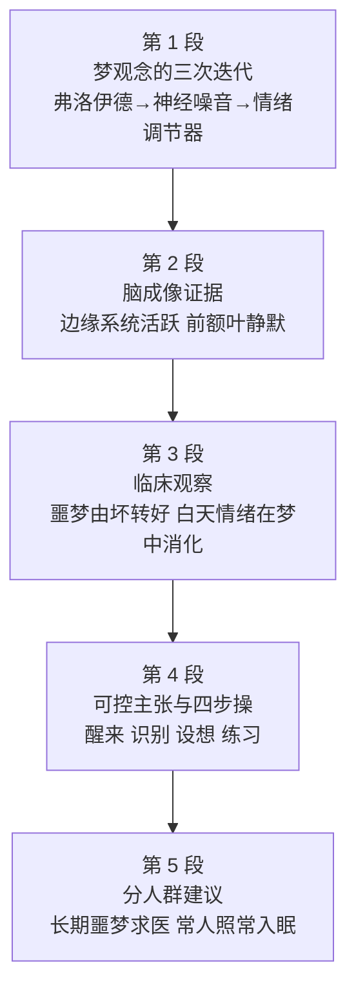

# Passage 31 · 梦可以被有意识地控制

## 答题记录

| 轮次  | 日期         | 题号  | 正确  | 错误  | 正确率 | 用时    | 错题归因 |
| --- | --- | --- | --- | --- | --- | --- | --- |
| 1 |  | 1-5 |  |  |  |  |  |
| 2 |  | 1-5 |  |  |  |  |  |
| 3 |  | 1-5 |  |  |  |  |  |

> [!tip] 填写口径
> - **用时**以分钟计，只计做题时间，不含精读复盘。
> - **错题归因**填「题型·错误类型」，如：细节题·定位错、推理判断·过度推断、主旨大意·以偏概全。
> - 纵向看趋势：正确率升而用时过长 → 熟练度不足；用时降而正确率波动 → 定位不稳。

> [!info] 文章档案
> - **来源**：考研英语（一）2005 年 Text 3
> - **题材**：科学技术——从弗洛伊德的「无意识密码」到脑成像下的「情绪调节器」，梦不再只能被动承受，而可以被有意识地改写
> - **结构**：5 段 / 24 句 ＋ 5 题
> - **难度**：★★★☆☆
> - **一句话主旨**：梦不是弗洛伊德说的无意识欲望的伪装影子，也不是神经修复随手排出的噪音，而是大脑在「离线」时调节情绪的恒温器——既然如此，就可以照着「醒来→识别→改写结局→反复练习」四步去调它；常人偶尔做噩梦大可照常生活，长期被噩梦缠住的才需要找治疗师。

## 一、篇章脉络

- **第 1 段**：先用「一夜好眠中最不受控的是梦」起笔，再用一句话写尽梦的荒诞（逻辑失效、逝者开口），随后端出三次观念迭代——弗洛伊德说梦是无意识欲望与恐惧的伪装投影；20 世纪 70 年代末神经学家把它降格为「精神噪音」（神经修复的随机副产品）；如今研究者则猜想梦是心智的情绪恒温器。段末连引卡特赖特两句话，把「可以被控制」直接说破：「那是你的梦，不喜欢就改掉它。」
- **第 2 段**：搬出硬证据——脑成像显示，快速眼动睡眠（最鲜明的梦发生的阶段）时大脑与完全清醒时一样活跃；但各部位并非同等参与：边缘系统（「情绪脑」）格外活跃，前额叶皮层（智力与推理中枢）相对安静。迪蒙特的一句话补上主观体验：从梦中醒来或喜或悲，情绪能伴随一整天。
- **第 3 段**：把镜头转到卡特赖特的诊所——梦与情绪的关联在病人身上看得最清楚：多数人前半夜噩梦多，临近醒来时转向愉快的梦，说明他们正在「消化」白天产生的负面情绪；之所以要等到梦里才消化，是因为清醒时心智被日常占满，顾不上去想这些事的情绪意义。
- **第 4 段**：顺势提出全篇最激进的主张——这个过程不必全交给无意识：人可以练习对反复出现的噩梦施加有意识的控制，具体操作是四步：醒来即识别梦中令你不安之处、设想你希望的结局、下次再出现时醒过来一点点以控制走向、反复练习直到能在睡梦中做到。
- **第 5 段**：最后收束并分人群给建议——说到底，除非梦让你睡不着或在恐慌中惊醒，没什么理由在意它；恐怖主义、经济不确定和不安全感加重了焦虑，长期做噩梦的人该去找治疗师，至于其余的人，大脑自有排解之道：睡一觉——不如说做个梦——明早就会好些。

> [!tip] 行文逻辑
> 全篇是「观念史 → 硬证据 → 临床观察 → 方法论 → 分人群建议」的标准科普论证结构。第 1 段用时间轴（A century ago → by the late 1970s → Now）把旧观点依次摆上、再逐一推翻，⑤句 not only harnessed but actually brought under conscious control 是全篇论点句；第 2 段以 Evidence from brain imaging supports this view 一句承上启下，用「边缘系统活跃／前额叶安静」这一生理对照坐实「梦＝情绪中枢的活动」；第 3 段把结论落到病人身上（shows up among the patients），②句 Most people seem to have more bad dreams early in the night 是第 3 题的唯一答案句；第 4 段①句 And this process need not be left to the unconscious 是段落论点，②句 Cartwright believes... 是其展开，共同支撑第 4 题 D 项；第 5 段按「是否长期受噩梦困扰」把人群一分为二：③句求医、④⑤句照常生活，正是第 5 题 A 项的落点。五道题依次考：研究者当下观点（第 1 题）、举例/引用目的（第 2 题）、细节定位（第 3 题）、人物观点推断（第 4 题）、分人群建议（第 5 题）。

## 二、逐段精读

### 第 1 段 · 梦的观念史：从欲望投影到情绪恒温器

**原文**

① Of all the components of a good night's sleep, dreams seem to be least within our control.
② In dreams, a window opens into a world where logic is suspended and dead people speak.
③ A century ago, Freud formulated his revolutionary theory that dreams were the disguised shadows of our unconscious desires and fears; by the late 1970s, neurologists had switched to thinking of them as just "mental noise"—the random byproducts of the neural-repair work that goes on during sleep.
④ Now researchers suspect that dreams are part of the mind's emotional thermostat, regulating moods while the brain is "off-line."
⑤ And one leading authority says that these intensely powerful mental events can be not only harnessed but actually brought under conscious control, to help us sleep and feel better.
⑥ "It's your dream," says Rosalind Cartwright, chair of psychology at Chicago's Medical Center.
⑦ "If you don't like it, change it."

**译文**

① 在构成一夜好眠的诸般要素中，梦似乎是最不受我们控制的一项。
② 在梦中，一扇窗通往一个逻辑被悬置、逝者开口说话的世界。
③ 一个世纪前，弗洛伊德提出了他那革命性的理论：梦是我们无意识的欲望与恐惧所投下的、经过伪装的影子；而到 20 世纪 70 年代末，神经学家已转而把梦仅仅看作「精神噪音」——睡眠中进行的神经修复工作随机产生的副产品。
④ 如今研究者猜想，梦是心智的情绪恒温器的一部分，在大脑「离线」时调节着情绪。
⑤ 一位权威人士还说，这些极其强烈的精神活动不但可以被驾驭，而且真的可以被置于有意识的控制之下，好让我们睡得更好、感觉更好。
⑥ 「那是你的梦，」芝加哥医疗中心心理学系主任罗莎琳德·卡特赖特说。
⑦ 「不喜欢，就改掉它。」

> [!note] 段落要点
> - 功能：开篇立论——用「观念史」的方式把旧说逐一摆上再推翻，⑤句提出全篇论点「梦可以被有意识控制」（第 1 题的答案句），⑥⑦句用两句引语把论点说到极致。
> - ①句 least within our control 是「欲扬先抑」：先承认梦最不受控，才有下文「其实可以控」的反转张力。
> - ③句是全段最复杂的句子，分号前后构成两组旧观点：弗洛伊德（desires and fears）↔ 神经学家（mental noise / random byproducts）——它们分别是第 1 题 C、D 两项的素材来源，**都是「过去的看法」，题干问的是现在**。
> - ④句 Now researchers suspect 一转进入当下：emotional thermostat（情绪恒温器）是核心比喻，regulating moods 则是它的功能；与③句的 random（随机）形成「有意义 vs 无意义」的对立。
> - ⑤句 not only... but actually... 是递进，重心在后者：不只是「可以利用」，而是「可以 consciously 控制」；⑥⑦句引语正是这一主张的口语版。
> - ⑥⑦句被句号切成两句，实为一人之言：⑦句 If you don't like it, change it 是「祈使句＋祈使句」的条件式口号，语气干脆，是全篇最易被命题的地方——第 1 题 A 项 can be modified in their courses 即由此而来。

#### 长难句 · 本段

> [!abstract] 本段第 ③ 句 · A century ago, Freud formulated his revolutionary theory that dreams were the disguised shadows of our unconscious desires and fears; by the late 1970s, neurologists had switched to thinking of them as just "mental noise"—the random byproducts of the neural-repair work that goes on during sleep.

**结构拆解**

- **分句一**：A century ago, Freud formulated his revolutionary theory（主谓宾；formulate a theory 提出理论）
- **同位语从句**：that dreams were the disguised shadows of our unconscious desires and fears（说明 theory 的内容；disguised 过去分词作定语）
- **分句二**：by the late 1970s, neurologists had switched to thinking of them as just "mental noise"（过去完成时，表示「到……时已经转向」）
- **结构**：switch to doing / think of A as B（把 A 看作 B）
- **破折号同位语**：—the random byproducts of the neural-repair work（解释 mental noise）
- **嵌套定语从句**：that goes on during sleep（修饰 the neural-repair work；go on ＝ 进行）

**参考译文**

一个世纪前，弗洛伊德提出了他那革命性的理论：梦是我们无意识的欲望与恐惧所投下的、经过伪装的影子；而到 20 世纪 70 年代末，神经学家已转而把梦仅仅看作「精神噪音」——睡眠中进行的神经修复工作随机产生的副产品。

> [!tip] 拆解要点
> 一句装下两种旧理论，靠的是分号（；）这一「并列＋对照」的标点：分号前是弗洛伊德，分号后是神经学家，时间状语 A century ago 与 by the late 1970s 构成时间轴。破折号后的 the random byproducts... 不是补充说明主句，而是**解释前面的引语 mental noise**——凡「引语＋破折号」多半是在给这个说法下定义。此句正是第 1 题的干扰源：C、D 两项各取自分号的一端，而题干问的是研究者「现在」的看法，故都落选。

> [!abstract] 本段第 ⑤ 句 · And one leading authority says that these intensely powerful mental events can be not only harnessed but actually brought under conscious control, to help us sleep and feel better.

**结构拆解**

- **主干**：one leading authority says that...（主谓＋宾语从句）
- **宾语从句主语**：these intensely powerful mental events（指代 dreams）
- **并列谓语（被动）**：can be not only harnessed but actually brought under conscious control（not only... but... 连接两个过去分词；情态被动 can be done）
- **递进副词**：actually（真的、实际上）加强 but 一端，重心后移
- **目的状语**：to help us sleep and feel better（＝in order to；help sb do）

**参考译文**

一位权威人士还说，这些极其强烈的精神活动不但可以被驾驭，而且真的可以被置于有意识的控制之下，好让我们睡得更好、感觉更好。

> [!tip] 拆解要点
> 本句是全篇论点句，也是第 1 题的唯一答案句。两处机关：一是 not only... but (actually)... 的递进——作者真正要说的是后半句 brought under conscious control，A 项 can be modified in their courses 正是它的同义改写；二是被动语态：动作的施动者被隐去（人可以去控制梦），只留下「梦可以被控制」这一结论，读时要补出施动者。harness 本义「给马套上挽具」，引申为「驾驭、利用（自然力等）」，是考研高频的熟词僻义。

#### 本段重点词汇

| 单词 / 短语 | 词性 | 文中意 | 常用考义与拓展 | 英文示例搭配（中译） |
| --- | --- | --- | --- | --- |
| **component** | n. | 组成部分，要素 | component part 零部件；= element / constituent | Of all the components of a good night's sleep（在构成一夜好眠的诸般要素中） |
| **suspend** | v. | 悬置，暂停；使失效 | 熟词僻义：常见义「悬挂、暂令停职」→ 此处「（逻辑）被悬置」；suspension n. 暂停 | a world where logic is suspended（一个逻辑失效的世界） |
| **formulate** | v. | 系统地提出，阐述 | formulate a theory / policy 提出理论／制定政策；formulation n. 表述 | Freud formulated his revolutionary theory（弗洛伊德提出了他的革命性理论） |
| **revolutionary** | adj. | 革命性的，划时代的 | revolution n. 革命；revolutionize v. 彻底改变 | his revolutionary theory（他那革命性的理论） |
| **disguised** | adj. | 伪装的，经过掩饰的 | disguise v./n. 伪装；in disguise 乔装；disguised shadows 伪装的影子 | the disguised shadows of our unconscious desires（无意识欲望的伪装投影） |
| **unconscious** | adj./n. | 无意识的；无意识（the unconscious） | 构词 un-＋conscious；反义 conscious；subconscious adj. 潜意识的 | our unconscious desires and fears（我们无意识的欲望与恐惧） |
| **neurologist** | n. | 神经学家，神经科医生 | neurology n. 神经病学；neurological adj. 神经系统的； neuron n. 神经元 | neurologists had switched to thinking of them as...（神经学家已转而把它们看作……） |
| **switch to** | 短语 | 转向，改而（做某事） | switch n. 开关／v. 转换；switch to doing 转去做 | had switched to thinking of them as "mental noise"（已转而把它们看作「精神噪音」） |
| **mental noise** | n. | 精神噪音，无意义的脑活动 | mental adj. 精神的、心理的；noise 本义「噪音」→ 比喻「无意义的信息」 | thinking of them as just "mental noise"（把它们只看作「精神噪音」） |
| **random** | adj. | 随机的，随意的 | at random 随机地；randomness n. 随机性；= arbitrary | the random byproducts（随机产生的副产品） |
| **byproduct** | n. | 副产品，附带产物 | 构词 by-（副）＋product；byproduct of sth 某事的副产品 | byproducts of the neural-repair work（神经修复工作的副产品） |
| **suspect** | v. | 猜想，觉得；怀疑 | 熟词僻义：常见义「怀疑（某人有罪）」→ 此处「猜想、认为可能是」；suspect that... | researchers suspect that dreams are part of...（研究者猜想梦是……的一部分） |
| **thermostat** | n. | 恒温器，温度自动调节器 | 构词 thermo（热）＋stat（稳定装置）；比喻「自动调节机制」 | the mind's emotional thermostat（心智的情绪恒温器） |
| **regulate** | v. | 调节，调控 | regulation n. 规章／调节；regulator n. 监管者；regulate moods 调节情绪 | regulating moods while the brain is off-line（在大脑离线时调节情绪） |
| **off-line** | adj./adv. | 离线的，脱机的 | 反义 online；文中比喻大脑「脱离日常事务、停止对外工作」的状态 | while the brain is "off-line"（当大脑「离线」时） |
| **leading authority** | n. | 权威人士，顶尖专家 | authority n. 权威、权威人士（authority on sth 某领域的权威）；leading adj. 首要的 | one leading authority says that...（一位权威人士说……） |
| **intensely** | adv. | 极度地，强烈地 | intense adj. 强烈的；intensity n. 强度；intensify v. 加剧 | these intensely powerful mental events（这些极其强烈的精神活动） |
| **harness** | v. | 驾驭，利用 | 熟词僻义：名词「马具」→ 动词「驾驭、开发利用」（harness solar energy 利用太阳能） | can be not only harnessed but...（不但可以被驾驭，而且……） |
| **bring...under conscious control** | 短语 | 把……置于有意识的控制之下 | bring sth under control 控制住某事；conscious adj. 有意识的 | brought under conscious control（被置于有意识的控制之下） |
| **chair** | n. | （系）主任，主席 | 熟词僻义：常见义「椅子」→ 职务「主席、（系）主任」；chair of psychology 心理学系主任 | chair of psychology at Chicago's Medical Center（芝加哥医疗中心心理学系主任） |
| **psychology** | n. | 心理学 | psychologist n. 心理学家；psychological adj. 心理的 | chair of psychology（心理学系主任） |

### 第 2 段 · 脑成像的证据：情绪脑醒着，理智脑睡着

**原文**

① Evidence from brain imaging supports this view.
② The brain is as active during REM (rapid eye movement) sleep—when most vivid dreams occur—as it is when fully awake, says Dr. Eric Nofzinger at the University of Pittsburgh.
③ But not all parts of the brain are equally involved; the limbic system (the "emotional brain") is especially active, while the prefrontal cortex (the center of intellect and reasoning) is relatively quiet.
④ "We wake up from dreams happy or depressed, and those feelings can stay with us all day," says Stanford sleep researcher Dr. William Dement.

**译文**

① 来自脑成像的证据支持这一观点。
② 匹兹堡大学的埃里克·诺夫辛格博士说，大脑在快速眼动（REM）睡眠——最鲜明的梦发生的阶段——期间，与完全清醒时一样活跃。
③ 但并非大脑的所有部位都同等参与：边缘系统（「情绪脑」）格外活跃，而前额叶皮层（智力与推理的中枢）则相对安静。
④ 斯坦福的睡眠研究者威廉·迪蒙特博士说：「我们从梦中醒来时或喜或悲，而这些情绪可以陪伴我们整整一天。」

> [!note] 段落要点
> - 功能：证据段——用脑成像数据支撑第 1 段的「梦＝情绪调节器」，①句 Evidence from brain imaging supports this view 是典型的「承上启下句」。
> - ②句用 as...as 把「梦中」与「清醒」拉平：大脑并没有在睡眠中停工，这就否定了「梦是无意义的噪音」一说。
> - ③句是本段核心，也是第 2 题的定位句：分号后是「一热一冷」的对照——limbic system（情绪脑）especially active ↔ prefrontal cortex（理智脑）relatively quiet。注意括号里的 emotional brain 是命题人留给考生的提示，直接指向 C 项 the relation of dreams to emotions。
> - ③句内部有两重对照：一是两个脑区的活跃度对照，二是括号内的通俗标签（emotional brain / the center of intellect and reasoning）与术语对照——英文科普文的惯用写法。
> - ④句从生理回到体验：happy or depressed 对应③句的边缘系统，stay with us all day 则说明梦的情绪影响可持续，为第 3 段「消化白天情绪」铺垫。
> - 段落逻辑：「有证据（①）→ 大脑整体活跃（②）→ 但活跃得不均匀，情绪区最活跃（③）→ 所以梦后的情绪会留一整天（④）」。

#### 长难句 · 本段

> [!abstract] 本段第 ② 句 · The brain is as active during REM (rapid eye movement) sleep—when most vivid dreams occur—as it is when fully awake, says Dr. Eric Nofzinger at the University of Pittsburgh.

**结构拆解**

- **主干**：The brain is as active... as it is...（as ＋ adj. ＋ as 同级比较；第二个 as 后接省略句 it is (active)）
- **比较项一**：during REM (rapid eye movement) sleep（在快速眼动睡眠期间）
- **双破折号插入语**：—when most vivid dreams occur—（非限定性定语从句，补充说明 REM sleep；读时可跳过）
- **比较项二**：when fully awake（＝when it is fully awake，省略主语与系动词）
- **倒装主谓**：says Dr. Eric Nofzinger（引语／陈述后置于句末时的主谓倒装，主语带长修饰语时常见）

**参考译文**

匹兹堡大学的埃里克·诺夫辛格博士说，大脑在快速眼动（REM）睡眠——最鲜明的梦发生的阶段——期间，与完全清醒时一样活跃。

> [!tip] 拆解要点
> 抓骨架先抓 as...as：as active during A as (it is) when B——两端分别是「REM 睡眠时」与「完全清醒时」，结论是「一样活跃」。中间的 —when most vivid dreams occur— 是双破折号插入语，先跳过去不读，骨架立刻清爽；回头再看，它交代的是「最鲜明的梦发生在 REM 阶段」，正是后文的立足点。句末 says Dr. Eric Nofzinger 是主谓倒装（主语带介词短语，太长，故谓语提前），不是「他说」的疑问句。

> [!abstract] 本段第 ③ 句 · But not all parts of the brain are equally involved; the limbic system (the "emotional brain") is especially active, while the prefrontal cortex (the center of intellect and reasoning) is relatively quiet.

**结构拆解**

- **分句一**：not all parts of the brain are equally involved（部分否定：not all ＝ 并非所有……都）
- **分号**：连接两个并列分句，后句对前句作具体说明
- **分句二**：the limbic system is especially active, while the prefrontal cortex is relatively quiet（while 此处表**对比**＝whereas，不是「当……时」）
- **同位语（括号）**：the "emotional brain" 解释 limbic system；the center of intellect and reasoning 解释 prefrontal cortex
- **副词对照**：especially（尤其）↔ relatively（相对地）

**参考译文**

但并非大脑的所有部位都同等参与：边缘系统（「情绪脑」）格外活跃，而前额叶皮层（智力与推理的中枢）则相对安静。

> [!tip] 拆解要点
> 第 2 题的题眼就在这句。三处机关：一是 **not all 的部分否定**（并非全部，＝部分参与得多、部分参与得少），为下文的「不均匀」作铺垫；二是 **while 表对比**（此处绝不能译成「当……的时候」）；三是两处括号同位语——把术语「翻译」成大白话，是英文科普的标志性写法，也是出题人最爱摘取的地方：括号里的 emotional brain 直接对应 C 项的 emotions。至于 A 项（边缘系统在梦中的作用）只是文中提到的事实，不是作者**提到**它的目的——「事实 ≠ 目的」是例证题最常见的陷阱。

#### 本段重点词汇

| 单词 / 短语 | 词性 | 文中意 | 常用考义与拓展 | 英文示例搭配（中译） |
| --- | --- | --- | --- | --- |
| **brain imaging** | n. | 脑成像（技术） | imaging n. 成像；image n. 图像／v. 想象；fMRI 功能性磁共振成像属此类 | Evidence from brain imaging（来自脑成像的证据） |
| **vivid** | adj. | 鲜明生动的，清晰的 | vividly adv. 生动地；vividness n. 生动；vivid memory 清晰的记忆 | most vivid dreams occur（最鲜明的梦发生） |
| **as...as** | 结构 | 和……一样…… | 同级比较；as active as 与……一样活跃；否定式 not as/so...as | as active during REM sleep as it is when fully awake（在 REM 睡眠时与完全清醒时一样活跃） |
| **awake** | adj. | 醒着的，清醒的 | 表语形容词（不作定语）；wake v. 醒来；awaken v. 唤醒；keep sb awake 使人无法入睡 | as it is when fully awake（如同它完全清醒时那样） |
| **equally** | adv. | 同等地，一样地 | equal adj. 相等的（be equal to）；equality n. 平等；unequally adv. 不均等地 | not all parts are equally involved（并非所有部位同等参与） |
| **involve** | v. | 参与，涉及 | be involved in 参与／卷入；involvement n. 参与 | not all parts of the brain are equally involved（大脑各部位并非同等参与） |
| **limbic system** | n. | （大脑）边缘系统 | limbic adj. 边缘的；主管情绪与记忆的脑区群，含海马体、杏仁核 | the limbic system is especially active（边缘系统格外活跃） |
| **especially** | adv. | 尤其，特别 | especial adj. 特别的；= particularly / in particular | especially active（格外活跃） |
| **prefrontal cortex** | n. | 前额叶皮层 | 构词 pre-（前）＋frontal（额部的）＋cortex（皮层）；主管决策、推理与自控 | the prefrontal cortex is relatively quiet（前额叶皮层相对安静） |
| **intellect** | n. | 智力，才智 | intellectual adj. 智力的／n. 知识分子；intelligent adj. 聪明的 | the center of intellect and reasoning（智力与推理的中枢） |
| **reasoning** | n. | 推理，论证 | reason n. 理由／v. 推理；reasonable adj. 合理的 | the center of intellect and reasoning（智力与推理的中枢） |
| **relatively** | adv. | 相对地，比较而言 | relative adj. 相对的／n. 亲戚；relativity n. 相对性；反义 absolutely | relatively quiet（相对安静） |
| **depressed** | adj. | 沮丧的，抑郁的 | depress v. 使沮丧；depression n. 抑郁、萧条；depressing adj. 令人沮丧的 | wake up from dreams happy or depressed（从梦中醒来时或喜或悲） |
| **stay with** | 短语 | 留在……身边，持续伴随 | 字面「与……待在一起」→ 抽象「（情绪、印象）久久不散」 | those feelings can stay with us all day（这些情绪可以整天伴随着我们） |

### 第 3 段 · 诊所里的证据：夜间由坏转好，白天情绪在梦中消化

**原文**

① The link between dreams and emotions shows up among the patients in Cartwright's clinic.
② Most people seem to have more bad dreams early in the night, progressing toward happier ones before awakening, suggesting that they are working through negative feelings generated during the day.
③ Because our conscious mind is occupied with daily life we don't always think about the emotional significance of the day's events—until, it appears, we begin to dream.

**译文**

① 梦与情绪之间的关联，在卡特赖特诊所的病人身上显现出来。
② 多数人似乎在前半夜做较多的噩梦，临近醒来时则逐渐转向较愉快的梦，这表明他们正在消化白天产生的负面情绪。
③ 由于清醒时的心智被日常生活占满，我们并不总能想到当天那些事件的情绪意义——直到，看起来，我们开始做梦。

> [!note] 段落要点
> - 功能：例证段——把第 2 段的生理结论落到临床观察上，②句是第 3 题的唯一答案句。
> - ①句 The link between dreams and emotions shows up among... 直接呼应第 2 段的「边缘系统活跃」：关联从实验室走到了病人身上。
> - ②句是一句三层的长句：现象（前半夜噩梦多、临近醒来转向愉快）＋ 趋势（progressing toward）＋ 推断（suggesting that...）。答案就落在「early in the night」这个时间状语上——白天产生的负面情绪，在**夜间较早**的梦里出现（第 3 题 D 项）。
> - ②句 working through 是理解关键：不是「压抑」也不是「加剧」，而是「逐步消化、排解」——第 3 题 A 项 aggravate（加剧）正与它相反。
> - ③句解释「为什么非得等到梦里才处理」：清醒时心智被日常占满（be occupied with），顾不上想情绪意义，只能留到梦里；破折号后的 until... we begin to dream 是全句的落点，也是「梦为何必要」的答案。
> - 段落逻辑：「关联可见（①）→ 可见为何（②）→ 为何非在梦中（③）」，三步递进。

#### 长难句 · 本段

> [!abstract] 本段第 ② 句 · Most people seem to have more bad dreams early in the night, progressing toward happier ones before awakening, suggesting that they are working through negative feelings generated during the day.

**结构拆解**

- **主干**：Most people seem to have more bad dreams（seem to do 似乎……；early in the night 为时间状语）
- **现在分词短语（伴随／结果）**：progressing toward happier ones before awakening（ones 指代 dreams；逻辑主语是 bad dreams 的变化趋势）
- **现在分词短语（结论性）**：suggesting that...（现在分词表「前文现象说明……」，作整个句子的结果状语）
- **宾语从句**：that they are working through negative feelings（work through 消化、排解）
- **过去分词作后置定语**：generated during the day（＝which are generated during the day，修饰 feelings）

**参考译文**

多数人似乎在前半夜做较多的噩梦，临近醒来时则逐渐转向较愉快的梦，这表明他们正在消化白天产生的负面情绪。

> [!tip] 拆解要点
> 本句是第 3 题的答案句，也是「一句三层」的范例：先说现象（more bad dreams early in the night），再说走势（progressing toward happier ones），最后用 suggesting that 道出结论（正在消化白天的负面情绪）。两个现在分词分工不同：progressing 描述现象本身的变化，suggesting 则引出作者的推断——现在分词置于句末作「结论性状语」是考研极高频的写法，凡见 suggesting / indicating / showing that，后面多半就是答案。generated during the day 是过去分词作定语，等于一个省略的定语从句。命题人把 early in the night 抽出来做成 D 项，把 working through 反过来做成 A 项 aggravate——一正一反两个选项，同出于这一句。

> [!abstract] 本段第 ③ 句 · Because our conscious mind is occupied with daily life we don't always think about the emotional significance of the day's events—until, it appears, we begin to dream.

**结构拆解**

- **原因状语从句**：Because our conscious mind is occupied with daily life（be occupied with 被……占据、忙于）
- **主干**：we don't always think about the emotional significance of the day's events（部分否定：don't always ＝ 并非总是）
- **破折号＋until 从句**：—until, it appears, we begin to dream（until 引导时间状语；it appears 是插入语，＝it seems 看来、似乎）
- **名词化结构**：the emotional significance of the day's events（当天事件的情绪意义）

**参考译文**

由于清醒时的心智被日常生活占满，我们并不总能想到当天那些事件的情绪意义——直到，看起来，我们开始做梦。

> [!tip] 拆解要点
> 破折号后的 until 是句子的「反转点」：前面说「顾不上想」，破折号一转，说「直到开始做梦为止」——也就是说，梦承担了清醒时没做完的情绪功课。it appears 是插入语，读时可直接跳过，但它暗示这是一种**推断**（作者并未断言），体现科普文的谨慎语气。另注意 don't always 是部分否定（并非总是），不等于 never。

#### 本段重点词汇

| 单词 / 短语 | 词性 | 文中意 | 常用考义与拓展 | 英文示例搭配（中译） |
| --- | --- | --- | --- | --- |
| **link** | n. | 关联，联系 | link n. 环节／v. 连接；link between A and B；= connection / tie | The link between dreams and emotions（梦与情绪之间的关联） |
| **show up** | 短语 | 显现出来，露面 | 熟词僻义：常见义「出现、到场」→ 此处「（关联、特征）显现、看得出来」；show up in the data 在数据中显现 | shows up among the patients（在病人身上显现出来） |
| **clinic** | n. | 诊所，门诊 | clinical adj. 临床的；clinician n. 临床医生；≠ clinic 与 hospital 规模不同 | the patients in Cartwright's clinic（卡特赖特诊所的病人） |
| **progressing toward** | 短语 | 逐渐转向，朝着……发展 | progress v. 推进、进展（≠ 仅作名词「进步」）；progress toward/to 向……进展 | progressing toward happier ones（逐渐转向较愉快的梦） |
| **work through** | 短语 | 消化，排解，逐步处理 | 字面「work one's way through」→ 心理语境「把情绪慢慢消化掉」；≠ work out（解决／锻炼） | working through negative feelings（消化负面情绪） |
| **generate** | v. | 产生，引发 | generation n. 一代／产生；generator n. 发电机；generate income 创造收入 | feelings generated during the day（白天产生的情绪） |
| **negative** | adj. | 负面的，消极的 | 反义 positive；negative feelings 负面情绪；negative attitude 消极态度 | negative feelings generated during the day（白天产生的负面情绪） |
| **conscious mind** | n. | 清醒时的心智，意识 | conscious adj. 有意识的；consciousness n. 意识；反义 unconscious（见第 1 段） | our conscious mind is occupied with daily life（清醒的心智被日常生活占满） |
| **be occupied with** | 短语 | 被……占据，忙于 | occupy v. 占用、占领；occupation n. 职业／占据；be occupied in doing 忙于做 | is occupied with daily life（被日常生活占满） |
| **significance** | n. | 意义，重要性 | significant adj. 重要的、显著的；signify v. 表示、意味着 | the emotional significance of the day's events（当天事件的情绪意义） |
| **suggest** | v. | 表明，暗示 | 熟词僻义：常见义「建议」→ 此处「表明、说明」；suggesting that...（作状语时几乎必为「表明」） | suggesting that they are working through...（这表明他们在消化……） |

### 第 4 段 · 不必交给无意识：控制噩梦的四步操

**原文**

① And this process need not be left to the unconscious.
② Cartwright believes one can exercise conscious control over recurring bad dreams.
③ As soon as you awaken, identify what is upsetting about the dream.
④ Visualize how you would like it to end instead; the next time it occurs, try to wake up just enough to control its course.
⑤ With much practice people can learn to, literally, do it in their sleep.

**译文**

① 而这一过程，未必只能交给无意识。
② 卡特赖特认为，人可以对反复出现的噩梦施加有意识的控制。
③ 一醒来，就认清这个梦中让你不安的究竟是什么。
④ 设想你希望它如何收场；下一次它再出现时，试着醒过来一点点，好控制它的走向。
⑤ 经过大量练习，人们真的可以学会在做梦的同时做到这一点。

> [!note] 段落要点
> - 功能：方法论段——从「梦是情绪调节器」推出「梦可以被控制」，①句是段落论点（第 4 题的答案句之一），②句是人物观点（第 4 题 D 项的直接依据）。
> - ①句 need not be left to the unconscious 用双重否定式的委婉（未必必须……），语气比 must 温和，但立场明确：梦不专属于无意识。
> - ②句 exercise conscious control over recurring bad dreams 是「施加控制」的正式说法；注意 recurring（反复出现的）限定了适用范围——不是所有梦，是**反复出现的噩梦**。
> - ③④句是可直接照做的四步：identify（识别不安之处）→ visualize（设想新结局）→ wake up just enough（下次醒一点点）→ control its course（控制走向）。其中 visualize 的宾语是 how you would like it to end（结局），不是「噩梦本身」——第 4 题 B 项正栽在这里。
> - ⑤句 with much practice... literally... do it in their sleep 是全段的夸张式收束：练习到能在睡梦中操作；literally（真的、毫不夸张）是作者的强调。
> - 段落逻辑：「总论点（①）→ 人物主张（②）→ 操作步骤（③④）→ 练习成效（⑤）」，是标准的「主张＋操作」结构。

#### 长难句 · 本段

> [!abstract] 本段第 ① 句 · And this process need not be left to the unconscious.

**结构拆解**

- **主干**：this process need not be left to the unconscious（情态动词被动：need not be done）
- **need not**：不必（情态否定，＝don't have to；≠ must not 禁止）
- **谓语**：be left to...（leave sth to sb/sth 把……交给……；被动后为 be left to）
- **介宾**：the unconscious（the ＋ 形容词表抽象名词，＝无意识；见第 1 段 unconscious）
- **连接副词**：And（承接上段「梦中消化情绪」这一过程）

**参考译文**

而这一过程，未必只能交给无意识。

> [!tip] 拆解要点
> 句子极短，却是第 4 题的题眼之一。两处值得记：一是 **need not 的语气**——「不必」而非「不可」，作者说的是「多了一个选项」，不是「推翻无意识」；D 项 dreaming may not entirely belong to the unconscious（做梦也许不完全属于无意识）中的 may not entirely 正与 need not 的委婉语气严丝合缝，凡是选项里出现 may / might / not entirely 这类弱化词，往往是正确答案的信号。二是 **the ＋ 形容词**表抽象概念（the unconscious 无意识、the unknown 未知之物），是考研的固定考点。

> [!abstract] 本段第 ④ 句 · Visualize how you would like it to end instead; the next time it occurs, try to wake up just enough to control its course.

**结构拆解**

- **分句一**：Visualize how you would like it to end instead（祈使句＋宾语从句）
- **宾语从句**：how you would like it to end（would like sth to do 想要某事如何；instead 副词「作为替代」）
- **分句二**：the next time it occurs, try to wake up just enough to control its course
- **时间状语从句**：the next time it occurs（the next time 可作连词引导从句，＝when... next time）
- **不定式目的状语**：to control its course（control 的宾语是 course「走向、进程」）
- **程度修饰**：just enough（刚好够……；enough 修饰不定式）

**参考译文**

设想你希望它如何收场；下一次它再出现时，试着醒过来一点点，好控制它的走向。

> [!tip] 拆解要点
> 一句两祈使，是「操作指南」的标准句式。三处细节：instead 的位置在句末，修饰的是 end（换个结局），不是「别做梦」；the next time 在这里是**连词**，直接引导从句（同类还有 the moment / the first time），其后不加 when；just enough to do 表示「刚好够做……」，wake up just enough 即「醒到刚好能控制的程度」。第 4 题 B 项 visualizing bad dreams helps bring them under control 把 visualize 的宾语偷换成了 bad dreams（原文是「希望的结局」），是典型的「近处取材＋偷换宾语」型干扰项。

#### 本段重点词汇

| 单词 / 短语 | 词性 | 文中意 | 常用考义与拓展 | 英文示例搭配（中译） |
| --- | --- | --- | --- | --- |
| **process** | n. | 过程，进程 | 熟词僻义：亦可作动词「加工、处理」；in the process of 在……过程中 | this process need not be left to the unconscious（这一过程未必只能交给无意识） |
| **leave sth to** | 短语 | 把……交给，听任 | leave sth to sb 把某事交给某人；leave alone 不打扰；被动 be left to | need not be left to the unconscious（不必交给无意识） |
| **exercise conscious control over** | 短语 | 对……施加有意识的控制 | exercise v. 行使、施加（exercise power/control 行使权力／施加控制）；≠ 名词「锻炼」 | exercise conscious control over recurring bad dreams（对反复出现的噩梦施加有意识的控制） |
| **recurring** | adj. | 反复出现的， recurrent | recur v. 再次发生、复发；recurrence n. 复发（re-＋cur 跑） | recurring bad dreams（反复出现的噩梦） |
| **awaken** | v. | 醒来，唤醒 | 正式用语＝wake up；awake adj. 醒着的（见第 2 段）；awakening n. 觉醒 | As soon as you awaken（你一醒来） |
| **identify** | v. | 识别，确认 | identification n. 识别、身份；identify with 认同；identifiable adj. 可识别的 | identify what is upsetting about the dream（认清梦中令人不安的是什么） |
| **upsetting** | adj. | 令人不安的，令人心烦的 | upset v. 使心烦／adj. 心烦的／n. 混乱；upsetting 修饰事物 | what is upsetting about the dream（梦中令人不安的地方） |
| **visualize** | v. | 想象，在脑中设想 | visual adj. 视觉的；visualization n. 可视化；= imagine / picture | Visualize how you would like it to end（设想你希望它如何收场） |
| **instead** | adv. | 作为替代，反而 | instead of 而不是；= as an alternative；句末 instead 表「换个做法」 | how you would like it to end instead（你希望它换成怎样的结局） |
| **occur** | v. | 发生，出现 | occurrence n. 发生、事件；occur to sb 被某人想到（It occurred to me that...） | the next time it occurs（下次它再发生时） |
| **course** | n. | 走向，进程；航线 | 熟词僻义：常见义「课程、一道菜」→ 此处「（事件的）走向、进程」；in the course of 在……期间 | control its course（控制它的走向） |
| **with much practice** | 短语 | 经过大量练习 | practice n. 练习（英式 practise 为动词）；put sth into practice 付诸实践 | With much practice people can learn to...（经过大量练习，人们可以学会……） |
| **literally** | adv. | 真的，毫不夸张地；字面地 | literal adj. 字面的；literally speaking 严格来说；口语中常作强调词 | people can learn to, literally, do it in their sleep（人们真的能学会在睡梦中做到） |

### 第 5 段 · 给谁的建议：长期噩梦求医，常人只管睡

**原文**

① At the end of the day, there's probably little reason to pay attention to our dreams at all unless they keep us from sleeping or "we wake up in a panic," Cartwright says.
② Terrorism, economic uncertainties and general feelings of insecurity have increased people's anxiety.
③ Those suffering from persistent nightmares should seek help from a therapist.
④ For the rest of us, the brain has its ways of working through bad feelings.
⑤ Sleep—or rather dream—on it and you'll feel better in the morning.

**译文**

① 说到底，大概没什么理由去在意我们的梦，除非它们让我们睡不着，或者「我们在恐慌中惊醒」，卡特赖特说。
② 恐怖主义、经济上的种种不确定以及普遍的不安全感，加重了人们的焦虑。
③ 那些长期受噩梦折磨的人，应当去寻求治疗师的帮助。
④ 至于我们其余的人，大脑自有办法把坏情绪消化掉。
⑤ 睡一觉——不如说，做个梦——第二天早上你就会感觉好些。

> [!note] 段落要点
> - 功能：收束段——按人群分给建议，并回扣篇首「梦能帮我们感觉更好」。
> - ①句 at the end of the day 是双关：字面「一天结束之时」＋习语「说到底」，放在谈梦的文章末尾格外贴切；unless 引出两个例外（睡不着／惊恐惊醒），正是「需要干预」的分界线。
> - ②句把个人焦虑放到时代背景里：terrorism、economic uncertainties、insecurity 三者共同推高 anxiety——解释了为何近年求助者变多，也说明「偶尔做噩梦」未必是病。
> - ③句与④句构成对照：**persistent nightmares → seek help from a therapist**；**the rest of us → 大脑自己会处理**。第 5 题的题干 those who sometimes have bad dreams（偶尔做噩梦的人）属于后者，故答案 A（照常生活）；B、C 两项是对「长期受噩梦折磨者」的建议，属张冠李戴型干扰。
> - ⑤句 Sleep on it 是英语习语「先睡一觉、明天再说」（把问题交给睡眠），作者又用 or rather 自我修正为「不如说做个梦」——既呼应全篇的「梦能调节情绪」，也把 sleep 与 dream 的分野点破；句末 you'll feel better in the morning 与第 1 段⑤句 to help us sleep and feel better 首尾扣合。
> - 段落逻辑：「给标准（①）→ 讲背景（②）→ 分人群（③④）→ 收尾双关（⑤）」。

#### 长难句 · 本段

> [!abstract] 本段第 ① 句 · At the end of the day, there's probably little reason to pay attention to our dreams at all unless they keep us from sleeping or "we wake up in a panic," Cartwright says.

**结构拆解**

- **句首状语（双关）**：At the end of the day（字面「在一天结束时」／习语「说到底、归根结底」）
- **主干**：there's probably little reason to pay attention to our dreams at all（there be 句型；little 表几乎否定「几乎没有理由」；at all 加强语气）
- **条件状语从句**：unless they keep us from sleeping or "we wake up in a panic"（unless ＝ if... not 除非；or 连接两个并列条件）
- **结构**：keep sb from doing 使某人无法做、阻止某人做
- **引语倒装**：Cartwright says（引语在前时的主谓倒装）

**参考译文**

说到底，大概没什么理由去在意我们的梦，除非它们让我们睡不着，或者「我们在恐慌中惊醒」，卡特赖特说。

> [!tip] 拆解要点
> 本句给全篇划了一条「是否需要干预」的界线。little reason 是否定意味的量化词（几乎没理由），unless 把它限定出两个例外——阅读时把 unless 翻成「除非」，再把两个 or 条件读全，句意立刻清楚。keep sb from doing 里的 from 不能丢（＝prevent sb from doing）。at the end of the day 在本篇是刻意的一语双关：既指「一天将尽、夜里做梦」，又是习语「说到底」，放在结尾格外漂亮，值得直接搬进写作。

> [!abstract] 本段第 ⑤ 句 · Sleep—or rather dream—on it and you'll feel better in the morning.

**结构拆解**

- **祈使句（含习语）**：Sleep on it（sleep on sth ＝ 把问题留到第二天再决定／先睡一觉再说；it 指代上文的 bad feelings）
- **双破折号插入（自我修正）**：—or rather dream—（or rather 更确切地说；用 dream 替换 sleep，构成修正）
- **并列连词**：and（祈使句 ＋ and ＋ 陈述句 ＝ 「如果……，就会……」的条件句式）
- **分句二**：you'll feel better in the morning（将来时，表结果）

**参考译文**

睡一觉——不如说，做个梦——第二天早上你就会感觉好些。

> [!tip] 拆解要点
> 全篇的收尾句，短短一句藏了三个机关：一是习语 sleep on it（先睡一觉再说），二是 or rather 的自我修正（不做「睡」，而是「梦」），三是「祈使句 ＋ and ＋ 将来时」这一条件句式（＝If you sleep on it, you'll feel better）。or rather 是考研阅读里常见的修正标记，凡见 or rather / rather / more precisely，作者真正想说的都在**修正后的那个词**上——本篇正是「梦」字。

#### 本段重点词汇

| 单词 / 短语 | 词性 | 文中意 | 常用考义与拓展 | 英文示例搭配（中译） |
| --- | --- | --- | --- | --- |
| **at the end of the day** | 短语 | 说到底，归根结底 | 习语（＝when all is said and done）；本篇兼用字面义「一天结束之时」，构成双关 | At the end of the day, there's probably little reason...（说到底，大概没什么理由……） |
| **pay attention to** | 短语 | 关注，在意 | attention n. 注意力；pay close attention to 密切关注；反义 ignore / neglect | little reason to pay attention to our dreams（没什么理由去在意我们的梦） |
| **keep sb from doing** | 短语 | 使某人无法做，阻止 | keep...from 中的 from 不可省（＝prevent/stop sb from doing） | unless they keep us from sleeping（除非它们让我们睡不着） |
| **in a panic** | 短语 | 惊慌地，在恐慌中 | panic n./v. 恐慌（panic-panicked-panicked）；panicky adj. 惊慌的 | we wake up in a panic（我们在恐慌中惊醒） |
| **terrorism** | n. | 恐怖主义 | terror n. 恐怖；terrorist n. 恐怖分子；terrorize v. 恐吓 | Terrorism, economic uncertainties and...（恐怖主义、经济的不确定……） |
| **uncertainty** | n. | 不确定（性），不确定之事 | certain adj. 确定的；uncertain adj. 不确定的；复数为 uncertainties（具体的不确定因素） | economic uncertainties（经济上的种种不确定） |
| **insecurity** | n. | 不安全感，不稳定 | secure adj. 安全的／v. 获得；security n. 安全、安保；insecure adj. 不安全的 | general feelings of insecurity（普遍的不安全感） |
| **anxiety** | n. | 焦虑，担忧 | anxious adj. 焦虑的（be anxious about）；anxiety about/over 对……的焦虑 | have increased people's anxiety（加重了人们的焦虑） |
| **persistent** | adj. | 持续不断的，反复的 | persist v. 坚持、持续（persist in doing）；persistence n. 坚持 | those suffering from persistent nightmares（长期受噩梦折磨的人） |
| **nightmare** | n. | 噩梦；可怕的经历 | 反义 dream；nightmarish adj. 噩梦般的 | persistent nightmares（反复出现的噩梦） |
| **seek help from** | 短语 | 向……求助 | seek-sought-sought v. 寻求；seek advice/help 征求意见／寻求帮助 | should seek help from a therapist（应当寻求治疗师的帮助） |
| **therapist** | n. | 治疗师，心理治疗师 | therapy n. 治疗、疗法；psychotherapist n. 心理治疗师；physiotherapist 理疗师 | seek help from a therapist（向治疗师求助） |
| **or rather** | 短语 | 更确切地说，不如说 | 用于自我修正；同类 more precisely / to be exact | Sleep—or rather dream—on it（睡一觉——不如说，做个梦） |
| **sleep on it** | 短语 | 先睡一觉再说，隔夜再定 | 习语：把问题交给睡眠，第二天再决定；文中被 or rather 修正为 dream | Sleep on it and you'll feel better（先睡一觉，明早就会好些） |

## 三、全篇重点词汇汇总（自测用）

> [!info] 说明
> 本表只列「单词 / 词性 / 所在段」，不含释义与搭配，用于遮表自测：说出词义后再回该段核对。
> 收录**全篇所有段落词汇，共 73 条，不删减**，与各段「本段重点词汇」等长同源。

| 单词 / 短语 | 词性 | 所在段 |
| --- | --- | --- |
| **component** | n. | 第 1 段 |
| **suspend** | v. | 第 1 段 |
| **formulate** | v. | 第 1 段 |
| **revolutionary** | adj. | 第 1 段 |
| **disguised** | adj. | 第 1 段 |
| **unconscious** | adj./n. | 第 1 段 |
| **neurologist** | n. | 第 1 段 |
| **switch to** | 短语 | 第 1 段 |
| **mental noise** | n. | 第 1 段 |
| **random** | adj. | 第 1 段 |
| **byproduct** | n. | 第 1 段 |
| **suspect** | v. | 第 1 段 |
| **thermostat** | n. | 第 1 段 |
| **regulate** | v. | 第 1 段 |
| **off-line** | adj./adv. | 第 1 段 |
| **leading authority** | n. | 第 1 段 |
| **intensely** | adv. | 第 1 段 |
| **harness** | v. | 第 1 段 |
| **bring...under conscious control** | 短语 | 第 1 段 |
| **chair** | n. | 第 1 段 |
| **psychology** | n. | 第 1 段 |
| **brain imaging** | n. | 第 2 段 |
| **vivid** | adj. | 第 2 段 |
| **as...as** | 结构 | 第 2 段 |
| **awake** | adj. | 第 2 段 |
| **equally** | adv. | 第 2 段 |
| **involve** | v. | 第 2 段 |
| **limbic system** | n. | 第 2 段 |
| **especially** | adv. | 第 2 段 |
| **prefrontal cortex** | n. | 第 2 段 |
| **intellect** | n. | 第 2 段 |
| **reasoning** | n. | 第 2 段 |
| **relatively** | adv. | 第 2 段 |
| **depressed** | adj. | 第 2 段 |
| **stay with** | 短语 | 第 2 段 |
| **link** | n. | 第 3 段 |
| **show up** | 短语 | 第 3 段 |
| **clinic** | n. | 第 3 段 |
| **progressing toward** | 短语 | 第 3 段 |
| **work through** | 短语 | 第 3 段 |
| **generate** | v. | 第 3 段 |
| **negative** | adj. | 第 3 段 |
| **conscious mind** | n. | 第 3 段 |
| **be occupied with** | 短语 | 第 3 段 |
| **significance** | n. | 第 3 段 |
| **suggest** | v. | 第 3 段 |
| **process** | n. | 第 4 段 |
| **leave sth to** | 短语 | 第 4 段 |
| **exercise conscious control over** | 短语 | 第 4 段 |
| **recurring** | adj. | 第 4 段 |
| **awaken** | v. | 第 4 段 |
| **identify** | v. | 第 4 段 |
| **upsetting** | adj. | 第 4 段 |
| **visualize** | v. | 第 4 段 |
| **instead** | adv. | 第 4 段 |
| **occur** | v. | 第 4 段 |
| **course** | n. | 第 4 段 |
| **with much practice** | 短语 | 第 4 段 |
| **literally** | adv. | 第 4 段 |
| **at the end of the day** | 短语 | 第 5 段 |
| **pay attention to** | 短语 | 第 5 段 |
| **keep sb from doing** | 短语 | 第 5 段 |
| **in a panic** | 短语 | 第 5 段 |
| **terrorism** | n. | 第 5 段 |
| **uncertainty** | n. | 第 5 段 |
| **insecurity** | n. | 第 5 段 |
| **anxiety** | n. | 第 5 段 |
| **persistent** | adj. | 第 5 段 |
| **nightmare** | n. | 第 5 段 |
| **seek help from** | 短语 | 第 5 段 |
| **therapist** | n. | 第 5 段 |
| **or rather** | 短语 | 第 5 段 |
| **sleep on it** | 短语 | 第 5 段 |

> [!example] 同义替换链（阅读题高频）
> - **can be brought under conscious control（第 1 段⑤句）↔ can be modified in their courses（第 1 题 A 项）↔ It's your dream... If you don't like it, change it（第 1 段⑥⑦句）**：第 1 题的正确链条——「改变梦的走向」＝「在梦的形成过程中被修改」。
> - **the limbic system (the "emotional brain")（第 2 段③句）↔ the relation of dreams to emotions（第 2 题 C 项）**：括号里的通俗标签就是答案的提示；②至④句都是论据，只为说明①句的论点。
> - **more bad dreams early in the night（第 3 段②句）↔ show up in dreams early at night（第 3 题 D 项）**：第 3 题的原词复现，时间状语是唯一落点。
> - **working through negative feelings（第 3 段②句）↔ aggravate in our unconscious mind（第 3 题 A 项）**：方向相反——「消化排解」≠「加剧」，A 项因此落选。
> - **this process need not be left to the unconscious（第 4 段①句）＋ exercise conscious control（第 4 段②句）↔ dreaming may not entirely belong to the unconscious（第 4 题 D 项）**：need not（不必）↔ may not entirely（未必完全），语气与范围双双对应。
> - **visualize how you would like it to end（第 4 段④句）↔ visualizing bad dreams（第 4 题 B 项）**：宾语被偷换——原文设想的是「结局」，不是「噩梦」。
> - **those suffering from persistent nightmares should seek help（第 5 段③句）↔ For the rest of us（第 5 段④句）**：分人群的分水岭；题干 sometimes have bad dreams 属后者，故第 5 题选 Lead your life as usual。
> - **sleep and feel better（第 1 段⑤句）↔ you'll feel better in the morning（第 5 段⑤句）**：首尾扣合，全篇的「梦能让人更好」由此闭环。

> [!warning] 熟词僻义专列
> - **suspend**：悬挂、暂令停职 → （逻辑）被悬置、失效。
> - **unconscious**：失去知觉的 → 无意识（the unconscious 作名词）。
> - **suspect**：怀疑（某人有罪）→ 猜想、认为可能是。
> - **harness**：马具 → 驾驭、开发利用（自然力、资源）。
> - **chair**：椅子 → （系）主任、主席。
> - **course**：课程、一道菜 → （事件的）走向、进程。
> - **progress**：名词「进步」→ 动词「推进、逐渐发展」（progressing toward）。
> - **suggest**：建议 → 表明、说明（suggesting that...）。
> - **show up**：出现、到场 → （关联、特征）显现出来。
> - **exercise**：锻炼 → 行使、施加（exercise control over）。
> - **literally**：字面地 → 真的、毫不夸张地（口语强调）。
> - **at the end of the day**：一天结束之时 → 习语「说到底、归根结底」。
> - **sleep on it**：字面「睡在它上面」→ 习语「先睡一觉、隔夜再定」。

## 四、知识点补充

> [!question] 背景知识
> - **西格蒙德·弗洛伊德（Sigmund Freud, 1856–1939）**：奥地利精神分析学家，1900 年出版《梦的解析》（The Interpretation of Dreams），主张梦是「愿望的达成」，是被压抑的无意识欲望经过伪装（condensation、displacement、symbolization）后的显现——文中 disguised shadows of our unconscious desires and fears 即指此说。
> - **REM 睡眠（Rapid Eye Movement sleep）**：快速眼动睡眠，1953 年由阿塞林斯基与克莱特曼发现；一夜约 4–5 个周期，每周期约 90 分钟，REM 期脑电波接近清醒、眼球快速转动、多数鲜明生动的梦发生于此，而躯体肌肉处于弛缓状态。
> - **边缘系统（limbic system）**：环绕脑干的一组结构（含杏仁核 amygdala、海马体 hippocampus、下丘脑等），主司情绪与记忆，故俗称「情绪脑」；**前额叶皮层（prefrontal cortex）**则主司决策、推理与自我控制。二者「一热一冷」的对照，是当代情绪神经科学的核心图景。
> - **罗莎琳德·卡特赖特（Rosalind Cartwright）**：美国睡眠心理学家，长期任职于拉什大学医学中心（Rush University Medical Center），提出「梦在夜间处理情绪、由负转正」的假说，并开创了「意象排演疗法」的雏形。
> - **意象排演疗法（Imagery Rehearsal Therapy, IRT）**：治疗反复噩梦的一线心理疗法——白天把噩梦写下来、改写结局、反复在脑中排演新结局；文中第 4 段的四步（identify → visualize → wake up to control → practice）正是它的通俗版本。
> - **威廉·迪蒙特（William Dement）**：斯坦福大学睡眠研究者，现代睡眠医学奠基人之一，有「睡眠医学之父」之称。
> - **sleep on it**：英语习语，意为「把问题留到第二天再决定」，源自「睡眠有助于判断」的民间智慧；本文作者把它改造成「不如说是做梦」，既用典又点题。

> [!warning] 语法点
> - **as...as 同级比较（第 2 段②）**：as active during A as (it is) when B，第二个 as 后常用省略。
> - **双破折号插入语（第 2 段②、第 5 段⑤）**：—when most vivid dreams occur—；—or rather dream—，读时先跳过，回头再看。
> - **not all 部分否定（第 2 段③）**：not all... ＝ 并非所有……都（≠ none）。
> - **while 表对比（第 2 段③）**：此处 ＝ whereas 而，不是「当……时」。
> - **现在分词作结论性状语（第 3 段②）**：suggesting / indicating / showing that... 引出作者推断，答案常在其后。
> - **过去分词作后置定语（第 3 段②）**：feelings generated during the day ＝ feelings which are generated...。
> - **部分否定 don't always（第 3 段③）**：并非总是（≠ never）。
> - **until 引导时间状语（第 3 段③）**：not...until 的变体，此处破折号后单独成段式出现。
> - **need not ＋ 被动（第 4 段①）**：need not be left to... 不必被交给……（情态否定）。
> - **the ＋ 形容词表抽象名词（第 4 段①）**：the unconscious 无意识（同类 the rich、the unknown）。
> - **the next time 作连词（第 4 段④）**：直接引导时间从句，不加 when。
> - **祈使句 ＋ and ＋ 将来时（第 5 段⑤）**：＝ If..., you will...，条件句式的简写。
> - **unless 引导条件（第 5 段①）**：＝ if... not 除非，限定前半句的范围。
> - **keep sb from doing（第 5 段①）**：from 不可省略。

> [!success] 写作可迁移句型
> - **Of all the components of..., ...seem to be least within our control.**：在……的诸要素中，……最不受控（对比式开篇）。
> - **A century ago, ...; by the late 1970s, ...; Now researchers suspect that...**：观念史三段式，用来铺陈认识的演进。
> - **Evidence from... supports this view.**：来自……的证据支持这一观点（承上启下句）。
> - **...is especially active, while...is relatively quiet.**：……格外活跃，而……相对安静（对照句式）。
> - **...need not be left to...**：……未必只能交给……（委婉立论）。
> - **sb believes one can exercise conscious control over...**：某人认为人可以对……施加有意识的控制。
> - **The next time it occurs, try to...**：下次再发生时，试着……（建议句）。
> - **At the end of the day, there's probably little reason to...unless...**：说到底，除非……否则没什么理由去……（收束式判断）。
> - **Those suffering from...should...; for the rest of us, ...**：分人群给建议的对照句式。
> - **Sleep—or rather dream—on it and you'll feel better in the morning.**：习语＋自我修正＋条件句式，收尾的高级写法。

> [!danger] 易混辨析
> - **suspend / postpone / delay**：suspend 悬置、暂停（使失效）；postpone 延期（改期再做）；delay 耽搁。
> - **formulate / formulate a policy vs. frame**：formulate 系统提出；frame 构设、表述（frame a question）。
> - **disguised / disguised as**：disguise 伪装（disguise oneself as 乔装成）；conceal 隐藏（不强调改装）。
> - **unconscious / subconscious / insensible**：unconscious 无意识的；subconscious 潜意识的；insensible 无知觉的、无动于衷的。
> - **random / casual / arbitrary**：random 随机的（统计义）；casual 随意的、非正式的；arbitrary 武断的。
> - **byproduct / outcome / output**：byproduct 副产品；outcome 结果；output 产出。
> - **regulate / adjust / control**：regulate 调节（按机制）；adjust 校准；control 控制（压制性）。
> - **harness / exploit / utilize**：harness 驾驭并利用（中性偏褒）；exploit 开发／剥削（贬义）；utilize 利用。
> - **progress / proceed / process**：progress v. 进展；proceed 继续进行；process v. 加工处理。
> - **work through / work out / work off**：work through 逐步消化（情绪）；work out 解决、锻炼；work off 发泄、消除。
> - **recurring / recurrent / repetitive**：recurring、recurrent 反复出现的；repetitive 重复的（多含贬义）。
> - **visualize / imagine / envision**：visualize 在脑中成像；imagine 想象；envision 展望。
> - **persistent / constant / chronic**：persistent 持续不断的（可褒可贬）；constant 恒定的、经常的；chronic 慢性的（多指疾病）。
> - **anxiety / fear / panic**：anxiety 焦虑（持续性）；fear 恐惧（指向具体对象）；panic 突如其来的恐慌。
> - **therapist / psychologist / psychiatrist**：therapist 治疗师；psychologist 心理学家；psychiatrist 精神科医生（可开药）。

## 五、题目分析

> [!info] 题目总览
> | 题号 | 题型 | 定位 | 答案 |
> | --- | --- | --- | --- |
> | 1 | 细节题（研究者观点） | 第 1 段④⑤句（＋⑥⑦句） | A |
> | 2 | 例证题（写作目的） | 第 2 段③句（论点在①句） | C |
> | 3 | 细节题（细节定位） | 第 3 段②句 | D |
> | 4 | 推断题（人物观点） | 第 4 段①句＋②句 | D |
> | 5 | 推断题（分人群建议） | 第 5 段①句、③至⑤句 | A |

### 第 1 题 · 细节题（研究者观点）

> [!question] 原题
> Researchers have come to believe that dreams
> - A. can be modified in their courses.
> - B. are susceptible to emotional changes.
> - C. reflect our innermost desires and fears.
> - D. are a random outcome of neural repairs.

**正确答案**：**A. can be modified in their courses.（梦在形成过程中可以被改变）**

**定位与依据**
- 审题要害在题干的时态与主语：**Researchers have come to believe**（研究者**现在**开始认为），问的是当下观点，不是过去的看法。
- 定位到第 1 段④⑤句：Now researchers suspect that dreams are part of the mind's emotional thermostat...；And one leading authority says that these intensely powerful mental events can be **not only harnessed but actually brought under conscious control**——「可以被驾驭，且能被置于有意识的控制之下」。
- 段末⑥⑦句引语是同义的口语版："It's your dream... If you don't like it, **change it**." ——change it ＝ A 项的 can be modified。
- 书中解析：「定位至第一段④⑤句……从这两句话可以看出，研究者现在认为这些精神活动（梦）可以被有意识地控制，且本段末句也提到『梦是你自己的，不喜欢那就改变它』。因此 A 项正确。」

**干扰项分析**

| 选项 | 选项内容 | 判断 | 排除理由 |
| --- | --- | --- | --- |
| A | can be modified in their courses. | ✓ | 正确项：brought under conscious control 与 change it 的同义改写；modified（被修改）＝change，in their courses（在其过程中）对应 control its course。 |
| B | are susceptible to emotional changes. | ✗ | 主被动倒置（偷换关系）：原文说梦是情绪的**调节器**（emotional thermostat, regulating moods），是梦去调节情绪；B 项反过来说梦「易受情绪变化影响」，把主动与被动颠倒。 |
| C | reflect our innermost desires and fears. | ✗ | 时代错位：这是**弗洛伊德**一个世纪前的看法（第 1 段③句 unconscious desires and fears），不是研究者现在的观点。 |
| D | are a random outcome of neural repairs. | ✗ | 时代错位：这是 20 世纪 70 年代末**神经学家**的看法（第 1 段③句 mental noise / random byproducts），同样已被 Now researchers 的新说取代。 |

> [!tip] 解题思路
> 本题考的是「观点的时间差」——同一个对象（梦）在文中先后出现过三种说法：弗洛伊德（C 项素材）、1970 年代的神经学家（D 项素材）、如今的研究者（A 项素材）。凡题干出现 now / have come to / recent / today 之类时间词，第一步就是**把旧观点全部划掉**。剩下 A、B 二选一时，再看关系的方向：原文是「梦调节情绪」，B 项说成「梦受情绪影响」，主被动一颠倒，就是典型的「偷换关系」型干扰项。记住：细节题的干扰项很少凭空捏造，多是「原文有此素材，但张冠李戴或方向反了」。

### 第 2 题 · 例证题（写作目的）

> [!question] 原题
> By referring to the limbic system, the author intends to show
> - A. its function in our dreams.
> - B. the mechanism of REM sleep.
> - C. the relation of dreams to emotions.
> - D. its difference from the prefrontal cortex.

**正确答案**：**C. the relation of dreams to emotions.（梦与情绪的关系）**

**定位与依据**
- 由 limbic system 定位到第 2 段③句：the limbic system (the **"emotional brain"**) is especially active, while the prefrontal cortex... is relatively quiet——括号里的「情绪脑」已把答案写了一半。
- 例证题铁律：**内容是事实，目的才是答案**。本段①句 Evidence from brain imaging supports this view 是全段论点，②至④句（含 limbic system 一句）都是论据，服务于「this view」＝第 1 段④⑤句的「梦是情绪调节器、可被控制」。
- 书中解析：「③句中提到 the limbic system (the "emotional brain") is especially active，要注意括号中的『情绪大脑』……而②③④句均为论据，旨在说明①句的论点，即梦是情绪调节器，可以被控制。因此，本段是围绕梦与情绪的关系展开的。」

**干扰项分析**

| 选项 | 选项内容 | 判断 | 排除理由 |
| --- | --- | --- | --- |
| A | its function in our dreams. | ✗ | 事实≠目的：边缘系统在梦中活跃、发挥作用，这是文中提到的事实，但作者**提到**它是为了证明「梦与情绪的关系」；问的是 intends to show（意图），不是文中是否提到。 |
| B | the mechanism of REM sleep. | ✗ | 无中生有：文中只说 REM 期大脑与清醒时一样活跃、鲜明的梦多发生于此（②句），从未解释 REM 的**机制**（如何产生、如何调节）。 |
| C | the relation of dreams to emotions. | ✓ | 正确项：①②③④句全部围绕「梦 ↔ 情绪」展开——脑成像显示情绪脑活跃、理智脑安静，梦后情绪能留一整天，正对应 C 项。 |
| D | its difference from the prefrontal cortex. | ✗ | 曲解意图：作者确实用 while 把边缘系统与前额叶作了对比，但对比只是**手法**，目的在于突出「情绪区活跃」从而说明梦与情绪的关系，不是为了介绍两个脑区的差异。 |

> [!tip] 解题思路
> 「作者提到 X 是为了说明……」这类题，解题分两步：先把 X 所在的句子读完（找 X 本身的特征），再往**上一句或段落首句**找它要支撑的论点。本题中 limbic system 出现在③句，而上一段（第 1 段）刚说完「梦是情绪恒温器」，本段①句又说「证据支持这一观点」——论点已在手，答案自然是 the relation of dreams to emotions。三个干扰项各有典型套路：A「事实当目的」（最常见）、B「无中生有」（文中没写 REM 机制）、D「手法当目的」（对比只是修辞，不是论证目标）。另外，括号里的通俗解释（the "emotional brain"）是作者留给读者的路标，看到它几乎可以直接锁定 emotions。

### 第 3 题 · 细节题（细节定位）

> [!question] 原题
> The negative feelings generated during the day tend to
> - A. aggravate in our unconscious mind.
> - B. develop into happy dreams.
> - C. persist till the time we fall asleep.
> - D. show up in dreams early at night.

**正确答案**：**D. show up in dreams early at night.（在夜间较早的梦中显现出来）**

**定位与依据**
- 题干原词 negative feelings generated during the day 直接指向第 3 段②句：Most people seem to have **more bad dreams early in the night**, progressing toward happier ones before awakening, suggesting that they are working through **negative feelings generated during the day**.
- 同义替换：white 天产生的负面情绪 → 在**前半夜**以噩梦的形式出现（show up in dreams early at night）；后半夜才逐渐转向愉快的梦，说明情绪被「消化」了。
- 书中解析：「定位到第三段②句 Most people seem to have more bad dreams early in the night... 这句话说明受到白天负面情绪影响而产生的噩梦会在夜间较早阶段的梦里显示出来。因此 D 项正确。」

**干扰项分析**

| 选项 | 选项内容 | 判断 | 排除理由 |
| --- | --- | --- | --- |
| A | aggravate in our unconscious mind. | ✗ | 与原文相反：原文说人们正在 working through（逐步消化、排解）这些负面情绪，情绪是**减弱**的；aggravate（加剧）与之方向相反。 |
| B | develop into happy dreams. | ✗ | 断章取义：原文是「噩梦逐渐转向较愉快的梦」（progressing toward happier ones），转变的是**梦的性质**，不是「负面情绪变成开心的梦」；且这一过程发生在后半夜，与「负面情绪出现」不是一回事。 |
| C | persist till the time we fall asleep. | ✗ | 与原文相反：原文恰恰说清醒时我们**顾不上**想这些情绪（don't always think about the emotional significance），它们是在**入睡之后**的梦里才被处理；C 项说「持续到入睡为止（之后就没了）」，正好说反。 |
| D | show up in dreams early at night. | ✓ | 正确项：more bad dreams early in the night 的原词改写——白天的负面情绪在夜间较早的梦中显现。 |

> [!tip] 解题思路
> 本题是典型的「原词定位题」：题干里的 negative feelings generated during the day 与原文一字不差，回文定位后只需把该句读完即可。难点在于区分两个时间节点——**early in the night（前半夜，噩梦多＝负面情绪登场）** 与 **before awakening（临近醒来，梦转好＝情绪被消化）**。三个干扰项分别演示了三种常见错误：A 把「消化」说成「加剧」（方向相反）、B 把「梦的转变」说成「情绪的转变」（偷换主语）、C 把「入睡后才处理」说成「入睡时即终止」（时间错位）。做细节题时，凡是含时间状语的选项，一定要把时间轴画清楚。

### 第 4 题 · 推断题（人物观点）

> [!question] 原题
> Cartwright seems to suggest that
> - A. waking up in time is essential to the ridding of bad dreams.
> - B. visualizing bad dreams helps bring them under control.
> - C. dreams should be left to their natural progression.
> - D. dreaming may not entirely belong to the unconscious.

**正确答案**：**D. dreaming may not entirely belong to the unconscious.（做梦也许不完全属于无意识）**

**定位与依据**
- 人名定位：先在最后两段找此人的论点。第 4 段①句 **And this process need not be left to the unconscious**（这一过程未必只能交给无意识）——这是全段的论点句，也是 D 项的直接来源。
- 第 4 段②句 **Cartwright believes one can exercise conscious control over recurring bad dreams**（可以对反复出现的噩梦施加有意识的控制）是①句的具体化，两句合起来即「做梦不完全是无意识的事」。
- 语气对应：原文 need not（不必）↔ D 项 may not entirely（未必完全）——弱化语气与原文一致，这是正确选项的常见特征。
- 书中解析：「先在最后两段找出此人的论点。由第四段②句可知，卡特赖特认为，人们可以通过练习有意识地控制噩梦的重演。再根据意群信息，②句旨在引证①句 And this process need not be left to the unconscious（做梦这一过程未必是无意识的），因此 D 项正确。」

**干扰项分析**

| 选项 | 选项内容 | 判断 | 排除理由 |
| --- | --- | --- | --- |
| A | waking up in time is essential to the ridding of bad dreams. | ✗ | 程度过重：原文④句只说 try to wake up just enough to control its course（醒过来一点点以便控制走向），是**方法之一**；essential（必不可少的）是文中没有的定性。 |
| B | visualizing bad dreams helps bring them under control. | ✗ | 偷换宾语：原文③句是 Visualize **how you would like it to end** instead——设想的是「希望的结局」，不是「噩梦本身」；把 visualize 的宾语换成 bad dreams，意思就变了。 |
| C | dreams should be left to their natural progression. | ✗ | 与原文相反：①句明说 need **not** be left to the unconscious，②至⑤句更给出一套主动干预的操作；「顺其自然」恰恰是作者要否定的态度。 |
| D | dreaming may not entirely belong to the unconscious. | ✓ | 正确项：与第 4 段①句 need not be left to the unconscious 同义，且 may not entirely 的委婉语气与原文一致。 |

> [!tip] 解题思路
> 「某位人物似乎认为……」的题，做法是**先找该人物的论点句，再看论据**。本题的关键是分清①句与②句的主从：①句是论点（不必交给无意识），②句 Cartwright believes... 是引证，③④⑤句是操作细节。三个干扰项都取自③④⑤句的细节：A 把「醒一点点」升格成 essential，B 把「设想结局」换成「设想噩梦」，C 把论点直接反过来说。这提示一个通法——**细节是干扰项的富矿，论点才是答案**；读段落时先判定哪一句是 thesis，做题时就不会被细节牵着走。另外，选项中出现 may / might / not entirely 这类弱化表述时，往往比绝对化的 must / essential / all 更接近作者原意。

### 第 5 题 · 推断题（分人群建议）

> [!question] 原题
> What advice might Cartwright give to those who sometimes have bad dreams?
> - A. Lead your life as usual.
> - B. Seek professional help.
> - C. Exercise conscious control.
> - D. Avoid anxiety in the daytime.

**正确答案**：**A. Lead your life as usual.（照常生活即可）**

**定位与依据**
- 题干关键词 Cartwright ＋ those who **sometimes** have bad dreams（**偶尔**做噩梦的人）——注意 sometimes 这一限定，它把人群划到了「非长期受困扰者」。
- 定位到最后一段：①句划出需要干预的两个例外（除非梦让你睡不着或在恐慌中惊醒）；③句 Those suffering from **persistent** nightmares should seek help from a therapist（**长期**受噩梦折磨者才要求助）；④句 **For the rest of us**, the brain has its ways of working through bad feelings（至于其余的人，大脑自有排解之道）。
- 偶尔做噩梦的人属于 the rest of us，因此建议就是「不必特别处理，照常生活」——⑤句 Sleep—or rather dream—on it and you'll feel better in the morning 正是「照常生活」的诗意说法。
- 书中解析：「定位到最后一段③至⑤句。该句群指出，卡特赖特建议那些长期受到噩梦折磨的人去寻求专家的帮助，而对于普通人来说，睡觉就可以了。因此偶尔做噩梦的人只要正常生活就可以了，故 A 项正确。」

**干扰项分析**

| 选项 | 选项内容 | 判断 | 排除理由 |
| --- | --- | --- | --- |
| A | Lead your life as usual. | ✓ | 正确项：对应第 5 段④句 For the rest of us, the brain has its ways of working through bad feelings——偶尔做噩梦属「其余的人」，无需干预。 |
| B | Seek professional help. | ✗ | 张冠李戴（人群错位）：③句的 seek help from a therapist 针对的是 those suffering from **persistent** nightmares（长期受噩梦折磨者），不是题干的 sometimes（偶尔）。 |
| C | Exercise conscious control. | ✗ | 张冠李戴（人群错位）：第 4 段②句 exercise conscious control over **recurring** bad dreams 针对的是**反复出现**的噩梦，同样不是偶尔做噩梦的人；且这是第 4 段的方法论，与本题的「建议」指向不同人群。 |
| D | Avoid anxiety in the daytime. | ✗ | 断章取义：②句确实提到焦虑在增加，但那是**背景**（解释为何求助者变多），卡特赖特并未建议「白天避免焦虑」；且焦虑源被写成 terrorism、economic uncertainties 等宏观因素，不是个人能「避免」的。 |

> [!tip] 解题思路
> 本题的分水岭是题干里的一个副词：**sometimes**。英文阅读中，频度副词（sometimes / often / persistent / recurrent）往往是「分人群」的信号——答案对不同的人不同。文中恰好把人分成了两类：persistent nightmares → 求医（B）、recurring bad dreams → 练习控制（C）、the rest of us → 顺其自然（A）。B、C 两项都是从文中正确句子里搬来的，但**安错了人群**，这正是推断题里最难的「张冠李戴」。做这类题的通法：先在题干圈出限定词（sometimes / most / some），再回文找与限定词对应的人群分界句（persistent ↔ the rest of us），最后按人群取建议。

## 六、复盘清单

- [ ] 过汇总表 73 词，遮住「所在段」列自测，重点过 13 个熟词僻义
- [ ] 重做 10 个长难句的口头翻译，特别是 as...as 同级比较（第 2 段②）与「祈使句＋and＋将来时」条件句（第 5 段⑤）
- [ ] 默写「观念史（弗洛伊德→神经噪音→情绪调节器）→ 脑成像 → 临床观察 → 四步操 → 分人群建议」五步链条，并标出首尾呼应点（第 1 段⑤句 sleep and feel better ↔ 第 5 段⑤句 feel better in the morning）
- [ ] 整理本文干扰项类型：时代错位 ×2、主被动倒置 ×1、事实≠目的 ×1、无中生有 ×2、断章取义 ×2、与原文相反 ×3、偷换宾语 ×1、程度过重 ×1、人群错位 ×2
- [ ] 复记三个构词：unconscious（un-＋conscious）、byproduct（by-＋product）、recurring（re-＋cur）
- [ ] 把答题记录填进顶部表格，对照正确率决定是否二刷

## 七、关联笔记

- [[Passage30-为动物研究一辩]]
- [[考研英语 · 阅读六大题型方法论]]
- [[考研英语 · 熟词僻义汇总]]
