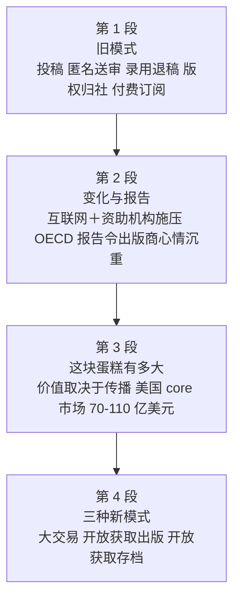

# Passage 32 · 学术出版模式的变革

## 答题记录

| 轮次  | 日期         | 题号  | 正确  | 错误  | 正确率 | 用时    | 错题归因 |
| --- | --- | --- | --- | --- | --- | --- | --- |
| 1 |  | 1-5 |  |  |  |  |  |
| 2 |  | 1-5 |  |  |  |  |  |
| 3 |  | 1-5 |  |  |  |  |  |

> [!tip] 填写口径
> - **用时**以分钟计，只计做题时间，不含精读复盘。
> - **错题归因**填「题型·错误类型」，如：细节题·定位错、推理判断·过度推断、主旨大意·以偏概全。
> - 纵向看趋势：正确率升而用时过长 → 熟练度不足；用时降而正确率波动 → 定位不稳。

> [!info] 文章档案
> - **来源**：考研英语（一）2008 年 Text 2
> - **题材**：科学技术——学术期刊出版从「投稿—评审—订阅」的传统模式，被互联网与资助机构的双重压力推向开放获取的新模式
> - **结构**：4 段 / 24 句 ＋ 5 题
> - **难度**：★★★☆☆
> - **一句话主旨**：过去学术出版是一条笔直的老路——研究者投稿、编辑隐名送审、录用了版权归出版商、想看就得订阅；如今互联网与资助机构一起发问「凭什么拿政府资助的研究赚钱」，OECD 的报告把这瓶冷水浇到出版商头上，并归纳出「大交易、开放获取出版、开放获取存档」三种正在成形的商业模式，连同行评审的老规矩都可能跟着改。

## 一、篇章脉络

- **第 1 段**：用 It used to be so straightforward 一句话定下「怀旧＋对照」的基调，随后四句按时间顺序还原旧流程——实验室团队投稿（②）→ 编辑隐去姓名与单位送同行评审（③）→ 依评审意见录用或退稿（④）→ 版权归出版商、读者须订阅（⑤）。第 1 题即考这一段「写的是什么」。
- **第 2 段**：No longer 两字推翻上段。②句摆出两股推力：互联网，以及资助机构的质问（为何商业出版商靠限制访问政府资助的研究来赚钱）；③至⑥句引出 OECD 报告——报告令迄今获利颇丰的出版商「读起来心情沉重」（第 2 题），而且 go further：它标志着科学事业关键要素的改变（第 3 题的答案句也在②句）。
- **第 3 段**：解释这场变局为何牵动神经：知识的价值与公共投资的回报取决于广泛传播与便捷获取，而这「是一桩大生意」——美国核心科学出版市场 70 亿至 110 亿美元、全球 2000 多家专营出版商、每年 120 多万篇文章。
- **第 4 段**：给出变化的具体形状——75% 的学术期刊已上线，三种新模式正在成形：机构打包订阅的「大交易」、作者（或雇主）掏钱的「开放获取出版」（第 4 题）、机构自建知识库的「开放获取存档」，另有「延迟开放获取」等混合体；末句收于：这一切可能改变同行评审的传统形式。

> [!tip] 行文逻辑
> 全篇靠一条**时间线索**串起来，各段首句就是路标：**It used to be**（第 1 段，旧）→ **No longer**（第 2 段，转折）→ **The value of knowledge...**（第 3 段，说明为何重要）→ **This is now changing**（第 4 段，新）。第 5 题的主旨答案 B（A new mode of publication is emerging）正是由这串首句推出来的。具体到题：第 1 题锁定第 1 段（traditional ↔ used to be）；第 2 题锁定第 2 段④句 makes heavy reading for publishers；第 3 题锁定第 2 段②句 is making access to scientific results a reality；第 4 题锁定第 4 段开放获取那句（asking the author to pay）；第 5 题通读各段首尾句取「变化」二字。另注意本书解析把第 4 段的 open-access publishing 标为「③句」，按句号断句实为**第 4 段⑤句**（本笔记按⑤标注）。

## 二、逐段精读

### 第 1 段 · 旧模式：投稿、匿名送审、录用退稿、订阅

**原文**

① It used to be so straightforward.
② A team of researchers working together in the laboratory would submit the results of their research to a journal.
③ A journal editor would then remove the authors' names and affiliations from the paper and send it to their peers for review.
④ Depending on the comments received, the editor would accept the paper for publication or decline it.
⑤ Copyright rested with the journal publisher, and researchers seeking knowledge of the results would have to subscribe to the journal.

**译文**

① 过去这一切曾是如此简单明了。
② 一群在实验室里合作研究的研究人员，会把他们的研究成果投给某家期刊。
③ 期刊编辑随后会隐去作者的姓名与所属机构，把论文送给他们的同行评审。
④ 根据收到的评审意见，编辑会决定录用该论文发表，或是退稿。
⑤ 版权归期刊出版商所有，而想了解这些成果的研究人员，则必须订阅该期刊。

> [!note] 段落要点
> - 功能：铺陈旧模式——用五个句子按流程顺序写出学术出版的传统链条，为下段 No longer 的推翻作铺垫。
> - ①句 It used to be so straightforward 是**全篇的时间锚点**：used to be（过去一向）暗示「现在不再如此」，第 1 题 D 项的 traditional 与它直接对应。
> - ②③④⑤四句是一条完整流水线：submit（投稿）→ remove...send for review（匿名送审）→ accept or decline（录用／退稿）→ copyright rested with...subscribe（版权与付费阅读）。书中解析把这条链概括为「提交论文—论文评议—论文发表—论文版权归属」。
> - ③句 remove the authors' names and affiliations 就是今天说的「盲审」（peer review 的匿名环节）；affiliations（所属机构）是考研词汇表里的难点词。
> - ⑤句 Copyright rested with the journal publisher 是旧模式的要害——版权不归作者，这是后文「作者与资助机构不满」的根源；rest with 是正式用语「归属于、在于」。
> - 段落内部没有转折，是纯粹的顺叙，读起来「straightforward」本身就是作者刻意营造的效果：句子简单，正好映衬「过去那套流程简单」。

#### 长难句 · 本段

> [!abstract] 本段第 ③ 句 · A journal editor would then remove the authors' names and affiliations from the paper and send it to their peers for review.

**结构拆解**

- **主干**：A journal editor would then remove the authors' names and affiliations from the paper and send it to their peers（and 连接两个并列的谓语 remove 与 send）
- **宾语**：the authors' names and affiliations（双重所有格＋并列名词）
- **状语**：from the paper（remove A from B 从 B 中去掉 A）
- **代词指代**：it 指 the paper；their 指 the authors'
- **目的状语**：for review（for ＋ 名词表目的，＝ in order to be reviewed）
- **情态**：would 表示过去习惯性的动作（「总是会……」）

**参考译文**

期刊编辑随后会隐去作者的姓名与所属机构，把论文送给他们的同行评审。

> [!tip] 拆解要点
> 一句写完「匿名送审」的全过程。抓骨架的办法是先找 and 连接的两个动词：remove A from B 与 send sth to sb，两个动作一先一后，主语都是 editor。would 在这里不是「将要」，而是**过去习惯性动作**（used to 的同类表达），与首句 It used to be 呼应——整段都在用 would 描述「过去的惯例」。for review 是名词式目的状语，等于 to be reviewed，被动含义藏在名词里。affiliation 是本篇较难的词（所属机构、隶属关系），看不出意思时可从上下文（与 names 并列、被 remove 掉以防评审认出作者）反推。

#### 本段重点词汇

| 单词 / 短语 | 词性 | 文中意 | 常用考义与拓展 | 英文示例搭配（中译） |
| --- | --- | --- | --- | --- |
| **straightforward** | adj. | 简单的，直截了当的 | 构词 straight（直）＋forward；= simple / uncomplicated；straightforward answer 坦率的回答 | It used to be so straightforward（过去这一切曾如此简单明了） |
| **submit** | v. | 提交，呈递；屈服 | submit sth to sb 向……提交；submission n. 提交、投稿；submit to 屈服于 | submit the results of their research to a journal（把研究成果投给期刊） |
| **journal** | n. | 期刊，学术刊物 | journal n. 亦作「日志」；journalism n. 新闻业；journalist n. 记者；academic journal 学术期刊 | submit...to a journal（向期刊投稿） |
| **editor** | n. | 编辑 | edit v. 编辑；edition n. 版本；editorial n. 社论／adj. 编辑的 | A journal editor would then remove...（期刊编辑随后会隐去……） |
| **remove** | v. | 去掉，移除；免职 | remove A from B 把 A 从 B 中去除；removal n. 移除、免职 | remove the authors' names and affiliations（隐去作者的姓名与单位） |
| **affiliation** | n. | 所属机构，隶属关系 | affiliate v. 使隶属（be affiliated with 附属于）；affiliated hospital 附属医院 | the authors' names and affiliations（作者的姓名与所属机构） |
| **peer** | n. | 同行，同辈；同龄人 | peer review 同行评审；peer pressure 同伴压力（见 Passage 13）；peerless adj. 无与伦比的 | send it to their peers for review（送给同行评审） |
| **review** | n./v. | 评审，审阅；评论 | peer review 同行评审；reviewer n. 审稿人；review 亦有「复习、书评」义 | send it to their peers for review（送交同行评审） |
| **depending on** | 短语 | 取决于，依据 | depend on/upon 依赖、取决于；dependent adj. 依赖的（be dependent on） | Depending on the comments received（根据收到的评审意见） |
| **comment** | n. | 意见，评论 | comment on 就……发表评论；commentary n. 评论、解说；no comment 无可奉告 | the comments received（收到的评审意见） |
| **accept...for publication** | 短语 | 录用（发表） | publish v. 出版；publication n. 出版、出版物；accept a paper 录用论文 | accept the paper for publication（录用该论文予以发表） |
| **decline** | v. | 谢绝，婉拒；下降 | decline an invitation 谢绝邀请；a decline in 在……方面的下降（见第 3 段变化）；= refuse / turn down | accept the paper for publication or decline it（录用或退稿） |
| **copyright** | n. | 版权，著作权 | 构词 copy＋right；copyright law 著作权法；patent n. 专利 | Copyright rested with the journal publisher（版权归期刊出版商） |
| **rest with** | 短语 | 归属于，取决于 | rest v. 在于、停留在；The decision rests with you 决定权在你 | Copyright rested with the journal publisher（版权归期刊出版商所有） |
| **publisher** | n. | 出版商，出版者 | publish v. 出版；publishing n. 出版业；publishing house 出版社 | the journal publisher（期刊出版商） |
| **seek** | v. | 寻求，追求；试图 | seek-sought-sought；seek knowledge 求知；seek to do 试图做；seeker n. 探求者 | researchers seeking knowledge of the results（想了解这些成果的研究者） |
| **subscribe to** | 短语 | 订阅；同意（观点） | subscription n. 订阅费；subscriber n. 订阅者（见第 4 段）；subscribe to a view 赞同某一观点 | would have to subscribe to the journal（不得不订阅该期刊） |

### 第 2 段 · 今非昔比：互联网＋资助机构，OECD 报告浇来冷水

**原文**

① No longer.
② The Internet—and pressure from funding agencies, who are questioning why commercial publishers are making money from government-funded research by restricting access to it—is making access to scientific results a reality.
③ The Organization for Economic Co-operation and Development (OECD) has just issued a report describing the far-reaching consequences of this.
④ The report, by John Houghton of Victoria University in Australia and Graham Vickery of the OECD, makes heavy reading for publishers who have, so far, made handsome profits.
⑤ But it goes further than that.
⑥ It signals a change in what has, until now, been a key element of scientific endeavor.

**译文**

① 今非昔比。
② 互联网——以及来自资助机构的压力，后者正在质问：为何商业出版商要靠限制人们获取政府资助的研究成果来赚钱——正在使获取科研成果成为现实。
③ 经济合作与发展组织（OECD）刚刚发布了一份报告，描述此举影响深远的后果。
④ 这份由澳大利亚维多利亚大学的约翰·霍顿与 OECD 的格雷厄姆·维克里撰写的报告，对那些迄今获利颇丰的出版商来说，读起来心情沉重。
⑤ 但它还不止于此。
⑥ 它标志着一个变化——改变的是迄今一直是科学事业关键要素的那个东西。

> [!note] 段落要点
> - 功能：转折段——①句 No longer 直接否定上段，②句给出变化的两股推力，③至⑥句引出 OECD 报告并说明其分量。
> - ②句是全段最长也最关键的一句：主语是 The Internet—and pressure from funding agencies（**两股力量并列**），谓语 is making access to scientific results a reality；中间嵌着一个 who 从句，说明资助机构在质问什么。第 3 题的答案就落在这一句上。
> - ②句里的质问是全篇的「道德支点」：研究由政府资助，成果却被商业出版商据为付费内容——这一问把出版商置于被动。注意**被质疑的是出版商，不是政府资助的研究**，第 2 题 A 项正栽在这里。
> - ③句 OECD 报告登场；④句 makes heavy reading（读来心情沉重）是地道习语，第 2 题 C 项 upsets profit-making journal publishers 即由其改写而来；handsome profits（可观的利润）与 heavy reading 一褒一贬，形成对照。
> - ⑤⑥句是递进：goes further than that（不止于此）→ signals a change in... a key element of scientific endeavor（标志着科学事业关键要素的改变）——把影响从「出版商的钱包」提升到「科学事业本身」。
> - 段落逻辑：「否定旧状（①）→ 变化及其推力（②）→ 报告（③）→ 对出版商的冲击（④）→ 更深层意义（⑤⑥）」。

#### 长难句 · 本段

> [!abstract] 本段第 ② 句 · The Internet—and pressure from funding agencies, who are questioning why commercial publishers are making money from government-funded research by restricting access to it—is making access to scientific results a reality.

**结构拆解**

- **主干**：The Internet—and pressure from funding agencies—is making access to scientific results a reality
- **主语**：The Internet and pressure from funding agencies（两股力量并列；核心词 pressure 后接 from 短语）
- **双破折号插入语**：—and pressure from funding agencies, who are questioning...—（插入部分使主语变长，读时可先跳过）
- **非限定性定语从句**：who are questioning why...（修饰 funding agencies）
- **宾语从句**：why commercial publishers are making money from government-funded research by restricting access to it（questioning 的宾语；by restricting... 为方式状语；it 指 research）
- **谓语结构**：make ＋ 宾语 ＋ 宾补（make access to scientific results a reality 使获取科研成果成为现实）
- **主谓一致**：主语核心为 The Internet and pressure（复数概念），但此处把二者视为同一股趋势，谓语用单数 is——插入语造成的「远距离一致」是考研难点

**参考译文**

互联网——以及来自资助机构的压力，后者正在质问：为何商业出版商要靠限制人们获取政府资助的研究成果来赚钱——正在使获取科研成果成为现实。

> [!tip] 拆解要点
> 本句是第 3 题的答案句，也是全篇最考眼力的一句。三步拆解法：①先跳过双破折号之间的整段插入语，得到骨架 The Internet... is making access to scientific results a reality（互联网正使获取科研成果成为现实）——答案 A 项 provides an easier access to scientific results 已呼之欲出；②再看插入语，知道另一股推力是 funding agencies 及其质问；③最后处理 who 从句里的 why 从句，by restricting access to it 是「靠限制访问来赚钱」的方式状语。另外注意 make ＋ 宾语 ＋ 宾补 这一结构（make sth a reality 使某事成为现实），同类还有 make it possible / make sth clear。

> [!abstract] 本段第 ④ 句 · The report, by John Houghton of Victoria University in Australia and Graham Vickery of the OECD, makes heavy reading for publishers who have, so far, made handsome profits.

**结构拆解**

- **主干**：The report makes heavy reading for publishers（make heavy reading 令某人读来心情沉重）
- **主语后置定语**：by John Houghton of Victoria University in Australia and Graham Vickery of the OECD（by 引出报告作者；of 短语层层后置）
- **定语从句**：who have, so far, made handsome profits（修饰 publishers；so far 为插入的时间状语，与现在完成时连用）
- **习语**：make heavy reading（for sb）（读起来沉重＝令人不安）
- **搭配**：make handsome profits 赚取可观的利润（handsome 此处＝ considerable 可观的，不是「英俊的」）

**参考译文**

这份由澳大利亚维多利亚大学的约翰·霍顿与 OECD 的格雷厄姆·维克里撰写的报告，对那些迄今获利颇丰的出版商来说，读起来心情沉重。

> [!tip] 拆解要点
> 第 2 题的答案句。两处机关：一是**主谓被长长的后置定语隔开**——The report 之后插入 by John Houghton... and Graham Vickery...，谓语 makes 迟迟才出现，读时要能「拎着主语等谓语」；二是 **make heavy reading 的习语义**（令人读来心情沉重、不是好消息），C 项 upsets profit-making journal publishers 正是它的同义改写，其中 profit-making 对应 made handsome profits。handsome 修饰 profits 时作「可观的、丰厚的」，是熟词僻义；so far（迄今）与现在完成时 have made 搭配，暗示「过去赚得盆满钵满，往后未必」。

#### 本段重点词汇

| 单词 / 短语 | 词性 | 文中意 | 常用考义与拓展 | 英文示例搭配（中译） |
| --- | --- | --- | --- | --- |
| **no longer** | 短语 | 不再 | = not...any longer；置于句首作省略句，直接否定上段内容 | No longer.（今非昔比／不再如此） |
| **funding agency** | n. | 资助机构，出资方 | fund n. 基金／v. 资助；funding n. 资金；agency n. 机构、代理处 | pressure from funding agencies（来自资助机构的压力） |
| **question** | v. | 质疑，对……提出疑问 | 熟词僻义：常见名词「问题」→ 动词「质疑、盘问」；questionable adj. 可疑的 | who are questioning why...（他们正在质问为何……） |
| **commercial** | adj. | 商业的，营利性的 | commerce n. 商业；commercialize v. 商业化；反义 non-profit 非营利的 | commercial publishers（商业出版商） |
| **government-funded** | adj. | 政府资助的 | 构词 名词＋过去分词：government-funded / state-owned（国有的）/ self-employed | government-funded research（政府资助的研究） |
| **restrict** | v. | 限制，约束 | restrict sth to 把……限制在；restriction n. 限制；restrictive adj. 限制性的 | by restricting access to it（通过限制对它的获取） |
| **access to** | n. | 获取……的途径，使用权 | access n. 通道／v. 进入；accessible adj. 可获取的（be accessible to）；gain access to 获得……的使用权 | access to scientific results（获取科研成果） |
| **reality** | n. | 现实，事实 | real adj. 真实的；realize v. 实现、意识到；make sth a reality 使某事成为现实 | is making access to scientific results a reality（正使获取科研成果成为现实） |
| **OECD** | 缩写 | 经济合作与发展组织 | 全称 Organization for Economic Co-operation and Development；由 30 余个市场经济国家组成 | the OECD has just issued a report（OECD 刚发布一份报告） |
| **issue** | v. | 发布，颁布；发行 | 熟词僻义：常见名词「问题、议题」→ 动词「发布、签发」；issue a report/statement 发布报告／声明 | has just issued a report（刚刚发布了一份报告） |
| **far-reaching** | adj. | 影响深远的，广泛的 | 构词 far＋reaching；= extensive / profound；far-reaching consequences 深远的后果 | describing the far-reaching consequences（描述影响深远的后果） |
| **consequence** | n. | 后果，结果 | as a consequence of 由于；consequently adv. 因此；= outcome / result | the far-reaching consequences of this（此举的深远影响） |
| **make heavy reading** | 短语 | 令（某人）读来心情沉重 | 习语：heavy 此处＝令人心情沉重；反义 make pleasant reading 读来愉快 | makes heavy reading for publishers（令出版商读来心情沉重） |
| **handsome** | adj. | 可观的，丰厚的 | 熟词僻义：常见义「英俊的」→ 修饰利润、报酬时＝ considerable 可观的 | made handsome profits（赚取了可观的利润） |
| **profit** | n. | 利润，收益 | profitable adj. 盈利的；non-profit adj. 非营利的；profit from 从……中获利 | publishers who have made handsome profits（获利颇丰的出版商） |
| **go further** | 短语 | 更进一步，不止于此 | go further than that 比那走得更远；furthermore adv. 此外 | But it goes further than that（但它还不止于此） |
| **signal** | v. | 标志，表明 | 熟词僻义：名词「信号」→ 动词「标志着、预示」；signal a change 标志着变化 | It signals a change in...（它标志着……的变化） |
| **scientific endeavor** | n. | 科学事业，科研工作 | endeavor n./v. 努力、事业（= effort）；endeavor to do 努力去做 | a key element of scientific endeavor（科学事业的一个关键要素） |

### 第 3 段 · 这块蛋糕有多大：价值取决于传播与获取

**原文**

① The value of knowledge and the return on the public investment in research depends, in part, upon wide distribution and ready access.
② It is big business.
③ In America, the core scientific publishing market is estimated at between $7 billion and $11 billion.
④ The International Association of Scientific, Technical and Medical Publishers says that there are more than 2,000 publishers worldwide specializing in these subjects.
⑤ They publish more than 1.2 million articles each year in some 16,000 journals.

**译文**

① 知识的价值，以及科研公共投资的回报，在一定程度上取决于广泛的传播与便捷的获取。
② 这是一桩大生意。
③ 在美国，核心科学出版市场估计在 70 亿至 110 亿美元之间。
④ 国际科学、技术与医学出版商协会称，全球有 2000 多家专营这些学科的出版商。
⑤ 他们每年在约 16000 种期刊上发表 120 多万篇文章。

> [!note] 段落要点
> - 功能：立场段——说明为什么「获取方式」这件事值得写一整篇文章：知识的价值与公共投资的回报，都要靠传播与获取来实现；而它同时是一桩大生意。
> - ①句是全段论点，也是容易被命题的地方：value/return **depends upon** distribution/access——因果方向是「传播与获取 → 价值与回报」，第 3 题 D 项（网络出版促进公共投资）把方向倒过来了。
> - ①句 in part（在一定程度上）是作者的克制用语，避免绝对化；ready access 的 ready 是「现成的、便利的」，不是「准备好的」。
> - ②句 It is big business 一句独立成句，短促有力，是全段的转折口：前面讲价值，这里讲钱。
> - ③④⑤三句用数字坐实「大生意」：70–110 亿美元（市场）、2000 多家（出版商）、120 多万篇／16000 种（体量）。三个数据层层加码，是本段的论据。
> - 段落逻辑：「论点（①）→ 定性（②）→ 三组数据（③④⑤）」，是典型的「观点＋数据」结构。

#### 长难句 · 本段

> [!abstract] 本段第 ① 句 · The value of knowledge and the return on the public investment in research depends, in part, upon wide distribution and ready access.

**结构拆解**

- **主语**：The value of knowledge and the return on the public investment in research（两个名词短语并列：the value of A and the return on B）
- **后置定语**：on the public investment in research（return on 在……上的回报；in research 修饰 investment）
- **插入语**：in part（在某种程度上，部分地）
- **谓语**：depends upon（＝ depends on 取决于；注意主语为复数概念，此处用单数 depends，把两类回报视为同一整体）
- **宾语**：wide distribution and ready access（并列名词短语）

**参考译文**

知识的价值，以及科研公共投资的回报，在一定程度上取决于广泛的传播与便捷的获取。

> [!tip] 拆解要点
> 全句是「A and B depend upon C and D」的对称结构，难在名词层层后置：the return **on** the public investment **in** research（科研公共投资的回报）——两个 of/on/in 介词链条要一层层剥。插入语 in part 读时可跳过。ready 在这里不是「准备好的」，而是「现成的、便捷的」（ready access ＝ easy access），与第 2 段的 access to 呼应。命题角度：本句确立「传播与获取决定价值」，第 3 题 D 项把它倒过来说成「网络出版促进公共投资」，属因果倒置，落选。

> [!abstract] 本段第 ④ 句 · The International Association of Scientific, Technical and Medical Publishers says that there are more than 2,000 publishers worldwide specializing in these subjects.

**结构拆解**

- **主语**：The International Association of Scientific, Technical and Medical Publishers（专有名词作主语，核心词 Association，后接一串 of 定语）
- **谓语**：says that...（引述机构观点）
- **宾语从句**：there are more than 2,000 publishers worldwide（there be 句型；worldwide 为后置副词）
- **现在分词作后置定语**：specializing in these subjects（＝which specialize in...，修饰 publishers）

**参考译文**

国际科学、技术与医学出版商协会称，全球有 2000 多家专营这些学科的出版商。

> [!tip] 拆解要点
> 长专有名词不可怕，抓住核心词即可：The International Association **of** Scientific, Technical and Medical Publishers（科学、技术与医学出版商**国际协会**，简称 STM）。真正的考点是句末的 specializing in these subjects——现在分词作后置定语，等于一个省略的定语从句 which specialize in；specialize in（专营、专攻）是高频搭配，these subjects 回指上文的科学、技术与医学等学科领域。

#### 本段重点词汇

| 单词 / 短语 | 词性 | 文中意 | 常用考义与拓展 | 英文示例搭配（中译） |
| --- | --- | --- | --- | --- |
| **value** | n. | 价值 | valuable adj. 有价值的；valueless adj. 无价值的；evaluate v. 评估 | The value of knowledge（知识的价值） |
| **return** | n. | 回报，收益 | 熟词僻义：常见义「返回、归还」→ 经济语境「回报、收益率」；return on investment 投资回报率 | the return on the public investment（公共投资的回报） |
| **public investment** | n. | 公共投资，政府投入 | invest v. 投资；investment n. 投资；investor n. 投资人 | the public investment in research（科研的公共投资） |
| **depend upon** | 短语 | 取决于，依赖于 | = depend on；dependent adj. 依赖的；dependable adj. 可靠的 | depends, in part, upon wide distribution（在一定程度上取决于广泛传播） |
| **in part** | 短语 | 在某种程度上，部分地 | = partly / to some extent；反义 in whole 整体上 | depends, in part, upon...（在一定程度上取决于……） |
| **distribution** | n. | 传播，分发；分配 | distribute v. 分发、散布；distributor n. 分销商；distribution channel 发行渠道 | wide distribution and ready access（广泛的传播与便捷的获取） |
| **ready access** | n. | 便捷的获取，随时可用 | ready adj. 现成的、便利的（非「准备好的」）；have ready access to 可随时获取 | wide distribution and ready access（广泛传播与便捷获取） |
| **big business** | n. | 大生意，大买卖 | 习语：指规模大、利润高的行业；business n. 生意、事务 | It is big business.（这是一桩大生意） |
| **core** | adj./n. | 核心的；核心 | core market 核心市场；core value 核心价值观；core curriculum 核心课程 | the core scientific publishing market（核心科学出版市场） |
| **be estimated at** | 短语 | 估计为，估价为 | estimate v./n. 估计；an estimated 20% 估计 20%；overestimate 高估 | is estimated at between $7 billion and $11 billion（估计在 70 亿至 110 亿美元之间） |
| **association** | n. | 协会，社团；关联 | associate v. 联系（associate A with B）；associated adj. 相关的；= society / institute | The International Association of STM Publishers（国际 STM 出版商协会） |
| **specialize in** | 短语 | 专营，专攻 | special adj. 专门的；specialist n. 专家；specialization n. 专业化 | publishers specializing in these subjects（专营这些学科的出版商） |
| **subject** | n. | 学科，主题；对象 | 熟词僻义：常见义「主题、主语」→ 此处「学科、科目」；subject to 受制于 | publishers specializing in these subjects（专营这些学科的出版商） |
| **article** | n. | 文章，论文 | article 亦有「物品、条款」义；journal article 期刊论文 | publish more than 1.2 million articles（发表 120 多万篇文章） |

### 第 4 段 · 三种新模式：大交易、开放获取出版、开放获取存档

**原文**

① This is now changing.
② According to the OECD report, some 75% of scholarly journals are now online.
③ Entirely new business models are emerging; three main ones were identified by the report's authors.
④ There is the so-called big deal, where institutional subscribers pay for access to a collection of online journal titles through site-licensing agreements.
⑤ There is open-access publishing, typically supported by asking the author (or his employer) to pay for the paper to be published.
⑥ Finally, there are open-access archives, where organizations such as universities or international laboratories support institutional repositories.
⑦ Other models exist that are hybrids of these three, such as delayed open-access, where journals allow only subscribers to read a paper for the first six months, before making it freely available to everyone who wishes to see it.
⑧ All this could change the traditional form of the peer-review process, at least for the publication of papers.

**译文**

① 这一切正在改变。
② 根据 OECD 的报告，约 75% 的学术期刊现已上线。
③ 全新的商业模式正在涌现；报告的作者归纳出其中三种主要的模式。
④ 一种是所谓的「大交易」，即机构订阅者通过站点许可协议付费，以获得一批在线期刊的使用权。
⑤ 一种是「开放获取式出版」，其典型做法是要求作者（或其雇主）为论文的发表付费。
⑥ 最后是「开放获取式存档」，即由大学或国际实验室之类的机构出资支持机构知识库。
⑦ 此外还存在这三种模式的混合体，例如「延迟开放获取」——期刊在头六个月只允许订阅者阅读某篇论文，之后才向所有想看的人免费开放。
⑧ 所有这些都可能改变同行评审这一传统形式，至少在论文发表这一环节上如此。

> [!note] 段落要点
> - 功能：展开段——给出「变化」的具体形态，是第 4 题与第 5 题的落点。
> - ①句 This is now changing 呼应第 2 段的 No longer，是第二段首句路标；This 回指上文的出版格局。
> - ②句用数据开场：75% 的学术期刊已上线——数字化已成事实，不是预测。
> - ③句提出「商业模式」，并预告三种；④⑤⑥句以 There is... / Finally, there are... 的排比依次列出：**big deal**（机构打包订阅）、**open-access publishing**（作者付费，读者免费）、**open-access archives**（机构自建知识库）。第 4 题考第二种。
> - ⑦句补上混合模式（delayed open-access：前六个月只给订阅者看，之后免费开放），说明现实比三种分类更复杂。
> - ⑧句收于一个更远的展望：连 peer-review process 这种「科学事业的基石」都可能被改变——呼应第 2 段⑥句的 key element of scientific endeavor，全篇首尾扣合。
> - 段落逻辑：「变化的事实（①②）→ 三种模式（③④⑤⑥）→ 混合模式（⑦）→ 更深层影响（⑧）」。

#### 长难句 · 本段

> [!abstract] 本段第 ⑤ 句 · There is open-access publishing, typically supported by asking the author (or his employer) to pay for the paper to be published.

**结构拆解**

- **主干**：There is open-access publishing（there be 存在句）
- **过去分词作后置定语**：typically supported by...（＝which is typically supported by...，修饰 open-access publishing）
- **方式状语**：by asking the author (or his employer) to pay（by ＋ doing；ask sb to do 要求某人做）
- **不定式**：to pay for the paper to be published（pay for sth；the paper 后接不定式的被动式 to be published 作定语）

**参考译文**

一种是「开放获取式出版」，其典型做法是要求作者（或其雇主）为论文的发表付费。

> [!tip] 拆解要点
> 第 4 题的答案句（书中解析标为「最后一段③句」，按句号断句为**第 4 段⑤句**）。三层结构：there be 引出模式名 → 过去分词 supported by 说明它靠什么维持 → by asking... 说明如何收费。句末 to be published 是不定式的被动式作后置定语（＝the paper which is to be published「待发表的论文」），这是考研语法的高频点。答案 A 项 cover the cost of its publication 即「由作者承担出版费用」，等于 asking the author to pay。B 项（订阅期刊）是第 1 段旧模式的做法，属时代错位。

> [!abstract] 本段第 ⑦ 句 · Other models exist that are hybrids of these three, such as delayed open-access, where journals allow only subscribers to read a paper for the first six months, before making it freely available to everyone who wishes to see it.

**结构拆解**

- **主干**：Other models exist（主谓；主语后接定语从句，故形成「分隔式」）
- **定语从句（后置）**：that are hybrids of these three（＝which are hybrids of...；hybrid 混合物、混合体）
- **举例**：such as delayed open-access（such as 举例说明 hybrids）
- **非限定性定语从句**：where journals allow only subscribers to read a paper...（where ＝ in which，修饰 delayed open-access）
- **结构**：allow sb to do 允许某人做；only subscribers 只允许订阅者
- **时间状语＋介词短语**：for the first six months, before making it freely available to everyone（before ＋ doing；make sth available to sb 使某物对某人可用）
- **嵌套定语从句**：who wishes to see it（修饰 everyone）

**参考译文**

此外还存在这三种模式的混合体，例如「延迟开放获取」——期刊在头六个月只允许订阅者阅读某篇论文，之后才向所有想看的人免费开放。

> [!tip] 拆解要点
> 一句三层从句，是本篇的句法高峰。拆法：先抓主干 Other models exist（其他模式存在），再看后置的 that are hybrids of these three（哪些模式？三者的混合体）；such as delayed open-access 举例后，用 where（＝in which）引导从句解释这种混合体怎么运作；句末 before making it freely available to everyone who wishes to see it 又套了一层 who 从句。值得记的是 **make sth available to sb**（使某物可供某人获取）与 **before ＋ doing** 这两个高频结构；另外 where 引导定语从句时未必指地点，也可指「在该模式下／在该情形中」。

#### 本段重点词汇

| 单词 / 短语 | 词性 | 文中意 | 常用考义与拓展 | 英文示例搭配（中译） |
| --- | --- | --- | --- | --- |
| **scholarly** | adj. | 学术的，学者的 | scholar n. 学者；scholarship n. 奖学金、学术成就；scholarly journal 学术期刊 | 75% of scholarly journals（75% 的学术期刊） |
| **online** | adj./adv. | 在线的，联网的 | 反义 offline（见 Passage 31）；go online 上线；online service 在线服务 | scholarly journals are now online（学术期刊现已上线） |
| **business model** | n. | 商业模式 | model n. 模型、模式；business n. 生意、业务 | Entirely new business models are emerging（全新的商业模式正在涌现） |
| **emerge** | v. | 出现，兴起 | emerge from 从……中出现；emergence n. 出现；emerging adj. 新兴的（emerging markets 新兴市场） | new business models are emerging（新的商业模式正在出现） |
| **identify** | v. | 确认，识别；认定 | identification n. 识别；identify with 认同；identifiable adj. 可辨认的（见 Passage 31） | three main ones were identified（三种主要的被归纳出来） |
| **so-called** | adj. | 所谓的（常含保留意味） | 用于引出一个称谓，作者不一定认同；= what is called | the so-called big deal（所谓的「大交易」） |
| **big deal** | n. | （出版业）打包订阅协议 | 专有行话；口语中 big deal 亦作「大事／没什么大不了」（反讽） | There is the so-called big deal（一种是所谓的大交易） |
| **institutional subscriber** | n. | 机构订阅者 | institution n. 机构（高校、图书馆等）；institutional adj. 机构的；subscriber n. 订阅者（见第 1 段 subscribe） | institutional subscribers pay for access（机构订阅者付费获取使用权） |
| **site-licensing agreement** | n. | 站点许可协议 | license n. 许可、执照／v. 许可；site n. 站点；agreement n. 协议 | through site-licensing agreements（通过站点许可协议） |
| **open-access publishing** | n. | 开放获取式出版 | 学术出版术语：读者免费、作者付费；缩写 OA publishing | There is open-access publishing（一种是开放获取式出版） |
| **typically** | adv. | 典型地，通常 | typical adj. 典型的（be typical of）；type n. 类型 | typically supported by asking the author（通常由要求作者付费来支撑） |
| **employer** | n. | 雇主，用人单位 | employ v. 雇用；employee n. 雇员；employment n. 就业；unemployment 失业 | the author (or his employer)（作者或其雇主） |
| **open-access archive** | n. | 开放获取式存档库 | archive n. 档案、档案馆／v. 存档 | there are open-access archives（还有开放获取式存档） |
| **institutional repository** | n. | 机构知识库 | repository n. 仓库、存储库；学术语境指机构自建的论文存储库 | support institutional repositories（支持机构知识库） |
| **hybrid** | n. | 混合体，混合物 | hybrid adj. 混合的；hybrid car 混合动力汽车；= mixture / combination | Other models exist that are hybrids of these three（还有这三者的混合模式） |
| **delayed open-access** | n. | 延迟开放获取 | delayed adj. 延后的；embargo 禁发期（同义概念） | such as delayed open-access（例如延迟开放获取） |
| **freely available** | 短语 | 免费可得的，自由获取的 | available adj. 可获得的（be available to sb）；freely adv. 免费地、自由地 | making it freely available to everyone（让它对所有人免费开放） |
| **peer-review process** | n. | 同行评审流程 | peer review 见第 1 段；process n. 流程（见 Passage 31） | change the traditional form of the peer-review process（改变同行评审的传统形式） |
| **at least** | 短语 | 至少；起码 | 用于收窄范围；反义 at most 至多 | at least for the publication of papers（至少在论文发表环节） |

## 三、全篇重点词汇汇总（自测用）

> [!info] 说明
> 本表只列「单词 / 词性 / 所在段」，不含释义与搭配，用于遮表自测：说出词义后再回该段核对。
> 收录**全篇所有段落词汇，共 68 条，不删减**，与各段「本段重点词汇」等长同源。

| 单词 / 短语 | 词性 | 所在段 |
| --- | --- | --- |
| **straightforward** | adj. | 第 1 段 |
| **submit** | v. | 第 1 段 |
| **journal** | n. | 第 1 段 |
| **editor** | n. | 第 1 段 |
| **remove** | v. | 第 1 段 |
| **affiliation** | n. | 第 1 段 |
| **peer** | n. | 第 1 段 |
| **review** | n./v. | 第 1 段 |
| **depending on** | 短语 | 第 1 段 |
| **comment** | n. | 第 1 段 |
| **accept...for publication** | 短语 | 第 1 段 |
| **decline** | v. | 第 1 段 |
| **copyright** | n. | 第 1 段 |
| **rest with** | 短语 | 第 1 段 |
| **publisher** | n. | 第 1 段 |
| **seek** | v. | 第 1 段 |
| **subscribe to** | 短语 | 第 1 段 |
| **no longer** | 短语 | 第 2 段 |
| **funding agency** | n. | 第 2 段 |
| **question** | v. | 第 2 段 |
| **commercial** | adj. | 第 2 段 |
| **government-funded** | adj. | 第 2 段 |
| **restrict** | v. | 第 2 段 |
| **access to** | n. | 第 2 段 |
| **reality** | n. | 第 2 段 |
| **OECD** | 缩写 | 第 2 段 |
| **issue** | v. | 第 2 段 |
| **far-reaching** | adj. | 第 2 段 |
| **consequence** | n. | 第 2 段 |
| **make heavy reading** | 短语 | 第 2 段 |
| **handsome** | adj. | 第 2 段 |
| **profit** | n. | 第 2 段 |
| **go further** | 短语 | 第 2 段 |
| **signal** | v. | 第 2 段 |
| **scientific endeavor** | n. | 第 2 段 |
| **value** | n. | 第 3 段 |
| **return** | n. | 第 3 段 |
| **public investment** | n. | 第 3 段 |
| **depend upon** | 短语 | 第 3 段 |
| **in part** | 短语 | 第 3 段 |
| **distribution** | n. | 第 3 段 |
| **ready access** | n. | 第 3 段 |
| **big business** | n. | 第 3 段 |
| **core** | adj./n. | 第 3 段 |
| **be estimated at** | 短语 | 第 3 段 |
| **association** | n. | 第 3 段 |
| **specialize in** | 短语 | 第 3 段 |
| **subject** | n. | 第 3 段 |
| **article** | n. | 第 3 段 |
| **scholarly** | adj. | 第 4 段 |
| **online** | adj./adv. | 第 4 段 |
| **business model** | n. | 第 4 段 |
| **emerge** | v. | 第 4 段 |
| **identify** | v. | 第 4 段 |
| **so-called** | adj. | 第 4 段 |
| **big deal** | n. | 第 4 段 |
| **institutional subscriber** | n. | 第 4 段 |
| **site-licensing agreement** | n. | 第 4 段 |
| **open-access publishing** | n. | 第 4 段 |
| **typically** | adv. | 第 4 段 |
| **employer** | n. | 第 4 段 |
| **open-access archive** | n. | 第 4 段 |
| **institutional repository** | n. | 第 4 段 |
| **hybrid** | n. | 第 4 段 |
| **delayed open-access** | n. | 第 4 段 |
| **freely available** | 短语 | 第 4 段 |
| **peer-review process** | n. | 第 4 段 |
| **at least** | 短语 | 第 4 段 |

> [!example] 同义替换链（阅读题高频）
> - **It used to be so straightforward（第 1 段①句）↔ the traditional process of journal publication（第 1 题 D 项）**：used to be（过去一向）＝ traditional（传统的），这是第 1 题的解题钥匙。
> - **submit → remove...for review → accept or decline → copyright rested with...subscribe（第 1 段②至⑤句）↔ 提交论文—论文评议—论文发表—论文版权归属（书中解析的概括）**：第 1 题的完整依据链。
> - **makes heavy reading for publishers（第 2 段④句）↔ It upsets profit-making journal publishers（第 2 题 C 项）**：习语改写；made handsome profits ↔ profit-making。
> - **is making access to scientific results a reality（第 2 段②句）↔ it provides an easier access to scientific results（第 3 题 A 项）**：第 3 题的原意复现，access 一词是线索。
> - **asking the author (or his employer) to pay for the paper to be published（第 4 段⑤句）↔ cover the cost of its publication（第 4 题 A 项）**：第 4 题的唯一依据。
> - **It used to be → No longer → This is now changing（第 1/2/4 段首句）↔ A new mode of publication is emerging（第 5 题 B 项）**：主旨题靠各段首句的时间线索推出。
> - **a key element of scientific endeavor（第 2 段⑥句）↔ the traditional form of the peer-review process（第 4 段⑧句）**：首尾扣合——被改变的正是科学事业的关键要素。
> - **ready access（第 3 段①句）↔ access to scientific results（第 2 段②句）↔ open-access（第 4 段）**：access 一词贯穿全篇，是本篇的「词眼」。

> [!warning] 熟词僻义专列
> - **journal**：日报、日志 → 学术期刊。
> - **review**：复习、评论 → （同行）评审；reviewer 审稿人。
> - **decline**：下降 → 婉言谢绝、退稿。
> - **rest with**：休息 → 归属于、取决于（决定权在于）。
> - **question**：问题 → 动词「质疑、盘问」。
> - **issue**：问题、议题 → 动词「发布、颁布」。
> - **signal**：信号 → 动词「标志着、预示」。
> - **handsome**：英俊的 → （利润、报酬）可观的、丰厚的。
> - **return**：返回、归还 → 回报、收益（return on investment）。
> - **ready**：准备好的 → 现成的、便捷的（ready access）。
> - **core**：果核 → 核心的（core market）。
> - **subject**：主题、主语、臣民 → 学科、科目。
> - **article**：物品、冠词、条款 → （学术）论文。
> - **employer**：雇用者 → 雇主、作者所属单位（与 employee 相对）。
> - **hybrid**：杂种 → 混合体、混合模式。

## 四、知识点补充

> [!question] 背景知识
> - **学术出版的传统模式**：研究者无偿投稿、无偿审稿（同行评审 peer review 多为义务劳动）、版权让渡给出版商，图书馆与个人再以高价订阅。这套体系在二战后迅速膨胀，期刊价格涨幅长期高于通胀率，被学界称为「期刊危机」（serials crisis）。
> - **OECD（经济合作与发展组织）**：1961 年成立，总部巴黎，成员以发达市场经济体为主（文中报告由 John Houghton 与 Graham Vickery 撰写，题为 Towards a New Model of Scientific Publishing）。中国非其成员。
> - **开放获取（Open Access, OA）**：2002 年《布达佩斯开放获取倡议》确立的理念——学术论文应免费、即时、在线可得。常见路线有两条：**金色 OA**（作者付费、读者免费，如本文的 open-access publishing）与**绿色 OA**（作者把论文存进机构知识库，如 open-access archives）。
> - **大交易（Big Deal）**：1990 年代末兴起，出版商把整批期刊打包卖给图书馆，签站点许可协议（site-licensing），图书馆看似单价更低，实则被锁定、难以削减，近年大量高校因成本失控而退出。
> - **延迟开放获取（Delayed Open Access）**：论文上线后设 6–12 个月的禁发期（embargo），期内仅订阅者可读，之后免费开放，是订阅制与 OA 之间的折中。
> - **STM 出版商协会（The International Association of Scientific, Technical and Medical Publishers）**：国际科学、技术与医学出版商行业协会，总部荷兰，会员包括 Elsevier、Springer、Wiley 等。
> - **开放获取的争议**：金色 OA 把成本从读者端转到了作者端，可能加剧「付不起版面费就发不出文章」的不平等，因此近年出现了「作者付费能力豁免」「混合期刊」等修补方案。

> [!warning] 语法点
> - **used to be（第 1 段①）**：过去一向（现在不再），与第 2 段 No longer、第 4 段 This is now changing 共同构成时间轴。
> - **would 表过去习惯（第 1 段②③④）**：would ＋ 动词原形＝过去经常／惯常的做法（＝used to do）。
> - **remove A from B（第 1 段③）**：把 A 从 B 中移除；同类结构 remove sb from office 免职。
> - **for ＋ 名词表目的（第 1 段③）**：for review ＝ to be reviewed，名词中藏被动。
> - **双破折号插入语（第 2 段②）**：—and pressure from funding agencies, who...—，先跳过再回头。
> - **make ＋ 宾语 ＋ 宾补（第 2 段②）**：make access a reality 使获取成为现实。
> - **主语与谓语被后置定语隔开（第 2 段④）**：The report, by A and B, makes...。
> - **so far ＋ 现在完成时（第 2 段④）**：迄今（到目前为止）。
> - **depend upon / on（第 3 段①）**：取决于；插入语 in part。
> - **there be ＋ 现在分词作定语（第 3 段④）**：there are... publishers specializing in...。
> - **there be ＋ 过去分词作定语（第 4 段⑤）**：There is open-access publishing, typically supported by...。
> - **不定式的被动式作定语（第 4 段⑤）**：the paper to be published 待发表的论文。
> - **分隔式定语从句（第 4 段⑦）**：Other models exist that are hybrids...（先行词与从句被谓语隔开）。
> - **where 引导定语从句（第 4 段④⑥⑦）**：where ＝ in which，可指「在该模式／协议中」，不限于地点。
> - **before ＋ doing（第 4 段⑦）**：before making it freely available...，介词后接动名词。
> - **make sth available to sb（第 4 段⑦）**：使某物可供某人获取。

> [!success] 写作可迁移句型
> - **It used to be so straightforward.**：过去这一切曾如此简单（怀旧式开篇，后接今昔对照）。
> - **No longer.**：今非昔比（独词成句，用于转折，力度极强）。
> - **A—and B, who...—is making...a reality.**：A 与 B 正使……成为现实（双破折号插入＋make sth a reality）。
> - **...has just issued a report describing the far-reaching consequences of this.**：刚发布报告描述其深远影响（引报告／数据开篇）。
> - **The report makes heavy reading for those who have, so far, made handsome profits.**：该报告令迄今获利颇丰者读来心情沉重。
> - **But it goes further than that.**：但它还不止于此（递进过渡句）。
> - **It signals a change in what has, until now, been a key element of...**：它标志着……中一个关键要素的改变。
> - **The value of...and the return on...depends, in part, upon...**：……的价值与……的回报在一定程度上取决于……（议论文立论句）。
> - **Entirely new...are emerging; three main ones were identified by...**：全新的……正在涌现，其中三种主要类型被归纳出来（分类说明句）。
> - **There is A, where...; There is B, ...; Finally, there are C, where...**：排比列举三种模式（分类写作的标准句式）。
> - **All this could change the traditional form of..., at least for...**：所有这些都可能改变……的传统形式，至少在……方面（收尾展望句）。

> [!danger] 易混辨析
> - **submit / surrender / yield**：submit 提交（稿件）／屈服；surrender 投降、交出；yield 让步、产生。
> - **decline / refuse / reject**：decline 婉拒（客气）；refuse 拒绝（坚决）；reject 驳回、拒收（正式，常用于拒稿）。
> - **remove / delete / eliminate**：remove 移除（物理或抽象）；delete 删除（文字、数据）；eliminate 消除、淘汰。
> - **restrict / limit / confine**：restrict 限制（规则性）；limit 限定（数量、程度）；confine 局限于（范围）。
> - **access / entrance / admission**：access 获取权、使用权（抽象）；entrance 入口；admission 准入、录取。
> - **issue / publish / release**：issue 发布（报告、声明、命令）；publish 出版；release 发布、放行。
> - **consequence / result / outcome**：consequence 后果（常带负面色彩）；result 结果（中性）；outcome 结局、成果。
> - **profit / benefit / interest**：profit 利润（金钱）；benefit 好处、福利；interest 利息、利益。
> - **signal / indicate / mark**：signal 标志、预示；indicate 表明；mark 标志着（常接转折点）。
> - **return / reward / yield**：return 回报、收益率；reward 奖赏；yield 产量、收益率。
> - **distribution / circulation / spread**：distribution 分发、发行；circulation 发行量、流通；spread 传播（扩散式）。
> - **estimate / assess / evaluate**：estimate 估计（数值）；assess 评估（价值、风险）；evaluate 评价（优劣）。
> - **emerge / appear / arise**：emerge 涌现（从无到有、逐渐显现）；appear 出现；arise 产生（问题、机会）。
> - **so-called / alleged / self-styled**：so-called 所谓的（含保留）；alleged 涉嫌的；self-styled 自封的。
> - **typically / usually / normally**：typically 典型地（具代表性）；usually 通常；normally 正常情况下。
> - **hybrid / mixture / blend**：hybrid 混合体（保留各自特征）；mixture 混合物；blend 调和、融合。

## 五、题目分析

> [!info] 题目总览
> | 题号 | 题型 | 定位 | 答案 |
> | --- | --- | --- | --- |
> | 1 | 段落主旨题（写作内容） | 第 1 段①至⑤句 | D |
> | 2 | 细节题（报告的影响） | 第 2 段④句 | C |
> | 3 | 细节题（意义／原因） | 第 2 段②句 | A |
> | 4 | 细节题（模式细节） | 第 4 段⑤句（书中标③句） | A |
> | 5 | 主旨大意题 | 各段首句（It used to be → No longer → This is now changing） | B |

### 第 1 题 · 段落主旨题（写作内容）

> [!question] 原题
> In the first paragraph, the author discusses
> - A. the background information of journal editing.
> - B. the publication routine of laboratory reports.
> - C. the relations of authors with journal publishers.
> - D. the traditional process of journal publication.

**正确答案**：**D. the traditional process of journal publication.（期刊出版的传统流程）**

**定位与依据**
- 题干限定 In the first paragraph，是「段落写了什么」型主旨题，解题要读段落**首尾句并概括中间细节**。
- 首句 It used to be so straightforward 定调：过去如此——traditional 正对应 used to be。
- ②至⑤句是四个连续环节：投稿（submit）→ 隐去署名送同行评审（remove...send for review）→ 录用或退稿（accept...or decline）→ 版权归出版商、读者须订阅（copyright rested with...subscribe）。书中解析概括为「提交论文—论文评议—论文发表—论文版权归属」。
- 书中解析：「概括段落主旨，需要我们重点读段落首尾句。通过阅读首句 It used to be so straightforward 可知这段描述的是过去的一种情形……随后分析②至⑤句，发现其为具体的环节……这是在描述学术期刊的出版过程。」

**干扰项分析**

| 选项 | 选项内容 | 判断 | 排除理由 |
| --- | --- | --- | --- |
| A | the background information of journal editing. | ✗ | 无中生有＋以偏概全：本段没有交代编辑行业的背景（历史、现状、成因），编辑（③句）只是流程中的一环，不能代表整段。 |
| B | the publication routine of laboratory reports. | ✗ | 偷换主体：laboratory reports（实验室报告）≠ 学术论文；②句的 in the laboratory 只是交代研究者的身份，投稿对象是 journal，不是实验报告。 |
| C | the relations of authors with journal publishers. | ✗ | 以偏概全：作者与出版商的关系只在⑤句（版权归属、付费订阅）出现，其余四句讲的是流程本身；且全段并未讨论二者的「关系」。 |
| D | the traditional process of journal publication. | ✓ | 正确项：traditional 对应 It used to be，process 对应②至⑤句的四步流程，覆盖全段。 |

> [!tip] 解题思路
> 「某段讨论了什么」的题，标准做法是**先读段首句定调、再扫中间句找共同属性**。本段首句的 used to be 是全篇最显眼的时间信号，它把四个细节句统统归入「过去的做法」，于是选项中带 traditional 的 D 项天然占优。三个干扰项各犯一种典型错误：A 无中生有（文中没有背景介绍），B 偷换主体（把「期刊论文」换成「实验室报告」——只取了 laboratory 一词），C 以偏概全（只覆盖⑤句）。记住：段落主旨题的正确项必须能**覆盖该段大多数句子**，凡是只能覆盖一两句的，多半是干扰项。

### 第 2 题 · 细节题（报告的影响）

> [!question] 原题
> Which of the following is true of the OECD report?
> - A. It criticizes government-funded research.
> - B. It introduces an effective means of publication.
> - C. It upsets profit-making journal publishers.
> - D. It benefits scientific research considerably.

**正确答案**：**C. It upsets profit-making journal publishers.（它令营利的期刊出版商不安）**

**定位与依据**
- 题干关键词 the OECD report 定位到第 2 段③句（has just issued a report）及④至⑥句（报告的内容与影响）。
- ④句：The report... **makes heavy reading for publishers who have, so far, made handsome profits**——报告令迄今获利颇丰的出版商读来心情沉重，正是 C 项 It upsets（使不安）＋ profit-making（营利的）＋ journal publishers 的合体。
- 书中解析：「通过④句 The report...makes heavy reading for publishers who have, so far, made handsome profits（报告让那些目前为止获利颇丰的出版商读起来心情沉重）可知，C 项为正确答案。It upsets profit-making journal publishers 是对④句的同义改写。」

**干扰项分析**

| 选项 | 选项内容 | 判断 | 排除理由 |
| --- | --- | --- | --- |
| A | It criticizes government-funded research. | ✗ | 偷换对象：②句中被质问的是**商业出版商**（commercial publishers）靠限制访问政府资助研究来赚钱；政府资助的研究是保护对象，不是批评对象。 |
| B | It introduces an effective means of publication. | ✗ | 张冠李戴：报告的角色是「描述变化及其深远影响」（③句 describing the far-reaching consequences），新出版模式是第 4 段的三种做法；且文中从未评价任何方式 effective（有效）。 |
| C | It upsets profit-making journal publishers. | ✓ | 正确项：makes heavy reading for publishers... made handsome profits 的同义改写。 |
| D | It benefits scientific research considerably. | ✗ | 程度过重／无中生有：⑥句只说报告「标志着科学事业关键要素的改变」（signals a change），改变不等于「带来相当大的好处」，considerably 是文中没有的程度。 |

> [!tip] 解题思路
> 本题的题眼是习语 makes heavy reading（读来心情沉重＝不是好消息）。凡遇习语，先把它翻成「这不是个好消息」，再找谁会不舒服——答案是出版商。三个干扰项的套路值得记：A 是「偷换对象」（把被质疑的一方换成被保护的一方），B 是「张冠李戴」（把第 4 段的内容安到报告头上，还加上了原文没有的 effective），D 是「程度过重」（把 signals a change 拔高成 benefits...considerably）。做细节题时，凡选项中出现 considerably / greatly / entirely 这类强程度副词，都要回原文核对有没有对应依据。

### 第 3 题 · 细节题（意义／原因）

> [!question] 原题
> According to the text, online publication is significant in that
> - A. it provides an easier access to scientific results.
> - B. it brings huge profits to scientific researchers.
> - C. it emphasizes the crucial role of scientific knowledge.
> - D. it facilitates public investment in scientific research.

**正确答案**：**A. it provides an easier access to scientific results.（它提供了更便捷的获取科研成果的途径）**

**定位与依据**
- 题干 online publication is significant 定位到第 2 段②句：The Internet... **is making access to scientific results a reality**——互联网（即在线出版）正使获取科研成果成为现实，A 项是其同义替换。
- 对照第 1 段⑤句旧模式：researchers seeking knowledge of the results would have to **subscribe to the journal**（想了解成果必须订阅）——有了在线出版，获取变得更便捷。
- 书中解析：「由题干的关键信息 online publication is significant 定位到第二段②句，该句指出 The Internet... is making access to scientific results a reality……相较于传统出版……网络出版提供了更便捷的接触科研成果的途径，所以 A 项正确。it provides an easier access to scientific results 是第二段②句的同义替换。」

**干扰项分析**

| 选项 | 选项内容 | 判断 | 排除理由 |
| --- | --- | --- | --- |
| A | it provides an easier access to scientific results. | ✓ | 正确项：is making access to scientific results a reality 的同义改写；easier 是相对于旧模式「必须订阅」而言。 |
| B | it brings huge profits to scientific researchers. | ✗ | 张冠李戴：文中说巨额利润（handsome profits）属于**商业出版商**（第 2 段④句），不是科研人员；把钱的归属换了人。 |
| C | it emphasizes the crucial role of scientific knowledge. | ✗ | 无中生有：第 3 段确说知识的价值取决于传播与获取，但那是**出版变革的意义**，并非在线出版「强调」了知识的重要作用；emphasize 是文中没有的动作。 |
| D | it facilitates public investment in scientific research. | ✗ | 因果倒置：第 3 段①句说公共投资的**回报**取决于广泛传播与便捷获取（投资 → 需要传播），不是在线出版促进投资；方向被倒过来了。 |

> [!tip] 解题思路
> 题干的 significant in that（意义在于）本质是问「为什么重要」，答案几乎总是原文中的**好处句**。定位后只需把 is making access to scientific results a reality 与四项比对，A 项几乎是原词复现（access to scientific results）。B 项考的是「钱归谁」（出版商 vs 研究者），C 项考「谁是动作发出者」（文中没有 emphasize），D 项考「因果方向」（投资→传播，还是传播→投资）。做此类题，画一条因果箭头很有用：谁影响谁，写清楚就不会被倒置项骗到。

### 第 4 题 · 细节题（模式细节）

> [!question] 原题
> With the open-access publishing model, the author of a paper is required to
> - A. cover the cost of its publication.
> - B. subscribe to the journal publishing it.
> - C. allow other online journals to use it freely.
> - D. complete the peer-review before submission.

**正确答案**：**A. cover the cost of its publication.（承担其出版费用）**

**定位与依据**
- 题干关键词 open-access publishing model ＋ the author of a paper 定位到第 4 段（书中解析标为「最后一段③句」，按句号断句为**第 4 段⑤句**）：There is open-access publishing, typically supported by **asking the author (or his employer) to pay for the paper to be published**.
- pay for the paper to be published ＝ cover the cost of its publication（作者付钱发表）。
- 书中解析：「定位至最后一段③句 There is open-access publishing, typically supported by asking the author (or his employer) to pay for the paper to be published……由此可知，开放获取式出版模式主要由作者出钱发表论文来提供支持。故 A 项为正确答案。」

**干扰项分析**

| 选项 | 选项内容 | 判断 | 排除理由 |
| --- | --- | --- | --- |
| A | cover the cost of its publication. | ✓ | 正确项：asking the author to pay for the paper to be published 的同义改写。 |
| B | subscribe to the journal publishing it. | ✗ | 时代错位：订阅是第 1 段⑤句**旧模式**下读者要做的事（researchers...would have to subscribe to the journal），与开放获取「读者免费」正相反。 |
| C | allow other online journals to use it freely. | ✗ | 无中生有／偷换对象：「免费」出现在⑦句 delayed open-access——六个月后向**所有想看的人**（everyone who wishes to see it）免费开放，不是允许别的期刊免费转载。 |
| D | complete the peer-review before submission. | ✗ | 无中生有：第 1 段③句的同行评审由**编辑**组织（送同行评审），第 4 段⑧句只说新模式可能改变评审形式，从未要求作者自行完成评审。 |

> [!tip] 解题思路
> 这是一道「术语定位题」：题干给了专有名词 open-access publishing，回文找到它所在的那句，答案就在句中，几乎不需要推理。难点在于区分三种模式——第 4 段一口气给了 big deal（机构打包订阅）、open-access publishing（作者付费）、open-access archives（机构知识库）外加混合模式 delayed open-access，**四个概念极易混淆**。对策是列一张对照表：谁付钱？谁获益？有无时滞？本题问「作者要做什么」，只有第二种模式的答案是「付钱」。B 项拿旧模式来搪塞，C 项把「对读者免费」说成「对期刊免费」，D 项把编辑的活儿安给作者——三种套路都指向同一条原则：定位后只认那一句，别从别处借素材。

### 第 5 题 · 主旨大意题

> [!question] 原题
> Which of the following best summarizes the text?
> - A. The Internet is posing a threat to publishers.
> - B. A new mode of publication is emerging.
> - C. Authors welcome the new channel for publication.
> - D. Publication is rendered easier by online service.

**正确答案**：**B. A new mode of publication is emerging.（一种新的出版模式正在出现）**

**定位与依据**
- 主旨题要通读**各段首句**：第 1 段 It used to be so straightforward（旧）→ 第 2 段 No longer（转折）→ 第 3 段 The value of knowledge...（为何重要）→ 第 4 段 This is now changing（新）＋三种新模式。
- 时间线索 It used to be → No longer → This is now changing 直指「变化」，且变化的方向是**新**（entirely new business models are emerging，emerge 与 B 项的 is emerging 完全对应）。
- 书中解析：「概括文章主旨需要通读首尾段及各段首（尾）句。通过读各段首句，可以从 It used to be → No longer → This is now changing 的时间线索推测出文章主要在说一种变化，体现『新』这层意义……进一步对文章进行总体分析，可以得知本文主要分析了学术期刊出版模式的变化，最终将落脚点放在网络出版上，这是新的出版模式，故 B 项是对文章主旨最恰当的概括。」

**干扰项分析**

| 选项 | 选项内容 | 判断 | 排除理由 |
| --- | --- | --- | --- |
| A | The Internet is posing a threat to publishers. | ✗ | 以偏概全：出版商受冲击只是第 2 段④句的一端，文章主体（第 3、4 段）讲的是出版模式本身的演变与三种新形态，威胁出版商只是变化的一个后果。 |
| B | A new mode of publication is emerging. | ✓ | 正确项：与第 4 段③句 Entirely new business models are emerging 及各段首句的时间线索完全吻合，覆盖全篇。 |
| C | Authors welcome the new channel for publication. | ✗ | 无中生有：文中从未直接论述**作者**对新出版方式的态度；即便可以推断，也不是文章重心（文章重心是模式之变，不是作者感受）。 |
| D | Publication is rendered easier by online service. | ✗ | 无中生有／曲解：文中只说**获取**（access）更便捷（第 2 段②句），没有说**出版**（publication）这件事变得更容易；把 access 偷换成 publication。 |

> [!tip] 解题思路
> 主旨题的通法是**串读各段首句**，本篇尤其典型：三段首句连起来就是 It used to be → No longer → This is now changing，一条完整的「旧→转→新」线索，答案只能落在「新」上。三个干扰项分别演示了主旨题的三种常见错误：A 以偏概全（拿一个后果当主题）、C 无中生有（作者态度文中未写）、D 偷换概念（把「获取更便捷」说成「出版更容易」）。注意 D 项这种「半真半假」的选项最危险——online service、easier 都是文中出现过的词，但搭配的对象被换了。做主旨题时，正确项必须能覆盖全篇主体，凡只覆盖一两段、或引入文中没有的态度／主体的，一律排除。

## 六、复盘清单

- [ ] 过汇总表 68 词，遮住「所在段」列自测，重点过 15 个熟词僻义
- [ ] 重做 7 个长难句的口头翻译，特别是双破折号插入语（第 2 段②）与分隔式定语从句（第 4 段⑦）
- [ ] 默写「四段首句时间线索」：It used to be → No longer → The value of knowledge... → This is now changing，并说明它如何推出第 5 题 B 项
- [ ] 画一张三种出版模式对照表：谁付钱／谁获益／有无时滞，防止第 4 题再混
- [ ] 整理本文干扰项类型：无中生有 ×3、以偏概全 ×3、偷换对象／主体 ×3、张冠李戴 ×2、时代错位 ×1、因果倒置 ×1、程度过重 ×2
- [ ] 复记三个构词：government-funded（名词＋过去分词）、far-reaching（副词＋现在分词）、straightforward（形容词＋副词）
- [ ] 把答题记录填进顶部表格，对照正确率决定是否二刷

## 七、关联笔记

- [[Passage31-梦可以被有意识地控制]]
- [[考研英语 · 阅读六大题型方法论]]
- [[考研英语 · 熟词僻义汇总]]
