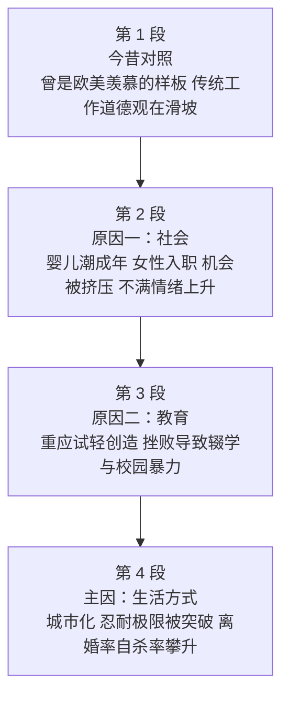

# Passage 33 · 日本道德滑坡的病根

## 答题记录

| 轮次  | 日期         | 题号  | 正确  | 错误  | 正确率 | 用时    | 错题归因 |
| --- | --- | --- | --- | --- | --- | --- | --- |
| 1 |  | 1-4 |  |  |  |  |  |
| 2 |  | 1-4 |  |  |  |  |  |
| 3 |  | 1-4 |  |  |  |  |  |

> [!tip] 填写口径
> - **用时**以分钟计，只计做题时间，不含精读复盘。
> - **错题归因**填「题型·错误类型」，如：细节题·定位错、推理判断·过度推断、主旨大意·以偏概全。
> - 纵向看趋势：正确率升而用时过长 → 熟练度不足；用时降而正确率波动 → 定位不稳。
> - 本篇为 2000 年真题，**只有 4 题**（同 Passage 22、28），题号栏填 1-4。

> [!info] 文章档案
> - **来源**：考研英语（一）2000 年 Text 4
> - **题材**：社会生活——战后日本从「勤奋守纪的样板」滑向「年轻人不知往哪儿走」，谋生压力、升学机器与城市化共同侵蚀了传统道德
> - **结构**：4 段 / 17 句 ＋ 4 题
> - **难度**：★★★★☆
> - **一句话主旨**：西方人眼里战后日本一度是「效率与和谐」的样板，如今却眼看着传统的工作道德观一路下滑——年轻人就业机会被挤压、教育只练应试不养创造力、城市生活把大家族拆成孤立的两代之家；真正的主因不是学校，而是日本人生活方式的彻底改变，离婚率与自杀率的攀升就是它留下的账单。

## 一、篇章脉络

- **第 1 段**：起笔先立一个「高标杆」——漫无目标从来不是战后日本的特征，其生产率与社会和谐令欧美艳羡（第 1 题的答案句）；随即用 But 一转，说日本人正看到传统工作道德观的衰退，并用「十年前的勤奋 vs 如今不知往哪儿走」完成今昔对照。
- **第 2 段**：给第一个原因——社会性的。战后婴儿潮一代成年、女性进入男性主导的就业市场，共同挤压了青少年的机会；两个调查数据（24.5% 的日本学生对学校生活满意 vs 美国的 67.2%；日本工人对工作的不满远超其余十国）坐实了这种不满。
- **第 3 段**：给第二个原因——教育性的。日本教育虽因重视基础常受外国人称赞，却偏重应试与机械学习而轻视创造力与自我表达；三位人物（海部俊树、濑户山三男）与两组数据（2125 起校园暴力、929 起袭师）说明后果：挫败感导致辍学、放荡、校园暴力；保守派因此主张回到战前的道德教育。
- **第 4 段**：用 But 把原因再推一层——**that may have more to do with Japanese lifestyles**（主因在此，第 2 题的答案句）。经济增长带来集中化，76% 的人口挤进城市，社区与大家族被孤立的两代之家取代；通勤漫长、居住拥挤，旧的集体与家庭价值观一松动，「不适」便开始显形（第 4 题的答案句）；离婚率十年上升五成以上、自杀率上升近四分之一，是最后的账单。

> [!tip] 行文逻辑
> 全篇是「现象 → 多方归因 → 主因」的经典结构，靠三个连接词推进：**But increasingly**（第 1 段②句，引出问题）→ **In addition / While often praised**（第 2、3 段，并列与让步式补充原因）→ **But that may have more to do with**（第 4 段①句，转折递进到主因）。因果链是本篇的骨架，第 2 题直接问「主要原因」，第 4 题问「生活方式改变的表现」，都在考这条链。四道题依次考：他人眼中战后日本的形象（第 1 题，定位第 1 段①句）、道德滑坡的主因（第 2 题，定位第 4 段①句）、作者的教育观（第 3 题，定位第 3 段①句）、生活方式改变的表现（第 4 题，定位第 4 段④句与⑤句）。全篇大量使用数据（24.5%、67.2%、2125、929、76%、119 million、50%、one-quarter），是本类文章最易出题的地方——但本篇**没有一道题考数据本身**，数据全部是论据。

## 二、逐段精读

### 第 1 段 · 今昔对照：曾令欧美艳羡，如今道德滑坡

**原文**

① Aimlessness has hardly been typical of the postwar Japan whose productivity and social harmony are the envy of the United States and Europe.
② But increasingly the Japanese are seeing a decline of the traditional work-moral values.
③ Ten years ago young people were hardworking and saw their jobs as their primary reason for being, but now Japan has largely fulfilled its economic needs, and young people don't know where they should go next.

**译文**

① 漫无目标几乎从来不是战后日本的特征——这个国家的生产率与社会和谐程度，曾令美国和欧洲艳羡不已。
② 但日本人正越来越多地看到，传统的工作道德观正在衰退。
③ 十年前，年轻人勤劳肯干，把工作视为自己生存的主要理由；而如今日本已大体满足了自身的经济需求，年轻人却不知道接下来该往哪里走。

> [!note] 段落要点
> - 功能：开篇立标＋转折——先把战后日本抬到「欧美艳羡」的高度，再用 But 引出「传统工作道德观在衰退」，③句用十年前后的对照把这条下降线画出来。
> - ①句是第 1 题的答案句：hardly（几乎不）＋ be the envy of（令……艳羡）＝ **西方的正面榜样**。命题人把「漫无目标」做成 A 项、「走下坡路」做成 D 项，都与这一句的方向相反或时间错位。
> - ①句 whose 引导的定语从句是难点：whose 指代 Japan's，relations 是「这个国家的生产率与社会和谐为欧美所羡慕」。
> - ②句 work-moral values（工作道德观）是全篇的题眼：后文所有原因都在解释它为什么衰退。注意 decline 是**名词**（a decline of）。
> - ③句是全段最复杂的一句，也是全篇的「今昔对照」模板：Ten years ago... but now... and... 三层并列。reason for being（存在的理由）是哲学术语的音译式表达，值得记。
> - ③句含一个深层悖论：经济需求已满足，年轻人却失去了方向——「富有之后反而迷失」是全篇的心理起点，也解释了为何是「价值观」问题而非「温饱」问题。

#### 长难句 · 本段

> [!abstract] 本段第 ① 句 · Aimlessness has hardly been typical of the postwar Japan whose productivity and social harmony are the envy of the United States and Europe.

**结构拆解**

- **主干**：Aimlessness has hardly been typical of the postwar Japan（主系表；hardly 为否定副词，几乎不）
- **结构**：be typical of 是……的典型特征（＝be characteristic of）
- **定语从句**：whose productivity and social harmony are the envy of the United States and Europe（whose ＝ the postwar Japan's，修饰 Japan）
- **表语**：the envy of sb（令某人艳羡的对象；envy 此处为名词「羡慕的对象」）
- **时态**：has been（现在完成时，表示从战后延续至今的状态）

**参考译文**

漫无目标几乎从来不是战后日本的特征——这个国家的生产率与社会和谐程度，曾令美国和欧洲艳羡不已。

> [!tip] 拆解要点
> 第 1 题的答案句。两处机关：一是 **hardly 的部分否定**——「漫无目标几乎不是战后日本的特征」，即战后日本一向**目标明确**（A 项 under aimless development 与之相反，故错）；二是 **the envy of** 这个习语（＝an object of envy 令人羡慕的对象），envy 在这里不是动词而是名词，且不含恶意。whose 引导的从句补充说明「为什么值得羡慕」：productivity（生产率）与 social harmony（社会和谐）。注意「艳羡者是欧美」这一信息——第 1 题问的是 In the Westerners' eyes，正是从 the United States and Europe 的视角看日本，答案 B（a positive example 正面榜样）由此而来。

> [!abstract] 本段第 ③ 句 · Ten years ago young people were hardworking and saw their jobs as their primary reason for being, but now Japan has largely fulfilled its economic needs, and young people don't know where they should go next.

**结构拆解**

- **分句一**：Ten years ago young people were hardworking and saw their jobs as their primary reason for being（and 连接两个谓语；see A as B 把 A 看作 B）
- **分句二**：but now Japan has largely fulfilled its economic needs（与分句一构成今昔对照）
- **分句三**：and young people don't know where they should go next（where 引导宾语从句；与分句二并列，共同构成 now 一端）
- **结构**：reason for being 存在的理由；fulfill one's needs 满足需求

**参考译文**

十年前，年轻人勤劳肯干，把工作视为自己生存的主要理由；而如今日本已大体满足了自身的经济需求，年轻人却不知道接下来该往哪里走。

> [!tip] 拆解要点
> 一句之内完成一次「时间跳切」。骨架是 **Ten years ago... but now... and...**：前半写过去（勤劳、以工作为生存理由），后半写现在（经济需求已满足、却不知去向）。抓这种句子的办法是先找时间状语（Ten years ago / now），把句子劈成两半再各读一遍。see A as B（把 A 看作 B）和 reason for being（存在的理由）都值得背下来；fulfill（满足、实现）比 meet 更正式，常见搭配 fulfill a need / a promise / a dream。

#### 本段重点词汇

| 单词 / 短语 | 词性 | 文中意 | 常用考义与拓展 | 英文示例搭配（中译） |
| --- | --- | --- | --- | --- |
| **aimlessness** | n. | 漫无目标，无目的性 | 构词 aimless（无目标的）＋-ness；aim n. 目标／v. 旨在（aim at）；aimlessly adv. 漫无目的地 | Aimlessness has hardly been typical of...（漫无目标几乎不是……的特征） |
| **hardly** | adv. | 几乎不，几乎没有 | 否定副词，置于句中即构成否定句；hardly...when 一……就……；scarcely / barely 近义 | has hardly been typical of（几乎不是……的典型） |
| **be typical of** | 短语 | 是……的典型特征 | typical adj. 典型的；typically adv. 典型地（见 Passage 32）；= be characteristic of | typical of the postwar Japan（战后日本的典型特征） |
| **postwar** | adj. | 战后的 | 构词 post-（后）＋war；反义 prewar 战前的（见第 3 段）；post-industrial 后工业化的 | the postwar Japan（战后日本） |
| **productivity** | n. | 生产率，生产力 | produce v. 生产；product n. 产品；productive adj. 多产的；labor productivity 劳动生产率 | whose productivity and social harmony（其生产率与社会和谐） |
| **social harmony** | n. | 社会和谐 | harmony n. 和谐、协调（in harmony with 与……协调）；harmonious adj. 和谐的 | productivity and social harmony（生产率与社会和谐） |
| **be the envy of** | 短语 | 令……艳羡，是……羡慕的对象 | envy n. 羡慕、嫉妒／v. 羡慕；envious adj. 羡慕的（be envious of）；green with envy 十分嫉妒 | are the envy of the United States and Europe（令美欧艳羡） |
| **increasingly** | adv. | 越来越多地，日益 | increase v./n. 增加；increasing adj. 日益增长的；= more and more | increasingly the Japanese are seeing...（日本人正越来越多地看到……） |
| **a decline of** | 短语 | ……的衰退、下降 | decline v. 婉拒（见 Passage 32）／n. 下降；a decline in ……方面的下降 | a decline of the traditional work-moral values（传统工作道德观的衰退） |
| **work-moral values** | n. | 工作道德观，职业道德观 | 复合定语 work-moral（工作方面的道德）；values n. 价值观（family values 家庭观） | the traditional work-moral values（传统的工作道德观） |
| **hardworking** | adj. | 勤劳的，勤奋的 | = diligent / industrious；hard work n. 努力工作；work hard v. 努力工作 | young people were hardworking（年轻人勤劳肯干） |
| **primary** | adj. | 主要的，首要的 | primarily adv. 主要地；primary school 小学；prime adj. 首要的 | their primary reason for being（他们生存的主要理由） |
| **reason for being** | 短语 | 存在的理由 | 源自哲学术语 raison d'être；= the purpose of existence | saw their jobs as their primary reason for being（把工作视为生存的主要理由） |
| **fulfill** | v. | 满足，实现 | fulfill a need/a promise/a dream 满足需求／履行承诺／实现梦想；fulfillment n. 成就感、履行 | Japan has largely fulfilled its economic needs（日本已大体满足其经济需求） |
| **economic needs** | n. | 经济需求 | economic adj. 经济的（≠ economical 节约的）；economics n. 经济学；economy n. 经济 | fulfilled its economic needs（满足了自身的经济需求） |
| **go next** | 短语 | 接下来往哪里走 | next adv. 接下来；where to go next 下一步去向 | don't know where they should go next（不知接下来该往哪里走） |

### 第 2 段 · 原因一：机会被挤压，不满在上升

**原文**

① The coming of age of the postwar baby boom and an entry into the male-dominated job market have limited the opportunities of teenagers who are already questioning the heavy personal sacrifices involved in climbing Japan's rigid social ladder to good schools and jobs.
② In a recent survey, it was found that only 24.5 percent of Japanese students were fully satisfied with school life, compared with 67.2 percent of students in the United States.
③ In addition, far more Japanese workers expressed dissatisfaction with their jobs than did their counterparts in the 10 other countries surveyed.

**译文**

① 战后婴儿潮一代的成年，以及女性进入由男性主导的就业市场，共同挤压了青少年的机会——这些青少年本已在质疑：为了攀登日本僵硬的社会阶梯、考上好学校、找到好工作，付出如此沉重的个人牺牲是否值得。
② 在最近的一项调查中发现，只有 24.5% 的日本学生对学校生活感到完全满意，而美国学生的这一比例为 67.2%。
③ 此外，表示对工作不满的日本工人，远多于接受调查的其他十个国家中的同行。

> [!note] 段落要点
> - 功能：归因段（社会层面）——两个人口结构变化挤压了年轻人的机会，两个调查数据证明不满情绪确实在上升。
> - ①句是全段的核心长句，主语是**两件事并列**：婴儿潮一代成年（the coming of age of the postwar baby boom）＋ 女性进入职场（an entry into the male-dominated job market），谓语 have limited。
> - ①句里的 who 从句很关键：青少年「本已在质疑」为升学就业付出的沉重个人牺牲——说明不满不是被数据发现的，而是早已存在。question 作动词「质疑」是熟词僻义（见 Passage 32）。
> - ①句的 climb Japan's rigid social ladder to good schools and jobs 是全篇最形象的比喻：把升学与就业比作爬一架僵硬的梯子，rigid（僵硬的、缺乏弹性的）暗含批评。
> - ②句用 24.5% vs 67.2% 的对比坐实「学生满意度低」；③句用 In addition 追加「工人不满度高于其余十国」。两组数据都是论据，本篇没有直接考，但第 2 题 B 项（More workers are dissatisfied with their jobs）正是从③句取材后**被当作「原因」误植**的。
> - 段落逻辑：「机会被挤压（①，原因）→ 学生不满（②，证据一）→ 工人不满（③，证据二）」。

#### 长难句 · 本段

> [!abstract] 本段第 ① 句 · The coming of age of the postwar baby boom and an entry into the male-dominated job market have limited the opportunities of teenagers who are already questioning the heavy personal sacrifices involved in climbing Japan's rigid social ladder to good schools and jobs.

**结构拆解**

- **主语（并列）**：The coming of age of the postwar baby boom and an entry into the male-dominated job market（两个名词短语并列；coming of age 成年）
- **谓语**：have limited（主语为复数，故用 have）
- **宾语**：the opportunities of teenagers
- **定语从句**：who are already questioning the heavy personal sacrifices（修饰 teenagers）
- **过去分词作后置定语**：involved in climbing...（＝which are involved in...，修饰 sacrifices）
- **介词宾语**：climbing Japan's rigid social ladder（动名词短语；social ladder 社会阶梯）
- **目的／方向**：to good schools and jobs（通往好学校与好工作）

**参考译文**

战后婴儿潮一代的成年，以及女性进入由男性主导的就业市场，共同挤压了青少年的机会——这些青少年本已在质疑：为攀登日本僵硬的社会阶梯、考上好学校、找到好工作而付出如此沉重的个人牺牲是否值得。

> [!tip] 拆解要点
> 全篇最长的句子之一，但骨架清晰：**A and B have limited C of D who...**。三步拆：①主语是两件事（婴儿潮成年、女性入职），谓语只有一个 have limited；②宾语 opportunities 后有 of teenagers， teenagers 又带 who 从句；③who 从句里，宾语是 sacrifices，其后 involved in climbing... 是过去分词作定语（＝「攀登阶梯所涉及的牺牲」）。两个值得记的搭配：**coming of age（成年、达到法定年龄）** 与 **climb the social ladder（攀登社会阶梯）**。命题角度：第 2 题 A 项 Women's participation in social activities is limited 就是从本句「女性进入职场」取材后偷换的——原文是「女性的进入**限制了青少年的机会**」，A 项却说「女性参与社会活动**受限制**」，主宾颠倒。

#### 本段重点词汇

| 单词 / 短语 | 词性 | 文中意 | 常用考义与拓展 | 英文示例搭配（中译） |
| --- | --- | --- | --- | --- |
| **coming of age** | n. | 成年（到达法定年龄） | come of age 成年、成熟（动词短语）；= reach adulthood | The coming of age of the postwar baby boom（战后婴儿潮一代的成年） |
| **baby boom** | n. | 婴儿潮，生育高峰 | boom n. 繁荣、激增／v. 迅猛发展；baby boomer 婴儿潮一代（见 Passage 21） | the postwar baby boom（战后的婴儿潮） |
| **entry into** | 短语 | 进入，加入 | enter v. 进入；entry n. 进入、条目；entry into the market 进入市场 | an entry into the job market（进入就业市场） |
| **male-dominated** | adj. | 男性主导的 | 构词 名词＋过去分词：male-dominated / female-dominated 女性主导的；dominate v. 支配 | the male-dominated job market（男性主导的就业市场） |
| **job market** | n. | 就业市场，劳动力市场 | = labor market；job hunting 求职；job security 工作保障 | an entry into the male-dominated job market（进入男性主导的就业市场） |
| **limit** | v./n. | 限制，限定 | limited adj. 有限的；limitation n. 局限；limitless adj. 无限的 | have limited the opportunities of teenagers（限制了青少年的机会） |
| **opportunity** | n. | 机会，机遇 | opportunity cost 机会成本；take the opportunity to do 借机做；= chance | the opportunities of teenagers（青少年的机会） |
| **teenager** | n. | 青少年（13–19 岁） | teen n. 十几岁；teenage adj. 青少年的；adolescent n. 青少年（更正式） | the opportunities of teenagers（青少年的机会） |
| **question** | v. | 质疑，对……表示怀疑 | 熟词僻义：名词「问题」→ 动词「质疑」（见 Passage 32）；questioning 亦作形容词「爱探究的」 | who are already questioning...（已经在对……提出质疑） |
| **sacrifice** | n./v. | 牺牲，舍弃 | make sacrifices for 为……作出牺牲；self-sacrifice 自我牺牲；at the sacrifice of 以牺牲……为代价 | the heavy personal sacrifices（沉重的个人牺牲） |
| **be involved in** | 短语 | 被卷入；牵涉到，涉及 | involve v. 涉及（见 Passage 31）；involvement n. 参与；be involved in doing 涉及做 | sacrifices involved in climbing...（攀登……所涉及的牺牲） |
| **climb the social ladder** | 短语 | 攀登社会阶梯，向上爬 | ladder n. 梯子；social mobility 社会流动；climb the career ladder 职业晋升 | climbing Japan's rigid social ladder（攀登日本僵硬的社会阶梯） |
| **rigid** | adj. | 僵硬的，死板的，严格的 | rigid rules 死板的规定；rigidity n. 僵化；反义 flexible 灵活的 | Japan's rigid social ladder（日本僵硬的社会阶梯） |
| **survey** | n./v. | 调查，勘测 | conduct/carry out a survey 开展调查；surveyor n. 测量员；questionnaire n. 问卷 | In a recent survey（在最近的一项调查中） |
| **be satisfied with** | 短语 | 对……感到满意 | satisfaction n. 满意；satisfactory adj. 令人满意的；dissatisfied adj. 不满意的 | were fully satisfied with school life（对学校生活完全满意） |
| **compared with** | 短语 | 与……相比 | compare A with B 把 A 与 B 相比；compare A to B 把 A 比作 B；comparison n. 比较 | compared with 67.2 percent of students in the United States（相比之下美国学生为 67.2%） |
| **in addition** | 短语 | 此外，另外 | = besides / furthermore / moreover；in addition to 除……之外 | In addition, far more Japanese workers...（此外，远更多的日本工人……） |
| **dissatisfaction** | n. | 不满，不满意 | 构词 dis-＋satisfaction；dissatisfied adj. 不满的（be dissatisfied with）；反义 satisfaction | expressed dissatisfaction with their jobs（表达对工作的不满） |
| **counterpart** | n. | 对应的人或物，同行， counterpart | 构词 counter-（对应）＋part；常用于跨国、跨部门对比 | than did their counterparts in the 10 other countries（比其余十国的同行） |

### 第 3 段 · 原因二：只练应试，不养创造力

**原文**

① While often praised...for its emphasis on the basics, Japanese education tends to stress test taking and mechanical learning over creativity and self-expression.
② "Those things that do not show up in the test scores—personality, ability, courage or humanity—are completely ignored," says Toshiki Kaifu, chairman of the ruling Liberal Democratic Party's education committee.
③ "Frustration against this kind of thing leads kids to drop out and run wild."
④ Last year Japan experienced 2,125 incidents of school violence, including 929 assaults on teachers.
⑤ Amid the outcry, many conservative leaders are seeking a return to the prewar emphasis on moral education.
⑥ Last year Mitsuo Setoyama, who was then education minister, raised eyebrows when he argued that liberal reforms introduced by the American occupation authorities after World War II had weakened the "Japanese morality of respect for parents."

**译文**

① 尽管日本教育因重视基础教育而常常受到外国人的赞扬，但它往往强调应试与机械学习，而忽视创造力与自我表达。
② 自民党教育委员会主席海部俊树说：「个性、能力、勇气或人性——那些在考试分数上显示不出来的东西，被完全忽视了。」
③ 「对这种状况的挫败感，导致孩子们辍学、放纵。」
④ 去年日本发生了 2125 起校园暴力事件，其中包括 929 起袭击教师事件。
⑤ 在一片抗议声中，许多保守派领导人正谋求回归战前对道德教育的重视。
⑥ 去年，时任文部大臣的濑户山三男提出了一个令人侧目的观点：二战后由美国占领当局引入的自由化改革，削弱了日本「尊重父母」的道德观念。

> [!note] 段落要点
> - 功能：归因段（教育层面）——第 3 题的全部答案都在这一段。
> - ①句是段首论点，也是第 3 题的答案句：While 引导让步（虽因重基础受称赞），主句才是重点（tends to stress test taking and mechanical learning **over** creativity and self-expression）。stress A over B ＝ 重视 A 而轻视 B，作者的态度是**批评**，故第 3 题 C 项（应更重视创造力培养）正确。
> - ②句引海部俊树的话：个性、能力、勇气、人性这些「分数上看不出来的东西」被完全忽略——与①句互为印证。
> - ③句给出因果链：**挫折感 → 辍学、放纵**（frustration leads kids to drop out and run wild）。第 3 题 D 项把它倒过来说（辍学导致应试挫败感），故错。
> - ④句用数据（2125 起校园暴力、929 起袭师）坐实后果；⑤句写保守派的对策（回到战前的道德教育）；⑥句借濑户山三男之口把矛头指向美国占领当局的自由改革——这一句是第 2 题 D 项「西方价值观影响生活方式」的**部分依据**（但不是主因句）。
> - 段落逻辑：「评价（①）→ 引语佐证（②③）→ 后果数据（④）→ 社会反应（⑤⑥）」。

#### 长难句 · 本段

> [!abstract] 本段第 ① 句 · While often praised by foreigners for its emphasis on the basics, Japanese education tends to stress test taking and mechanical learning over creativity and self-expression.

**结构拆解**

- **让步状语（省略式）**：While often praised by foreigners for its emphasis on the basics（＝While (it is) often praised...；while 此处表**让步**＝although）
- **结构**：praise sb for sth 因某事称赞某人；emphasis on 对……的重视
- **主干**：Japanese education tends to stress test taking and mechanical learning over creativity and self-expression
- **谓语**：tends to do 往往、倾向于
- **结构**：stress A over B 重视 A 甚于 B（over ＝ more than）

**参考译文**

尽管日本教育因重视基础教育而常常受到外国人的赞扬，但它往往强调应试与机械学习，而忽视创造力与自我表达。

> [!tip] 拆解要点
> 第 3 题的答案句。三处机关：一是 **while 表让步**（此处绝不是「当……时」），让步从句的内容往往是「别人怎么说」，主句才是「作者怎么看」——凡 while 开头的句子，重心一律在主句；二是 **stress A over B** 这个结构（重视 A 而轻视 B），作者借此点出日本教育的偏废；三是 **tends to**（往往、倾向于），既表频率又留有余地。第 3 题 B 项（日本教育以机械学习**和**创造力为特征）用 as well as 把被 over 否掉的 creativity 又拉了回来，与原文相反；A 项则把「因重视基础教育而受称赞」偷换成「日本教育受称赞」，与文中未提的「有助于攀登社会阶梯」拼接。

> [!abstract] 本段第 ⑥ 句 · Last year Mitsuo Setoyama, who was then education minister, raised eyebrows when he argued that liberal reforms introduced by the American occupation authorities after World War II had weakened the "Japanese morality of respect for parents."

**结构拆解**

- **主干**：Mitsuo Setoyama raised eyebrows when he argued that...（raise eyebrows 令人侧目、令人惊讶）
- **非限定性定语从句**：who was then education minister（修饰主语；then 当时的）
- **时间状语从句**：when he argued that...（when 引导；argue 后接宾语从句）
- **宾语从句**：that liberal reforms...had weakened the "Japanese morality of respect for parents"（过去完成时，表示「削弱」发生在 argued 之前）
- **过去分词作后置定语**：introduced by the American occupation authorities after World War II（＝which were introduced by...，修饰 liberal reforms）
- **习语**：raise eyebrows 扬起眉毛＝令人惊讶／侧目

**参考译文**

去年，时任文部大臣的濑户山三男提出了一个令人侧目的观点：二战后由美国占领当局引入的自由化改革，削弱了日本「尊重父母」的道德观念。

> [!tip] 拆解要点
> 一句套四层（定语从句＋状语从句＋宾语从句＋分词定语），是本篇句法最密的一句。拆法：先抓主干 Mitsuo Setoyama raised eyebrows（濑户山三男语出惊人），再看 when 从句（他主张……），最后处理 that 从句里的 introduced by...（改革是谁引入的）。两处值得记：**raise eyebrows** 是习语（令人侧目、令人惊讶），不是「扬眉」的字面动作；**introduced by** 是过去分词作定语，等于 which were introduced by。此句在文中的作用是给保守派的观点收尾——把道德滑坡的部分责任推给战后美国主导的自由化改革，正好呼应第 2 题 D 项中的 Western values（但文章的主因判断在第 4 段，不在这一句）。

#### 本段重点词汇

| 单词 / 短语 | 词性 | 文中意 | 常用考义与拓展 | 英文示例搭配（中译） |
| --- | --- | --- | --- | --- |
| **while** | conj. | 尽管，虽然（让步） | while 亦可表对比（见 Passage 31）与时间（当……时）；此处＝although | While often praised by foreigners...（尽管常受外国人称赞……） |
| **praise sb for** | 短语 | 因……而称赞某人 | praise n./v. 赞扬；praiseworthy adj. 值得称赞的；sing high praise for 高度赞扬 | praised by foreigners for its emphasis on the basics（因重视基础而受外国人称赞） |
| **emphasis on** | 短语 | 对……的重视 | emphasize v. 强调；put/lay emphasis on 强调；emphatic adj. 强调的 | its emphasis on the basics（对基础教育的重视） |
| **the basics** | n. | 基础（知识、技能） | basic adj. 基本的；basically adv. 基本上；the basics of grammar 语法基础 | emphasis on the basics（对基础教育的重视） |
| **tend to** | 短语 | 往往，倾向于 | tendency n. 趋势（a tendency to do）；tend v. 照料、趋向 | tends to stress test taking and mechanical learning（往往强调应试与机械学习） |
| **stress A over B** | 短语 | 重视 A 甚于 B | stress v. 强调／n. 压力；stress the importance of 强调……的重要性 | stress test taking over creativity（重应试甚于重创造力） |
| **test taking** | n. | 应试，参加考试 | take a test 参加考试；test-oriented education 应试教育；exam-oriented 应试的 | stress test taking and mechanical learning（强调应试与机械学习） |
| **mechanical learning** | n. | 机械学习，死记硬背 | mechanical adj. 机械的；mechanism n. 机制（见 Passage 32）；rote learning 死记硬背 | mechanical learning over creativity（机械学习甚于创造力） |
| **creativity** | n. | 创造力，创造性 | create v. 创造；creative adj. 有创造力的；creature n. 生物；cultivate creativity 培养创造力 | over creativity and self-expression（甚于创造力与自我表达） |
| **self-expression** | n. | 自我表达，自我表现 | express v. 表达；expression n. 表达、表情；self- 前缀：self-confidence 自信 | creativity and self-expression（创造力与自我表达） |
| **show up** | 短语 | 显现，露面 | 熟词僻义：常见义「到场」→ 此处「（在分数上）显示出来」（见 Passage 31） | those things that do not show up in the test scores（那些在分数上显示不出来的东西） |
| **ignore** | v. | 忽视，不顾 | ignorance n. 无知（be in ignorance of）；ignorant adj. 无知的（be ignorant of） | are completely ignored（被完全忽视） |
| **frustration** | n. | 挫败感，沮丧 | frustrate v. 使受挫；frustrated adj. 挫败的；frustrating adj. 令人沮丧的 | Frustration against this kind of thing（对这种状况的挫败感） |
| **drop out** | 短语 | 辍学，退出 | dropout n. 辍学者；drop out of school 退学；drop out of the race 退出竞选 | leads kids to drop out and run wild（导致孩子们辍学、放纵） |
| **run wild** | 短语 | 放纵，撒野 | wild adj. 野的、狂野的；run wild 亦作「（植物）蔓生」 | leads kids to drop out and run wild（导致孩子们辍学、放纵） |
| **school violence** | n. | 校园暴力 | violence n. 暴力；violent adj. 暴力的；domestic violence 家庭暴力 | 2,125 incidents of school violence（2125 起校园暴力事件） |
| **amid** | prep. | 在……之中（常指氛围） | amid the crisis 在危机中；amid protests 在抗议声中；= in the middle of | Amid the outcry（在一片抗议声中） |
| **outcry** | n. | 强烈抗议，公众的强烈反对 | 构词 out＋cry；public outcry 公众抗议；protest n./v. 抗议 | Amid the outcry（在一片抗议声中） |
| **moral education** | n. | 道德教育 | moral adj. 道德的／n. 寓意、道德；morality n. 道德（见本段末）；immoral 不道德的 | a return to the prewar emphasis on moral education（回归战前对道德教育的重视） |
| **raise eyebrows** | 短语 | 令人侧目，令人惊讶 | 习语：字面「扬起眉毛」；eyebrow-raising adj. 令人吃惊的 | raised eyebrows when he argued that...（当他主张……时令人侧目） |
| **liberal reform** | n. | 自由化改革 | liberal adj. 自由的、开明的／n. 自由主义者；liberalism 自由主义；reform n./v. 改革 | liberal reforms introduced by...（由……引入的自由化改革） |
| **occupation authorities** | n. | 占领当局 | occupation n. 占领、职业（见 Passage 32 employer 条）；authority n. 当局、权威 | the American occupation authorities（美国占领当局） |
| **weaken** | v. | 削弱，使变弱 | weak adj. 虚弱的；weakness n. 弱点；weaken one's resolve 动摇决心 | had weakened the "Japanese morality of respect for parents"（削弱了「尊重父母」的日本道德观） |
| **morality** | n. | 道德，道德观 | moral adj. 道德的；moral decline 道德滑坡（见第 2 题题干）；immorality 不道德 | the Japanese morality of respect for parents（日本尊重父母的道德观） |

### 第 4 段 · 主因：生活方式变了，忍耐到头了

**原文**

① But that may have more to do with Japanese lifestyles.
② "In Japan," says educator Yoko Muro, "it's never a question of whether you enjoy your job and your life, but only how much you can endure."
③ With economic growth has come centralization; fully 76 percent of Japan's 119 million citizens live in cities where community and the extended family have been abandoned in favor of isolated, two-generation households.
④ Urban Japanese have long endured lengthy commutes (travels to and from work) and crowded living conditions, but as the old group and family values weaken, the discomfort is beginning to tell.
⑤ In the past decade, the Japanese divorce rate, while still well below that of the United States, has increased by more than 50 percent, and suicides have increased by nearly one-quarter.

**译文**

① 但这更可能与日本人的生活方式有关。
② 教育家室伏洋子说：「在日本，问题从来不是你是否享受自己的工作与生活，而仅仅是你能够忍受多少。」
③ 经济增长带来的是集中化；日本 1.19 亿国民中足有 76% 住在城市里，在那里，社区和大家庭已被抛弃，取而代之的是孤立的两代之家。
④ 城市中的日本人长期忍受着漫长的通勤（上下班往返）和拥挤的居住条件，但随着旧的集体与家庭价值观的弱化，这种不适开始显现出来。
⑤ 在过去的十年里，日本的离婚率虽然仍远低于美国，却已上升了五成以上，自杀率也上升了近四分之一。

> [!note] 段落要点
> - 功能：归因段的收束——用 But 把原因从「教育」推进到更根本的「生活方式」，①句是第 2 题的答案句，④句是第 4 题的答案句。
> - ①句 But that may have more to do with Japanese lifestyles 中，that 回指上文的道德滑坡；**have more to do with（与……关系更大）** 是本篇的最高级信号——第 2 题问 chiefly responsible（主要原因），答案正是本句。
> - ②句引教育家室伏洋子的话：日本人的生活准则不是「享受」而是「能忍受多少」——一个 endure 字定下全段基调，④句的 endured 与之呼应。
> - ③句是全段的骨架句：经济增长 → 集中化 → 76% 人口进城 → 社区和大家族被孤立的两代之家取代。倒装结构 With economic growth has come centralization 是考研的常考语法点。
> - ④句是第 4 题的答案句：旧的集体与家庭价值观一弱化，**the discomfort is beginning to tell**（不适开始显现／开始要人命）。begin to tell 是习语，指「（长期压抑的东西）开始产生效果、开始显形」。
> - ⑤句用两个数据收尾：离婚率十年涨五成以上、自杀率涨近四分之一；插入的 while still well below that of the United States 是作者的克制（第 4 题 B 项正是把它反着说）。
> - 段落逻辑：「主因判断（①）→ 生活准则（②）→ 城市化的代价（③）→ 忍耐到极限（④）→ 两份账单（⑤）」。

#### 长难句 · 本段

> [!abstract] 本段第 ③ 句 · With economic growth has come centralization; fully 76 percent of Japan's 119 million citizens live in cities where community and the extended family have been abandoned in favor of isolated, two-generation households.

**结构拆解**

- **分句一（全部倒装）**：With economic growth has come centralization（介词短语提前引起主谓倒装；正常语序＝Centralization has come with economic growth）
- **分句二**：fully 76 percent of Japan's 119 million citizens live in cities（fully 强调数量之足＝足足）
- **定语从句**：where community and the extended family have been abandoned（where ＝ in which，修饰 cities；现在完成时被动）
- **介词短语**：in favor of isolated, two-generation households（in favor of 支持、选择……取代……；此处＝「取而代之的是……」）

**参考译文**

经济增长带来的是集中化；日本 1.19 亿国民中足有 76% 住在城市里，在那里，社区和大家庭已被抛弃，取而代之的是孤立的两代之家。

> [!tip] 拆解要点
> 两处语法点值得单独记：一是**介词短语前置引起的全部倒装**（With economic growth has come centralization），正常语序是 Centralization has come with economic growth，凡句首是 With/In/On 等介词短语、谓语又是不及物动词（come/stand/lie），多半是倒装，还原后再读；二是 **in favor of** 在本文的特殊用法——不是「支持」，而是「（被放弃后）取而代之的是」，abandon A in favor of B ＝ 弃 A 而取 B。fully 修饰数字时作「足足、整整」，是熟词僻义。

> [!abstract] 本段第 ④ 句 · Urban Japanese have long endured lengthy commutes (travels to and from work) and crowded living conditions, but as the old group and family values weaken, the discomfort is beginning to tell.

**结构拆解**

- **分句一**：Urban Japanese have long endured lengthy commutes and crowded living conditions（现在完成时，表示从过去持续至今；long 为「长期地」）
- **括号注释**：(travels to and from work)（解释 commutes；commute 通勤）
- **分句二**：but as the old group and family values weaken, the discomfort is beginning to tell
- **时间／原因状语从句**：as the old group and family values weaken（as ＝ 随着；weaken 弱化）
- **习语**：begin to tell（开始显形、开始产生效果；tell 此处＝have an effect）

**参考译文**

城市中的日本人长期忍受着漫长的通勤（上下班往返）和拥挤的居住条件，但随着旧的集体与家庭价值观的弱化，这种不适开始显现出来。

> [!tip] 拆解要点
> 第 4 题的答案句。结构上是「长期忍受（过去）→ but 随着价值观松动，不适开始显形（现在）」。两处机关：一是 **as 表「随着」**（兼有时间与原因意味），它把「旧价值观弱化」与「不适显形」连成因果；二是 **begin to tell 的习语义**——tell 在此不是「告诉」，而是「起作用、显出效果」（the strain is beginning to tell 压力开始显出恶果）。第 4 题 A 项 the young are less tolerant of discomforts in life（年轻人更难以忍受生活中的不舒适）正是对这一句的改写：过去能忍，现在忍不了了。B 项把⑤句的 well below 说成 exceeds，C 项把「忍耐力减弱」说成「忍得更多」，D 项则与②句「问题从来不是你是否享受生活」完全相反。

> [!abstract] 本段第 ⑤ 句 · In the past decade, the Japanese divorce rate, while still well below that of the United States, has increased by more than 50 percent, and suicides have increased by nearly one-quarter.

**结构拆解**

- **时间状语**：In the past decade（与现在完成时连用）
- **主语**：the Japanese divorce rate
- **插入的让步／对比状语**：while still well below that of the United States（＝while it is still well below...；that 指代 the divorce rate；well below 远低于）
- **谓语一**：has increased by more than 50 percent（increase by ＋ 幅度）
- **并列分句**：and suicides have increased by nearly one-quarter（one-quarter ＝ 25%）

**参考译文**

在过去的十年里，日本的离婚率虽然仍远低于美国，却已上升了五成以上，自杀率也上升了近四分之一。

> [!tip] 拆解要点
> 一句之内两组数据＋一层让步。三处细节：一是 **while ＋ 省略结构**（while (it is) still well below...），插在主语与谓语之间，读时可先跳过；二是 **that 的指代**（that of the United States ＝ the divorce rate of the United States，比较结构中常用 that 代替前面的名词）；三是 **increase by ＋ 幅度**（增加了……）与 increase to ＋ 数值（增加到……）的区分。命题角度：第 4 题 B 项 the divorce rate in Japan exceeds that in the U.S. 就是把 still well below 反过来说，属「与原文相反」型干扰项。

#### 本段重点词汇

| 单词 / 短语 | 词性 | 文中意 | 常用考义与拓展 | 英文示例搭配（中译） |
| --- | --- | --- | --- | --- |
| **have more to do with** | 短语 | 与……关系更大，更主要与……有关 | have something/little/nothing to do with 与……有些／几乎没／毫无关系 | that may have more to do with Japanese lifestyles（这更可能与日本人的生活方式有关） |
| **lifestyle** | n. | 生活方式 | 构词 life＋style；lifestyle change 生活方式改变（见第 4 题题干）；way of life 生活方式 | Japanese lifestyles（日本人的生活方式） |
| **endure** | v. | 忍受，忍耐；持续 | endurance n. 忍耐力；endurable adj. 可忍受的；= tolerate / put up with | how much you can endure（你能忍受多少） |
| **centralization** | n. | 集中化，集权化 | central adj. 中心的；centralize v. 集中；decentralization 分权 | With economic growth has come centralization（经济增长带来了集中化） |
| **fully** | adv. | 足足，整整；完全地 | 熟词僻义：修饰数字＝as many as 足足；fully aware 完全意识到 | fully 76 percent of Japan's citizens（足有 76% 的日本国民） |
| **citizen** | n. | 公民，国民 | citizenship n. 公民身份；citizenry n. 全体公民；senior citizen 老年人 | Japan's 119 million citizens（日本的 1.19 亿国民） |
| **extended family** | n. | 大家庭（数代同堂） | extend v. 延伸；extended adj. 延伸的、扩展的；反义 nuclear family 核心家庭 | community and the extended family（社区和大家庭） |
| **abandon...in favor of** | 短语 | 弃……而取…… | abandon v. 抛弃、放弃；in favor of 支持、有利于；此处意为「取而代之的是」 | have been abandoned in favor of isolated households（被弃而代之以孤立的家庭） |
| **isolated** | adj. | 孤立的，隔离的 | isolate v. 隔离；isolation n. 孤立（in isolation）；isolated incident 孤立事件 | isolated, two-generation households（孤立的两代之家） |
| **household** | n. | 家庭，户 | householder n. 户主；household income 家庭收入；two-generation household 两代之家 | isolated, two-generation households（孤立的两代之家） |
| **lengthy** | adj. | 漫长的，冗长的 | length n. 长度；lengthen v. 延长；at length 详细地／终于 | lengthy commutes（漫长的通勤） |
| **commute** | n./v. | 通勤，上下班往返 | commuter n. 通勤者；commuting time 通勤时间 | endure lengthy commutes（忍受漫长的通勤） |
| **crowded** | adj. | 拥挤的 | crowd n. 人群／v. 挤满；be crowded with 挤满；overcrowded 过度拥挤 | crowded living conditions（拥挤的居住条件） |
| **living conditions** | n. | 居住条件，生活条件 | condition n. 状况、条件（on condition that 条件是）；working conditions 工作条件 | crowded living conditions（拥挤的居住条件） |
| **begin to tell** | 短语 | 开始显出效果，开始显形 | 习语：tell 此处＝have an effect；the strain is beginning to tell 压力开始显出后果 | the discomfort is beginning to tell（这种不适开始显现出来） |
| **in the past decade** | 短语 | 在过去的十年里 | decade n. 十年；与现在完成时连用；over the past decade 近十年来 | In the past decade, the Japanese divorce rate...（在过去十年里，日本的离婚率……） |
| **divorce rate** | n. | 离婚率 | divorce n./v. 离婚；divorce rate 离婚率；marriage rate 结婚率 | the Japanese divorce rate（日本的离婚率） |
| **well below** | 短语 | 远低于 | well 修饰介词＝much／far 大大地；well above 远高于；well over 远超 | while still well below that of the United States（虽然仍远低于美国） |
| **suicide** | n. | 自杀 | commit suicide 自杀；suicidal adj. 自杀的；suicide rate 自杀率 | suicides have increased by nearly one-quarter（自杀率上升了近四分之一） |

## 三、全篇重点词汇汇总（自测用）

> [!info] 说明
> 本表只列「单词 / 词性 / 所在段」，不含释义与搭配，用于遮表自测：说出词义后再回该段核对。
> 收录**全篇所有段落词汇，共 78 条，不删减**，与各段「本段重点词汇」等长同源。

| 单词 / 短语 | 词性 | 所在段 |
| --- | --- | --- |
| **aimlessness** | n. | 第 1 段 |
| **hardly** | adv. | 第 1 段 |
| **be typical of** | 短语 | 第 1 段 |
| **postwar** | adj. | 第 1 段 |
| **productivity** | n. | 第 1 段 |
| **social harmony** | n. | 第 1 段 |
| **be the envy of** | 短语 | 第 1 段 |
| **increasingly** | adv. | 第 1 段 |
| **a decline of** | 短语 | 第 1 段 |
| **work-moral values** | n. | 第 1 段 |
| **hardworking** | adj. | 第 1 段 |
| **primary** | adj. | 第 1 段 |
| **reason for being** | 短语 | 第 1 段 |
| **fulfill** | v. | 第 1 段 |
| **economic needs** | n. | 第 1 段 |
| **go next** | 短语 | 第 1 段 |
| **coming of age** | n. | 第 2 段 |
| **baby boom** | n. | 第 2 段 |
| **entry into** | 短语 | 第 2 段 |
| **male-dominated** | adj. | 第 2 段 |
| **job market** | n. | 第 2 段 |
| **limit** | v./n. | 第 2 段 |
| **opportunity** | n. | 第 2 段 |
| **teenager** | n. | 第 2 段 |
| **question** | v. | 第 2 段 |
| **sacrifice** | n./v. | 第 2 段 |
| **be involved in** | 短语 | 第 2 段 |
| **climb the social ladder** | 短语 | 第 2 段 |
| **rigid** | adj. | 第 2 段 |
| **survey** | n./v. | 第 2 段 |
| **be satisfied with** | 短语 | 第 2 段 |
| **compared with** | 短语 | 第 2 段 |
| **in addition** | 短语 | 第 2 段 |
| **dissatisfaction** | n. | 第 2 段 |
| **counterpart** | n. | 第 2 段 |
| **while** | conj. | 第 3 段 |
| **praise sb for** | 短语 | 第 3 段 |
| **emphasis on** | 短语 | 第 3 段 |
| **the basics** | n. | 第 3 段 |
| **tend to** | 短语 | 第 3 段 |
| **stress A over B** | 短语 | 第 3 段 |
| **test taking** | n. | 第 3 段 |
| **mechanical learning** | n. | 第 3 段 |
| **creativity** | n. | 第 3 段 |
| **self-expression** | n. | 第 3 段 |
| **show up** | 短语 | 第 3 段 |
| **ignore** | v. | 第 3 段 |
| **frustration** | n. | 第 3 段 |
| **drop out** | 短语 | 第 3 段 |
| **run wild** | 短语 | 第 3 段 |
| **school violence** | n. | 第 3 段 |
| **amid** | prep. | 第 3 段 |
| **outcry** | n. | 第 3 段 |
| **moral education** | n. | 第 3 段 |
| **raise eyebrows** | 短语 | 第 3 段 |
| **liberal reform** | n. | 第 3 段 |
| **occupation authorities** | n. | 第 3 段 |
| **weaken** | v. | 第 3 段 |
| **morality** | n. | 第 3 段 |
| **have more to do with** | 短语 | 第 4 段 |
| **lifestyle** | n. | 第 4 段 |
| **endure** | v. | 第 4 段 |
| **centralization** | n. | 第 4 段 |
| **fully** | adv. | 第 4 段 |
| **citizen** | n. | 第 4 段 |
| **extended family** | n. | 第 4 段 |
| **abandon...in favor of** | 短语 | 第 4 段 |
| **isolated** | adj. | 第 4 段 |
| **household** | n. | 第 4 段 |
| **lengthy** | adj. | 第 4 段 |
| **commute** | n./v. | 第 4 段 |
| **crowded** | adj. | 第 4 段 |
| **living conditions** | n. | 第 4 段 |
| **begin to tell** | 短语 | 第 4 段 |
| **in the past decade** | 短语 | 第 4 段 |
| **divorce rate** | n. | 第 4 段 |
| **well below** | 短语 | 第 4 段 |
| **suicide** | n. | 第 4 段 |

> [!example] 同义替换链（阅读题高频）
> - **hardly typical of aimlessness（第 1 段①句）＋ the envy of the United States and Europe ↔ a positive example（第 1 题 B 项）**：第 1 题的解题链条——「不漫无目标」＋「令欧美艳羡」＝正面榜样。
> - **But that may have more to do with Japanese lifestyles（第 4 段①句）↔ The lifestyle has been influenced by Western values（第 2 题 D 项）**：more to do with（关系更大）＝ chiefly responsible for（主要责任所在）；Western values 的依据在第 3 段⑥句（美国占领当局的自由化改革）。
> - **stress test taking and mechanical learning over creativity（第 3 段①句）↔ More stress should be placed on the cultivation of creativity（第 3 题 C 项）**：作者批评「轻创造力」，故主张「应更重创造力」——由否定推出应然。
> - **Frustration...leads kids to drop out（第 3 段③句）↔ Dropping out leads to frustration（第 3 题 D 项）**：方向对调，D 项因果颠倒。
> - **the discomfort is beginning to tell（第 4 段④句）↔ the young are less tolerant of discomforts in life（第 4 题 A 项）**：「不适开始显形」＝「忍耐力下降」。
> - **still well below that of the United States（第 4 段⑤句）↔ exceeds that in the U.S.（第 4 题 B 项）**：反义干扰。
> - **it's never a question of whether you enjoy...but only how much you can endure（第 4 段②句）↔ endure lengthy commutes（第 4 段④句）**：endure 一词贯穿第 4 段，是全段的「词眼」。
> - **moral decline（第 2 题题干）↔ a decline of the traditional work-moral values（第 1 段②句）↔ moral education（第 3 段⑤句）↔ morality（第 3 段⑥句）↔ Japanese lifestyles（第 4 段①句）**：「道德」这条线从现象一路追到主因。

> [!warning] 熟词僻义专列
> - **hardly**：几乎不（否定副词，放在句中即构成否定，不是「努力地」）。
> - **envy**：嫉妒 → the envy of 令……艳羡的对象（中性偏褒）。
> - **decline**：下降（名词）→ 亦作动词「婉拒」（见 Passage 32）。
> - **question**：问题 → 动词「质疑、怀疑」。
> - **counterpart**：副本 → 对应的人、同行、对等职位者。
> - **while**：当……时 → 尽管（让步）／而（对比）。
> - **stress**：压力 → 动词「强调」（stress A over B）。
> - **show up**：出现、到场 → （在分数上）显现出来。
> - **drop out**：掉落 → 辍学、退出。
> - **amid**：在……中间（具体空间）→ 在……的氛围／声音中。
> - **raise eyebrows**：扬起眉毛 → 令人侧目、令人惊讶（习语）。
> - **occupation**：职业 → 占领（occupation authorities 占领当局）。
> - **fully**：完全地 → 修饰数字时「足足、整整」。
> - **tell**：告诉 → （长期压抑之物）显出效果、起作用（begin to tell）。
> - **well**：好地 → 修饰介词＝大大地、远远地（well below 远低于）。

## 四、知识点补充

> [!question] 背景知识
> - **战后日本的经济奇迹**：1950–1970 年代日本保持两位数增长，1968 年成为世界第二大经济体，「终身雇佣制」「年功序列」「企业工会」被视为日本式经营的三大支柱，也是 work-moral values 的制度背景。文中「十年前年轻人以工作为生存理由」即指这一时期的社会心理。
> - **婴儿潮与「团块世代」**：日本 1947–1949 年出生的一代称「团块世代」（约 800 万人），他们集中成年、集中就业、集中退休，一直被视为挤压前后代人机会的「人口块」。
> - **「考试地狱」（受験地獄）**：日本升学竞争自 1960 年代起极度激烈，「四当五落」（每天睡四小时考上、睡五小时落榜）的说法即源于此。文中 climb the rigid social ladder to good schools and jobs、stress test taking 写的正是这一现象。
> - **校园暴力与「不登校」**：1990 年代日本校园暴力（校内暴力）、欺负（いじめ）、拒绝上学（不登校）成为全国性社会问题，文中 2125 起校园暴力、929 起袭师即当时的统计数据。
> - **自民党与保守派**： Liberal Democratic Party（自民党）自 1955 年起长期执政，党内保守派主张恢复战前的「修身」教育，即 moral education 的回归。
> - **美国占领时期（1945–1952）**：盟军总司令部（GHQ）主导了日本的非军事化与民主化改革，包括教育基本法、男女同权、土地改革等；保守派认为这些「自由化改革」削弱了传统的「孝道」与家族秩序——文中濑户山三男的观点即属此列。
> - **城市化与「核心家庭化」**：经济高速增长期人口向东京、大阪、名古屋三大都市圈集中，传统的三代同堂（extended family）被「核家族」（两代之家）取代，地域共同体瓦解，这正是第 4 段所说的主因。

> [!warning] 语法点
> - **hardly 的部分否定（第 1 段①）**：置于句中即构成否定，注意反义疑问句与倒装（Hardly had...when...）。
> - **whose 引导定语从句（第 1 段①）**：whose ＝ the postwar Japan's，可指物。
> - **see A as B（第 1 段③）**：把 A 看作 B；同类 regard A as B / view A as B / think of A as B。
> - **并列主语＋复数谓语（第 2 段①）**：A and B have limited...（两件事共同造成一个结果）。
> - **过去分词作后置定语（第 2 段①、第 3 段⑥）**：sacrifices involved in...；reforms introduced by...。
> - **比较结构中的 than did...（第 2 段③）**：than did their counterparts（did 代替 expressed，并引起倒装）。
> - **while ＋ 省略（第 3 段①、第 4 段⑤）**：while (it is) often praised...；while (it is) still well below...。
> - **stress A over B（第 3 段①）**：重视 A 甚于 B（over ＝ more than）。
> - **raise eyebrows（第 3 段⑥）**：习语，令人侧目。
> - **过去完成时（第 3 段⑥）**：had weakened 表示「削弱」发生在 argued 之前（过去的过去）。
> - **介词短语前置引起的全部倒装（第 4 段③）**：With economic growth has come centralization。
> - **where 引导定语从句（第 4 段③）**：where ＝ in which，修饰 cities。
> - **abandon A in favor of B（第 4 段③）**：弃 A 而取 B。
> - **as 表「随着」（第 4 段④）**：as the old values weaken。
> - **increase by ＋ 幅度（第 4 段⑤）**：增加了……（区别于 increase to ＋ 数值）。
> - **that 指代前文名词（第 4 段⑤）**：that of the United States ＝ the divorce rate of the United States。

> [!success] 写作可迁移句型
> - **...has hardly been typical of...whose...**：……几乎从来不是……的特征，其……（先立标杆，后接转折）。
> - **Ten years ago..., but now..., and...**：十年前……，而如今……（今昔对照的标准三段式）。
> - **A and B have limited the opportunities of those who...**：A 与 B 共同挤压了……的机会（多因并列归因）。
> - **While often praised for..., ...tends to...over...**：虽因……常受称赞，……却往往重……而轻……（让步＋批评，议论文利器）。
> - **...leads kids to drop out and run wild.**：……导致孩子们辍学、放纵（因果链）。
> - **Amid the outcry, many...are seeking a return to...**：在一片抗议声中，许多……正谋求回归……（社会反应句）。
> - **But that may have more to do with...than with...**：但这更可能是……而非……的问题（推进主因句）。
> - **it's never a question of whether..., but only how much...**：问题从来不是是否……，而仅仅是多少……（never...but only... 取舍句式）。
> - **With...has come...**：……带来了……（倒装，强调因果）。
> - **...have long endured..., but as..., the discomfort is beginning to tell.**：长期忍受……，但随着……，不适开始显现（先抑后扬的转折句）。
> - **..., while still well below that of..., has increased by more than...**：……虽仍远低于……，却已上升了……（数据＋让步）。

> [!danger] 易混辨析
> - **aimless / aimlessness / pointless**：aimless 无目标的；pointless 无意义的；文中 aimlessness 指「社会层面的迷失」。
> - **hardly / barely / scarcely**：均表「几乎不」，hardly 最常用，置于句首时主谓倒装。
> - **envy / jealousy**：envy 羡慕（可褒）；jealousy 嫉妒（贬义，含占有欲）。
> - **decline / decrease / reduce**：decline 下降（质量、程度）；decrease 减少（数量）；reduce 及物动词「缩减」。
> - **opportunity / chance / occasion**：opportunity 机会（有利时机）；chance 机会（含偶然）；occasion 场合。
> - **sacrifice / devote / contribute**：sacrifice 牺牲（付出代价）；devote 投入（时间精力）；contribute 贡献。
> - **rigid / strict / severe**：rigid 僵硬的、不通融的；strict 严格的；severe 严厉的、严重的。
> - **satisfied / satisfactory / satisfying**：satisfied（人）感到满意；satisfactory（物）令人满意；satisfying 令人满足的。
> - **counterpart / opponent / peer**：counterpart 对应方（跨国／跨部门对比）；opponent 对手；peer 同辈、同行。
> - **stress / emphasize / highlight**：stress 强调（重音在 stress A over B 的取舍）；emphasize 强调；highlight 突出。
> - **ignore / neglect / overlook**：ignore 故意不理；neglect 疏忽（未尽义务）；overlook 忽略、俯瞰、宽容。
> - **frustration / disappointment / despair**：frustration 挫败感（受阻）；disappointment 失望；despair 绝望。
> - **amid / among / amongst**：amid 在……氛围中（常接抽象名词）；among 在……之中（三者以上）。
> - **morality / morals / ethics**：morality 道德（体系、程度）；morals 品行、道德规范；ethics 伦理学、职业道德。
> - **endure / tolerate / bear**：endure 长期忍受（含坚韧）；tolerate 容忍（含宽容）；bear 承受。
> - **isolated / lonely / alone**：isolated 被隔绝的；lonely 孤独的（情感）；alone 独自的（状态）。
> - **lengthy / long / prolonged**：lengthy 冗长的（常带贬义）；long 长的；prolonged 被延长的。

## 五、题目分析

> [!info] 题目总览
> | 题号 | 题型 | 定位 | 答案 |
> | --- | --- | --- | --- |
> | 1 | 细节题（他人视角） | 第 1 段①句 | B |
> | 2 | 因果题（主要原因） | 第 4 段①句（辅证第 3 段⑥句） | D |
> | 3 | 细节判断题（作者观点） | 第 3 段①句（辅证②③句） | C |
> | 4 | 细节题（表现） | 第 4 段④句＋⑤句 | A |

### 第 1 题 · 细节题（他人视角）

> [!question] 原题
> In the Westerners' eyes, the postwar Japan was
> - A. under aimless development.
> - B. a positive example.
> - C. a rival to the West.
> - D. on the decline.

**正确答案**：**B. a positive example.（一个正面的榜样）**

**定位与依据**
- 题干 In the Westerners' eyes 关键是「视角」，对应第 1 段①句里的 the United States and Europe——西方看日本。
- ①句两层信息：Aimlessness has **hardly** been typical of the postwar Japan（漫无目标几乎不是战后日本的特征＝一向目标明确）＋ whose productivity and social harmony are **the envy of** the United States and Europe（其生产率与社会和谐令美欧艳羡）。
- 「不漫无目标」＋「令欧美羡慕」＝ 西方人眼中的正面榜样，B 项 a positive example 正是这一推断。
- 书中解析：「根据题干信息定位到第一段①句，该句表明，毫无目标几乎不是战后日本的特色，相反，其生产率与社会的和谐程度为美国和欧洲所羡慕。从这句话可以得出，B 项为正确答案。A 项不正确，因为该项所述与原文内容相反；C 项在文中未提及；D 项是现在日本的状态，不是战后日本的状态。」

**干扰项分析**

| 选项 | 选项内容 | 判断 | 排除理由 |
| --- | --- | --- | --- |
| A | under aimless development. | ✗ | 与原文相反：①句说的是 Aimlessness has **hardly** been typical（漫无目标几乎不是其特征），A 项把 hardly 去掉了。 |
| B | a positive example. | ✓ | 正确项：由 hardly aimless ＋ the envy of the US and Europe 推出，西方人眼中战后日本是正面的样板。 |
| C | a rival to the West. | ✗ | 无中生有：文中只说日本令欧美「羡慕」，从未说它是西方的竞争对手（rival）。 |
| D | on the decline. | ✗ | 时代错位：走下坡路是**现在**的状态（第 1 段②句 But increasingly the Japanese are seeing a decline...），题干问的是战后（postwar）日本的模样。 |

> [!tip] 解题思路
> 题干里的两个词决定了答案：**In the Westerners' eyes**（视角）与 **was**（过去时）。回到第 1 段①句，与西方有关的信息只有一处——are the envy of the United States and Europe，据此可直接锁定 B。三个干扰项恰好演示了这类题的三条套路：A 与原文相反（把 hardly 抹掉）、C 无中生有（羡慕 ≠ 竞争）、D 时代错位（把「现在的下滑」安到战后）。凡题干带时间词（postwar / used to be / now），第一件事就是把选项的时间属性对一遍。

### 第 2 题 · 因果题（主要原因）

> [!question] 原题
> According to the author, what may chiefly be responsible for the moral decline of Japanese society?
> - A. Women's participation in social activities is limited.
> - B. More workers are dissatisfied with their jobs.
> - C. Excessive emphasis has been placed on the basics.
> - D. The lifestyle has been influenced by Western values.

**正确答案**：**D. The lifestyle has been influenced by Western values.（生活方式受到了西方价值观的影响）**

**定位与依据**
- 题干的 **chiefly**（主要地）是关键词——文章给了多个原因，要选作者判定为「最主要」的那个。
- 定位第 4 段①句：**But that may have more to do with Japanese lifestyles**（但这更可能与日本人的生活方式有关）。more to do with ＝ chiefly responsible for，这是全篇唯一的「主因标记」。
- 西方价值观的依据在第 3 段⑥句：Mitsuo Setoyama 认为二战后美国占领当局引入的 liberal reforms 削弱了「尊重父母的日本道德观」——即西方影响改变了日本的生活方式与道德。
- 书中解析：「第二至四段分析了日本道德水平下降的多种原因，但是题干问的是主要原因。第二段分析社会原因……第三段分析教育方面的原因……第四段首句通过 But...more to do with... 这一转折递进结构，指出造成该现象的主要原因：日本生活方式（Japanese lifestyles）的改变。因此 D 项为正确答案。」

**干扰项分析**

| 选项 | 选项内容 | 判断 | 排除理由 |
| --- | --- | --- | --- |
| A | Women's participation in social activities is limited. | ✗ | 主宾颠倒／偷换主体：第 2 段①句说女性**进入**职场这件事挤压了**青少年**的机会（an entry into...have limited the opportunities of teenagers），不是「女性参与社会活动受限制」。 |
| B | More workers are dissatisfied with their jobs. | ✗ | 现象当原因：第 2 段③句「更多工人对工作不满」是道德滑坡的**表现**（数据性证据），不是造成它的原因。 |
| C | Excessive emphasis has been placed on the basics. | ✗ | 以偏概全：第 3 段确说日本教育过度重视基础教育（这也是原因之一），但第 4 段①句用 But...more to do with... 明确指出还有更主要的原因，故非 chiefly。 |
| D | The lifestyle has been influenced by Western values. | ✓ | 正确项：与第 4 段①句 Japanese lifestyles 对应，Western values 的依据在第 3 段⑥句（美国占领当局的自由化改革）。 |

> [!tip] 解题思路
> 多因归因型文章的通用解法：**先找「主因标记词」**。本篇的标记是第 4 段①句的 have **more** to do with（关系更大），同类还有 mainly / chiefly / primarily / above all / the key factor。定位到它，答案基本就出来了。三个干扰项都不是编造的，而是把文中真实出现的素材**换了身份**：A 把「限制者」说成「被限制者」，B 把「结果」说成「原因」，C 把「次因」说成「主因」。做因果题时养成一个习惯——在草稿上写「因 → 果」箭头，再逐项核对它们在箭头上的位置。

### 第 3 题 · 细节判断题（作者观点）

> [!question] 原题
> Which of the following is true according to the author?
> - A. Japanese education is praised for helping the young climb the social ladder.
> - B. Japanese education is characterized by mechanical learning as well as creativity.
> - C. More stress should be placed on the cultivation of creativity.
> - D. Dropping out leads to frustration against test taking.

**正确答案**：**C. More stress should be placed on the cultivation of creativity.（应当更加重视创造力的培养）**

**定位与依据**
- 题干无具体关键词，但四个选项全部指向教育，故定位第 3 段。
- ①句：While often praised...for its emphasis on **the basics**, Japanese education tends to stress test taking and mechanical learning **over** creativity and self-expression——作者指出日本教育「重应试与机械学习，轻创造力与自我表达」，态度是批评，由此推出「应当更重视创造力」，C 项正确。
- ③句：Frustration against this kind of thing **leads kids to drop out** and run wild——挫败感导致辍学（D 项把它倒过来）。
- 书中解析：「定位到第三段。该段①句对日本的教育进行评价：日本因重视基础教育而经常受到外国人的赞扬，但是日本教育往往强调应试和机械学习，而不重视创造力和自我表现力的培养。③④句说这种情况带来的挫败感致使孩子们辍学、放荡，导致发生了较多的校园暴力事件。从这里可以看出，作者对日本的教育是批评的态度，希望教育突出创造力的培养，故 C 项正确。」

**干扰项分析**

| 选项 | 选项内容 | 判断 | 排除理由 |
| --- | --- | --- | --- |
| A | Japanese education is praised for helping the young climb the social ladder. | ✗ | 偷换＋拼接：受称赞的是「对基础教育的重视」（emphasis on the basics），不是「日本教育」本身；且「有助于年轻人攀登社会阶梯」是文中没有的信息（第 2 段①句的 climb the social ladder 与之无关）。 |
| B | Japanese education is characterized by mechanical learning as well as creativity. | ✗ | 与原文相反：①句用的是 stress A **over** B（重 A 轻 B），创造力恰是**被轻视**的一端，as well as（既……又……）把它说成了并列特征。 |
| C | More stress should be placed on the cultivation of creativity. | ✓ | 正确项：由作者对「轻创造力」的批评态度推出应然主张。 |
| D | Dropping out leads to frustration against test taking. | ✗ | 因果颠倒：③句说 **Frustration...leads kids to drop out**（挫败感导致辍学），D 项把因与果调了个个儿。 |

> [!tip] 解题思路
> 「According to the author, which is true」这类题，选项往往跨越全段甚至全篇，但本篇四个选项全指向教育，于是定位被限定在第 3 段——**先看选项的共同主题再定段**，是解此类题的省力法。本题的突破点是两个小词：①句的 **over**（重 A 轻 B，否定了 creativity）与③句的 **leads...to**（因果方向）。B 项用 as well as 抹掉了 over 的取舍，D 项把 leads to 的方向调反，A 项则把「基础」与「阶梯」两处信息拼接。此外，C 项是「由批评推出应然」——作者说某处不足，选项说应当补足，这类「批评 → 建议」的转化是正确项的常见形态。

### 第 4 题 · 细节题（表现）

> [!question] 原题
> The change in Japanese lifestyle is revealed in the fact that
> - A. the young are less tolerant of discomforts in life.
> - B. the divorce rate in Japan exceeds that in the U.S.
> - C. the Japanese endure more than ever before.
> - D. the Japanese appreciate their present life.

**正确答案**：**A. the young are less tolerant of discomforts in life.（年轻人更难以忍受生活中的不舒适）**

**定位与依据**
- 题干 The change in Japanese lifestyle 直接对应第 4 段①句 Japanese lifestyles，定位第 4 段。
- ④句：Urban Japanese have long endured lengthy commutes...but as the old group and family values weaken, **the discomfort is beginning to tell**——过去能长期忍受通勤与拥挤，如今「不适开始显形」，即忍耐力下降，A 项与此同义。
- ⑤句佐证：离婚率十年涨五成以上、自杀率涨近四分之一——「不堪忍受」的社会账单。
- 书中解析：「该段④句指出，随着生活方式的改变，新一代的日本人不像从前那样愿意忍受生活中的不适（the discomfort is beginning to tell），末句提到的离婚率和自杀率的上升就是不堪忍受的表现。由此可见，A 项是日本人生活方式改变的表现。B 项与末句提到的日本人的离婚率仍然低于美国人的事实不符；C 项在文中未提及，文中只提到日本人的忍耐力减弱，并没有提到要比以前忍受更多；D 项文中未提及。」

**干扰项分析**

| 选项 | 选项内容 | 判断 | 排除理由 |
| --- | --- | --- | --- |
| A | the young are less tolerant of discomforts in life. | ✓ | 正确项：与④句 the discomfort is beginning to tell（不适开始显形＝忍耐力下降）同义。 |
| B | the divorce rate in Japan exceeds that in the U.S. | ✗ | 与原文相反：⑤句明说 **while still well below that of the United States**（仍远低于美国），exceeds（超过）说反了。 |
| C | the Japanese endure more than ever before. | ✗ | 无中生有／方向相反：④句只说日本人**长期**忍受（have long endured）但如今已经忍不下去了，并未说「比以往忍受得更多」。 |
| D | the Japanese appreciate their present life. | ✗ | 与原文相反：②句引语 it's never a question of whether you enjoy your job and your life, but only how much you can endure——在日本从来讲的不是「是否享受生活」，而是「能忍多少」，D 项与全段基调相反。 |

> [!tip] 解题思路
> 题干的 revealed in the fact（通过这一事实表现出来）是「用现象证明结论」型提问，答案一定落在**具体事实句**上。本篇第 4 段有两个事实：④句（不适开始显形）与⑤句（离婚率、自杀率上升），A 项对应前者，B 项则把后者的 well below 说成 exceeds。三个干扰项的套路是：B 与原文相反（反义词干扰，最易中招）、C 无中生有（把 have long endured 曲解成 endure more than ever）、D 与原文基调相反（第 4 段②句已明确否定「享受生活」这一维度）。做此类题时，凡选项中含比较级或反义动词（exceeds / more than ever / less tolerant），都要回原文核对比较的方向。

## 六、复盘清单

- [ ] 过汇总表 78 词，遮住「所在段」列自测，重点过 15 个熟词僻义
- [ ] 重做 8 个长难句的口头翻译，特别是全部倒装（第 4 段③）与 stress A over B（第 3 段①）
- [ ] 画一条因果链：传统工作道德观滑坡 ← 机会被挤压（第 2 段）／教育重应试（第 3 段）／**生活方式改变（第 4 段①，主因）**，并标出第 2 题的落点
- [ ] 整理本文干扰项类型：与原文相反 ×4、无中生有 ×2、时代错位 ×1、主宾颠倒 ×1、现象当原因 ×1、以偏概全 ×1、偷换＋拼接 ×1、因果颠倒 ×1
- [ ] 复记三个构词：postwar / prewar（前、后缀）、male-dominated / government-funded（名词＋过去分词）、counterpart（counter- 对应）
- [ ] 把答题记录填进顶部表格，对照正确率决定是否二刷

## 七、关联笔记

- [[Passage32-学术出版模式的变革]]
- [[考研英语 · 阅读六大题型方法论]]
- [[考研英语 · 熟词僻义汇总]]
