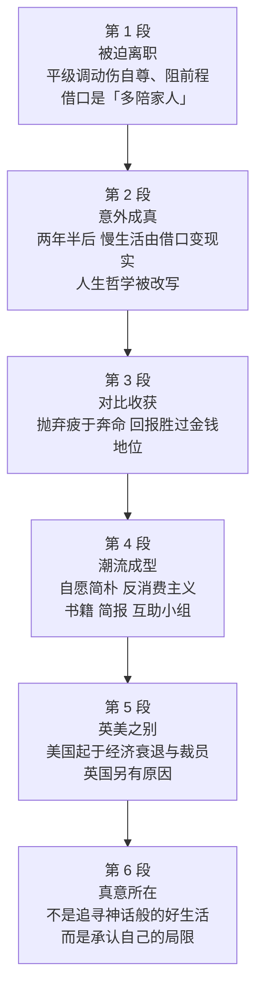

# Passage 34 · 放慢生活节奏

## 答题记录

| 轮次  | 日期         | 题号  | 正确  | 错误  | 正确率 | 用时    | 错题归因 |
| --- | --- | --- | --- | --- | --- | --- | --- |
| 1 |  | 1-4 |  |  |  |  |  |
| 2 |  | 1-4 |  |  |  |  |  |
| 3 |  | 1-4 |  |  |  |  |  |

> [!tip] 填写口径
> - **用时**以分钟计，只计做题时间，不含精读复盘。
> - **错题归因**填「题型·错误类型」，如：细节题·定位错、推理判断·过度推断、主旨大意·以偏概全。
> - 纵向看趋势：正确率升而用时过长 → 熟练度不足；用时降而正确率波动 → 定位不稳。
> - 本篇为 2001 年真题，**只有 4 题**（同 Passage 22、28、33），题号栏填 1-4。

> [!info] 文章档案
> - **来源**：考研英语（一）2001 年 Text 5
> - **题材**：社会生活——「放慢生活节奏」（downshifting）：作者被一次平级调动逼下职场，却意外汇入英美方兴未艾的慢生活潮流，并借英美对比道出慢生活的真意
> - **结构**：6 段 / 11 句 ＋ 4 题（按行首缩进与句号断句实测；书中解析称末段为「第七段」，属书中分段口径，笔记按实测标注为第 6 段）
> - **难度**：★★★☆☆
> - **一句话主旨**：作者因一次伤自尊的平级调动被迫辞职，却意外发现自己赶上了「放慢生活节奏」的国际潮流——她从「拥有一切」哲学的热情鼓吹者变成知足常乐的人；在美国，这股潮流起于经济衰退与裁员，在英国中产女性这里，它与其说是对神话般美好生活的追寻，不如说是对自身局限的承认。

## 一、篇章脉络

- **第 1 段**：先交代「我是怎么离开职场的」——辞去全职工作时压根没想过自己会汇入一股国际潮流（第 1 题 A 项的出处）；真正的原因是②句那次平级调动：伤了自尊、堵了前程，才被迫放弃体面职业（第 1 题的答案句）；末句那个「想多陪家人」的说法，不过是像失势部长那样为离职找的托词（第 1 题 D 项的出处）。
- **第 2 段**：两年半、两本小说之后，作者发现当初那句**托词**（tired excuse）竟然成了**现实**（absolute reality）——①句完成「借口→现实」的反转；②句用 transformed from...into... 写人生哲学的改写：从「拥有一切」的倡导者，变成「什么都来一点」就知足的人（第 2 题的答案句）。
- **第 3 段**：写慢生活的**收获**。①句用「抛弃 A、改走 B」的对举，把 juggling your life 与 downshifting 明确摆成反义（第 3 题的答案句）；②句用四个并列名词短语（12 小时工作日、催命的期限、办公室政治的压力、「优质时间」里做父母的局限）把「疲于奔命」具体化，并声明绝不回头。
- **第 4 段**：把个人经历上升到**社会潮流**。①句讲美国早已确立「由忙转简」的趋势；②句说慢生活甚至催生出「反消费主义」这一新领域；③句用三个 there be 并列（自助书籍、简报、互助小组）证明它已形成产业与社群。
- **第 5 段**：用 **While... in America... , in Britain...** 做国别对比——美国的慢生活始于对经济衰退的反应（80 年代末裁员造成大规模失业），至今仍与节俭主张相连；英国人的理由则不同（第 4 题的答案句）。
- **第 6 段**：收束到「真意」——对作者这一代被力劝「继续疲于奔命」的女性而言，90 年代中期的慢生活**与其说**是追寻那种神话般的美好生活（自己种菜，还冒着变成一根菜的风险），**不如说**是对自身局限的个人体认。

> [!tip] 行文逻辑
> 全篇是「个人经历 → 社会潮流 → 跨国比较 → 点明真意」的递进结构，靠四组对立推进：**tired excuse ↔ absolute reality**（第 2 段①）→ **juggling your life ↔ downshifting**（第 3 段①，第 3 题）→ **In America ↔ in Britain**（第 5 段①，第 4 题）→ **not so much... as...**（第 6 段①）。四道题依次考：第 1 段细节（被迫离职）、第 2 段末句的「哲学改写」、第 3 段首句的短语含义、第 5 段首句的成因。命题密度最高的两组信号是**转折对举**（abandoning... and making the alternative move into...）与**让步对比**（While... in Britain...），看到就该预判出题。

## 二、逐段精读

### 第 1 段 · 被迫离职：一次平级调动，一句体面托词

**原文**

① When I decided to quit my full time employment it never occurred to me that I might become a part of a new international trend.
② A lateral move that hurt my pride and blocked my professional progress prompted me to abandon my relatively high profile career although, in the manner of a disgraced government minister, I covered my exit by claiming "I wanted to spend more time with my family."

**译文**

① 当我决定辞去全职工作时，我从未想过自己可能会成为一股新的国际潮流中的一分子。
② 一次伤了我的自尊、又阻碍了我职业发展的平级调动，促使我放弃了那份相对体面的职业——尽管，就像一位失势的政府部长那样，我为离职找了个托词，声称「我想多花些时间陪伴家人」。

> [!note] 段落要点
> - 功能：交代「我为什么离开职场」，为全篇的个人经历视角立基；本段是**第 1 题**的唯一战场。
> - ①句是「无心的开头」：it never occurred to me that...（我从未想过……），作者当时并不知道自己在汇入一股潮流（a new international trend）。A 项正是把这句话拧成了 Full-time employment is a new international trend——**主语被换掉了**。
> - ②句是第 1 题的答案句，也是全段最难的一句：A lateral move that hurt my pride and blocked my professional progress **prompted** me to abandon... → 离职是**被逼的**（非自愿），B 项 compelled by circumstances 正是对 prompt（促使、逼使）的同义转述。
> - ②句末的 although 让步是理解 D 项的关键：cover my exit by claiming... ＝ 用「多陪家人」来**掩饰**离职的真正原因，所以「想多陪家人」是**托词不是事实**。
> - 注意 lateral（横向的 → 平级的）这个构词题眼：lateral move 是「平级调动」，它**导致**了离职，本身并不等于「退出全职工作」——C 项就栽在这里。
> - 全段的语气是自嘲式的（in the manner of a disgraced government minister 像一位失势的部长那样），这种「体面的自我解嘲」贯穿全篇。

#### 长难句 · 本段

> [!abstract] 本段第 ② 句 · A lateral move that hurt my pride and blocked my professional progress prompted me to abandon my relatively high profile career although, in the manner of a disgraced government minister, I covered my exit by claiming "I wanted to spend more time with my family."

**结构拆解**

- **主句主干**：A lateral move prompted me to abandon my...career（主谓宾＋宾补；prompt sb to do 促使／逼使某人做）
- **定语从句**：that hurt my pride and blocked my professional progress（修饰 A lateral move；and 连接两个谓语）
- **让步状语从句**：although I covered my exit by claiming "..."（although 后置，表「尽管如此」）
- **方式插入语**：in the manner of a disgraced government minister（像……那样；disgraced 失势的、丢尽脸面的）
- **方式状语**：by claiming "I wanted to spend more time with my family"（by doing 表手段；claim 声称）
- **结构**：cover one's exit 掩饰自己的离职（cover 此处＝掩饰，非「覆盖」）

**参考译文**

一次伤了我的自尊、又阻碍了我职业发展的平级调动，促使我放弃了那份相对体面的职业——尽管，就像一位失势的政府部长那样，我为离职找了个托词，声称「我想多花些时间陪伴家人」。

> [!tip] 拆解要点
> 第 1 题的答案句。骨架是 **A that...and...prompted me to do B although I did C**：主句讲「被逼离职」，although 从句讲「嘴上怎么说」。两个必须抓准的点：**prompt** 在这里是动词「促使、逼使」（比 cause 更强调触发机制，不是「迅速的」那个形容词），它决定了 B 项 compelled by circumstances 成立；**cover my exit** 的 cover 是「掩饰」（熟词僻义），claiming 引出的是借口内容。命题人把这句话拆成三个干扰项：A 换主语（trend 被安到 full-time employment 头上）、C 换概念（lateral move ≠ 退出全职工作）、D 把托词当事实。读这类句子时，凡是 although / by claiming 之后的内容，都要在心里打上「表面说法」的标签。

#### 本段重点词汇

| 单词 / 短语 | 词性 | 文中意 | 常用考义与拓展 | 英文示例搭配（中译） |
| --- | --- | --- | --- | --- |
| **quit** | v. | 辞去（工作），放弃 | quit one's job 辞职；quit smoking 戒烟；过去式 quit/quitted；= resign（更正式） | quit my full time employment（辞去我的全职工作） |
| **full time employment** | n. | 全职工作 | full-time adj. 全职的（作定语时加连字符）；part-time 兼职的；employment n. 就业（≠ employee 雇员） | quit my full time employment（辞去全职工作） |
| **occur to** | 短语 | （想法）被想到，浮现于脑海 | it occurs to sb that... 某人想到……；it never occurred to me that... 我从未想过……；occurrence n. 发生 | it never occurred to me that...（我从未想过……） |
| **trend** | n. | 趋势，潮流 | a trend toward... ……的趋势；set/start a trend 引领潮流；trendy adj. 时髦的 | a new international trend（一股新的国际潮流） |
| **lateral move** | n. | 平级调动，横向调动 | lateral adj. 横向的、平级的（lateral thinking 横向思维）；vertical 纵向的、垂直的 | A lateral move that hurt my pride（一次伤了我自尊的平级调动） |
| **pride** | n. | 自尊，骄傲 | hurt/wound one's pride 伤自尊；take pride in 以……为荣；proud adj. 骄傲的 | hurt my pride（伤了我的自尊） |
| **block** | v. | 阻碍，阻塞 | block one's progress/way 阻碍进展／挡路；block n. 街区、块；blockage n. 堵塞 | blocked my professional progress（阻碍了我的职业发展） |
| **professional progress** | n. | 职业发展，事业进步 | professional adj. 职业的、专业的；profession n. 职业（尤指专业职业）；make progress 取得进步 | blocked my professional progress（阻碍了我的职业发展） |
| **prompt** | v. | 促使，推动，激起 | 熟词僻义：形容词「迅速的、即时的」→ 动词「促使」；prompt sb to do 促使某人做；promptly adv. 迅速地 | prompted me to abandon my career（促使我放弃职业） |
| **abandon** | v. | 放弃，抛弃 | abandon oneself to 沉溺于；abandoned adj. 被遗弃的；abandonment n. 放弃（见 Passage 33） | abandon my relatively high profile career（放弃我那份相对体面的职业） |
| **relatively** | adv. | 相对地，比较而言 | relative adj. 相对的／n. 亲戚；relativity n. 相对性；= comparatively | my relatively high profile career（我那份相对体面的职业） |
| **high profile** | adj. | 引人注目的，地位显要的 | profile n. 形象、轮廓、简介；keep a low profile 保持低调；high-profile adj. 高调的（作定语加连字符） | my relatively high profile career（我那份相对体面／引人注目的职业） |
| **career** | n. | 职业，事业（长期） | career woman 职业女性；career path 职业路径；≠ job（具体一份工作）、work（劳动） | abandon my relatively high profile career（放弃我的职业） |
| **in the manner of** | 短语 | 以……的方式，像……那样 | manner n. 方式、举止；in a...manner 以……方式；manners n. 礼貌 | in the manner of a disgraced government minister（像一位失势的政府部长那样） |
| **disgraced** | adj. | 失势的，丢尽脸面的 | disgrace n. 耻辱／v. 使蒙羞；disgraceful adj. 可耻的；fall into disgrace 失势 | a disgraced government minister（一位失势的政府部长） |
| **government minister** | n. | 政府部长，大臣 | minister n. 部长、大臣／v. 照料（minister to）；ministry n. 部委；prime minister 首相 | a disgraced government minister（一位失势的政府部长） |
| **cover** | v. | 掩饰，掩盖 | 熟词僻义：覆盖 → 掩饰、掩护；cover up 掩盖（丑闻）；cover one's tracks 不留痕迹 | I covered my exit by claiming...（我借口……来掩饰自己的离职） |
| **exit** | n. | 退出，离职；出口 | exit v. 退出；make one's exit 退场；反义 entrance 入口 | covered my exit（掩饰我的离职） |

### 第 2 段 · 意外成真：托词变现实，哲学被改写

**原文**

① Curiously, some two-and-a-half years and two novels later, my experiment in what the Americans term "downshifting" has turned my tired excuse into an absolute reality.
② I have been transformed from a passionate advocate of the philosophy of "having it all", preached by Linda Kelsey for the past seven years in the pages of She magazine, into a woman who is happy to settle for a bit of everything.

**译文**

① 说来奇怪，在过了两年半、写完两本小说之后，我这项用美国人的说法叫做「放慢生活节奏」的尝试，已经把我那个老掉牙的借口变成了十足的现实。
② 我已经从「拥有一切」这一哲学的热情倡导者——这一哲学由琳达·凯尔茜过去七年里在《她》杂志上所宣扬——变成了一个乐于「什么都来一点」就知足的女人。

> [!note] 段落要点
> - 功能：完成「借口 → 现实」的反转，并交代人生哲学的改写；本段是**第 2 题**的战场（答案句在②句）。
> - ①句的 **turned my tired excuse into an absolute reality** 是全篇最漂亮的一处呼应：tired excuse 指第 1 段那句「想多陪家人」的托词，absolute reality 指它竟然成真了。第 2 题 A 项（enables her to realize her dream）就在这里被排除——**成真的不是梦想，是托词**。
> - ①句 what the Americans term "downshifting" 是「介词 ＋ what 从句」结构，term 作动词「把……称为」（熟词僻义，名词是「术语」）。
> - ②句的 **transform A from B into C** 是本段骨架，也是第 2 题的答案句：从 a passionate advocate of "having it all" 变成 a woman happy to settle for a bit of everything ＝ **人生哲学（philosophy）被换了一套**，故 B 项 mold a new philosophy of life 正确。
> - ②句中间的 preached by Linda Kelsey... 是过去分词短语作后置定语，修饰 the philosophy of "having it all"；preach（布道 → 宣扬、鼓吹）带明显的贬义色彩，暗示作者如今对这套说辞的态度已变。
> - 段首的 Curiously（说来奇怪、奇怪的是）是评注性副词，修饰全句，作者用自嘲语气承认「歪打正着」。

#### 长难句 · 本段

> [!abstract] 本段第 ① 句 · Curiously, some two-and-a-half years and two novels later, my experiment in what the Americans term "downshifting" has turned my tired excuse into an absolute reality.

**结构拆解**

- **评注性副词**：Curiously（说来奇怪，修饰全句；curious 此处＝strange 奇怪的，非「好奇的」）
- **时间状语**：some two-and-a-half years and two novels later（两年半、两本小说之后；some 此处＝about 大约）
- **主语**：my experiment in what the Americans term "downshifting"（in ＋ what 引导的宾语从句；term v. 把……称为）
- **谓语**：has turned（现在完成时，turn A into B 把 A 变成 B）
- **宾语**：my tired excuse → an absolute reality（tired 此处＝老掉牙的、陈腐的；absolute 十足的、绝对的）

**参考译文**

说来奇怪，在过了两年半、写完两本小说之后，我这项用美国人的说法叫做「放慢生活节奏」的尝试，已经把我那个老掉牙的借口变成了十足的现实。

> [!tip] 拆解要点
> 抓两处：一是 **in what the Americans term "downshifting"** ——介词 in 后面整个 what 从句作宾语，what ＝ the thing which，term 是动词「称作」（名词「术语」的熟词僻义）；二是 **turn A into B** 的两端 A＝tired excuse、B＝absolute reality，这一句把第 1 段与第 2 段缝在了一起。第 2 题 A 项（realize her dream）正是攻击这一句：原文变现实的是 **excuse（借口）**，不是 **dream（梦想）**，一字之差就是答案的分界。另注意 two novels later 这个俏皮的时间表达——用「写完两本小说」计时，说明她已彻底换了活法。

> [!abstract] 本段第 ② 句 · I have been transformed from a passionate advocate of the philosophy of "having it all", preached by Linda Kelsey for the past seven years in the pages of She magazine, into a woman who is happy to settle for a bit of everything.

**结构拆解**

- **主干**：I have been transformed from A into B（被动；transform A from B into C 的被动式）
- **A 端**：a passionate advocate of the philosophy of "having it all"（advocate n. 倡导者）
- **后置定语**：preached by Linda Kelsey for the past seven years in the pages of She magazine（过去分词短语，修饰 the philosophy；preach v. 宣扬、鼓吹）
- **B 端**：a woman who is happy to settle for a bit of everything（who 引导定语从句；settle for 满足于、将就）
- **结构**：have it all 拥有一切（事业家庭两全）；a bit of everything 什么都来一点

**参考译文**

我已经从「拥有一切」这一哲学的热情倡导者——这一哲学由琳达·凯尔茜过去七年里在《她》杂志上所宣扬——变成了一个乐于「什么都来一点」就知足的女人。

> [!tip] 拆解要点
> 第 2 题的答案句。骨架是 **transform A from X into Y**，读时先抓住 from/into 两端再做比较：X＝**「拥有一切」哲学的热情倡导者**，Y＝**乐于「什么都来一点」的女人**，两端的共同点是「人生哲学」，故 B 项 helps her mold a new philosophy of life（帮她形成新的人生观）成立。中间的 preached by... 是插入的过去分词定语，先跳过不读，主干就清爽了。三个干扰项分别来自：①句（A 把 tired excuse 升格为 dream）、第 1 段②句（C 把平级调动造成的结果——放弃相对体面的职业——安到 downshifting 头上，且文中从未说她有较高社会地位）、本句（D 与事实相反：她是**抛弃**而非接受《她》杂志的信条）。

#### 本段重点词汇

| 单词 / 短语 | 词性 | 文中意 | 常用考义与拓展 | 英文示例搭配（中译） |
| --- | --- | --- | --- | --- |
| **curiously** | adv. | 奇怪的是，说来奇怪 | 评注性副词，修饰全句；curious adj. 好奇的／奇怪的；curiosity n. 好奇心 | Curiously, my experiment has turned...（说来奇怪，我的尝试已经把……） |
| **experiment** | n./v. | 尝试，试验 | experiment in/on 在……方面的尝试；experiment with 试用；experimental adj. 实验性的 | my experiment in what the Americans term "downshifting"（我这项慢生活的尝试） |
| **term** | v. | 把……称为，把……叫做 | 熟词僻义：名词「术语、学期」→ 动词「称作」；be termed (as) 被称为；terminology n. 术语 | what the Americans term "downshifting"（美国人称作「放慢生活节奏」的东西） |
| **downshifting** | n. | 放慢生活节奏，减速生活 | downshift v. 降档、放慢节奏；downshifter n. 放慢生活节奏者（见第 5 段）；= voluntary simplicity | my experiment in downshifting（我放慢生活节奏的尝试） |
| **turn A into B** | 短语 | 把 A 变成 B | = transform/convert A into B；turn out 结果是；turn down 拒绝（见 Passage 32） | turned my tired excuse into an absolute reality（把老借口变成了十足的现实） |
| **tired excuse** | n. | 老掉牙的借口，陈腐的说辞 | tired adj. 老套的、陈腐的（≠ 疲倦的，此为僻义）；lame excuse 站不住脚的借口 | my tired excuse（我那个老掉牙的借口） |
| **absolute reality** | n. | 完全的现实，实实在在的事实 | absolute adj. 绝对的、完全的；absolutely adv. 绝对地；reality n. 现实 | turned my tired excuse into an absolute reality（使老借口成为十足的现实） |
| **transform** | v. | 使改观，使转变 | transform A from B into C；transformation n. 转变；transformer n. 变压器 | I have been transformed from...into...（我已从……变成……） |
| **passionate** | adj. | 热情的，狂热的 | passion n. 热情、酷爱（have a passion for）；passionately adv. 热烈地 | a passionate advocate of the philosophy（这一哲学的热情倡导者） |
| **advocate** | n./v. | 倡导者／提倡 | 名词重音在 -cate，动词亦可读 /ˈædvəkeɪt/；advocacy n. 倡导；= proponent | a passionate advocate of "having it all"（「拥有一切」的热情倡导者） |
| **philosophy** | n. | 人生哲学，理念 | philosopher n. 哲学家；philosophical adj. 哲学的、豁达的 | the philosophy of "having it all"（「拥有一切」的人生哲学） |
| **have it all** | 短语 | 拥有一切（事业家庭两全） | 1990 年代女性话语中的高频说法；have it both ways 两全其美 | the philosophy of "having it all"（「拥有一切」的哲学） |
| **preach** | v. | 宣扬，鼓吹；布道 | preach to sb 对某人说教；preacher n. 传道士；含贬义「说教」 | preached by Linda Kelsey in the pages of She magazine（由凯尔茜在《她》杂志上宣扬） |
| **settle for** | 短语 | 勉强接受，满足于 | settle down 安顿下来；settle on 选定；settlement n. 解决、定居 | happy to settle for a bit of everything（乐于「什么都来一点」就知足） |
| **a bit of everything** | 短语 | 什么都来一点 | a bit of 一点儿；bits and pieces 零零碎碎；= a little of each | settle for a bit of everything（什么都来一点就满足） |

### 第 3 段 · 对比收获：抛弃疲于奔命，回报胜过金钱地位

**原文**

① I have discovered, as perhaps Kelsey will after her much-publicized resignation from the editorship of She after a build-up of stress, that abandoning the doctrine of "juggling your life", and making the alternative move into "downshifting" brings with it far greater rewards than financial success and social status.
② Nothing could persuade me to return to the kind of life Kelsey used to advocate and I once enjoyed: 12-hour working days, pressured deadlines, the fearful strain of office politics and the limitations of being a parent on "quality time".

**译文**

① 我发现——正如凯尔茜在压力积聚之后高调辞去《她》杂志主编一职之后大概也会发现的那样——抛弃「疲于奔命」的信条、转而选择「放慢生活节奏」，所带来的回报远远超过经济上的成功与社会地位。
② 没有什么能说服我回到凯尔茜过去倡导、而我也曾经享受过的那种生活：每天工作 12 小时、催命般的截止期限、办公室政治带来的可怕压力，以及只能在「优质时间」里做父母的那种局限。

> [!note] 段落要点
> - 功能：写慢生活的**收益**，并把 juggling your life 与 downshifting 正式摆成反义；本段是**第 3 题**的战场（答案句在①句，证据在②句）。
> - ①句的 **abandoning the doctrine of "juggling your life", and making the alternative move into "downshifting"** 是全篇最关键的对比结构：两个动名词短语并列作主语，alternative（另一条可选择的路）一词直接点明二者互斥——第 3 题据此可知 juggling one's life ＝ downshifting 的反面。
> - ②句冒号后的四个并列名词短语是对 juggling your life 的**具体释义**：12 小时工作日、催命的期限、办公室政治的压力、「优质时间」父母的局限 → 高度概括就是 extreme stress（第 3 题 C 项）。
> - ①句的 as perhaps Kelsey will (discover) after... 是省略式的 as 从句，作者把自己与凯尔茜并列：那位宣扬「拥有一切」的人，终将因压力积聚而辞职，并得出同样的结论。
> - 段落逻辑：「发现（①，结论）→ 具体说明旧生活的代价（②，证据）」，②句 Nothing could persuade me to return to... 是用否定强调「绝不回头」。

#### 长难句 · 本段

> [!abstract] 本段第 ① 句 · I have discovered, as perhaps Kelsey will after her much-publicized resignation from the editorship of She after a build-up of stress, that abandoning the doctrine of "juggling your life", and making the alternative move into "downshifting" brings with it far greater rewards than financial success and social status.

**结构拆解**

- **主句主干**：I have discovered that...（现在完成时；that 引导宾语从句）
- **方式／比较状语从句（省略）**：as perhaps Kelsey will (discover) after her much-publicized resignation...（as ＝ 正如；will 后省略 discover）
- **插入的介词短语**：after a build-up of stress（在一番压力积聚之后；build-up n. 积累、积聚）
- **宾语从句主语（并列动名词）**：abandoning the doctrine of "juggling your life", and making the alternative move into "downshifting"
- **宾语从句谓语**：brings with it（随之带来；it 指代前面的整个举动）
- **比较结构**：far greater rewards than financial success and social status（远比……更大的回报）

**参考译文**

我发现——正如凯尔茜在压力积聚之后高调辞去《她》杂志主编一职之后大概也会发现的那样——抛弃「疲于奔命」的信条、转而选择「放慢生活节奏」，所带来的回报远远超过经济上的成功与社会地位。

> [!tip] 拆解要点
> 第 3 题的答案句。三层机关：①**as 从句省略**——as perhaps Kelsey will 后面省了 discover，读时把 discover 补回去（正如凯尔茜大概也将发现的那样）；②**宾语从句的主语是两个并列的动名词**——abandoning A and making B，中间那个 alternative（另一条可供选择的路）就是命题人给的提示词，说明 A 与 B 互斥；③**brings with it far greater rewards than...** ——it 回指整个「弃 A 走 B」之举，比较对象是被否定的金钱与地位。第 3 题问 juggling one's life 的含义，正解就来自这里的对举：juggling ＝ downshifting 的反面，即忙乱紧张的生活（extreme stress）。三个干扰项（non-materialistic lifestyle / a bit of everything / anti-consumerism）全是 downshifting 一侧的特征，被搬来冒充 juggling。

> [!abstract] 本段第 ② 句 · Nothing could persuade me to return to the kind of life Kelsey used to advocate and I once enjoyed: 12-hour working days, pressured deadlines, the fearful strain of office politics and the limitations of being a parent on "quality time".

**结构拆解**

- **主干**：Nothing could persuade me to return to the kind of life（否定词作主语，表示「绝无可能」；persuade sb to do 说服某人做）
- **定语从句（并列）**：Kelsey used to advocate and (that) I once enjoyed（修饰 the kind of life；used to do 过去常常）
- **同位语（冒号后四个并列名词短语）**：12-hour working days, pressured deadlines, the fearful strain of office politics and the limitations of being a parent on "quality time"（对 the kind of life 作具体说明）
- **结构**：quality time（与家人、孩子共度的）优质时光；strain n. 压力、紧张

**参考译文**

没有什么能说服我回到凯尔茜过去倡导、而我也曾经享受过的那种生活：每天工作 12 小时、催命般的截止期限、办公室政治带来的可怕压力，以及只能在「优质时间」里做父母的那种局限。

> [!tip] 拆解要点
> 第 3 题的证据句。骨架是 **Nothing could persuade me to return to the kind of life...: A, B, C and D**——冒号后四个并列名词短语既是旧生活的素描，也是 juggling one's life 的释义，四个加起来只有一个共性：**extreme stress（极度紧张）**（书中解析：「只有 C 项是对这些特征的高度概括」）。两点提醒：一是 the kind of life 后跟了**两个**定语从句（Kelsey used to advocate ／ I once enjoyed），二是 quality time 是 1980 年代美国家庭话语中的高频词，指「忙里挤出来陪孩子的高质量时间」，作者用 limitations of being a parent on "quality time" 反讽这种「排档期式育儿」。

#### 本段重点词汇

| 单词 / 短语 | 词性 | 文中意 | 常用考义与拓展 | 英文示例搭配（中译） |
| --- | --- | --- | --- | --- |
| **much-publicized** | adj. | 广为报道的，被大肆宣传的 | 构词 副词＋过去分词：much-publicized / widely-reported；publicize v. 宣传 | her much-publicized resignation（她那次广受关注／高调的辞职） |
| **resignation** | n. | 辞职；辞呈 | resign v. 辞职（resign from）；resignation 亦作「顺从」；hand in one's resignation 递交辞呈 | resignation from the editorship of She（辞去《她》杂志主编一职） |
| **editorship** | n. | 编辑职位，主编之职 | 构词 editor ＋ -ship（身份、职位）：professorship 教授职位；editor n. 编辑 | the editorship of She（《她》杂志的主编职位） |
| **build-up** | n. | 积累，积聚 | build up v. 积累、增强；a build-up of stress/tension 压力的积聚 | after a build-up of stress（在一番压力积聚之后） |
| **doctrine** | n. | 信条，教义，主张 | the doctrine of...……的信条；doctrinal adj. 教义上的；= creed / tenet | the doctrine of "juggling your life"（「疲于奔命」的信条） |
| **juggle one's life** | 短语 | 疲于奔命（地应付生活） | juggle v. 玩杂耍、同时应付（juggle work and family）；juggler n. 杂耍艺人 | the doctrine of "juggling your life"（疲于奔命的信条） |
| **alternative** | adj./n. | 可供选择的／替代方案 | alternative to...……的替代；alternatively adv. 或者；have no alternative but to do 别无选择只能 | making the alternative move into "downshifting"（转而选择放慢生活节奏） |
| **bring with it** | 短语 | 随之带来，伴随而来 | bring about 引起；bring up 抚养、提出；it 回指前文整个行为 | brings with it far greater rewards（随之带来远为丰厚的回报） |
| **reward** | n./v. | 回报，奖赏／奖赏 | reward sb for (doing) sth 因……奖赏某人；rewarding adj. 有回报的；≠ award（奖品） | far greater rewards than financial success（远胜经济成功的回报） |
| **financial success** | n. | 经济上的成功 | financial adj. 财政的、金融的；finance n. 财政／v. 资助（见 Passage 32） | greater rewards than financial success（胜过经济成功的回报） |
| **social status** | n. | 社会地位 | status n. 地位、身份（≠ statue 雕像、stature 身高／声望）；status symbol 身份象征 | financial success and social status（经济成功与社会地位） |
| **persuade** | v. | 说服，劝服 | persuade sb to do/into doing 说服某人做；persuasion n. 说服；persuasive adj. 有说服力的 | Nothing could persuade me to return...（没有什么能说服我回到……） |
| **pressured deadlines** | n. | 催命的截止期限 | deadline n. 最后期限（meet/miss a deadline 赶上／错过期限）；pressured adj. 压力重重的 | 12-hour working days, pressured deadlines（12 小时工作日、催命的期限） |
| **fearful strain** | n. | 可怕的压力，令人紧张的负担 | fearful adj. 可怕的、担心的；strain n. 压力、张力（under strain）；strained adj. 紧张的 | the fearful strain of office politics（办公室政治的可怕压力） |
| **office politics** | n. | 办公室政治，职场权谋 | politics n. 政治、权术（此处取「权术」义）；play politics 玩弄权术 | the fearful strain of office politics（办公室政治带来的压力） |
| **limitation** | n. | 局限，限制（之处） | limit v./n. 限制（见 Passage 33）；limited adj. 有限的；limitation 侧重「能力／条件上的局限」 | the limitations of being a parent on "quality time"（在「优质时间」里做父母的局限） |
| **quality time** | n. | 优质时光（专程陪家人的时间） | 1980 年代美国家庭话语高频词；spend quality time with sb 与某人共度优质时光 | being a parent on "quality time"（靠「优质时间」当父母） |

### 第 4 段 · 潮流成型：自愿简朴与反消费主义

**原文**

① In America, the move away from juggling to a simpler, less materialistic lifestyle is a well-established trend.
② Downshifting — also known in America as "voluntary simplicity" — has, ironically, even bred a new area of what might be termed anti-consumerism.
③ There are a number of bestselling downshifting self-help books for people who want to simplify their lives; there are newsletters, such as The Tightwad Gazette, that give hundreds of thousands of Americans useful tips on anything from recycling their cling-film to making their own soap; there are even support groups for those who want to achieve the mid-'90s equivalent of dropping out.

**译文**

① 在美国，从疲于奔命转向更简单、更不重物质的生活方式，是一股早已确立的潮流。
② 「放慢生活节奏」——在美国也叫「自愿简朴」——具有讽刺意味的是，甚至催生出一个可以称之为「反消费主义」的新领域。
③ 有许多畅销的「放慢生活节奏」自助书籍，写给那些想简化生活的人；有像《吝啬鬼公报》这样的时事简报，给数十万美国人提供各种有用的窍门，从回收保鲜膜到自己动手做肥皂；甚至还有互助小组，服务于那些想实现 90 年代中期版「退出主流」的人。

> [!note] 段落要点
> - 功能：把个人经历抬升为**社会现象**，用三个 there be 并列（书籍／简报／互助小组）证明它已成产业与社群。
> - ①句是第 3 题的**二次验证**：move away from juggling to a simpler, less materialistic lifestyle —— juggling 与 simple/less materialistic 正面对立，据此可再次确认 juggling ＝ 忙乱紧张（第 3 题 A 项 non-materialistic lifestyle 正是从这里取材后安错了对象）。
> - ②句的 ironically（具有讽刺意味地）是全段的情绪开关：慢生活本是为了少消费，结果却「催生」出一个新领域（bred a new area）——反消费主义本身也被做成了生意。
> - ③句是全篇最长的并列句，书架—简报—互助小组构成「从读到做到」的完整链条；The Tightwad Gazette（《吝啬鬼公报》）是当年美国一本著名的节俭简报，属文化专有名词，不必深究词义。
> - ③句末 the mid-'90s equivalent of dropping out（90 年代中期版的「遁世」）是神来之笔：60 年代嬉皮式的 drop out（退出主流社会）在 90 年代有了温和版本——慢生活。

#### 长难句 · 本段

> [!abstract] 本段第 ③ 句 · There are a number of bestselling downshifting self-help books for people who want to simplify their lives; there are newsletters, such as The Tightwad Gazette, that give hundreds of thousands of Americans useful tips on anything from recycling their cling-film to making their own soap; there are even support groups for those who want to achieve the mid-'90s equivalent of dropping out.

**结构拆解**

- **分句一**：There are a number of bestselling downshifting self-help books（there be 句型）＋ 定语 for people who want to simplify their lives
- **分句二**：there are newsletters, such as The Tightwad Gazette, that give...（such as 举例插入；that 引导定语从句修饰 newsletters）
- **双宾语结构**：give hundreds of thousands of Americans useful tips（give sb sth）
- **范围状语**：on anything from recycling their cling-film to making their own soap（from A to B 表范围；recycling / making 为动名词）
- **分句三**：there are even support groups for those who want to achieve the mid-'90s equivalent of dropping out（the equivalent of ……的对应物／版本）

**参考译文**

有许多畅销的「放慢生活节奏」自助书籍，写给那些想简化生活的人；有像《吝啬鬼公报》这样的时事简报，给数十万美国人提供各种有用的窍门，从回收保鲜膜到自己动手做肥皂；甚至还有互助小组，服务于那些想实现 90 年代中期版「退出主流」的人。

> [!tip] 拆解要点
> 三个 **there be** 用分号并列，是英语列举「现象已成气候」的标准写法，读时按分号切成三块即可。三块内部各套一个定语从句（who want to simplify / that give... / who want to achieve...），结构对称。两个值得记的搭配：**give sb tips on...（给某人关于……的窍门）** 与 **the equivalent of...（……的对应物／等价物）**——后者的 equivalent 是名词（形容词「相等的」的熟词僻义）。末句 mid-'90s equivalent of dropping out 是全篇最耐人寻味的一处：把 90 年代的慢生活比作 60 年代 drop out（退出主流社会）的温和版，作者用「时代对照」把个人选择与历史潮流接上了。

#### 本段重点词汇

| 单词 / 短语 | 词性 | 文中意 | 常用考义与拓展 | 英文示例搭配（中译） |
| --- | --- | --- | --- | --- |
| **move away from** | 短语 | 从……转向，远离 | move toward 向……靠拢；move on 继续前进；a move away from A to B 由 A 转向 B | the move away from juggling to a simpler lifestyle（由疲于奔命转向更简单的生活） |
| **materialistic** | adj. | 物质主义的，重物质的 | materialism n. 唯物主义／物质主义；material adj. 物质的／n. 材料 | a simpler, less materialistic lifestyle（更简单、更不重物质的生活方式） |
| **well-established** | adj. | 确立已久的，公认的 | 构词 副词＋过去分词：well-established / well-known；establish v. 建立；establishment n. 机构 | a well-established trend（一股确立已久的潮流） |
| **voluntary simplicity** | n. | 自愿简朴（慢生活的另一说法） | voluntary adj. 自愿的（≠ voluntary 志愿的，同词）；simplicity n. 简朴、简单（simple 的名词） | also known in America as "voluntary simplicity"（在美国也叫「自愿简朴」） |
| **ironically** | adv. | 具有讽刺意味地，讽刺的是 | ironic adj. 讽刺的；irony n. 反讽；评注性副词，修饰全句 | has, ironically, even bred a new area（讽刺的是甚至催生了一个新领域） |
| **breed** | v. | 滋生，催生，孕育 | 熟词僻义：繁殖 → 产生、孕育；breed n. 品种；breed resentment 滋生怨恨 | has even bred a new area of anti-consumerism（甚至催生出一个反消费主义的新领域） |
| **anti-consumerism** | n. | 反消费主义 | 构词 anti-（反）＋consumerism（消费主义）；consumer n. 消费者；consume v. 消费 | a new area of what might be termed anti-consumerism（一个可称为反消费主义的新领域） |
| **bestselling** | adj. | 畅销的 | bestseller n. 畅销书／畅销品；= best-selling | bestselling downshifting self-help books（畅销的慢生活自助书籍） |
| **self-help** | adj./n. | 自助的／自助 | self-help book 自助类书籍；self-help group 互助小组；self-made 白手起家的 | downshifting self-help books（慢生活自助书籍） |
| **simplify** | v. | 简化，使简单 | simple adj. 简单的；simplicity n. 简朴；simplification n. 简化 | people who want to simplify their lives（想简化生活的人） |
| **newsletter** | n. | 时事简报，通讯 | 构词 news ＋ letter；subscribe to a newsletter 订阅简报 | there are newsletters, such as The Tightwad Gazette（有像《吝啬鬼公报》这样的简报） |
| **tips** | n. | 窍门，建议，贴士 | tips on/for (doing) sth 关于……的窍门；tip 亦作「小费、尖端」 | useful tips on anything from...to...（关于……的各种有用窍门） |
| **recycle** | v. | 回收利用，再利用 | 构词 re-（再）＋cycle（循环）；recycling n. 回收利用；recyclable adj. 可回收的 | recycling their cling-film（回收他们的保鲜膜） |
| **cling-film** | n. | 保鲜膜 | 英式说法，美式为 plastic wrap；cling v. 黏附、紧贴 | from recycling their cling-film to making their own soap（从回收保鲜膜到自制肥皂） |
| **support group** | n. | 互助小组，支持团体 | support n./v. 支持；group therapy 团体治疗；peer support 同伴支持 | there are even support groups（甚至还有互助小组） |
| **equivalent** | n./adj. | 等同物，对应物／相等的 | 熟词僻义：形容词「相等的」→ 名词「对应物」；the equivalent of ……的对应物；equivalence n. 相等 | the mid-'90s equivalent of dropping out（90 年代中期版的「退出主流」） |
| **drop out** | 短语 | 退出（主流社会、学校） | dropout n. 中途退学者、遁世者；drop out of school 辍学（见 Passage 33） | the mid-'90s equivalent of dropping out（90 年代中期版的遁世） |

### 第 5 段 · 英美之别：一个起于经济衰退，一个另有原因

**原文**

① While in America the trend started as a reaction to the economic decline — after the mass redundancies caused by downsizing in the late '80s — and is still linked to the politics of thrift, in Britain, at least among the middle-class downshifters of my acquaintance, we have different reasons for seeking to simplify our lives.

**译文**

① 在美国，这一潮流的兴起是对经济衰退的一种反应——在 80 年代末企业裁员造成大规模失业之后——并且至今仍与节俭的主张联系在一起；而在英国，至少在我所认识的中产阶级「放慢生活者」当中，我们简化生活的理由并不相同。

> [!note] 段落要点
> - 功能：**国别对比**，交代慢生活在美国与英国的不同成因；本段是**第 4 题**的唯一战场（答案句在①句前半）。
> - ①句前半 the trend started as a **reaction to the economic decline** 直接给出「美国慢生活的成因」＝ 经济形势（第 4 题 D 项）。题干 emerged in the U.S. as a result of 正是对 started as a reaction to 的同义转述。
> - ①句中间的破折号插入语 after the mass redundancies caused by downsizing in the late '80s 是对 economic decline 的**具体化**：80 年代末的裁员潮造成大规模失业。redundancy（英式「裁员」）与 downsizing（缩编裁员）是同义复现，两个词都要认得。
> - ①句后半用 **in Britain... we have different reasons** 拉开对比，把问题留给第 6 段回答——这是「先抛悬念、下段揭晓」的写法，第 6 段就是答案。
> - 全句的语法骨架是 **While A..., B...**：while 在此不表「当……时」而表**对比**（＝ whereas），是本篇最高频的逻辑信号。

#### 长难句 · 本段

> [!abstract] 本段第 ① 句 · While in America the trend started as a reaction to the economic decline — after the mass redundancies caused by downsizing in the late '80s — and is still linked to the politics of thrift, in Britain, at least among the middle-class downshifters of my acquaintance, we have different reasons for seeking to simplify our lives.

**结构拆解**

- **对比状语从句**：While in America the trend started as a reaction to the economic decline and is still linked to the politics of thrift（while ＝ whereas 表对比；从句内 and 连接两个谓语 started / is linked）
- **破折号插入语**：after the mass redundancies caused by downsizing in the late '80s（补充说明 economic decline 的具体背景；caused by 过去分词作后置定语）
- **主句**：in Britain, at least among the middle-class downshifters of my acquaintance, we have different reasons（among... 为范围限定插入语）
- **目的／内容定语**：for seeking to simplify our lives（reasons for doing ……的理由）
- **结构**：be linked to 与……相关联；of one's acquaintance 某人所认识的

**参考译文**

在美国，这一潮流的兴起是对经济衰退的一种反应——在 80 年代末企业裁员造成大规模失业之后——并且至今仍与节俭的主张联系在一起；而在英国，至少在我所认识的中产阶级「放慢生活者」当中，我们简化生活的理由并不相同。

> [!tip] 拆解要点
> 第 4 题的答案句。骨架是 **While 从句（美国）＋ 主句（英国）**：while 此处＝whereas（而），表对比而非时间，这是本篇最值得牢记的一处用法。读法：先把破折号里的插入语（after the mass redundancies...）跳过去，从句就剩「美国的潮流起于对经济衰退的反应、且仍与节俭相连」——**reaction to the economic decline** 即为第 4 题 D 项 the economic situation 的出处；再读主句「英国人另有原因」，悬念留到第 6 段。三个干扰项分别来自：A 利用常识（节奏快所以要慢下来）、B 拼凑末段 risking turning into one、C 拼凑末段 a search for the mythical good life（且那是英国人的动机，答非所问）。书中解析把末段称作「第七段」，本笔记按实测分段记作第 6 段，所指内容相同。

#### 本段重点词汇

| 单词 / 短语 | 词性 | 文中意 | 常用考义与拓展 | 英文示例搭配（中译） |
| --- | --- | --- | --- | --- |
| **reaction to** | 短语 | 对……的反应 | react v. 反应（react to）；reaction n. 反应；reactive adj. 反应性的、被动的 | started as a reaction to the economic decline（起于对经济衰退的反应） |
| **economic decline** | n. | 经济衰退 | decline n./v. 下降、衰退（见 Passage 32、33）；economic depression 大萧条；recession 衰退 | a reaction to the economic decline（对经济衰退的反应） |
| **mass redundancies** | n. | 大规模裁员（造成的失业） | redundancy n. 裁员、冗员（英式，美式为 layoff）；redundant adj. 被裁的、多余的 | after the mass redundancies caused by downsizing（在企业裁员造成大规模失业之后） |
| **downsizing** | n. | （企业）裁员，精简规模 | downsize v. 缩编；构词 down ＋ size；≠ downshifting（放慢生活节奏，别混） | caused by downsizing in the late '80s（由 80 年代末的裁员造成的） |
| **be linked to** | 短语 | 与……相关联，与……挂钩 | link A to/with B 把 A 与 B 相连；link n. 联系、环节 | is still linked to the politics of thrift（仍与节俭的主张相连） |
| **the politics of thrift** | n. | 节俭的主张（之道） | politics 此处＝主张、策略（非「政治」）；thrift n. 节俭；thrifty adj. 节俭的 | linked to the politics of thrift（与节俭主张相连） |
| **middle-class** | adj./n. | 中产阶级的／中产阶级 | the middle class 中产阶级；upper-class / working-class 上层／工人阶级 | the middle-class downshifters（中产阶级的放慢生活者） |
| **downshifter** | n. | 放慢生活节奏者 | 构词 downshift ＋ -er；downshifting n. 放慢生活节奏（见第 2 段） | the middle-class downshifters of my acquaintance（我所认识的中产阶级慢生活者） |
| **of one's acquaintance** | 短语 | 某人所认识的，某人交往的 | acquaintance n. 熟人、了解（make sb's acquaintance 结识某人；have a nodding acquaintance with 略知一二） | downshifters of my acquaintance（我认识的慢生活者） |
| **seek to** | 短语 | 力图，设法（做某事） | seek (for) sth 寻求；seek to do ＝ try to do；seeker n. 探求者 | different reasons for seeking to simplify our lives（简化生活的不同理由） |

### 第 6 段 · 真意所在：不是追寻神话，而是承认局限

**原文**

① For the women of my generation who were urged to keep juggling through the '80s, downshifting in the mid-'90s is not so much a search for the mythical good life — growing your own organic vegetables, and risking turning into one — as a personal recognition of your limitations.

**译文**

① 对于我们这一代被力劝在整个 80 年代继续疲于奔命的女性来说，90 年代中期的「放慢生活节奏」与其说是对那种神话般美好生活的追寻——自己种有机蔬菜，还冒着自己也变成一根蔬菜的风险——不如说是对自身局限的一种个人体认。

> [!note] 段落要点
> - 功能：回答第 5 段抛出的悬念——英国（尤其是作者这一代女性）慢下来的真正理由；全篇的立意在此收束。
> - ①句的 **not so much A as B**（与其说是 A，不如说是 B）是全篇的**题眼句式**：A＝a search for the mythical good life（追寻神话般的美好生活），B＝a personal recognition of your limitations（对自身局限的个人体认）。作者否定了「田园牧歌」式的想象，把慢生活落回到「承认自己扛不住」。
> - 破折号里的 growing your own organic vegetables, and risking turning into one 是全篇唯一的**幽默**：one 回指 vegetable——自己种菜，久而久之自己也快变成一根菜了。这个双关是第 4 题 B 项（adventurous spirit）取材的地方。
> - ①句开头的 For the women of my generation who were urged to keep juggling through the '80s 把「我们这一代女性」定位为被 80 年代「拥有一切」话语推着走的人——urge（力劝）与第 2 段 preach（鼓吹）形成呼应：先被鼓动，后被迫承认局限。
> - limitation 在第 3 段已收（the limitations of being a parent on "quality time"），此处复现，是全篇「从职场局限到人生局限」的呼应。

#### 长难句 · 本段

> [!abstract] 本段第 ① 句 · For the women of my generation who were urged to keep juggling through the '80s, downshifting in the mid-'90s is not so much a search for the mythical good life — growing your own organic vegetables, and risking turning into one — as a personal recognition of your limitations.

**结构拆解**

- **介词短语（对象）**：For the women of my generation who were urged to keep juggling through the '80s（who 引导定语从句修饰 women；urge sb to do 力劝某人做）
- **主干**：downshifting in the mid-'90s is not so much A as B（主系表；not so much A as B 与其说是 A 不如说是 B）
- **A 端**：a search for the mythical good life（search for 追寻；mythical 神话般的、虚构的）
- **破折号插入语**：growing your own organic vegetables, and risking turning into one（两个并列动名词短语，具体化 the mythical good life；one 回指 vegetable，为幽默双关）
- **B 端**：a personal recognition of your limitations（recognition of 对……的认识／承认）

**参考译文**

对于我们这一代被力劝在整个 80 年代继续疲于奔命的女性来说，90 年代中期的「放慢生活节奏」与其说是对那种神话般美好生活的追寻——自己种有机蔬菜，还冒着自己也变成一根蔬菜的风险——不如说是对自身局限的一种个人体认。

> [!tip] 拆解要点
> 全篇的收束句，骨架是 **not so much A as B**，读时先把破折号里的插科打诨跳过去，主干就剩「downshifting is not so much a search for... as a recognition of...」。两处必须抓：①**not so much A as B 的取舍方向**——作者肯定的是 B（承认局限），否定的是 A（追寻神话般的好生活），搞反就全盘皆错；②**risking turning into one 里的 one** 回指的是 vegetable 而不是 life，这是作者的自嘲（种菜种到自己也快成一根菜），第 4 题 B 项 man's adventurous spirit 正是从这个「冒险」字眼胡乱拼出来的。整段把文章从「社会潮流」拉回「个人体认」，是全篇的立意所在。

#### 本段重点词汇

| 单词 / 短语 | 词性 | 文中意 | 常用考义与拓展 | 英文示例搭配（中译） |
| --- | --- | --- | --- | --- |
| **generation** | n. | 一代人，同代人 | the younger generation 年轻一代；generation gap 代沟；generate v. 产生 | the women of my generation（我们这一代的女性） |
| **urge** | v./n. | 力劝，敦促／强烈欲望 | urge sb to do 力劝某人做；urgent adj. 紧急的；urgency n. 紧迫 | who were urged to keep juggling（被力劝继续疲于奔命） |
| **keep juggling** | 短语 | 继续疲于应付，继续周旋 | keep doing 持续做；juggle v. 同时应付、玩杂耍（见第 3 段） | urged to keep juggling through the '80s（被力劝在整个 80 年代继续疲于奔命） |
| **mythical** | adj. | 神话般的，虚构的 | myth n. 神话、迷思；mythology n. 神话学；urban myth 都市传说 | a search for the mythical good life（追寻神话般的美好生活） |
| **the good life** | n. | 美好生活，优裕生活 | lead/live the good life 过优裕生活；the good life 亦含「闲适自足」的理想 | the mythical good life（神话般的美好生活） |
| **organic vegetables** | n. | 有机蔬菜 | organic adj. 有机的、器官的；organic farming 有机农业；vegetable n. 蔬菜（此处双关） | growing your own organic vegetables（自己种有机蔬菜） |
| **risk doing** | 短语 | 冒险做……，冒着……的风险 | risk n. 风险／v. 冒……的风险（后接动名词）；risky adj. 冒险的 | risking turning into one（冒着自己也变成一根菜的风险） |
| **not so much A as B** | 短语 | 与其说是 A，不如说是 B | 取舍句式，肯定 B 否定 A；= B rather than A；同类 more A than B 与其说 B 不如说 A | is not so much a search for...as a recognition of...（与其说是追寻……不如说是承认……） |
| **recognition** | n. | 认识，承认，认可 | recognize v. 认出、承认、认可；beyond recognition 认不出来 | a personal recognition of your limitations（对自身局限的个人体认） |

## 三、全篇重点词汇汇总（自测用）

> [!info] 说明
> 本表只列「单词 / 词性 / 所在段」，不含释义与搭配，用于遮表自测：说出词义后再回该段核对。
> 收录**全篇所有段落词汇，共 86 条，不删减**，与各段「本段重点词汇」等长同源。

| 单词 / 短语 | 词性 | 所在段 |
| --- | --- | --- |
| **quit** | v. | 第 1 段 |
| **full time employment** | n. | 第 1 段 |
| **occur to** | 短语 | 第 1 段 |
| **trend** | n. | 第 1 段 |
| **lateral move** | n. | 第 1 段 |
| **pride** | n. | 第 1 段 |
| **block** | v. | 第 1 段 |
| **professional progress** | n. | 第 1 段 |
| **prompt** | v. | 第 1 段 |
| **abandon** | v. | 第 1 段 |
| **relatively** | adv. | 第 1 段 |
| **high profile** | adj. | 第 1 段 |
| **career** | n. | 第 1 段 |
| **in the manner of** | 短语 | 第 1 段 |
| **disgraced** | adj. | 第 1 段 |
| **government minister** | n. | 第 1 段 |
| **cover** | v. | 第 1 段 |
| **exit** | n. | 第 1 段 |
| **curiously** | adv. | 第 2 段 |
| **experiment** | n./v. | 第 2 段 |
| **term** | v. | 第 2 段 |
| **downshifting** | n. | 第 2 段 |
| **turn A into B** | 短语 | 第 2 段 |
| **tired excuse** | n. | 第 2 段 |
| **absolute reality** | n. | 第 2 段 |
| **transform** | v. | 第 2 段 |
| **passionate** | adj. | 第 2 段 |
| **advocate** | n./v. | 第 2 段 |
| **philosophy** | n. | 第 2 段 |
| **have it all** | 短语 | 第 2 段 |
| **preach** | v. | 第 2 段 |
| **settle for** | 短语 | 第 2 段 |
| **a bit of everything** | 短语 | 第 2 段 |
| **much-publicized** | adj. | 第 3 段 |
| **resignation** | n. | 第 3 段 |
| **editorship** | n. | 第 3 段 |
| **build-up** | n. | 第 3 段 |
| **doctrine** | n. | 第 3 段 |
| **juggle one's life** | 短语 | 第 3 段 |
| **alternative** | adj./n. | 第 3 段 |
| **bring with it** | 短语 | 第 3 段 |
| **reward** | n./v. | 第 3 段 |
| **financial success** | n. | 第 3 段 |
| **social status** | n. | 第 3 段 |
| **persuade** | v. | 第 3 段 |
| **pressured deadlines** | n. | 第 3 段 |
| **fearful strain** | n. | 第 3 段 |
| **office politics** | n. | 第 3 段 |
| **limitation** | n. | 第 3 段 |
| **quality time** | n. | 第 3 段 |
| **move away from** | 短语 | 第 4 段 |
| **materialistic** | adj. | 第 4 段 |
| **well-established** | adj. | 第 4 段 |
| **voluntary simplicity** | n. | 第 4 段 |
| **ironically** | adv. | 第 4 段 |
| **breed** | v. | 第 4 段 |
| **anti-consumerism** | n. | 第 4 段 |
| **bestselling** | adj. | 第 4 段 |
| **self-help** | adj./n. | 第 4 段 |
| **simplify** | v. | 第 4 段 |
| **newsletter** | n. | 第 4 段 |
| **tips** | n. | 第 4 段 |
| **recycle** | v. | 第 4 段 |
| **cling-film** | n. | 第 4 段 |
| **support group** | n. | 第 4 段 |
| **equivalent** | n./adj. | 第 4 段 |
| **drop out** | 短语 | 第 4 段 |
| **reaction to** | 短语 | 第 5 段 |
| **economic decline** | n. | 第 5 段 |
| **mass redundancies** | n. | 第 5 段 |
| **downsizing** | n. | 第 5 段 |
| **be linked to** | 短语 | 第 5 段 |
| **the politics of thrift** | n. | 第 5 段 |
| **middle-class** | adj./n. | 第 5 段 |
| **downshifter** | n. | 第 5 段 |
| **of one's acquaintance** | 短语 | 第 5 段 |
| **seek to** | 短语 | 第 5 段 |
| **generation** | n. | 第 6 段 |
| **urge** | v./n. | 第 6 段 |
| **keep juggling** | 短语 | 第 6 段 |
| **mythical** | adj. | 第 6 段 |
| **the good life** | n. | 第 6 段 |
| **organic vegetables** | n. | 第 6 段 |
| **risk doing** | 短语 | 第 6 段 |
| **not so much A as B** | 短语 | 第 6 段 |
| **recognition** | n. | 第 6 段 |

> [!example] 同义替换链（阅读题高频）
> - **A lateral move that hurt my pride and blocked my progress prompted me to abandon my career（第 1 段②句）↔ The writer was compelled by circumstances to leave her job（第 1 题 B 项）**：prompt（促使、逼使）＝ be compelled by circumstances（为情势所迫）。
> - **covered my exit by claiming "I wanted to spend more time with my family"（第 1 段②句）↔ The writer was only too eager to spend more time with her family（第 1 题 D 项）**：托词（cover my exit）被命题人改写成事实。
> - **turned my tired excuse into an absolute reality（第 2 段①句）↔ enables her to realize her dream（第 2 题 A 项）**：原文的 excuse → reality 被换成 dream → realize，一字之差就是答案的分界。
> - **transformed from a passionate advocate of the philosophy of "having it all" into a woman happy to settle for a bit of everything（第 2 段②句）↔ helps her mold a new philosophy of life（第 2 题 B 项）**：两端的共同项是 philosophy，故正解落在「人生观被改写」。
> - **abandoning the doctrine of "juggling your life", and making the alternative move into "downshifting"（第 3 段①句）↔ extreme stress（第 3 题 C 项）**：alternative 点明二者互斥，juggling ＝ downshifting 的反面。
> - **12-hour working days, pressured deadlines, the fearful strain of office politics...（第 3 段②句）↔ extreme stress（第 3 题 C 项）**：四个并列短语的具体举例，被高度概括为一个词。
> - **the move away from juggling to a simpler, less materialistic lifestyle（第 4 段①句）↔ non-materialistic lifestyle（第 3 题 A 项）**：A 项取自主句的对立面（downshifting 一侧），被搬来解释 juggling。
> - **the trend started as a reaction to the economic decline（第 5 段①句）↔ downshifting emerged in the U.S. as a result of the economic situation（第 4 题 D 项）**：start as a reaction to ＝ emerge as a result of；economic decline ＝ the economic situation。
> - **downshifting（第 2 段①句）↔ voluntary simplicity（第 4 段②句）**：同一事物的两种叫法，属同义复现，是本篇的「词眼」。
> - **downshifting ↔ downsizing（第 5 段①句同现）**：形近异义——前者「放慢生活节奏」（个人选择），后者「企业裁员」（经济成因），本篇最大的词形陷阱。

> [!warning] 熟词僻义专列
> - **prompt**：迅速的（形容词）→ 动词「促使、逼使」（prompt sb to do）。
> - **cover**：覆盖 → 掩饰、掩盖（cover my exit 掩饰离职）。
> - **term**：术语、学期 → 动词「把……称为」（term sth sth）。
> - **tired**：疲倦的 → 陈腐的、老掉牙的（a tired excuse）。
> - **preach**：布道 → 宣扬、鼓吹（含「说教」的贬义）。
> - **breed**：繁殖 → 滋生、催生（breed a new area）。
> - **equivalent**：相等的（形容词）→ 名词「对应物、等价物」（the equivalent of）。
> - **exit**：出口 → 退出、离职。
> - **politics**：政治 → 权术、主张（office politics 办公室政治；the politics of thrift 节俭主张）。
> - **curiously**：好奇地 → 说来奇怪、奇怪的是（评注性副词，修饰全句）。
> - **absolute**：绝对的 → 十足的、完全的（an absolute reality）。
> - **advocate**：动词「提倡」→ 名词「倡导者」（a passionate advocate of...）。
> - **minister**：部长、大臣 → 亦作动词「照料、服侍」（minister to）。
> - **profile**：轮廓、简介 → high profile 引人注目的、地位显要的。
> - **tip**：尖端、小费 → 窍门、建议（tips on...）。
> - **redundancy**：多余、冗余 → 英式「裁员」（mass redundancies）。

## 四、知识点补充

> [!question] 背景知识
> - **downshifting（放慢生活节奏）**：1990 年代兴起于英美的一种生活选择——主动降薪、减工时、降消费，换取时间与自主。美国多称 **voluntary simplicity**（自愿简朴），一般认为由美国学者 Duane Elgin 在 1981 年的《Voluntary Simplicity》中系统阐述，90 年代随裁员潮与环保意识升温而流行。
> - **文中人物 Linda Kelsey 与《She》杂志**：作者以英国女性杂志《She》的主编琳达·凯尔茜为「拥有一切」（having it all）话语的代表——她在杂志上宣扬女性可以事业家庭两全，而文中说她后来在压力积聚之下高调辞职，作者据此推断她终将得出与自己相同的结论。
> - **80 年代末的裁员潮**：1987 年股灾之后，英美企业大规模「缩编」（downsizing），白领首次大规模失业，慢生活在美国因而带有**被迫＋反思**的双重色彩——第 5 段①句 reaction to the economic decline 写的正是这个背景。
> - **The Tightwad Gazette（《吝啬鬼公报》）**：美国一份以极致省钱为主题的时事简报（1990 年代创办，作者 Amy Dacyczyn），是文中「慢生活已成产业」的具体例证；这一类文化专有名词不必深究，认得是「节俭类读物」即可。
> - **quality time（优质时间）**：1980 年代美国家庭话语的高频词，指双职工父母专门留出、专注陪伴孩子的时间。文中 the limitations of being a parent on "quality time" 是对这种「排档期式育儿」的反讽。
> - **anti-consumerism（反消费主义）**：视过度消费为社会与环境问题的思潮；文中说慢生活「讽刺地」催生出一个反消费主义的新领域——反消费本身也被做成了生意（书籍、简报、互助小组）。

> [!warning] 语法点
> - **it never occurred to me that...（第 1 段①）**：occur to 主语是「念头」，人作宾语；= it never struck me that...
> - **定语从句 ＋ although 让步 ＋ by doing 方式（第 1 段②）**：三层修饰套在一个句子里，读时先抓 prompted me to abandon。
> - **介词 ＋ what 从句（第 2 段①）**：my experiment in **what** the Americans term "downshifting"（in 的宾语整个是一句话）。
> - **被动式 transform A from B into C（第 2 段②）**：I have been transformed from A into B。
> - **过去分词短语作后置定语（第 2 段②、第 4 段③）**：preached by Linda Kelsey...；hundreds of thousands of Americans（非分词，但同类长后置定语）。
> - **as 引导的方式／比较从句＋省略（第 3 段①）**：as perhaps Kelsey will (discover) after...（will 后省略动词）。
> - **并列动名词作主语（第 3 段①）**：abandoning..., and making... brings...（两个动作合起来算一件事，谓语用单数）。
> - **冒号引出四个并列同位语（第 3 段②）**：12-hour working days, pressured deadlines, ... and the limitations...。
> - **分号并列三个 there be 句（第 4 段③）**：英语列举「现象成气候」的标准写法。
> - **破折号作插入语（第 4 段②、第 5 段①、第 6 段①）**：三处都是「补充说明／自嘲」，阅读时可先跳过。
> - **while 表对比＝whereas（第 5 段①）**：While in America..., in Britain...（本篇最重要的逻辑信号）。
> - **not so much A as B（第 6 段①）**：与其说 A 不如说 B（肯定 B）。
> - **the equivalent of（第 4 段③）**：……的对应物／版本（equivalent 由形容词转名词）。

> [!success] 写作可迁移句型
> - **It never occurred to me that I might become a part of...**：我从未想过自己会成为……的一分子（无心插柳的开场）。
> - **A...that hurt my pride and blocked my progress prompted me to abandon...**：……伤我自尊、阻我前程，逼我放弃了……（归因句）。
> - **...has turned my tired excuse into an absolute reality.**：……把我那句老掉牙的借口变成了十足的现实（反转句）。
> - **I have been transformed from a passionate advocate of...into a woman who is happy to...**：我已从……的热情倡导者变成乐于……的人（改变句）。
> - **Nothing could persuade me to return to the kind of life...**: 没有什么能说服我回到……的那种生活（决绝句）。
> - **...brings with it far greater rewards than financial success and social status.**：……带来的回报远胜金钱与地位（价值观句）。
> - **There are...; there are...; there are even...**：有……；有……；甚至还有……（三叠式列举）。
> - **While in A..., in B...we have different reasons for...**：在 A 地……，而在 B 地……我们却有不同理由（国别／群体对比）。
> - **...is not so much a search for...as a personal recognition of...**：……与其说是对……的追寻，不如说是对……的个人体认（立意句）。

> [!danger] 易混辨析
> - **quit / resign / abandon / drop out**：quit 辞去（口语）；resign 辞职（正式）；abandon 放弃（含抛弃义）；drop out 退出、辍学。
> - **career / job / profession / employment**：career 长期事业；job 一份工作；profession 专业职业；employment 就业（状态）。
> - **lateral / vertical**：lateral 横向的、平级的；vertical 纵向的、垂直的（lateral move 平级调动）。
> - **prompt / motivate / trigger**：prompt 促使（直接触发）；motivate 激励（给动机）；trigger 引发（常指事件）。
> - **high profile / low profile**：high profile 引人注目、地位显要；keep a low profile 保持低调。
> - **experiment / experience / expertise**：experiment 尝试、实验；experience 经历／经验；expertise 专长。
> - **term / call / label**：term 称作（正式，term sth sth）；call 叫做；label 贴标签（常带贬义）。
> - **excuse / reason / pretext**：excuse 借口；reason 理由（中性）；pretext 托词（贬义最强）。
> - **transform / convert / shift**：transform 彻底改观；convert 转变（用途、信仰）；shift 转移、变换（程度最轻）。
> - **advocate / preach / urge**：advocate 倡导（理性）；preach 鼓吹、说教（贬义）；urge 力劝（情感强）。
> - **reward / award / prize**：reward 回报（因付出）；award 奖（经评选）；prize 奖品（比赛）。
> - **status / statue / stature**：status 地位；statue 雕像；stature 身高、声望。
> - **limitation / limit / restriction**：limitation 局限（能力上）；limit 限度；restriction 限制（外在规定）。
> - **downshifting / downsizing**：downshifting 放慢生活节奏（个人选择）；downsizing 企业裁员（组织行为）——**本篇最易混的一对**。
> - **redundancy / layoff**：redundancy 英式「裁员」；layoff 美式。
> - **decline / recession / depression**：decline 衰退（程度轻）；recession 经济衰退；depression 大萧条。
> - **equivalent / equality / equivalence**：equivalent n. 对应物；equality 平等；equivalence 相等（抽象）。

## 五、题目分析

> [!info] 题目总览
> | 题号 | 题型 | 定位 | 答案 |
> | --- | --- | --- | --- |
> | 1 | 细节判断题（段落细节） | 第 1 段②句（辅证①句） | B |
> | 2 | 细节推断题（experiment shows） | 第 2 段②句（辅证①句） | B |
> | 3 | 词义／短语理解题 | 第 3 段①句（证据②句，辅证第 4 段①句） | C |
> | 4 | 因果细节题 | 第 5 段①句（书中称「第五段首句」） | D |

### 第 1 题 · 细节判断题（段落细节）

> [!question] 原题
> Which of the following is true according to Paragraph 1?
> - A. Full-time employment is a new international trend.
> - B. The writer was compelled by circumstances to leave her job.
> - C. "A lateral move" means stepping out of full-time employment.
> - D. The writer was only too eager to spend more time with her family.

**正确答案**：**B. The writer was compelled by circumstances to leave her job.（作者是因环境所迫才离职的）**

**定位与依据**
- 题干 according to Paragraph 1 把范围锁死在第 1 段：A 项对应①句（quit my full time employment ／ a new international trend），B、C、D 三项全部对应②句。
- ②句因果链：A lateral move that **hurt my pride and blocked my professional progress** → **prompted** me to **abandon** my relatively high profile career。即「平级调动伤自尊、堵前程 → 逼我放弃职业」，与 B 项 compelled by circumstances（为情势所迫）完全同向。
- ②句末 although 从句：I **covered my exit** by claiming "I wanted to spend more time with my family" ——「想多陪家人」是**掩饰离职原因的托词**，不是真实动机，D 项因此不成立。
- C 项的知识错点在 lateral：lateral 意为「横向的、平级的」，lateral move 是**导致**她离开的原因，本身并不等于「退出全职工作」。
- 书中解析：「文章第一句说的是辞去全职工作（quit my full-time employment），成为国际潮流中的一分子，所以全职工作并非新的国际潮流，故排除[A]项；作者在第一段②句提到一次工作上的平级调动（A lateral move）伤害了她的自尊，并阻碍了她的事业发展，这促使她放弃了相对体面的职业。可见，作者辞职非她所愿，而是环境所迫，[B]项与该事实相符，是正确答案。……第一段末句提到，为了掩饰辞职的真正原因（covered my exit），作者找了一个想多花时间来陪伴家人的借口，因此[D]项是作者的托词而不是事实。」

**干扰项分析**

| 选项 | 选项内容 | 判断 | 排除理由 |
| --- | --- | --- | --- |
| A | Full-time employment is a new international trend. | ✗ | 偷换主语：①句说的是「辞去全职工作（quit my full time employment）之后成为国际潮流中的一分子」，成为潮流的是**慢生活**，不是全职工作本身。 |
| B | The writer was compelled by circumstances to leave her job. | ✓ | 正确项：②句 prompted me to abandon my career（平级调动逼我离职）＝ 为情势所迫。 |
| C | "A lateral move" means stepping out of full-time employment. | ✗ | 偷换概念：lateral（横向的、平级的）指平级调动，它是离职的**原因**，并不等于「退出全职工作」。 |
| D | The writer was only too eager to spend more time with her family. | ✗ | 托词当事实：②句 covered my exit by claiming... 表明「想多陪家人」是为掩饰离职真因而找的借口，不是事实。 |

> [!tip] 解题思路
> 段落型细节判断题的解法是「选项逐一回段落对号」：四个选项分别对应①句的 trend、②句的 lateral move 与 claiming，定位毫无难度，考的全是**转述是否忠实**。两条判别线要记牢：①**原因 ≠ 结果**——lateral move（原因）不能等同于 quit full-time employment（结果），C 项就是踩这条；②**表面说法 ≠ 真实动机**——although / by claiming 之后的内容在考研阅读里几乎总是「托词」，D 项由此排除。A 项最隐蔽：它保留了①句的两个词却换了主语，凡选项中出现原文词汇但关系被重排的，务必回原句比一遍主谓。

### 第 2 题 · 细节推断题（experiment shows）

> [!question] 原题
> The writer's experiment shows that downshifting
> - A. enables her to realize her dream.
> - B. helps her mold a new philosophy of life.
> - C. prompts her to abandon her high social status.
> - D. leads her to accept the doctrine of She magazine.

**正确答案**：**B. helps her mold a new philosophy of life.（帮助她形成了一种新的生活哲学）**

**定位与依据**
- 题干 The writer's experiment 回指第 2 段①句 my experiment in what the Americans term "downshifting"，答案落在②句。
- ①句先给结论：这项尝试 has turned my **tired excuse** into an **absolute reality**（把老借口变成了十足的现实）——注意变现实的是 excuse（借口、托词），不是 dream（梦想），A 项由此被排除。
- ②句是答案句：I have been **transformed from** a passionate advocate of the **philosophy** of "having it all" **into** a woman who is happy to settle for a bit of everything —— 两端的共同项是**人生哲学（philosophy）**，即「放弃『拥有一切』，改为知足常乐」，正是 mold a new philosophy of life。
- 书中解析：「关键在于把握第二段末句中的 transformed from...into... 的结构……可见[B]项正确，因为她从这样的生活实践中获得了新的认识，形成了新的人生观。从文章内容可知，『慢节奏生活』并不是作者原有的梦想，而是当初迫不得已的选择，只是后来她意外发现自己喜欢上了这种生活方式，所以[A]项不对；[C]项是最初的平级调动带来的结果，不是放慢生活节奏带来的结果，而且文中并没有说作者具有较高的社会地位……[D]项恰恰与文中事实相反，从第二段的最后一句可知，实际结果是她抛弃而非接受凯尔茜在《她》杂志中宣扬的信条。」

**干扰项分析**

| 选项 | 选项内容 | 判断 | 排除理由 |
| --- | --- | --- | --- |
| A | enables her to realize her dream. | ✗ | 无中生有＋偷换：①句变现实的是 tired excuse（老借口）而非 dream（梦想）；慢生活是迫不得已的选择，她只是意外发现自己喜欢上了它。 |
| B | helps her mold a new philosophy of life. | ✓ | 正确项：②句 transformed from a passionate advocate of the philosophy of "having it all" into a woman happy to settle for a bit of everything ＝ 人生哲学被换了一套。 |
| C | prompts her to abandon her high social status. | ✗ | 张冠李戴：放弃「相对体面的职业」是第 1 段平级调动的结果，不是 downshifting 的结果；且文中只说 relatively high profile career，从未说她有较高的社会地位。 |
| D | leads her to accept the doctrine of She magazine. | ✗ | 与原文相反：②句表明她已**抛弃**（而非接受）凯尔茜在《她》杂志宣扬的「拥有一切」信条。 |

> [!tip] 解题思路
> 抓住题干的 experiment 后直接跳到第 2 段，答案在段末那句 transform A from B into C。做这类「改变类」句子题的方法是：先确定 **from/into 两端的共同项**——两端讲的都是「人生哲学／生活态度」（advocate of the philosophy ↔ settle for a bit of everything），所以正确项必然落在 philosophy 上。三个干扰项分别演示了三条常见套路：A 把原文词（reality）升格成 dream（无中生有）、C 把上一段的原因搬来当这一段的结果（张冠李戴）、D 把方向说反（抛弃 → 接受）。凡是选项里出现 dream / status / accept 这类「评价性词」，都要回原文找有没有对应的评价依据。

### 第 3 题 · 词义／短语理解题

> [!question] 原题
> "Juggling one's life" probably means living a life characterized by
> - A. non-materialistic lifestyle.
> - B. a bit of everything.
> - C. extreme stress.
> - D. anti-consumerism.

**正确答案**：**C. extreme stress.（极度紧张）**

**定位与依据**
- 题干问短语含义，定位第 3 段①句：abandoning the doctrine of "**juggling your life**", and making the **alternative** move into "**downshifting**" —— alternative（另一条可供选择的路）点明二者**互斥**，juggling your life ＝ downshifting 的反面。
- ②句紧接着用四个并列名词短语给 juggling 作具体释义：12-hour working days, pressured deadlines, the fearful strain of office politics and the limitations of being a parent on "quality time"（12 小时工作日、催命的期限、办公室政治的可怕压力、只能在「优质时间」做父母的局限）——共同特征就是**极度紧张**。
- 第 4 段①句二次验证：In America, the **move away from juggling** to a simpler, less materialistic lifestyle... —— juggling 与 a simpler, less materialistic lifestyle 正面对立。
- 书中解析：「分析第三段首句后可以得出 juggling one's life 是 downshifting 的反义……此外②句中的四个并列的名词短语 12-hour working days, pressured deadlines…（每天工作 12 个小时，压得人喘不过气来的最后期限……）对该短语进行了进一步的解释。显然只有[C]项是对这些特征的高度概括。同时，在第四段①句中也有类似的描述……第四段①句提到的[A]项、第二段②句提到的[B]项和第四段②句谈到的[D]项的内容都是 downshifting 的特征，故均排除。」

**干扰项分析**

| 选项 | 选项内容 | 判断 | 排除理由 |
| --- | --- | --- | --- |
| A | non-materialistic lifestyle. | ✗ | 张冠李戴：这是第 4 段①句 a simpler, less materialistic lifestyle 的说法，属于 **downshifting** 一侧的特征，被搬来解释 juggling。 |
| B | a bit of everything. | ✗ | 张冠李戴：出自第 2 段②句 settle for a bit of everything，是作者**慢生活之后**的心态，同样是 downshifting 一侧。 |
| C | extreme stress. | ✓ | 正确项：①句与 downshifting 对举（alternative），②句四个并列短语（12 小时工作日、催命期限、办公室政治压力、育儿局限）的高度概括。 |
| D | anti-consumerism. | ✗ | 张冠李戴：出自第 4 段②句，是慢生活催生出的**新领域**，属 downshifting 一侧。 |

> [!tip] 解题思路
> 短语含义题的正解永远来自**上下文的对立或并列关系**，不要凭字面猜（juggle 字面是「玩杂耍」，若据此猜「灵活应付」就偏了）。本题给了两重证据链：一是①句 **abandoning A and making the alternative move into B** 的互斥结构（A 与 B 反义）；二是②句冒号后的**具体举例**（四个并列短语）。更妙的是三个干扰项全部是「另一侧」的特征——A、B、D 分别出自第 4 段①句、第 2 段②句、第 4 段②句，都是 downshifting 的属性。这类题的判别口诀是：**问 A 的含义，选项里凡是 B 的特征，一律排除**。

### 第 4 题 · 因果细节题

> [!question] 原题
> According to the passage, downshifting emerged in the U.S. as a result of
> - A. the quick pace of modern life.
> - B. man's adventurous spirit.
> - C. man's search for mythical experiences.
> - D. the economic situation.

**正确答案**：**D. the economic situation.（经济形势）**

**定位与依据**
- 题干 emerged in the U.S. as a result of（在美国兴起是……的结果）直接对应第 5 段①句前半：the trend **started as a reaction to the economic decline**（这一潮流起于对经济衰退的反应）→ economic situation。
- 同句破折号内的插入语补充了背景：after the mass redundancies caused by **downsizing** in the late '80s（80 年代末企业裁员造成大规模失业之后），进一步坐实「经济成因」。
- 同句后半 in Britain... we have different reasons 把「英国动机」与「美国成因」分开，末段（书中称第七段，本笔记按实测为第 6 段）讲的 a search for the mythical good life 属于**英国中产女性**的动机，被 C 项挪来回答「美国成因」，属答非所问。
- 书中解析：「根据题干关键词 downshifting emerged in the U.S. 定位到第五段首句。该句指出，美国的这一趋势一开始是对经济衰退作出的一种反应（a reaction to the economic decline），所以[D]项是这种生活方式产生的原因。[A]项利用常识进行干扰：节奏快，所以要减缓，故[A]项不正确。[B]项利用第七段末 risking turning into one 设置无关干扰。[C]项根据第七段中 a search for the mythical good life 设置干扰，答非所问。」

**干扰项分析**

| 选项 | 选项内容 | 判断 | 排除理由 |
| --- | --- | --- | --- |
| A | the quick pace of modern life. | ✗ | 常识干扰：看似合理（节奏快所以要慢下来），但文中从未把「快节奏」列为成因，⑤段①句明写是 reaction to the economic decline。 |
| B | man's adventurous spirit. | ✗ | 拼凑无关信息：由末段 risking turning into one 的「risk」字眼胡乱引申，与美国的成因无关。 |
| C | man's search for mythical experiences. | ✗ | 答非所问：a search for the mythical good life 是**英国**慢生活者的动机（末段），题干问的是美国的成因。 |
| D | the economic situation. | ✓ | 正确项：第 5 段①句 started as a reaction to the economic decline，且由 80 年代末裁员潮（mass redundancies caused by downsizing）坐实。 |

> [!tip] 解题思路
> 因果题先做**题干与原文的同义对表**：emerged in the U.S. as a result of ＝ started as a reaction to，落点唯一，直奔第 5 段①句即可。三个干扰项演示了因果题最常见的三种造假：**常识合理型**（A，读起来顺却文中无据）、**字面拼凑型**（B，抓 risking 的「冒险」字眼）、**对象错位型**（C，把英国的动机安给美国）。做因果题时务必连问三句：谁的原因？什么时候的原因？哪一国的原因？——本题 C 项就是栽在「哪一国」上。另记：**downshifting（放慢生活节奏）≠ downsizing（企业裁员）**，前者是选择，后者是成因之一，第 5 段两者同现，是本篇最大的词形陷阱。

## 六、复盘清单

- [ ] 过汇总表 86 词，遮住「所在段」列自测，重点过 10 个熟词僻义（prompt / cover / term / tired / preach / breed / equivalent / alternative / exit / limitation）
- [ ] 重做 8 个长难句的口头翻译，特别是 not so much A as B（第 6 段①）与 While 表对比（第 5 段①）
- [ ] 画一条对比链：excuse ↔ reality（第 2 段①）→ juggling ↔ downshifting（第 3 段①）→ America ↔ Britain（第 5 段①）→ not so much...as...（第 6 段①），并标出第 3、4 题的落点
- [ ] 整理本文干扰项类型：偷换概念 ×2、托词当事实 ×1、无中生有 ×1、张冠李戴 ×4、与原文相反 ×1、常识干扰 ×1、答非所问 ×2
- [ ] 复记四组构词：lateral / vertical（横向—纵向）、downshifting / downsizing（慢生活—裁员）、editor ＋ -ship、副词＋过去分词（much-publicized / well-established）
- [ ] 把答题记录填进顶部表格，对照正确率决定是否二刷

## 七、关联笔记

- [[Passage33-日本道德滑坡的病根]]
- [[考研英语 · 阅读六大题型方法论]]
- [[考研英语 · 熟词僻义汇总]]
