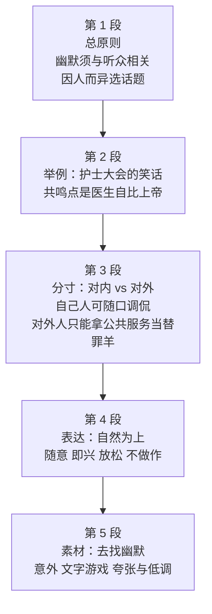

# Passage 35 · 幽默如何奏效

## 答题记录

| 轮次  | 日期         | 题号  | 正确  | 错误  | 正确率 | 用时    | 错题归因 |
| --- | --- | --- | --- | --- | --- | --- | --- |
| 1 |  | 1-5 |  |  |  |  |  |
| 2 |  | 1-5 |  |  |  |  |  |
| 3 |  | 1-5 |  |  |  |  |  |

> [!tip] 填写口径
> - **用时**以分钟计，只计做题时间，不含精读复盘。
> - **错题归因**填「题型·错误类型」，如：细节题·定位错、推理判断·过度推断、主旨大意·以偏概全。
> - 纵向看趋势：正确率升而用时过长 → 熟练度不足；用时降而正确率波动 → 定位不稳。
> - 本篇 5 题，题号栏填 1-5；第 5 题是标题题，错因建议单列「主旨·以偏概全」或「主旨·混淆手段与目的」。

> [!info] 文章档案
> - **来源**：考研英语（一）2002 年 Text 1
> - **题材**：社会生活（交际技巧类说明文）——怎样让幽默在谈话中奏效：找准共同经历、看人下菜、把握分寸、表达自然、善于发现素材
> - **结构**：5 段 / 20 句 ＋ 5 题（按句号断句与行首缩进实测，与解析引用的「第一段①句」「第四段②句」「第五段④句」「第三段末句」全部吻合）
> - **难度**：★★★☆☆
> - **一句话主旨**：要让幽默奏效，先得找到与听众共同的经历和问题——跟不同的人谈不同的话题（对「自己人」可随口调侃食堂与主席的领带，对外人则只能拿邮局、电话系统这类公共服务当替罪羊）；表达要自然随意，而幽默本身往往来自出人意料、文字游戏与夸张低调的反差。

## 一、篇章脉络

- **第 1 段**：立总原则。①句给出全文纲领——想用幽默让人笑，就得会找**共同的经历和问题**（第 1 题的答案句起点）；②句补充「幽默必须与听众相关，并表明你是他们中的一员、理解并**赞同**他们的观点」；③句点出「对象不同，问题也不同」；④句用经理／秘书的对称例子演示什么叫「看人下菜」。
- **第 2 段**：给一个**完整的笑话**作例证。①句说明这个笑话之所以奏效，是因为听众对医生抱有**同样的看法**（第 2 题的题眼）；②—④句铺陈天堂排队的场面；⑤句是笑点：新来者问「那是谁」，圣彼得答「那是上帝——只不过他有时候以为自己是医生」。
- **第 3 段**：讲**分寸**。①句说如果你是听众中的一员，才适合顺口调侃食堂的饭菜或主席的领带；②句说面对其他听众则不可插科打诨，因为局外人的贬损会招人反感；③句给出安全牌——拿邮局、电话系统这类「替罪羊」开涮（第 3 题的答案句）。
- **第 4 段**：讲**表达方式**。①句说觉得别扭就多练；②句是本段核心，也是第 4 题的答案句——插入几句随意、看似即兴的话，用放松、不做作的方式说出来；③句说让人笑的往往是**表达方式（delivery）**本身。
- **第 5 段**：讲**找素材**。①—②句说幽默常来自出人意料；③句说可以改造熟悉的引语、玩文字游戏；④句说去找夸张与低调陈述；⑤句收束：翻看自己的讲稿，挑几处可以换个说法、注入幽默的地方。

> [!tip] 行文逻辑
> 全篇是「总原则 → 举例 → 分寸 → 表达 → 素材」的**how-to（操作指南）型说明文**，五段各司其职、互不交叠，因此**五道题严格按段分布**：第 1 题→第 1 段，第 2 题→第 2 段，第 3 题→第 3 段，第 4 题→第 4 段，第 5 题→全篇（标题题）。这是本篇最大的结构红利：看到题号就能预判落点（题文同序）。贯穿全篇的两条线是**听众相关性**（relevant to the audience / shared / in sympathy with）与**自然**（natural / casual / relaxed / unforced），第 4 题与第二、三条直接相关。

## 二、逐段精读

### 第 1 段 · 总原则：幽默必须与听众相关，因人而异

**原文**

① If you intend using humor in your talk to make people smile, you must know how to identify shared experiences and problems.
② Your humor must be relevant to the audience and should help to show them that you are one of them or that you understand their situation and are in sympathy with their point of view.
③ Depending on whom you are addressing, the problems will be different.
④ If you are talking to a group of managers, you may refer to the disorganized methods of their secretaries; alternatively if you are addressing secretaries, you may want to comment on their disorganized bosses.

**译文**

① 如果你想在谈话中运用幽默把人逗笑，就必须懂得如何找到（与听众）共同的经历和问题。
② 你的幽默必须与听众相关，并且应当有助于向他们表明：你是他们中的一员，或者你理解他们的处境、赞同他们的观点。
③ 根据谈话对象不同，所谈的问题也会不同。
④ 如果你面对的是一群经理，你可以拿他们秘书那套缺乏条理的做法说事；反过来，如果你面对的是秘书，你不妨议论一下他们那些同样缺乏条理的老板。

> [!note] 段落要点
> - 功能：开篇立纲领，给出全篇的总原则；本段是**第 1 题**的唯一战场。
> - ①句是全文的**题眼**：identify shared experiences and problems（找到共同的经历和问题）。整篇文章都在解释「怎么找」「找什么」「对谁说」。
> - ②句两层并列（that... or that...）：要么表明你**是他们中的一员**（one of them），要么表明你理解并**赞同**他们的观点。注意 in sympathy with 此处＝**赞同、支持**，不是「同情」——第 1 题 D 项正是利用这个差别设的陷阱。
> - ③句 Depending on whom you are addressing, the problems will be different 是第 1 题 C 项的直接出处（对不同的对象谈不同的问题）。address 作动词「对……讲话、针对……说话」，是熟词僻义（名词是「地址」，动词亦常作「解决」）。
> - ④句用经理与秘书的**镜像例子**演示③句：同一件事（缺乏条理），对经理说秘书，对秘书说老板。这个「对称结构」本身就是「因人而异」的最佳注脚，也是第 1 题 B 项的取材处——文中只是用 disorganized 形容这两类人，并没说应当取笑他们。

#### 长难句 · 本段

> [!abstract] 本段第 ① 句 · If you intend using humor in your talk to make people smile, you must know how to identify shared experiences and problems.

**结构拆解**

- **条件状语从句**：If you intend using humor in your talk to make people smile（intend doing 打算做；to make people smile 为目的状语）
- **主句**：you must know how to identify shared experiences and problems（how to do 作 know 的宾语）
- **结构**：identify v. 识别、找到（＝find out / recognize）；shared adj. 共同的（share v. 分享、共有）

**参考译文**

如果你想在谈话中运用幽默把人逗笑，就必须懂得如何找到（与听众）共同的经历和问题。

> [!tip] 拆解要点
> 第 1 题的起点句。骨架极简：**If you intend doing A to do B, you must know how to do C**——条件是「想用幽默逗笑」，结论是「必须会找共同点」。两个值得记的用法：**intend doing / intend to do** 均可（前者偏英式）；**identify** 不只是「识别身份」，在议论文里常作「找到、确认」（identify the cause 找到原因）。第 1 题 C 项 address different problems to different people 正是对本段③句 depending on... the problems will be different 的同义转述——书中解析说「从这句话无法直接推出正确答案，可以继续向下读」，说明首句只是**引子**，答案在②—④句。

> [!abstract] 本段第 ② 句 · Your humor must be relevant to the audience and should help to show them that you are one of them or that you understand their situation and are in sympathy with their point of view.

**结构拆解**

- **主干**：Your humor must be relevant to the audience and should help to show them...（and 连接两个谓语）
- **双宾语结构**：show them that...（show sb that 向某人表明……）
- **宾语从句一**：that you are one of them（one of them 他们中的一员＝同类人）
- **宾语从句二**：or that you understand their situation and are in sympathy with their point of view（or 连接的第二个 that 从句；从句内 and 连接两个谓语）
- **结构**：be relevant to 与……有关；in sympathy with 赞同、支持（≠ show sympathy for 同情）

**参考译文**

你的幽默必须与听众相关，并且应当有助于向他们表明：你是他们中的一员，或者你理解他们的处境、赞同他们的观点。

> [!tip] 拆解要点
> 抓两处：①**show them that A or that B** ——show 后跟双宾语，两个 that 从句用 or 并列，说明「拉近距离」有两条路：同类人，或理解＋赞同；②**in sympathy with** 是本篇最狠的词义陷阱——它在这里是「赞同、认同（观点）」，而 D 项 show sympathy for 是「同情（处境）」，两者形近义远。考研命题最爱在这一类「短语里认识每个词、合起来却认错」的地方设题。另外 be relevant to（与……相关）是议论文高频搭配，值得整条背下。

> [!abstract] 本段第 ④ 句 · If you are talking to a group of managers, you may refer to the disorganized methods of their secretaries; alternatively if you are addressing secretaries, you may want to comment on their disorganized bosses.

**结构拆解**

- **分句一**：If you are talking to a group of managers, you may refer to the disorganized methods of their secretaries（if 条件句＋主句；refer to 提到、谈及）
- **分句二**：alternatively if you are addressing secretaries, you may want to comment on their disorganized bosses（alternatively 为连接性副词，引出另一种情形）
- **对称结构**：managers ↔ secretaries；their secretaries ↔ their bosses；refer to ↔ comment on（两面镜像）
- **结构**：disorganized adj. 缺乏条理的、杂乱无章的；comment on 评论、议论

**参考译文**

如果你面对的是一群经理，你可以拿他们秘书那套缺乏条理的做法说事；反过来，如果你面对的是秘书，你不妨议论一下他们那些同样缺乏条理的老板。

> [!tip] 拆解要点
> 全句用分号连接两个**结构完全对称**的分句，是英语「举正反两例」的标准写法：经理→谈他秘书，秘书→谈他老板，动词也由 refer to 换成 comment on（同义换词，避免重复）。**alternatively**（或者、换个说法）是这里唯一的连接信号，读时把它当成「另一种情况」的开关。命题角度：第 1 题 B 项 make fun of the disorganized people 就是从本句取材后**断章取义**——原文只是举例说明「话题要随对象变」，从未说应当取笑缺乏条理的人。凡选项中出现「应当／最好＋评价性动词（make fun of／criticize）」而原文只是在举例的，基本都是过度引申。

#### 本段重点词汇

| 单词 / 短语 | 词性 | 文中意 | 常用考义与拓展 | 英文示例搭配（中译） |
| --- | --- | --- | --- | --- |
| **intend** | v. | 打算，想要 | intend doing/to do 打算做；intention n. 意图；intentional adj. 故意的 | intend using humor in your talk（打算在谈话中用幽默） |
| **humor** | n./v. | 幽默／迁就 | humorous adj. 幽默的；sense of humor 幽默感；humor 亦作动词「迁就、迎合」 | using humor to make people smile（用幽默逗人笑） |
| **identify** | v. | 找到，识别，确认 | identify with 认同；identification n. 识别、身份证明；identity n. 身份 | identify shared experiences and problems（找到共同的经历和问题） |
| **shared experiences** | n. | 共同的经历 | shared adj. 共有的（share v. 分享）；shared values 共同价值观 | shared experiences and problems（共同的经历与问题） |
| **be relevant to** | 短语 | 与……相关，切合 | relevant adj. 相关的；relevance n. 关联性；irrelevant adj. 不相干的 | be relevant to the audience（与听众相关） |
| **audience** | n. | 听众，受众 | audience 为集合名词（谓语可单可复）；audience rating 收视率；spectator 观众（体育赛事） | relevant to the audience（与听众相关） |
| **in sympathy with** | 短语 | 赞同，支持，认同 | sympathy n. 同情／赞同；sympathize v. 同情（sympathize with）；**show sympathy for 同情（处境）** | are in sympathy with their point of view（赞同他们的观点） |
| **point of view** | n. | 观点，看法 | = view / viewpoint / standpoint；from one's point of view 依某人看 | in sympathy with their point of view（赞同他们的观点） |
| **depending on** | 短语 | 取决于，根据 | depend on/upon 取决于、依靠；dependent adj. 依赖的（be dependent on） | Depending on whom you are addressing（视你谈话的对象而定） |
| **address** | v. | 对……讲话，针对……说话 | 熟词僻义：名词「地址」→ 动词「对……讲话」／「处理、解决」；address an audience 对听众讲话 | the problems you are addressing（你所针对／面对的听众的问题） |
| **refer to** | 短语 | 提到，谈及；参考 | refer to sb/sth 提到；reference n. 参考、提及；refer to a dictionary 查词典 | refer to the disorganized methods of their secretaries（提到他们秘书缺乏条理的做法） |
| **disorganized** | adj. | 缺乏条理的，杂乱的 | 构词 dis-＋organized；organize v. 组织；反义 organized 有条理的 | the disorganized methods of their secretaries（秘书们缺乏条理的做法） |
| **alternatively** | adv. | 或者，换个说法（二选一） | alternative n. 替代方案／adj. 可供选择的（见 Passage 34）；alternate v. 交替 | alternatively if you are addressing secretaries（反过来说，如果你面对的是秘书） |
| **comment on** | 短语 | 评论，议论 | comment n. 评论／v. 评论（comment on）；commentary n. 实况解说、评论 | comment on their disorganized bosses（议论他们那些缺乏条理的老板） |

### 第 2 段 · 举例：护士大会上的那个笑话

**原文**

① Here is an example, which I heard at a nurses' convention, of a story which works well because the audience all shared the same view of doctors.
② A man arrives in heaven and is being shown around by St. Peter.
③ He sees wonderful accommodations, beautiful gardens, sunny weather, and so on.
④ Everyone is very peaceful, polite and friendly until, waiting in a line for lunch, the new arrival is suddenly pushed aside by a man in a white coat, who rushes to the head of the line, grabs his food and stomps over to a table by himself.
⑤ "Who is that?" the new arrival asked St. Peter. "Oh, that's God," came the reply, "but sometimes he thinks he's a doctor."

**译文**

① 这里有个例子——是我在一次护士大会上听到的——讲的是一个效果很好的故事，因为听众对医生都抱着同样的看法。
② 一个人来到天堂，由圣彼得带着四处参观。
③ 他看到了极好的住处、美丽的花园、晴朗的天气，等等等等。
④ 大家都十分安详、有礼而友善，直到——排队等午餐的时候，这位新来者突然被一个穿白大褂的人挤到一边；那人冲到队伍最前面，抓起自己的饭，一个人重重地走到一张桌子旁坐下。
⑤ 「那是谁？」新来者问圣彼得。「哦，那是上帝，」回答是这样，「只不过他有时候以为自己是医生。」

> [!note] 段落要点
> - 功能：用一个**完整的笑话**为第 1 段的原则作例证，说明「共鸣点」才是笑话奏效的原因；本段是**第 2 题**的战场（答案句在⑤句）。
> - ①句是本段的总括，也是第 2 题的钥匙：**works well because the audience all shared the same view of doctors** —— 笑话奏效的原因是听众**共享同一个看法**。works 在此＝「奏效、起作用」（熟词僻义：工作 → 起作用）。
> - ②—④句是铺垫，而且是**欲扬先抑**：天堂里一切美好、人人有礼，唯一的反常是一个穿白大褂的人插队——这个反常正是笑点的引线。④句里 who 引导的定语从句一连四个动作（rushes、grabs、stomps、by himself），动作感极强，是英语讲笑话的典型节奏。
> - ⑤句是**笑点（punch line）**：插队的不是别人，正是上帝——「只不过他有时候以为自己是医生」。护士之所以发笑，是因为她们在日常工作中见惯了医生的「上帝姿态」（第 2 题 B 项 very conscious of their godlike role）。
> - 第 2 题的解题关键在题干的 **in the eyes of nurses** ——A（对新来者没礼貌）、C（享有特权）、D（连午饭时间都很忙）三项在原文都能找到对应细节（插队、冲到队首、忙），但那都是**表面情节**，护士真正产生共鸣的是「医生把自己当上帝」。

#### 长难句 · 本段

> [!abstract] 本段第 ① 句 · Here is an example, which I heard at a nurses' convention, of a story which works well because the audience all shared the same view of doctors.

**结构拆解**

- **主干（倒装）**：Here is an example of a story（here 引起的完全倒装；of a story 修饰 example）
- **插入的定语从句**：which I heard at a nurses' convention（修饰 example）
- **定语从句**：which works well（修饰 a story；work 此处＝奏效、起作用）
- **原因状语从句**：because the audience all shared the same view of doctors（share the same view of 对……有同样的看法）

**参考译文**

这里有个例子——是我在一次护士大会上听到的——讲的是一个效果很好的故事，因为听众对医生都抱着同样的看法。

> [!tip] 拆解要点
> 本句有两个障碍：一是 **Here is an example of a story** 中间被 which I heard at... 拦腰截断，读时先把插入语跳过，主干就出来了；二是 **work** 在此不是「工作」而是「奏效、起作用」（The joke works. 这个笑话有效），这是第 2 题最关键的一处熟词僻义。句末 because 从句是全文的**方法论**：笑话之所以有效，是因为听众共享同一个看法——这也预告了第 2 题的问法（in the eyes of nurses）。

> [!abstract] 本段第 ④ 句 · Everyone is very peaceful, polite and friendly until, waiting in a line for lunch, the new arrival is suddenly pushed aside by a man in a white coat, who rushes to the head of the line, grabs his food and stomps over to a table by himself.

**结构拆解**

- **主句**：Everyone is very peaceful, polite and friendly（主系表，三形容词并列）
- **时间／转折连词**：until（直到……为止，此处含「直到出了意外」的转折意味）
- **插入的现在分词短语**：waiting in a line for lunch（逻辑主语是 the new arrival）
- **until 从句**：the new arrival is suddenly pushed aside by a man in a white coat（被动语态）
- **定语从句（修饰 a man）**：who rushes to the head of the line, grabs his food and stomps over to a table by himself（and 连接三个并列谓语）
- **结构**：push aside 推开；stomp v. 迈着重步走；by oneself 独自

**参考译文**

大家都十分安详、有礼而友善，直到——排队等午餐的时候，这位新来者突然被一个穿白大褂的人挤到一边；那人冲到队伍最前面，抓起自己的饭，一个人重重地走到一张桌子旁坐下。

> [!tip] 拆解要点
> 讲笑话的节奏句，骨架是 **Everyone is... until..., ...is pushed aside by... who..., ...and...**。三点提醒：①**until 的转折功能**——前面越是岁月静好，后面那一下子越突兀，这是笑话的「铺垫＋反转」结构；②**waiting in a line for lunch 是插入的分词短语**，其逻辑主语是后面的 the new arrival，位置提前了，别把它当成 Everyone 的动作；③**who 从句里三个动词 rush → grab → stomp 一气呵成**，配合 by himself（独自一人），把一个傲慢又匆忙的形象立住，正是第 2 题 A、D 两项（impolite to new arrivals／very busy even during lunch hours）取材的地方——它们是**情节**，不是护士眼中笑话的**含义**。

#### 本段重点词汇

| 单词 / 短语 | 词性 | 文中意 | 常用考义与拓展 | 英文示例搭配（中译） |
| --- | --- | --- | --- | --- |
| **convention** | n. | 大会，会议；惯例 | 熟词僻义：惯例、习俗 → 大型会议；conventional adj. 常规的、传统的；convention center 会议中心 | at a nurses' convention（在一次护士大会上） |
| **work** | v. | 奏效，起作用 | 熟词僻义：工作 → 起作用、行得通；The plan works. 计划行得通；work out 锻炼、解决 | a story which works well（一个效果很好的故事） |
| **accommodation** | n. | 住处，膳宿 | 英式常用 accommodations（复数）；accommodate v. 容纳、提供住宿 | wonderful accommodations（极好的住处） |
| **show sb around** | 短语 | 带某人参观 | = take sb around；show off 炫耀；show up 到场（见 Passage 33） | is being shown around by St. Peter（由圣彼得带着参观） |
| **and so on** | 短语 | 等等，诸如此类 | = and so forth / etc.；用于列举收尾 | sunny weather, and so on（晴朗的天气，等等） |
| **peaceful** | adj. | 平静的，安宁的 | peace n. 和平、平静；peacefully adv. 平静地 | Everyone is very peaceful, polite and friendly（大家都安详、有礼而友善） |
| **wait in a line** | 短语 | 排队等候 | = queue up（英式）；stand in line 排队（美式）；jump the queue 插队 | waiting in a line for lunch（排队等午餐） |
| **new arrival** | n. | 新来者，新到的人 | arrival n. 到达、到达者；a new arrival 亦指新生儿、新商品 | the new arrival asked St. Peter（新来者问圣彼得） |
| **push aside** | 短语 | 把……推开，挤开 | push v. 推；push on 继续前进；aside adv. 到一边 | is suddenly pushed aside by a man in a white coat（突然被一个穿白大褂的人挤开） |
| **rush to** | 短语 | 冲到，奔向 | rush v. 冲、仓促行事／n. 高峰（rush hour）；rush into 仓促做 | rushes to the head of the line（冲到队伍最前面） |
| **grab** | v. | 抓住，抢 | grab a bite 随便吃点；grab the chance 抓住机会；= seize | grabs his food and stomps over（抓起他的饭，重重地走开） |
| **stomp** | v. | 迈着重步走，跺脚 | stomp over to... 大步走到……；stamp v. 跺脚、盖章 | stomps over to a table by himself（一个人重重地走到一张桌子旁） |
| **godlike** | adj. | 上帝般的，如神一般的 | 构词 god ＋ -like（像……的）：lifelike 逼真的、childlike 天真的 | (the doctors are) very conscious of their godlike role（医生非常在乎自己上帝般的角色） |
| **be conscious of** | 短语 | 在意，意识到 | conscious adj. 有意识的、在意的；consciousness n. 意识；unconscious adj. 无意识的 | very conscious of their godlike role（非常在乎自己上帝般的角色） |

### 第 3 段 · 分寸：对内可随口调侃，对外只宜拿替罪羊

**原文**

① If you are part of the group which you are addressing, you will be in a position to know the experiences and problems which are common to all of you and it'll be appropriate for you to make a passing remark about the inedible canteen food or the chairman's notorious bad taste in ties.
② With other audiences you mustn't attempt to cut in with humor as they will resent an outsider making disparaging remarks about their canteen or their chairman.
③ You will be on safer ground if you stick to scapegoats like the Post Office or the telephone system.

**译文**

① 如果你是所面对的那一群人中的一员，你就有条件了解大家共有的经历和问题，这时你顺口说一句「食堂的饭难以下咽」或「主席挑领带的品位出了名地差」，才是恰当的。
② 面对其他听众，你绝不能试图插科打诨，因为他们会反感一个局外人来贬损他们的食堂或主席。
③ 如果你只拿邮局、电话系统这类「替罪羊」开涮，那就稳妥得多了。

> [!note] 段落要点
> - 功能：讲**分寸感**，把第 1 段的「相关性」原则细化成「对内／对外」两条规则；本段是**第 3 题**的战场（答案句在③句）。
> - ①句的规则是「你是圈内人 → 可以调侃内部事物」：be in a position to（有条件、能够）＋ make a passing remark about（顺口说一句）。两个例子（inedible canteen food、chairman's notorious bad taste in ties）都是办公室内部的槽点。
> - ②句的规则是「你是圈外人 → 不可乱说」：mustn't attempt to cut in with humor，因为 resent（反感）一个 outsider（局外人）作 disparaging remarks（贬损性评论）。注意 as 在这里＝because。
> - ③句是第 3 题的答案句：**on safer ground if you stick to scapegoats like the Post Office or the telephone system** —— 拿邮局、电话系统（＝公共服务机构）当替罪羊最安全，反过来说明这类机构是**经常被拿来开涮的对象**（laughing stock）。
> - 第 3 题的定位要绕一个弯：题干的 public services 在文中找不到原词，被替换成了 the Post Office / the telephone system——这是推理题最常见的「同义替换定位」。

#### 长难句 · 本段

> [!abstract] 本段第 ① 句 · If you are part of the group which you are addressing, you will be in a position to know the experiences and problems which are common to all of you and it'll be appropriate for you to make a passing remark about the inedible canteen food or the chairman's notorious bad taste in ties.

**结构拆解**

- **条件状语从句**：If you are part of the group which you are addressing（which 从句修饰 the group）
- **主句一**：you will be in a position to know the experiences and problems（be in a position to do 有条件／能够做）
- **定语从句**：which are common to all of you（修饰 experiences and problems；be common to 为……所共有）
- **主句二（并列）**：and it'll be appropriate for you to make a passing remark about A or B（it 为形式主语；appropriate for sb to do）
- **并列宾语**：the inedible canteen food or the chairman's notorious bad taste in ties（or 连接；bad taste in 在……方面品位差）

**参考译文**

如果你是所面对的那一群人中的一员，你就有条件了解大家共有的经历和问题，这时你顺口说一句「食堂的饭难以下咽」或「主席挑领带的品位出了名地差」，才是恰当的。

> [!tip] 拆解要点
> 全段最长的一句，骨架是 **If..., you will be in a position to know... and it'll be appropriate for you to do...**（and 连接两个并列主句）。四处值得记：①**be in a position to do** ＝ 有条件／能够做（不是「处在某个位置」）；②**be common to** 为……所共有（common to all of you 你们大家共有的）；③**it is appropriate for sb to do** 某人做……是恰当的；④**make a passing remark about** 顺口说一句、随口评论（passing 此处＝顺带的、随口的）。命题关联：本句说的是「圈内人才能调侃食堂与主席」，第 3 题 C 项（公共服务不适合作为幽默主题）正与段末「拿公共服务当替罪羊更安全」相矛盾。

> [!abstract] 本段第 ② 句 · With other audiences you mustn't attempt to cut in with humor as they will resent an outsider making disparaging remarks about their canteen or their chairman.

**结构拆解**

- **介词短语（对象）**：With other audiences（对于其他听众而言；with 表「面对、就……而言」）
- **主句**：you mustn't attempt to cut in with humor（attempt to do 试图做；cut in 插嘴）
- **原因状语从句**：as they will resent an outsider making disparaging remarks about...（as ＝ because；resent sb doing 反感某人做）
- **结构**：disparaging adj. 贬低的、轻蔑的（disparage v. 贬低）；outsider n. 局外人（反义 insider 圈内人）

**参考译文**

面对其他听众，你绝不能试图插科打诨，因为他们会反感一个局外人来贬损他们的食堂或主席。

> [!tip] 拆解要点
> 三处要抓：①**as ＝ because**（此处不是「当……时」也不是「尽管」，而是「因为」，由「别人会反感」的因果语义决定）；②**resent sb('s) doing** 是固定结构（resent 后接名词或动名词，不接不定式），意为「反感某人做某事」；③**cut in with humor** 的 cut in 本义「插嘴、打断」，此处引申为「插科打诨、硬插一段幽默」。本句与①句构成「对内可以、对外不可以」的对比，正是第 3 题推理的落脚点：既然对外人只能谈「公共的替罪羊」，说明公共服务是**人人可拿来取笑**的对象。

#### 本段重点词汇

| 单词 / 短语 | 词性 | 文中意 | 常用考义与拓展 | 英文示例搭配（中译） |
| --- | --- | --- | --- | --- |
| **be in a position to** | 短语 | 能够，有条件（做某事） | position n. 位置、处境、立场；be in no position to do 没有资格／条件做 | be in a position to know the experiences（有条件了解这些经历） |
| **be common to** | 短语 | 为……所共有，对……而言是共同的 | common adj. 共同的、常见的；common sense 常识；in common 共有 | experiences which are common to all of you（大家共有的经历） |
| **appropriate** | adj. | 恰当的，合适的 | be appropriate for/to 适合于；appropriately adv. 恰当地；inappropriate adj. 不恰当的 | it'll be appropriate for you to make a passing remark（你顺口说一句是恰当的） |
| **make a passing remark** | 短语 | 顺口说一句，随口评论 | passing adj. 顺带的、临时的；remark n./v. 评论（remark on）；make a remark about 就……发表评论 | make a passing remark about the inedible canteen food（顺口说一句食堂的饭难吃） |
| **inedible** | adj. | 不能吃的，难以下咽的 | 构词 in-（不）＋edible（可食用的）；edible adj. 可食用的 | the inedible canteen food（食堂里难以下咽的饭菜） |
| **canteen** | n. | 食堂，餐厅 | = cafeteria（美式）；dining hall 食堂；canteen 亦作「水壶」 | their canteen or their chairman（他们的食堂或主席） |
| **notorious** | adj. | 臭名昭著的，出了名的（贬） | notoriously adv. 出了名地；notoriety n. 恶名；≠ famous（中性偏褒） | the chairman's notorious bad taste in ties（主席出了名地差的领带品位） |
| **bad taste in** | 短语 | 在……方面品位差 | taste n. 品位、口味／v. 尝；in bad taste 不得体；good taste 高雅 | bad taste in ties（挑领带的品位差） |
| **attempt to** | 短语 | 试图，企图 | attempt n./v. 尝试（attempt to do ／ make an attempt to do）；attempted murder 未遂谋杀 | mustn't attempt to cut in with humor（绝不能试图插科打诨） |
| **cut in** | 短语 | 插嘴，打断；插（话） | cut in on sb 打断某人；cut off 切断；cut down 削减 | cut in with humor（插进一段幽默／插科打诨） |
| **resent** | v. | 怨恨，反感 | resent doing/sb doing 反感（某人）做；resentment n. 怨恨；resentful adj. 充满怨恨的 | they will resent an outsider making disparaging remarks（他们会反感局外人作贬损性评论） |
| **outsider** | n. | 局外人，外来者 | 构词 out ＋ side ＋ -er；反义 insider 圈内人、知情者 | resent an outsider making disparaging remarks（反感一个局外人作贬损评论） |
| **disparaging** | adj. | 贬低的，轻蔑的 | disparage v. 贬低、轻视；disparagement n. 贬损；= derogatory | disparaging remarks about their canteen（对他们食堂的贬损性评论） |
| **on safer ground** | 短语 | 更稳妥，更安全 | ground n. 立场、地盘（on shaky ground 站不住脚）；on safe ground 站得住脚 | be on safer ground if you stick to scapegoats（只拿替罪羊开涮就稳妥得多） |
| **stick to** | 短语 | 坚持，固守，限于 | stick to one's word 守信；stick to the point 紧扣主题；stick v. 粘、卡住 | stick to scapegoats like the Post Office（只拿邮局这类替罪羊开涮） |
| **scapegoat** | n. | 替罪羊，代人受过者 | 构词 scape（escape 的变体）＋goat；make a scapegoat of sb 拿某人当替罪羊 | scapegoats like the Post Office or the telephone system（邮局、电话系统这类替罪羊） |

### 第 4 段 · 表达：随意、即兴、不做作

**原文**

① If you feel awkward being humorous, you must practice so that it becomes more natural.
② Include a few casual and apparently off-the-cuff remarks which you can deliver in a relaxed and unforced manner.
③ Often it's the delivery which causes the audience to smile, so speak slowly and remember that a raised eyebrow or an unbelieving look may help to show that you are making a light-hearted remark.

**译文**

① 如果你觉得幽默起来很别扭，那就必须练习，让它变得更自然。
② 加入几句随意的、看似即兴的话，你可以用放松、不做作的方式把它们说出来。
③ 让听众发笑的往往是（你的）表达方式，所以要说得慢一些，并且记住：扬一下眉毛，或露出难以置信的神情，都有助于表明你是在说一句俏皮话。

> [!note] 段落要点
> - 功能：讲**表达方式**；本段是**第 4 题**的战场（答案句在②句）。
> - ①句先破后立：觉得 awkward（别扭、不自在）就多练，目标是 natural（自然）。注意 awkward 这个词在第 4 题 B 项（as awkwardly as possible）里被原词复现做干扰。
> - ②句是第 4 题的答案句，一句之内堆了四个「自然」的同义词：**casual**（随意的）、**off-the-cuff**（即兴的）、**relaxed**（放松的）、**unforced**（不做作的）——第 4 题 D 项 as casually as possible 正由此而来。
> - ③句说 the delivery（表达方式／讲述方式）才是让人笑的关键，并给出两个「非语言」提示：扬眉毛、露出难以置信的表情。delivery 由 deliver（递送、接生）转为「表达方式」，是熟词僻义。
> - 段落逻辑：「练到自然（①）→ 用随意即兴的方式说出来（②）→ 表达方式本身就是笑点（③）」，三句层层推进。

#### 长难句 · 本段

> [!abstract] 本段第 ② 句 · Include a few casual and apparently off-the-cuff remarks which you can deliver in a relaxed and unforced manner.

**结构拆解**

- **主干（祈使句）**：Include a few casual and apparently off-the-cuff remarks（include 为动词原形，构成建议式祈使句）
- **并列定语**：casual and apparently off-the-cuff（修饰 remarks；apparently 表面上、似乎）
- **定语从句**：which you can deliver in a relaxed and unforced manner（修饰 remarks；deliver v. 表达、说出）
- **方式状语**：in a relaxed and unforced manner（以放松、不做作的方式；in a...manner 以……方式）

**参考译文**

加入几句随意的、看似即兴的话，你可以用放松、不做作的方式把它们说出来。

> [!tip] 拆解要点
> 第 4 题的答案句。全句只有一个难点：**四个「自然」的形容词同现**（casual / off-the-cuff / relaxed / unforced）。书中解析说得好：「只要我们能懂其中一个单词的意思，这道题目就解决了，这些词代表的都是自然的表达方式。」因此 D 项 as casually as possible 是唯一与这条语义链同向的选项。两个词值得单独记：**off-the-cuff**（即兴的、未经准备的，字面是「从袖口上（念出来的）」，源自早年在衬衫袖口记要点的习惯）与 **in a...manner**（以……方式，= in a...way / fashion）。第 4 题的三个干扰项分别：A（措辞得体）与「自然随意」相悖；B 利用①句的 awkward 原词设陷；C 利用第 5 段④句的 exaggeration 设陷，那是**找素材**的方法，不是**讲述**的方式。

> [!abstract] 本段第 ③ 句 · Often it's the delivery which causes the audience to smile, so speak slowly and remember that a raised eyebrow or an unbelieving look may help to show that you are making a light-hearted remark.

**结构拆解**

- **分句一（强调句）**：Often it's the delivery which causes the audience to smile（it is...which... 强调句型，强调 the delivery）
- **分句二（so 连接并列句）**：so speak slowly and remember that...（and 连接两个祈使谓语）
- **宾语从句**：that a raised eyebrow or an unbelieving look may help to show that...（or 连接两个主语）
- **嵌套宾语从句**：that you are making a light-hearted remark（作 show 的宾语）
- **结构**：delivery n. 表达方式、讲述方式；light-hearted adj. 轻松的、俏皮的

**参考译文**

让听众发笑的往往是（你的）表达方式，所以要说得慢一些，并且记住：扬一下眉毛，或露出难以置信的神情，都有助于表明你是在说一句俏皮话。

> [!tip] 拆解要点
> 骨架是 **it is A which causes B, so do C and remember that D**。三处值得记：①**强调句 it is...which...**（被强调的是 the delivery，即「方式」而非「内容」）——这是第 4 题 D 项「讲述方式要自然」的另一处支撑；②**delivery** 由动词 deliver（递送、发表）转为名词「表达方式、讲述方式」，与②句的 deliver 形成动—名呼应；③**a raised eyebrow / an unbelieving look** 是「用表情提示这是玩笑」的两种具体做法，light-hearted（轻松、俏皮的）是它们的共同目的。写作时可整句迁移：Often it's the delivery which causes the audience to smile.

#### 本段重点词汇

| 单词 / 短语 | 词性 | 文中意 | 常用考义与拓展 | 英文示例搭配（中译） |
| --- | --- | --- | --- | --- |
| **awkward** | adj. | 别扭的，不自在的；笨拙的 | awkwardly adv. 笨拙地、尴尬地；awkwardness n. 尴尬；an awkward silence 尴尬的沉默 | feel awkward being humorous（幽默起来觉得别扭） |
| **natural** | adj. | 自然的，不做作的 | nature n. 自然、本性；naturally adv. 自然地；natural-born 天生的 | so that it becomes more natural（让它变得更自然） |
| **casual** | adj. | 随意的，不经意的 | casual clothes 便装；casually adv. 随意地；casualty n. 伤亡者（形近义远） | a few casual and apparently off-the-cuff remarks（几句随意、看似即兴的话） |
| **apparently** | adv. | 表面上，似乎；显然 | apparent adj. 明显的、表面的；it is apparent that... 显然…… | apparently off-the-cuff remarks（看似即兴的话） |
| **off-the-cuff** | adj. | 即兴的，未经准备的 | 典故：早年把要点写在衬衫袖口（cuff）上；= impromptu / unprepared | apparently off-the-cuff remarks（看似即兴的话） |
| **deliver** | v. | 表达，说出；递送 | deliver a speech 发表演讲；deliver a baby 接生；delivery n. 递送、表达方式 | deliver remarks in a relaxed manner（以放松的方式把这些话说出来） |
| **in a...manner** | 短语 | 以……的方式 | manner n. 方式、举止（见 Passage 34 in the manner of）；= in a...way/fashion | in a relaxed and unforced manner（以放松、不做作的方式） |
| **relaxed** | adj. | 放松的，轻松的 | relax v. 放松；relaxation n. 放松、消遣；relaxing adj. 令人放松的 | in a relaxed and unforced manner（以放松的方式） |
| **unforced** | adj. | 不做作的，自然的 | 构词 un-＋forced（勉强的）；forced smile 强颜欢笑 | a relaxed and unforced manner（放松而不做作的方式） |
| **delivery** | n. | 表达方式，讲述方式 | 熟词僻义：递送、分娩 → （演讲的）表达方式；deliver v. 递送、发表 | Often it's the delivery which causes the audience to smile（往往是表达方式让人发笑） |
| **a raised eyebrow** | n. | 扬起的眉毛（表惊讶／调侃） | raise one's eyebrows 扬起眉毛（＝令人侧目，见 Passage 33）；raise v. 抬起 | a raised eyebrow or an unbelieving look（扬一下眉毛或难以置信的神情） |
| **unbelieving** | adj. | 怀疑的，不相信的 | 构词 un-＋believing；unbelievable adj. 难以置信的；believe v. 相信 | an unbelieving look（难以置信的神情） |
| **light-hearted** | adj. | 轻松的，俏皮的 | light-hearted remark 俏皮话；heavy-hearted 心情沉重的；light-hearted 亦作「无忧无虑的」 | making a light-hearted remark（在说一句俏皮话） |

### 第 5 段 · 素材：幽默来自意外、文字游戏与夸张

**原文**

① Look for the humor.
② It often comes from the unexpected.
③ A twist on a familiar quote "If at first you don't succeed, give up" or a play on words or on a situation.
④ Search for exaggeration and understatements.
⑤ Look at your talk and pick out a few words or sentences which you can turn about and inject with humor.

**译文**

① 去寻找幽默。
② 它常常来自出人意料之处。
③ 改造一句耳熟能详的引语——「如果一开始没成功，就放弃吧」——或者玩个文字游戏、玩一把情境。
④ 去找夸张的说法与低调的陈述。
⑤ 翻看你的讲稿，挑出几个可以换个说法、注入幽默的词或句子。

> [!note] 段落要点
> - 功能：讲**怎么找幽默素材**，是全篇的收尾段，也是第 5 题（标题题）中「善于发现幽默」这一条的出处。
> - ①—②句是总纲：幽默来自 **the unexpected**（出乎意料）。「the ＋ 形容词」表示一类抽象事物（the unexpected 出乎意料的事），是考研高频结构。
> - ③句给两个具体做法：改造熟悉的引语（a twist on a familiar quote）＋玩文字游戏（a play on words）。文中的例子是对名言「If at first you don't succeed, try, try again（若一开始没成功，就再试再试）」的**反转**：「若一开始没成功，就放弃吧」。
> - ④句给第三、四种做法：**exaggeration（夸张）与 understatements（低调陈述）**——一放一收，都是制造反差的手法。注意 understatement 在考研阅读里常考（轻描淡写，与 overstatement 相对）。
> - ⑤句把方法落回自己的讲稿：挑出可以 turn about（换个说法）并 inject with humor（注入幽默）的词句。inject 由「注射」引申为「注入、增添」，是熟词僻义。
> - 本段几乎全是**祈使句**（Look for / Search for / Look at / pick out），是 how-to 类说明文结尾的典型语气。

#### 长难句 · 本段

> [!abstract] 本段第 ⑤ 句 · Look at your talk and pick out a few words or sentences which you can turn about and inject with humor.

**结构拆解**

- **主干（祈使句）**：Look at your talk and pick out a few words or sentences（and 连接两个祈使谓语）
- **定语从句**：which you can turn about and inject with humor（修饰 words or sentences；从句内 and 连接两个谓语）
- **结构**：turn about 换个说法、翻转（＝turn around）；inject A with B 把 B 注入 A（inject 本义「注射」）
- **结构**：pick out 挑出、选出

**参考译文**

翻看你的讲稿，挑出几个可以换个说法、注入幽默的词或句子。

> [!tip] 拆解要点
> 骨架是 **Look at A and pick out B which you can do C and do D** ——两个祈使句并列，后面套一个含双谓语的定语从句。两个表达值得整条背下：**turn about**（换个说法、翻转一下，口语里更常说 turn around）与 **inject A with humor**（给 A 注入幽默；inject 由「注射」引申为「注入、增添」，如 inject new life into... 给……注入新活力）。本句也可看作全篇的收束动作：前面四段讲的是「怎么说」，最后一句把球踢回读者——去自己的材料里找。第 4 题 C 项（in exaggerated statements）正是把本段④句「找夸张手法」误当成「讲述方式」来用，属**段落功能错位**。

#### 本段重点词汇

| 单词 / 短语 | 词性 | 文中意 | 常用考义与拓展 | 英文示例搭配（中译） |
| --- | --- | --- | --- | --- |
| **look for** | 短语 | 寻找，留意 | look into 调查；look up 查阅；look forward to 期待（to 为介词） | Look for the humor.（去寻找幽默。） |
| **the unexpected** | n. | 出乎意料的事 | 「the ＋ 形容词」表一类抽象事物：the unexpected / the unknown / the impossible | It often comes from the unexpected.（它常来自出人意料之处。） |
| **twist** | n./v. | 改动，反转／扭、拧 | a twist on... 对……的改造／反转；twist of fate 命运的转折；twisty adj. 曲折的 | a twist on a familiar quote（对一句熟悉引语的改造） |
| **quote** | n./v. | 引语，名言／引用 | quotation n. 引语、报价；quote from 引自；in quotes 加引号 | a familiar quote "If at first you don't succeed, give up"（一句熟悉的话：若一开始没成功，就放弃） |
| **a play on words** | 短语 | 文字游戏，双关语 | = pun；a play on a situation 情境上的玩法（文中并列）；play with words 玩弄词句 | a play on words or on a situation（文字游戏或情境游戏） |
| **exaggeration** | n. | 夸张，夸大 | exaggerate v. 夸张、夸大；exaggerated adj. 夸张的；反义 understatement 低调陈述 | Search for exaggeration and understatements.（去找夸张与低调陈述。） |
| **understatement** | n. | 低调陈述，轻描淡写 | understate v. 轻描淡写；反义 overstatement 夸大其词；英国人尤爱用 | exaggeration and understatements（夸张与低调陈述） |
| **pick out** | 短语 | 挑出，选出 | pick up 捡起、学会；pick on 挑剔；pickpocket n. 扒手 | pick out a few words or sentences（挑出几个词或句子） |
| **turn about** | 短语 | 换个说法，翻转 | = turn around；turn down 拒绝（见 Passage 32）；turn out 结果是 | which you can turn about（你可以换个说法的词句） |
| **inject** | v. | 注入，增添 | 熟词僻义：注射 → 注入、增添；inject A with B ＝ inject B into A；injection n. 注射 | inject with humor（注入幽默） |

## 三、全篇重点词汇汇总（自测用）

> [!info] 说明
> 本表只列「单词 / 词性 / 所在段」，不含释义与搭配，用于遮表自测：说出词义后再回该段核对。
> 收录**全篇所有段落词汇，共 67 条，不删减**，与各段「本段重点词汇」等长同源。

| 单词 / 短语 | 词性 | 所在段 |
| --- | --- | --- |
| **intend** | v. | 第 1 段 |
| **humor** | n./v. | 第 1 段 |
| **identify** | v. | 第 1 段 |
| **shared experiences** | n. | 第 1 段 |
| **be relevant to** | 短语 | 第 1 段 |
| **audience** | n. | 第 1 段 |
| **in sympathy with** | 短语 | 第 1 段 |
| **point of view** | n. | 第 1 段 |
| **depending on** | 短语 | 第 1 段 |
| **address** | v. | 第 1 段 |
| **refer to** | 短语 | 第 1 段 |
| **disorganized** | adj. | 第 1 段 |
| **alternatively** | adv. | 第 1 段 |
| **comment on** | 短语 | 第 1 段 |
| **convention** | n. | 第 2 段 |
| **work** | v. | 第 2 段 |
| **accommodation** | n. | 第 2 段 |
| **show sb around** | 短语 | 第 2 段 |
| **and so on** | 短语 | 第 2 段 |
| **peaceful** | adj. | 第 2 段 |
| **wait in a line** | 短语 | 第 2 段 |
| **new arrival** | n. | 第 2 段 |
| **push aside** | 短语 | 第 2 段 |
| **rush to** | 短语 | 第 2 段 |
| **grab** | v. | 第 2 段 |
| **stomp** | v. | 第 2 段 |
| **godlike** | adj. | 第 2 段 |
| **be conscious of** | 短语 | 第 2 段 |
| **be in a position to** | 短语 | 第 3 段 |
| **be common to** | 短语 | 第 3 段 |
| **appropriate** | adj. | 第 3 段 |
| **make a passing remark** | 短语 | 第 3 段 |
| **inedible** | adj. | 第 3 段 |
| **canteen** | n. | 第 3 段 |
| **notorious** | adj. | 第 3 段 |
| **bad taste in** | 短语 | 第 3 段 |
| **attempt to** | 短语 | 第 3 段 |
| **cut in** | 短语 | 第 3 段 |
| **resent** | v. | 第 3 段 |
| **outsider** | n. | 第 3 段 |
| **disparaging** | adj. | 第 3 段 |
| **on safer ground** | 短语 | 第 3 段 |
| **stick to** | 短语 | 第 3 段 |
| **scapegoat** | n. | 第 3 段 |
| **awkward** | adj. | 第 4 段 |
| **natural** | adj. | 第 4 段 |
| **casual** | adj. | 第 4 段 |
| **apparently** | adv. | 第 4 段 |
| **off-the-cuff** | adj. | 第 4 段 |
| **deliver** | v. | 第 4 段 |
| **in a...manner** | 短语 | 第 4 段 |
| **relaxed** | adj. | 第 4 段 |
| **unforced** | adj. | 第 4 段 |
| **delivery** | n. | 第 4 段 |
| **a raised eyebrow** | n. | 第 4 段 |
| **unbelieving** | adj. | 第 4 段 |
| **light-hearted** | adj. | 第 4 段 |
| **look for** | 短语 | 第 5 段 |
| **the unexpected** | n. | 第 5 段 |
| **twist** | n./v. | 第 5 段 |
| **quote** | n./v. | 第 5 段 |
| **a play on words** | 短语 | 第 5 段 |
| **exaggeration** | n. | 第 5 段 |
| **understatement** | n. | 第 5 段 |
| **pick out** | 短语 | 第 5 段 |
| **turn about** | 短语 | 第 5 段 |
| **inject** | v. | 第 5 段 |

> [!example] 同义替换链（阅读题高频）
> - **identify shared experiences and problems（第 1 段①句）↔ address different problems to different people（第 1 题 C 项）**：depending on whom you are addressing, the problems will be different（③句）是中间桥梁——「找共同点」落到操作上就是「因人而异选话题」。
> - **in sympathy with their point of view（第 1 段②句）↔ show sympathy for your listeners（第 1 题 D 项）**：形近义远——前者「赞同观点」，后者「同情听众」。
> - **disorganized methods of their secretaries / disorganized bosses（第 1 段④句）↔ make fun of the disorganized people（第 1 题 B 项）**：原文是举例说明「话题随对象变」，选项是「应当取笑」，断章取义。
> - **the audience all shared the same view of doctors（第 2 段①句）↔ in the eyes of nurses（第 2 题题干）**：听众＝护士，共享看法＝护士眼中的医生形象。
> - **"Oh, that's God," ... "but sometimes he thinks he's a doctor."（第 2 段⑤句）↔ very conscious of their godlike role（第 2 题 B 项）**：笑点＝医生自比上帝。
> - **stick to scapegoats like the Post Office or the telephone system（第 3 段③句）↔ public services（第 3 题题干）**：同义替换定位——公共服务被具体化为邮局与电话系统。
> - **on safer ground（第 3 段③句）↔ have often been the laughing stock（第 3 题 D 项）**：「拿它开涮最安全」＝「它常是笑料」。
> - **casual / off-the-cuff / relaxed / unforced（第 4 段②句）↔ as casually as possible（第 4 题 D 项）**：四个「自然」形容词同指一条语义链。
> - **awkward（第 4 段①句）↔ as awkwardly as possible（第 4 题 B 项）**：原词复现式干扰（原文说要练到不别扭）。
> - **Search for exaggeration（第 5 段④句）↔ in exaggerated statements（第 4 题 C 项）**：段落功能错位——「找素材的手法」被当成「讲述的方式」。

> [!warning] 熟词僻义专列
> - **address**：地址（名词）→ 对……讲话、针对……说话（动词，如 address an audience）。
> - **work**：工作 → 奏效、起作用（The joke works.）。
> - **convention**：惯例、习俗 → 大型会议、大会（a nurses' convention）。
> - **in sympathy with**：同情 → 赞同、认同（观点）。
> - **deliver**：递送、接生 → 表达、说出（remarks）。
> - **delivery**：递送、分娩 → （演讲的）表达方式、讲述方式。
> - **off-the-cuff**：袖口之外 → 即兴的、未经准备的。
> - **inject**：注射 → 注入、增添（inject...with humor）。
> - **accommodation**：住宿、适应 → 住处、膳宿（英式常作 accommodations）。
> - **twist**：扭、拧 → 改造、反转（a twist on a familiar quote）。
> - **stomp**：跺脚 → 迈着重步走（stomp over to...）。
> - **grab**：抓 → 抢、逮住机会（grab a bite / a chance）。
> - **ground**：地面 → 立场、依据（on safer ground 更稳妥）。
> - **passing**（make a passing remark）：经过的 → 顺带的、随口的。
> - **notorious**：著名的 → 臭名昭著的、出了名的（贬义）。
> - **turn about**：转身 → 换个说法、翻转（＝turn around）。

## 四、知识点补充

> [!question] 背景知识
> - **St. Peter 与天堂之门**：圣彼得（St. Peter）是耶稣十二门徒之首，基督教传统中他手持天国的钥匙、守在天门迎接亡魂——所以文中文「由圣彼得带着参观天堂」是西方读者一看就懂的文化设定，笑话的反差正建立在「连上帝都要插队」上。
> - **护士与医生的「上帝情结」**：英语里 doctor 与 God 常被并置调侃（God complex「上帝情结」指医生自认无所不能、可主宰生死）。护士日常最直接感受医生的权威姿态，因此对这则笑话「共享同一个看法」——第 2 题 B 项 very conscious of their godlike role 就是这个梗。
> - **"If at first you don't succeed, give up"**：这是对英语励志格言 **"If at first you don't succeed, try, try again"（若一开始未成功，就再试、再试）** 的**反转**（a twist on a familiar quote）。把「坚持」改成「放弃」，反差即笑点。这种「改造名言」是英文幽默最常见的手法之一。
> - **英国的公共服务梗**：Post Office（邮局）与 telephone system（电话系统）在 1980—1990 年代的英国是效率低下、服务糟糕的代名词，长期被脱口秀与漫画调侃，属于「人人都可骂、谁都不会得罪」的安全靶子——文中 scapegoat（替罪羊）正用在此处。
> - **off-the-cuff 的来历**：早年演讲者把要点写在衬衫袖口（cuff）上，临场瞄一眼就讲，故 off-the-cuff ＝ 即兴的、未经准备的；同义表达还有 impromptu、extemporaneous。
> - **understatement（低调陈述）**：英式幽默的核心手法之一——把大事说小（如「略有不便」实指灾难），与 exaggeration（夸张）一收一放，都是靠**反差**制造幽默。

> [!warning] 语法点
> - **intend doing / intend to do（第 1 段①）**：打算做（两者皆可，doing 偏英式）。
> - **how to do 作宾语（第 1 段①）**：know how to identify...。
> - **show sb that A or that B（第 1 段②）**：show 带双宾语，两个 that 从句由 or 并列。
> - **Depending on whom...（第 1 段③）**：现在分词短语作状语，其逻辑主语是主句的 problems（视对象而定）。
> - **Here is...引起的完全倒装（第 2 段①）**：Here is an example of a story（主语在后）。
> - **until 表「直到……（出了意外）」（第 2 段④）**：前面铺陈常态，until 之后是转折。
> - **who 引导定语从句含三个并列谓语（第 2 段④）**：rushes..., grabs... and stomps...。
> - **it is appropriate for sb to do（第 3 段①）**：it 作形式主语。
> - **as ＝ because 引导原因从句（第 3 段②）**：由语义判定，非「当……时」。
> - **resent sb('s) doing（第 3 段②）**：resent 后接名词或动名词，不接不定式。
> - **so that 引导目的状语从句（第 4 段①）**：以便、为了。
> - **强调句 it is...which...（第 4 段③）**：强调 the delivery。
> - **祈使句表建议（第 5 段全段）**：Look for... / Search for... / Look at...。
> - **the ＋ 形容词表抽象名词（第 5 段②）**：the unexpected（出乎意料的事）。
> - **inject A with B（第 5 段⑤）**：把 B 注入 A（＝inject B into A）。

> [!success] 写作可迁移句型
> - **If you intend doing A to do B, you must know how to do C.**：如果你想通过 A 达到 B，就必须懂得如何 C（方法类文章的标准开场）。
> - **A must be relevant to B and should help to show...**：A 必须与 B 相关，并有助于表明……（原则句）。
> - **Depending on whom you are addressing, ...will be different.**：视对象不同，……也会不同（因人而异句）。
> - **If you are part of the group..., it'll be appropriate for you to...**：如果你属于那个群体，做……才是恰当的（分寸句）。
> - **You will be on safer ground if you stick to...**：如果只限于……，你会更稳妥（建议句）。
> - **If you feel awkward doing..., you must practice so that it becomes more natural.**：觉得别扭就练，直到变自然。
> - **Often it's the delivery which causes the audience to...**：往往是表达方式让人……（强调句式）。
> - **A twist on a familiar quote or a play on words.**：改造名言或玩文字游戏（幽默手法句）。
> - **Look at your...and pick out...which you can turn about and inject with humor.**：翻看你的……，挑出可以换个说法、注入幽默的部分（收束句）。

> [!danger] 易混辨析
> - **audience / spectator / viewer**：audience 听众、观众（统称）；spectator 现场观众（赛事）；viewer 电视观众。
> - **in sympathy with / show sympathy for**：前者「赞同（观点）」，后者「同情（处境）」——本篇最大陷阱。
> - **address / speak to / deal with**：address 对……讲话／处理；speak to 对……说；deal with 处理、应对。
> - **refer to / comment on / remark on**：refer to 提到；comment on 评论（较正式）；remark on 就……发表看法。
> - **alternatively / or / otherwise**：alternatively 换个说法、二选一（副词）；or 或者（连词）；otherwise 否则。
> - **convention / conference / meeting**：convention 大型（行业／政党）大会；conference 专业会议；meeting 一般会议。
> - **accommodation / apartment / flat**：accommodation 住处（英，常复数）；apartment 公寓（美）；flat 公寓（英）。
> - **grab / seize / snatch**：grab 一把抓（口语）；seize 抓住（正式／抽象，seize the chance）；snatch 抢夺。
> - **appropriate / proper / suitable**：appropriate 恰当（合乎场合）；proper 正当、合乎规范；suitable 合适。
> - **notorious / famous / well-known**：notorious 臭名昭著（贬）；famous 著名（褒）；well-known 众所周知（中性）。
> - **resent / regret / resist**：resent 怨恨、反感（resent doing）；regret 后悔；resist 抵抗、忍住。
> - **disparaging / critical / negative**：disparaging 贬损的（含轻蔑）；critical 批评的、批判的；negative 负面的。
> - **scapegoat / victim / target**：scapegoat 替罪羊（代人受过）；victim 受害者；target 靶子、目标。
> - **casual / causal**：casual 随意的、偶然的；causal 因果关系的（形近易混，本篇与因果无关）。
> - **exaggeration / overstatement / understatement**：exaggeration 夸张；overstatement 言过其实；understatement 轻描淡写（英式幽默核心）。
> - **laughing stock / joke / target of ridicule**：laughing stock 笑柄（固定搭配，第 3 题 D 项用词）。

## 五、题目分析

> [!info] 题目总览
> | 题号 | 题型 | 定位 | 答案 |
> | --- | --- | --- | --- |
> | 1 | 细节题（方法建议） | 第 1 段①—④句（答案在③④句） | C |
> | 2 | 推理判断题（笑话含义） | 第 2 段⑤句（依据①句） | B |
> | 3 | 推理判断题（同义替换） | 第 3 段③句（辅证①②句） | D |
> | 4 | 细节题（方式） | 第 4 段②句（辅证③句） | D |
> | 5 | 主旨大意题（标题） | 全篇（各段首句） | A |

### 第 1 题 · 细节题（方法建议）

> [!question] 原题
> To make your humor work, you should
> - A. take advantage of different kinds of audience.
> - B. make fun of the disorganized people.
> - C. address different problems to different people.
> - D. show sympathy for your listeners.

**正确答案**：**C. address different problems to different people.（对不同的人谈不同的问题）**

**定位与依据**
- 题干 To make your humor work 对应第 1 段①句 If you intend using humor in your talk to make people smile...，落点锁定第 1 段。
- ①句只能给出「要找共同经历」这一总纲，尚不足以定项；继续读③句：**Depending on whom you are addressing, the problems will be different.** ——对象不同，问题不同，正是 C 项的同义转述（address different problems to different people）。
- ④句用经理／秘书的**镜像例子**坐实③句：对经理说秘书没条理，对秘书说老板没条理。
- ②句是排除 D 项的关键：原文是 **in sympathy with their point of view**（赞同其观点），而 D 项 show sympathy for your listeners 是「同情听众」，形近义远。
- 书中解析：「根据题干信息定位到第一段①句……从这句话无法直接推出正确答案，可以继续向下读。下文②③句指出，你的幽默必须与听众有关，并且有助于向他们表明你是他们中的一员，或者你理解他们的处境，并赞同他们的观点。根据谈话对象的不同，问题也会有所不同。换言之，跟不同的人要谈不同的问题，故[C]项为正确选项。文中虽然提到了不同，也提到了听众，没有提到要利用听众，故排除[A]项；文中用 disorganized 一词形容例子中的老板和秘书，但没有说应该取笑这样的人，[B]项属于断章取义，故排除；in sympathy with 在文中表示赞同，与 show sympathy for（同情）意义不同，故排除[D]项。」

**干扰项分析**

| 选项 | 选项内容 | 判断 | 排除理由 |
| --- | --- | --- | --- |
| A | take advantage of different kinds of audience. | ✗ | 无中生有＋偷换动词：文中只说幽默要 be relevant to the audience（与听众相关），从未说要「利用」听众（take advantage of）。 |
| B | make fun of the disorganized people. | ✗ | 断章取义：④句只是用 disorganized 举例说明「话题随对象变」，并未主张取笑缺乏条理的人。 |
| C | address different problems to different people. | ✓ | 正确项：③句 Depending on whom you are addressing, the problems will be different 的同义转述。 |
| D | show sympathy for your listeners. | ✗ | 短语误读：原文②句 in sympathy with their point of view ＝ 赞同其观点；show sympathy for ＝ 同情（处境），二者含义不同。 |

> [!tip] 解题思路
> 方法建议类细节题，答案往往不在首句而在「首句＋展开」的组合里——本题①句只是引子，③句才是落点，④句是例证。做题时养成「首句定段、往下两找」的习惯：**找展开句**（depending on...the problems will be different）、**找例证句**（managers / secretaries）。三个干扰项恰好是这类题的三条常设陷阱：A 把「与听众相关」升级为「利用听众」（动词被加重）；B 把举例当成主张（事实 → 建议）；D 用形近短语换义（in sympathy with ≠ show sympathy for）。第 4 条经验：**选项里出现 in sympathy with / take advantage of 这类短语动词，务必回原文核对它的确切搭配对象**。

### 第 2 题 · 推理判断题（笑话含义）

> [!question] 原题
> The joke about doctors implies that, in the eyes of nurses, they are
> - A. impolite to new arrivals.
> - B. very conscious of their godlike role.
> - C. entitled to some privileges.
> - D. very busy even during lunch hours.

**正确答案**：**B. very conscious of their godlike role.（非常在乎自己上帝般的角色）**

**定位与依据**
- 题干 The joke about doctors 直指第 2 段的那个笑话；in the eyes of nurses 对应①句的 the audience（听众＝与会的护士）与 shared the same view of doctors（对医生抱有同样的看法）。
- ①句已给出判断标准：这个笑话之所以 works well，**是因为听众共享对医生的同一个看法**——所以解题就是找出「护士眼里医生是什么样的」。
- ⑤句是笑点：插队的不是别人，正是上帝——**"Oh, that's God," came the reply, "but sometimes he thinks he's a doctor."**（那是上帝，只不过他有时以为自己是医生）。把 God 与 doctor 并置，笑的是医生自认如上帝般可以例外、可以优先。
- 书中解析：「第二段讲了一个例子来说明笑话应该引起听众共鸣，[A]项、[C]项、[D]项在原文中都能定位到对应的具体内容。但是本题问的是在护士眼中，这个笑话暗示的内容，即这个笑话让护士产生共鸣的点是什么。该段最后一句给出了答案……这句话的意思是，在护士眼中，医生非常在乎自己上帝般的角色，故答案为[B]项。」

**干扰项分析**

| 选项 | 选项内容 | 判断 | 排除理由 |
| --- | --- | --- | --- |
| A | impolite to new arrivals. | ✗ | 表面情节：④句确有「新来者被挤到一边」，但那只是笑话的铺垫，不是护士眼中医生的「本质形象」。 |
| B | very conscious of their godlike role. | ✓ | 正确项：⑤句 God 与 doctor 的并置——医生自以为如上帝般可以例外，正是护士共鸣之处。 |
| C | entitled to some privileges. | ✗ | 表面情节：插队、冲到队首确实像「享有特权」，但这是情节描述，未触及笑话的讽刺核心。 |
| D | very busy even during lunch hours. | ✗ | 表面情节：「连午饭时间都忙」同样只是情节，且文中并未说医生在忙，只说那人动作匆忙。 |

> [!tip] 解题思路
> 本题的判别口诀是**「情节 ≠ 含义」**。A、C、D 三项在原文中全都能「点对点」定位（push aside the new arrival／rush to the head of the line／during lunch），这正是命题人设的「可定位陷阱」——找得到不等于对。题干中的 **implies** 与 **in the eyes of nurses** 已经明示：要的是**推断出的态度**，不是复述情节。凡是笑话类、例子类题干里出现 imply / suggest / in one's eyes，答案通常落在**笑点句**（本段⑤句）而不是铺陈句。另记：文中 works（奏效）与 shared the same view（共享看法）是理解本段的两把钥匙。

### 第 3 题 · 推理判断题（同义替换）

> [!question] 原题
> It can be inferred from the text that public services
> - A. have benefited many people.
> - B. are the focus of public attention.
> - C. are an inappropriate subject for humor.
> - D. have often been the laughing stock.

**正确答案**：**D. have often been the laughing stock.（常常是大家的笑料）**

**定位与依据**
- 题干的 public services 在文中**没有原词**——这是推理题的典型信号：关键词被替换了。
- 回第 3 段③句找到替换项：**scapegoats like the Post Office or the telephone system**（邮局、电话系统这类替罪羊）＝ 公共服务机构。
- ③句说 You will be **on safer ground** if you stick to scapegoats...（拿它们当替罪羊更安全）——既然拿公共服务开涮「最安全」，反过来说明它们是**人人都可以取笑的对象**。
- ①句（圈内人才可随口调侃内部事物）与②句（外人不可贬损他人内部事物）构成对比，进一步说明：唯有公共的、大家共有的靶子才安全。
- 书中解析：「做推理题可同做细节题一样直接定位，但是用 public services 来定位，在文中找不到对应定位的位置，说明关键词被替换了。我们发现第三段最后一句话提到了邮局、电话系统，这些其实就是指公共服务机构。……末句指出，如果拿公共服务行业作为替罪羊来调侃的话，你将会更加安全。由此可知，公共服务是大家经常谈论的笑料。因此，答案为[D]项。[A]项、[B]项在文中未提及；[C]项与第三段末句中的 on safer ground（更加安全）矛盾，故排除。」

**干扰项分析**

| 选项 | 选项内容 | 判断 | 排除理由 |
| --- | --- | --- | --- |
| A | have benefited many people. | ✗ | 无中生有：文中从未评价公共服务「带来好处」。 |
| B | are the focus of public attention. | ✗ | 无中生有：「被关注」不等于「可安全取笑」，原文没有关于关注度的表述。 |
| C | are an inappropriate subject for humor. | ✗ | 与原文相反：③句 on safer ground 表明拿公共服务开涮是**最安全**的，恰恰说明它适合作为幽默题材。 |
| D | have often been the laughing stock. | ✓ | 正确项：由 scapegoats（替罪羊）＋ on safer ground（更安全）推出——可安全取笑＝常是笑料。 |

> [!tip] 解题思路
> 推理题三步走：**先用题干关键词定位 → 找不到就找同义替换 → 再按替换后的句子做推断**。本题的替换链是 public services → the Post Office / the telephone system → scapegoats。推断的关键在 **on safer ground** 这个评价词：既然拿它开涮「更稳妥」，说明它不构成冒犯、人人都能笑——即 laughing stock（笑柄）。反过来，C 项说「不适合作为幽默主题」，与 on safer ground 直接打架。记住这条：**选项与原文的评价性形容词（safe / appropriate / natural）方向相反时，一律排除**。

### 第 4 题 · 细节题（方式）

> [!question] 原题
> To achieve the desired result, humorous stories should be delivered
> - A. in well-worded language.
> - B. as awkwardly as possible.
> - C. in exaggerated statements.
> - D. as casually as possible.

**正确答案**：**D. as casually as possible.（尽可能随意自然）**

**定位与依据**
- 按**题文同序原则**（第 3 题已考第 3 段），本题应落在第 4 段；题干 delivered（讲述、表达）对应第 4 段的 deliver／delivery。
- 定位第 4 段②句：Include a few **casual** and apparently **off-the-cuff** remarks which you can deliver **in a relaxed and unforced manner** —— 四个形容词同指一条语义链：**自然、随意、不做作**。
- ③句补充说明：Often it's the **delivery** which causes the audience to smile（让人笑的是表达方式），从「方式」这一侧再次确认答案方向。
- 书中解析：「按照题文同序原则，这道题应该定位到第三段以后的内容。定位句是第四段②句……其中有一些关键词，如 casual、relaxed、unforced 等。只要我们能懂其中一个单词的意思，这道题目就解决了，这些词代表的都是自然的表达方式，故[D]项为正确答案。[A]项与文意相悖，可排除；[B]项是利用第四段首句中的 awkward 制造的干扰，与题意不符，故排除[B]项；[C]项是利用第五段④句中的 Search for exaggeration 制造干扰，但这不是讲述幽默故事的方式，故排除[C]项。」

**干扰项分析**

| 选项 | 选项内容 | 判断 | 排除理由 |
| --- | --- | --- | --- |
| A | in well-worded language. | ✗ | 与文意相悖：原文强调随意、即兴、不做作，而非「措辞讲究」。 |
| B | as awkwardly as possible. | ✗ | 原词干扰：①句 If you feel awkward... 说的是「觉得别扭就要练到自然」，awkward 是要克服的对象，不是目标。 |
| C | in exaggerated statements. | ✗ | 段落错位：第 5 段④句 Search for exaggeration 讲的是**找素材**的手法，不是**讲述**的方式。 |
| D | as casually as possible. | ✓ | 正确项：②句 casual / off-the-cuff / relaxed / unforced 四个词共同指向「自然随意」。 |

> [!tip] 解题思路
> 本题给了两条解题捷径：一是**题文同序**——第 3 题考完第 3 段，第 4 题从第 4 段找；二是**同义形容词群**——本段②句罕见地连摆四个近义形容词（casual / off-the-cuff / relaxed / unforced），只要认得其中一个就能锁定 D。三个干扰项是三种典型造假：A 反向（讲究措辞 vs 随意）、B 原词复现（awkward 是要消除的状态）、C 跨段取材（第 5 段的 exaggeration 属于「找素材」，被搬到「讲述方式」上）。**做细节题时，每锁定一个选项，都要确认它所在段落的「功能」与题干问的维度是否一致**——C 项就是功能错位。

### 第 5 题 · 主旨大意题（标题）

> [!question] 原题
> The best title for the text may be
> - A. Use Humor Effectively.
> - B. Various Kinds of Humor.
> - C. Add Humor to Speech.
> - D. Different Humor Strategies.

**正确答案**：**A. Use Humor Effectively.（有效地使用幽默）**

**定位与依据**
- 标题题要**纵观全文**：读首尾段与各段首尾句，归纳各段功能。
- 第 1 段：幽默须与听众相关，**因人而异选话题**（第 1～3 段讲的是「谈什么、对谁谈」）；第 4 段：**用什么方式**表达才能达到效果；第 5 段：**去哪里找**幽默素材。
- 三段合起来是一条完整的方法链：**选对内容 → 用对方式 → 找对素材**，其共同目的都由第 1 段①句给出——to make people smile，即「让幽默奏效」。A 项 Use Humor Effectively 正扣这个目的。
- 书中解析：「选标题需要纵观全文，可以通过读首尾段及各段首（尾）句来确定文章大意。通读后可以发现，文章第一至三段讲的是跟不同的人谈话时要选择不同的幽默话题；第四段说采用何种方式来表达幽默才能达到想要的效果；第五段建议人们要善于发现幽默，所以最符合文章主旨的是[A]项。文中只是说跟不同的人谈话时要选择不同的幽默话题，但是没有提及各种幽默，排除[B]项；[C]项、[D]项只是文章的部分内容，不是文章主旨，故排除。」

**干扰项分析**

| 选项 | 选项内容 | 判断 | 排除理由 |
| --- | --- | --- | --- |
| A | Use Humor Effectively. | ✓ | 正确项：涵盖全篇五段（内容相关＋方式自然＋素材寻找），且扣住第 1 段①句的「让幽默奏效」。 |
| B | Various Kinds of Humor. | ✗ | 无中生有：文中从未给幽默分类，只谈「跟不同的人选不同话题」（话题不同 ≠ 幽默种类不同）。 |
| C | Add Humor to Speech. | ✗ | 以偏概全：只覆盖「往讲话里加幽默」这一表层动作，丢掉了「如何有效」这一贯穿全篇的核心限定。 |
| D | Different Humor Strategies. | ✗ | 以偏概全：只对应「策略／话题选择」（第 1～3 段），漏掉第 4 段的表达方式与第 5 段的素材寻找。 |

> [!tip] 解题思路
> 标题题用**「各段功能叠加法」**：先给每段写一句话的功能标签（①相关性／因人而异、②举例、③分寸、④方式、⑤素材），再看哪个选项能覆盖全部标签。A 项的 effectively（有效地）是**限定词**，恰恰是它与 C 项 Add Humor to Speech 的分水岭——全文不只说「加幽默」，而是说「怎样加才有效」。B 项属于偷换概念（不同话题 ≠ 不同种类的幽默），D 项属于以偏概全（只覆盖前三段）。**遇到「手段 vs 目的」型标题，优先选带目的／效果限定词的那个**。

## 六、复盘清单

- [ ] 过汇总表 67 词，遮住「所在段」列自测，重点过 16 个熟词僻义（address / work / convention / in sympathy with / deliver / delivery / off-the-cuff / inject 等）
- [ ] 重做 10 个长难句的口头翻译，特别是强调句 it is the delivery which...（第 4 段③）与 resent sb doing（第 3 段②）
- [ ] 画一张「五段功能表」：①相关性 ②举例 ③分寸 ④方式 ⑤素材，并标出五道题的落点（题文同序的典型样本）
- [ ] 整理本文干扰项类型：无中生有 ×3、断章取义 ×1、短语误读 ×1、表面情节当含义 ×3、与原文相反 ×2、原词干扰 ×1、段落错位 ×1、以偏概全 ×2、偷换概念 ×1
- [ ] 复记三组构词：dis-（disorganized／disparaging）、un-（unforced／unbelieving）、the ＋ 形容词（the unexpected）
- [ ] 把答题记录填进顶部表格，对照正确率决定是否二刷

## 七、关联笔记

- [[Passage34-放慢生活节奏]]
- [[考研英语 · 阅读六大题型方法论]]
- [[考研英语 · 熟词僻义汇总]]
