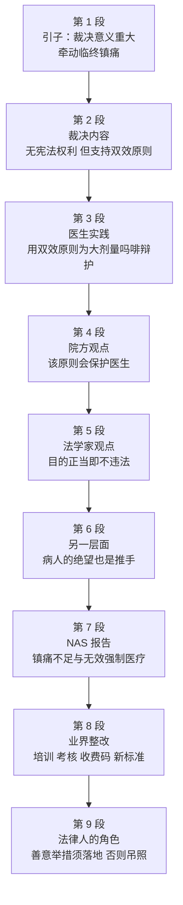

# Passage 36 · 医助自杀的裁决与临终镇痛

## 答题记录

| 轮次  | 日期         | 题号  | 正确  | 错误  | 正确率 | 用时    | 错题归因 |
| --- | --- | --- | --- | --- | --- | --- | --- |
| 1 |  | 1-5 |  |  |  |  |  |
| 2 |  | 1-5 |  |  |  |  |  |
| 3 |  | 1-5 |  |  |  |  |  |

> [!tip] 填写口径
> - **用时**以分钟计，只计做题时间，不含精读复盘。
> - **错题归因**填「题型·错误类型」，如：细节题·定位错、推理判断·过度推断、词义题·代入不验证。
> - 纵向看趋势：正确率升而用时过长 → 熟练度不足；用时降而正确率波动 → 定位不稳。
> - 本篇 5 题，题号栏填 1-5；第 4 题是词义猜测题，错因建议单列「词义题·未回原文代入」。

> [!info] 文章档案
> - **来源**：考研英语（一）2002 年 Text 4
> - **题材**：社会生活（法律 × 医学伦理）——最高法院就「医助自杀」作出裁决，引出「双效原则」、临终镇痛不足与临终照护改革
> - **结构**：9 段 / 15 句 ＋ 5 题（按句号断句与行首缩进实测，与解析引用的「第二段①句」「第五段①句」「第七段②句」及第 4 题题干「第七段第三行」全部吻合）
> - **难度**：★★★☆☆
> - **一句话主旨**：最高法院虽裁定医助自杀不是宪法赋予的权利，却事实上支持了「双效原则」——只要医生出于缓解疼痛的正当目的用药，即便加速死亡也不违法；而真正需要改的是临终镇痛的不足与那些无效而强制的医疗干预。

## 一、篇章脉络

- **第 1 段**：一句话定调。最高法院关于医助自杀的裁决，**对医学如何为垂死者解除痛苦影响深远**——把「法律判决」与「临终镇痛」绑在一起，是全文的引子。
- **第 2 段**：给出裁决的**具体内容**。虽然裁定不存在医助自杀的宪法权利（第 1 题 B 项的出处），但法院**事实上**支持了「双效原则」：只要行为者只追求善果，可预见的恶果不影响行为的正当性。
- **第 3 段**：讲医生的**实际操作**。近年来医生一直援引该原则，用大剂量吗啡为病危者镇痛，尽管加量最终会致死（第 1 题 A 项 used to do 的陷阱就在这里）。
- **第 4 段**：医院管理者 Nancy Dubler 的观点——该原则会**保护（shield）**那些一直不敢足量用药的医生。
- **第 5 段**：法学家 George Annas 的观点——只要开药出于**正当医疗目的**，即使病人用它加速死亡，医生也没违法；并用**外科手术**作比（第 2 题 C 项、第 5 题的题眼都在本段）。
- **第 6 段**：转入「**另一层面**」——医助自杀之争部分源于病人的绝望，因为现代医学延长了临终的肉体痛苦。
- **第 7 段**：NAS 报告点名临终照护的**两大痼疾**：镇痛不足（undertreatment of pain）与大胆使用无效而强制的医疗程序（第 3 题与第 4 题的战场）。
- **第 8 段**：业界的**四项整改举措**：临终关怀院培训、镇痛疗法考核、医保收费代码、评估与治疗疼痛的新标准。
- **第 9 段**：Annas 收束——律师要推动这些**善意举措**落地；医生若对病人可预见的痛苦无动于衷，构成「系统性虐待病人」，痛苦的死亡应推定为处置不当并**吊销执照**（第 5 题答案）。

> [!tip] 行文逻辑
> 全篇是「**判决 → 原则 → 实践 → 表态（院方／法方）→ 反思 → 报告 → 整改 → 问责**」的新闻评论型结构，前三段构成第 1 题的题区（From the first three paragraphs），第 5 段是第 2 题与第 5 题的共同落点，第 7 段独扛第 3、4 两题。与 Passage 35 那种「一段一题」不同，本篇**题区是成块的**：第 1 题要读前三段才能排除 used to do，第 2 题通篇无处可定位、只能逐项判断。**「题文同序」在本篇只部分成立**（第 1 题→前三段，第 2 题→第 5 段，第 3、4 题→第 7 段，第 5 题→第 9 段），因此不要机械地按题号找段落，而要先看清题干的限定（from the first three paragraphs / according to the text / NAS's report / Line 3 Paragraph 7）。

## 二、逐段精读

### 第 1 段 · 引子：裁决的意义在于牵动临终镇痛

**原文**

① The Supreme Court's decisions on physician-assisted suicide carry important implications for how medicine seeks to relieve dying patients of pain and suffering.

**译文**

① 最高法院关于医助自杀的裁决，对医学界如何设法让垂死的病人摆脱疼痛与痛苦有着重要意义。

> [!note] 段落要点
> - 功能：一句话开篇立论，把「法律裁决」与「临终镇痛」两个话题焊接在一起，是全文的引子也是主线。
> - **physician-assisted suicide**（医助自杀）是全篇的核心术语，第 1—6 段反复出现；选项里的 help the dying end their lives（第 1 题 B 项）正是它的同义转述。
> - **carry implications for** 是考研高频搭配：对……具有（重要）意义／影响；命题人爱把它换成 have an effect on / have implications for。
> - 本段虽只有一句，但 5 道题的落点被它划定了范围：法律怎么说（1、2 题）＋ 医学怎么做（3—5 题）。
> - 注意 **medicine** 在此不是「药」，而是「医学界、医学行业」（集合用法），下文 medical community / the profession 都是它的同义复现。

#### 长难句 · 本段

> [!abstract] 本段第 ① 句 · The Supreme Court's decisions on physician-assisted suicide carry important implications for how medicine seeks to relieve dying patients of pain and suffering.

**结构拆解**

- **主干**：The Supreme Court's decisions... carry important implications（主语＋谓语＋宾语）
- **定语**：on physician-assisted suicide（介词短语修饰 decisions）
- **介词宾语从句**：for how medicine seeks to relieve dying patients of pain and suffering（how 引导的从句作 for 的宾语）
- **从句内部**：medicine 主语；seeks to relieve 谓语；dying patients 宾语；of pain and suffering 为 relieve 要求的搭配（relieve sb of sth）
- **结构**：relieve sb of sth 使某人摆脱／解除……

**参考译文**

最高法院关于医助自杀的裁决，对医学界如何设法让垂死的病人摆脱疼痛与痛苦有着重要意义。

> [!tip] 拆解要点
> 一句话承载全篇纲领，骨架是 **A carry implications for how B does C**：A（裁决）对 B（医学界）如何做 C（为垂死者镇痛）意义重大。两处值得背：**relieve sb of sth**（解除某人的……，relieve 后接「人」，用 of 引出被解除的东西——relieve him of his pain／his duties）与 **how 引导的从句直接作介词宾语**（for how...，不是 for what）。命题角度：本段没有直接出题，但「法律裁定 × 临终镇痛」这层关系一旦读漏，第 1 题就会误以为文章在讲「法院反对医助自杀」（C 项），而实际上法院是「不承认权利却支持原则」——**反对的是权利，支持的是原则**，这一区别是本篇最大的理解关。

#### 本段重点词汇

| 单词 / 短语 | 词性 | 文中意 | 常用考义与拓展 | 英文示例搭配（中译） |
| --- | --- | --- | --- | --- |
| **Supreme Court** | n. | 最高法院 | 专有名词须大写；the Court 下文即指它；court n. 法院／球场 | The Supreme Court's decisions（最高法院的裁决） |
| **physician-assisted suicide** | n. | 医助自杀 | physician n. 内科医生（＝doctor）；suicide n. 自杀（commit suicide）；assisted adj. 协助的 | decisions on physician-assisted suicide（关于医助自杀的裁决） |
| **carry implications for** | 短语 | 对……有（重要）意义／影响 | implication n. 含意、可能的影响（implications 常用复数表「深远影响」；≠ hint 暗示）；carry implications for ＝ have implications for | carry important implications for how medicine seeks to...（对医学如何……意义重大） |
| **medicine** | n. | 医学界，医学（行业） | 熟词僻义：「药」→「医学／医学界」（集合名词）；take medicine 吃药；medical adj. 医学的 | how medicine seeks to relieve dying patients（医学界如何设法为垂死者解除痛苦） |
| **seek to** | 短语 | 设法，力图 | seek (sought, sought) v. 寻求、试图；seek to do ＝ attempt/try to do（正式语体）；seek for 寻找 | medicine seeks to relieve...pain（医学力图解除……疼痛） |
| **relieve** | v. | 缓解，解除 | relieve sb of sth 使某人摆脱……；relief n. 缓解、救济；relieve pain 止痛 | relieve dying patients of pain（为垂死的病人止痛） |
| **dying** | adj. | 垂死的，临终的 | die v. 死；dying 亦为 die 的现在分词；the dying 垂死者（集合）；dead adj. 死的 | dying patients（垂死的病人） |
| **suffering** | n. | 痛苦，苦难 | suffer v. 遭受；suffer from 患（病）；suffering 亦作「苦难」总称 | pain and suffering（疼痛与痛苦） |

### 第 2 段 · 裁决内容：不承认宪法权利，却支持「双效原则」

**原文**

① Although it ruled that there is no constitutional right to physician-assisted suicide, the Court in effect supported the medical principle of "double effect," a centuries-old moral principle holding that an action having two effects—a good one that is intended and a harmful one that is foreseen—is permissible if the actor intends only the good effect.

**译文**

① 尽管法院裁定不存在医助自杀的宪法权利，它实际上却支持了医学上的「双效原则」——这是一条有数百年历史的道德原则，它认为：一个行为若同时具有两种效果（一种是行为者所追求的善果，一种是可预见的不良后果），只要行为者只追求那个善果，该行为便是被允许的。

> [!note] 段落要点
> - 功能：给出裁决的**两面性**，是第 1 题 B 项的直接出处，也是第 2 题 C 项的间接依据。
> - 主句是 **the Court in effect supported...**——「实际上支持」；从句是「裁定不存在宪法权利」。**反对的是「宪法权利」，支持的是「原则」**，两者不是一回事（第 1 题 C 项正是把前者当成后者）。
> - **in effect** 是本篇的态度信号词，意为「实际上、事实上」，与 in fact / effectively 同义，常引出「名义上 vs 实际上」的转折。
> - **double effect（双效原则）**是本篇的题眼概念：动机（intend the good effect）决定行为的正当性。后文第 3、4、5 段全部围绕它展开。
> - **holding that...** 此处 hold ＝ 认为、主张（法律、原则「持有」某种观点），是熟词僻义（不是「握住／举行」）。

#### 长难句 · 本段

> [!abstract] 本段第 ① 句 · Although it ruled that there is no constitutional right to physician-assisted suicide, the Court in effect supported the medical principle of "double effect," a centuries-old moral principle holding that an action having two effects—a good one that is intended and a harmful one that is foreseen—is permissible if the actor intends only the good effect.

**结构拆解**

- **让步状语从句**：Although it ruled that there is no constitutional right to physician-assisted suicide（rule＋that 宾语从句；it 指 the Court）
- **主句**：the Court in effect supported the medical principle of "double effect"
- **同位语**：a centuries-old moral principle（解释说明 double effect）
- **后置定语**：holding that...（＝which holds that...，现在分词短语修饰 principle）
- **holding 的宾语从句**：that an action... is permissible（主干），其中
  - having two effects 现在分词短语修饰 an action
  - 破折号之间的 a good one that is intended and a harmful one that is foreseen 是 two effects 的同位解释（one 代 effect）
  - if the actor intends only the good effect 为条件状语从句
- **结构**：permissible adj. 被允许的；foresee (foresaw, foreseen) v. 预见

**参考译文**

尽管法院裁定不存在医助自杀的宪法权利，它实际上却支持了医学上的「双效原则」——这是一条有数百年历史的道德原则，它认为：一个行为若同时具有两种效果（一种是行为者所追求的善果，一种是可预见的不良后果），只要行为者只追求那个善果，该行为便是被允许的。

> [!tip] 拆解要点
> 抓三处：①**Although A, the Court in effect B**——让步在前、重点在后，重点永远是「实际上支持」；②**同位语＋现在分词作定语**的套娃结构：principle of "double effect," a...principle holding that...（第二个 principle 是同位语，holding 又回头修饰它），读时把同位语当作插入语先跳过去，句子立刻变短；③**one 代 effect**——a good one / a harmful one 中的 one 是替代词，避免重复 effect（考研阅读里 one 指代上文的名词是必考点）。命题角度：第 1 题 B 项 it is still illegal for doctors to help the dying end their lives 就是「裁定不存在宪法权利」的**同义改写**（不承认权利＝仍属违法）；C 项 the Supreme Court strongly opposes 把 supported 说成 opposes，与原文直接相反——**凡是选项用 strongly 这类强化词改写原文，几乎都是反向干扰**。

#### 本段重点词汇

| 单词 / 短语 | 词性 | 文中意 | 常用考义与拓展 | 英文示例搭配（中译） |
| --- | --- | --- | --- | --- |
| **rule** | v. | 裁定，判决 | 熟词僻义：「规则」（名词）→「裁定」（动词）；rule that... 裁定……；ruling n. 裁决（见第 7 段） | it ruled that there is no constitutional right（法院裁定不存在宪法权利） |
| **constitutional right** | n. | 宪法权利 | constitution n. 宪法／体质；constitutional adj. 宪法的、合乎宪法的；right n. 权利 | no constitutional right to physician-assisted suicide（没有医助自杀的宪法权利） |
| **in effect** | 短语 | 实际上，事实上 | ＝in fact / effectively；注意与 in effect「生效」（The law is in effect.）的区别，此处作评注性状语 | the Court in effect supported the principle（法院实际上支持了这一原则） |
| **double effect** | n. | 双效原则 | 专有伦理学术语，须大写引号；effect n. 效果、影响；side effect 副作用 | the medical principle of "double effect"（医学上的「双效原则」） |
| **centuries-old** | adj. | 有数百年历史的 | 构词：复数名词＋连字符＋old（year-old / centuries-old 作定语，year 用单数） | a centuries-old moral principle（一条有数百年历史的道德原则） |
| **moral principle** | n. | 道德原则 | moral adj. 道德的／n. 寓意；morality n. 道德；principle n. 原则（≠ principal 校长／主要的） | supported the medical principle of "double effect"（支持「双效」这一医学原则） |
| **hold** | v. | 认为，主张（原则、法院持某种看法） | 熟词僻义：「握住／举行」→「认为、主张」；hold that... 认为……（法律英语高频） | a moral principle holding that an action...is permissible（一条认为某行为可被允许的原则） |
| **intend** | v. | 意图，打算（追求） | intend to do / intend doing；intention n. 意图（第 5 段 An 纳斯的全部论证都建立在 intention 上）；intentional adj. 故意的 | a good one that is intended（被追求的善果）；intends only the good effect（只追求善果） |
| **foresee** | v. | 预见，预知 | fore- 前缀表「预先」：forecast 预测、foretell 预言；foreseeable adj. 可预见的（foreseeable future） | a harmful one that is foreseen（可预见的不良后果） |
| **permissible** | adj. | 被允许的，可容许的 | permit v. 允许；permission n. 许可；permissive adj. 宽容的 | is permissible if the actor intends only the good effect（若行为者只追求善果便是被允许的） |
| **actor** | n. | 行为者，行为人 | 熟词僻义：「演员」→（伦理／法律语境下）「行为者」；act v. 行动／n. 行为 | if the actor intends only the good effect（如果行为者只追求善果） |

### 第 3 段 · 医生的实践：援引该原则为大剂量吗啡辩护

**原文**

① Doctors have used that principle in recent years to justify using high doses of morphine to control terminally ill patients' pain, even though increasing dosages will eventually kill the patient.

**译文**

① 近年来，医生们一直援引这一原则，为自己使用大剂量吗啡来控制病危病人疼痛的做法辩护，尽管不断增加的剂量最终会致病人于死。

> [!note] 段落要点
> - 功能：把第 2 段的原则落到**临床实践**上，是第 1 题 A 项与第 2 题 C 项的共同取材处。
> - 时态是关键：本句用**现在完成时 have used...in recent years**，表示「近年来一直如此（现在还在做）」——这正是 A 项 **used to**（过去常常，现在不做了）被排除的语法依据。考研细节题里，**时态＋时间状语**是最硬的排除理由。
> - 逻辑上这是一次「**以善果为目的、预见恶果仍可为**」的实操：镇痛是目的，加速死亡是可预见的后果。
> - **justify**（证明……正当）是本篇的态度动词之一：医生需要为用药「辩护」，暗示外界对此有争议。

#### 长难句 · 本段

> [!abstract] 本段第 ① 句 · Doctors have used that principle in recent years to justify using high doses of morphine to control terminally ill patients' pain, even though increasing dosages will eventually kill the patient.

**结构拆解**

- **主句**：Doctors have used that principle in recent years to justify...（现在完成时；to justify 为目的状语）
- **justify 的宾语**：using high doses of morphine（动名词短语）
- **目的状语**：to control terminally ill patients' pain（说明使用吗啡的目的）
- **让步状语从句**：even though increasing dosages will eventually kill the patient（increasing 为现在分词作定语，修饰 dosages）
- **结构**：justify doing 证明做……正当；dose n.（一次）剂量 vs dosage n.（总）剂量、用量

**参考译文**

近年来，医生们一直援引这一原则，为自己使用大剂量吗啡来控制病危病人疼痛的做法辩护，尽管不断增加的剂量最终会致病人于死。

> [!tip] 拆解要点
> 骨架是 **A use B to justify doing C to do D, even though E**：用原则 B 为「为达 D 而做 C」辩护，尽管 E。三个要点：①**justify doing**（不是 justify to do）——凡 justify / admit / deny / risk / suggest 都接动名词；②**even though 引出的让步是全句的张力所在**：目的善（镇痛）与后果恶（致死）并存，正是「双效原则」的现实版本；③**现在完成时 have used...in recent years** 是本题区的时态硬信号。命题角度：第 1 题 A 项把 have used 改成 **used to increase**（过去常做、现在不做了），与原文时态直接冲突；第 2 题 C 项 high-dosage pain-relieving medication can be prescribed 则是对本句＋第 2 段「法院支持该原则」的**合情推理**——法院支持原则，医生据此开大剂量镇痛药，故「可以开」成立。

#### 本段重点词汇

| 单词 / 短语 | 词性 | 文中意 | 常用考义与拓展 | 英文示例搭配（中译） |
| --- | --- | --- | --- | --- |
| **in recent years** | 短语 | 近年来 | 常与现在完成时连用；recent adj. 最近的；recently adv. 最近 | have used that principle in recent years（近年来一直使用这一原则） |
| **justify** | v. | 证明……正当，为……辩护 | justify doing 证明做……有理；justice n. 正义；justification n. 正当理由；justifiable adj. 可正当化的 | justify using high doses of morphine（为使用大剂量吗啡辩护） |
| **high doses of** | 短语 | 大剂量的 | dose n.（一次）剂量；a dose of medicine 一剂药；high-dose adj. 大剂量的 | using high doses of morphine（使用大剂量吗啡） |
| **morphine** | n. | 吗啡 | 镇痛药，晚期癌症镇痛常用；opioid n. 阿片类药物 | high doses of morphine to control pain（控制疼痛的大剂量吗啡） |
| **terminally ill** | adj. | 病危的，晚期的（不治的） | terminal adj. 晚期的、末端的（terminal cancer 晚期癌症／terminal 航站楼）；the terminally ill 临终病人（集合） | terminally ill patients' pain（病危病人的疼痛） |
| **dosage** | n. | 剂量，用量（总量与用法） | 与 dose 辨析：dose 指「一次的量」，dosage 指「给药的剂量方案／总用量」；increase the dosage 加大剂量 | increasing dosages will eventually kill the patient（不断增加的剂量最终会致其死亡） |
| **eventually** | adv. | 最终，最后 | eventual adj. 最终的（only 作定语：the eventual outcome）；＝finally / in the end | will eventually kill the patient（最终会致病人于死） |

### 第 4 段 · 院方观点：该原则会为医生提供保护

**原文**

① Nancy Dubler, director of Montefiore Medical Center, contends that the principle will shield doctors who "until now have very, very strongly insisted that they could not give patients sufficient medication to control their pain if that might hasten death".

**译文**

① 蒙特菲奥里医疗中心主任南希·杜布勒主张，这一原则将会保护那些医生——「迄今为止，他们一直非常、非常坚决地坚称：如果用药可能加速死亡，他们便不能给病人足量的药物来控制疼痛」。

> [!note] 段落要点
> - 功能：换一位权威（医院管理者）发声，说明双效原则的**现实作用**：给医生「壮胆」。
> - **contend / maintain / acknowledge / say** 构成本篇的「观点动词链」，第 4、5、6、9 段各有一个，读时可用它们快速切分观点归属（谁说了什么）——这是做「George Annas would probably agree...」一类题的关键。
> - **shield**（保护、庇护）是比喻用法：原则像盾牌一样挡住法律风险。
> - 引号内的 **until now** 是时间分界：此前医生因担心加速死亡而不敢足量用药，此后（有了原则作依据）则可以——这正是第 3 段「近年来」的延续。

#### 长难句 · 本段

> [!abstract] 本段第 ① 句 · Nancy Dubler, director of Montefiore Medical Center, contends that the principle will shield doctors who "until now have very, very strongly insisted that they could not give patients sufficient medication to control their pain if that might hasten death".

**结构拆解**

- **主干**：Nancy Dubler... contends that...（contend＋that 宾语从句）
- **同位语**：director of Montefiore Medical Center（说明 Nancy Dubler 的身份，职务前一般不加冠词）
- **宾语从句**：that the principle will shield doctors who...（shield 后接宾语 doctors）
- **定语从句**：who "until now have... insisted that..."（修饰 doctors；从句内又有 insist 的 that 宾语从句）
- **insist 的宾语从句**：that they could not give patients sufficient medication to control their pain（give sb sth 双宾语；to control... 为目的状语）
- **条件状语从句**：if that might hasten death（that 指代「给足量药物」这件事）
- **结构**：shield v. 保护（＝protect）；hasten v. 加速（＝accelerate / speed up）

**参考译文**

蒙特菲奥里医疗中心主任南希·杜布勒主张，这一原则将会保护那些医生——「迄今为止，他们一直非常、非常坚决地坚称：如果用药可能加速死亡，他们便不能给病人足量的药物来控制疼痛」。

> [!tip] 拆解要点
> 抓三处：①**同位语插入**（director of...）——人名后的职务说明一律当作插入语，先跳过后主干只剩 Nancy Dubler contends that the principle will shield doctors；②**who 从句里再套 insist that 从句**，两层 that 依次读：原则保护「那些一直坚称不能足量用药」的医生（也就是说，正是这批最谨慎的医生最需要保护）；③**if that might hasten death** 中的 that 回指「给足量药」这件事，不是「疼痛」。命题角度：本段虽未直接出题，但它是第 1 题的「前三段」之一——读到此处应能确认：医生**不是过去**用大剂量镇痛（A 错），而是**直到现在都不敢**用（until now have insisted they could not），这一层反转是 A 项最阴的地方。

#### 本段重点词汇

| 单词 / 短语 | 词性 | 文中意 | 常用考义与拓展 | 英文示例搭配（中译） |
| --- | --- | --- | --- | --- |
| **director** | n. | 主任，主管，负责人 | direct v. 指导／adj. 直接的；direction n. 方向；director 亦指「董事、导演」 | director of Montefiore Medical Center（蒙特菲奥里医疗中心主任） |
| **contend** | v. | 主张，声称 | 熟词僻义：「竞争、争夺」（contend with）→「主张、认为」（＝argue / maintain）；contention n. 主张、争论 | contends that the principle will shield doctors（主张这一原则会保护医生） |
| **shield** | v./n. | 保护，庇护／盾牌 | 熟词僻义：名词「盾牌」→动词「保护、遮挡」；shield sb from sth 使某人免受…… | the principle will shield doctors（该原则将保护医生） |
| **until now** | 短语 | 迄今为止（到现在为止） | 与现在完成时连用，暗含「此后可能改变」；up to now / so far 同义 | who until now have insisted that...（那些迄今为止一直坚称……的医生） |
| **insist** | v. | 坚持说，坚决主张 | insist on doing 坚持做；insist that＋（should）do 坚持要求（虚拟）；insist that＋陈述语气＝坚持说（事实） | have very strongly insisted that they could not...（一直坚决主张他们不能……） |
| **sufficient** | adj. | 充足的，足够的 | ＝enough / adequate；sufficiency n. 充足；insufficient adj. 不足的（第 7 段 undertreatment 的近义） | sufficient medication to control their pain（足以控制疼痛的药物） |
| **medication** | n. | 药物，药物治疗 | medicine 指「药」时偏日常，medication 偏专业（药物治疗）；medicate v. 用药治疗；be on medication 在服药 | give patients sufficient medication（给病人足量的药物） |
| **hasten** | v. | 加速，催促 | haste n. 匆忙（in haste）；hasten death 加速死亡（安乐死议题的固定搭配）；＝accelerate | if that might hasten death（如果那可能加速死亡） |

### 第 5 段 · 法学家观点：目的正当即不违法

**原文**

① George Annas, chair of the health law department at Boston University, maintains that, as long as a doctor prescribes a drug for a legitimate medical purpose, the doctor has done nothing illegal even if the patient uses the drug to hasten death.
② "It's like surgery," he says.
③ "We don't call those deaths homicides because the doctors didn't intend to kill their patients, although they risked their death."
④ "If you're a physician, you can risk your patient's suicide as long as you don't intend their suicide."

**译文**

① 波士顿大学卫生法学系主任乔治·安纳斯坚称：只要医生开药是出于正当的医疗目的，那么即使病人用这种药加速自己的死亡，医生的行为也并不违法。
② 「这就像外科手术，」他说。
③ 「我们并不把那些死亡称作杀人，因为医生并没有杀死病人的意图，尽管他们冒了致其死亡的风险。」
④ 「如果你是医生，只要你不存心让病人自杀，你就可以冒病人自杀的风险。」

> [!note] 段落要点
> - 功能：本篇的**观点核心段**，独扛第 2 题（C 项）与第 5 题（D 项）。
> - ①句是全篇的「法律准绳」：**只要目的正当（legitimate medical purpose），行为就不违法**——意图（intention）是判断合法与否的唯一标准。第 2 题 D 项「不再取决于意图」正与此相反。
> - ②—④句用**外科手术**作类比：手术也有致死风险，但只要不是存心杀人就不算 homicide；同理，医生可以冒病人自杀的风险，只要不是**存心**让其自杀。
> - 注意 **risk** 的宾语：risk their death / risk your patient's suicide——「冒（导致）……的风险」，不是「冒……的危险去做」；第 5 题题干的 be punished 与此处「不违法」形成对照：不违法 ≠ 不必受行业处罚（见第 9 段）。

#### 长难句 · 本段

> [!abstract] 本段第 ① 句 · George Annas, chair of the health law department at Boston University, maintains that, as long as a doctor prescribes a drug for a legitimate medical purpose, the doctor has done nothing illegal even if the patient uses the drug to hasten death.

**结构拆解**

- **主干**：George Annas... maintains that...（maintain＋that 宾语从句）
- **同位语**：chair of the health law department at Boston University（身份说明）
- **宾语从句内部**：
  - 条件状语从句一：as long as a doctor prescribes a drug for a legitimate medical purpose（as long as ＝ 只要）
  - 主句：the doctor has done nothing illegal（nothing illegal ＝ 没有任何违法的事）
  - 让步状语从句：even if the patient uses the drug to hasten death（even if 即使）
- **结构**：prescribe v. 开（药方）；legitimate adj. 合法的、正当的；illegal adj. 违法的（il- 否定前缀）

**参考译文**

波士顿大学卫生法学系主任乔治·安纳斯坚称：只要医生开药是出于正当的医疗目的，那么即使病人用这种药加速自己的死亡，医生的行为也并不违法。

> [!tip] 拆解要点
> 骨架是 **as long as A（目的正当）, B（不违法）even if C（后果严重）**——这个「条件＋让步」的双层结构就是「双效原则」的法律表达：目的正当抵销后果的严重性。三处要点：①**as long as ＝ 只要**（唯一条件，不是「和……一样长」）；②**nothing illegal**＝形容词修饰不定代词须后置（something important / nothing wrong）；③**even if 让步**再次强调「后果不影响定性」。命题角度：第 2 题 C 项 The Court ruled that high-dosage pain-relieving medication can be prescribed 正是本句＋第 2 段「法院支持该原则」的合成结论；D 项 no longer justified by his intentions 把「以意图为准」说成「不再看意图」，与原文**方向相反**——**凡含 no longer / cease / stop 这类否定延续的选项，先查原文是不是还在强调该依据**。

> [!abstract] 本段第 ③ 句 · "We don't call those deaths homicides because the doctors didn't intend to kill their patients, although they risked their death."

**结构拆解**

- **主句**：We don't call those deaths homicides（call＋宾语＋宾补：称那些死亡为杀人）
- **否定转移**：not...because... 此处 not 否定主句（不是因为……才不称作），because 从句说明原因
- **原因状语从句**：because the doctors didn't intend to kill their patients（intend to do 意图做）
- **让步状语从句**：although they risked their death（risk＋名词：冒……的风险）
- **结构**：homicide n. 杀人（罪）；homicide 与 suicide 相对（他杀／自杀）

**参考译文**

「我们并不把那些死亡称作杀人，因为医生并没有杀死病人的意图，尽管他们冒了致其死亡的风险。」

> [!tip] 拆解要点
> 两个易错点：①**call sb/sth ＋ 名词宾补**（call those deaths homicides 把那些死亡称为杀人），同类还有 call it a day、call sb names；②**not...because 的否定范围**——此处 not 属于主句（「我们不把它们称为杀人，是因为……」），而不是「并非因为……」；判据是语义：后文 although 说「尽管冒了风险」，说明医生**确实**造成了死亡，只是**没有意图**，故不构成 homicide。命题角度：本句与第 2 题 A 项 Doctors will be held guilty if they risk their patients' death 直接冲突——原文说冒风险也不算杀人，A 项说冒风险就有罪，**正反颠倒**是本篇第 2 题的主要干扰手法。

#### 本段重点词汇

| 单词 / 短语 | 词性 | 文中意 | 常用考义与拓展 | 英文示例搭配（中译） |
| --- | --- | --- | --- | --- |
| **chair** | n. | 系主任，主席（职务） | 熟词僻义：「椅子」→「主席／主持人／系主任」；chairman n. 主席；chair v. 主持（会议） | chair of the health law department（卫生法学系主任） |
| **maintain** | v. | 坚称，主张 | 熟词僻义：「维持、保养」→「坚称、主张」（＝argue / contend）；maintenance n. 维护 | maintains that the doctor has done nothing illegal（坚称医生未做任何违法之事） |
| **as long as** | 短语 | 只要（唯一条件） | ＝provided that / on condition that；注意与 as far as（就……而言）、as well as（以及）区分 | as long as a doctor prescribes a drug for a legitimate purpose（只要医生开药出于正当目的） |
| **prescribe** | v. | 开（药），开处方；规定 | prescription n. 处方、药方；prescribe sth for sth 为……开……药；prescribe 亦作「规定」（法律） | prescribes a drug for a legitimate medical purpose（出于正当医疗目的开药） |
| **legitimate** | adj. | 合法的，正当的 | legal（法律上合法） vs legitimate（合乎规定／情理）；legitimacy n. 正当性；反义 illegitimate | a legitimate medical purpose（正当的医疗目的） |
| **medical purpose** | n. | 医疗目的 | purpose n. 目的；for the purpose of 为了……；on purpose 故意地 | prescribe a drug for a legitimate medical purpose（为正当的医疗目的开药） |
| **illegal** | adj. | 违法的，不合法的 | il- 为 in- 的变体否定前缀（legal→illegal；logical→illogical）；illegality n. 违法 | has done nothing illegal（没有做任何违法的事） |
| **surgery** | n. | 外科手术 | surgeon n. 外科医生；surgery 亦指「（医生的）诊室」（英式）；operate v. 动手术 | "It's like surgery," he says.（「这就像外科手术，」他说。） |
| **homicide** | n. | 杀人（行为／罪） | 词根 cide ＝ 杀：suicide 自杀、pesticide 杀虫剂、genocide 种族灭绝；murder 谋杀（含恶意） | call those deaths homicides（把那些死亡称为杀人） |
| **risk** | v./n. | 冒……的风险／风险 | risk doing 冒险做；risk one's life 冒生命危险；at risk 处于危险中；risky adj. 冒险的 | they risked their death（他们冒了致病人死亡的风险） |

### 第 6 段 · 另一层面：病人的绝望也是推手

**原文**

① On another level, many in the medical community acknowledge that the assisted-suicide debate has been fueled in part by the despair of patients for whom modern medicine has prolonged the physical agony of dying.

**译文**

① 在另一个层面上，医学界许多人承认，医助自杀之争在一定程度上是被病人的绝望情绪所推动的——现代医学延长了他们临终时肉体上的痛苦。

> [!note] 段落要点
> - 功能：由「法律怎么说」转向「**为什么会闹到这一步**」，是文章的第二层推进。
> - **On another level** 是典型的话题推进标记：前面讲制度与原则，这里讲**社会心理**。读到它就该意识到「新论点开始」。
> - **fuel**（火上浇油、推动）是本篇最有画面感的动词选择：争论像火，绝望是燃料。
> - 本段是第 2 题 B 项的排除依据：现代医学**延长痛苦**（prolonged the physical agony），而不是「协助无痛康复（painless recovery）」——**方向相反**。

#### 长难句 · 本段

> [!abstract] 本段第 ① 句 · On another level, many in the medical community acknowledge that the assisted-suicide debate has been fueled in part by the despair of patients for whom modern medicine has prolonged the physical agony of dying.

**结构拆解**

- **评注性状语**：On another level（在另一个层面上）
- **主干**：many (in the medical community) acknowledge that...（many 代词作主语；in the medical community 为后置定语）
- **宾语从句**：that the assisted-suicide debate has been fueled in part by the despair of patients（现在完成时被动：has been fueled by）
- **定语从句**：for whom modern medicine has prolonged the physical agony of dying（介词＋whom 引导，修饰 patients；for whom ＝ for these patients）
- **结构**：fuel v. 加燃料、推动；prolong v. 延长；agony n. 极度痛苦

**参考译文**

在另一个层面上，医学界许多人承认，医助自杀之争在一定程度上是被病人的绝望情绪所推动的——现代医学延长了他们临终时肉体上的痛苦。

> [!tip] 拆解要点
> 抓三处：①**被动句 has been fueled by**——把「争论」当火、「绝望」当燃料，by 引出真正的原因，读被动句要先找 by；②**in part**（部分地）限定归因强度，说明绝望只是原因之一，不是全部（第 2 题若出现「唯一原因」即错）；③**介词＋whom 定语从句**（for whom...），whom 指 patients，for 表示「对这些病人来说」——还原成两句就是：modern medicine has prolonged the physical agony of dying **for these patients**。命题角度：第 2 题 B 项 painless recovery 与 prolonged the physical agony 直接对撞；另记 **prolong** 这个词在第 7 段引号里还会出现一次（prolong the period of dying），第 3 题 A 项正是由它而来——**同一个词，两处语境不同，修饰对象不同**，是本篇词义题的伏笔。

#### 本段重点词汇

| 单词 / 短语 | 词性 | 文中意 | 常用考义与拓展 | 英文示例搭配（中译） |
| --- | --- | --- | --- | --- |
| **on another level** | 短语 | 在另一个层面上 | level n. 层面、层次；on one level... on another level... 是议论文推进话题的固定搭配 | On another level, many in the medical community acknowledge...（在另一个层面上，医学界许多人承认……） |
| **medical community** | n. | 医学界，医疗界 | community n. 界、共同体（the academic community 学术界；the business community 商界） | many in the medical community（医学界的许多人） |
| **acknowledge** | v. | 承认 | acknowledge doing 承认做过；be acknowledged as 被公认为；acknowledgement n. 承认、致谢 | acknowledge that the debate has been fueled by...（承认这场争论是由……推动的） |
| **fuel** | v./n. | 推动，火上浇油／燃料 | 熟词僻义：名词「燃料」→动词「加剧、推动」；fuel the debate/anger 火上浇油；add fuel to the fire 火上浇油 | the debate has been fueled in part by the despair（争论在一定程度上被绝望所推动） |
| **in part** | 短语 | 部分地，在某种程度上 | ＝partly / to some extent；in parts 分成几部分；for one's part 就某人而言 | has been fueled in part by the despair of patients（部分是由病人的绝望推动的） |
| **despair** | n./v. | 绝望 | despair of 对……绝望；in despair 绝望地；desperate adj. 绝望的、不顾一切的（第 4 题 D 项） | the despair of patients（病人的绝望） |
| **prolong** | v. | 延长，拉长 | pro- 前缀表「向前」：promote 促进、prolong 延长、proceed 继续；prolonged adj. 长期的 | has prolonged the physical agony of dying（延长了临终的肉体痛苦） |
| **physical agony** | n. | 肉体上的极度痛苦 | agony n. 极度痛苦（＞pain）；physical adj. 身体的（≠ mental 精神的）；agonizing adj. 令人极度痛苦的 | the physical agony of dying（临终时的肉体痛苦） |

### 第 7 段 · NAS 报告：临终照护的两大痼疾

**原文**

① Just three weeks before the Court's ruling on physician-assisted suicide, the National Academy of Science (NAS) released a two-volume report, Approaching Death: Improving Care at the End of Life.
② It identifies the undertreatment of pain and the aggressive use of "ineffectual and forced medical procedures that may prolong and even dishonor the period of dying" as the twin problems of end-of-life care.

**译文**

① 就在最高法院就医助自杀作出裁决的三周前，美国国家科学院（NAS）发布了一份两卷本的报告《走近死亡：改善临终照护》。
② 该报告认定，临终照护存在两个孪生问题：一是对疼痛的治疗不足，二是大胆使用「可能延长甚至玷污死亡过程的、无效而强制性的医疗手段」。

> [!note] 段落要点
> - 功能：用权威报告为全文提供**事实支撑**，独扛第 3 题与第 4 题。
> - ②句的 **twin problems** 是题眼：两个问题一一对应第 3 题的 B 项（undertreatment of pain → inadequate treatment of pain）与 A 项陷阱（ineffectual and forced medical procedures ≠ prolonged medical procedures）。
> - 第 4 题的 aggressive 出现在本段**第 3 印刷行**（undertreatment of pain and the aggressive use of...），与题目 Line 3, Paragraph 7 完全吻合——这类「行号定位」的题干，务必按印刷行而不是句号去数。
> - aggressive 在此不取「好斗的」，而取「大胆的、积极进取的」（Bold）；同样的词在第 8 段修饰 pain management therapies 时却是**褒义**（积极的镇痛疗法）——**同一个词，两处感情色彩相反**，这是本篇最精妙的词义词。

#### 长难句 · 本段

> [!abstract] 本段第 ② 句 · It identifies the undertreatment of pain and the aggressive use of "ineffectual and forced medical procedures that may prolong and even dishonor the period of dying" as the twin problems of end-of-life care.

**结构拆解**

- **主干**：It identifies A and B as the twin problems of end-of-life care（identify A and B as... 把 A 与 B 认定为……）
- **并列宾语一**：the undertreatment of pain（under- 前缀表「不足」）
- **并列宾语二**：the aggressive use of "ineffectual and forced medical procedures that may prolong and even dishonor the period of dying"
  - 引号内为原文引用；其中 that may prolong and even dishonor the period of dying 为定语从句，修饰 procedures
  - 从句内 and 连接两个谓语：may prolong... and (may) even dishonor...
- **结构**：identify A as B 认定 A 为 B；undertreatment n. 治疗不足；ineffectual adj. 无效的

**参考译文**

该报告认定，临终照护存在两个孪生问题：一是对疼痛的治疗不足，二是大胆使用「可能延长甚至玷污死亡过程的、无效而强制性的医疗手段」。

> [!tip] 拆解要点
> 抓两处：①**identify A and B as C** ——报告类文章的标志性句式（identify...as 认定……为），A、B 是并列的两项，C 是归类；只要看清 and 连接的是两项，第 3 题「one of the problems」立刻有解；②**引号内嵌定语从句**：that 从句的先行词是 procedures，不是 dying——延长的是 **the period of dying**（死亡过程），不是 procedures。命题角度：第 3 题 A 项 prolonged medical procedures 就是把 prolong 的宾语换成了 procedures（原文是 forced / ineffectual 修饰 procedures）；第 4 题 aggressive 需把四个选项逐一代入「the ____ use of procedures」，只有 Bold（大胆的）说得通——Harmful 是 procedures 的结果而非 use 的属性，Careless 与 Desperate 均无人可指（desperate 对应的是第 6 段病人的 despair，属**跨段原词干扰**）。**猜词题的正规解法永远是代入＋上下文验证，不是凭印象选近义**。

#### 本段重点词汇

| 单词 / 短语 | 词性 | 文中意 | 常用考义与拓展 | 英文示例搭配（中译） |
| --- | --- | --- | --- | --- |
| **the National Academy of Science (NAS)** | n. | （美国）国家科学院 | academy n. 学院、研究院；academic adj. 学术的；NAS 为专有缩写 | the NAS released a two-volume report（美国国家科学院发布了两卷本报告） |
| **release** | v./n. | 发布，公布；释放 | release a report 发布报告；release sb from 释放某人；press release 新闻稿 | released a two-volume report（发布了一份两卷本的报告） |
| **two-volume report** | n. | 两卷本的报告 | volume n. 卷、册／体积／音量（一词三义）；a two-volume work 两卷本著作 | a two-volume report, Approaching Death（一份名为《走近死亡》的两卷本报告） |
| **identify ... as** | 短语 | 把……认定为，确认……为 | identify A as B；identify with 认同；identification n. 认定、身份证明 | identifies A and B as the twin problems（把 A 与 B 认定为两大孪生问题） |
| **undertreatment** | n. | 治疗不足，处置不力 | under- 前缀表「不足」：underestimate 低估、underdeveloped 欠发达的；overtreatment 过度治疗 | the undertreatment of pain（对疼痛的治疗不足） |
| **aggressive** | adj. | 大胆的，积极进取的（此处带贬义） | 本篇核心考点：①大胆的（Bold）②好斗的、侵略性的 ③积极进取的（褒义，见第 8 段 pain management）；aggressiveness n. | the aggressive use of ineffectual and forced procedures（大胆使用无效而强制性的手段） |
| **ineffectual** | adj. | 无效的，不起作用的 | ＝ineffective；effect n. 效果；effective adj. 有效的；ineffectual 更强调「（人／方法）不顶用」 | ineffectual and forced medical procedures（无效而强制性的医疗手段） |
| **forced** | adj. | 强制的，被迫的 | force n. 力量／v. 强迫；force sb to do 强迫某人做；forced smile 勉强的微笑 | forced medical procedures（强制性的医疗手段） |
| **dishonor** | v./n. | 使受辱，玷污／耻辱 | dis- 否定前缀＋honor；dishonorable adj. 不光彩的；honor v. 尊重、兑现 | may prolong and even dishonor the period of dying（可能延长甚至玷污死亡的过程） |
| **twin problems** | n. | 两个孪生问题（成对出现的两大问题） | twin adj. 孪生的、成对的（twin towers 双子塔）；twin problems ＝ two closely related problems | the twin problems of end-of-life care（临终照护的两大孪生问题） |
| **end-of-life care** | n. | 临终照护，临终关怀 | ＝palliative care / hospice care（缓和医疗／安宁疗护）；end-of-life adj. 临终的 | the twin problems of end-of-life care（临终照护的两大问题） |

### 第 8 段 · 业界整改：培训、考核、收费代码与新标准

**原文**

① The profession is taking steps to require young doctors to train in hospices, to test knowledge of aggressive pain management therapies, to develop a Medicare billing code for hospital-based care, and to develop new standards for assessing and treating pain at the end of life.

**译文**

① 医疗行业正在采取一系列措施：要求年轻医生到临终关怀院接受培训、考核他们对积极的镇痛疗法的掌握、制定基于医院的照护的医疗保险收费代码，以及制定评估和治疗临终疼痛的新标准。

> [!note] 段落要点
> - 功能：由「问题」转向「**对策**」，四项举措并列，是文章的第三层推进。
> - 四个 **to do** 并列（to require / to test / to develop / to develop）构成本段的骨架，读时只需抓这四个动词。
> - **aggressive** 第二次出现，此处修饰 pain management therapies，是**褒义**（积极的、力度大的镇痛疗法）——与第 7 段的贬义形成对照，第 4 题若拿这里的褒义去套第 7 题就会选错。
> - 本段对应第 7 段的两大问题：hospice 培训与镇痛疗法、新标准 → 治「镇痛不足」；收费代码 → 让临终照护有据可依。

#### 长难句 · 本段

> [!abstract] 本段第 ① 句 · The profession is taking steps to require young doctors to train in hospices, to test knowledge of aggressive pain management therapies, to develop a Medicare billing code for hospital-based care, and to develop new standards for assessing and treating pain at the end of life.

**结构拆解**

- **主干**：The profession is taking steps to do A, to do B, to do C, and to do D（现在进行时；四个不定式并列作目的／内容）
- **并列项一**：to require young doctors to train in hospices（require sb to do 要求某人做）
- **并列项二**：to test knowledge of aggressive pain management therapies（test knowledge of 考核……的知识）
- **并列项三**：to develop a Medicare billing code for hospital-based care
- **并列项四**：to develop new standards for assessing and treating pain at the end of life（for＋动名词）
- **结构**：take steps to do 采取措施做；hospice n. 临终关怀院；therapy n. 疗法

**参考译文**

医疗行业正在采取一系列措施：要求年轻医生到临终关怀院接受培训、考核他们对积极的镇痛疗法的掌握、制定基于医院的照护的医疗保险收费代码，以及制定评估和治疗临终疼痛的新标准。

> [!tip] 拆解要点
> 抓两处：①**四项并列不定式**——长句读法：先锁定 is taking steps to，然后把后面所有 to do 当成清单逐条读（require / test / develop / develop），考研阅读的「举措段」几乎都是这个套路，抓动词即可，不必逐词细读；②**require sb to do** 与 **standards for doing** 两个固定搭配（介词后接动名词 assessing / treating）。命题角度：本段未直接出题，但它是第 9 段 these well-meaning medical initiatives 的**指代对象**——不读本段就不知道 initiatives 指什么，第 5 题的定位链会在第 9 段断掉。**凡末段出现 these/those/such ＋ 名词，一定要回上一段确认指代**，这是本篇第 5 题的隐藏考点。

#### 本段重点词汇

| 单词 / 短语 | 词性 | 文中意 | 常用考义与拓展 | 英文示例搭配（中译） |
| --- | --- | --- | --- | --- |
| **the profession** | n. | 行业，业界（此处指医疗行业） | 熟词僻义：「职业」→「（某一行业的）全体从业者、业界」；the medical/legal profession 医疗／法律界 | The profession is taking steps to...（医疗行业正在采取措施……） |
| **take steps to** | 短语 | 采取措施做 | step n. 步骤；take measures to / take action to 同义；step by step 逐步地 | is taking steps to require young doctors to train（正采取措施要求年轻医生受训） |
| **require** | v. | 要求，规定 | require sb to do 要求某人做；require doing（＝require to be done）需要被……；requirement n. 要求 | require young doctors to train in hospices（要求年轻医生到临终关怀院受训） |
| **hospice** | n. | 临终关怀院，安宁疗护机构 | hospice care 临终关怀；hospitable adj. 好客的（同根：host 主人） | train in hospices（在临终关怀院接受培训） |
| **pain management** | n. | 疼痛管理，镇痛治疗 | management n. 管理、处理；manage v. 管理／设法做到（第 5 题 A 项 manage their patients 的陷阱所在） | knowledge of aggressive pain management therapies（积极镇痛疗法的知识） |
| **therapy** | n. | 疗法，治疗 | therapist n. 治疗师；physiotherapy 理疗；chemotherapy 化疗；therapy 强调「疗程／疗法」 | pain management therapies（镇痛疗法） |
| **Medicare** | n. | （美国）联邦医疗保险 | 专有名词：Medicare 面向 65 岁以上老人与部分残障者；Medicaid 面向低收入者（勿混） | a Medicare billing code（一项联邦医保收费代码） |
| **billing code** | n. | 收费代码，账单编码 | bill n. 账单／v. 开账单；billing n. 计费；code n. 代码、准则 | develop a Medicare billing code（制定联邦医保收费代码） |
| **hospital-based care** | n. | 基于医院的照护 | 构词：名词＋based ＝ 以……为基地的（home-based 居家的；community-based 社区的） | for hospital-based care（针对基于医院的照护） |
| **assess** | v. | 评估，评定 | assessment n. 评估；assess the risk 评估风险；evaluate v. 评价（侧重价值判断） | standards for assessing and treating pain（评估与治疗疼痛的标准） |

### 第 9 段 · 问责：善意举措须落地，否则吊销执照

**原文**

① Annas says lawyers can play a key role in insisting that these well-meaning medical initiatives translate into better care.
② "Large numbers of physicians seem unconcerned with the pain their patients are needlessly and predictably suffering," to the extent that it constitutes "systematic patient abuse."
③ He says medical licensing boards "must make it clear... that painful deaths are presumptively ones that are incompetently managed and should result in license suspension."

**译文**

① 安纳斯说，律师可以发挥关键作用，坚持促使这些善意的医疗举措转化为更好的照护。
② 「大批医生似乎对病人正在遭受的、本不必要且完全可以预见的痛苦无动于衷」，以至于这构成了「系统性虐待病人」。
③ 他说，医疗执业资格委员会「必须明确……痛苦的死亡应当被推定为处置不当所致，并应导致吊销行医执照」。

> [!note] 段落要点
> - 功能：收束全篇，把「改革的希望」落到「**问责**」上，是第 5 题的唯一战场。
> - ①句的 **these well-meaning medical initiatives** 回指第 8 段的四项举措——「善意」二字暗含批评：举措是好意，但未必落地。
> - ②句给出**现状**：大批医生对病人不必要、可预见的痛苦漠不关心，严重到构成 systematic patient abuse。第 3 题 C 项 systematic drug abuse 正是此处被换成 drug 的干扰。
> - ③句给出**问责主张**：painful deaths 推定为 incompetently managed → 应吊照。**注意 incompetently 修饰的是 managed（处置），对象是「死亡过程」而不是「病人」**——第 5 题 A 项 manage their patients incompetently 正是把宾语换成了 patients。

#### 长难句 · 本段

> [!abstract] 本段第 ③ 句 · He says medical licensing boards "must make it clear... that painful deaths are presumptively ones that are incompetently managed and should result in license suspension."

**结构拆解**

- **主干**：He says (that) medical licensing boards "must make it clear... that..."（says 后接宾语从句）
- **从句主干**：medical licensing boards must make it clear that...（make＋形式宾语 it＋宾补 clear＋真正的宾语 that 从句）
- **that 从句内部**：
  - 主语 painful deaths；谓语 are presumptively ones（ones 代 deaths）
  - 定语从句：that are incompetently managed and should result in license suspension（and 连接两个谓语：are managed / should result in）
- **结构**：make it clear that... 明确表明……（it 为形式宾语）；presumptively adv. 推定地；result in 导致

**参考译文**

他说，医疗执业资格委员会「必须明确……痛苦的死亡应当被推定为处置不当所致，并应导致吊销行医执照」。

> [!tip] 拆解要点
> 抓三处：①**make it clear that...** ——it 是形式宾语，真正的宾语是后面那一长串 that 从句（同类：make it possible that / see to it that）；②**ones 代 deaths**（painful deaths are presumptively ones that...），ones 回指复数名词，读时直接替换成 deaths 就不绕了；③**and 连接的两个谓语**（are incompetently managed / should result in license suspension）构成「认定＋后果」的处置链。命题角度：这是第 5 题的答案句。D 项 prolong the needless suffering of the patients 与②句「对病人不必要、可预见的痛苦无动于衷」＋③句「应吊照」完全对应；A 项 manage their patients incompetently 是把 **incompetently managed 的对象**由「死亡过程」换成「病人」（原文 manage 的宾语是 deaths，见解析「manage 的对象是 death 而非病人」）；B、C 两项都往「药量多少」上靠，而第 5 段已明确说「只要目的正当，不存在药量多少的问题」。**细节题里「动词＋宾语」的搭配对象被偷换，是最高频也最隐蔽的干扰手法**。

#### 本段重点词汇

| 单词 / 短语 | 词性 | 文中意 | 常用考义与拓展 | 英文示例搭配（中译） |
| --- | --- | --- | --- | --- |
| **play a key role in** | 短语 | 在……中起关键作用 | play a role/part in 起作用；key adj. 关键的（key factor 关键因素）；role n. 角色、作用 | lawyers can play a key role in insisting that...（律师可在坚持……方面发挥关键作用） |
| **well-meaning** | adj. | 善意的，出于好心的 | 构词：well＋现在分词（well-meaning / well-intentioned）；贬义色彩：好心但未必有效 | these well-meaning medical initiatives（这些善意的医疗举措） |
| **initiative** | n. | 举措，倡议；主动性 | 熟词僻义：「主动性」（take the initiative）→「新举措、倡议」；initiate v. 发起 | these well-meaning medical initiatives（这些善意的医疗举措） |
| **translate into** | 短语 | 转化为，变成 | 熟词僻义：「翻译」→「转化为」（抽象用法）；translate A into B 把 A 转化成 B | translate into better care（转化为更好的照护） |
| **be unconcerned with** | 短语 | 对……漠不关心 | unconcerned adj. 不关心的（un- 否定＋concerned）；be concerned with 关注；concern n./v. 关心、涉及 | seem unconcerned with the pain（似乎对这种痛苦漠不关心） |
| **needlessly** | adv. | 不必要地，无谓地 | needless adj. 不必要的（needless to say 不用说）；need n./v. 需要 | needlessly and predictably suffering（不必要且可预见地受苦） |
| **predictably** | adv. | 可预见地，不出所料地 | predict v. 预测；predictable adj. 可预见的（≠ predictive 预测的）；predictability n. | the pain their patients are needlessly and predictably suffering（病人不必要且可预见地在承受的痛苦） |
| **to the extent that** | 短语 | 到……的程度，以至于 | to some extent 在某种程度上；to the extent of 到……地步；extent n. 程度、范围 | to the extent that it constitutes "systematic patient abuse"（以至于构成了「系统性虐待病人」） |
| **constitute** | v. | 构成，等同于 | constitute a crime 构成犯罪；constitution n. 宪法／构成；constituent n. 成分 | it constitutes "systematic patient abuse"（这构成了「系统性虐待病人」） |
| **systematic patient abuse** | n. | 系统性虐待病人 | systematic adj. 系统性的、有组织的；abuse n./v. 虐待、滥用（drug abuse 药物滥用，第 3 题 C 项陷阱） | constitutes "systematic patient abuse"（构成「系统性虐待病人」） |
| **licensing board** | n. | 执业资格委员会，执照颁发委员会 | license n. 执照／v. 许可；licensed adj. 持照的；board n. 委员会、董事会 | medical licensing boards（医疗执业资格委员会） |
| **make it clear** | 短语 | 明确表明，说清楚 | make it clear that...（it 为形式宾语）；make clear ＋ 名词；clear adj. 明确的 | must make it clear... that painful deaths are...（必须明确……痛苦的死亡是……） |
| **presumptively** | adv. | 可推定地，据推定 | presume v. 假定、推定；presumption n. 推定；presumptive adj. 推定的（法律用语） | painful deaths are presumptively ones that...（痛苦的死亡可推定为……的死亡） |
| **incompetently** | adv. | 不胜任地，处置不当地 | competent adj. 胜任的；competence n. 能力；incompetent adj. 不称职的；manage incompetently 处置不当 | ones that are incompetently managed（被处置不当的那些） |
| **license suspension** | n. | 吊销执照（暂停执业资格） | suspend v. 暂停、吊（照）；suspension n. 暂停；license n. 执照 | should result in license suspension（应导致吊销执照） |

## 三、全篇重点词汇汇总（自测用）

> [!info] 说明
> 本表只列「单词 / 词性 / 所在段」，不含释义与搭配，用于遮表自测：说出词义后再回该段核对。
> 收录**全篇所有段落词汇，共 88 条，不删减**，与各段「本段重点词汇」等长同源（跨段复现的词只在其首次出现的段落收录一次）。

| 单词 / 短语 | 词性 | 所在段 |
| --- | --- | --- |
| **Supreme Court** | n. | 第 1 段 |
| **physician-assisted suicide** | n. | 第 1 段 |
| **carry implications for** | 短语 | 第 1 段 |
| **medicine** | n. | 第 1 段 |
| **seek to** | 短语 | 第 1 段 |
| **relieve** | v. | 第 1 段 |
| **dying** | adj. | 第 1 段 |
| **suffering** | n. | 第 1 段 |
| **rule** | v. | 第 2 段 |
| **constitutional right** | n. | 第 2 段 |
| **in effect** | 短语 | 第 2 段 |
| **double effect** | n. | 第 2 段 |
| **centuries-old** | adj. | 第 2 段 |
| **moral principle** | n. | 第 2 段 |
| **hold** | v. | 第 2 段 |
| **intend** | v. | 第 2 段 |
| **foresee** | v. | 第 2 段 |
| **permissible** | adj. | 第 2 段 |
| **actor** | n. | 第 2 段 |
| **in recent years** | 短语 | 第 3 段 |
| **justify** | v. | 第 3 段 |
| **high doses of** | 短语 | 第 3 段 |
| **morphine** | n. | 第 3 段 |
| **terminally ill** | adj. | 第 3 段 |
| **dosage** | n. | 第 3 段 |
| **eventually** | adv. | 第 3 段 |
| **director** | n. | 第 4 段 |
| **contend** | v. | 第 4 段 |
| **shield** | v./n. | 第 4 段 |
| **until now** | 短语 | 第 4 段 |
| **insist** | v. | 第 4 段 |
| **sufficient** | adj. | 第 4 段 |
| **medication** | n. | 第 4 段 |
| **hasten** | v. | 第 4 段 |
| **chair** | n. | 第 5 段 |
| **maintain** | v. | 第 5 段 |
| **as long as** | 短语 | 第 5 段 |
| **prescribe** | v. | 第 5 段 |
| **legitimate** | adj. | 第 5 段 |
| **medical purpose** | n. | 第 5 段 |
| **illegal** | adj. | 第 5 段 |
| **surgery** | n. | 第 5 段 |
| **homicide** | n. | 第 5 段 |
| **risk** | v./n. | 第 5 段 |
| **on another level** | 短语 | 第 6 段 |
| **medical community** | n. | 第 6 段 |
| **acknowledge** | v. | 第 6 段 |
| **fuel** | v./n. | 第 6 段 |
| **in part** | 短语 | 第 6 段 |
| **despair** | n./v. | 第 6 段 |
| **prolong** | v. | 第 6 段 |
| **physical agony** | n. | 第 6 段 |
| **the National Academy of Science (NAS)** | n. | 第 7 段 |
| **release** | v./n. | 第 7 段 |
| **two-volume report** | n. | 第 7 段 |
| **identify ... as** | 短语 | 第 7 段 |
| **undertreatment** | n. | 第 7 段 |
| **aggressive** | adj. | 第 7 段 |
| **ineffectual** | adj. | 第 7 段 |
| **forced** | adj. | 第 7 段 |
| **dishonor** | v./n. | 第 7 段 |
| **twin problems** | n. | 第 7 段 |
| **end-of-life care** | n. | 第 7 段 |
| **the profession** | n. | 第 8 段 |
| **take steps to** | 短语 | 第 8 段 |
| **require** | v. | 第 8 段 |
| **hospice** | n. | 第 8 段 |
| **pain management** | n. | 第 8 段 |
| **therapy** | n. | 第 8 段 |
| **Medicare** | n. | 第 8 段 |
| **billing code** | n. | 第 8 段 |
| **hospital-based care** | n. | 第 8 段 |
| **assess** | v. | 第 8 段 |
| **play a key role in** | 短语 | 第 9 段 |
| **well-meaning** | adj. | 第 9 段 |
| **initiative** | n. | 第 9 段 |
| **translate into** | 短语 | 第 9 段 |
| **be unconcerned with** | 短语 | 第 9 段 |
| **needlessly** | adv. | 第 9 段 |
| **predictably** | adv. | 第 9 段 |
| **to the extent that** | 短语 | 第 9 段 |
| **constitute** | v. | 第 9 段 |
| **systematic patient abuse** | n. | 第 9 段 |
| **licensing board** | n. | 第 9 段 |
| **make it clear** | 短语 | 第 9 段 |
| **presumptively** | adv. | 第 9 段 |
| **incompetently** | adv. | 第 9 段 |
| **license suspension** | n. | 第 9 段 |

> [!example] 同义替换链（阅读题高频）
> - **it is still illegal for doctors to help the dying end their lives（第 1 题 B 项）↔ there is no constitutional right to physician-assisted suicide（第 2 段①句）**：不承认宪法权利 ＝ 仍然违法，是本篇最重要的一条替换链。
> - **have used that principle in recent years（第 3 段①句）↔ doctors used to increase drug dosages（第 1 题 A 项）**：现在完成时 vs used to do——时态一换，意思就反了。
> - **supported the medical principle of "double effect"（第 2 段①句）↔ the Supreme Court strongly opposes（第 1 题 C 项）**：support 与 oppose 直接对撞。
> - **high doses of morphine...can be prescribed（第 2 题 C 项）↔ prescribe a drug for a legitimate medical purpose（第 5 段①句）＋ the Court in effect supported（第 2 段①句）**：法院支持原则 → 医生据此开大剂量镇痛药 → 「可以开」成立。
> - **the undertreatment of pain（第 7 段②句）↔ inadequate treatment of pain（第 3 题 B 项）**：under-（不足）↔ in-adequate（不足）。
> - **ineffectual and forced medical procedures（第 7 段②句）↔ prolonged medical procedures（第 3 题 A 项）**：prolong 的宾语在原文是 the period of dying，选项换成了 procedures。
> - **systematic patient abuse（第 9 段②句）↔ systematic drug abuse（第 3 题 C 项）**：patient → drug，一字之差。
> - **the aggressive use of procedures（第 7 段②句）↔ Bold（第 4 题 A 项）**：猜词题的正解链；同段的 ineffectual / forced 是它的平行定语。
> - **despair（第 6 段①句）↔ Desperate（第 4 题 D 项）**：跨段同根词干扰（词性与搭配对象均不同）。
> - **painful deaths are presumptively ones that are incompetently managed（第 9 段③句）↔ manage their patients incompetently（第 5 题 A 项）**：manage 的宾语被由 deaths 换成 patients。
> - **the pain their patients are needlessly and predictably suffering（第 9 段②句）↔ prolong the needless suffering of the patients（第 5 题 D 项）**：needless ↔ needlessly，属正确项的同义转述。

> [!warning] 熟词僻义专列
> - **medicine**：药 → 医学界、医学行业（how medicine seeks to...）。
> - **rule**：规则 → 裁定、判决（rule that...；ruling n. 裁决）。
> - **hold**：握住、举行 → 认为、主张（a principle holding that...）。
> - **actor**：演员 → （伦理／法律语境下的）行为者、行为人。
> - **contend**：竞争、争夺 → 主张、声称（＝argue / maintain）。
> - **shield**：盾牌 → 保护、庇护（shield doctors）。
> - **chair**：椅子 → 主席、系主任（chair of the department）。
> - **maintain**：维持、保养 → 坚称、主张（maintain that...）。
> - **fuel**：燃料 → 推动、加剧（fuel the debate）。
> - **risk**：风险（名词）→ 冒……的风险（及物动词，risk their death）。
> - **initiative**：主动性 → 新举措、倡议（medical initiatives）。
> - **translate**：翻译 → 转化为（translate into better care）。
> - **the profession**：职业 → 业界、全体从业者（此处指医疗界）。
> - **volume**：体积、音量 → 卷、册（a two-volume report）。
> - **aggressive**：好斗的 → ①大胆的（贬义，第 7 段）②积极进取的（褒义，第 8 段）。
> - **dishonor**：耻辱（名词）→ 使受辱、玷污（动词）。
> - **prescribe**：规定 → 开（药）、开处方。
> - **surgery**：外科手术 → （英式亦指）诊所、诊室。
> - **hospice**：（历史义）旅客招待所 → 临终关怀院。
> - **board**：板 → 委员会、董事会（licensing board）。

## 四、知识点补充

> [!question] 背景知识
> - **医助自杀（physician-assisted suicide）**：指医生为病人提供致命药物或手段、由病人自己完成最后一步，与「安乐死（euthanasia，由他人施予）」不同。美国至今仅有俄勒冈、华盛顿等少数州以立法方式允许，联邦层面长期由判例与州法博弈——本篇的 Supreme Court 裁决正处在这一拉锯中。
> - **双效原则（the principle of double effect）**：源自托马斯·阿奎那的天主教伦理传统，核心判断是「行为的**意图**决定其道德性质」：一个行为同时产生善恶两种效果时，若恶果只是被**预见**（foreseen）而非被**追求**（intended），且善恶之间比例相称，则该行为可被允许。本篇第 3 段的「大剂量吗啡镇痛」就是教科书式的例子。
> - **Nancy Dubler 与 George Annas**：前者是 Montefiore 医疗中心的生物伦理学家，后者是波士顿大学公共卫生学院卫生法系教授、美国生命伦理法权威。文中两人的身份（director / chair）是判断观点归属的标记。
> - **NAS 报告《Approaching Death》**：美国国家科学院医学研究所 1997 年的报告，首次系统提出美国临终照护的两大缺陷——疼痛治疗不足与过度使用无效治疗，直接推动了美国的临终关怀（hospice）与缓和医疗（palliative care）改革。
> - **Medicare 与 Medicaid**：Medicare 是面向 65 岁以上老人与部分残障者的联邦医保；Medicaid 是面向低收入人群的联邦—州联合医疗补助。**billing code（收费代码）**则是医保结算的钥匙——没有代码，临终谈话与镇痛服务就无法计费，这是文中「举措」的现实含义。

> [!warning] 语法点
> - **relieve sb of sth（第 1 段①）**：解除某人的……（relieve dying patients of pain）。
> - **how 引导的从句作介词宾语（第 1 段①）**：for how medicine seeks to...。
> - **Although 让步＋主句转折（第 2 段①）**：重点在主句（in effect supported）。
> - **同位语＋现在分词作定语（第 2 段①）**：a...principle holding that...（＝which holds that...）。
> - **one / ones 作替代词（第 2 段①、第 9 段③）**：a good one（one ＝ effect）；painful deaths...ones（ones ＝ deaths）。
> - **现在完成时＋in recent years（第 3 段①）**：表「近年来一直如此」，与 used to do 相对。
> - **justify doing（第 3 段①）**：justify 后接动名词，不接不定式。
> - **同位语表示职务，零冠词（第 4、5 段①）**：director of... / chair of...。
> - **insist that＋陈述语气（第 4 段①）**：此处表「坚持说（事实）」，非虚拟。
> - **as long as 条件句＋even if 让步句（第 5 段①）**：条件与让步共现。
> - **call＋宾语＋宾补（第 5 段③）**：call those deaths homicides。
> - **介词＋whom 引导定语从句（第 6 段①）**：patients for whom...。
> - **现在完成时被动 has been fueled by（第 6 段①）**：by 引出真正原因。
> - **identify A and B as C（第 7 段②）**：把 A 与 B 认定为 C。
> - **四项并列不定式（第 8 段①）**：to require / to test / to develop / to develop。
> - **make it clear that...（第 9 段③）**：it 为形式宾语，真正宾语是 that 从句。

> [!success] 写作可迁移句型
> - **A carry important implications for how B does C.**：A 对 B 如何做 C 意义重大（开篇立论句，社会议题类作文通用）。
> - **Although A, B in effect does C.**：尽管 A，B 实际上却做了 C（「名义 vs 实际」的转折句）。
> - **A has been fueled in part by B.**：A 在一定程度上是由 B 推动的（多因归因句，比 because of 高级）。
> - **It identifies A and B as the twin problems of C.**：报告把 A 与 B 认定为 C 的两大痼疾（报告／调研类写作）。
> - **The profession is taking steps to do A, to do B, to do C, and to do D.**：业界正采取……等措施（对策段的标准句式）。
> - **A can play a key role in insisting that B translate into C.**：A 可以在推动 B 转化为 C 方面发挥关键作用（建议／呼吁句）。
> - **...to the extent that it constitutes...**：……以至于构成了……（程度强调句）。
> - **A should result in license suspension.**：A 应导致吊销执照（问责句；可替换为 should result in severe penalties）。
> - **As long as A does B for a legitimate purpose, A has done nothing illegal even if C.**：只要出于正当目的做 B，即使 C 也不违法（法理／规则表述句）。

> [!danger] 易混辨析
> - **used to do / be used to doing / have used**：used to do 过去常常（现在不做）；be used to doing 习惯于做；have used 一直用（现在还在用）——第 1 题 A 项的陷阱。
> - **dose / dosage**：dose 一次的量；dosage 剂量方案、总用量。
> - **principle / principal**：principle 原则；principal 校长／主要的。
> - **contend / maintain / acknowledge / argue / claim**：contend 主张（含争论意味）；maintain 坚称；acknowledge 承认；argue 论证；claim 声称（常带「未必属实」的色彩）。
> - **legitimate / legal / lawful**：legal 法律许可的；legitimate 合乎规定或情理的（更宽）；lawful 合法的（正式）。
> - **homicide / murder / suicide / euthanasia**：homicide 他杀（中性法律用语）；murder 谋杀（含恶意）；suicide 自杀；euthanasia 安乐死。
> - **prescribe / describe / inscribe / subscribe**：prescribe 开药／规定；describe 描述；inscribe 题写；subscribe 订阅／同意。
> - **prolong / postpone / delay / extend**：prolong 延长（时间过程，常带贬义）；postpone 推迟（改期）；delay 耽搁；extend 延长（期限、空间，中性或褒义）。
> - **ineffectual / ineffective / inefficient**：ineffectual 不顶用的（多指人或方法达不到目的）；ineffective 无效的；inefficient 效率低的。
> - **permissible / permitted / allowable**：permissible 可被允许的（合乎规范）；permitted 被许可的（具体行为）；allowable 可容许的（数量、限度）。
> - **patient abuse / drug abuse / child abuse**：abuse 前接不同名词，含义天差地别——第 3 题 C 项陷阱。
> - **assess / access / excess**：assess 评估；access 获取、通道；excess 过量（三词形近，考研高频）。
> - **presumptively / presumably**：presumptively 依法律推定地；presumably 大概、想必（推测副词）。
> - **suspension / suspending / suspense**：suspension 暂停、吊销（license suspension）；suspense 悬念。
> - **despair / desperate / desperation**：despair 绝望（名／动）；desperate 绝望的、不顾一切的（形）；desperation 绝望（名，强调铤而走险）。

## 五、题目分析

> [!info] 题目总览
> | 题号 | 题型 | 定位 | 答案 |
> | --- | --- | --- | --- |
> | 1 | 细节题（区间概括） | 第 1—3 段（答案句在第 2 段①句） | B |
> | 2 | 判断正误题（通篇） | 第 5 段①句（辅证第 2 段①句、第 6 段①句） | C |
> | 3 | 细节题（报告内容） | 第 7 段②句 | B |
> | 4 | 词义猜测题 | 第 7 段②句（Line 3, Paragraph 7） | A |
> | 5 | 推理判断题（人物观点） | 第 9 段②③句 | D |

### 第 1 题 · 细节题（前三段区间概括）

> [!question] 原题
> From the first three paragraphs, we learn that
> - A. doctors used to increase drug dosages to control their patients' pain.
> - B. it is still illegal for doctors to help the dying end their lives.
> - C. the Supreme Court strongly opposes physician-assisted suicide.
> - D. patients have no constitutional right to commit suicide.

**正确答案**：**B. it is still illegal for doctors to help the dying end their lives.（医生协助垂死病人结束生命仍然是不合法的）**

**定位与依据**
- 题干 From the first three paragraphs 把题区限定在前三段：第 1 段引出裁决，第 2 段给出裁决内容，第 3 段讲医生实践。
- 第 2 段①句是答案句：**Although it ruled that there is no constitutional right to physician-assisted suicide...** ——法院裁定不存在医助自杀的宪法权利，换言之，医生协助病人结束生命仍是违法的。B 项是对这一句的同义改写（help the dying end their lives ＝ physician-assisted suicide）。
- 第 3 段①句 **Doctors have used that principle in recent years...** 是排除 A 项的依据：现在完成时＋in recent years 表示「近年来一直如此」，而 used to do 意为「过去常常（现在不做了）」，二者冲突。
- 同一句的 **the Court in effect supported the medical principle of "double effect"** 是排除 C 项的依据：法院是支持而非强烈反对。
- D 项的错处在**偷换主体**：原文说的是医生没有宪法赋予的权利去协助病人自杀，并未说病人自己没有权利自杀。
- 书中解析：「根据题干信息定位到前三段，再逐个看选项。文章第三段提到，近年来医生一直使用这个原则、为自己替病危患者注射大剂量的吗啡以助他们止痛的做法进行辩护，也就是说，现在医生还在用这种方法，而[A]项 used to do sth.意为『过去常常做某事（但是现在不做了）』，故排除[A]项；第二段①句提到，法院在判决中裁定医生协助病人自杀不是宪法赋予的权利，换言之，医生这种做法仍然是违法的，[B]项是对文章第二段的同义改写，故[B]项为正确答案；第二段明确提出，法院实际上对这种『双效』原则表示了支持，[C]项与原文相悖，故排除；原文只提到医生没有宪法赋予的权利去协助病人自杀，并没有说病人本人没有权利去自杀，故排除[D]项。」

**干扰项分析**

| 选项 | 选项内容 | 判断 | 排除理由 |
| --- | --- | --- | --- |
| A | doctors used to increase drug dosages to control their patients' pain. | ✗ | 时态偷换：原文第 3 段①句为现在完成时 have used...in recent years（现在还在用），而 used to do 表「过去常常、现在不做」。 |
| B | it is still illegal for doctors to help the dying end their lives. | ✓ | 正确项：第 2 段①句 no constitutional right to physician-assisted suicide 的同义改写（不承认权利＝仍属违法）。 |
| C | the Supreme Court strongly opposes physician-assisted suicide. | ✗ | 与原文相反：第 2 段①句 the Court in effect supported...（实际上支持双效原则）；strongly opposes 无据。 |
| D | patients have no constitutional right to commit suicide. | ✗ | 偷换主体：无宪法权利的是「医生协助病人自杀」这一行为，文中并未说病人自己无权自杀。 |

> [!tip] 解题思路
> 区间型细节题（From the first three paragraphs）的做法是**先逐段各写一句功能标签，再逐项回区间核对**：第 1 段「裁决牵动临终镇痛」、第 2 段「不承认权利但支持原则」、第 3 段「医生据此用大剂量吗啡」。三个干扰项恰好覆盖三种常设手法：**时态偷换**（A，used to ↔ have used）、**方向相反**（C，oppose ↔ support）、**主体偷换**（D，doctors ↔ patients）。经验：**选项里出现 used to / no longer / strongly 这类「时态或程度」标记词时，务必回原文核对动词的时态与强度**——本题 A、C 两项都栽在这里。

### 第 2 题 · 判断正误题（通篇）

> [!question] 原题
> Which of the following statements is true according to the text?
> - A. Doctors will be held guilty if they risk their patients' death.
> - B. Modern medicine has assisted terminally ill patients in painless recovery.
> - C. The Court ruled that high-dosage pain-relieving medication can be prescribed.
> - D. A doctor's medication is no longer justified by his intentions.

**正确答案**：**C. The Court ruled that high-dosage pain-relieving medication can be prescribed.（最高法院判决，可以开大剂量的镇痛药）**

**定位与依据**
- 题干没有可定位的关键词（according to the text），这类题只能**逐项判断**，是本篇耗时最长的一题。
- C 项由两句合成：第 2 段①句 **the Court in effect supported the medical principle of "double effect"** ＋ 第 3 段①句 **Doctors have used that principle...to justify using high doses of morphine to control terminally ill patients' pain** ——法院支持该原则，医生据此开大剂量镇痛药，故「可以开」成立。
- A 项与第 5 段③句直接冲突：We don't call those deaths homicides...although they risked their death（冒了致死风险也不算杀人）。
- B 项与第 6 段①句冲突：现代医学**延长**了病人临终的肉体痛苦（prolonged the physical agony of dying），而非「协助无痛康复」。
- D 项与第 2 段「双效原则」及第 5 段①句冲突：恰恰**只看意图**（intends only the good effect / for a legitimate medical purpose），「不再取决于意图」是反向表述。
- 书中解析：「本题根据题干无法直接定位出答案，需要逐个判断选项是否正确。第五段①句说，只要医生是出于合理的医疗目的开药，那么即使病人因为服用此药而加速死亡，医生的行为也没有违法。由此可知[A]项和[D]项与文意相悖，故排除；第六段提到，引起病人绝望的原因是现代医学延长了病人临终前肉体的痛苦，[B]项与文意不符，故排除；文章第二段和第三段提到最高法院对『双效』原则表示支持，而近年来医生一直使用这个原则为他们使用大剂量吗啡进行辩护。由此可知，最高法院实际上支持该原则，故[C]项为正确答案。」

**干扰项分析**

| 选项 | 选项内容 | 判断 | 排除理由 |
| --- | --- | --- | --- |
| A | Doctors will be held guilty if they risk their patients' death. | ✗ | 与原文相反：第 5 段③句明说冒了致死风险也不叫 homicide（不判罪）。 |
| B | Modern medicine has assisted terminally ill patients in painless recovery. | ✗ | 与原文相反：第 6 段①句说现代医学 prolonged the physical agony of dying（延长了临终痛苦），不是无痛康复。 |
| C | The Court ruled that high-dosage pain-relieving medication can be prescribed. | ✓ | 正确项：第 2 段①句（法院支持双效原则）＋第 3 段①句（医生据此用大剂量吗啡镇痛）的合成结论。 |
| D | A doctor's medication is no longer justified by his intentions. | ✗ | 与原文相反：第 2 段「只追求善果即被允许」与第 5 段「目的正当即不违法」都说明**恰恰只看意图**；no longer 无据。 |

> [!tip] 解题思路
> 通篇判断正误题的口诀是「**逐项定位、逐项证伪**」：不要试图先猜答案，而是给每个选项找落点段落（A→第 5 段③、B→第 6 段①、C→第 2、3 段、D→第 2、5 段），能定位就能判定。本篇三个错误项全部是**与原文方向相反**（reverse干扰），占干扰项的大头——这说明本篇命题的着力点在「读懂态度与定性」，而不是细枝末节。另记：C 项是**跨段合成**才能得到（法院支持原则＋医生据此用药），这类「两段拼接型正确项」在阅读里很常见，找不到单句出处时不要急着排除，先想想是不是需要两句相加。

### 第 3 题 · 细节题（报告内容）

> [!question] 原题
> According to the NAS's report, one of the problems in end-of-life care is
> - A. prolonged medical procedures.
> - B. inadequate treatment of pain.
> - C. systematic drug abuse.
> - D. insufficient hospital care.

**正确答案**：**B. inadequate treatment of pain.（对病痛处理不当／治疗不足）**

**定位与依据**
- 题干 NAS's report 与 end-of-life care 是原词，直接定位第 7 段②句。
- 该句给出 **twin problems**：the **undertreatment of pain** and the **aggressive use of "ineffectual and forced medical procedures..."** ——两个问题一一对应 B 项与 A 项陷阱。
- B 项 inadequate treatment of pain ＝ undertreatment of pain（inadequate ↔ under-，都是「不足」）。
- A 项把修饰 procedures 的 **ineffectual and forced** 换成了 **prolonged**；prolong 在原文中的宾语是 the period of dying（prolong...the period of dying），不是 procedures。
- C 项把第 9 段②句的 **patient abuse**（虐待病人）换成了 drug abuse（药物滥用）。
- D 项无中生有：文中说对疼痛治疗不足，并未说医院护理不足。
- 书中解析：「根据关键词 NAS's report 和 end-of-life care 定位至第七段。美国国家科学院（NAS）发布的报告中明确提到了临终关怀护理中的两个问题，即 the undertreatment of pain（对病痛处理不力）和 the aggressive use of『ineffectual and forced medical procedures』（大胆使用『无效而强制性的医疗程序』）。[B]项是提到的问题之一，故[B]项为正确选项。第七段②句提到的是 forced（强制性的）医疗程序而非 prolonged（延长的）医疗程序，故排除[A]项；文章最后一段提到的是 patient abuse（虐待病人）而非 drug abuse（药物滥用），利用 abuse 进行干扰，故排除[C]项；文中只提到对病痛处理不当，并未说医院护理不足，故排除[D]项。」

**干扰项分析**

| 选项 | 选项内容 | 判断 | 排除理由 |
| --- | --- | --- | --- |
| A | prolonged medical procedures. | ✗ | 偷换修饰语＋偷换宾语：原文是 ineffectual and forced medical procedures；prolong 的宾语在原文是 the period of dying。 |
| B | inadequate treatment of pain. | ✓ | 正确项：第 7 段②句 the undertreatment of pain 的同义替换。 |
| C | systematic drug abuse. | ✗ | 偷换名词：第 9 段②句是 systematic **patient** abuse（虐待病人），不是 drug abuse（药物滥用）。 |
| D | insufficient hospital care. | ✗ | 无中生有：文中只说对疼痛治疗不足，未提医院护理不足（hospital-based care 出现在第 8 段，且是整改举措而非问题）。 |

> [!tip] 解题思路
> 这是一道典型的「**双答案结构**」题：原文用 twin problems 给出 A、B 两项内容，其中一项是正解（B），另一项被改了修饰语（A）。做这类题要先识别**并列结构**（and 连接的两项），再逐项比对修饰语是否被动过。C 项的手法也值得记：**同一个中心词（abuse）换定语**——patient abuse ↔ drug abuse，只需回原文确认定语即可秒杀。最后提醒：第 8 段的 hospital-based care 与 D 项的 hospital care 形近，属于**跨段落的原词拼贴**，D 项把「举措」说成了「问题」。

### 第 4 题 · 词义猜测题（aggressive）

> [!question] 原题
> Which of the following best defines the word "aggressive" (Line 3, Paragraph 7)?
> - A. Bold.
> - B. Harmful.
> - C. Careless.
> - D. Desperate.

**正确答案**：**A. Bold.（大胆的）**

**定位与依据**
- 题干给出精确坐标 **Line 3, Paragraph 7**——按印刷行数是第 7 段第三行（undertreatment of pain and the aggressive use of...），落在第 7 段②句。
- 上下文：该句说临终照护的两大问题是 the undertreatment of pain 与 the aggressive use of "ineffectual and forced medical procedures..."。aggressive 修饰的是**对医疗手段的使用**，其平行定语是 ineffectual（无效的）与 forced（强制性的）——说的是医生「大着胆子」用那些无效而强制的手段。
- 代入四选项：Bold（大胆的）最贴合「明知无效还用、且带有强制性」这一语境；Harmful 是这些手段可能造成的**结果**，不是 use 本身的属性；Careless（粗心的）与 Desperate（不顾一切的）在文中无人可指——desperate 的同根词 despair 出现在第 6 段，形容的是病人，属跨段干扰。
- 书中解析：「做猜词题应通过上下文寻找相关信息，理清逻辑关系。首先根据题目定位到文章第七段②句，该句提到临终关怀护理中存在的两个问题，即对病痛处理不力和使用『无效而强制性的医疗程序』。该句中的 aggressive 用来修饰对医疗程序的使用，将四个选项一代入，只有[A]项 Bold（大胆的）代进去合适，符合文意，故[A]项为正确答案。」

**干扰项分析**

| 选项 | 选项内容 | 判断 | 排除理由 |
| --- | --- | --- | --- |
| A | Bold. | ✓ | 正确项：代入后为「大胆使用（无效而强制的医疗手段）」，与平行定语 ineffectual / forced 语义合拍。 |
| B | Harmful. | ✗ | 结果当属性：有害是这些 procedures 可能造成的结果，而不是描述「使用」这一行为的属性。 |
| C | Careless. | ✗ | 无中生有：文中没有任何「粗心、疏忽」的表述（医生是明知而用，不是疏忽）。 |
| D | Desperate. | ✗ | 跨段原词干扰：despair（绝望）在第 6 段属于**病人**，不能用来形容医生使用手段的方式。 |

> [!tip] 解题思路
> 猜词题的标准三步：**定位原句 → 找出被修饰词与平行成分 → 逐项代入验证**。本题的关键是看清 aggressive 修饰的是 **use**（使用行为），不是 procedures（手段本身），所以形容「手段有害」的 B 项就不能选；平行定语 ineffectual and forced 提示该用法的性质是「明知无效仍强行使用」＝大胆。另记本篇的一个高级考点：**同一个 aggressive 在第 8 段（aggressive pain management therapies）是褒义「积极的」**，若把那里的褒义带进第 7 题就会选偏——**一词两色，必须就地代入**。凡是题干给了 Line X, Paragraph Y 的，先按印刷行找到原词再动手，不要凭印象。

### 第 5 题 · 推理判断题（人物观点）

> [!question] 原题
> George Annas would probably agree that doctors should be punished if they
> - A. manage their patients incompetently.
> - B. give patients more medicine than needed.
> - C. reduce drug dosages for their patients.
> - D. prolong the needless suffering of the patients.

**正确答案**：**D. prolong the needless suffering of the patients.（延长病人不必要的痛苦）**

**定位与依据**
- 题干 George Annas 是人名，全文出现两次：第 5 段（法律观点）与第 9 段（问责主张）。should be punished 指向第 9 段。
- 第 9 段②句：Large numbers of physicians seem unconcerned with the pain their patients are **needlessly** and **predictably** suffering...——病人正在承受的是「不必要且可预见」的痛苦。
- 第 9 段③句是答案句：painful deaths are presumptively ones that are **incompetently managed** and should result in **license suspension**（痛苦的死亡应推定为处置不当，并应吊销执照）。D 项 prolong the needless suffering 正是这两句的合取。
- A 项是原词干扰：incompetently managed 的对象是 **painful deaths**（死亡／死亡过程的处置），不是「管理病人」。
- B、C 两项都往「药量多少」上靠，而第 5 段①句已明确：只要出于正当医疗目的，即使加速死亡也不违法——**不存在药量多少的问题**。
- 书中解析：「在最后一段中安纳斯指出，许多医生对病人遭受不必要的、可预见的痛苦无动于衷。如果病人痛苦的死亡（painful deaths）可以推定是由于医生治疗不当造成的，应当吊销其行医执照（should result in license suspension），因此[D]项是医生受惩罚的原因。[A]项是用文章最后一句中的 incompetently managed 来制造干扰，而文章中 manage 的对象是 death，而非病人。而第五段提到，安纳斯认为只要医生开的药物是用于合理的医疗目的，就没有违法，而不存在药量多少的问题。因此，可以排除[B]项和[C]项。」

**干扰项分析**

| 选项 | 选项内容 | 判断 | 排除理由 |
| --- | --- | --- | --- |
| A | manage their patients incompetently. | ✗ | 偷换宾语：原文 incompetently managed 的对象是 painful deaths（死亡过程的处置），不是 patients（病人）。 |
| B | give patients more medicine than needed. | ✗ | 无中生有＋与第 5 段①句相悖：只要目的正当，不存在药量多少的问题。 |
| C | reduce drug dosages for their patients. | ✗ | 无中生有：同理，安纳斯的判断标准是意图与目的，不是剂量增减。 |
| D | prolong the needless suffering of the patients. | ✓ | 正确项：第 9 段②句 needlessly and predictably suffering ＋③句 should result in license suspension 的合取。 |

> [!tip] 解题思路
> 人物观点题（would probably agree）的做法是**先找出该人物的全部发言**：Annas 在第 5 段讲「目的正当即不违法」，在第 9 段讲「漠视痛苦应吊照」，两处合起来才是他的完整立场——**不追究药量，只追究是否放任痛苦**。A 项的手法值得单独记：**原词回归＋宾语偷换**（incompetently managed 被安到 patients 头上），这是考研细节题里出现频率最高的干扰类型，破解办法只有一个：回原文确认动词的宾语。另记：题干的 punished 对应原文的 **license suspension**（吊照），属同义替换；凡题干出现 punish / blame / criticize 这类评价动词，先在原文找它的具体表达。

## 六、复盘清单

- [ ] 过汇总表 88 词，遮住「所在段」列自测，重点过 20 个熟词僻义（medicine / rule / hold / actor / contend / shield / chair / maintain / fuel / initiative / translate / the profession / aggressive 等）
- [ ] 重做 10 个长难句的口头翻译，特别是第 2 段①句（同位语＋holding that）与第 7 段②句（identify A and B as）
- [ ] 画一张「九段功能表」：①引子 ②裁决 ③实践 ④院方 ⑤法方 ⑥反思 ⑦报告 ⑧整改 ⑨问责，并标出五道题的落点
- [ ] 整理本文干扰项类型：与原文相反 ×5、时态偷换 ×1、主体／宾语偷换 ×3、修饰语偷换 ×2、跨段原词干扰 ×2、无中生有 ×4、结果当属性 ×1
- [ ] 复记三组构词：under-（undertreatment）、il-（illegal）、dis-（dishonor）＋ 同根词群 cide（homicide / suicide）
- [ ] 整理 aggressive 一词两色（第 7 段贬义「大胆的」vs 第 8 段褒义「积极的」）与 prolong 一词两境（第 6 段 agony vs 第 7 段 period of dying）
- [ ] 把答题记录填进顶部表格，对照正确率决定是否二刷

## 七、关联笔记

- [[Passage35-幽默如何奏效]]
- [[考研英语 · 阅读六大题型方法论]]
- [[考研英语 · 熟词僻义汇总]]
