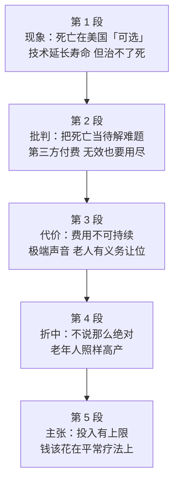

# Passage 37 · 死亡不是待解的难题

## 答题记录

| 轮次  | 日期         | 题号  | 正确  | 错误  | 正确率 | 用时    | 错题归因 |
| --- | --- | --- | --- | --- | --- | --- | --- |
| 1 |  | 1-5 |  |  |  |  |  |
| 2 |  | 1-5 |  |  |  |  |  |
| 3 |  | 1-5 |  |  |  |  |  |

> [!tip] 填写口径
> - **用时**以分钟计，只计做题时间，不含精读复盘。
> - **错题归因**填「题型·错误类型」，如：推理判断·过度推断、态度题·程度失准、主旨大意·以偏概全。
> - 纵向看趋势：正确率升而用时过长 → 熟练度不足；用时降而正确率波动 → 定位不稳。
> - 本篇 5 题，题号栏填 1-5；第 3 题是态度题，错因建议单列「态度题·程度词失准」（reserved consent 的关键在「保留」二字）。

> [!info] 文章档案
> - **来源**：考研英语（一）2003 年 Text 4
> - **题材**：社会生活（医疗卫生 × 生命伦理）——美国人把死亡当成待解决的技术难题，作者主张正视死亡、把钱花在刀刃上
> - **结构**：5 段 / 27 句 ＋ 5 题（按句号断句与行首缩进实测，与解析引用的「第一段③句」「第二段③句」「第三段尾句」「第四段 I would not go that far」「最后一段③句」「第三段①②句」全部吻合）
> - **难度**：★★★★☆
> - **一句话主旨**：死亡是正常的、不可避免的生命事实，但美国人仗着发达的医疗技术把它当成可以解决的技术问题，不惜用无效而昂贵的手段拖延生命；作者主张接受死亡，并把资金从「追求不可能的治愈」转向「改善生活质量的平常疗法」。

## 一、篇章脉络

- **第 1 段**：用一个跨国俏皮话开场（在英国死亡**逼人**，在加拿大**不可避免**，在加州却是**可选的**），接着罗列医疗成就（髋骨置换、抑郁症可控、白内障三十分钟摘除），最后用 **But** 一转：再强大的医疗体系也治不了死亡，不正视这一点正在侵蚀美国的伟大。第 1 题的战场。
- **第 2 段**：亮明作者的批判。死亡是正常的、基因设定好的；可我们作为**医疗消费者**却把它当成待解决的问题，因为有第三方付费，便要求「什么手段都用上，哪怕毫无用处」——最典型的例子就是晚期癌症治疗（第 2 题的战场）。
- **第 3 段**：算经济账。1950 年 127 亿 → 2002 年 15400 亿，趋势**不可持续**，却无人愿扭转；于是有学者主张政府停止为超过某年龄（比如 83 岁）的人支付维持生命的费用，前科罗拉多州长拉姆更说老人「有义务死去并让位」（第 3 题与第 5 题 D 项的取材处）。
- **第 4 段**：作者对极端主张的**折中表态**——I would not go that far（我不会说得这么绝对），然后举一批高龄仍高产的名人（第 3 题的答案句）。
- **第 5 段**：给出正面主张。社会投入有上限；日本、瑞典花得少却活得更长更健康（第 4 题）；美国是在**过度投入**不可能的治愈、而**投入不足**于改善生活质量的平常疗法（第 5 题的答案句）。

> [!tip] 行文逻辑
> 全篇是「**现象 → 批判 → 代价 → 折中 → 主张**」的社论型结构，作者是一位 68 岁的医生，通篇用第一人称（I know... / I wish...）把个人经验与公共议题结合起来。三条线索贯穿全篇：**死亡的自然性**（Death is normal / cure death 的不可能 / accept death）、**技术的盲目自信**（optional / treat death as a problem to be solved / everything that can possibly be done）、**钱该花在哪**（unsustainable / overfunding vs underfunding）。与 Passage 35 那种「一段一题」不同，本篇**第 5 题需要整合全篇五段**，第 2 题看似细节题实则靠主旨（书中解析明说「根本无须定位，例子肯定是支持文章中心的」）——**例证题的兜底解法就是回到中心思想**，这是本篇最重要的一条方法论。

## 二、逐段精读

### 第 1 段 · 现象：死亡在美国成了「可选项」

**原文**

① It is said that in England death is pressing, in Canada inevitable and in California optional.
② Small wonder.
③ Americans' life expectancy has nearly doubled over the past century.
④ Failing hips can be replaced, clinical depression controlled, cataracts removed in a 30-minute surgical procedure.
⑤ Such advances offer the aging population a quality of life that was unimaginable when I entered medicine 50 years ago.
⑥ But not even a great health-care system can cure death—and our failure to confront that reality now threatens this greatness of ours.

**译文**

① 据说，死亡在英国是迫在眉睫的，在加拿大是不可避免的，而在加利福尼亚州则是可以选择的。
② 这不足为奇。
③ 美国人的预期寿命在过去一个世纪里几乎翻了一番。
④ 衰竭的髋关节可以置换，临床抑郁症可以得到控制，白内障可以在三十分钟的手术中摘除。
⑤ 这些进步为老龄人口提供了这样一种生活质量——那在我五十年前进入医学界时是不可想象的。
⑥ 然而，即便再伟大的医疗体系也无法治愈死亡；而我们未能正视这一现实，如今正危及我们这份伟大。

> [!note] 段落要点
> - 功能：用一句俏皮话开场，先扬后抑，是第 1 题的唯一战场。
> - ①句的**递进式对照**（pressing → inevitable → optional）是题眼：从「逼人」到「不可避免」再到「可自主选择」，说明美国人自认为**可以掌控死亡**。
> - ②句 **Small wonder（难怪）** 承上启下：之所以「可选」，是因为③—⑤句的医疗成就。
> - ⑥句的 **But** 是全篇的转折枢纽：**can cure death** 一句否定掉前面的技术乐观，**failure to confront that reality** 则点出全篇要批评的态度。第 1 题 C 项 over-confident of their medical technology 正由此而来。
> - 注意作者身份：本段末的 **when I entered medicine 50 years ago** 与第 5 段的 As a physician 相互呼应，说明这是一位行医五十年的老医生在发声。

#### 长难句 · 本段

> [!abstract] 本段第 ① 句 · It is said that in England death is pressing, in Canada inevitable and in California optional.

**结构拆解**

- **主干**：It is said that...（it 为形式主语，that 从句为真正主语；It is said that... 据说……）
- **that 从句内部**：三个并列的「介词短语＋主语＋表语」结构，后两项省略主语与谓语
  - in England death is **pressing**
  - in Canada (death is) **inevitable**
  - in California (death is) **optional**
- **结构**：pressing adj. 紧迫的、逼人的；inevitable adj. 不可避免的；optional adj. 可选择的

**参考译文**

据说，死亡在英国是迫在眉睫的，在加拿大是不可避免的，而在加利福尼亚州则是可以选择的。

> [!tip] 拆解要点
> 抓三处：①**It is said that...**（据说……）是引述俗语、谚语的固定句式，表示「这是别人说的、未必是作者本人主张」——凡读到 It is said / It is believed / It is reported，先把它与作者观点区分开；②**三项并列＋后项省略**（in Canada **inevitable**, in California **optional**，省略了 death is），这是英语平行结构的常规省略，读时把省略部分补回来；③三个形容词构成**程度递进**：pressing（逼人的）→ inevitable（不可避免的）→ optional（可选择的），越往后人对死亡的掌控感越强。命题角度：第 1 题问 What is implied in the first sentence，答案不可能停在字面——字面是「死亡在美国可以选择」，推出的含义是「美国人相信医疗技术能决定生死」，即 C 项 over-confident of their medical technology；D 项 take a vain pride in their long life expectancy 的陷阱在于把自信的**对象**由「医疗技术」换成了「长寿」。**凡 imply / suggest 型题干，答案一定是「字面→态度」的推导，不是字面复述**。

> [!abstract] 本段第 ⑥ 句 · But not even a great health-care system can cure death—and our failure to confront that reality now threatens this greatness of ours.

**结构拆解**

- **分句一**：But not even a great health-care system can cure death（not even 连强调语气：「即便……也不」）
- **分句二**：and our failure to confront that reality now threatens this greatness of ours（and 连接并列句）
  - 主语 our failure to confront that reality（failure to do 未能做……；that reality 指前句的「死亡不可治愈」）
  - 谓语 threatens；宾语 this greatness of ours（双重限定：this ＋ of ours）
- **结构**：confront v. 正视、面对；threaten v. 危及

**参考译文**

然而，即便再伟大的医疗体系也无法治愈死亡；而我们未能正视这一现实，如今正危及我们这份伟大。

> [!tip] 拆解要点
> 抓三处：①**not even ＋ 名词 ＋ can do** 的最强否定式（即便再……也不能），本句用 health-care system 作主语，把「技术万能」的神话直接打掉；②**failure to do**（未能做到……）是抽象名词化的谓语，相当于 we fail to confront，抽象名词作主语是考研阅读的常规操作；③**that reality** 回指前句「死亡无法被治愈」这一事实，**this greatness** 回指本段③—⑤句罗列的医疗成就——两个指代连起来就是全篇的中心矛盾：成就伟大，但不肯接受极限。命题角度：本句是第 1 题 C 项的直接依据，也是第 5 题 C 项（death should be accepted as a fact of life）的源头。

#### 本段重点词汇

| 单词 / 短语 | 词性 | 文中意 | 常用考义与拓展 | 英文示例搭配（中译） |
| --- | --- | --- | --- | --- |
| **pressing** | adj. | 紧迫的，逼人的 | press v. 按、压／n. 新闻界；pressing 亦作名词「压制」；pressing need 迫切需求 | death is pressing（死亡迫在眉睫／逼人） |
| **inevitable** | adj. | 不可避免的，必然的 | evade v. 逃避；inevitable 为 evade 的否定形容词；inevitability n. 必然性 | death is inevitable（死亡不可避免） |
| **optional** | adj. | 可选择的，非必须的 | option n. 选择（have no option but to）；optional course 选修课；反义 compulsory / mandatory | death is optional（死亡是可以选择的） |
| **small wonder** | 短语 | 难怪，不足为奇 | ＝no wonder / little wonder；(It is) small wonder (that)... 难怪…… | Small wonder.（这不足为奇。） |
| **life expectancy** | n. | 预期寿命 | expect v. 预期；expectancy n. 预期；life span 寿命（实际长度） | Americans' life expectancy has nearly doubled（美国人的预期寿命几乎翻了一番） |
| **double** | v./adj. | （使）翻倍／双倍的 | double 作动词「翻倍」；triple 三倍；quadruple 四倍；double 亦作「双倍的」 | has nearly doubled over the past century（在过去一个世纪里几乎翻了一番） |
| **failing hips** | n. | 衰竭的髋关节 | failing adj. 衰退的、衰竭的（failing eyesight 衰退的视力）；hip n. 髋部；fail v. 失败／衰退 | Failing hips can be replaced（衰竭的髋关节可以置换） |
| **clinical depression** | n. | 临床抑郁症 | clinical adj. 临床的（clinic n. 诊所）；depression n. 抑郁、萧条（the Great Depression 大萧条） | clinical depression controlled（临床抑郁症被控制住） |
| **cataract** | n. | 白内障 | 医学术语；cataracts removed 摘除白内障；注意与 catastrophe（大灾难）形近 | cataracts removed in a 30-minute procedure（三十分钟摘除白内障） |
| **surgical procedure** | n. | 外科手术（程序） | surgery n. 外科手术（见 Passage 36）；surgical adj. 外科的；procedure n. 程序、手续 | removed in a 30-minute surgical procedure（在三十分钟的手术中摘除） |
| **aging population** | n. | 老龄人口 | the aging population ＝ the elderly；aging n./adj. 老龄化（的）；ageing（英式拼法） | offer the aging population a quality of life（为老龄人口提供某种生活质量） |
| **confront** | v. | 正视，面对（不回避） | confront reality 正视现实；be confronted with 面临；confrontation n. 对抗 | our failure to confront that reality（我们未能正视那一现实） |

### 第 2 段 · 批判：把死亡当成待解的技术难题

**原文**

① Death is normal; we are genetically programmed to disintegrate and perish, even under ideal conditions.
② We all understand that at some level, yet as medical consumers we treat death as a problem to be solved.
③ Shielded by third-party payers from the cost of our care, we demand everything that can possibly be done for us, even if it's useless.
④ The most obvious example is late-stage cancer care.
⑤ Physicians—frustrated by their inability to cure the disease and fearing loss of hope in the patient—too often offer aggressive treatment far beyond what is scientifically justified.

**译文**

① 死亡是正常的；即便在理想条件下，我们的基因程序也设定了我们会解体、灭亡。
② 这一点我们在某种程度上都懂，然而作为医疗消费者，我们却把死亡当成了一个有待解决的问题。
③ 由于第三方支付者替我们承担了医疗费用，我们便要求用尽一切可能的手段，哪怕它们毫无用处。
④ 最明显的例子是晚期癌症的治疗。
⑤ 医生们——既因无力治愈而沮丧，又担心病人失去希望——常常提供远远超出科学依据的激进治疗。

> [!note] 段落要点
> - 功能：亮明作者的批判立场，是第 2 题的战场，也是全篇中心思想的表达最集中的一段。
> - ①句用**科学口吻**立论：死亡是基因设定的（genetically programmed to disintegrate and perish），不是故障。
> - ②句的 **yet** 是本段的态度转折：**treat death as a problem to be solved** 是全篇的文眼——把「自然规律」误当成「技术故障」。
> - ③句给出制度原因：**第三方付费**屏蔽了费用感知，于是「哪怕无用也要用尽」。第 2 题 A 项的 wasted 正对应这里的 useless。
> - ⑤句解释医生为何配合：不是贪婪，而是**挫败感 + 害怕病人失去希望**；同时 aggressive treatment 与 Passage 36 第 7 段的 aggressive 遥相呼应（两篇都批评「大胆而无效的医疗干预」）。

#### 长难句 · 本段

> [!abstract] 本段第 ① 句 · Death is normal; we are genetically programmed to disintegrate and perish, even under ideal conditions.

**结构拆解**

- **分句一**：Death is normal（判断句，直接立论）
- **分句二**：we are genetically programmed to disintegrate and perish（被动语态；be programmed to do 被设定去做）
- **不定式并列**：to disintegrate and (to) perish
- **让步性状语**：even under ideal conditions（即便在理想条件下）
- **结构**：genetically adv. 从基因上；disintegrate v. 分解、瓦解；perish v. 死亡、消亡

**参考译文**

死亡是正常的；即便在理想条件下，我们的基因程序也设定了我们会解体、灭亡。

> [!tip] 拆解要点
> 抓两处：①**be programmed to do** 是本篇最传神的表达——把「写程序」的意象借来描述生物宿命（基因给我们写好了「解体与灭亡」的程序），与前文「把死亡当技术故障」形成讽刺对照；②**even under ideal conditions**（即便在最理想的条件下）是让步性状语，把话说死：不是环境不好才死，而是**无论如何都会死**。命题角度：本句是第 5 题 C 项 death should be accepted as a fact of life 的正面依据；读议论文要特别留意这种「分号＋科学判断」的立论句，它通常就是全文中心。

> [!abstract] 本段第 ③ 句 · Shielded by third-party payers from the cost of our care, we demand everything that can possibly be done for us, even if it's useless.

**结构拆解**

- **句首过去分词短语作状语**：Shielded by third-party payers from the cost of our care（逻辑主语是主句的 we；shield sb from sth）
- **主句**：we demand everything（demand＋宾语）
- **定语从句**：that can possibly be done for us（修饰 everything；被动语态）
- **让步状语从句**：even if it's useless（it 指代 everything）
- **结构**：shield v. 遮蔽、保护（shield sb from）；third-party payer 第三方支付者；useless adj. 无用的

**参考译文**

由于第三方支付者替我们承担了医疗费用，我们便要求用尽一切可能的手段，哪怕它们毫无用处。

> [!tip] 拆解要点
> 抓三处：①**Shielded by...** 是过去分词短语作**原因／条件状语**，其逻辑主语就是主句的 we（＝Because we are shielded...），读到句首的 -ed 短语先把它还原成「因为／由于」；②**everything that can possibly be done** 中的 possibly 把范围拉到最大（凡是能做的都要做）——这种「绝对化表述」正是作者要批评的对象；③**even if it's useless** 是本句的刀刃：明知无用仍要用，就是浪费。命题角度：第 2 题 A 项 medical resources are often wasted 就是 useless 的同义替换（书中解析明说「选项中的 wasted 可以视为 useless 的同义替换」）；B、C 两项（doctors are helpless / treatments are too aggressive）都出自⑤句的**例子本身**，而不是举例的目的——**例证题的永恒陷阱：选项复述例子内容 ≠ 举例的目的**。

> [!abstract] 本段第 ⑤ 句 · Physicians—frustrated by their inability to cure the disease and fearing loss of hope in the patient—too often offer aggressive treatment far beyond what is scientifically justified.

**结构拆解**

- **主干**：Physicians... too often offer aggressive treatment（主语＋状语 too often＋谓语＋宾语）
- **双破折号之间的插入语**：frustrated by their inability to cure the disease and fearing loss of hope in the patient（两个过去分词／现在分词短语并列，说明医生的两重心境）
  - frustrated by their inability to cure the disease（inability to do 无力做……）
  - (and) fearing loss of hope in the patient（loss of hope 希望的丧失）
- **后置定语**：far beyond what is scientifically justified（beyond＋what 从句：远远超出……的范围）
- **结构**：aggressive treatment 激进治疗；justify v. 证明正当（见 Passage 36）；far beyond 远远超出

**参考译文**

医生们——既因无力治愈而沮丧，又担心病人失去希望——常常提供远远超出科学依据的激进治疗。

> [!tip] 拆解要点
> 抓三处：①**双破折号之间的插入成分**是阅读理解的高频障碍，读法同样是「先跳过」——跳过之后主干只剩 Physicians too often offer aggressive treatment；②插入语内部是两个**分词短语并列**（frustrated by... and fearing...），一个表被动（被挫败感驱使），一个表主动（担忧病人失去希望），恰好说明医生并非逐利，而是被情绪与伦理绑架；③**far beyond what is scientifically justified** 中的 what 从句作 beyond 的宾语（超出「科学上站得住脚的」范围）。命题角度：本句是第 2 题 B、C 两项的原词取材处，但它们只是**例子内容**，不是「作者举这个例子要说明什么」——书中解析的判断标准很实用：**例子一定服务于中心，最能体现中心的选项才是答案**。

#### 本段重点词汇

| 单词 / 短语 | 词性 | 文中意 | 常用考义与拓展 | 英文示例搭配（中译） |
| --- | --- | --- | --- | --- |
| **genetically** | adv. | 从基因上，遗传上 | genetic adj. 基因的；genetics n. 遗传学；gene n. 基因 | we are genetically programmed to...（我们的基因程序设定我们会……） |
| **be programmed to** | 短语 | 被（基因／程序）设定为，天生注定 | program n. 程序／v. 编程；be programmed to do 被设定去做；programmed cell death 细胞程序性死亡 | programmed to disintegrate and perish（被设定为会解体并消亡） |
| **disintegrate** | v. | 分解，瓦解 | integrate v. 整合；dis- 表「分离、否定」；disintegration n. 瓦解 | to disintegrate and perish（解体并灭亡） |
| **perish** | v. | 死亡，消亡（文语） | perish 为文学／正式用语（Perish the thought! 打消这个念头！）；perishable adj. 易腐烂的 | we are programmed to disintegrate and perish（我们注定会解体并消亡） |
| **at some level** | 短语 | 在某种程度上，在内心某处 | ＝on some level / to some extent；level n. 层面 | We all understand that at some level（我们在某种程度上都懂得这一点） |
| **medical consumer** | n. | 医疗消费者（患者） | consume v. 消费；consumer n. 消费者；consumption n. 消费／消耗（疾病：consumption 结核） | as medical consumers we treat death as a problem（作为医疗消费者，我们把死亡当成问题） |
| **treat A as B** | 短语 | 把 A 当作 B 对待／看待 | treat v. 对待、治疗；treat sb to sth 请客；treatment n. 对待、治疗 | treat death as a problem to be solved（把死亡当作一个待解决的问题） |
| **shield** | v. | 遮蔽，保护（使不受影响） | shield sb from sth 使某人免受……；shield 亦作名词「盾牌」（见 Passage 36） | Shielded by third-party payers from the cost（被第三方支付者屏蔽了费用感知） |
| **third-party payer** | n. | 第三方支付者（医保机构） | third-party adj. 第三方的；payer n. 支付方；third party 第三方（法律用语） | shielded by third-party payers（由第三方支付者承担费用） |
| **useless** | adj. | 无用的，无效的 | -less 为否定后缀（hopeless / careless）；useful adj. 有用的 | even if it's useless（即便它毫无用处） |
| **late-stage cancer care** | n. | 晚期癌症治疗 | late-stage adj. 晚期的（＝advanced）；cancer care 癌症治疗、照护 | The most obvious example is late-stage cancer care（最明显的例子是晚期癌症治疗） |
| **frustrated** | adj. | 受挫的，沮丧的 | frustrate v. 使受挫；frustration n. 挫败感；frustrating adj. 令人沮丧的 | frustrated by their inability to cure the disease（因无力治愈该病而沮丧） |
| **far beyond** | 短语 | 远远超出 | beyond prep. 超出；far beyond one's reach 遥不可及；beyond dispute 无可争辩 | far beyond what is scientifically justified（远远超出科学依据所允许的范围） |
| **scientifically justified** | 短语 | 有科学依据的，科学上站得住脚的 | justify v. 证明……正当（见 Passage 36）；justified adj. 有正当理由的 | what is scientifically justified（科学上站得住脚的东西） |

### 第 3 段 · 代价：费用不可持续，极端声音出现

**原文**

① In 1950, the U.S. spent $12.7 billion on health care.
② In 2002, the cost will be $1,540 billion.
③ Anyone can see this trend is unsustainable.
④ Yet few seem willing to try to reverse it.
⑤ Some scholars conclude that a government with finite resources should simply stop paying for medical care that sustains life beyond a certain age—say 83 or so.
⑥ Former Colorado governor Richard Lamm has been quoted as saying that the old and infirm "have a duty to die and get out of the way" so that younger, healthier people can realize their potential.

**译文**

① 1950 年，美国在医疗保健上的支出是 127 亿美元。
② 到 2002 年，这一费用将达到 15400 亿美元。
③ 谁都看得出，这种趋势是难以为继的。
④ 然而似乎很少有人愿意设法扭转它。
⑤ 一些学者得出的结论是：资源有限的政府应当干脆停止为超过某一年龄——比如 83 岁左右——的人支付维持生命的医疗费用。
⑥ 前科罗拉多州长理查德·拉姆有一句被广泛引述的话：年老体弱者「有义务死去并让开道路」，以便让更年轻、更健康的人发挥他们的潜能。

> [!note] 段落要点
> - 功能：把议论推进到**经济层面**，并引出极端观点，为第 4 段的折中表态做铺垫。
> - ①—②句用**两个年份的数字对比**制造冲击（127 亿 → 15400 亿），③—④句给出判断与无奈（unsustainable / few...willing to reverse）。
> - ⑤—⑥句是**他人的极端主张**：停止为高龄者支付维生费用、老人「有义务死去让位」。注意这里**不是作者观点**——第 5 题 B 项正是把它当成作者观点（张冠李戴）。
> - ⑥句的 **has been quoted as saying**（被引述说）是「他人观点」的标记语，与第 1 段的 It is said 一样，凡读到这类引述句式都要与作者立场区分。

#### 长难句 · 本段

> [!abstract] 本段第 ⑤ 句 · Some scholars conclude that a government with finite resources should simply stop paying for medical care that sustains life beyond a certain age—say 83 or so.

**结构拆解**

- **主干**：Some scholars conclude that...（conclude＋that 宾语从句）
- **宾语从句**：a government... should simply stop paying for medical care（stop doing 停止做；pay for 为……付费）
- **定语**：with finite resources（介词短语修饰 a government）
- **定语从句**：that sustains life beyond a certain age（修饰 medical care）
- **破折号插入**：say 83 or so（say 此处为「比方说」，引出举例；or so 大约）
- **结构**：finite adj. 有限的；sustain v. 维持；beyond a certain age 超过某一年龄

**参考译文**

一些学者得出的结论是：资源有限的政府应当干脆停止为超过某一年龄——比如 83 岁左右——的人支付维持生命的医疗费用。

> [!tip] 拆解要点
> 抓三处：①**conclude that...** 是观点动词，主语是 Some scholars——**观点归属要盯住主语**：这不是作者的观点，而是「一些学者」的观点，第 5 题 B 项正是把它误当作者观点；②**stop paying for**（停止为……付费）后接动名词（stop to do 是「停下来去做」，意思完全不同）；③**say ＋ 数字**是插入语用法，say ＝ 「比方说」（＝let's say），or so ＝ 「大约」（置于数词之后）。命题角度：本段①②句的数字是第 5 题 D 项 excessive demands increase the cost of health care 的取材处，但书中判定它「以偏概全」——它只是**现象**，不是作者「着重要表达的观点」。**主旨题里，选项对应文中某个事实却不是论点，一律按以偏概全排除**。

> [!abstract] 本段第 ⑥ 句 · Former Colorado governor Richard Lamm has been quoted as saying that the old and infirm "have a duty to die and get out of the way" so that younger, healthier people can realize their potential.

**结构拆解**

- **主干**：Former Colorado governor Richard Lamm has been quoted as saying that...（现在完成时被动；be quoted as saying 被引述说……）
- **that 从句内部**：
  - 主语 the old and infirm（the＋形容词＝一类人，复数概念）
  - 谓语(引号内) have a duty to die and get out of the way（have a duty to do 有义务做）
  - 目的状语从句 so that younger, healthier people can realize their potential
- **结构**：governor n. 州长；infirm adj. 体弱的；realize one's potential 发挥潜能

**参考译文**

前科罗拉多州长理查德·拉姆有一句被广泛引述的话：年老体弱者「有义务死去并让开道路」，以便让更年轻、更健康的人发挥他们的潜能。

> [!tip] 拆解要点
> 抓三处：①**be quoted as saying**（被引述说）是本篇第二个「他人观点标记」，与 It is said、scholars conclude 一起构成一组信号——读到它们就自动打上「非作者观点」的标签；②**the old and infirm** 是「the＋形容词」表一类人（the poor / the elderly / the unemployed），谓语用复数；③**so that** 引导目的状语从句，说明极端主张的「理由」（把资源让给年轻人）。命题角度：本句是第 3 题的定位句——题干问作者对 **Lamm's remark** 的态度，所以必须先看 Lamm 说了什么（老人有义务去死），再看作者在第 4 段怎么回应（I would not go that far）。**态度题的标准动作：先定位被评价的对象，再找评价语**。

#### 本段重点词汇

| 单词 / 短语 | 词性 | 文中意 | 常用考义与拓展 | 英文示例搭配（中译） |
| --- | --- | --- | --- | --- |
| **health care** | n. | 医疗保健（服务／体系） | health care system 医疗体系；healthcare 亦连写；care n. 照护 | spent $12.7 billion on health care（在医疗保健上支出 127 亿美元） |
| **billion** | n. | 十亿 | million 百万 / billion 十亿 / trillion 万亿；billions of 数十亿的 | $12.7 billion（127 亿美元）；$1,540 billion（15400 亿美元） |
| **trend** | n. | 趋势，趋向 | trend n. 潮流、趋势；a downward trend 下降趋势；trendy adj. 时髦的 | this trend is unsustainable（这一趋势难以为继） |
| **unsustainable** | adj. | 不可持续的，难以为继的 | sustain v. 支撑、维持；sustainable adj. 可持续的（sustainable development 可持续发展）；un- 否定前缀 | Anyone can see this trend is unsustainable（谁都看得出这种趋势难以为继） |
| **reverse** | v./n. | 扭转，逆转／相反 | reverse the decision 撤销决定；reverse 亦作名词「相反」（the reverse）；reverse v. 倒车 | few seem willing to try to reverse it（似乎很少有人愿意设法扭转它） |
| **scholar** | n. | 学者 | scholarship n. 奖学金／学问；scholarly adj. 学术的；scholar 亦指「获奖学金的学生」 | Some scholars conclude that...（一些学者得出结论说……） |
| **conclude** | v. | 得出结论，断定 | conclude that... 得出结论；conclude with 以……结束；conclusion n. 结论 | Some scholars conclude that a government should...（一些学者断定政府应当……） |
| **finite resources** | n. | 有限的资源 | finite adj. 有限的（≠ infinite 无限的）；resource n. 资源（常用复数） | a government with finite resources（资源有限的政府） |
| **sustain life** | 短语 | 维持生命 | sustain v. 维持、支撑；sustained adj. 持续的；sustenance n. 生计、食物 | medical care that sustains life beyond a certain age（为超过一定年龄者维持生命的医疗） |
| **beyond a certain age** | 短语 | 超过某一年龄 | beyond prep. 超出（某一界线）；beyond doubt 毫无疑问；beyond repair 无法修复 | stop paying for care that sustains life beyond a certain age（停止为超过一定年龄者的维生医疗付费） |
| **governor** | n. | 州长；（机构）主管 | govern v. 治理；government n. 政府；governor 亦指「英格兰银行行长」等 | Former Colorado governor Richard Lamm（前科罗拉多州长理查德·拉姆） |
| **be quoted as saying** | 短语 | 被引述说，有人引述其话说 | quote v. 引用；quotation n. 引语；quote sb as saying 引述某人的话说 | has been quoted as saying that the old and infirm...（被引述说年老体弱者……） |
| **the old and infirm** | n. | 年老体弱者（一类人） | the＋形容词表一类人；infirm adj. 体弱的（firm 坚定→in- 否定＝虚弱）；infirmity n. 虚弱、疾病 | the old and infirm "have a duty to die"（年老体弱者「有义务死去」） |
| **realize one's potential** | 短语 | 发挥潜能 | realize v. 实现、认识到（熟词僻义：「意识到」→「实现」）；potential n. 潜能／adj. 潜在的 | younger, healthier people can realize their potential（更年轻健康的人能发挥潜能） |

### 第 4 段 · 折中：不说那么绝对，老年人照样高产

**原文**

① I would not go that far.
② Energetic people now routinely work through their 60s and beyond, and remain dazzlingly productive.
③ At 78, Viacom chairman Sumner Redstone jokingly claims to be 53.
④ Supreme Court Justice Sandra Day O'Connor is in her 70s, and former surgeon general C. Everett Koop chairs an Internet start-up in his 80s.
⑤ These leaders are living proof that prevention works and that we can manage the health problems that come naturally with age.
⑥ As a mere 68-year-old, I wish to age as productively as they have.

**译文**

① 我不会说得那么绝对。
② 如今精力充沛的人照例会一直工作到六十岁之后，而且依然保持着惊人的创造力。
③ 78 岁时，维亚康姆集团董事长萨姆纳·雷德斯通开玩笑地自称 53 岁。
④ 最高法院大法官桑德拉·戴·奥康纳已七十多岁，前卫生总监 C·埃弗里特·库普八十多岁时还主持着一家互联网初创公司。
⑤ 这些领军人物就是活生生的证明：预防是有效的，而且我们能够应付随年龄自然而来的健康问题。
⑥ 作为一个年仅 68 岁的人，我希望自己能像他们那样富有成效地老去。

> [!note] 段落要点
> - 功能：对第 3 段的极端主张作**有限度的反驳**，是第 3 题的答案段。
> - ①句 **I would not go that far（我不会说得那么绝对／我不会走那么远）** 是全篇最重要的态度句：**不完全赞成，也不完全反对** —— 对应第 3 题 B 项 reserved consent（有保留的赞同）。
> - ②—⑤句用**一批高龄仍活跃的人物**作证据：Redstone（78 岁自称 53）、O'Connor（七十多岁的大法官）、Koop（八十多岁主持互联网初创公司）。
> - ⑥句的 **As a mere 68-year-old** 是作者的自我定位（自嘲「才 68 岁」），也再次确认作者是医生兼老年人。

#### 长难句 · 本段

> [!abstract] 本段第 ⑤ 句 · These leaders are living proof that prevention works and that we can manage the health problems that come naturally with age.

**结构拆解**

- **主干**：These leaders are living proof（主系表）
- **同位语从句一**：that prevention works（说明 proof 的具体内容）
- **同位语从句二**：and that we can manage the health problems（and 连接第二个 that 从句）
- **定语从句**：that come naturally with age（修饰 the health problems）
- **结构**：living proof 活生生的证明；prevention n. 预防；manage v. 应对、管理

**参考译文**

这些领军人物就是活生生的证明：预防是有效的，而且我们能够应付随年龄自然而来的健康问题。

> [!tip] 拆解要点
> 抓三处：①**proof ＋ that 同位语从句**（不是定语从句——that 从句说明的是 proof 的**内容**，that 不充当成分），考研阅读里 fact / proof / evidence / idea / news 后接 that 的多为同位语从句；②**and 连接的两个 that 从句并列**，说明这些老人证明了两件事：**预防有效** ＋ **年龄带来的健康问题可控**；③**come with**（随……而来）＝ accompany，health problems that come naturally with age ＝ 随年龄自然而来的健康问题。命题角度：本段的作用是「**部分反驳**」——作者承认老人的价值（所以不赞成为 83 岁以上者停止付费），但这是**限定**而不是**推翻**，因此第 3 题的态度是 reserved consent（有保留的赞同）而非 strong disapproval 或 enthusiastic support。**态度题的答案几乎总是一个「中间程度词」**（reserved / qualified / cautious / partial），凡是 strong / enthusiastic / contempt 这类极端词，多半是干扰项。

#### 本段重点词汇

| 单词 / 短语 | 词性 | 文中意 | 常用考义与拓展 | 英文示例搭配（中译） |
| --- | --- | --- | --- | --- |
| **go that far** | 短语 | 走得那么远，说到那么绝对 | go so far as to do 竟至于做；go too far 做得过火；此处「我不会说得那么绝对」 | I would not go that far.（我不会说得那么绝对。） |
| **energetic** | adj. | 精力充沛的 | energy n. 精力；energetically adv. 积极地；energize v. 使充满活力 | Energetic people now routinely work through their 60s（如今精力充沛的人照例工作到六十岁之后） |
| **routinely** | adv. | 通常地，例行地 | routine n. 常规／adj. 常规的；routine check 例行检查；routinize v. 使常规化 | now routinely work through their 60s（如今通常工作到六十多岁） |
| **work through** | 短语 | 一直工作（度过） | work through 在此＝持续工作、干到……为止；work through the night 通宵工作；work out 解决、锻炼 | work through their 60s and beyond（一直工作到六十岁之后） |
| **dazzlingly** | adv. | 耀眼地，惊人地 | dazzle v. 使眼花、使惊叹；dazzling adj. 耀眼的；dazzlingly productive 惊人地高产 | remain dazzlingly productive（依然惊人地高产） |
| **productive** | adj. | 高产的，富有成效的 | produce v. 生产；product n. 产品；productivity n. 生产率 | remain dazzlingly productive（保持惊人的创造力／产出） |
| **chairman** | n. | 董事长，主席 | chair n. 主席／v. 主持（见 Passage 36）；chairmanship n. 主席职务 | Viacom chairman Sumner Redstone（维亚康姆集团董事长萨姆纳·雷德斯通） |
| **claim** | v./n. | 声称，自称／主张 | claim to be 自称是；claim that 声称；claim 亦作名词「索赔、主张」 | jokingly claims to be 53（开玩笑地自称 53 岁） |
| **Supreme Court Justice** | n. | 最高法院大法官 | justice n. 法官／正义；Justice 用于人名前表「大法官」；the Supreme Court 最高法院（见 Passage 36） | Supreme Court Justice Sandra Day O'Connor（最高法院大法官桑德拉·戴·奥康纳） |
| **surgeon general** | n. | （美国）卫生总监 | surgeon n. 外科医生；general adj. 总的；Surgeon General 为美国公共卫生最高官员职衔 | former surgeon general C. Everett Koop（前卫生总监 C·埃弗里特·库普） |
| **start-up** | n. | 初创公司 | start up 创立、启动；start-up company 初创企业；startup 亦可连写 | chairs an Internet start-up in his 80s（八十多岁时主持一家互联网初创公司） |
| **living proof** | n. | 活生生的证明 | proof n. 证明／adj. 防……的（waterproof 防水的）；prove v. 证明；living adj. 活着的 | These leaders are living proof that...（这些领军人物就是……的活证明） |
| **prevention** | n. | 预防 | prevent v. 预防（prevent sb from doing）；preventive adj. 预防性的（preventive medicine 预防医学） | living proof that prevention works（预防行之有效的活证明） |
| **mere** | adj. | 仅仅的，只不过的 | merely adv. 仅仅；a mere child 不过是个孩子；mere 强调「小／少」 | As a mere 68-year-old（作为一个年仅 68 岁的人） |
| **age** | v. | 变老，老去 | 熟词僻义：名词「年龄、时代」→动词「变老／使变老」；aging n. 老龄化；aged adj. 年老的 | I wish to age as productively as they have（我希望能像他们那样富有成效地老去） |

### 第 5 段 · 主张：投入有上限，钱该花在平常疗法上

**原文**

① Yet there are limits to what a society can spend in this pursuit.
② As a physician, I know the most costly and dramatic measures may be ineffective and painful.
③ I also know that people in Japan and Sweden, countries that spend far less on medical care, have achieved longer, healthier lives than we have.
④ As a nation, we may be overfunding the quest for unlikely cures while underfunding research on humble therapies that could improve people's lives.

**译文**

① 然而，一个社会在这项追求上能花多少钱，是有上限的。
② 作为一名医生，我知道那些最昂贵、最引人注目的措施很可能是无效的，而且令人痛苦。
③ 我也知道，日本和瑞典这些在医疗保健上花费少得多的国家，人们却获得了比我们更长寿、更健康的生活。
④ 作为一个国家，我们可能是在为追求那些不太可能的治愈方法投入过多资金，同时却对那些能够改善人们生活的、不起眼的疗法投入不足。

> [!note] 段落要点
> - 功能：给出作者的正面主张，是第 4 题与第 5 题的答案段。
> - ①句用 **Yet** 转折回主题：承认老人有价值 ≠ 可以无限投入。
> - ②句以医生身份作证：最贵最「戏剧性」的措施往往**无效且痛苦**。
> - ③句给出国际对照：日本、瑞典**花得少却活得更长更健康** —— 第 4 题答案（more reasonably）。
> - ④句是全篇的结论句：**overfunding...while underfunding...** 的对称结构，把「钱该花在哪」说清楚：少追逐奇迹疗法，多研究平常疗法。

#### 长难句 · 本段

> [!abstract] 本段第 ③ 句 · I also know that people in Japan and Sweden, countries that spend far less on medical care, have achieved longer, healthier lives than we have.

**结构拆解**

- **主干**：I also know that...（know＋that 宾语从句）
- **宾语从句**：people in Japan and Sweden... have achieved longer, healthier lives than we have
  - 主语 people (in Japan and Sweden)
  - 同位语 countries（解释 Japan and Sweden）
  - 定语从句 that spend far less on medical care（修饰 countries）
  - 比较结构 than we have（＝than we have achieved）
- **结构**：far less 少得多（far 修饰比较级）；achieve v. 取得、实现

**参考译文**

我也知道，日本和瑞典这些在医疗保健上花费少得多的国家，人们却获得了比我们更长寿、更健康的生活。

> [!tip] 拆解要点
> 抓三处：①**同位语＋定语从句的嵌套**（Japan and Sweden, countries that spend far less...）——countries 是同位语，that 从句又修饰 countries，读时把同位语与从句一并视为插入，主干即 people in Japan and Sweden have achieved longer, healthier lives；②**than we have** 是省略型比较从句（＝than we have achieved），考研阅读里 than 后的省略从句常让人误读成「比我们有的（东西）」；③**far less** 中 far 是程度副词修饰比较级（＝much less）。命题角度：本句是第 4 题的答案句——「花得少、活得长」推出的是「投入更**合理**（more reasonably）」，而不是「更节省／更谨慎／更灵活」。**比较级选项题要看清比较的维度**：题干比的是 funding（投入方式），答案就得落在「合理性」上。

> [!abstract] 本段第 ④ 句 · As a nation, we may be overfunding the quest for unlikely cures while underfunding research on humbler therapies that could improve people's lives.

**结构拆解**

- **主干**：we may be overfunding the quest... while (we may be) underfunding research...（while 连接两个对称的现在进行时谓语，后项省略主语与助动词）
- **状语**：As a nation（作为一个国家）
- **对称结构**：overfunding ↔ underfunding；the quest for unlikely cures ↔ research on humbler therapies
- **定语从句**：that could improve people's lives（修饰 therapies）
- **结构**：quest n./v. 探求；unlikely adj. 不大可能的；humble adj. 不起眼的、普通的

**参考译文**

作为一个国家，我们可能是在为追求那些不太可能的治愈方法投入过多资金，同时却对那些能够改善人们生活的、不起眼的疗法投入不足。

> [!tip] 拆解要点
> 抓三处：①**while ＋ 省略式并列**（while underfunding... ＝ while we are underfunding...），while 在此表**对比**（而、与此同时），不是「当……时」；②**over- / under- 的对称构词**（overfunding / underfunding）是本句最醒目的修辞，一对反义前缀把「钱花错了地方」说得极其凝练，也是第 5 题主旨的浓缩表达；③**humble** 在此不是「谦逊的」，而是「不起眼的、普通的」（humble therapies ＝ 那些不炫目却能改善生活的疗法），与 unlikely cures（不可能实现的奇迹疗法）形成对照。命题角度：本句是第 5 题的落脚点——作者不是要「延长寿命」（A 错），也不是赞成为高龄者停止治疗（B 错，那是他人观点），而是主张**接受死亡、把资源转向改善生活质量**（C 对）。

#### 本段重点词汇

| 单词 / 短语 | 词性 | 文中意 | 常用考义与拓展 | 英文示例搭配（中译） |
| --- | --- | --- | --- | --- |
| **there are limits to** | 短语 | ……是有限度的 | limit n. 限度／v. 限制；limited adj. 有限的；set a limit to 对……设限 | there are limits to what a society can spend（一个社会能花费的是有上限的） |
| **pursuit** | n. | 追求，从事 | pursue v. 追求、从事；in pursuit of 追求…… | what a society can spend in this pursuit（社会在这项追求上能花多少） |
| **costly** | adj. | 昂贵的，代价高的 | cost n. 成本／v. 花费；costly 强调「代价高」（≠ expensive 只指价格高）；a costly mistake 代价高昂的错误 | the most costly and dramatic measures（最昂贵、最引人注目的措施） |
| **dramatic** | adj. | 引人注目的，戏剧性的 | drama n. 戏剧；dramatically adv. 显著地；dramatic 亦指「戏剧的」 | the most costly and dramatic measures（最昂贵最引人注目的手段） |
| **ineffective** | adj. | 无效的 | effective adj. 有效的；ineffectual 亦表「无效」（见 Passage 36）；inefficiency n. 低效 | may be ineffective and painful（可能是无效且痛苦的） |
| **painful** | adj. | 痛苦的，令人难受的 | pain n. 疼痛；painstaking adj. 费尽心思的；painless adj. 无痛的（见 Passage 36） | ineffective and painful（无效且令人痛苦） |
| **far less** | 短语 | 少得多 | far / much / even 可修饰比较级；far less on sth 在……上少得多 | countries that spend far less on medical care（在医疗上花费少得多的国家） |
| **achieve** | v. | 取得，实现 | achieve longer, healthier lives 获得更长寿更健康的生活；achievement n. 成就 | have achieved longer, healthier lives（获得了更长寿、更健康的生活） |
| **overfund** | v. | 对……投入过多资金 | over- 前缀表「过度」：overestimate 高估、overstate 夸大；fund v. 资助／n. 资金 | overfunding the quest for unlikely cures（为探求不可能的治愈投入过多） |
| **quest** | n./v. | 探求，追寻 | quest for 对……的追求（in quest of）；quest 偏文学语体，义同 search / pursuit | the quest for unlikely cures（对不大可能的治愈方法的追求） |
| **unlikely** | adj. | 不大可能的，未必的 | likely adj. 可能的；unlikely cures 几乎不可能实现的疗法；It is unlikely that... | the quest for unlikely cures（对不可能实现的治愈的追求） |
| **underfund** | v. | 对……投入不足 | under- 前缀表「不足」（见 Passage 36 undertreatment）；underfunded adj. 资金不足的 | underfunding research on humbler therapies（对平常疗法的研究投入不足） |
| **humble** | adj. | 不起眼的，普通的；谦逊的 | 熟词僻义：「谦逊的」→「不起眼的、简陋的」（a humble meal 粗茶淡饭）；humility n. 谦逊 | humbler therapies that could improve people's lives（能改善生活的、更不起眼的疗法） |
| **improve people's lives** | 短语 | 改善人们的生活 | improve v. 改善；improvement n. 改进；quality of life 生活质量 | therapies that could improve people's lives（能改善人们生活的疗法） |

## 三、全篇重点词汇汇总（自测用）

> [!info] 说明
> 本表只列「单词 / 词性 / 所在段」，不含释义与搭配，用于遮表自测：说出词义后再回该段核对。
> 收录**全篇所有段落词汇，共 69 条，不删减**，与各段「本段重点词汇」等长同源（跨段复现的词只在其首次出现的段落收录一次）。

| 单词 / 短语 | 词性 | 所在段 |
| --- | --- | --- |
| **pressing** | adj. | 第 1 段 |
| **inevitable** | adj. | 第 1 段 |
| **optional** | adj. | 第 1 段 |
| **small wonder** | 短语 | 第 1 段 |
| **life expectancy** | n. | 第 1 段 |
| **double** | v./adj. | 第 1 段 |
| **failing hips** | n. | 第 1 段 |
| **clinical depression** | n. | 第 1 段 |
| **cataract** | n. | 第 1 段 |
| **surgical procedure** | n. | 第 1 段 |
| **aging population** | n. | 第 1 段 |
| **confront** | v. | 第 1 段 |
| **genetically** | adv. | 第 2 段 |
| **be programmed to** | 短语 | 第 2 段 |
| **disintegrate** | v. | 第 2 段 |
| **perish** | v. | 第 2 段 |
| **at some level** | 短语 | 第 2 段 |
| **medical consumer** | n. | 第 2 段 |
| **treat A as B** | 短语 | 第 2 段 |
| **shield** | v. | 第 2 段 |
| **third-party payer** | n. | 第 2 段 |
| **useless** | adj. | 第 2 段 |
| **late-stage cancer care** | n. | 第 2 段 |
| **frustrated** | adj. | 第 2 段 |
| **far beyond** | 短语 | 第 2 段 |
| **scientifically justified** | 短语 | 第 2 段 |
| **health care** | n. | 第 3 段 |
| **billion** | n. | 第 3 段 |
| **trend** | n. | 第 3 段 |
| **unsustainable** | adj. | 第 3 段 |
| **reverse** | v./n. | 第 3 段 |
| **scholar** | n. | 第 3 段 |
| **conclude** | v. | 第 3 段 |
| **finite resources** | n. | 第 3 段 |
| **sustain life** | 短语 | 第 3 段 |
| **beyond a certain age** | 短语 | 第 3 段 |
| **governor** | n. | 第 3 段 |
| **be quoted as saying** | 短语 | 第 3 段 |
| **the old and infirm** | n. | 第 3 段 |
| **realize one's potential** | 短语 | 第 3 段 |
| **go that far** | 短语 | 第 4 段 |
| **energetic** | adj. | 第 4 段 |
| **routinely** | adv. | 第 4 段 |
| **work through** | 短语 | 第 4 段 |
| **dazzlingly** | adv. | 第 4 段 |
| **productive** | adj. | 第 4 段 |
| **chairman** | n. | 第 4 段 |
| **claim** | v./n. | 第 4 段 |
| **Supreme Court Justice** | n. | 第 4 段 |
| **surgeon general** | n. | 第 4 段 |
| **start-up** | n. | 第 4 段 |
| **living proof** | n. | 第 4 段 |
| **prevention** | n. | 第 4 段 |
| **mere** | adj. | 第 4 段 |
| **age** | v. | 第 4 段 |
| **there are limits to** | 短语 | 第 5 段 |
| **pursuit** | n. | 第 5 段 |
| **costly** | adj. | 第 5 段 |
| **dramatic** | adj. | 第 5 段 |
| **ineffective** | adj. | 第 5 段 |
| **painful** | adj. | 第 5 段 |
| **far less** | 短语 | 第 5 段 |
| **achieve** | v. | 第 5 段 |
| **overfund** | v. | 第 5 段 |
| **quest** | n./v. | 第 5 段 |
| **unlikely** | adj. | 第 5 段 |
| **underfund** | v. | 第 5 段 |
| **humble** | adj. | 第 5 段 |
| **improve people's lives** | 短语 | 第 5 段 |

> [!example] 同义替换链（阅读题高频）
> - **death is...in California optional（第 1 段①句）↔ Americans are over-confident of their medical technology（第 1 题 C 项）**：字面「死亡可选」→ 推出「对医疗技术过度自信」。
> - **life expectancy has nearly doubled（第 1 段③句）↔ take a vain pride in their long life expectancy（第 1 题 D 项）**：自信的**对象**被由「技术」换成「长寿」。
> - **even if it's useless（第 2 段③句）↔ medical resources are often wasted（第 2 题 A 项）**：useless ↔ wasted，是例证题正解的关键替换。
> - **frustrated by their inability to cure / offer aggressive treatment（第 2 段⑤句）↔ doctors are helpless / some treatments are too aggressive（第 2 题 B、C 项）**：例子本身的细节，不是举例的目的。
> - **In 1950...$12.7 billion / In 2002...$1,540 billion（第 3 段①②句）↔ excessive demands increase the cost of health care（第 5 题 D 项）**：事实对应但属以偏概全。
> - **the old and infirm "have a duty to die and get out of the way"（第 3 段⑥句）↔ life beyond a certain limit is not worth living（第 5 题 B 项）**：他人观点被当成作者观点（张冠李戴）。
> - **I would not go that far（第 4 段①句）↔ reserved consent（第 3 题 B 项）**：态度题的程度词对应——「不说那么绝对」＝「有保留的赞同」。
> - **spend far less on medical care / achieved longer, healthier lives（第 5 段③句）↔ more reasonably（第 4 题 D 项）**：花得少、效果好 → 投入更合理。
> - **Death is normal（第 2 段①句）＋ cure death 的不可能（第 1 段⑥句）↔ death should be accepted as a fact of life（第 5 题 C 项）**：主旨的正确项，来自首尾两段立论句的合成。
> - **overfunding the quest for unlikely cures while underfunding...humbler therapies（第 5 段④句）↔ 全文主张**：把钱从「追逐奇迹」转向「改善生活」。

> [!warning] 熟词僻义专列
> - **pressing**：紧迫的（pressing need）→ 此处形容死亡「逼人的、迫在眉睫的」。
> - **optional**：可选的 → 死亡「可自主选择的」（反讽用法）。
> - **program**：节目、程序 → be genetically programmed to do 被基因设定为（天生注定）。
> - **perish**：毁灭 →（文语）死亡、消亡。
> - **shield**：盾牌 → 遮蔽、使不受影响（shield sb from the cost）。
> - **say**：说 → 比方说、大约（say 83 or so）。
> - **infirm**：不坚定的 → 体弱的（the old and infirm）。
> - **realize**：意识到 → 实现、发挥（realize one's potential）。
> - **go that far**：走得那么远 → 说得那么绝对、做到那个地步。
> - **claim**：要求（索赔）→ 声称、自称（claim to be 53）。
> - **age**：年龄、时代（名词）→ 变老、老去（动词）。
> - **mere**：仅仅的 → 用于自谦（a mere 68-year-old 才 68 岁）。
> - **dramatic**：戏剧的 → 引人注目的、极端的（dramatic measures）。
> - **humble**：谦逊的 → 不起眼的、普通的（humble therapies）。
> - **quest**：探索 →（文学语体）追求、探求（the quest for cures）。
> - **costly**：昂贵的 → 代价高昂的（含负面评价）。
> - **reverse**：相反的 → 扭转、逆转（动词）。
> - **patient**（文外补充）：耐心的／病人——医疗类文章的双义高频词。

## 四、知识点补充

> [!question] 背景知识
> - **这句俏皮话的来历**：「死亡在英国是迫在眉睫的，在加拿大是不可避免的，在加州却是可选的」改编自美国作家 Ashley Montagu 的名句。英国的国民保健（NHS）资源紧张，故死亡「逼人」；加拿大纬度高、语气更宿命；**加州**则是美国医疗技术与乐观主义的象征——把死亡说成「可选择的」，讽刺的是美国人相信技术可以决定生死。
> - **第三方支付（third-party payer）**：指由保险公司或政府（Medicare / Medicaid）代替患者向医院付费。患者不直接掏钱，就失去了对费用的敏感度，于是「什么都要用上」——这正是本文批评的制度根源，也是经济学里「道德风险（moral hazard）」的教科书案例。
> - **Richard Lamm**：美国科罗拉多州前州长（1975—1987），以主张限制高龄者的维生医疗著称，其「老人有义务死去并让位」一语在美国引发巨大争议。文中作者只说 I would not go that far，是典型的「承认问题、拒绝极端」的公共知识分子立场。
> - **文中三位高龄人物**：Sumner Redstone（维亚康姆／CBS 董事长）、Sandra Day O'Connor（美国最高法院首位女性大法官）、C. Everett Koop（前美国卫生总监）——作者用他们证明「年老 ≠ 无价值」。
> - **日本与瑞典的对照**：两国医疗支出占 GDP 比例长期低于美国，人均寿命与健康预期却高于美国，常被用作「美国医疗高投入低产出」的反例（本文写于 2003 年，这一对照至今仍成立）。

> [!warning] 语法点
> - **It is said that...（第 1 段①）**：据说……（it 形式主语，后接真正主语从句）。
> - **并列省略（第 1 段①）**：in Canada (death is) inevitable, in California (death is) optional。
> - **not even...can（第 1 段⑥）**：即便……也不能（最强否定式）。
> - **failure to do（第 1 段⑥）**：抽象名词化作主语（＝we fail to do）。
> - **be programmed to do（第 2 段①）**：被动＋不定式（被设定去做）。
> - **过去分词短语作状语（第 2 段③）**：Shielded by...，逻辑主语＝主句主语 we。
> - **even if 让步从句（第 2 段③）**：即便（假设语气）。
> - **双破折号插入语（第 2 段⑤）**：frustrated by... and fearing... 两个分词短语并列。
> - **beyond ＋ what 从句（第 2 段⑤）**：超出……的范围。
> - **stop doing（第 3 段⑤）**：停止做（≠ stop to do 停下来去做）。
> - **say ＋ 数词作插入语（第 3 段⑤）**：比方说；or so 大约。
> - **be quoted as saying（第 3 段⑥）**：被引述说（他人观点标记）。
> - **the＋形容词表一类人（第 3 段⑥）**：the old and infirm（谓语用复数）。
> - **so that 目的状语从句（第 3 段⑥）**：以便。
> - **同位语从句（第 4 段⑤）**：proof that...（that 说明内容，不作成分）。
> - **比较从句省略（第 5 段③）**：than we have（＝than we have achieved）。
> - **while ＋ 省略式并列（第 5 段④）**：while underfunding...（＝while we are underfunding...），表对比。
> - **over- / under- 对举构词（第 5 段④）**：overfunding ↔ underfunding。

> [!success] 写作可迁移句型
> - **It is said that in A sth is..., in B... and in C...**：据说在 A 是……，在 B 是……，在 C 却是……（三段式开场，适合引出文化差异）。
> - **But not even A can do B—and our failure to... threatens...**：然而即便 A 也无法 B，而我们未能……正危及……（转折＋警示句）。
> - **A is normal; we are...programmed to B, even under ideal conditions.**：A 是正常的；即便在理想条件下我们也注定 B（科学口吻的立论句）。
> - **Shielded by...from..., we demand everything that can possibly be done, even if it's useless.**：由于被……屏蔽了……，我们要求用尽一切可能的手段，哪怕毫无用处（批评过度消费的句式）。
> - **Anyone can see this trend is unsustainable. Yet few seem willing to try to reverse it.**：谁都看得出这一趋势难以为继，然而似乎很少有人愿意扭转它（现象＋无奈句）。
> - **Some scholars conclude that...（他人观点句，写作中可用于让步段）**。
> - **I would not go that far.（我不会说得那么绝对——表达保留态度的万能句）**。
> - **These leaders are living proof that A works and that we can B.**：这些领军人物就是 A 有效、我们能够 B 的活证明（举例论证句）。
> - **There are limits to what a society can spend in this pursuit.**：社会在这项追求上的投入是有上限的（主张句）。
> - **We may be overfunding A while underfunding B.**：我们可能在 A 上投入过多，却对 B 投入不足（资源配置类议题的黄金句式）。

> [!danger] 易混辨析
> - **inevitable / unavoidable / certain**：inevitable 不可避免（强调规律）；unavoidable 无法回避（强调客观）；certain 必然的（强调确定）。
> - **optional / compulsory / elective**：optional 可选择的；compulsory 强制的（必修）；elective 选修的（美）。
> - **life expectancy / life span**：life expectancy（预期寿命，统计值）；life span（寿命长度，生物上限）。
> - **cataract / catastrophe**：cataract 白内障；catastrophe 大灾难（形近易混）。
> - **disintegrate / decompose / collapse**：disintegrate 解体（整体碎裂）；decompose 分解／腐烂；collapse 崩塌。
> - **useless / ineffectual / ineffective**：useless 无用（口语）；ineffectual 不顶用（多指人／方法达不到目的）；ineffective 无效（结果层面）。
> - **far beyond / beyond / above**：far beyond 远远超出；beyond 超出（范围）；above 高于（数量、位置）。
> - **sustain / maintain / retain**：sustain 维持（生命、持续）；maintain 维持、保养（亦作「坚称」，见 Passage 36）；retain 保留。
> - **reverse / revert / inverse**：reverse v. 扭转／n. 相反；revert 恢复原状；inverse adj. 相反的／n. 倒数。
> - **finite / infinite / definite / indefinite**：finite 有限的；infinite 无限的；definite 明确的；indefinite 不确定的。
> - **governor / mayor / senator**：governor 州长；mayor 市长；senator 参议员。
> - **claim / assert / allege**：claim 声称（自称）；assert 断言（坚定）；allege 指控（未经证实）。
> - **costly / expensive / precious**：costly 代价高昂的（含负面）；expensive 昂贵的（价格）；precious 珍贵的。
> - **dramatic / drastic / drastic measures**：dramatic 引人注目的、戏剧性的；drastic 激烈的、极端的（drastic measures 常用搭配）。
> - **humble / modest / plain**：humble 谦逊的／不起眼的；modest 适度的、谦虚的；plain 朴素的、简单的。
> - **quest / pursuit / search**：quest 探求（文学、宏大）；pursuit 追求（常用）；search 搜查、搜寻。

## 五、题目分析

> [!info] 题目总览
> | 题号 | 题型 | 定位 | 答案 |
> | --- | --- | --- | --- |
> | 1 | 推理判断题（句意推断） | 第 1 段①句（依据⑥句） | C |
> | 2 | 例证题（写作目的） | 第 2 段③句（例子在④⑤句） | A |
> | 3 | 观点态度题 | 第 3 段⑥句（态度句在第 4 段①句） | B |
> | 4 | 推理判断题（比较） | 第 5 段③句 | D |
> | 5 | 主旨大意题（中心思想） | 全篇（落点第 5 段④句） | C |

### 第 1 题 · 推理判断题（首句含义）

> [!question] 原题
> What is implied in the first sentence?
> - A. Americans are better prepared for death than other people.
> - B. Americans enjoy a higher life quality than ever before.
> - C. Americans are over-confident of their medical technology.
> - D. Americans take a vain pride in their long life expectancy.

**正确答案**：**C. Americans are over-confident of their medical technology.（美国人对自己的医疗技术过于自信）**

**定位与依据**
- 题干问「第一句话暗示了什么」，落点在第 1 段①句：death is pressing（英国）→ inevitable（加拿大）→ optional（加州）。
- 单看①句只能得到字面义（在美国死亡似乎「可以选择」），往下读到⑥句才有判断：**But not even a great health-care system can cure death—and our failure to confront that reality now threatens this greatness of ours.**
- 由「以为死亡可选」＋「实则技术治不了死亡」推出：美国人对医疗技术**过分自信**。C 项正是对这一推导的概括。
- A 项与原文相反：文中说美国人**没有**为死亡做好准备（our failure to confront that reality）。
- B 项是第 1 段③—⑤句的字面事实（寿命延长、生活质量提高），与首句的比较含义无关。
- D 项偷换自信的**对象**：自信的是医疗技术，不是「长寿」本身（life expectancy 只是③句的事实）。
- 书中解析：「本题问的是首段第一句话的含义，考查的是考生对比较手法的理解能力。这句话的意思是：据说，死亡在英国难以抗拒，在加拿大不可避免，在加利福尼亚州却是可以选择的。从这句话中，我们看不出太多内容，往下看。下面提到美国的医疗水平确实很发达，生命得到了延长、很多疾病可以轻易被治愈，首段最后一句话提出 But not even a great health-care system can cure death—and our failure to confront that reality now threatens this greatness of ours.（但是即使有一个强大的医疗卫生体系，死亡也是无法治愈的——而我们没能正视这个现实正危及我们强大的医疗体系）。分析这几句话可以发现美国人相信、他们可以借助医疗技术选择什么时候结束死亡，但是作者认为即便是强大的医疗体系也无法治愈死亡。由此可以得出，作者认为美国人对自己的医疗技术过分自信，所以[C]项为正确答案，[A]项显然不符合常识、没有人时刻准备去结束生命；[B]项是将美国人的现状与过去进行对比，与首句的比较句暗示的含义没有关系；[D]项也没有理解原文的意思，美国人过于自信的对象是『医疗技术』而非『长寿』，所以[D]项错误。」

**干扰项分析**

| 选项 | 选项内容 | 判断 | 排除理由 |
| --- | --- | --- | --- |
| A | Americans are better prepared for death than other people. | ✗ | 与原文相反：第 1 段⑥句 our failure to confront that reality 说明美国人恰恰**没有**为死亡做好准备。 |
| B | Americans enjoy a higher life quality than ever before. | ✗ | 答非所问：③—⑤句确有生活质量提高的事实，但题干问的是首句（比较句）的暗示义，与「今昔对比」无关。 |
| C | Americans are over-confident of their medical technology. | ✓ | 正确项：由首句「死亡可选」＋⑥句「技术治不了死亡」推出的态度判断。 |
| D | Americans take a vain pride in their long life expectancy. | ✗ | 偷换对象：自信的对象是 medical technology，不是 life expectancy（寿命只是文中事实）。 |

> [!tip] 解题思路
> 句意推断题（What is implied...）的要点是：**答案不在本句，而在本句＋下文的态度转折**。首句只是「引子」，真正的判断在⑥句的 But 之后——所以读到 imply / suggest / mean 这类题干，务必**往下读到本段的转折句**再下笔。三个干扰项分别演示：与原文相反（A，prepared ↔ failure to confront）、答非所问（B，事实≠暗示）、偷换对象（D，technology ↔ life expectancy）。另记：**over-confident 的 over- 是作者评价的标记**，凡选项里出现 over- / too / excessively 这类词，先确认原文是否真有「过度」的评价（本文⑥句的 threatens 正是负面评价）。

### 第 2 题 · 例证题（作者举例的目的）

> [!question] 原题
> The author uses the example of cancer patients to show that
> - A. medical resources are often wasted.
> - B. doctors are helpless against fatal diseases.
> - C. some treatments are too aggressive.
> - D. medical costs are becoming unaffordable.

**正确答案**：**A. medical resources are often wasted.（医疗资源经常被浪费）**

**定位与依据**
- 题干 example of cancer patients 定位第 2 段④句 The most obvious example is late-stage cancer care.
- 例子所服务的观点在**它的前一句**（例证题的通用规律）：③句 Shielded by third-party payers... we demand everything that can possibly be done for us, **even if it's useless** ——明知无用仍要用尽，那就是浪费。A 项的 wasted 正是 useless 的同义替换。
- ⑤句解释医生的动机（因无力治愈而沮丧、怕病人失去希望），是**例子本身的细节**，不是举例的目的。
- 书中解析给出了一条兜底解法：「这个题问的是癌症病人的例子是为了说明什么，根据 cancer patients 可以定位到第二段。第二段③句指出，由于有第三方支付我们的医疗费用，我们常常要求用尽一切可能的医疗手段，即使它们没有任何作用。接着列举了癌症病人的例子来证明这一点，因此例子是为了说明医疗资源被浪费了，故[A]项正确，选项中的 wasted 可以视为 useless 的同义替换。事实上这道题目根本无须定位，例子肯定是支持文章中心的，而[A]项是最能体现文章中心的答案，所以为正确答案。[B]项、[C]项是例子本身的内容，不是举例的目的，可排除；[D]项在文中未提及。」

**干扰项分析**

| 选项 | 选项内容 | 判断 | 排除理由 |
| --- | --- | --- | --- |
| A | medical resources are often wasted. | ✓ | 正确项：第 2 段③句 even if it's useless 的同义替换（wasted ↔ useless），且最能体现全文中心。 |
| B | doctors are helpless against fatal diseases. | ✗ | 例子内容当目的：⑤句确有 physicians frustrated by their inability to cure，但那是例子的细节，不是举例要说明的道理。 |
| C | some treatments are too aggressive. | ✗ | 例子内容当目的：⑤句的 aggressive treatment 同样是细节；且作者批评的是「明知无用仍用」，不是「手段激进」本身。 |
| D | medical costs are becoming unaffordable. | ✗ | 无中生有（错位）：费用问题出现在第 3 段，不是本例要说明的内容。 |

> [!tip] 解题思路
> 例证题的通用解法有两条，本篇两条都用得上：①**例子服务于它前面（或本段首）的观点**——本题答案句在③句，例子在④句；②**例子一定服务于中心，实在定位不到就选最贴近中心的选项**（书中明说「根本无须定位」）。本题的陷阱极典型：B、C 两项都是**从例子本身抽出来的细节**（inability to cure / aggressive treatment），读起来句句属实，却答非所问。**判断标准：把选项当成「作者想让你明白的道理」去读——inability to cure 是现象描述，wasted 才是价值判断，而议论文里的例子永远服务于价值判断。**

### 第 3 题 · 观点态度题

> [!question] 原题
> The author's attitude toward Richard Lamm's remark is one of
> - A. strong disapproval.
> - B. reserved consent.
> - C. slight contempt.
> - D. enthusiastic support.

**正确答案**：**B. reserved consent.（有保留的赞同）**

**定位与依据**
- 题干 Richard Lamm's remark 定位第 3 段⑥句：老人「有义务死去并让位」。
- 作者的回应紧接在下一段首句：**I would not go that far.（我不会说得那么绝对）** ——既没有强烈谴责（不是 strong disapproval），也没有热烈支持（不是 enthusiastic support），而是「方向上认同、程度上保留」。
- 第 4 段②—⑤句随即举出一批高龄仍高产的名人，说明老人仍有价值；第 5 段①句 Yet there are limits to what a society can spend in this pursuit 又回到「投入必须有上限」——**两头都认，两头都不极端**，正合 reserved consent。
- 书中解析：「做作者态度题需要注意文中使用的感情色彩词和情态动词等，首先根据关键词 Richard Lamm 定位到第三段的尾句。拉姆认为年老多病者『有义务死去和让位』，以便让更年轻、更健康的人们去发挥他们的潜能。在第四段，作者对拉姆的观点发表了看法：I would not go that far（我不会说得这么绝对）。接着，作者举了许多例子说明老年人仍然有创造力，还能为社会作贡献。从作者的论述中，我们可以推断出作者的态度只是在一定程度上与拉姆的言论是一致的，即有保留的赞同，所以选择[B]项。」

**干扰项分析**

| 选项 | 选项内容 | 判断 | 排除理由 |
| --- | --- | --- | --- |
| A | strong disapproval. | ✗ | 程度过重：作者用 I would not go that far 是「不全盘接受」，不是「强烈反对」；且第 5 段①句仍主张投入须有上限。 |
| B | reserved consent. | ✓ | 正确项：「方向上认同（投入须有上限）＋程度上保留（不赞成为高龄者停止治疗）」＝有保留的赞同。 |
| C | slight contempt. | ✗ | 无中生有：文中没有任何轻蔑、嘲讽的表达（作者称这些人为 leaders，语带敬意）。 |
| D | enthusiastic support. | ✗ | 程度过重且方向偏差：作者明确说 I would not go that far，不可能「热烈支持」。 |

> [!tip] 解题思路
> 态度题的关键在**程度词**，不在方向。本题四项里 A、D 是两个极端（strong / enthusiastic），C 是负面情绪（contempt），只有 B 是中间值（reserved）——**考研态度题的答案绝大多数落在「中间程度词」上**：reserved / qualified / cautious / partial / neutral / objective。定位动作固定为两步：先找到**被评价的对象**（Lamm 的原话），再找**评价语**（I would not go that far）。另记：态度题还可以借助**感情色彩词**判断——本文作者称 Redstone 等人为 These leaders、自称 As a mere 68-year-old，语气温和克制，与 contempt 完全不搭。

### 第 4 题 · 推理判断题（国际比较）

> [!question] 原题
> In contrast to the U.S., Japan and Sweden are funding their medical care
> - A. more flexibly.
> - B. more extravagantly.
> - C. more cautiously.
> - D. more reasonably.

**正确答案**：**D. more reasonably.（更合理地）**

**定位与依据**
- 题干 Japan and Sweden 定位第 5 段③句：I also know that people in Japan and Sweden, countries that **spend far less on medical care**, have achieved **longer, healthier lives** than we have.
- 「花得少 ＋ 效果好」推出的结论是：它们的投入**更合理**。
- 第 5 段④句紧接着给出作者的倡议——把钱从 unlikely cures 转向 humbler therapies，也就是「更合理地配置资源」，与 D 项同向。
- A 项（更灵活）、C 项（更谨慎）在文中均无依据；B 项（更奢侈）与「花得少得多」直接相反。
- 书中解析：「根据题干关键词 Japan and Sweden 定位到最后一段③句 I also know that people in Japan and Sweden, countries that spend far less on medical care, have achieved longer, healthier lives than we have（我也深知在日本和瑞典这些医疗开销少得多的国家，人们获得了比我们更长的寿命、更健康的生活）。该句说明虽然日本和瑞典在医疗保健上的花费比美国少，但人们的寿命比美国人长，身体也更健康。接着，作者提出倡议，与其将资金徒劳地花费在没有希望的治疗方法的探求上、还不如投入平常的治疗方法的研究中，以提高人们的生活质量。所以可以推断出日本和瑞典在医疗保健上的投资更合理，因此选择[D]项。」

**干扰项分析**

| 选项 | 选项内容 | 判断 | 排除理由 |
| --- | --- | --- | --- |
| A | more flexibly. | ✗ | 无中生有：文中没有「灵活」这一维度的比较（比的是投入与产出，不是方式是否灵活）。 |
| B | more extravagantly. | ✗ | 与原文相反：原文明说 spend far less（花费少得多），不可能是「更奢侈」。 |
| C | more cautiously. | ✗ | 无中生有：文中没有「谨慎」的表述（作者的评价是「合理」，不是「保守」）。 |
| D | more reasonably. | ✓ | 正确项：「花得少、活得长更健康」＋下句「钱该花在平常疗法上」共同推出「投入更合理」。 |

> [!tip] 解题思路
> 比较型推理题的做法是**先锁定比较的维度**：题干比的是 funding（怎么投钱），那么答案必须是评价「投入方式」的词。原文给出的两条信息是 spend far less（投入少）与 longer, healthier lives（产出好），二者合起来只能是「更合理」——**「少投入＋高产出 ＝ 合理」是一条常识性推导**，考研常考这种「由事实推评价」的一步。三个干扰项分别是：反向（B，extravagantly ↔ far less）、无中生有（A、C，flexibly / cautiously 均未在文中出现）。

### 第 5 题 · 主旨大意题（中心思想）

> [!question] 原题
> The text intends to express the idea that
> - A. medicine will further prolong people's lives.
> - B. life beyond a certain limit is not worth living.
> - C. death should be accepted as a fact of life.
> - D. excessive demands increase the cost of health care.

**正确答案**：**C. death should be accepted as a fact of life.（死亡应当作为生命的一种事实被接受）**

**定位与依据**
- 主旨题要**整合全篇**：第 1 段⑥句「再强大的医疗体系也治不了死亡，不正视这一点正危及我们的伟大」；第 2 段①句「死亡是正常的，基因设定我们要解体灭亡」；第 5 段④句「钱该从奇迹疗法转向改善生活的平常疗法」——三条合起来就是 C 项。
- A 项对应第 1 段③句（寿命延长），是**事实**而非作者要表达的观点，属以偏概全。
- B 项对应第 3 段（学者与拉姆的主张），是**他人观点**，被当成作者观点，属张冠李戴；作者明确说 I would not go that far。
- D 项对应第 3 段①②句（医疗费用暴涨），同样是**现象**而非论点，属以偏概全。
- 书中解析：「本题考查文章中心。文中先谈到一种现象：美国人不能面对死亡这一不可避免的现实，用无效而昂贵的手段去延长生命。作者针对『让年老体弱者让位』的极端观点发表了自己的看法：不能否认老年人的创造力，但不应将大量财力投到延缓死亡上，而应该将钱更多地投到研究提高人们生活质量的平常方法上。可见，全文的中心思想是劝告人们接受死亡，故[C]项正确。[A]项以偏概全，对应第一段③句的事实，不是文章着重要表达的观点。[B]项张冠李戴，将第三段提到的他人观点当作作者观点。[D]项以偏概全，对应第三段①②句的事实，不是文章着重要表达的观点。」

**干扰项分析**

| 选项 | 选项内容 | 判断 | 排除理由 |
| --- | --- | --- | --- |
| A | medicine will further prolong people's lives. | ✗ | 以偏概全：只对应第 1 段③句的事实（寿命延长），而全文要表达的是「技术有其极限，应当接受死亡」。 |
| B | life beyond a certain limit is not worth living. | ✗ | 张冠李戴：这是第 3 段学者与拉姆的极端观点，作者明说 I would not go that far，不予苟同。 |
| C | death should be accepted as a fact of life. | ✓ | 正确项：第 1 段⑥句（治不了死亡）＋第 2 段①句（死亡正常）＋第 5 段④句（钱该花在改善生活上）的中心概括。 |
| D | excessive demands increase the cost of health care. | ✗ | 以偏概全：只对应第 3 段①②句的费用事实，属于现象而非论点。 |

> [!tip] 解题思路
> 本篇主旨题的判别口诀是「**事实 ≠ 观点，他人观点 ≠ 作者观点**」：A、D 两项都是文中确有其事的**事实**（寿命延长、费用暴涨），B 项是文中确有但属于**他人**的极端主张——三项都能在原文定位，这正是主旨题最狠的地方。破解办法是**给每段写一句功能标签，再检查选项能否统领全部标签**：①现象（技术治不了死亡）→②批判（把死亡当技术故障）→③代价（费用不可持续＋极端声音）→④折中（老人仍有用）→⑤主张（投入有上限、钱要花对地方）。只有 C 项能同时罩住「①的极限意识」与「⑤的资源转向」。另记：**作者用 I would not go that far 明确与极端观点划清界限，凡主旨选项复述极端主张的，一律按张冠李戴排除**。

## 六、复盘清单

- [ ] 过汇总表 69 词（逐段 12/14/14/15/14），遮住「所在段」列自测，重点过 18 个熟词僻义（pressing / optional / be programmed to / say / infirm / realize / go that far / age / mere / humble 等）
- [ ] 重做 10 个长难句的口头翻译，特别是第 2 段⑤句（双破折号插入语＋far beyond what 从句）与第 5 段④句（over- / under- 对举）
- [ ] 画一张「五段功能表」：①现象 ②批判 ③代价 ④折中 ⑤主张，并标出五道题的落点
- [ ] 整理本文干扰项类型：与原文相反 ×2、答非所问 ×1、偷换对象 ×1、例子内容当目的 ×2、以偏概全 ×3、张冠李戴 ×1、程度过重 ×2、无中生有 ×3
- [ ] 复记三组构词：over- / under-（overfunding / underfunding）、un- / in-（unsustainable / ineffective / infirm）、-less（useless）
- [ ] 积累两条通用解法：**例证题看例子前面的观点句**（③句→④句）；**态度题选中间程度词**（reserved / qualified / cautious）
- [ ] 把答题记录填进顶部表格，对照正确率决定是否二刷

## 七、关联笔记

- [[Passage36-医助自杀的裁决与临终镇痛]]
- [[考研英语 · 阅读六大题型方法论]]
- [[考研英语 · 熟词僻义汇总]]
