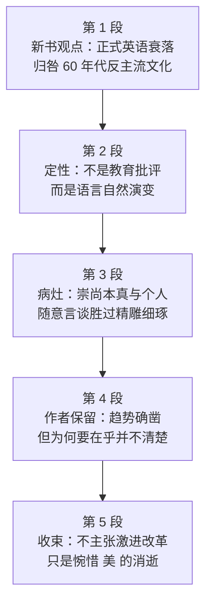

# Passage 38 · 正式英语的退场

## 答题记录

| 轮次  | 日期         | 题号  | 正确  | 错误  | 正确率 | 用时    | 错题归因 |
| --- | --- | --- | --- | --- | --- | --- | --- |
| 1 |  | 1-5 |  |  |  |  |  |
| 2 |  | 1-5 |  |  |  |  |  |
| 3 |  | 1-5 |  |  |  |  |  |

> [!tip] 填写口径
> - **用时**以分钟计，只计做题时间，不含精读复盘。
> - **错题归因**填「题型·错误类型」，如：细节题·原词拼凑、猜词题·未找反义对应、类比题·喻体本体错位。
> - 纵向看趋势：正确率升而用时过长 → 熟练度不足；用时降而正确率波动 → 定位不稳。
> - 本篇 5 题，题号栏填 1-5；第 5 题是**类比题（A is to B as C is to D）**，错因建议单列「类比题·喻体本体未转换」——关键在于先找出本体（paper plates ↔ china 各自指什么）再对选项。

> [!info] 文章档案
> - **来源**：考研英语（一）2005 年 Text 4
> - **题材**：社会生活（语言文化 × 教育）——书评体议论文，借约翰·麦克沃特的新书谈正式英语的衰落及其文化根源
> - **结构**：5 段 / 17 句 ＋ 5 题（按句号断句与行首缩进实测，与解析引用的「第一段③句」「第二段②句后半句」「第三段最后一句」「第四段③句」「第四段④句」「第五段②句」全部吻合）
> - **难度**：★★★★☆
> - **一句话主旨**：麦克沃特认为正式英语的衰落是 1960 年代反主流文化「做自己的事」的必然结果——作为语言学家他承认这是自然的语言演变、不值得惋惜，但作为文化评论者他又为「失去了美的东西」而遗憾：我们如今是用「纸盘子」而非「瓷盘子」盛放英语。

## 一、篇章脉络

- **第 1 段**：抛出麦克沃特新书的核心论断——美国人不再要求公众人物**娴熟地驾驭英语**，自己也不再以此为目标；他把正式英语的衰落归咎于 **1960 年代反主流文化的得势**（第 1 题的战场）。
- **第 2 段**：**先破后立**地划清界限：把责任推给「放纵的 60 年代」并不新鲜，但这**不是又一次批评教育滑坡**；麦克沃特的学术专长是语言史，他认为 whom 的消失是自然的，就像古英语格词尾的消失一样不足为惜（第 1 题的答案句）。
- **第 3 段**：真正的病灶——对「本真」与「个人化」的崇拜（doing our own thing）**葬送了**正式演讲、写作、诗歌与音乐；1960 年代前即便是中等文化程度的人动笔也追求高雅腔调，此后最受推崇的文字反倒追求把口语搬到纸上（第 2 题的战场）。
- **第 4 段**：作者的**保留与反问**：麦克沃特所记录的趋势确凿无误，但**为何我们要在乎**（副标题里那个问题）却不清楚；作为语言学家他承认包括黑人英语在内的所有语言变体都极具表现力，也不认同「说话不规范就让人无法清晰思考」的说法（第 3 题的战场）。
- **第 5 段**：收束与抒情：俄国人背诵诗歌、意大利政客讲究辞藻（第 4 题的战场）；麦克沃特承认正式语言并非必不可少、也不主张激进的教育改革，他惋惜的是**美的消逝甚于用的丧失**——我们现在是用「纸盘子」而非「瓷盘子」盛放英语（第 5 题的战场）。

> [!tip] 行文逻辑
> 全篇是典型的**书评结构**：「新书观点 → 划清界限 → 指出病灶 → 保留质疑 → 收束抒情」。两条张力贯穿全篇：**「自然演变」与「文化损失」**（to be natural ↔ grieving over the loss of something beautiful）、**「talking」与「speaking」**（随意言谈 ↔ 精雕细琢）。读这类文章要分清**三层声音**：作者本人、麦克沃特（书作者）、「很多人」（as many do）——第 3 题考的正是「麦克沃特不同意很多人」。本篇五题的落点非常规整：**一段一题，第 5 题落在末段末两句的比喻上**，是「按段命题」的教科书样本。

## 二、逐段精读

### 第 1 段 · 新书观点：正式英语的衰落该怪谁

**原文**

① Americans no longer expect public figures, whether in speech or in writing, to command the English language with skill and gift.
② Nor do they aspire to such command themselves.
③ In his latest book, Doing Our Own Thing: The Degradation of Language and Music and Why We Should, Like, Care, John McWhorter, a linguist and controversialist of mixed liberal and conservative views, sees the triumph of 1960s counter-culture as responsible for the decline of formal English.

**译文**

① 美国人不再期待公众人物——无论是在演讲中还是在写作中——能够娴熟而富有天赋地驾驭英语这门语言。
② 他们自己也不再渴望拥有这样的驾驭能力。
③ 在他最新的著作《做我们自己的事：语言与音乐的退化，以及我们为何应该、呃、在乎》中，身为语言学家、兼持自由与保守观点而好辩的约翰·麦克沃特，把 1960 年代反主流文化的得势视为正式英语衰落的原因。

> [!note] 段落要点
> - 功能：**亮出新书的核心论断**，是第 1 题的唯一战场。
> - ①②句「**expect... nor... aspire**」双层否定式：公众人物不再被要求，普通人也不再自我要求——衰落是**双向的**，不只是「水平下降」。
> - ③句是本段乃至全篇的**信息密度最高句**：书名（副标题里的 Why We Should, Like, Care 在第 4 段②句被回扣）、作者身份（linguist ／ controversialist ／ mixed views）、核心因果（triumph of 1960s counter-culture **as responsible for** the decline of formal English）。
> - 注意 **see A as responsible for B**（把 A 视为 B 的原因）这个结构：第 1 题的 C、D 两个干扰项都在这根因果链上做手脚——C 把因果方向颠倒（衰落→引发争议），D 把「60 年代文化的胜利」换成「60 年代大众态度的改变」。

#### 长难句 · 本段

> [!abstract] 本段第 ③ 句 · In his latest book, Doing Our Own Thing: The Degradation of Language and Music and Why We Should, Like, Care, John McWhorter, a linguist and controversialist of mixed liberal and conservative views, sees the triumph of 1960s counter-culture as responsible for the decline of formal English.

**结构拆解**

- **句首状语**：In his latest book, Doing Our Own Thing: The Degradation of Language and Music and Why We Should, Like, Care（书名作 book 的同位语；冒号后是副标题）
- **主干**：John McWhorter... **sees** the triumph of 1960s counter-culture **as responsible for** the decline of formal English
  - 主语 John McWhorter；同位语 a linguist and controversialist of mixed liberal and conservative views（of mixed... 修饰 controversialist）
  - 谓语 see A as B（认为 A 是 B）；A ＝ the triumph of 1960s counter-culture；B ＝ responsible for the decline of formal English
- **结构**：triumph n. 胜利、得势；counter-culture n. 反主流文化；decline n. 衰落

**参考译文**

在他最新的著作《做我们自己的事：语言与音乐的退化，以及我们为何应该、呃、在乎》中，身为语言学家、兼持自由与保守观点而好辩的约翰·麦克沃特，把 1960 年代反主流文化的得势视为正式英语衰落的原因。

> [!tip] 拆解要点
> 抓三处：①**书名同位语**极长（Doing Our Own Thing: ... Why We Should, Like, Care），读时先跳过，抓住主干 John McWhorter sees A as B；书名里的 **Why We Should, Like, Care** 是个文字游戏——like 既是「喜欢」又是口语里的填充词「呃／那个」，这正是作者在下文中反复调侃的「随意」；②**see A as responsible for B** 是「把 A 当作 B 的成因」，等价于 attribute B to A，命题人最爱在这根因果链上做方向手脚；③**a linguist and controversialist of mixed liberal and conservative views** 这一串同位语是作者故意给出的「立场提示」——一个左右观点兼具的人，结论才不至于被简单归为保守派的牢骚，这也是第 2 段「这不是又一次批评教育滑坡」的伏笔。命题角度：第 1 题的 A、C、D 三项都是把本句的个别词（radical education reforms ／ counter-culture ／ 1960s）抠出来重组，却丢掉了 **sees...as responsible for** 这层因果——**凡选项是把原文的词重新拼装却不成逻辑的，一律排除**。

#### 本段重点词汇

| 单词 / 短语 | 词性 | 文中意 | 常用考义与拓展 | 英文示例搭配（中译） |
| --- | --- | --- | --- | --- |
| **public figures** | n. | 公众人物 | figure n. 人物、数字、身材、图形（四义高频）；public figure ＝ 知名人士 | expect public figures to command the English language（期待公众人物驾驭英语） |
| **whether in speech or in writing** | 短语 | 无论是在演讲中还是在写作中 | whether A or B 无论 A 还是 B（让步连词）；speech n. 演说；writing n. 写作、文字 | command the language whether in speech or in writing（无论口头还是笔头都能驾驭这门语言） |
| **command** | v./n. | 掌握，运用自如；驾驭 | 熟词僻义：命令、指挥 →（对语言的）掌握、驾驭；command of English 英语功底；have a good command of 精通 | command the English language with skill and gift（娴熟而富天赋地驾驭英语） |
| **skill and gift** | n. | 技巧与天赋 | gift n. 天赋（＝talent）；亦作「礼物」；gifted adj. 有天赋的 | with skill and gift（凭借技巧与天赋） |
| **aspire to** | 短语 | 渴望，追求，有志于 | aspire v. 渴望；aspiration n. 抱负；aspire to sth / aspire to do sth | Nor do they aspire to such command themselves.（他们自己也不再追求这样的驾驭能力。） |
| **latest** | adj. | 最新的，最近的 | late 的最高级；the latest book / news 新书、最新消息；注意 last（上一个的）与 latest（最新的）不同 | in his latest book（在他最新的著作中） |
| **degradation** | n. | 退化，堕落，降格 | degrade v. 使降级、使退化；degrading adj. 有辱人格的；grade n. 等级 | the degradation of language and music（语言与音乐的退化） |
| **linguist** | n. | 语言学家 | linguistic adj. 语言学的；linguistics n. 语言学；bilingual adj. 双语的 | a linguist and controversialist（一位语言学家兼好辩者） |
| **controversialist** | n. | 好辩者，引发争议的人 | controversy n. 争议；controversial adj. 有争议的；-ist 表「从事……的人」 | a controversialist of mixed liberal and conservative views（一位观点兼收左右的好辩之士） |
| **of mixed liberal and conservative views** | 短语 | 自由与保守观点兼具的 | liberal adj. 自由派的／开明的；conservative adj. 保守的；mixed adj. 混合的 | a controversialist of mixed liberal and conservative views（观点兼有自由与保守色彩的好辩者） |
| **see A as B** | 短语 | 认为 A 是 B；把 A 视为 B | ＝regard A as B / view A as B；see A as responsible for B 把 A 视为 B 的成因 | sees the triumph of 1960s counter-culture as responsible for the decline（把 60 年代反主流文化的得势视为衰落的原因） |
| **triumph** | n./v. | 胜利，得势／获胜 | triumph over 战胜；triumphant adj. 凯旋的、得意洋洋的； victory 侧重「战胜」，triumph 侧重「大获全胜、得势」 | the triumph of 1960s counter-culture（60 年代反主流文化的得势） |
| **counter-culture** | n. | 反主流文化，反正统文化 | counter- 前缀表「反、逆」：counterattack 反击、counterbalance 制衡 | the triumph of 1960s counter-culture（60 年代反主流文化的胜利） |
| **be responsible for** | 短语 | 是……的原因；对……负责 | responsible adj. 负责的／（作表语）作为原因的；responsibility n. 责任 | be responsible for the decline of formal English（是正式英语衰落的原因） |
| **decline** | n./v. | 衰落，下降／婉拒 | a decline in... ……的下降；decline 亦作动词「婉言谢绝」；反义 rise / increase | the decline of formal English（正式英语的衰落） |
| **formal English** | n. | 正式英语 | formal adj. 正式的（反义 informal）；informal English 非正式英语；formality n. 礼节、形式 | the decline of formal English（正式英语的衰落） |

### 第 2 段 · 定性：这不是又一次批评教育滑坡

**原文**

① Blaming the permissive 1960s is nothing new, but this is not yet another criticism against the decline in education.
② Mr. McWhorter's academic speciality is language history and change, and he sees the gradual disappearance of "whom", for example, to be natural and no more regrettable than the loss of the case-endings of Old English.

**译文**

① 把责任推给放纵的 20 世纪 60 年代并不是什么新鲜事，但这并不是又一次针对教育滑坡的批评。
② 麦克沃特先生的学术专长是语言史与语言演变，在他看来，譬如 whom 一词的逐渐消失是自然的，并不比古英语格词尾的消失更令人遗憾。

> [!note] 段落要点
> - 功能：**划清界限**——本书的立场不是保守派的老调重弹（不是批评教育），而是语言学家的专业判断（第 1 题的答案所在）。
> - ①句 **Blaming...is nothing new, but this is not...** 是「承认相似、否定雷同」的经典笔法：先承认「归咎 60 年代」这话别人说过，再用 but 划出本书的独特性。**凡是 but 之后的内容，都是命题重点**。
> - ②句给出**语言学依据**：whom 的消失 ≈ 古英语格词尾的消失，两者都是**自然的**（to be natural）——第 1 题 B 项 is but all too natural 正是对 to be natural 的同义改写。
> - **no more regrettable than** ＝ 不比……更令人遗憾（＝ 同样不值得惋惜），是「比较级表等同」的结构，也是全篇「惋惜但不激烈」基调的语言标记。

#### 长难句 · 本段

> [!abstract] 本段第 ② 句 · Mr. McWhorter's academic speciality is language history and change, and he sees the gradual disappearance of "whom", for example, to be natural and no more regrettable than the loss of the case-endings of Old English.

**结构拆解**

- **分句一**：Mr. McWhorter's academic speciality is language history and change（主系表）
- **分句二**：and he **sees** the gradual disappearance of "whom", for example, **to be natural and no more regrettable than** the loss of the case-endings of Old English
  - 谓语结构 see ＋ 宾语 ＋ (to be) 宾补：sees the disappearance **to be** natural and no more regrettable than...
  - 插入语 for example（举例说明「消失的用法」）
  - 比较结构 **no more...than**：no more regrettable than the loss of... ＝ 不比……的消失更令人遗憾
- **结构**：speciality n. 专长；disappearance n. 消失；case-ending n. 格词尾；Old English 古英语

**参考译文**

麦克沃特先生的学术专长是语言史与语言演变，在他看来，譬如 whom 一词的逐渐消失是自然的，并不比古英语格词尾的消失更令人遗憾。

> [!tip] 拆解要点
> 抓三处：①**see ＋ 宾语 ＋ to be ＋ 宾补**（认为……是……），to be 可省略，这是考研阅读中「观点句」的常用骨架：X sees A to be B；②**for example 是插入语**，读时可整体跳过，主干是 he sees the gradual disappearance of "whom" to be natural and no more regrettable than the loss of the case-endings；③**no more A than B**（不比 B 更 A，即 A 与 B 一样不……）是常考的比较结构——这里「whom 的消失」与「古英语格词尾的消失」一样**都不值得惋惜**，正是「自然演变」的论据。命题角度：本句是第 1 题 B 项的直接依据，is but all too natural ↔ to be natural；A 项（radical education reforms）把第 5 段②句的 proposes no radical education reforms 搬到此处，属**段落错位的原词拼装**。

#### 本段重点词汇

| 单词 / 短语 | 词性 | 文中意 | 常用考义与拓展 | 英文示例搭配（中译） |
| --- | --- | --- | --- | --- |
| **blame** | v./n. | 归咎，责怪 | blame sb for sth 因某事责怪某人；be to blame for 应对……负责；blame sth on sb 把……归咎于某人 | Blaming the permissive 1960s is nothing new.（把责任推给放纵的 60 年代并非新鲜事。） |
| **permissive** | adj. | 宽容的，放任的 | permit v. 允许；permission n. 许可；permissive society 放纵型社会；1960s 在英语语境中常与 permissive 搭配 | the permissive 1960s（放纵的 20 世纪 60 年代） |
| **nothing new** | 短语 | 不是什么新鲜事，老生常谈 | ＝not new；There is nothing new in... ……并无新意 | Blaming the permissive 1960s is nothing new.（归咎于 60 年代并非新鲜事。） |
| **yet another** | 短语 | 又一个，再一个 | yet 在此表「再、又」（yet another chance 又一次机会）；another ＋ 单数名词 | this is not yet another criticism against the decline in education（这不是又一次针对教育滑坡的批评） |
| **criticism** | n. | 批评，评论 | critic n. 批评家；critical adj. 批评的／关键的；criticize v. 批评；criticism against/of 对……的批评 | criticism against the decline in education（针对教育滑坡的批评） |
| **decline in education** | n. | 教育水准的下降 | decline in sth 某方面的下降；educational standards 教育水准 | not yet another criticism against the decline in education（并非又一次批评教育滑坡） |
| **academic speciality** | n. | 学术专长 | academic adj. 学术的；speciality（美 specialty）n. 专长、专业；specialize in 专攻 | Mr. McWhorter's academic speciality is language history and change（麦克沃特先生的学术专长是语言史与演变） |
| **language history and change** | n. | 语言史与语言演变 | change 在此为名词「演变、变化」；historical linguistics 历史语言学 | his academic speciality is language history and change（他的专长是语言史与语言变迁） |
| **gradual** | adj. | 逐渐的，渐进的 | gradually adv. 逐渐地；反义 abrupt 突变的、sudden 突然的 | the gradual disappearance of "whom"（whom 一词的逐渐消失） |
| **disappearance** | n. | 消失，消亡 | disappear v. 消失；appearance n. 出现、外表；dis- 否定前缀 | the gradual disappearance of "whom"（whom 的逐渐消失） |
| **for example** | 短语 | 例如，譬如 | ＝for instance / e.g.；作插入语时可整体跳过 | the disappearance of "whom", for example（譬如 whom 的消失） |
| **no more regrettable than** | 短语 | 并不比……更令人遗憾 | no more A than B ＝ 和 B 一样不 A；regrettable adj. 令人遗憾的；regret v./n. 后悔 | no more regrettable than the loss of the case-endings（并不比格词尾的消失更令人遗憾） |
| **case-ending** | n. | 格词尾，屈折词尾 | case n.（语法）格；ending n. 词尾；the nominative case 主格 | the loss of the case-endings of Old English（古英语格词尾的消失） |
| **Old English** | n. | 古英语 | 公元 5—11 世纪的英语；对比 Middle English 中古英语、Modern English 现代英语 | the case-endings of Old English（古英语的格词尾） |

### 第 3 段 · 病灶：崇尚「本真」葬送了正式语体

**原文**

① But the cult of the authentic and the personal, "doing our own thing", has spelt the death of formal speech, writing, poetry and music.
② While even the modestly educated sought an elevated tone when they put pen to paper before the 1960s, even the most well regarded writing since then has sought to capture spoken English on the page.
③ Equally, in poetry, the highly personal, performative genre is the only form that could claim real liveliness.
④ In both oral and written English, talking is triumphing over speaking, spontaneity over craft.

**译文**

① 然而，对「本真」与个人化的崇拜——即「做我们自己的事」——已经葬送了正式的演讲、写作、诗歌与音乐。
② 20 世纪 60 年代以前，即便是受教育程度平平的人在动笔写作时也追求高雅的腔调；而自那以后，即便是最受推崇的文字，也转而追求把口语搬到纸面上。
③ 同样地，在诗歌领域，那种高度个人化、重在表演的类型，是唯一还能称得上真正有生气的体裁。
④ 无论是在口头英语还是书面英语中，随意言谈正战胜优雅的言辞，自然发挥也正战胜精雕细琢。

> [!note] 段落要点
> - 功能：**点出真正的病灶**——不是教育，而是 60 年代对「本真／个人化」的崇拜（第 2 题的战场）。
> - ①句 **spelt the death of**（招致……的死亡）是 spell 的熟词僻义（拼写 → 招致、意味着），语气极重，与第 2 段「不足为惜」的克制形成对照——说明作者对**文化层面**的损失是有情绪的。
> - ②句的 **While ＋ 前后对照**是全篇最漂亮的对比句：过去（before the 1960s）「中等文化程度者 → 追求高雅腔调」，现在（since then）「最受推崇的文字 → 追求口语入书面」，两头都用 even 加强，落差一目了然。
> - ④句 **A is triumphing over B, C over D** 是「对举＋省略」结构（spontaneity over craft ＝ spontaneity is triumphing over craft），也是第 2 题的答案句：**talking ↔ speaking 是反义对举**，故 talking ＝ informality。

#### 长难句 · 本段

> [!abstract] 本段第 ① 句 · But the cult of the authentic and the personal, "doing our own thing", has spelt the death of formal speech, writing, poetry and music.

**结构拆解**

- **主干**：the cult of the authentic and the personal... has **spelt** the death of formal speech, writing, poetry and music
  - 主语 the cult of the authentic and the personal（of 短语修饰 cult；the ＋ 形容词 authentic / personal 表抽象概念「本真者、个人化者」）
  - 插入语 "doing our own thing"（作 the authentic and the personal 的同义解释，呼应书名）
  - 谓语 has spelt（现在完成时，spell 的过去分词为 spelt／spelled）
  - 宾语 the death of formal speech, writing, poetry and music（四项并列）
- **结构**：cult n. 崇拜、风靡；authentic adj. 真实的、本真的；spell v. 招致、意味着

**参考译文**

然而，对「本真」与个人化的崇拜——即「做我们自己的事」——已经葬送了正式的演讲、写作、诗歌与音乐。

> [!tip] 拆解要点
> 抓三处：①**the ＋ 形容词表抽象概念**（the authentic 「本真之物」、the personal「个人化的东西」），与 Passage 37 的 the old and infirm 属同一用法，只是后者指人、这里指抽象品质；②**spell 的熟词僻义**——不是「拼写」而是「招致、意味着」（spell disaster 招致灾难、spell the end of 意味着……的终结），是本段的情绪高点；③**四项并列宾语**（formal speech, writing, poetry and music）说明损失的是**整个正式文化**，不止语言——这正是第 4 段②句「为何我们要在乎」的反问对象。命题角度：本句给出了「衰落的真正原因」，第 1 题 D 项 brought about changes in public attitudes 把这里的因果（崇拜本真 → 正式语体死亡）偷换成「衰落 → 大众态度改变」，属**因果方向倒置**。

> [!abstract] 本段第 ② 句 · While even the modestly educated sought an elevated tone when they put pen to paper before the 1960s, even the most well regarded writing since then has sought to capture spoken English on the page.

**结构拆解**

- **从句（While 引导的对比状语从句）**：While even the modestly educated **sought** an elevated tone when they put pen to paper before the 1960s
  - 主语 the modestly educated（the ＋ 过去分词式形容词表一类人）
  - 时间状语从句 when they put pen to paper（put 过去式仍为 put）
- **主句**：even the most well regarded writing since then **has sought** to capture spoken English on the page
  - 主语 the most well regarded writing；谓语 has sought to do；宾语 to capture spoken English on the page
- **对照骨架**：While even A（过去）did X, even B（现在）has done Y —— 双 even 强化反差
- **结构**：elevated adj. 高雅的、抬高的；capture v. 捕捉、再现

**参考译文**

20 世纪 60 年代以前，即便是受教育程度平平的人在动笔写作时也追求高雅的腔调；而自那以后，即便是最受推崇的文字，也转而追求把口语搬到纸面上。

> [!tip] 拆解要点
> 抓三处：①**While 此处不是「当……时」而是「而、然而」**（对比连词），判断依据是两个分句内容为反义对照；②**the ＋ 形容词／分词表一类人**（the modestly educated 受教育不多的人、the most well regarded 最受推崇的），前者指人、后者指作品，说明英语里「the ＋ adj.」的所指要靠语境判定；③**capture spoken English on the page**（把口语捕捉到纸面上）是全文最凝练的一句——正式英语衰落的**技术性定义**就是「书面语口语化」。命题角度：本句支撑第 2 题的语义场（spoken ↔ formal），但**不是答案句**——答案句在末句 talking 与 speaking 的对举上。

> [!abstract] 本段第 ④ 句 · In both oral and written English, talking is triumphing over speaking, spontaneity over craft.

**结构拆解**

- **状语**：In both oral and written English（both A and B 结构）
- **分句一**：talking is **triumphing over** speaking（现在进行时，表正在发生的趋势）
- **分句二**：spontaneity (is triumphing) over craft（**省略谓语**，与分句一并列）
- **结构**：oral adj. 口头的（反义 written）；spontaneity n. 自发、即兴；craft n. 技艺、精雕细琢

**参考译文**

无论是在口头英语还是书面英语中，随意言谈正战胜优雅的言辞，自然发挥也正战胜精雕细琢。

> [!tip] 拆解要点
> 抓三处：①**并列句谓语省略**（spontaneity over craft ＝ spontaneity **is triumphing** over craft），补回省略部分才能读懂；②**talking 与 speaking 的对比不是同义反复**——speaking 指「讲究的言辞／正式演讲」，talking 指「随意聊天」，二者在本句中是**反义对举**（由 triumphing over「战胜、压倒」可知方向相反）；③**现在进行时 is triumphing over** 表「正在取胜的趋势」，与第 4 段①句 the trend... is unmistakable 呼应。命题角度：本句是第 2 题的答案句——**猜词题的标准解法是「找反义／同义对举的那一半」**，talking 的释义由 speaking（formal）反推为 informality；三个干扰项 modesty / personality / liveliness 都是把本段别的词（modestly / the personal / liveliness）抠出来做**同域词干扰**。

#### 本段重点词汇

| 单词 / 短语 | 词性 | 文中意 | 常用考义与拓展 | 英文示例搭配（中译） |
| --- | --- | --- | --- | --- |
| **cult** | n. | 崇拜，风靡一时的风尚 | cult of... ……的崇拜；cult film 邪典电影；cultivate v. 培养（形近） | the cult of the authentic and the personal（对本真与个人化的崇拜） |
| **authentic** | adj. | 真实的，本真的，原汁原味的 | authenticity n. 真实性；author n. 作者（同源词根）；反义 fake / artificial | the cult of the authentic（对本真性的崇拜） |
| **spell** | v. | 招致，意味着（常指坏结果） | 熟词僻义：拼写 → 招致；spell disaster / spell the end of sth 意味着……的终结；过去式／分词 spelt 或 spelled | has spelt the death of formal speech（葬送了正式语体） |
| **the death of** | 短语 | ……的终结／消亡 | the death of formal speech 正式语体的死亡；death n. 死亡、终结 | spelt the death of formal speech, writing, poetry and music（葬送了正式的演讲、写作、诗歌与音乐） |
| **formal speech** | n. | 正式语体，讲究的言辞 | formal adj. 正式的；speech n. 演说、言辞；written English 书面英语 | spelt the death of formal speech（葬送了正式语体） |
| **the modestly educated** | n. | 受教育程度一般的人 | the ＋ adj./分词 表一类人；modestly adv. 适度地、不多地；modest adj. 谦虚的／不大的 | even the modestly educated sought an elevated tone（即便是受教育不多的人也追求高雅腔调） |
| **elevated tone** | n. | 高雅的语调，端庄的文风 | elevate v. 提升；elevated adj. 抬高的、高雅的；tone n. 语调、格调 | sought an elevated tone（追求高雅的腔调） |
| **put pen to paper** | 短语 | 动笔写，下笔 | ＝start writing；pen n. 笔（亦作动词「写」） | when they put pen to paper（当他们动笔写作时） |
| **well regarded** | adj. | 受推崇的，受器重的 | regard v. 看待／n. 关注；be well regarded 受到好评；regarding prep. 关于 | the most well regarded writing（最受推崇的文字） |
| **capture** | v./n. | 捕捉，再现；俘虏 | capture sth on the page 把……搬到纸面上；capture one's attention 吸引注意力 | capture spoken English on the page（把口语捕捉到纸面上） |
| **equally** | adv. | 同样地，平等地 | equal adj. 相等的；equality n. 平等；equally important 同样重要的是 | Equally, in poetry...（同样地，在诗歌领域……） |
| **performative** | adj. | 表演性的，重在演出的 | perform v. 表演、执行；performance n. 表演、表现；performative genre 重在表演的体裁 | the highly personal, performative genre（高度个人化、重在表演的体裁） |
| **genre** | n. | （文艺的）体裁，类型 | 源自法语，读作 /ˈʒɒnrə/；genre painting 风俗画；literary genre 文学体裁 | the performative genre is the only form（表演性体裁是唯一的形式） |
| **liveliness** | n. | 生动，活力，生气 | lively adj. 活泼的；live v. 生活／adj. 现场的；liveliness 为 live 的派生名词 | claim real liveliness（称得上真正有生气） |
| **claim** | v./n. | 赢得（注意、认可）；声称 | 熟词僻义：声称 → 值得、赢得（claim attention 值得关注）；claim to do 自称做…… | the only form that could claim real liveliness（唯一称得上真正有生气的形式） |
| **oral** | adj. | 口头的，口语的 | oral English 英语口语；oral exam 口试；反义 written 书面的 | in both oral and written English（在口头与书面英语中） |
| **triumph over** | 短语 | 胜过，压倒 | triumph n./v. 胜利、获胜；triumph over adversity 战胜逆境 | talking is triumphing over speaking（随意言谈正战胜优雅言辞） |
| **spontaneity** | n. | 自发，即兴，自然流露 | spontaneous adj. 自发的、即兴的；spontaneously adv. 自发地 | spontaneity over craft（自然发挥胜过精雕细琢） |
| **craft** | n./v. | 技艺，精雕细琢／精心制作 | craftsman n. 工匠；handicraft n. 手工艺；craft n. 工艺、手艺；handicraft n. 手工艺；craft 亦作动词「精心制作」 | spontaneity over craft（即兴胜过匠心） |

### 第 4 段 · 保留：趋势确凿，但为何要在乎

**原文**

① Illustrated with an entertaining array of examples from both high and low culture, the trend that Mr. McWhorter documents is unmistakable.
② But it is less clear, to take the question of his subtitle, why we should, like, care.
③ As a linguist, he acknowledges that all varieties of human language, including non-standard ones like Black English, can be powerfully expressive—there exists no language or dialect in the world that cannot convey complex ideas.
④ He is not arguing, as many do, that we can no longer think straight because we do not talk proper.

**译文**

① 麦克沃特先生所记录的这一趋势，配以一系列取自高雅文化与通俗文化的有趣例证，是确凿无误的。
② 然而，借用他副标题里的那个问题来说，「我们为何应该、呃、在乎」却并不那么清楚。
③ 作为语言学家，他承认人类的各种语言变体——包括像黑人英语这样的非标准变体——都可能极具表现力：世上不存在无法传达复杂思想的语言或方言。
④ 他并不像许多人那样主张：因为说话不规范，我们就再也无法清晰地思考。

> [!note] 段落要点
> - 功能：作者对麦克沃特的**保留与追问**——趋势没问题，「为何要在乎」却没说清（第 3 题的战场）。
> - ①句先**肯定**（unmistakable），②句再**反问**（it is less clear）——「先扬后抑」的评书笔法，与第 2 段①句同型。
> - ②句的 **like** 是口语填充词（「呃、那个」），作者故意把它塞进自己的句子里调侃，与书名副标题 Why We Should, Like, Care 呼应。
> - ③④句是全段核心，也是**三层声音**的分水岭：③句是麦克沃特**承认**的（所有变体都有表现力），④句是麦克沃特**否认**的（不同意「说话不规范就无法清晰思考」）——第 3 题 A 项正由④句反推得出，B、D 两项则踩在③句的「无比较」和「无最优秀」上。

#### 长难句 · 本段

> [!abstract] 本段第 ① 句 · Illustrated with an entertaining array of examples from both high and low culture, the trend that Mr. McWhorter documents is unmistakable.

**结构拆解**

- **句首过去分词短语作状语**：Illustrated with an entertaining array of examples from both high and low culture（逻辑主语＝主句主语 the trend）
  - illustrated with 配有……插图的／用……来说明的
  - an array of examples 一系列例子；from both high and low culture 来自高雅与通俗文化
- **主干**：the trend **that** Mr. McWhorter documents **is** unmistakable
  - 主语 the trend ＋ 定语从句 that Mr. McWhorter documents（that 作 documents 的宾语）
  - 系表 is unmistakable
- **结构**：array n. 一批、一系列；document v. 记录、记述；unmistakable adj. 明确无误的

**参考译文**

麦克沃特先生所记录的这一趋势，配以一系列取自高雅文化与通俗文化的有趣例证，是确凿无误的。

> [!tip] 拆解要点
> 抓三处：①**过去分词短语置于句首作状语**，逻辑主语必须与主句主语一致（此处是 the trend「被配以例证来说明」），还原后相当于 The trend is illustrated with... ；②**定语从句 that Mr. McWhorter documents** 中的 document 是动词「记录、记述」（熟词僻义：文件 → 记录），这是考研高频的名词转动词；③**high and low culture**（高雅文化与通俗文化）对举，说明例证覆盖面广，故结论 unmistakable（不会看错）。命题角度：本句是作者对麦克沃特的**肯定部分**，第 4 段整体是「肯定＋反问」结构；凡题干问 author's attitude 而段落里出现先肯定后反问的，答案多半是**有保留**而非全盘否定。

> [!abstract] 本段第 ③ 句 · As a linguist, he acknowledges that all varieties of human language, including non-standard ones like Black English, can be powerfully expressive—there exists no language or dialect in the world that cannot convey complex ideas.

**结构拆解**

- **句首介词短语**：As a linguist（作为语言学家，表身份／立场）
- **主干**：he **acknowledges that**...（that 引导宾语从句）
  - 宾从主干：all varieties of human language... **can be** powerfully expressive
  - 插入语 including non-standard ones like Black English（ones 指代 varieties）
- **破折号后的补充说明**：there **exists** no language or dialect in the world **that** cannot convey complex ideas
  - there exists no...that...cannot... ＝ 不存在不能……的……（双重否定表全部肯定）
  - 定语从句 that cannot convey complex ideas 修饰 language or dialect
- **结构**：variety n. 变体、种类；dialect n. 方言；convey v. 传达

**参考译文**

作为语言学家，他承认人类的各种语言变体——包括像黑人英语这样的非标准变体——都可能极具表现力：世上不存在无法传达复杂思想的语言或方言。

> [!tip] 拆解要点
> 抓三处：①**破折号后是「换一种说法重申」**，不是新信息——前半句说「都有表现力」，后半句用双重否定再说一遍「没有哪种不能表达复杂思想」，**凡读到破折号后的重申句，可用来检验前半句的理解是否正确**；②**双重否定表全部肯定**（there exists no... that cannot... ＝ 所有……都能……），是考研阅读的常见修辞；③**ones 指代 varieties**（including non-standard ones ＝ 非标准的变体），代词指代的还原是细节题的必查动作。命题角度：本句是第 3 题 B、D 两项的排除依据——原文只说「都有表现力」，**没有比较**（故 B 的 more expressive than 错），也**没有说哪种最能表达**（故 D 的 best convey 错）。**凡原文是「都……」而选项出现比较级或最高级的，一律是强加比较。**

> [!abstract] 本段第 ④ 句 · He is not arguing, as many do, that we can no longer think straight because we do not talk proper.

**结构拆解**

- **主干**：He is not **arguing that**...（他并不主张……）
  - 否定在主句：not arguing that...（**否定转移**型，实际否定的是从句内容）
- **插入语**：as many do（正如许多人那样做的——＝ as many people argue）
- **宾从**：that we can no longer think straight **because** we do not talk proper
  - 主句 we can no longer think straight；原因状语从句 because we do not talk proper
  - talk proper ＝ speak properly（proper 在此为副词用法，美式口语）
- **结构**：think straight 思路清晰；talk proper 说话规范（口语体）

**参考译文**

他并不像许多人那样主张：因为说话不规范，我们就再也无法清晰地思考。

> [!tip] 拆解要点
> 抓三处：①**as many do 是插入语**，其中 do 替代前面的 argue，读时可跳过，主干是 He is not arguing that...；②**talk proper 是口语体的 proper**（＝properly），作者故意用不规范的说法来演示「不规范也能传情」，与第 3 段④句 talking 一脉相承；③**否定在主句、语义否定从句**（He is not arguing that... ＝ 他并不认为……），英语里 think / believe / argue / suppose 的否定常前移，理解时要还原到从句。命题角度：本句是第 3 题 A 项的直接依据——麦克沃特**不认同**「说话方式影响逻辑思维」，故「逻辑思维与说话方式未必相关」正是他会同意的说法。**凡题干问 X would most likely agree，答案常常是 X 明确否认的命题的反面形式。**

#### 本段重点词汇

| 单词 / 短语 | 词性 | 文中意 | 常用考义与拓展 | 英文示例搭配（中译） |
| --- | --- | --- | --- | --- |
| **illustrated with** | 短语 | 用……来说明，配有……例证 | illustrate v. 说明、给……配插图；illustration n. 例证、插图 | Illustrated with an entertaining array of examples（配有一系列有趣的例证） |
| **entertaining** | adj. | 有趣的，引人发笑的 | entertain v. 招待、使娱乐；entertainment n. 娱乐 | an entertaining array of examples（一系列饶有趣味的例子） |
| **an array of** | 短语 | 一系列，大批 | array n. 排列、一批；an array of choices 一系列选择 | an array of examples from both high and low culture（取自雅俗两类文化的一系列例证） |
| **high and low culture** | 短语 | 高雅文化与通俗文化 | high culture 精英文化；low culture 大众／通俗文化；popular culture 流行文化 | examples from both high and low culture（取自高雅与通俗文化的例子） |
| **document** | v./n. | 记录，记述／文件 | 熟词僻义：文件 →（动词）实录、记述；documentary n. 纪录片 | the trend that Mr. McWhorter documents（麦克沃特所记录的趋势） |
| **unmistakable** | adj. | 明确无误的，不会看错的 | mistake n. 错误；mistakable 易弄错的；un- 否定前缀；unmistakably adv. 显而易见地 | the trend is unmistakable（这一趋势确凿无疑） |
| **it is less clear** | 短语 | 不太清楚，尚不明朗 | it is clear that... 显然……；less ＋ 原级表程度降低 | it is less clear why we should care（我们为何该在乎却不太清楚） |
| **subtitle** | n./v. | 副标题／加副标题 | sub- 前缀表「副、次、下」：subtitle、subway、subconscious | to take the question of his subtitle（借用他副标题里的那个问题） |
| **acknowledge** | v. | 承认；致谢 | acknowledge that... 承认……；be acknowledged as 被公认为；acknowledgement n. 承认 | he acknowledges that all varieties of human language can be expressive（他承认人类各种语言变体都有表现力） |
| **varieties of** | 短语 | 各种各样的…… | variety n. 种类、变体；a variety of 各种各样的；vary v. 变化；various adj. 各种的 | all varieties of human language（人类的各种语言变体） |
| **non-standard** | adj. | 非标准的，不规范的 | standard n./adj. 标准（的）；standard English 标准英语；non- 否定前缀 | non-standard ones like Black English（像黑人英语这样的非标准变体） |
| **Black English** | n. | 黑人英语 | ＝African American Vernacular English（AAVE）；美国英语的重要方言变体 | non-standard ones like Black English（诸如黑人英语的非标准变体） |
| **powerfully** | adv. | 强有力地，极大地 | powerful adj. 强大的；power n. 力量、权力 | can be powerfully expressive（可能极具表现力） |
| **expressive** | adj. | 有表现力的，富于表情的 | express v. 表达；expression n. 表达、表情；expressiveness n. 表现力 | all varieties of human language can be powerfully expressive（各种语言变体都极具表现力） |
| **dialect** | n. | 方言，土语 | dialectal adj. 方言的；local dialect 当地方言；accent 口音（≠ 方言） | no language or dialect in the world（世上没有任何语言或方言） |
| **convey** | v. | 传达，表达；运送 | convey ideas / meanings 传达思想／意义；conveyance n. 运输 | convey complex ideas（传达复杂的思想） |
| **complex ideas** | n. | 复杂的思想 | complex adj. 复杂的／n. 综合体；complexity n. 复杂性；simple 反义 | that cannot convey complex ideas（无法传达复杂思想的） |
| **think straight** | 短语 | 思路清晰，有条理地思考 | straight adv. 直地、清楚地；think straight ＝ think clearly | we can no longer think straight（我们再也无法清晰地思考） |
| **talk proper** | 短语 | 说话规范，讲标准语 | proper adj. 恰当的；此处作副词用法（口语体）＝properly；properly speaking 严格来说 | because we do not talk proper（因为我们说话不规范） |

### 第 5 段 · 收束：只是惋惜「美」的消逝

**原文**

① Russians have a deep love for their own language and carry large chunks of memorized poetry in their heads, while Italian politicians tend to elaborate speech that would seem old-fashioned to most English-speakers.
② Mr. McWhorter acknowledges that formal language is not strictly necessary, and proposes no radical education reforms—he is really grieving over the loss of something beautiful more than useful.
③ We now take our English "on paper plates instead of china".
④ A shame, perhaps, but probably an inevitable one.

**译文**

① 俄国人对自己的语言怀有深厚的热爱，脑中装着大段大段背诵下来的诗歌；而意大利的政治家们则往往讲究辞藻铺陈，那在大多数说英语的人听来会显得过时。
② 麦克沃特承认，正式语言并非绝对必需，他也不主张任何激进的教育改革——他其实是在为某种「美甚于用」的东西的消逝而惋惜。
③ 如今我们盛放英语用的是「纸盘子」而不是「瓷盘子」。
④ 这或许是件憾事，但大概也是一件不可避免的事。

> [!note] 段落要点
> - 功能：**收束＋抒情**，是全篇情感与主旨的落点（第 4、5 题的战场）。
> - ①句两个**他者镜像**：俄国人（背诵诗歌）与意大利政客（讲究辞藻）——他们仍在坚持正式语体，与英语世界的「纸盘子」形成对照。作者提到他们时的态度是**欣赏**（第 4 题 B 项）。
> - ②句 **not strictly necessary ＋ proposes no radical education reforms**：麦克沃特的克制——他承认「用」的一面不重要，故不主张改革；③—④句随即转折到「美」的一面。
> - ③句 **paper plates vs china** 是全篇最著名的比喻：纸盘子**能用**（functional），瓷盘子**兼有美感**（artistic）——第 5 题 C 项的来源。
> - ④句 **A shame, perhaps, but probably an inevitable one** 一锤定音：惋惜（a shame）但不激烈（perhaps / probably），与第 2 段「不足为惜」的克制首尾呼应。

#### 长难句 · 本段

> [!abstract] 本段第 ① 句 · Russians have a deep love for their own language and carry large chunks of memorized poetry in their heads, while Italian politicians tend to elaborate speech that would seem old-fashioned to most English-speakers.

**结构拆解**

- **分句一**：Russians **have** a deep love for their own language **and carry** large chunks of memorized poetry in their heads
  - 两个并列谓语 have... 与 carry...
- **连词 while**：表**对比**（而……），不是「当……时」
- **分句二**：Italian politicians **tend to** elaborate speech **that** would seem old-fashioned to most English-speakers
  - 定语从句 that would seem old-fashioned to most English-speakers 修饰 speech
  - elaborate 此处为形容词「精心铺陈的、讲究辞藻的」
- **结构**：chunks of 大块、大量；memorized poetry 背诵的诗歌；elaborate adj. 精心制作的

**参考译文**

俄国人对自己的语言怀有深厚的热爱，脑中装着大段大段背诵下来的诗歌；而意大利的政治家们则往往讲究辞藻铺陈，那在大多数说英语的人听来会显得过时。

> [!tip] 拆解要点
> 抓三处：①**while 在句中表对比**（＝whereas），判断依据是前后为两个不同民族的做法对照，而非同时发生的动作；②**elaborate 是形容词不是动词**——修饰 speech，读作 /ɪˈlæbərət/（作动词时读 /ɪˈlæbəreɪt/，意为「详细阐述」），**同形异读异义**是猜词题的常见考点；③**that would seem old-fashioned to most English-speakers** 中的 would 表「在……看来会」，是**视角限定**（在英语使用者眼中过时，在意大利人眼中则不然）。命题角度：本句是第 4 题的题面，但**答案不在本句内部**——要往下读到②③句（something beautiful ／ grieving over the loss ／ a shame），才能判定作者的态度是「欣赏」而非「感兴趣」「钦佩记忆力」或「蔑视守旧」。**凡题干问 the description of X shows the author's...，答案要从「叙述＋评价语」两处合成。**

> [!abstract] 本段第 ② 句 · Mr. McWhorter acknowledges that formal language is not strictly necessary, and proposes no radical education reforms—he is really grieving over the loss of something beautiful more than useful.

**结构拆解**

- **主干（and 连接两个谓语）**：Mr. McWhorter **acknowledges that**... , and **proposes** no radical education reforms
  - 宾语从句 that formal language is not strictly necessary
  - 宾语 no radical education reforms（no ＋ 名词 ＝ 没有任何……）
- **破折号后**：he is really **grieving over** the loss of something **beautiful more than useful**
  - grieve over 为……而悲痛／惋惜
  - something beautiful more than useful ＝ something that is beautiful rather than useful（后置定语；more than 此处＝rather than「与其说……不如说」）
- **结构**：strictly adv. 严格地、绝对地；radical adj. 激进的、彻底的；reform n./v. 改革

**参考译文**

麦克沃特承认，正式语言并非绝对必需，他也不主张任何激进的教育改革——他其实是在为某种「美甚于用」的东西的消逝而惋惜。

> [!tip] 拆解要点
> 抓三处：①**no ＋ 名词**表完全否定（proposes no radical education reforms 不提出任何激进的教育改革），第 1 题 A 项正是把这里的 radical education reforms 抠出来拼装成「is inevitable in radical education reforms」；②**破折号后是「真正意图」的说明**，前面说的「不主张改革」只是让步，真正的立场在 grieving over；③**beautiful more than useful**（美甚于用）是全篇的**题眼**——「用」的一面不重要（故不主张改革），「美」的一面才值得惋惜，这一句直接决定第 5 题的答案是 functional ↔ artistic。**凡读到 A more than B 的结构，要立刻意识到作者在做「价值排序」，而排序的结果往往是命题的落点。**

#### 本段重点词汇

| 单词 / 短语 | 词性 | 文中意 | 常用考义与拓展 | 英文示例搭配（中译） |
| --- | --- | --- | --- | --- |
| **have a deep love for** | 短语 | 深爱，对……怀有深厚感情 | deep adj. 深的、深厚的；love n./v. 爱；a deep love for one's language 对母语的热爱 | Russians have a deep love for their own language（俄国人深爱自己的语言） |
| **chunks of** | 短语 | 大块，大量 | chunk n. 厚块、相当大的部分；a chunk of time 一大段时间 | carry large chunks of memorized poetry（脑中装着大段背诵的诗歌） |
| **memorized poetry** | n. | 背诵下来的诗歌 | memorize v. 记忆、背诵；memory n. 记忆力（第 4 题 C 项的干扰源）；poetry n. 诗歌（总称） | large chunks of memorized poetry（大段大段背下来的诗） |
| **politician** | n. | 政治家，政客 | politics n. 政治；political adj. 政治的；policy n. 政策（形近） | Italian politicians tend to elaborate speech（意大利政治家往往讲究辞藻） |
| **tend to** | 短语 | 往往，倾向于 | tend v. 趋向、照料；tendency n. 趋势；tend to do 往往会做 | tend to elaborate speech（往往作精心铺陈的演说） |
| **elaborate** | adj./v. | 精心铺陈的，讲究辞藻的／详细阐述 | 形容词读 /ɪˈlæbərət/，动词读 /ɪˈlæbəreɪt/；elaborate plan 周密的计划 | elaborate speech that would seem old-fashioned（显得过时的讲究辞藻的演说） |
| **old-fashioned** | adj. | 老式的，过时的 | old fashion 旧式；fashion n. 时尚；反义 fashionable / modern | would seem old-fashioned to most English-speakers（在英语使用者看来会显得过时） |
| **strictly** | adv. | 严格地，绝对地 | strict adj. 严格的；strictly speaking 严格来说；strictly necessary 绝对必需的 | formal language is not strictly necessary（正式语言并非绝对必需） |
| **propose** | v. | 提议，主张；求婚 | proposal n. 提议、求婚；propose to do 提议做；propose that ＋ (should) do | proposes no radical education reforms（不主张激进的教育改革） |
| **radical** | adj./n. | 激进的，彻底的／激进派 | radical change 根本性变化；radically adv. 彻底地；词根 radic- 根 | no radical education reforms（没有任何激进的教育改革） |
| **education reform** | n. | 教育改革 | reform n./v. 改革、改良；re- （再）＋ form（形成）＝ 重新塑造 | propose no radical education reforms（不提出激进的教育改革） |
| **grieve over** | 短语 | 为……而悲痛／惋惜 | grieve v.（使）悲伤；grief n. 悲痛；grieve over the loss of... 为失去……而伤心 | grieving over the loss of something beautiful（为某种美好事物的消逝而惋惜） |
| **beautiful more than useful** | 短语 | 美甚于用，观赏价值大于实用价值 | A more than B ＝ 与其说 B 不如说 A；more than 此处＝rather than | the loss of something beautiful more than useful（某种美甚于用的东西的消逝） |
| **paper plates** | n. | 纸盘子 | paper plate 一次性纸碟；比喻「能用但不讲究的器皿」 | take our English on paper plates（用纸盘子盛放我们的英语） |
| **china** | n. | 瓷器，瓷餐具 | 熟词僻义：China（中国）→ 小写 china（瓷器）；chinaware 瓷器 | "on paper plates instead of china"（用「纸盘子」而非「瓷盘子」） |
| **a shame** | n. | 憾事，可惜的事 | shame n. 羞耻／憾事；It's a shame that... 真是遗憾……；shameful adj. 可耻的 | A shame, perhaps（或许是件憾事） |
| **inevitable** | adj. | 不可避免的，必然的 | evade v. 逃避；inevitability n. 必然性；inevitable 亦见 Passage 37（death is inevitable） | probably an inevitable one（大概也是不可避免的一件事） |

## 三、全篇重点词汇汇总（自测用）

> [!info] 说明
> 本表只列「单词 / 词性 / 所在段」，不含释义与搭配，用于遮表自测：说出词义后再回该段核对。
> 收录**全篇所有段落词汇，共 85 条，不删减**，与各段「本段重点词汇」等长同源（跨段复现的词只在其首次出现的段落收录一次）。

| 单词 / 短语 | 词性 | 所在段 |
| --- | --- | --- |
| **public figures** | n. | 第 1 段 |
| **whether in speech or in writing** | 短语 | 第 1 段 |
| **command** | v./n. | 第 1 段 |
| **skill and gift** | n. | 第 1 段 |
| **aspire to** | 短语 | 第 1 段 |
| **latest** | adj. | 第 1 段 |
| **degradation** | n. | 第 1 段 |
| **linguist** | n. | 第 1 段 |
| **controversialist** | n. | 第 1 段 |
| **of mixed liberal and conservative views** | 短语 | 第 1 段 |
| **see A as B** | 短语 | 第 1 段 |
| **triumph** | n. | 第 1 段 |
| **counter-culture** | n. | 第 1 段 |
| **be responsible for** | 短语 | 第 1 段 |
| **decline** | n. | 第 1 段 |
| **formal English** | n. | 第 1 段 |
| **blame** | v./n. | 第 2 段 |
| **permissive** | adj. | 第 2 段 |
| **nothing new** | 短语 | 第 2 段 |
| **yet another** | 短语 | 第 2 段 |
| **criticism** | n. | 第 2 段 |
| **decline in education** | n. | 第 2 段 |
| **academic speciality** | n. | 第 2 段 |
| **language history and change** | n. | 第 2 段 |
| **gradual** | adj. | 第 2 段 |
| **disappearance** | n. | 第 2 段 |
| **for example** | 短语 | 第 2 段 |
| **no more regrettable than** | 短语 | 第 2 段 |
| **case-ending** | n. | 第 2 段 |
| **Old English** | n. | 第 2 段 |
| **cult** | n. | 第 3 段 |
| **authentic** | adj. | 第 3 段 |
| **spell** | v. | 第 3 段 |
| **the death of** | 短语 | 第 3 段 |
| **formal speech** | n. | 第 3 段 |
| **the modestly educated** | n. | 第 3 段 |
| **elevated tone** | n. | 第 3 段 |
| **put pen to paper** | 短语 | 第 3 段 |
| **well regarded** | adj. | 第 3 段 |
| **capture** | v./n. | 第 3 段 |
| **equally** | adv. | 第 3 段 |
| **performative** | adj. | 第 3 段 |
| **genre** | n. | 第 3 段 |
| **liveliness** | n. | 第 3 段 |
| **claim** | v./n. | 第 3 段 |
| **oral** | adj. | 第 3 段 |
| **triumph over** | 短语 | 第 3 段 |
| **spontaneity** | n. | 第 3 段 |
| **craft** | n./v. | 第 3 段 |
| **illustrated with** | 短语 | 第 4 段 |
| **entertaining** | adj. | 第 4 段 |
| **an array of** | 短语 | 第 4 段 |
| **high and low culture** | 短语 | 第 4 段 |
| **document** | v./n. | 第 4 段 |
| **unmistakable** | adj. | 第 4 段 |
| **it is less clear** | 短语 | 第 4 段 |
| **subtitle** | n./v. | 第 4 段 |
| **acknowledge** | v. | 第 4 段 |
| **varieties of** | 短语 | 第 4 段 |
| **non-standard** | adj. | 第 4 段 |
| **Black English** | n. | 第 4 段 |
| **powerfully** | adv. | 第 4 段 |
| **expressive** | adj. | 第 4 段 |
| **dialect** | n. | 第 4 段 |
| **convey** | v. | 第 4 段 |
| **complex ideas** | n. | 第 4 段 |
| **think straight** | 短语 | 第 4 段 |
| **talk proper** | 短语 | 第 4 段 |
| **have a deep love for** | 短语 | 第 5 段 |
| **chunks of** | 短语 | 第 5 段 |
| **memorized poetry** | n. | 第 5 段 |
| **politician** | n. | 第 5 段 |
| **tend to** | 短语 | 第 5 段 |
| **elaborate** | adj./v. | 第 5 段 |
| **old-fashioned** | adj. | 第 5 段 |
| **strictly** | adv. | 第 5 段 |
| **propose** | v. | 第 5 段 |
| **radical** | adj./n. | 第 5 段 |
| **education reform** | n. | 第 5 段 |
| **grieve over** | 短语 | 第 5 段 |
| **beautiful more than useful** | 短语 | 第 5 段 |
| **paper plates** | n. | 第 5 段 |
| **china** | n. | 第 5 段 |
| **a shame** | n. | 第 5 段 |
| **inevitable** | adj. | 第 5 段 |

> [!example] 同义替换链（阅读题高频）
> - **sees the triumph of 1960s counter-culture as responsible for the decline of formal English（第 1 段③句）↔ the decline of formal English is but all too natural（第 1 题 B 项）**：题干问「麦克沃特眼中衰落的性质」，答案落在第 2 段②句的 to be natural。
> - **to be natural and no more regrettable than the loss of the case-endings（第 2 段②句）↔ is but all too natural in language development（第 1 题 B 项）**：natural 原词复现，language development 概括 language history and change。
> - **talking is triumphing over speaking（第 3 段④句）↔ informality（第 2 题 D 项）**：由反义对举反推词义，speaking＝formal，故 talking＝informal。
> - **modestly / the personal / liveliness（第 3 段②③句）↔ modesty / personality / liveliness（第 2 题 A、B、C 项）**：同域词干扰——取自本段别的句子，不是被考的词。
> - **He is not arguing... that we can no longer think straight because we do not talk proper（第 4 段④句）↔ Logical thinking is not necessarily related to the way we talk（第 3 题 A 项）**：否定句转肯定表述。
> - **all varieties... can be powerfully expressive（第 4 段③句）↔ Black English can be more expressive than standard English（第 3 题 B 项）**：原文「都有表现力」→ 选项强加比较级。
> - **there exists no language or dialect... that cannot convey complex ideas（第 4 段③句）↔ standard English can best convey complex ideas（第 3 题 D 项）**：原文「都能」→ 选项强加最高级。
> - **Russians... carry large chunks of memorized poetry... Italians... elaborate speech（第 5 段①句）＋ grieving over the loss of something beautiful（第 5 段②句）↔ appreciation of their efforts（第 4 题 B 项）**：叙述＋评价语合成。
> - **on paper plates instead of china（第 5 段③句）↔ "functional" is to "artistic"（第 5 题 C 项）**：喻体→本体的转换。
> - **A shame, perhaps, but probably an inevitable one（第 5 段④句）↔ 作者对衰落的最终态度**：惋惜而不激烈，与第 2 段 no more regrettable 首尾呼应。

> [!warning] 熟词僻义专列
> - **command**：命令、指挥 →（对语言的）**掌握、驾驭**（command the English language）。
> - **spell**：拼写 → **招致、意味着**（spell the death of 葬送……）。
> - **document**：文件 →（动词）**记录、记述**（the trend that Mr. McWhorter documents）。
> - **china**：中国 →（小写）**瓷器、瓷餐具**（paper plates instead of china）。
> - **claim**：声称、索赔 → **赢得、称得上**（claim real liveliness）。
> - **elaborate**：详细阐述（动词）→ **精心铺陈的、讲究辞藻的**（形容词，读音亦不同）。
> - **authentic**：真实的 → **本真的、原汁原味的**（the cult of the authentic）。
> - **cult**：祭仪、教派 → **崇拜、风靡一时**（the cult of the authentic）。
> - **oral**：口的 → **口头的**（反义 written）。
> - **strictly**：严格地 → **绝对地**（not strictly necessary 并非绝对必需）。
> - **radical**：根本的 → **激进的、彻底的**（radical education reforms）。
> - **shame**：羞耻 → **憾事、可惜的事**（A shame, perhaps）。
> - **proper**：恰当的 →（口语副词）**规范地**（talk proper ＝ speak properly）。
> - **array**：排列 → **一批、一系列**（an array of examples）。
> - **gift**：礼物 → **天赋**（with skill and gift）。
> - **figure**（文外补充）：数字／身材／图形 → **人物**（public figures 公众人物）。

## 四、知识点补充

> [!question] 背景知识
> - **约翰·麦克沃特（John McWhorter）**：美国语言学家、哥伦比亚大学教授，专攻语言史与克里奥尔语。他身兼自由派与保守派色彩，常就语言、种族与文化议题发声，故文中称其为 controversialist（好辩者）。他的核心语言学立场是：**语言变化是自然的，无所谓「退化」**。
> - **Doing Our Own Thing（2003）**：本书全名《做我们自己的事：语言与音乐的退化，以及我们为何应该、呃、在乎》。副标题里的 **Like** 是个双关——既是「喜欢」，又是美式口语里的填充词（相当于中文的「那个……」），作者用它来示范「随意」本身。
> - **1960 年代反主流文化（counter-culture）**：指美国 60 年代的嬉皮士、民权、反越战等运动，其核心信条是「做自己的事」「忠于自我」，反对权威与形式。麦克沃特认为正是这股风气让「正式」成了贬义词。
> - **whom 的消失**：whom 是 who 的宾格，现代英语口语中已基本被 who 取代（Whom did you see? → Who did you see?）。古英语则有一整套格词尾（case-endings）来表示主宾与属格，中古英语时期大量脱落——这是「语言简化是自然趋势」的经典例证。
> - **Black English（黑人英语）**：学术上称 African American Vernacular English（AAVE），有完整的语法系统。麦克沃特的专业立场是：它**不是**「错误的英语」，而是规则严整的方言变体，同样能表达复杂思想。
> - **纸盘子与瓷盘子**：纸盘子一次性、能用即弃（functional），瓷盘子精致、可赏可藏（artistic）。作者用这个比喻说明：正式英语的价值不在「用」，而在「美」。

> [!warning] 语法点
> - **Nor ＋ 助动词 ＋ 主语（第 1 段②）**：Nor do they aspire...（他们也不……），否定追加的倒装。
> - **see A as B（第 1 段③）**：认为 A 是 B（as 后接名词／形容词／介词短语）。
> - **书名作同位语（第 1 段③）**：In his latest book, Doing Our Own Thing: ...（冒号引出副标题）。
> - **动名词短语作主语（第 2 段①）**：Blaming the permissive 1960s is nothing new。
> - **see ＋ 宾语 ＋ (to be) 宾补（第 2 段②）**：sees the disappearance to be natural。
> - **no more A than B（第 2 段②）**：和 B 一样不 A（比较级表等同）。
> - **the ＋ 形容词表抽象／一类人（第 3 段①）**：the authentic（本真之物）／the modestly educated（一类人）。
> - **现在完成时 has spelt（第 3 段①）**：强调「已经造成的结果」。
> - **While 表对比（第 3 段②、第 5 段①）**：而……（＝whereas），不是「当……时」。
> - **并列句谓语省略（第 3 段④）**：spontaneity (is triumphing) over craft。
> - **过去分词短语置于句首作状语（第 4 段①）**：Illustrated with...，逻辑主语＝主句主语。
> - **there exists no...that cannot...（第 4 段③）**：双重否定表全部肯定。
> - **插入语 as many do（第 4 段④）**：do 替代前面的 argue。
> - **否定前移（第 4 段④）**：He is not arguing that...（＝ 他并不认为……）。
> - **破折号表补充说明／真实意图（第 4 段③、第 5 段②）**：重申与转折两种用法在本篇同时出现。
> - **A more than B（第 5 段②）**：与其说 B 不如说 A（＝rather than）。
> - **省略式感叹句（第 5 段④）**：A shame, perhaps, but probably an inevitable one（＝ It is a shame...）。

> [!success] 写作可迁移句型
> - **A no longer expect B to do C. Nor do they do it themselves.**：A 不再期待 B 做 C，他们自己也不再如此（双层否定开场）。
> - **Blaming A is nothing new, but this is not yet another criticism against B.**：把责任推给 A 并不新鲜，但这并不是又一次针对 B 的批评（划清界限句）。
> - **X sees A to be natural and no more regrettable than B.**：X 认为 A 是自然的，并不比 B 更令人遗憾（克制表态句）。
> - **The cult of A has spelt the death of B.**：对 A 的崇拜葬送了 B（批评文化现象句）。
> - **While even A did X before..., even B has done Y since then.**：过去连 A 都 X，如今连 B 都 Y（今昔反差句，double even 强化）。
> - **In both A and B, C is triumphing over D, E over F.**：无论 A 还是 B，C 正压倒 D，E 压倒 F（趋势对举句）。
> - **The trend X documents is unmistakable. But it is less clear why...**：X 所记录的趋势确凿无疑，但为何……却不那么清楚（先肯定后反问）。
> - **There exists no...that cannot...**：不存在不能……的……（双重否定强调句）。
> - **X is not arguing, as many do, that...**：X 并不像许多人那样主张……（区分立场句）。
> - **X acknowledges that...and proposes no...—X is really grieving over the loss of something beautiful more than useful.**：X 承认……也不主张……——真正让 X 惋惜的是「美甚于用」之物的消逝（让步＋真实意图句）。

> [!danger] 易混辨析
> - **decline of formal English（正式英语的衰落）≠ decline in education（教育水准的下降）**：第 2 段①句明确把两者分开——本书批评的是前者，不是后者。第 1 题 A 项（radical education reforms）正是把第 5 段的词搬到这里。
> - **talking ≠ speaking**：本组中 speaking 指「讲究的正式言辞」，talking 指「随意言谈」；二者在第 3 段④句中是**反义对举**（由 triumphing over 判定方向）。
> - **expressive（都有表现力）≠ more expressive（更有表现力）≠ best convey（最能传达）**：原文只说「都不差」，任何比较级、最高级都是强加。这是第 3 题 B、D 两项的通病。
> - **paper plates（functional 能用）≠ china（artistic 兼具美感）**：喻体与本体要对应到「用／美」这组对立上，而不是「临时／永久」或「激进／保守」。
> - **formal（正式的）≠ formalist（形式主义的）**：本文的 formal English 指正式语体，不含贬义；作者对其态度是惋惜而非批判。
> - **spelt（spell 的过去分词）≠ spelled**：两种拼写均可，英式更常用 spelt。

## 五、题目分析

> [!info] 题目总览
> | 题号 | 题型 | 定位 | 答案 |
> | --- | --- | --- | --- |
> | 1 | 观点细节题（人物观点） | 第 1 段③句 ＋ 第 2 段②句 | B |
> | 2 | 词义猜测题（单词含义） | 第 3 段④句（Line 5） | D |
> | 3 | 观点推断题（人物会同意哪项） | 第 4 段④句（依据③句） | A |
> | 4 | 观点态度题（作者态度） | 第 5 段①句（态度在②③句） | B |
> | 5 | 类比题（A is to B as C is to D） | 第 5 段③句（喻体）／②句（本体） | C |

### 第 1 题 · 观点细节题（麦克沃特眼中衰落的性质）

> [!question] 原题
> According to McWhorter, the decline of formal English
> - A. is inevitable in radical education reforms.
> - B. is but all too natural in language development.
> - C. has caused the controversy over the counter-culture.
> - D. brought about changes in public attitudes in the 1960s.

**正确答案**：**B. is but all too natural in language development.（只不过是语言发展过程中的自然现象）**

**定位与依据**
- 题干 According to McWhorter ＋ the decline of formal English 定位第 1 段③句：sees the triumph of 1960s counter-culture **as responsible for** the decline of formal English（把 60 年代反主流文化的得势视为衰落的原因）。
- 但③句只交代了「谁造成的」，**性质**要往下读到第 2 段②句：he sees the gradual disappearance of "whom", for example, **to be natural** and no more regrettable than the loss of the case-endings of Old English.
- B 项的 **is but all too natural** 正是对 to be natural 的同义改写，**in language development** 则概括了本句中的 language history and change 与 gradual disappearance——两项合起来就是「语言发展中的自然现象」。
- A 项把第 5 段②句的 **radical education reforms** 搬到了第 1 段：原文是 proposes no radical education reforms（不主张激进改革），与「衰落」毫无因果关系。
- C 项因果方向颠倒：原文是 counter-culture 的**得势导致**衰落，不是衰落**引发**对 counter-culture 的争议（controversy 一词也无着落）。
- D 项把「1960 年代反主流文化的胜利（the triumph of 1960s counter-culture）」偷换成「1960 年代大众态度的改变」，且同样颠倒了因果。
- 书中解析：「根据关键词 McWhorter 和 the decline of formal English 可以定位到第一段③句末 sees the triumph of 1960s counter-culture as responsible for the decline of formal English 和第二段②句后半句 he sees the gradual disappearance of "whom",... to be natural and no more regrettable than the loss of the case-endings of Old English，由此可知，McWhorter 认为一些英语用法的消失是自然的，正式英语的衰落是自然现象，故[B]项正确，而一些英语用法的消失，指的就是正式英语的衰落，所以 is but all too natural 是对第二段②句中的 to be natural 的同义改写。[A]项、[C]项及[D]项均是个别词在原文出现，整个选项代入题干，毫无逻辑，也不符合原文。」

**干扰项分析**

| 选项 | 选项内容 | 判断 | 排除理由 |
| --- | --- | --- | --- |
| A | is inevitable in radical education reforms. | ✗ | 原词拼装＋段落错位：radical education reforms 出自第 5 段②句，且原文为 proposes **no** radical education reforms，与「衰落」无因果关系。 |
| B | is but all too natural in language development. | ✓ | 正确项：第 2 段②句 to be natural 的同义改写；in language development 概括 language history and change。 |
| C | has caused the controversy over the counter-culture. | ✗ | 因果倒置：原文是 counter-culture 的得势**导致**衰落（as responsible for），不是衰落引发争议；controversy 亦无着落。 |
| D | brought about changes in public attitudes in the 1960s. | ✗ | 因果倒置＋偷换概念：原文是 the triumph of 1960s counter-culture，不是 public attitudes；且衰落在时间上晚于 60 年代。 |

> [!tip] 解题思路
> **观点细节题（According to X）的第一步是锁定「谁的观点」**，第二步是区分「说了什么」与「怎么定性」。本题的陷阱极典型：第 1 段③句能定位但**只给原因**，真正决定选项的是第 2 段②句的 to be natural——**凡 According to X 型题干，若首段只给出「归因」，继续往下读到「定性」句再作答**。三个干扰项全部是「把原文的词抠出来重组」：A 取自第 5 段，C、D 取自第 1 段③句却都把因果箭头调转了方向。**判定口诀：选项里的词都眼熟、但整句代入题干读不通的，一律是拼装项。**

### 第 2 题 · 词义猜测题（talking 的含义）

> [!question] 原题
> The word "talking" (Line 5, Paragraph 3) denotes
> - A. modesty.
> - B. personality.
> - C. liveliness.
> - D. informality.

**正确答案**：**D. informality.（非正式）**

**定位与依据**
- 题干给出精确坐标 Line 5, Paragraph 3——第 3 段第 5 印刷行正是末句：In both oral and written English, **talking** is triumphing over speaking, spontaneity over craft.
- 猜词的关键动作是**找与它成对出现的那一半**：句中 talking 与 **speaking** 由 triumphing over（战胜、压倒）连接，说明二者**方向相反**；由全文语境可知 speaking 代表「优雅的、正式的言辞」，故 talking 代表「非正式的、随意的言谈」。
- 同句中的 **spontaneity over craft**（自然发挥胜过精雕细琢）是第二重佐证：spontaneity（即兴）↔ craft（匠心）＝ informal ↔ formal，与 talking ↔ speaking 完全平行。
- 三个干扰项分别取自本段的**邻域词**：A 项的 modesty ← ②句的 modestly educated（那是「程度不多」，不是「谦虚」）；B 项的 personality ← ①句的 the personal（个人化）；C 项的 liveliness ← ③句的 claim real liveliness。它们都在本段出现过，却都不是 talking 的释义。
- 书中解析：「做猜词题应通过上下文寻找相关信息，同时注意逻辑关系词、标点等。根据题干信息定位到第三段最后一句 In both oral and written English, talking is triumphing over speaking, spontaneity over craft（无论是在口语还是在书面英语中，随意言谈胜过优雅的言辞，自然发挥也胜过精雕细琢）。由此可见，talking 与 speaking 两者的意义是相反的。speaking 在文中代表的是正[式]、也就是偏正式的语言，那 talking 指的就是非正式的一些语言，故[D]项为正确答案。采用排除法也可以做出来这道题，[A]项、[B]项和[C]项均是利用文中个别词制造的干扰项，但不符合题意要求。」

**干扰项分析**

| 选项 | 选项内容 | 判断 | 排除理由 |
| --- | --- | --- | --- |
| A | modesty. | ✗ | 同域词干扰：modestly 出现在第 3 段②句 the modestly educated，意为「受教育不多地」，与「谦虚」无关，更不是 talking 的释义。 |
| B | personality. | ✗ | 同域词干扰：the personal 出现在第 3 段①句（个人化），是 cult 的对象，不是 talking 的含义。 |
| C | liveliness. | ✗ | 同域词干扰：liveliness 出现在第 3 段③句（表演性诗歌的生气），是诗歌的特征，不是 talking 的特征。 |
| D | informality. | ✓ | 正确项：由 talking ↔ speaking 的反义对举（triumphing over）推出；与 spontaneity over craft 平行互证。 |

> [!tip] 解题思路
> **猜词题的标准三步**：①按题干给的行号／段号精确定位；②在句中找**成对出现的另一半**（对举或并列），由「同向／反向」标志词判定关系——本题的标志是 **triumphing over（压倒）→ 反义对举**；③把推得的词义代回原句检验。本题的干扰项设计极其工整：A、B、C 三个词（modestly / the personal / liveliness）**全部出自本段**，是典型的「同段邻域词干扰」——**凡猜词题，若某个选项的词就在被考词的前后两句里出现，多半是干扰项**（命题人希望你觉得「眼熟＝对」）。另记：**spontaneity over craft 与 talking over speaking 是同义平行的两句话**，读不懂第一句时可以用第二句反推，这是猜词题的「双保险」。

### 第 3 题 · 观点推断题（麦克沃特最可能同意哪项）

> [!question] 原题
> To which of the following statements would McWhorter most likely agree?
> - A. Logical thinking is not necessarily related to the way we talk.
> - B. Black English can be more expressive than standard English.
> - C. Non-standard varieties of human language are just as entertaining.
> - D. Of all the varieties, standard English can best convey complex ideas.

**正确答案**：**A. Logical thinking is not necessarily related to the way we talk.（逻辑思维未必与我们说话的方式相关）**

**定位与依据**
- 题干问的是**麦克沃特本人的看法**（不是作者、也不是「很多人」），故定位到第 4 段——本段③句是「他承认的」，④句是「他否认的」。
- 答案句在第 4 段④句：He is **not** arguing, as many do, that we can no longer **think straight** because we do not **talk proper**.（他并不像许多人那样主张：因为说话不规范，我们就再也无法清晰地思考。）
- 把这句话的否定去掉、换成正面表述，就是 A 项：「说话方式（the way we talk）」与「逻辑思维（Logical thinking / think straight）」**没有必然联系**。
- B 项踩在第 4 段③句上：原文说 all varieties... **can be powerfully expressive**（都有表现力），**没有比较**；B 项强加了 more...than 的比较级。
- D 项同样踩在③句：原文说 there exists no language or dialect that cannot convey complex ideas（都能传达复杂思想），**没有说谁最行**；D 项强加了 best 的最高级。
- C 项的 entertaining 在第 4 段①句出现过（an entertaining array of examples），但那是形容**例证**有趣，不是说语言变体有趣；文中没有讨论「是否有趣」。
- 书中解析：「该题问的是 McWhorter 的看法，定位到第四段，该段④句说 He is not arguing, as many do, that we can no longer think straight because we do not talk proper（麦克沃特先生不像其他许多人那样认为，说话方式的不规范会让我们无法清楚地思考）。由此可见，逻辑思维并不一定和我们谈话的方式有关，因此[A]项正确。根据第四段③句中的 all varieties of human language, including non-standard ones like Black English, can be powerfully expressive—there exists no language or dialect in the world that cannot convey complex ideas（人类各种各样的语言，包括像黑人英语这样的非标准语言，都具有强大的表达力——世上没有传达不了复杂思想的语言或方言）。由此可知，第一，黑人语言和标准语言一样都具有表现力，二者之间没有比较，故[B]项不正确；第二，所有语言都可以表达复杂的思想，没有谈及哪种语言最能表达复杂的思想，故[D]项不正确。文中没有讨论语言是否有趣的题目，故排除[C]项。」

**干扰项分析**

| 选项 | 选项内容 | 判断 | 排除理由 |
| --- | --- | --- | --- |
| A | Logical thinking is not necessarily related to the way we talk. | ✓ | 正确项：第 4 段④句 He is not arguing...that we can no longer think straight because we do not talk proper 的正面转述。 |
| B | Black English can be more expressive than standard English. | ✗ | 强加比较：第 4 段③句只说 all varieties can be powerfully expressive（都有表现力），未作优劣比较。 |
| C | Non-standard varieties of human language are just as entertaining. | ✗ | 无中生有（偷换修饰对象）：entertaining 在①句中修饰的是 examples（例证有趣），文中未讨论语言变体是否有趣。 |
| D | Of all the varieties, standard English can best convey complex ideas. | ✗ | 强加最高级：③句说 no language or dialect that cannot convey complex ideas（皆能传达），未分高下。 |

> [!tip] 解题思路
> 本题有两个关卡。第一关是**分清三层声音**：作者（第 4 段①②句的反问）、麦克沃特（③④句）、「很多人」（as many do）——题干问的是中间那一层。第二关是**否定句的正面转述**：答案 A 并不是原文原句，而是 He is not arguing that... 去掉否定后的**等价表述**，这类「反话正说」是考研高难题的常客，遇到时要训练自己把 not argue that P 直接读成「¬P」。第三关是**比较级／最高级陷阱**：B 的 more...than、D 的 best 都是原文没有的等级，而原文用的是「全称肯定＋双重否定」（all...／there exists no...that cannot...）——**凡原文是「都一样／都能」而选项出现比较级或最高级的，一律排除**。这一条与 Passage 37 第 3 题的「程度词」规律可以合并记忆：**选项里多出来的那半个等级，就是干扰项的指纹。**

### 第 4 题 · 观点态度题（作者对俄国人背诗的态度）

> [!question] 原题
> The description of Russians' love of memorizing poetry shows the author's
> - A. interest in their language.
> - B. appreciation of their efforts.
> - C. admiration for their memory.
> - D. contempt for their old-fashionedness.

**正确答案**：**B. appreciation of their efforts.（对他们这番努力的欣赏）**

**定位与依据**
- 题干 The description of Russians' love of memorizing poetry 定位第 5 段①句：Russians have a deep love for their own language and carry large chunks of memorized poetry in their heads...
- 但①句只是**叙述**，不含态度——态度要往下读：②句 **grieving over the loss of something beautiful more than useful**（为「美甚于用」之物的消逝而惋惜）、③句 **on paper plates instead of china**（纸盘子而非瓷盘子）、④句 **A shame, perhaps**（或许是个憾事）。
- 把这些评价语连起来：作者认为正式且讲究的语言是「**美的**」，它的消逝是「**憾事**」；那么仍然坚持它的人（俄国人背诗、意大利政客讲辞藻）自然是**值得欣赏的**——故 B 项 appreciation of their efforts。
- C 项卡在 memorized / in their heads 上，把「背诗的文化行为」窄化成「记忆力好」，作者从未评价记忆力。
- A 项（interest 兴趣）与 D 项（contempt 蔑视）在文中均无依据；且 D 项与作者「惋惜美之消逝」的立场正好相反——如果他认为讲究辞藻是守旧可鄙，就不会说 A shame。
- 书中解析：「在第五段中作者提到了俄国人和意大利人对正式用语的强调，并认为他们的语言是『something beautiful』。此外，在第五段中作者还提到『我们现在用纸盘子，而非瓷盘子盛放我们的英语大餐。真是惭愧啊，但很可能这是不可避免的』，显示出作者对正式英语的留恋和不舍，因此作者对俄国人因为深爱自己的语言而背诵诗歌的行为应该是钦佩和赞许的，故[B]项『欣赏他们的努力』为正确选项。[C]项着重强调的是记忆力（memory），故排除；[A]项中的兴趣（interest），[D]项中的守旧（old-fashionedness）均属于无中生有，故排除。」

**干扰项分析**

| 选项 | 选项内容 | 判断 | 排除理由 |
| --- | --- | --- | --- |
| A | interest in their language. | ✗ | 无中生有：作者只说俄国人自己深爱其语言，并未表达「感兴趣」；且 interest 是中性词，与惋惜的基调不符。 |
| B | appreciation of their efforts. | ✓ | 正确项：由①句的叙述 ＋ ②句 something beautiful ／ grieving over ＋ ④句 A shame 合成的正面评价。 |
| C | admiration for their memory. | ✗ | 偷换对象：memory 来自①句的 memorized poetry，但作者欣赏的是「坚持正式语体的行为」，不是记忆力本身。 |
| D | contempt for their old-fashionedness. | ✗ | 与原文相反：old-fashioned 出自①句，但那是「在英语使用者看来」，不是作者的态度；作者明说 A shame，不可能蔑视。 |

> [!tip] 解题思路
> **「the description of X shows the author's...」型态度题，分两步走**：①找到 X 所在的叙述句；②**往下读到评价语（形容词、情感动词、感叹句）**——本题的评价语链是 something beautiful → grieving over → A shame。三个干扰项分别演示了三种经典错法：**窄化**（C，把文化行为窄成记忆力）、**无中生有**（A，interest 文中无着落）、**方向相反**（D，contempt 与 A shame 背道而驰）。另记一处细节：①句的 old-fashioned 带有明确的**视角限定**（would seem old-fashioned **to most English-speakers**），那是英语使用者的看法，不是作者的——**凡带 to sb / in one's eyes 的评价，都要先确认那是谁的视角**，这是 Passage 36 以来反复出现的考点。

### 第 5 题 · 类比题（纸盘子之于瓷盘子）

> [!question] 原题
> According to the last paragraph, "paper plates" is to "china" as
> - A. "temporary" is to "permanent".
> - B. "radical" is to "conservative".
> - C. "functional" is to "artistic".
> - D. "humble" is to "noble".

**正确答案**：**C. "functional" is to "artistic".（「实用的」之于「艺术的」）**

**定位与依据**
- 题干 According to the last paragraph 把范围限定在末段，比喻出现在③句：We now take our English "on paper plates instead of china".
- 类比题的关键是**先把喻体还原成本体**：既然本体是 English（formal English），那么 paper plates 与 china 就是「盛放英语的两种器皿」，其差别要回到**上一句**找——②句末：the loss of something **beautiful more than useful**（某种「美甚于用」之物的消逝）。
- 于是对应关系成立：**paper plates ＝ useful（能用即弃，只满足容器功能）→ functional；china ＝ beautiful（兼有美感）→ artistic**。故 C 项正确。
- A 项（临时／永久）是纸盘子与瓷盘子的**物理属性**，但作者要对比的不是耐用性，而是「用」与「美」；B 项（激进／保守）取自②句的 radical；D 项（卑微／高尚）是把「纸／瓷」的贵贱感翻译成了社会等级——都属**喻体属性误代本体属性**。
- 书中解析：「最后一段②句中提到，麦克沃特先生认为正式的语言并非绝对必不可少，也并不主张彻底的教育改革——他只是为那些欣赏价值大于实用价值的美好事物的消逝而哀叹。所以在接下来的一句话中，作者是在『优美』和『有用』这两个词上做文章。纸盘子有用，可以满足作为容器的需求，而瓷盘子不仅可以盛放东西，还给人以美感，因此选择[C]项。」

**干扰项分析**

| 选项 | 选项内容 | 判断 | 排除理由 |
| --- | --- | --- | --- |
| A | "temporary" is to "permanent". | ✗ | 喻体属性误代：纸盘子确是一次性的，但作者的对比轴是「用／美」而非「耐用／不耐用」。 |
| B | "radical" is to "conservative". | ✗ | 原词拼装：radical 出自②句的 proposes no radical education reforms，与器皿比喻无关。 |
| C | "functional" is to "artistic". | ✓ | 正确项：对应②句 beautiful more than useful——纸盘子 functional（能用），瓷盘子 artistic（兼美）。 |
| D | "humble" is to "noble". | ✗ | 过度引申：纸／瓷确有贵贱之别，但作者强调的是「功能」与「美感」之别，不是等级之别。 |

> [!tip] 解题思路
> **类比题（A is to B as C is to D）的解法是「先还原本体，再找对比轴」**：①定位比喻句，确认喻体在服务什么本体（本题是 English）；②**往上或往下读一句**，找出作者真正要对比的那一组形容词（本题是 beautiful more than useful，即「美／用」）；③把选项的每一对词代入同一条轴检验。最常见的错法是**拿喻体自身的属性去对应**（纸盘子一次性、瓷盘子贵重 → A、D 两项正是这样来的），而正确答案永远是**本体层面的属性**（functional ↔ artistic）。另记：**A more than B 结构出现时，那一组反义词几乎必定是命题的落点**——本篇第 5 题就是这句话的直接产物。

## 六、复盘清单

- [ ] 过汇总表 85 词（逐段 16/14/19/19/17），遮住「所在段」列自测，重点过 16 个熟词僻义（command / spell / document / china / claim / elaborate / authentic / cult / proper / shame 等）
- [ ] 重做 10 个长难句的口头翻译，特别是第 3 段②句（While 对比＋双 even）与第 4 段③句（双重否定 there exists no...that cannot...）
- [ ] 画一张「五段功能表」：①新书观点 ②划清界限 ③指出病灶 ④保留质疑 ⑤收束抒情，并标出五道题的落点（本篇一段一题）
- [ ] 整理本文干扰项类型：原词拼装 ×2、因果倒置 ×2、同域词干扰 ×3、强加比较级 ×1、强加最高级 ×1、无中生有 ×2、偷换对象 ×1、与原文相反 ×1、喻体属性误代 ×2
- [ ] 复记三组构词：non-（non-standard）、un-（unmistakable）、counter-（counter-culture）；以及一对反义对举 talking ↔ speaking、spontaneity ↔ craft
- [ ] 积累三条通用解法：**猜词题找反义对举的另一半**（talking ↔ speaking）；**原文「都／都能」而选项出现比较级或最高级一律排除**；**类比题先还原本体再找对比轴**
- [ ] 把答题记录填进顶部表格，对照正确率决定是否二刷

## 七、关联笔记

- [[Passage37-死亡不是待解的难题]]
- [[考研英语 · 阅读六大题型方法论]]
- [[考研英语 · 熟词僻义汇总]]
