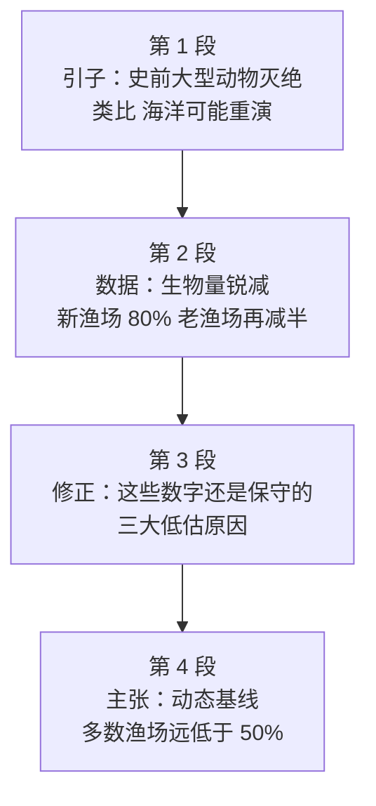

# Passage 39 · 海洋正在被掏空

## 答题记录

| 轮次  | 日期         | 题号  | 正确  | 错误  | 正确率 | 用时    | 错题归因 |
| --- | --- | --- | --- | --- | --- | --- | --- |
| 1 |  | 1-5 |  |  |  |  |  |
| 2 |  | 1-5 |  |  |  |  |  |
| 3 |  | 1-5 |  |  |  |  |  |

> [!tip] 填写口径
> - **用时**以分钟计，只计做题时间，不含精读复盘。
> - **错题归因**填「题型·错误类型」，如：例证题·把例子当论点、推理判断·数量换算错误、主旨题·以偏概全。
> - 纵向看趋势：正确率升而用时过长 → 熟练度不足；用时降而正确率波动 → 定位不稳。
> - 本篇 5 题，题号栏填 1-5；第 2 题是**数字换算题**（80% ＋ 再减半 ＝ 90%），错因建议单列「推理判断·数量换算」；第 5 题可用「高频名词法」兜底，错因写「主旨题·未抓高频词」。

> [!info] 文章档案
> - **来源**：考研英语（一）2006 年 Text 3
> - **题材**：社会生活（生态环境 × 科学报道）——借史前大型动物灭绝引出海洋过度捕捞，评述「动态基线」理论
> - **结构**：4 段 / 22 句 ＋ 5 题（按句号断句与行首缩进实测；与解析引用的「第一段①②③④句」「第二段末两句」「第三段①句＋③句」「最后一段②句＋末两句」及题干「Line 1, Paragraph 3」全部吻合）
> - **难度**：★★★☆☆
> - **一句话主旨**：海洋正在经历与史前大型动物灭绝类似的劫难——大型捕食鱼类的生物量在新渔场开发的头 15 年就减少了 80%，而由于技术先进、过去的数据偏低，实际损失还要更大；因此渔业管理必须以「动态基线」取代僵死的参照标准。

## 一、篇章脉络

- **第 1 段**：**引子**。史前人类一到新大陆，大型动物就灭绝了，小型物种存活；大型、生长慢的动物是**容易得手的猎物**，很快被猎杀至绝迹。末句一转：**如今类似的事可能正发生在海洋里**（第 1 题的答案句）。
- **第 2 段**：**数据**。海洋被过度捕捞早就是共识，迈尔斯与沃尔姆两位研究者揭示的是**变化有多快**：半个世纪的数据显示，新渔场在被开发的头 15 年里，大型捕食鱼类的生物量平均减少 **80%**；而在一些老渔场，此后**又减半**（第 2 题的战场）。
- **第 3 段**：**修正**。沃尔姆承认这些数字**还是保守的**，并给出三大原因：技术先进（现在捞得更多）、过去钩少鱼多（漏捕）、过去鲨鱼多（抢食）。结论是——**实际损失比数据更大**（第 3 题的答案句）。
- **第 4 段**：**主张**。两位研究者提出他们的工作给出了**正确的基线**，支持海洋生物学界流行的「**动态基线**」概念：人们因为只回望很短的一段时间，才没察觉海洋发生的巨变；而理论显示，当目标物种的生物量约为原始水平的 **50%** 时渔场产量最大，多数渔场**远低于此**（第 4、5 题的战场）。

> [!tip] 行文逻辑
> 全篇是**科学报道型**的「**引子 → 数据 → 修正 → 主张**」四段式，读起来像一篇 Nature 论文的科普改写。三条线索贯穿全篇：**类比**（something similar／the same threat）、**生物量（biomass）**（全篇出现 6 次，第 5 题的答案词）、**低估**（conservative／underestimate／fail to detect）。本篇的命题格局与 Passage 38 不同，**不是一段一题**：第 1 题考引子的功能，第 2、3 题都扎在第 2—3 段的数字上，第 4、5 题同在第 4 段。**特别提醒第 5 题**：书中给出的兜底解法是「**高频名词法**」——某个较特殊的名词在文中反复出现、又频繁出现在题干与选项里，含它的选项多半就是答案（本篇是 biomass）。这条方法在考场上定位不到主旨时非常好用。

## 二、逐段精读

### 第 1 段 · 引子：史前大型动物灭绝的旧事

**原文**

① When prehistoric man arrived in new parts of the world, something strange happened to the large animals: they suddenly became extinct.
② Smaller species survived.
③ The large, slow-growing animals were easy game, and were quickly hunted to extinction.
④ Now something similar could be happening in the oceans.

**译文**

① 当史前人类抵达世界上新的地方时，大型动物身上发生了某种奇怪的事情：它们突然灭绝了。
② 体型较小的物种存活了下来。
③ 那些体型大、生长缓慢的动物是容易得手的猎物，于是很快被猎杀至绝迹。
④ 如今，类似的事情可能正发生在海洋之中。

> [!note] 段落要点
> - 功能：**用史前旧事引出海洋议题**，是第 1 题的唯一战场。全段 4 句，**①②③句是例子本身，④句才是论点**。
> - ①句的冒号引出解释（something strange happened to the large animals: they suddenly became extinct），这是英语科普文常用的「悬念—揭示」句式。
> - ③句给出灭绝的**机制**：体型大 ＋ 生长慢 ＝ 容易得手（easy game）→ 很快被猎尽。这个机制正是它与海洋大型鱼类的**可类比之处**。
> - ④句的 **something similar could be happening** 是全文的「题眼」：similar 说明作者在**类比**，could be happening 说明这是**推测**（不是既成事实）——第 1 题 C 项的 may face the same threat 正由此而来。
> - 注意 **could be happening** 的委婉语气：科学报道中凡出现 may / could / likely / seems，都是**可能性表述**，选项里若换成肯定陈述（is happening）即为过度推断。

#### 长难句 · 本段

> [!abstract] 本段第 ① 句 · When prehistoric man arrived in new parts of the world, something strange happened to the large animals: they suddenly became extinct.

**结构拆解**

- **时间状语从句**：When prehistoric man **arrived in** new parts of the world
- **主句**：something strange **happened to** the large animals（something ＋ 形容词后置；happen to sb 发生在某人／某物身上）
- **冒号后**：they suddenly became extinct（**解释前句的 something strange**，相当于一个省略了 that is 的说明句）
- **结构**：prehistoric adj. 史前的；extinct adj. 灭绝的（作表语）

**参考译文**

当史前人类抵达世界上新的地方时，大型动物身上发生了某种奇怪的事情：它们突然灭绝了。

> [!tip] 拆解要点
> 抓三处：①**something ＋ 形容词**（something strange／something similar）是英语的固定后置修饰，读时按「奇怪的某件事」理解；②**冒号在此表「解释说明」**，冒号后的 they suddenly became extinct 是「something strange」的具体内容，不是新论点；③**happen to**（发生在……身上）与 take place in（发生在某地）不同，前者接受影响的对象。命题角度：本句与②③句共同构成第 1 题所说的 example，**例子本身不是答案**——第 1 题的 A、B 两项（易受环境影响／小物种存活）都能在①②③句里点对点找到，却都是例子内容。**例证题的铁律：例子服务于它支撑的论点，本段论点在末句。**

#### 本段重点词汇

| 单词 / 短语 | 词性 | 文中意 | 常用考义与拓展 | 英文示例搭配（中译） |
| --- | --- | --- | --- | --- |
| **prehistoric** | adj. | 史前的，有文字记载以前的 | pre- 前缀表「前、先」：prehistoric、predict 预测、preview 预览；history n. 历史 | prehistoric man（史前人类） |
| **arrive in** | 短语 | 抵达（较大的地方） | arrive in ＋ 大地方／arrive at ＋ 小地方；arrival n. 到达 | prehistoric man arrived in new parts of the world（史前人类抵达世界上的新地方） |
| **extinct** | adj. | 灭绝的，绝迹的 | extinction n. 灭绝（第 1 题题干词）；extinct volcano 死火山；distinct adj. 截然不同的（形近） | they suddenly became extinct（它们突然灭绝了） |
| **species** | n. | 物种（单复数同形） | 读作 /ˈspiːʃiːz/；a species of... 一种……；specimen n. 标本 | Smaller species survived.（体型较小的物种存活了下来。） |
| **survive** | v. | 幸存，存活／比……活得长 | survival n. 幸存；survivor n. 幸存者；survive on 靠……维生 | Smaller species survived.（较小的物种存活下来。） |
| **slow-growing** | adj. | 生长缓慢的 | 复合形容词：副词＋现在分词；对比 fast-growing 快速生长的、slow-moving 行动缓慢的 | the large, slow-growing animals（体型大、生长缓慢的动物） |
| **easy game** | n. | 容易得手的猎物 | game n. 猎物（不可数）、游戏、比赛；fair game 可攻击的对象 | the large animals were easy game（大型动物是容易得手的猎物） |
| **hunt...to extinction** | 短语 | 猎杀至灭绝 | hunt v./n. 狩猎、搜寻（hunt for a job 找工作）；hunter n. 猎人 | were quickly hunted to extinction（很快被猎杀至绝迹） |
| **something similar** | 短语 | 类似的事情 | similar adj. 相似的（be similar to）；similarity n. 相似性；something ＋ adj. 后置修饰 | something similar could be happening（类似的事情可能正在发生） |
| **ocean** | n. | 海洋（常用复数 the oceans） | oceanic adj. 海洋的；the Pacific Ocean 太平洋；sea 海（较小） | happening in the oceans（发生在海洋中） |
| **happen to** | 短语 | 发生在……身上 | happen to do 碰巧做；It happens that... 碰巧……；happen 无被动 | something strange happened to the large animals（大型动物身上发生了奇怪的事） |

### 第 2 段 · 数据：生物量锐减的证据

**原文**

① That the seas are being overfished has been known for years.
② What researchers such as Ransom Myers and Boris Worm have shown is just how fast things are changing.
③ They have looked at half a century of data from fisheries around the world.
④ Their methods do not attempt to estimate the actual biomass (the amount of living biological matter) of fish species in particular parts of the ocean, but rather changes in that biomass over time.
⑤ According to their latest paper published in Nature, the biomass of large predators (animals that kill and eat other animals) in a new fishery is reduced on average by 80% within 15 years of the start of exploitation.
⑥ In some long-fished areas, it has halved again since then.

**译文**

① 海洋正在遭到过度捕捞，这一点多年来已为人所知。
② 兰塞姆·迈尔斯与鲍里斯·沃尔姆等研究者所揭示的，恰恰是事情变化得有多快。
③ 他们查阅了来自世界各地渔场的半个世纪的数据。
④ 他们的研究方法并不试图估算海洋特定区域中鱼类物种的实际生物量（即存活的生物物质总量），而是估算那些生物量随时间发生的变化。
⑤ 根据他们发表在《自然》杂志上的最新论文，一个新渔场中的大型捕食鱼类（即捕杀并吞食其他动物的动物）的生物量，在被开发的头 15 年里平均减少了 80%。
⑥ 而在一些长期捕捞的海域，此后又减少了一半。

> [!note] 段落要点
> - 功能：**给出核心数据**，是第 2 题的战场。
> - ①②句先**让步再推进**：「过度捕捞早就是共识（has been known for years）」，新发现在于**变化的速度**（just how fast things are changing）——这是科学报道的典型笔法，「旧知 + 新知」。
> - ④句的 **not...but rather...**（不是……而是……）交代了研究方法的特点：**不测绝对量、只测变化量**。这一点至关重要——它解释了为什么下文要说「数字偏保守」，也是第 3 题 C 项（实际损失更大）的逻辑前提。
> - ⑤⑥句是**数字题的核心**：新渔场 15 年减 80%（剩 20%），老渔场**在此之后再减半**（20% → 10%），即比原始水平减少了 **90%**。第 2 题 A 项正是这个两步换算的结果。
> - 括号里的 **(the amount of living biological matter)** 与 **(animals that kill and eat other animals)** 是编者给 biomass 与 predators 下的**通俗定义**——读科普文时，括号释义往往就是命题点，务必读进去。

#### 长难句 · 本段

> [!abstract] 本段第 ② 句 · What researchers such as Ransom Myers and Boris Worm have shown is just how fast things are changing.

**结构拆解**

- **主语从句**：**What** researchers such as Ransom Myers and Boris Worm **have shown**（what 在从句中作 shown 的宾语，＝ the thing that）
- **系动词**：is
- **表语从句**：**just how fast** things are changing（how fast 引导；just 表强调「恰恰、正是」）
- **插入的同位举例**：such as Ransom Myers and Boris Worm（＝ researchers like...）
- **结构**：researcher n. 研究者；show v. 表明、揭示

**参考译文**

兰塞姆·迈尔斯与鲍里斯·沃尔姆等研究者所揭示的，恰恰是事情变化得有多快。

> [!tip] 拆解要点
> 抓三处：①**What 引导的主语从句**（What...have shown is...），what ＝ the thing that，在从句中**充当成分**（此处作 shown 的宾语），与 that 引导的主语从句（that 不作成分）要分清；②**such as 举例插入**，读时可先跳过，主干是 What researchers have shown is how fast things are changing；③**just 在此表强调**（正是、恰恰），暗示「内容不新鲜，新鲜的是程度」。命题角度：本句是科学报道的「新知句」，与第 4 题 D 项的 changing situation 遥相呼应；也提示本篇的重心不是「是否过度捕捞」，而是「**变化有多快、基线该怎么定**」。

> [!abstract] 本段第 ④ 句 · Their methods do not attempt to estimate the actual biomass (the amount of living biological matter) of fish species in particular parts of the ocean, but rather changes in that biomass over time.

**结构拆解**

- **主干**：Their methods do **not** attempt to estimate A, **but rather** B
  - A ＝ the actual biomass (the amount of living biological matter) of fish species in particular parts of the ocean
  - B ＝ changes in that biomass over time
- **括号成分**：the amount of living biological matter（**biomass 的同位释义**）
- **后置定语**：of fish species ／ in particular parts of the ocean（双重限定 actual biomass）
- **结构**：attempt to do 试图做；estimate v. 估算；but rather 而是（＝instead）

**参考译文**

他们的研究方法并不试图估算海洋特定区域中鱼类物种的实际生物量（即存活的生物物质总量），而是估算那些生物量随时间发生的变化。

> [!tip] 拆解要点
> 抓三处：①**not A but rather B**（不是 A 而是 B），but rather 比单纯的 but 更书面、语气更强，是考研阅读的高频对比标志；②**括号＝通俗释义**（biomass ＝ the amount of living biological matter），科普文常给术语配括号定义，**凡遇括号先读括号**，它往往是理解全篇的关键；③**in particular 此处是「特定的」而非「尤其」**——in particular parts of the ocean ＝ 海洋的特定区域，这是 in particular 的**熟词僻义**（形容词用法）。命题角度：本句交代了「只测变化、不测绝对值」的方法论，是第 3 题的重要前提：既然测的是相对变化，而过去的基准被低估，那么**实际损失必然大于账面数字**。

> [!abstract] 本段第 ⑤ 句 · According to their latest paper published in Nature, the biomass of large predators (animals that kill and eat other animals) in a new fishery is reduced on average by 80% within 15 years of the start of exploitation.

**结构拆解**

- **句首状语**：According to their latest paper **published** in Nature（过去分词 published 作后置定语，修饰 paper）
- **主干**：the biomass of large predators... **is reduced** on average by 80%
  - 主语 the biomass of large predators **in a new fishery**
  - 括号释义 animals that kill and eat other animals（定语从句作 predators 的同位释义）
  - 谓语 is reduced（被动）；程度状语 on average by 80%
- **时间状语**：within 15 years of the start of exploitation（＝ within 15 years after... 开始后的 15 年内）
- **结构**：predator n. 捕食者（反义 prey 猎物）；exploitation n. 开发、利用

**参考译文**

根据他们发表在《自然》杂志上的最新论文，一个新渔场中的大型捕食鱼类（即捕杀并吞食其他动物的动物）的生物量，在被开发的头 15 年里平均减少了 80%。

> [!tip] 拆解要点
> 抓三处：①**过去分词作后置定语**（paper published in Nature ＝ 发表在《自然》上的论文），相当于 paper which was published...；②**被动语态 is reduced by 80%**（被减少了 80%），注意 by 引出**幅度**，to 才引出**终点**（reduced to 20% ＝ 减少到 20%）；③**within 15 years of the start of exploitation**（自开发开始后的 15 年内）——of 在此相当于 after。命题角度：本句是第 2 题的**第一层数据**（减 80% → 剩 20%），必须再往下读⑥句（老渔场**再减半** → 20% × 1/2 ＝ 10% → 累计减少 90%）才能选出 A 项。**数字题的通病是只读一半就下笔**，本题的 B、C 两项正是分别取自「80%」与「20%」这两个半成品数字。

#### 本段重点词汇

| 单词 / 短语 | 词性 | 文中意 | 常用考义与拓展 | 英文示例搭配（中译） |
| --- | --- | --- | --- | --- |
| **overfish** | v. | 过度捕捞 | over- 前缀表「过度」：overfish、overuse 过度使用、overestimate 高估（第 3 段的 underestimate 是其反义） | the seas are being overfished（海洋正遭到过度捕捞） |
| **researcher** | n. | 研究者 | research n./v. 研究；research into 研究……；注意 researcher 与 scholar（人文学者）的语域差别 | researchers such as Ransom Myers and Boris Worm（诸如迈尔斯与沃尔姆的研究者） |
| **just how fast** | 短语 | 究竟／恰恰有多快 | just 表强调；how ＋ adj./adv. 引导表语从句（how fast things are changing） | what they have shown is just how fast things are changing（他们揭示的正是变化有多快） |
| **half a century** | n. | 半个世纪，五十年 | half a ＋ 单数名词（half an hour）；a century ＝ 100 years | half a century of data（半个世纪的数据） |
| **data** | n. | 数据，资料 | datum 的复数（现多作不可数／集合名词）；data from... 来自……的数据 | data from fisheries around the world（来自全球渔场的数据） |
| **fishery** | n. | 渔场；渔业 | fish v. 捕鱼／n. 鱼；fishing n. 捕鱼业；fisheries（复数）渔业 | in a new fishery（在一个新渔场中） |
| **attempt to** | 短语 | 试图，尝试 | attempt n./v. 尝试（make an attempt to do）；attempted adj. 未遂的 | do not attempt to estimate the actual biomass（并不试图估算实际生物量） |
| **estimate** | v./n. | 估算，估计 | under- 前缀表「不足」：underestimate、underfund（见 Passage 37）、understate 轻描淡写；反义 overestimate 高估 | estimate the actual biomass（估算实际生物量） |
| **actual** | adj. | 实际的，真实的 | actually adv. 实际上（口语高频）；actual 强调「与估算／名义相对的真实」 | the actual biomass（实际的生物量） |
| **biomass** | n. | 生物量（单位面积内生物的总量） | bio- 前缀表「生命」：biology 生物学、biography 传记；mass n. 质量、总量 | the biomass of large predators（大型捕食鱼类的生物量） |
| **the amount of living biological matter** | 短语 | 存活的生物物质总量 | the amount of ＋ 不可数名词；living adj. 存活的；biological adj. 生物的 | biomass (the amount of living biological matter)（生物量，即存活生物物质的总量） |
| **in particular** | 短语 | 特定的（形容词用法） | 熟词僻义：作状语时＝especially 尤其；作定语时＝specific 特定的（in particular parts） | in particular parts of the ocean（在海洋的特定区域） |
| **but rather** | 短语 | 而是（用于否定之后引出对照） | ＝instead；not A but rather B 不是 A 而是 B | not the actual biomass, but rather changes in that biomass（不是实际生物量，而是其变化） |
| **over time** | 短语 | 随时间推移，久而久之 | over 表「贯穿」：over the years 多年来；over time 强调动态变化 | changes in that biomass over time（那些生物量随时间的变化） |
| **latest paper** | n. | 最新的论文 | paper n. 论文、报纸、试卷、纸（四义高频）；latest adj. 最新的（见 Passage 38） | their latest paper published in Nature（他们发表在《自然》上的最新论文） |
| **publish** | v. | 发表，出版 | publication n. 出版物；publisher n. 出版商；publish in... 发表于…… | published in Nature（发表在《自然》杂志上） |
| **predator** | n. | 捕食者，捕食性动物 | prey n. 猎物（第 3 段同现）；predatory adj. 掠夺性的；predator-prey 捕食者—猎物 | the biomass of large predators（大型捕食者的生物量） |
| **on average** | 短语 | 平均而言 | average n./adj./v. 平均（的）；above/below average 高于／低于平均 | is reduced on average by 80%（平均减少了 80%） |
| **exploitation** | n. | 开发，利用；剥削 | exploit v. 开发、利用／剥削；exploitation of resources 资源开发 | within 15 years of the start of exploitation（自开发开始后的 15 年内） |

### 第 3 段 · 修正：这些数字还是保守的

**原文**

① Dr. Worm acknowledges that these figures are conservative.
② One reason for this is that fishing technology has improved, Today's vessels can find their prey using satellites and sonar, which were not available 50 years ago.
③ That means a higher proportion of what is in the sea is being caught, so the real difference between present and past is likely to be worse than the one recorded by changes in catch sizes.
④ In the early days, too, longlines would have been more saturated with fish.
⑤ Some individuals would therefore not have been caught, since no baited hooks would have been available to trap them, leading to an underestimate of fish stocks in the past.
⑥ Furthermore, in the early days of longline fishing, a lot of fish were lost to sharks after they had been hooked.
⑦ That is no longer a problem, because there are fewer sharks around now.

**译文**

① 沃尔姆博士承认，这些数字是保守的。
② 其中一个原因在于捕鱼技术已经进步，今天的船只能借助卫星与声呐找到猎物，而这些装备在 50 年前是没有的。
③ 这意味着海中被捕获的比例更高，因此现在与过去之间的真实差距，很可能比捕捞量变化所记录的那个差距更糟。
④ 同样地，在早期，延绳钓的钓线上挂满鱼的情况本会更加常见。
⑤ 因此，有些鱼就不会被捕获，因为不会有带饵的鱼钩去诱捕它们——这导致过去鱼类资源量被低估。
⑥ 此外，在延绳钓的早期，许多鱼在被钩住之后被鲨鱼吃掉了。
⑦ 这已不再是问题了，因为如今周围的鲨鱼少多了。

> [!note] 段落要点
> - 功能：**修正数据**——账面数字还是低估的，是第 3 题的战场。结构极清晰：**①句亮观点，②—⑦句给出三大原因**。
> - ①句 **conservative**（保守的、偏低的）是第 3 题的被考词。它的意思是「**把损失说小了**」，即实际损失**更大**——这一点直接对应 C 项 has suffered a greater loss。
> - **原因一**（②③句）：技术先进 → 现在捞得多 → 真实差距比捕捞量记录的大。
> - **原因二**（④⑤句）：过去鱼多钩少 → 有些鱼没被钩住 → **低估了过去的鱼量** → 一减一加，实际减幅更大。
> - **原因三**（⑥⑦句）：过去鲨鱼多，抢吃掉已上钩的鱼 → 又一层低估；如今鲨鱼少了，这问题不存在了。
> - **逻辑链务必理清**：低估的是「**过去**的鱼量」，而过去是参照基准——基准被低估，算出来的「减幅」就偏小，所以**实际损失更大**。这是第 3 题最难的一步。
> - 排版提示：②句中书上印作 `has improved, Today's vessels`（逗号连接两个完整句，属逗号粘连；规范写法应为句号）。本笔记按书中所印照录，并按书上的句序编号；若按句号严格断句，②句会拆成两句，其后各句顺推一位。

#### 长难句 · 本段

> [!abstract] 本段第 ② 句 · One reason for this is that fishing technology has improved, Today's vessels can find their prey using satellites and sonar, which were not available 50 years ago.

**结构拆解**

- **主干**：One reason for this **is that**...（that 引导表语从句）
- **表语从句内部（两层）**：
  - 层一：fishing technology has improved（主谓）
  - 层二：Today's vessels can find their prey **using** satellites and sonar（现在分词短语作方式状语）
- **非限制性定语从句**：**which** were not available 50 years ago（which 指代 satellites and sonar；非限定性，只补充不限定）
- **结构**：vessel n. 船只（正式用语）／血管；prey n. 猎物；available adj. 可获得的

**参考译文**

其中一个原因在于捕鱼技术已经进步，今天的船只能借助卫星与声呐找到猎物，而这些装备在 50 年前是没有的。

> [!tip] 拆解要点
> 抓三处：①**One reason for this is that...**（原因之一是……）是列举原因的开场句式，读到它就要预期**后面还有原因**（本篇共三个）；②**using satellites and sonar 是现在分词作方式状语**（＝by using...），逻辑主语是 vessels；③**which 引导的非限定性定语从句**此处指代的是**前面整个名词短语**（satellites and sonar），不是 vessels——判定依据是谓语 were（复数）与「50 years ago 没有」这一语义。命题角度：本句是第 3 题 A 项（fishing technology has improved rapidly）的**出处**，但 A 项是**原因本身**而非 conservative 的含义，属「因果倒置型干扰」——**题干问 X means，选项答 X 的原因，答非所问**。

> [!abstract] 本段第 ③ 句 · That means a higher proportion of what is in the sea is being caught, so the real difference between present and past is likely to be worse than the one recorded by changes in catch sizes.

**结构拆解**

- **主句一**：That **means** (that) a higher proportion **of what is in the sea** is being caught
  - 宾语从句中又嵌一个宾语从句：of **what** is in the sea（what 作主语，＝the things that）
- **连词 so** 引出结果
- **主句二**：the real difference between present and past **is likely to be worse than** the one recorded by changes in catch sizes
  - 主语 the real difference between present and past（between A and B 作后置定语）
  - 比较对象 the one（＝ the difference）recorded by changes in catch sizes（过去分词短语作后置定语）
- **结构**：proportion n. 比例；be likely to 很可能；catch sizes 捕捞量

**参考译文**

这意味着海中被捕获的比例更高，因此现在与过去之间的真实差距，很可能比捕捞量变化所记录的那个差距更糟。

> [!tip] 拆解要点
> 抓三处：①**what is in the sea 是介词 of 的宾语从句**（of what... ＝ ……之中的），what 在从句中**作主语**，这是 what 从句最易误判的地方；②**the one 替代前文的 the difference**（代词替代避免重复），recorded by... 是过去分词短语作后置定语；③**be likely to**（很可能）是科学报道的**可能性标记**，与第 1 段④句的 could be happening 同类——凡有 likely，选项里出现 certainly / definitely 即为过度推断。命题角度：本句是第 3 题的**直接答案句**：「真实差距比记录的更大」＝「损失更大」＝ C 项 the marine biomass has suffered a greater loss（书中解析正是引此句作第二重佐证）。

> [!abstract] 本段第 ⑤ 句 · Some individuals would therefore not have been caught, since no baited hooks would have been available to trap them, leading to an underestimate of fish stocks in the past.

**结构拆解**

- **主句**：Some individuals **would not have been caught**（**虚拟语气**：would have been done 表对过去的推测／假设）
- **原因状语从句**：**since** no baited hooks would have been available to trap them
  - available to do 可用来做……；trap v. 诱捕
- **结果状语**：**leading to** an underestimate of fish stocks in the past（现在分词短语表「自然而然的结果」）
- **结构**：individual n. 个体（此处指「鱼」）；underestimate n./v. 低估；fish stocks 鱼类资源量

**参考译文**

因此，有些鱼就不会被捕获，因为不会有带饵的鱼钩去诱捕它们——这导致过去鱼类资源量被低估。

> [!tip] 拆解要点
> 抓三处：①**连环虚拟语气**（would not have been caught ／ would have been available），全文都在做「**回到过去会怎样**」的假设推演，这是科学推理文的典型语体——读懂虚拟语气才能明白：作者不是在讲事实，而是在**反推过去的真实鱼量**；②**since 此处＝because**（因为，既然），引导原因状语从句；③**leading to... 现在分词短语表结果**，其逻辑主语是整个前句所述情形，相当于 which led to...。命题角度：本句是第 3 题 B 项（the catch-sizes are actually smaller than recorded）的**陷阱来源**——B 项说「捕捞量比记录的更小」，而原文说的是「**过去的鱼类资源量**被低估」，两件事：**被低估的是基准（fish stocks in the past），不是当下的捕捞量**。这是典型的「偷换概念」。

#### 本段重点词汇

| 单词 / 短语 | 词性 | 文中意 | 常用考义与拓展 | 英文示例搭配（中译） |
| --- | --- | --- | --- | --- |
| **conservative** | adj. | 保守的，偏低的（估计） | conserve v. 保存；conservation n. 保护；Conservative Party 保守党；a conservative estimate 保守估计 | these figures are conservative（这些数字是保守的／偏低的） |
| **figures** | n. | 数字，数据 | figure n. 数字／人物／身材／图形（四义高频，见 Passage 38）；figure out 弄明白 | these figures are conservative（这些数字是保守的） |
| **fishing technology** | n. | 捕鱼技术 | technology n. 技术；technological adj. 技术的；fishing industry 渔业 | fishing technology has improved（捕鱼技术已经进步） |
| **vessel** | n. | 船只；（解剖）血管 | 正式用语，≈ship／boat；blood vessel 血管；Today's vessels 今天的渔船 | Today's vessels can find their prey（今天的船只可以找到猎物） |
| **prey** | n./v. | 猎物／捕食 | predator n. 捕食者（第 2 段）；prey on 捕食、折磨；beast/bird of prey 猛兽／猛禽 | find their prey using satellites and sonar（用卫星与声呐找到猎物） |
| **satellite** | n. | 卫星；附属物 | satellite TV 卫星电视；satellite state 附庸国；man-made satellite 人造卫星 | using satellites and sonar（使用卫星与声呐） |
| **sonar** | n. | 声呐（声波定位装置） | 源自 sound navigation and ranging；radar 雷达（同类探测设备） | find their prey using satellites and sonar（借助卫星与声呐找到猎物） |
| **available** | adj. | 可获得的，可用的 | availability n. 可获得性；available to do 可用来做；be available for 可供……使用 | which were not available 50 years ago（这些在 50 年前是没有的） |
| **a higher proportion of** | 短语 | 更高比例的…… | proportion n. 比例（the proportion of... ……的比例）；in proportion to 与……成比例 | a higher proportion of what is in the sea（海中更高比例的） |
| **the difference between present and past** | 短语 | 现在与过去之间的差距 | between A and B 结构；present n. 现在／adj. 现在的、出席的；past n. 过去 | the real difference between present and past（现在与过去的真实差距） |
| **catch sizes** | n. | 捕捞量，渔获量 | catch n. 捕获量／v. 捕捉；size n. 规模、大小；catch-size limits 捕捞量限制（第 5 题 C 项） | changes in catch sizes（捕捞量的变化） |
| **in the early days** | 短语 | 在早期，在初期 | in the early days of... ……的早期；early adj. 早的、早期的 | in the early days, too, longlines would...（同样地，在早期，延绳钓会……） |
| **longline** | n. | 延绳（多钩长钓线） | longline fishing 延绳钓；longliner n. 延绳钓渔船 | longlines would have been more saturated with fish（延绳上本会挂满鱼） |
| **saturated** | adj. | 饱和的，挂满的 | saturate v. 使饱和；saturation n. 饱和；be saturated with 充满、挂满 | more saturated with fish（挂满鱼的） |
| **individual** | n./adj. | 个体（此处指「鱼」）；个别的 | individual adj. 个别的／n. 个人、个体；individualism n. 个人主义 | some individuals would not have been caught（有些个体不会被捕获） |
| **baited hooks** | n. | 带饵的鱼钩 | bait n. 饵／v. 装饵；hook n. 钩／v. 钩住（⑥句同现） | no baited hooks would have been available（不会有带饵的鱼钩可用） |
| **available to trap** | 短语 | 可用来诱捕 | available to do 可用来做……；trap v./n. 诱捕、陷阱 | available to trap them（可用来诱捕它们） |
| **underestimate** | n./v. | 低估 | under- 前缀表「不足」：underestimate、underfund（见 Passage 37）、understate 轻描淡写；反义 overestimate | leading to an underestimate of fish stocks（导致鱼类资源量被低估） |
| **fish stocks** | n. | 鱼类资源量，鱼类存量 | stock n. 存量、库存、股票（四义高频；第 2 题 A 项 the stock of large predators）；livestock n. 牲畜 | an underestimate of fish stocks in the past（过去鱼类资源量的低估） |
| **furthermore** | adv. | 此外，而且 | ＝moreover／in addition／besides；用于追加同类论据 | Furthermore, in the early days of longline fishing（此外，在延绳钓的早期） |

### 第 4 段 · 主张：改用「动态基线」

**原文**

① Dr. Myers and Dr. Worm argue that their work gives a correct baseline, which future management efforts must take into account.
② They believe the data support an idea current among marine biologists, that of the "shifting baseline".
③ The notion is that people have failed to detect the massive changes which have happened in the ocean because they have been looking back only a relatively short time into the past.
④ That matters because theory suggests that the maximum sustainable yield that can be cropped from a fishery comes when the biomass of a target species is about 50% of its original levels.
⑤ Most fisheries are well below that, which is a bad way to do business.

**译文**

① 迈尔斯博士与沃尔姆博士主张，他们的研究给出了一个正确的基线，未来的管理工作必须把这条基线考虑在内。
② 他们认为，这些数据支持了海洋生物学家当中流行的一种观点，即「动态基线」。
③ 这个观点的意思是：人们之所以未能察觉海洋已经发生的巨大变化，是因为他们只回望了过去相对短暂的一段时间。
④ 这一点很重要，因为理论表明：当目标物种的生物量约为其原始水平的 50% 时，从一个渔场所能获取的最大可持续产量才会到来。
⑤ 而大多数渔场都远低于这个水平，这是一种糟糕的经营方式。

> [!note] 段落要点
> - 功能：**提出主张与警示**，是第 4、5 题的战场。
> - ②句给出**核心概念**：shifting baseline（**动态基线**）——第 4 题 D 项的 changing situation 正是 shifting 的同义改写。
> - ③句解释动态基线失灵的**根源**：人们只回望很短的一段时间，于是把已经严重退化的状态当成了「正常」——这正是全文最深刻的洞见。
> - ④句给出**管理学依据**：目标物种生物量约为原始水平的 **50%** 时产量最大（maximum sustainable yield）。注意 B 项的陷阱：原文说的是「生物量为原始水平的 50%」，不是「产量为生物量的 50%」——**yield 与 biomass 被偷换**。
> - ⑤句 **well below that**（远低于那个水平）＋ **a bad way to do business**（糟糕的经营方式）是作者的**评价语**，也是第 5 题「作者最关注什么」的情感落点——作者关注的是**生物量水平**，不是管理效率、捕捞限额或技术应用。

#### 长难句 · 本段

> [!abstract] 本段第 ① 句 · Dr. Myers and Dr. Worm argue that their work gives a correct baseline, which future management efforts must take into account.

**结构拆解**

- **主干**：Dr. Myers and Dr. Worm **argue that**...
- **宾语从句**：their work **gives** a correct baseline
- **非限制性定语从句**：**which** future management efforts must take into account（which 指代 baseline，在从句中作 take into account 的宾语）
- **结构**：argue v. 主张、认为（＝maintain／contend）；baseline n. 基线、基准；take sth into account 把……考虑在内

**参考译文**

迈尔斯博士与沃尔姆博士主张，他们的研究给出了一个正确的基线，未来的管理工作必须把这条基线考虑在内。

> [!tip] 拆解要点
> 抓三处：①**argue 在学术语境中不是「争吵」而是「主张、论证」**（＝maintain），凡 Researchers argue that... 都是引出**学术观点**，与作者本人观点要区分；②**which 指代 baseline**（注意它指代的是从句中的宾语，不是主句主语 work），判定依据是「future management efforts must take into account」的只能是「基线」；③**take sth into account**（把……考虑在内）是写作高频搭配，等于 consider。命题角度：本句是第 4 题的定位起点，但**答案在②句**（shifting baseline）——**凡题干问 X hold that（X 认为），答案要落到 X 的**核心概念**上，而不是他的自我评价上**。

> [!abstract] 本段第 ③ 句 · The notion is that people have failed to detect the massive changes which have happened in the ocean because they have been looking back only a relatively short time into the past.

**结构拆解**

- **主干**：The notion **is that**...（表语从句）
- **表语从句内部**：people have **failed to detect** the massive changes **which** have happened in the ocean
  - 定语从句 which have happened in the ocean 修饰 changes
  - 现在完成进行时 have been looking back（表持续动作）
- **原因状语从句**：**because** they have been looking back only a relatively short time into the past
- **结构**：notion n. 观点、概念；detect v. 察觉；massive adj. 巨大的；relatively adv. 相对地

**参考译文**

这个观点的意思是：人们之所以未能察觉海洋已经发生的巨大变化，是因为他们只回望了过去相对短暂的一段时间。

> [!tip] 拆解要点
> 抓三处：①**fail to do 此处＝「未能做到」**（不是「失败」），是考研阅读里表示「没有察觉／没有做到」的常规表达；②**look back into the past**（回望过去），注意 into the past 是方向状语，a relatively short time 是程度状语；③**现在完成进行时 have been looking back** 强调「一直以来的习惯做法」。命题角度：本句解释了「动态基线」失灵的人性根源——**参照系被悄悄下移**。这与第 3 段「过去的鱼量被低估」是同一件事的两面：一个说数据、一个说认知。**把这两句连起来读，才真正读懂本篇。**

> [!abstract] 本段第 ④ 句 · That matters because theory suggests that the maximum sustainable yield that can be cropped from a fishery comes when the biomass of a target species is about 50% of its original levels.

**结构拆解**

- **主句**：That **matters**（that 指代前句的「人们没察觉变化」）
- **原因状语从句**：**because** theory **suggests that**...
- **宾语从句内部**：the maximum sustainable yield **that** can be cropped from a fishery **comes**...
  - 定语从句 that can be cropped from a fishery 修饰 yield（被动：be cropped 被收获）
  - 时间状语从句 **when** the biomass of a target species is about 50% of its original levels
- **结构**：matter v. 要紧、重要；maximum adj./n. 最大的／最大值；sustainable adj. 可持续的；yield n. 产量

**参考译文**

这一点很重要，因为理论表明：当目标物种的生物量约为其原始水平的 50% 时，从一个渔场所能获取的最大可持续产量才会到来。

> [!tip] 拆解要点
> 抓三处：①**matter 作动词＝「要紧、重要」**（That matters 这一点很重要），不是名词「物质／事情」；②**多层从句嵌套**：because 从句 → that 宾语从句 → that 定语从句 → when 时间状语从句，读时要**逐层剥开**，先抓 suggests that... 的主干 yield... comes；③**crop 此处为动词「收获、捕捞」**（名词义为「庄稼」），被动 be cropped from a fishery ＝ 从渔场中捕捞获得。命题角度：本句是第 4 题 B 项的**排除依据**——原文说「**生物量**为原始水平的 50%」，B 项说「**产量（yields）**保持在生物量的 50% 以下」，**两处名词都被调了包**。凡选项把原文的两个名词互换位置，一定是偷换概念。

> [!abstract] 本段第 ⑤ 句 · Most fisheries are well below that, which is a bad way to do business.

**结构拆解**

- **分句一**：Most fisheries **are well below** that（that 指代前句的「原始水平的 50%」；well below 远低于）
- **非限制性定语从句**：**which** is a bad way to do business（which 指代**整个前句所述情况**）
- **结构**：well below 远远低于（well 表程度「大大地」）；a way to do... 一种做……的方式；business n. 生意、经营

**参考译文**

而大多数渔场都远低于这个水平，这是一种糟糕的经营方式。

> [!tip] 拆解要点
> 抓两处：①**which 指代整个前句**（不是指代 that 那个词），这是非限制性定语从句的常规用法——判定依据是 is 的表语 a bad way to do business 只能描述「一种局面」；②**well below**（远远低于）中的 well 是程度副词「大大地、远远地」，同类的还有 well above／well worth／well aware。命题角度：本句是**作者的评价语**，也是第 5 题的情感落点——a bad way to do business 表明作者在**批评**。但要注意：作者批评的是「渔场生物量远低于可持续水平」这一**状态**，即他最关心的是**生物量水平（biomass level）**，而不是管理效率、捕捞限额或技术手段——这正是第 5 题 B 项与 A、C、D 三项的分水岭。

#### 本段重点词汇

| 单词 / 短语 | 词性 | 文中意 | 常用考义与拓展 | 英文示例搭配（中译） |
| --- | --- | --- | --- | --- |
| **argue** | v. | 主张，论证／争论 | argument n. 论点、争论；argue for/against 主张赞成／反对；学术语境中＝maintain | Dr. Myers and Dr. Worm argue that...（迈尔斯与沃尔姆主张……） |
| **baseline** | n. | 基线，基准 | base n. 基础；baseline data 基线数据；shifting baseline 动态基线 | a correct baseline（一条正确的基线） |
| **management efforts** | n. | 管理工作，管理努力 | management n. 管理；manage v. 管理、设法；effort n. 努力、举措 | future management efforts must take it into account（未来的管理举措必须考虑它） |
| **take into account** | 短语 | 把……考虑在内 | ＝take into consideration／consider；account n. 账户、考虑、解释 | must take into account（必须考虑在内） |
| **current** | adj./n. | 流行的，当前的／潮流 | currently adv. 目前；current among... 在……中流行的；current affairs 时事 | an idea current among marine biologists（海洋生物学家中流行的观点） |
| **marine biologists** | n. | 海洋生物学家 | marine adj. 海洋的（marine life 海洋生物）；biology n. 生物学；biologist n. 生物学家 | an idea current among marine biologists（海洋生物学家中流行的观点） |
| **shifting baseline** | n. | 动态基线，移动基线 | shift v./n. 移动、转变（第 4 题 D 项 changing 的同义改写）；shift work 轮班工作 | that of the "shifting baseline"（即「动态基线」） |
| **notion** | n. | 概念，观点，看法 | ＝idea／concept；have no notion of 不知道；notional adj. 概念上的 | The notion is that...（这个观点的意思是……） |
| **detect** | v. | 察觉，发现；探测 | detection n. 察觉、探测；detector n. 探测器；detective n. 侦探（同源） | failed to detect the massive changes（未能察觉这些巨大变化） |
| **massive** | adj. | 巨大的，大规模的 | mass n. 大量、质量；massively adv. 极大地；＝huge／enormous | the massive changes which have happened（已经发生的巨大变化） |
| **look back** | 短语 | 回顾，回望 | look back on sth 回顾某事；look back into the past 回望过去；look forward to 期待 | looking back only a relatively short time（只回望相对短暂的一段时间） |
| **relatively** | adv. | 相对地，比较地 | relative adj. 相对的／n. 亲戚；relative to 相对于；relativity n. 相对性 | a relatively short time（相对短暂的一段时间） |
| **matter** | v./n. | 要紧，重要／事情、物质 | It matters (that)... ……很重要；as a matter of fact 事实上；no matter 无论 | That matters because...（这一点很重要，因为……） |
| **maximum** | adj./n. | 最大的／最大值 | max 缩写；minimize／minimum 最小值；maximize v. 使最大化 | the maximum sustainable yield（最大可持续产量） |
| **sustainable** | adj. | 可持续的 | sustain v. 维持、支撑；sustainability n. 可持续性；sustainable development 可持续发展 | the maximum sustainable yield（最大可持续产量） |
| **yield** | n./v. | 产量／产出、屈服 | yield to 屈服于；high/low yield 高／低产；crop yield 作物产量 | the maximum sustainable yield（最大可持续产量） |
| **crop** | v./n. | 捕捞、收获／庄稼 | crop n. 作物、收成；crop up 突然出现；此处为动词「收获、捞取」 | that can be cropped from a fishery（可从渔场中捞取的） |
| **target species** | n. | 目标物种 | target n. 目标／v. 瞄准；species n. 物种（单复数同形，见第 1 段） | the biomass of a target species（目标物种的生物量） |
| **original levels** | n. | 原始水平 | original adj. 原始的、最初的／n. 原作；origin n. 起源；level n. 水平 | about 50% of its original levels（约其原始水平的 50%） |
| **well below** | 短语 | 远远低于 | well ＋ 介词表程度（well above 远高于、well worth 很值得）；below prep. 低于 | most fisheries are well below that（大多数渔场远低于该水平） |
| **a bad way to do business** | 短语 | 糟糕的经营方式 | business n. 生意、经营、事务；a way to do sth 做某事的方式 | which is a bad way to do business（这是一种糟糕的经营方式） |

## 三、全篇重点词汇汇总（自测用）

> [!info] 说明
> 本表只列「单词 / 词性 / 所在段」，不含释义与搭配，用于遮表自测：说出词义后再回该段核对。
> 收录**全篇所有段落词汇，共 71 条，不删减**，与各段「本段重点词汇」等长同源（跨段复现的词只在其首次出现的段落收录一次）。

| 单词 / 短语 | 词性 | 所在段 |
| --- | --- | --- |
| **prehistoric** | adj. | 第 1 段 |
| **arrive in** | 短语 | 第 1 段 |
| **extinct** | adj. | 第 1 段 |
| **species** | n. | 第 1 段 |
| **survive** | v. | 第 1 段 |
| **slow-growing** | adj. | 第 1 段 |
| **easy game** | n. | 第 1 段 |
| **hunt...to extinction** | 短语 | 第 1 段 |
| **something similar** | 短语 | 第 1 段 |
| **ocean** | n. | 第 1 段 |
| **happen to** | 短语 | 第 1 段 |
| **overfish** | v. | 第 2 段 |
| **researcher** | n. | 第 2 段 |
| **just how fast** | 短语 | 第 2 段 |
| **half a century** | n. | 第 2 段 |
| **data** | n. | 第 2 段 |
| **fishery** | n. | 第 2 段 |
| **attempt to** | 短语 | 第 2 段 |
| **estimate** | v./n. | 第 2 段 |
| **actual** | adj. | 第 2 段 |
| **biomass** | n. | 第 2 段 |
| **the amount of living biological matter** | 短语 | 第 2 段 |
| **in particular** | 短语 | 第 2 段 |
| **but rather** | 短语 | 第 2 段 |
| **over time** | 短语 | 第 2 段 |
| **latest paper** | n. | 第 2 段 |
| **publish** | v. | 第 2 段 |
| **predator** | n. | 第 2 段 |
| **on average** | 短语 | 第 2 段 |
| **exploitation** | n. | 第 2 段 |
| **conservative** | adj. | 第 3 段 |
| **figures** | n. | 第 3 段 |
| **fishing technology** | n. | 第 3 段 |
| **vessel** | n. | 第 3 段 |
| **prey** | n./v. | 第 3 段 |
| **satellite** | n. | 第 3 段 |
| **sonar** | n. | 第 3 段 |
| **available** | adj. | 第 3 段 |
| **a higher proportion of** | 短语 | 第 3 段 |
| **the difference between present and past** | 短语 | 第 3 段 |
| **catch sizes** | n. | 第 3 段 |
| **in the early days** | 短语 | 第 3 段 |
| **longline** | n. | 第 3 段 |
| **saturated** | adj. | 第 3 段 |
| **individual** | n./adj. | 第 3 段 |
| **baited hooks** | n. | 第 3 段 |
| **available to trap** | 短语 | 第 3 段 |
| **underestimate** | n./v. | 第 3 段 |
| **fish stocks** | n. | 第 3 段 |
| **furthermore** | adv. | 第 3 段 |
| **argue** | v. | 第 4 段 |
| **baseline** | n. | 第 4 段 |
| **management efforts** | n. | 第 4 段 |
| **take into account** | 短语 | 第 4 段 |
| **current** | adj./n. | 第 4 段 |
| **marine biologists** | n. | 第 4 段 |
| **shifting baseline** | n. | 第 4 段 |
| **notion** | n. | 第 4 段 |
| **detect** | v. | 第 4 段 |
| **massive** | adj. | 第 4 段 |
| **look back** | 短语 | 第 4 段 |
| **relatively** | adv. | 第 4 段 |
| **matter** | v./n. | 第 4 段 |
| **maximum** | adj./n. | 第 4 段 |
| **sustainable** | adj. | 第 4 段 |
| **yield** | n./v. | 第 4 段 |
| **crop** | v./n. | 第 4 段 |
| **target species** | n. | 第 4 段 |
| **original levels** | n. | 第 4 段 |
| **well below** | 短语 | 第 4 段 |
| **a bad way to do business** | 短语 | 第 4 段 |

> [!example] 同义替换链（阅读题高频）
> - **Now something similar could be happening in the oceans（第 1 段④句）↔ large sea animals may face the same threat today（第 1 题 C 项）**：something similar ↔ the same threat，could be happening ↔ may face。
> - **the large, slow-growing animals were easy game（第 1 段③句）↔ large animals were vulnerable to the changing environment（第 1 题 A 项）**：例子本身的细节，不是论点。
> - **Smaller species survived（第 1 段②句）↔ small species survived as large animals disappeared（第 1 题 B 项）**：照抄例子，答非所问。
> - **reduced on average by 80%... it has halved again since then（第 2 段⑤⑥句）↔ has reduced by 90%（第 2 题 A 项）**：80% ＋ 再减半 ＝ 累计 90%，两步换算。
> - **In some long-fished areas（第 2 段⑥句）↔ in some old fisheries（第 2 题 A 项）**：long-fished ↔ old，原词与释义的对应。
> - **the biomass of large predators（第 2 段⑤句）↔ the catch sizes（第 2 题 C 项）**：偷换概念——被考的是生物量，不是捕捞量。
> - **these figures are conservative（第 3 段①句）↔ the marine biomass has suffered a greater loss（第 3 题 C 项）**：「保守」＝ 把损失说小了 → 实际损失更大。
> - **the real difference between present and past is likely to be worse（第 3 段③句）↔ has suffered a greater loss（第 3 题 C 项）**：书中解析给出的第二重佐证。
> - **an underestimate of fish stocks in the past（第 3 段⑤句）↔ the catch-sizes are actually smaller than recorded（第 3 题 B 项）**：被低估的是**过去的资源量**，不是当下的捕捞量。
> - **that of the "shifting baseline"（第 4 段②句）↔ adjust the fishing baseline to the changing situation（第 4 题 D 项）**：shifting ↔ changing，全篇最核心的一组替换。
> - **the biomass of a target species is about 50% of its original levels（第 4 段④句）↔ keep their yields below 50% of the biomass（第 4 题 B 项）**：yield 与 biomass 两个名词被调包。
> - **biomass（第 2、3、4 段共 6 次）↔ biomass level（第 5 题 B 项）**：高频名词法的直接产物。

> [!warning] 熟词僻义专列
> - **game**：游戏／比赛 → **猎物**（easy game 容易得手的猎物）。
> - **conservative**：保守的（政治）→ **偏低的、留有余地的**（a conservative estimate 保守估计）。
> - **figure**：人物／身材／图形 → **数字、数据**（these figures）。
> - **vessel**：容器／血管 → **船只**（Today's vessels）。
> - **individual**：个人的／个人 → **（生物的）个体**（some individuals 指鱼）。
> - **stock**：股票／库存 → **（鱼类的）资源量、存量**（fish stocks）。
> - **current**：当前的／电流 → **流行的、通行的**（current among marine biologists）。
> - **matter**：事情／物质 → **要紧、重要**（动词，That matters）。
> - **yield**：屈服／让步 → **产量**（maximum sustainable yield）。
> - **crop**：庄稼 →（动词）**收获、捕捞**（be cropped from a fishery）。
> - **in particular**：尤其 → **特定的**（in particular parts of the ocean）。
> - **exploit**：剥削 → **开发、利用**（exploitation of a fishery）。
> - **saturate**：浸透 → **饱和、挂满**（saturated with fish）。
> - **original**：原创的 → **原始的、最初的**（original levels）。
> - **notion**：概念 → **观点、看法**（The notion is that...）。
> - **prey**（文外补充）：祈祷（pray 同音）→ **猎物**（与 predator 成对出现）。

## 四、知识点补充

> [!question] 背景知识
> - **史前大型动物灭绝（更新世巨型动物群灭绝）**：约 5 万—1 万年前，猛犸象、大地懒、剑齿虎等大型动物在人类抵达后大批消失。主流解释有两派：**过度猎杀假说**（本文采用）与**气候变化假说**。这类动物的共同特征是体型大、繁殖慢，一旦被捕猎就难以回补——这与海洋中的大型捕食鱼类（鲨鱼、金枪鱼、鳕鱼）惊人相似。
> - **Ransom Myers 与 Boris Worm**：两位海洋生物学家。迈尔斯（加拿大达尔豪斯大学，2007 年去世）与沃尔姆（德国基尔大学）2003 年在《自然》发表论文，用全球渔场半个世纪的数据证明：大型捕食鱼类的生物量在新渔场开发的头 15 年内平均下降 80%。这是海洋生态学史上被引用最多的论文之一。
> - **生物量（biomass）**：单位面积或体积内生物的总质量（活体生物的重量）。渔业管理关心的不是「捕了多少」，而是「还剩多少」——因为后者才决定种群能否自我恢复。
> - **最大可持续产量（maximum sustainable yield, MSY）**：渔业学的经典概念，指在不削弱种群再生能力的前提下可长期捕捞的最高产量。理论显示，当种群生物量约为原始水平的 **50%** 时，其增长速率最快，此时可捕量最大——这就是第 4 段④句的由来。
> - **动态基线（shifting baseline）**：由海洋生物学家 Daniel Pauly 提出。每一代渔民都把自己刚入行时看到的状态当作「正常」，于是标准随代际不断下移，人们对长期退化浑然不觉。这个概念现已扩展到气候变化、城市绿化等一切「缓慢退化」的议题。
> - **延绳钓（longline fishing）**：一条主线延伸数十公里、挂满上千个带饵鱼钩的捕捞方式。它的两大「误差源」（本文第 3 段的原因二与原因三）分别是：鱼多钩少时钩子上挂满鱼导致漏捕；鲨鱼抢食已上钩的鱼。

> [!warning] 语法点
> - **冒号表解释（第 1 段①）**：something strange happened...: they suddenly became extinct。
> - **something ＋ 形容词后置（第 1 段①④）**：something strange／something similar。
> - **What 引导主语从句（第 2 段②）**：What researchers... have shown is...（what 作从句宾语）。
> - **how 引导表语从句（第 2 段②）**：is just how fast things are changing。
> - **not A but rather B（第 2 段④）**：不是 A 而是 B。
> - **过去分词作后置定语（第 2 段⑤）**：paper published in Nature。
> - **被动语态 ＋ by 引出幅度（第 2 段⑤）**：is reduced by 80%（by 表幅度，to 表终点）。
> - **One reason for this is that...（第 3 段②）**：列举原因的开场句式。
> - **现在分词作方式状语（第 3 段②）**：using satellites and sonar。
> - **非限制性定语从句（第 3 段②、第 4 段①⑤）**：which 可指代名词，也可指代整个前句。
> - **what 作介词宾语从句（第 3 段③）**：a higher proportion of what is in the sea。
> - **代词替代（第 3 段③）**：the one ＝ the difference。
> - **连环虚拟语气（第 3 段④⑤）**：would not have been caught／would have been available（反推过去）。
> - **since ＝ because（第 3 段⑤）**：既然、因为。
> - **现在分词短语表结果（第 3 段⑤）**：leading to an underestimate...。
> - **现在完成进行时（第 4 段③）**：have been looking back（一直以来的做法）。
> - **多层从句嵌套（第 4 段④）**：because → that 宾语从句 → that 定语从句 → when 状语从句。
> - **well ＋ 介词表程度（第 4 段⑤）**：well below（远远低于）。

> [!success] 写作可迁移句型
> - **When A arrived in B, something strange happened to C: they...**：当 A 抵达 B 时，C 身上发生了奇怪的事：它们……（悬念式开场）。
> - **Now something similar could be happening in B.**：如今类似的事可能正发生在 B 中（类比引出主题句）。
> - **That A has been known for years. What B have shown is just how fast...**：A 早已为人所知，B 所揭示的恰恰是变化有多快（旧知＋新知句）。
> - **X does not attempt to estimate A, but rather B.**：X 并不试图估算 A，而是估算 B（方法论说明句）。
> - **According to their latest paper published in..., A is reduced on average by...within...**：根据他们发表于……的最新论文，A 在……内平均减少了……（数据引用句）。
> - **X acknowledges that these figures are conservative.**：X 承认这些数字是保守的（自我修正句）。
> - **One reason for this is that...**：原因之一是……（列举原因开场）。
> - **That means..., so the real difference between A and B is likely to be worse than...**：这意味着……，因此 A 与 B 的真实差距很可能比……更糟（推论句）。
> - **X argue that their work gives a correct baseline, which future management efforts must take into account.**：X 主张其研究给出了正确的基线，未来的管理举措必须予以考虑（政策建议句）。
> - **Most A are well below that, which is a bad way to do business.**：大多数 A 远低于该水平，这是一种糟糕的经营方式（批评收尾句）。

> [!danger] 易混辨析
> - **extinct / extinction**：extinct 是形容词（become extinct）；extinction 是名词（hunted to extinction）；第 1 题题干用的是 extinction。
> - **predator / prey**：捕食者 ↔ 猎物，第 2 段与第 3 段分别出现，成对记忆。
> - **biomass / catch sizes**：生物量（海里还剩多少）↔ 捕捞量（捞上来多少）。第 2 题 C 项、第 3 题 B 项都栽在这一对上。
> - **underestimate / overestimate**：低估 ↔ 高估。本篇只出现 under-（低估过去的鱼量 → 实际损失更大）。
> - **yield / biomass**：产量 ↔ 生物量。第 4 题 B 项把两者互换，属偷换概念。
> - **long-fished areas / old fisheries**：同一事物的书中说法与选项说法（第 2 题 A 项）。
> - **conservative**：不是「保守派的」，而是「（估计）偏低的」。第 3 题的题眼。
> - **stock**：本篇指「鱼类资源量」，不是「股票」——第 2 题 A 项 the stock of large predators。

## 五、题目分析

> [!info] 题目总览
> | 题号 | 题型 | 定位 | 答案 |
> | --- | --- | --- | --- |
> | 1 | 例证题（引用事实的目的） | 第 1 段④句（例子在①②③句） | C |
> | 2 | 推理判断题（数字换算） | 第 2 段⑤⑥句 | A |
> | 3 | 句意理解题（人物话语含义） | 第 3 段①句（依据③句） | C |
> | 4 | 观点细节题（研究者主张） | 第 4 段②句（依据④⑤句） | D |
> | 5 | 主旨大意题（作者关注点） | 全篇（高频词 biomass） | B |

### 第 1 题 · 例证题（引用史前灭绝的目的）

> [!question] 原题
> The extinction of large prehistoric animals is noted to suggest that
> - A. large animals were vulnerable to the changing environment.
> - B. small species survived as large animals disappeared.
> - C. large sea animals may face the same threat today.
> - D. slow-growing fish outlive fast-growing ones.

**正确答案**：**C. large sea animals may face the same threat today.（如今大型海洋动物可能面临同样的威胁）**

**定位与依据**
- 题干 The extinction of large prehistoric animals 定位第 1 段①②③句：史前人类抵达新大陆 → 大型动物突然灭绝 → 小物种存活 → 大而生长慢的动物是易得手的猎物，很快被猎尽。
- 但①②③句只是**例子本身**，作者引用它的目的在末句：④句 **Now something similar could be happening in the oceans.**（如今类似的事情可能正发生在海洋里）。
- C 项的 **the same threat** 正是 something similar 的同义替换，**may face** 对应 could be happening（同为可能性表述），**large sea animals** 则由「海洋」＋「大型、生长慢的动物」合成。
- A、B 两项都能在例子里点对点找到（A ← ③句的 easy game；B ← ②句的 Smaller species survived），但都是**例子内容**，不是引用例子的目的。
- D 项中的 slow-growing 确实出自③句，但原文说的是「生长慢的动物容易灭绝」，D 项却说「生长慢的鱼活得比生长快的长」——**与原文相反**，且 fish 一词在本段尚未出现。
- 书中解析：「例子本身不重要，重要的是例子支撑的论点。第一段举例子往往是为了引出文章的主题。①②③句为例子本身，因此定位到第一段④句 Now something similar could be happening in the oceans（现在，类似的事情可能正发生在海洋中）。可知例子是想引出海洋生物现在可能也面临着像史前大型动物灭绝那样的处境，[C]项中的 the same threat 与原文中的 something similar 为同义替换，因此[C]项正确。」

**干扰项分析**

| 选项 | 选项内容 | 判断 | 排除理由 |
| --- | --- | --- | --- |
| A | large animals were vulnerable to the changing environment. | ✗ | 例子内容当目的：③句的 easy game 确说明大型动物易被猎杀，但那是例子的细节；且「环境变化」是另一派解释，本文主张的是过度猎杀。 |
| B | small species survived as large animals disappeared. | ✗ | 照抄例子：②句 Smaller species survived 的原文复现，答非所问——题干问的是「引用这个例子想说明什么」。 |
| C | large sea animals may face the same threat today. | ✓ | 正确项：第 1 段④句 something similar could be happening in the oceans 的同义替换。 |
| D | slow-growing fish outlive fast-growing ones. | ✗ | 与原文相反＋无中生有：③句说生长慢的动物易被猎尽，而非活得长；且本段尚未出现 fish。 |

> [!tip] 解题思路
> **例证题（...is noted to suggest that...）的解法固定为两步**：①确认例子在哪几句；②**跳过例子本身，读它后面的论点句**。本篇的格局是「①②③句举例 ＋ ④句点题」，与 Passage 37 第 2 题的「③句观点 ＋ ④句例子」正好相反——**论点可以在例子前，也可以在例子后，全靠 but / now / 末句这些标志判断**。三条通用经验：其一，**首段举例几乎总是为了引出全文主题**；其二，A、B、D 三项都能在原文里点对点找到，说明它们**不是「推断」而是「复述」**，而例证题的答案一定是「推出来的一层」；其三，**题干里有 may 而选项里有 must / certainly 的，多半是干扰**。

### 第 2 题 · 推理判断题（数字换算）

> [!question] 原题
> We can infer from Dr. Myers and Dr. Worm's paper that
> - A. the stock of large predators in some old fisheries has reduced by 90%.
> - B. there are only half as many fisheries as there were 15 years ago.
> - C. the catch sizes in new fisheries are only 20% of the original amount.
> - D. the number of large predators dropped faster in new fisheries than in the old.

**正确答案**：**A. the stock of large predators in some old fisheries has reduced by 90%.（一些老渔场中大型捕食鱼类的资源量已减少了 90%）**

**定位与依据**
- 题干 Dr. Myers and Dr. Worm's paper 定位第 2 段⑤句：According to their latest paper published in Nature...，并往下读到⑥句。
- **两步换算**：⑤句说新渔场在被开发的头 15 年里生物量减少 **80%**，即**剩下 20%**；⑥句说在一些**长期捕捞的海域**，此后**又减半**（halved again since then），即 20% × 1/2 ＝ **10%**，也就是比原始水平减少了 **90%**。
- A 项的 **old fisheries** 对应原文的 **long-fished areas**，**the stock of large predators** 对应 **the biomass of large predators**，**reduced by 90%** 是两步换算的结果。
- B 项把「生物量减半」偷换成「**渔场数量**减半」——原文的 halve 说的是生物量，不是渔场数目；且文中无任何渔场数量的信息。
- C 项只用了第一层数据（20%），却把「**生物量**」换成了「**捕捞量**」（catch sizes）——两处同时出错。
- D 项的比较（新渔场比老渔场下降更快）文中并未提及：原文只分别给出新、老渔场的降幅，没有作速度对比。
- 书中解析：「根据题干关键信息 Dr. Myers and Dr. Worm's paper 迅速定位到第二段⑤⑥句 ...the biomass of large predators...in a new fishery is reduced on average by 80% within 15 years of the start of exploitation. In some long-fished areas, it has halved again since then。⑤句先说新渔场在被开发后的 15 年中大型捕食动物的生物量减少了 80%，即剩下 20%；⑥句又说一些老渔场的生物量又减少了一半，即剩下了 10%，也就是比原来减少了 90%。[A] 项中 old fisheries 对应原文中的 long-fished areas，故[A] 项正确。[B]项在原文中找不到依据，[C]项中的 catch sizes 为偷换概念，实际为 the biomass of large predators，[D]项中谈及的新旧渔场大型捕食动物的下降速度比较，文中并未提及。」

**干扰项分析**

| 选项 | 选项内容 | 判断 | 排除理由 |
| --- | --- | --- | --- |
| A | the stock of large predators in some old fisheries has reduced by 90%. | ✓ | 正确项：第 2 段⑤⑥句两步换算（80% → 剩 20% → 再减半 → 剩 10% ＝ 减少 90%）；old fisheries ↔ long-fished areas。 |
| B | there are only half as many fisheries as there were 15 years ago. | ✗ | 偷换概念＋无中生有：原文的 halve 指生物量减半，不是渔场数量减半；文中无渔场数量数据。 |
| C | the catch sizes in new fisheries are only 20% of the original amount. | ✗ | 偷换概念＋半成品数字：20% 只用了第一层数据；且原文说的是 biomass（生物量），不是 catch sizes（捕捞量）。 |
| D | the number of large predators dropped faster in new fisheries than in the old. | ✗ | 无中生有：原文分别给出新、老渔场的降幅，从未作「下降速度」的对比。 |

> [!tip] 解题思路
> **数字题的三条铁律**：①**读全再算**——本题的 90% 必须由⑤⑥两句合成，只读⑤句就会掉进 C 项的「20%」；②**分清「减少了」与「减少到」**——reduce **by** 80% ＝ 减少 80%（剩 20%），reduce **to** 20% ＝ 减少到 20%，两者数值相同但表述不同，选项常在这里设陷阱；③**确认被考的那个名词是什么**——本题的名词是 **biomass / stock**（生物量、资源量），B 项换成「渔场数量」、C 项换成「捕捞量」，都是**换了主语的数字**，数字再对也不能选。另记：halve（减半）＋ again（再）＝ 在已经减少的基础上**再砍一半**，这是本题的关键动作。

### 第 3 题 · 句意理解题（「这些数字是保守的」）

> [!question] 原题
> By saying "these figures are conservative" (Line 1, Paragraph 3), Dr. Worm means that
> - A. fishing technology has improved rapidly.
> - B. the catch-sizes are actually smaller than recorded.
> - C. the marine biomass has suffered a greater loss.
> - D. the data collected so far are out of date.

**正确答案**：**C. the marine biomass has suffered a greater loss.（海洋生物量遭受的损失更大）**

**定位与依据**
- 题干给出精确坐标 Line 1, Paragraph 3——第 3 段第 1 行正是首句：Dr. Worm acknowledges that **these figures are conservative**.（这与行首缩进实测的段首位置一致，行号与句号断句互证。）
- **conservative 在此＝「（估计）偏低的、留有余地的」**——把损失说小了，也就是**实际损失比账面上的更大**。C 项 has suffered a greater loss 正是这一含义。
- 往下读到②—⑦句的**三大原因**，全部指向同一个方向：技术先进（现在捞得更多，真实差距更大）、过去钩少鱼多（低估了过去的鱼量）、过去鲨鱼抢食（又一层低估）。**三条原因的共同结论：基准被低估 → 算出的减幅偏小 → 实际损失更大。**
- ③句是最直接的一句佐证：**so the real difference between present and past is likely to be worse than the one recorded by changes in catch sizes**（现在与过去之间的真实差距，很可能比捕捞量变化所记录的那个差距更糟）。
- A 项是**原因本身**（②句的 fishing technology has improved），题干问的是 conservative 的**含义**，不是它的原因——答非所问。
- B 项把「**过去的鱼类资源量**被低估（an underestimate of fish stocks in the past）」偷换成「**当下的捕捞量**比记录的更小」——**两个名词都被换掉**。
- D 项的 out of date（过时）文中无据：数据并不过时，而是**基准偏低**。
- 书中解析：「通过题干关键信息定位到第三段。第三段①句指出沃尔姆博士承认这些数字是保守的，并且提到了三大原因：原因一（②③句），现在的捕鱼技术发达；原因二（④⑤句），过去鱼多钩少，低估了过去的鱼类资源量；原因三（⑥⑦句），过去鲨鱼多，吞掉一些已经咬钩的鱼类，再一次低估了过去鱼类的数量。因此以前收集的数据比实际数量偏小，实际上现在海洋生物量遭受的损失更大一些，故[C]项正确。此外，分析第三段③句 so the real difference between present and past is likely to be worse than the one recorded by changes in catch sizes（因此现在和过去之间的真正差异很可能比捕捞量变化所记录的差异更大）这句话指出真正的差异更大，也就是所遭受的损失（过去的鱼类数量减去现在的鱼类数量）更多的意思，也能推出[C]项为正确选项。」

**干扰项分析**

| 选项 | 选项内容 | 判断 | 排除理由 |
| --- | --- | --- | --- |
| A | fishing technology has improved rapidly. | ✗ | 因果倒置（答非所问）：这是②句所述的**原因**，不是 conservative 的**含义**。 |
| B | the catch-sizes are actually smaller than recorded. | ✗ | 偷换概念：原文被低估的是 **fish stocks in the past**（过去的资源量），不是当下的 catch sizes（捕捞量）。 |
| C | the marine biomass has suffered a greater loss. | ✓ | 正确项：conservative ＝ 把损失说小了 → 实际损失更大；③句 is likely to be worse 为第二重佐证。 |
| D | the data collected so far are out of date. | ✗ | 无中生有：文中从未说数据过时，只说基准偏低、估计保守。 |

> [!tip] 解题思路
> **「By saying X, sb means that」型句意理解题，答案是 X 的「同义转述」，而不是 X 的原因、证据或后果**。本题的四个选项恰好演示了四种错法：A 是**原因**（②句）、B 是**偷换名词**（fish stocks → catch sizes）、D 是**无中生有**、C 才是**含义**。解题动作固定为两步：①**就地释义**（conservative ＝ 偏低、留有余地 → 实际更严重）；②**往下读佐证句**（本段③句的 is likely to be worse 直接印证）。另记一条逻辑链：本篇的难点在于「低估的是**过去**的鱼量」——过去是参照基准，基准被低估，算出来的**减幅**就偏小。**看到 underestimate 出现在某一端时，务必问一句：被低估的到底是「起点」还是「终点」？** 本题被低估的是起点，故真实落差更大。

### 第 4 题 · 观点细节题（研究者的主张）

> [!question] 原题
> Dr. Myers and other researchers hold that
> - A. people should look for a baseline that can work for a longer time.
> - B. fisheries should keep their yields below 50% of the biomass.
> - C. the ocean biomass should be restored to its original level.
> - D. people should adjust the fishing baseline to the changing situation.

**正确答案**：**D. people should adjust the fishing baseline to the changing situation.（人们应当调整捕捞基线以适应变化的情况）**

**定位与依据**
- 题干 Dr. Myers and other researchers hold that 定位最后一段①句（Dr. Myers and Dr. Worm argue that...），但要往下读到②句才见**核心概念**。
- ②句：They believe the data support an idea current among marine biologists, **that of the "shifting baseline"**.（他们认为这些数据支持了海洋生物学家中流行的观点，即「**动态基线**」。）
- D 项中的 **changing** 正是 **shifting** 的同义改写，**adjust the fishing baseline to the changing situation** ＝ 基线要随情况变化而调整——这就是「动态基线」的含义。
- ④⑤句给出管理学依据：目标物种生物量约为原始水平的 **50%** 时产量最大，而**多数渔场远低于此**——正因为状况在变、且在恶化，基线就必须动态调整。
- B 项把两个名词**调了包**：原文是「**生物量**为原始水平的 50%」（the biomass of a target species is about 50% of its original levels），B 项却说「把**产量**保持在生物量的 50% 以下」（keep their **yields** below 50% **of the biomass**）——yield 与 biomass 互换，意思全变。
- A 项（寻找一条能长期起作用的基线）恰恰与「动态基线」**相反**：动态基线的要点就是**没有一条能一劳永逸的基线**。
- C 项（恢复到原始水平）文中未提及，属无中生有。
- 书中解析：「根据题干定位至最后一段②句 They believe the data support an idea current among marine biologists, that of the 'shifting baseline'（他们认为数据恰恰体现了目前海洋生物学家支持的观点，那就是『动态基线』）。④⑤句接着说，当目标物种的生物量大约是原始水平的 50% 时，渔场可以获得最大的可持续产量，而大多数渔场远远低于这个水平。这就是说，基线应该是动态调整的，因此[D]项正确。[D]项中 changing 是 shifting 的同义改写。[A]项和[C]项无中生有，文章未提及。[B]项中 yields 为偷换概念，实际应是 the biomass of a target species。」

**干扰项分析**

| 选项 | 选项内容 | 判断 | 排除理由 |
| --- | --- | --- | --- |
| A | people should look for a baseline that can work for a longer time. | ✗ | 与原文相反：「动态基线」的要义恰恰是**不存在**一劳永逸的基线（work for a longer time 与之相悖）。 |
| B | fisheries should keep their yields below 50% of the biomass. | ✗ | 偷换概念：原文是「**生物量**约为原始水平的 50%」（biomass ↔ original levels），B 项换成「**产量**低于生物量的 50%」（yields ↔ biomass）。 |
| C | the ocean biomass should be restored to its original level. | ✗ | 无中生有：文中只说多数渔场远低于可持续水平、基线应动态调整，从未主张「恢复原始水平」。 |
| D | people should adjust the fishing baseline to the changing situation. | ✓ | 正确项：最后一段②句 shifting baseline 的同义改写（shifting ↔ changing）。 |

> [!tip] 解题思路
> **观点细节题（X hold that）要落到 X 的「核心概念」上，而不是 X 的自我评价或周边细节**。本题①句（their work gives a correct baseline）只是引子，真正的概念在②句的 **shifting baseline**——**凡选项中出现了对原文核心词的同义改写（shifting → changing），且其他选项都在「换名词」，那个同义改写项基本就是答案**。两个陷阱要记牢：其一，**B 项是本篇最典型的「双名词互换」**——把 biomass 与 yield 对调，句子读起来仍然通顺，意思却完全变了，识别办法是把选项**逐词拆开与原文比对**；其二，**A 项是「反向干扰」**，用「长期有效」去反衬「动态调整」，凡核心概念带 shift / adjust / adapt / dynamic 的，选项里出现 fixed / permanent / work for a longer time 一律是反义项。

### 第 5 题 · 主旨大意题（作者的关注点）

> [!question] 原题
> The author seems to be mainly concerned with most fisheries'
> - A. management efficiency.
> - B. biomass level.
> - C. catch-size limits.
> - D. technological application.

**正确答案**：**B. biomass level.（生物量水平）**

**定位与依据**
- 题干 mainly concerned with 是主旨题，需**通读首尾段及各段首（尾）句**：
  - 第 1 段末句：类似的事可能正发生在海洋里（引出海洋物种锐减）。
  - 第 2 段：生物量（**biomass**）在 15 年内减少 80%，老渔场再减半。
  - 第 3 段：这些数字还是保守的，**生物量**的实际损失更大。
  - 第 4 段：目标物种**生物量**约为原始水平的 50% 时产量最大，多数渔场**远低于此**。
- 全篇四段**段段都在讲生物量**——作者关注的是渔场的**生物量水平**，故 B 项正确。
- A 项（管理效率）只在末段①句 management efforts 处露过一面，是**局部词**；C 项（捕捞量限制）文中未讨论任何限额政策；D 项（技术应用）只在第 3 段②句作为「原因一」出现，更不是关注点。
- 书中解析给了两条解法：其一是**串首尾段与各段首尾句**；其二是**高频名词法**——「如果文章中高频出现某个较为特殊的名词，并且该名词频繁出现在选项中，该选项往往是正确答案」。本篇的 biomass 在文中出现 6 次，且在五道题的题干与选项中反复露面（第 2 题的 stock、第 3 题的 figures / biomass / data、第 5 题的 biomass），据此也可锁定 B 项。
- 书中解析：「本题需要结合文章主旨选出正确答案，应通读首尾段及各段首（尾）句。本文首先以史前动物灭绝的事实引出海洋生物也可能面临灭绝这一主题，然后说明海洋中生物量在锐减，再说明海洋生物量的减少量实际上更大，提出人们应该根据生物量变化来制定捕捞基线。全文整体围绕『生物量水平』这个关键词来讲，可见是作者最关注的一点，由此可知[B]项正确。此外，如果文章中高频出现某个较为特殊的名词，并且该名词频繁出现在选项中，该选项往往是正确答案。纵观各个题目及其选项也会发现有关生物量的相关词频繁出现，比如第一题的 extinction；第二题的 stock；第三题的 figures, biomass, data……」

**干扰项分析**

| 选项 | 选项内容 | 判断 | 排除理由 |
| --- | --- | --- | --- |
| A | management efficiency. | ✗ | 以偏概全：management 只在末段①句 management efforts 出现一次，是建议的落点而非全篇关注点。 |
| B | biomass level. | ✓ | 正确项：biomass 全篇出现 6 次，四段段段涉及；也是「高频名词法」的产物。 |
| C | catch-size limits. | ✗ | 无中生有：文中从未讨论捕捞量**限额**；catch sizes 只在第 3 段③句作为「记录方式」出现。 |
| D | technological application. | ✗ | 以偏概全：技术只在第 3 段②句作为「数字偏保守」的原因一出现，不是关注点。 |

> [!tip] 解题思路
> 本题给出**两条可复制的主旨题解法**：①**串线法**——通读首尾段与各段首（尾）句，看它们共同指向哪个名词；本篇四段的落点分别是「海洋物种锐减 → 生物量减 80% → 损失其实更大 → 多数渔场远低于 50%」，句句不离生物量。②**高频名词法（兜底）**——若文中某个较特殊的名词反复出现，又频繁出现在各题的题干与选项里，含它的选项多半是答案；本篇是 biomass（第 2 题的 stock、第 3 题的 biomass、第 5 题的 biomass level 都是它的变体）。**这套兜底法在考场上时间不够时尤其好用。** 三个干扰项都是「文中露过一面的局部词」（management / catch sizes / technology），属**以偏概全**——**主旨题的选项若是只在某一句出现过的词，一律不选**。

## 六、复盘清单

- [ ] 过汇总表 71 词（逐段 11/19/20/21），遮住「所在段」列自测，重点过 16 个熟词僻义（game / conservative / figure / vessel / individual / stock / current / matter / yield / crop / in particular 等）
- [ ] 重做 11 个长难句的口头翻译，特别是第 3 段③句（what 从句 ＋ the one 替代）与第 4 段④句（四层从句嵌套）
- [ ] 画一张「四段功能表」：①引子 ②数据 ③修正 ④主张，并标出五道题的落点（本篇**不是**一段一题：2、3 题扎在第 2—3 段，4、5 题同在第 4 段）
- [ ] 整理本文干扰项类型：例子内容当目的 ×3、与原文相反 ×1、偷换概念 ×4、无中生有 ×4、因果倒置 ×1、以偏概全 ×3
- [ ] 复记三组对偶词：predator ↔ prey、biomass ↔ catch sizes、underestimate ↔ overestimate；以及一组前缀 under- / over-
- [ ] 练一遍第 2 题的两步换算：80% → 剩 20% → 再减半 → 剩 10% ＝ 累计减少 90%
- [ ] 积累三条通用解法：**例证题看例子前后的论点句**（本篇论点在例子之后，P37 在例子之前）；**数字题读全再算、并核对被考的名词**；**主旨题可用「高频名词法」兜底**
- [ ] 把答题记录填进顶部表格，对照正确率决定是否二刷

## 七、关联笔记

- [[Passage38-正式英语的退场]]
- [[考研英语 · 阅读六大题型方法论]]
- [[考研英语 · 熟词僻义汇总]]
