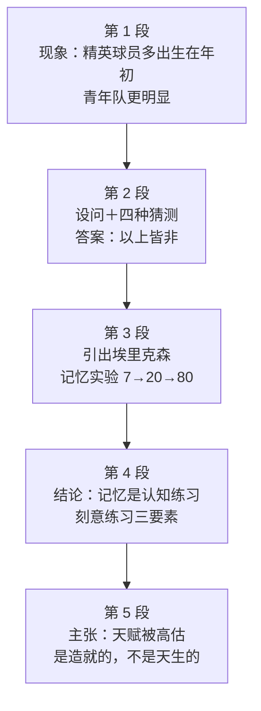

# Passage 40 · 卓越是练出来的

## 答题记录

| 轮次  | 日期         | 题号  | 正确  | 错误  | 正确率 | 用时    | 错题归因 |
| --- | --- | --- | --- | --- | --- | --- | --- |
| 1 |  | 1-5 |  |  |  |  |  |
| 2 |  | 1-5 |  |  |  |  |  |
| 3 |  | 1-5 |  |  |  |  |  |

> [!tip] 填写口径
> - **用时**以分钟计，只计做题时间，不含精读复盘。
> - **错题归因**填「题型·错误类型」，如：例证题·把例子当论点、词义题·程度色彩判断失误、细节题·对象错配。
> - 纵向看趋势：正确率升而用时过长 → 熟练度不足；用时降而正确率波动 → 定位不稳。
> - 本篇 5 题，题号栏填 1-5；第 2 题是**近义词群辨义题**（fun / craze / hysteria / excitement），错因建议单列「词义题·程度与感情色彩」；第 5 题是**谚语型主旨题**，错因写「主旨题·未抓末句中心」。

> [!info] 文章档案
> - **来源**：考研英语（一）2007 年 Text 1
> - **题材**：社会生活（教育与心理 × 科普报道）——从世界杯球员出生月份的怪现象出发，借埃里克森的记忆实验与「刻意练习」研究，论证杰出者几乎都是后天造就的
> - **结构**：5 段 / 18 句 ＋ 5 题（按句号断句与行首缩进实测；与解析引用的「第四段②句」「最后一段③④句」及题干「Line 4, Paragraph 2」全部吻合）
> - **难度**：★★★☆☆
> - **一句话主旨**：精英球员大多出生在年初，四种「天生论」解释都不成立——埃里克森用记忆实验（7 → 20 → 80）与专家研究表明，记忆力并非由基因决定，先天差异会被「编码」能力淹没，真正起作用的是设定目标、即时反馈、重技巧的刻意练习；所谓天赋被大大高估，杰出者几乎都是练出来的，而非天生的。

## 一、篇章脉络

- **第 1 段**：**现象**。查一查 2006 年世界杯球员的出生证明，会发现一个怪事（quirk）：精英球员更可能出生在一年中较早的月份；再看为世界杯和职业队输送人才的欧洲青年队，这一现象**更明显**（第 1 题的战场）。
- **第 2 段**：**设问＋猜测**。究竟什么能解释这个怪现象？作者列出四条猜测——星座赋予球技、冬季出生者携氧能力更强、痴迷足球的父母在足球狂热的春季高峰受孕，以及**以上皆非**（第 2 题的战场）。
- **第 3 段**：**实证**。埃里克森「坚信以上皆非」；他近 30 年前的第一个记忆实验给出硬数据：一名受试者训练约 20 小时后数字记忆广度从 7 升到 20，约 200 小时后超过 80。
- **第 4 段**：**机制**。这一成功加上「记忆并非由基因决定」的后续研究，让他得出结论：记忆行为**与其说是直觉练习，不如说是认知练习**；先天差异会被每个人「编码」信息的能力所淹没，而学会有意义编码的最佳途径就是**刻意练习**——设定具体目标、获得即时反馈、像关注结果一样关注技巧（第 3 题的战场）。
- **第 5 段**：**结论**。他们转而研究各领域的杰出表现者，尽可能收集数据，最后提出一个惊人的论断：我们通常称之为天赋的特质被**大大高估**了；换言之，杰出者——无论记忆、外科、芭蕾还是编程——**几乎都是造就的，而不是天生的**（第 4、5 题的战场）。

> [!tip] 行文逻辑
> 全篇是科普报道型的「**现象 → 设问 → 实验 → 机制 → 结论**」五段式，属于「抛出一个反常识现象，再给出一个反常识答案」的经典写法。三条线索贯穿全篇：**birth / born 的一语双关**（第 1 段 born in the earlier months「出生在」↔ 第 5 段 made, not born「天生的」）、**记忆实验的数字递进**（7 → 20 → 80，第 3 题的战场）、**刻意练习**（deliberate practice，第 4 段⑤句的三要素）。本篇的命题格局**不是一段一题**：第 1、2 题落在第 1—2 段的引子与设问，第 3 题跳到第 4 段，第 4、5 题同在第 5 段。**特别提醒第 1 题**：首段举例／摆现象几乎总是为了**引出全文主题**，判断依据是第 2 段①句的设问（What might account for this strange phenomenon?）——后文三段都在回答它，而这个问题的答案就是「什么造就优异表现」。**特别提醒第 5 题**：谚语题是主旨题的变体，书中给的落点是末句的 made, not born，用「串线法」也能独立推出同一结论。

## 二、逐段精读

### 第 1 段 · 现象：世界杯球员的生日巧合

**原文**

① If you were to examine the birth certificates of every soccer player in 2006's World Cup tournament, you would most likely find a noteworthy quirk: elite soccer players are more likely to have been born in the earlier months of the year than in the later months.
② If you then examined the European national youth teams that feed the World Cup and the professional ranks, you would find this strange phenomenon to be even more pronounced.

**译文**

① 如果你去查阅 2006 年世界杯锦标赛上每一位足球运动员的出生证明，你很可能会发现一个值得注意的怪事：精英足球运动员更可能出生在一年中较早的月份，而不是较晚的月份。
② 如果你接着考察那些为世界杯和职业队伍输送人才的欧洲国家青年队，你会发现这一奇怪现象更加明显。

> [!note] 段落要点
> - 功能：**抛出现象、充当全文引子**，是第 1 题的唯一战场。全段只有 2 句，却把「现象」说足：①句是世界杯层面，②句是青年队层面，**层层递进**。
> - ①句用虚拟语气（If you were to examine... you would find...）开场，是科普文常用的「请你设想一下」口吻，读时理解为「要是你去查一查，就会发现」。
> - ①句冒号后就是 quirk 的具体内容：精英球员集中在年初出生。这个怪现象在第 2 段被称作 this strange phenomenon，第 2 题的题干里则叫 the birthday phenomenon。
> - ②句的 **feed**（输送人才）与 **pronounced**（明显的）都是熟词僻义：feed 常作「喂养」，此处指为上一级队伍输送球员；pronounced 由 pronounce（发音／宣布）而来，作形容词是「显著的」。
> - 注意 **born** 一词在本段是字面义「出生」，而末段 made, not born 中的 born 是「天生的」——同一个词在全篇首尾形成呼应，是本篇最精巧的措辞（第 5 题的题眼）。

#### 长难句 · 本段

> [!abstract] 本段第 ① 句 · If you were to examine the birth certificates of every soccer player in 2006's World Cup tournament, you would most likely find a noteworthy quirk: elite soccer players are more likely to have been born in the earlier months of the year than in the later months.

**结构拆解**

- **虚拟条件从句**：If you **were to examine** the birth certificates of every soccer player in 2006's World Cup tournament
  - were to do 是**将来虚拟**的固定形式，表示「假如（将来）要去做……」，语气比 if you examined 更正式、更富假设性
- **主句**：you **would most likely find** a noteworthy quirk
- **冒号后**：elite soccer players **are more likely to have been born** in the earlier months of the year than in the later months（**解释 quirk 的内容**，相当于省去 namely 的同位说明）
- **比较结构**：more likely **to have been born** in A **than** in B（不定式的完成式，表示「出生」发生在「可能」之前）
- **词汇**：noteworthy adj. 值得注意的；quirk n. 怪事、巧合；elite adj. 精英的

**参考译文**

如果你去查阅 2006 年世界杯锦标赛上每一位足球运动员的出生证明，你很可能会发现一个值得注意的怪事：精英足球运动员更可能出生在一年中较早的月份，而不是较晚的月份。

> [!tip] 拆解要点
> 抓三处：①**were to do ＋ would do 是标准的将来虚拟**，读时不要当过去时，它表达的是「设想中的动作」；②**冒号在此表解释说明**，冒号后整句都是 quirk 的内容，不是新的论点；③**more likely A than B** 是「与其 B 不如 A」式的比较，此处即「年初多于年末」。命题角度：本段与第 2 段共同构成第 1 题所说的 phenomenon，**现象本身不是答案**——第 1 题的 B、D 两项（ spotlight the soccer superstars／explain why some soccer teams play better）都在围着现象的表面信息打转。**引子题的铁律：现象服务于它引出的话题，而话题要看后文实际讨论了什么。**

#### 本段重点词汇

| 单词 / 短语 | 词性 | 文中意 | 常用考义与拓展 | 英文示例搭配（中译） |
| --- | --- | --- | --- | --- |
| **examine** | v. | 检查；查阅 | examination n. 考试、检查；examine a document 查阅文件；examine the cause 探究原因 | examine the birth certificates（查阅出生证明） |
| **birth certificate** | n. | 出生证明 | certificate n. 证书、证明；a marriage certificate 结婚证；certify v. 证明 | the birth certificates of every soccer player（每位球员的出生证明） |
| **tournament** | n. | 锦标赛，联赛 | 读作 /ˈtʊənəmənt/；the World Cup tournament 世界杯锦标赛；tour n. 巡回赛 | in 2006's World Cup tournament（在 2006 年世界杯锦标赛上） |
| **noteworthy** | adj. | 值得注意的，显著的 | 合成词 note ＋ worthy；同义 notable、remarkable；worth doing 值得做 | a noteworthy quirk（一个值得注意的怪事） |
| **quirk** | n. | 怪事，巧合，奇特的习性 | a quirk of fate 命运的捉弄；quirky adj. 古怪的 | find a noteworthy quirk（发现一个值得注意的怪现象） |
| **elite** | adj./n. | 精英的；精英 | 读作 /eɪˈliːt/；the elite 精英阶层；elitism n. 精英主义 | elite soccer players（精英足球运动员） |
| **be more likely to** | 短语 | 更有可能 | likely adj./adv. 可能的（地）；It is likely that... 很可能……；unlikely 不太可能 | are more likely to have been born in the earlier months（更可能出生在较早的月份） |
| **the earlier months of the year** | 短语 | 一年中较早的月份 | 对比 the later months 较晚的月份；early adj./adv. 早的（地） | born in the earlier months of the year（出生在一年中较早的月份） |
| **youth teams** | n. | 青年队 | youth n. 青年、青春；a youth club 青年俱乐部；the youth 年轻人（总称） | the European national youth teams（欧洲各国国家青年队） |
| **feed** | v. | 输送（人才）；喂养 | feed A to B 把 A 喂给 B；feed on 以……为食；过去式 fed | youth teams that feed the World Cup（为世界杯输送人才的青年队） |
| **the professional ranks** | n. | 职业队（行列） | rank n. 等级、行列；the ranks of... ……的行列；rank and file 普通成员 | feed the World Cup and professional ranks（为世界杯和职业队伍输送人才） |
| **strange phenomenon** | n. | 奇怪的现象 | phenomenon 复数为 phenomena；phenomenal adj. 非凡的、惊人的 | this strange phenomenon（这一奇怪的现象） |
| **pronounced** | adj. | 明显的，显著的 | 由 pronounce（发音、宣布）派生；a pronounced difference 显著差异；同义 marked | the phenomenon to be even more pronounced（这一现象更加明显） |

### 第 2 段 · 设问：四种猜测与「以上皆非」

**原文**

① What might account for this strange phenomenon?
② Here are a few guesses: a) certain astrological signs confer superior soccer skills; b) winter-born babies tend to have higher oxygen capacity, which increases soccer stamina; c) soccer-mad parents are more likely to conceive children in springtime, at the annual peak of soccer mania; d) none of the above.

**译文**

① 究竟什么能解释这一奇怪的现象呢？
② 以下是几种猜测：a) 某些星座赋予超凡的足球技巧；b) 冬季出生的婴儿往往携氧能力更强，这会提升踢球的耐力；c) 痴迷足球的父母更可能在春天——也就是每年足球狂热的高峰期——怀上孩子；d) 以上皆非。

> [!note] 段落要点
> - 功能：**设问并列出四种猜测**，是第 2 题（mania）的唯一战场，同时承上启下——①句的设问就是全文要回答的问题。
> - ①句 **What might account for...?** 是自问自答的设问句。第 1 题的 C 项（introduce the topic of what makes expert performance）正是对这一设问功能的转述。
> - ②句冒号后是 a) b) c) d) 四个并列项。三项猜测的**共同点**是：都把差异归因于**出生时就已经定下的先天因素**（星座、携氧能力、父母受孕时机）。
> - **d) none of the above 是本段的关键**：作者对三项「天生论」解释作整体否定，为下文的后天论（刻意练习）铺路。第 3 段①句埃里克森「坚信以上皆非」正承接此处。
> - 第 2 题题干标 **Line 4, Paragraph 2**：本段共 4 个印刷行，mania 正落在第 4 行「mania; d) none of the above.」——行号定位与句意双向互证。
> - **soccer-mad 的 mad（痴迷、疯狂）就是 mania 的同义提示词**，两者在同一句里、中间没有转折，这是第 2 题最经济的解法。

#### 长难句 · 本段

> [!abstract] 本段第 ② 句 · Here are a few guesses: a) certain astrological signs confer superior soccer skills; b) winter-born babies tend to have higher oxygen capacity, which increases soccer stamina; c) soccer-mad parents are more likely to conceive children in springtime, at the annual peak of soccer mania; d) none of the above.

**结构拆解**

- **主句（倒装）**：Here **are** a few guesses（here 引起的全部倒装，主语是 a few guesses）
- **冒号后**：a) b) c) d) 四个并列项，共同作 guesses 的**同位列举**
  - a) certain astrological signs **confer** superior soccer skills（主谓宾：星座赋予球技）
  - b) winter-born babies **tend to have** higher oxygen capacity, **which** increases soccer stamina（which 引导**非限制性定语从句**，指代前面整个「携氧能力更强」这件事）
  - c) soccer-mad parents **are more likely to conceive** children in springtime, **at the annual peak of** soccer mania（at 短语作 springtime 的**同位说明**）
  - d) none of the above（固定表达：以上皆非）
- **合成词**：winter-born（冬季出生的）、soccer-mad（痴迷足球的），均为「名词 ＋ 过去分词／形容词」构成的复合形容词
- **词汇**：account for 解释；confer v. 赋予；stamina n. 耐力；mania n. 狂热

**参考译文**

以下是几种猜测：a) 某些星座赋予超凡的足球技巧；b) 冬季出生的婴儿往往携氧能力更强，这会提升踢球的耐力；c) 痴迷足球的父母更可能在春天——也就是每年足球狂热的高峰期——怀上孩子；d) 以上皆非。

> [!tip] 拆解要点
> 抓三处：①**here 引起的全部倒装**（Here are...），真正的主语在动词之后，读时先找主语；②**冒号后是四项并列的列举**，四项在语法上并列、在语义上构成「三种猜测 ＋ 一种否定」，**最后一项才是作者真正的立场**；③**which 在此指代整个前句所述之事**（携氧能力更强），而不是紧邻的 oxygen capacity 一个词——非限制性定语从句的先行词既可以是名词，也可以是整个句子。命题角度：本句承载第 2 题，**猜词题的第一原则是「就近找同义或反义提示」**，本句内部的 soccer-mad 已把 mad ↔ mania 的对应关系摆明，无需跨段。

#### 本段重点词汇

| 单词 / 短语 | 词性 | 文中意 | 常用考义与拓展 | 英文示例搭配（中译） |
| --- | --- | --- | --- | --- |
| **account for** | 短语 | 解释，说明（原因） | account n. 账户、说明；take into account 考虑到；on account of 由于 | What might account for this strange phenomenon?（什么能解释这一奇怪现象？） |
| **guess** | n./v. | 猜测 | 复数 guesses；make a guess 猜一下；同义 speculation n. 推测 | Here are a few guesses（以下是几种猜测） |
| **astrological signs** | n. | 星座（黄道十二宫） | astrology n. 占星术；astronomy n. 天文学（形近易混）；sign n. 星座、迹象 | certain astrological signs（某些星座） |
| **confer** | v. | 赋予，授予 | confer sth on sb 把某物授予某人；confer with sb 与某人商议；conference n. 会议 | confer superior soccer skills（赋予超凡的足球技巧） |
| **superior** | adj./n. | 出众的，更好的；上级 | be superior to 优于（无比较级形式）；superiority n. 优势；反义 inferior | confer superior soccer skills（赋予出众的足球技巧） |
| **soccer skills** | n. | 足球技巧 | skill n. 技巧、技能；skilled adj. 熟练的；skillful adj. 有技巧的 | superior soccer skills（超凡的足球技巧） |
| **winter-born** | adj. | 冬季出生的 | 复合形容词：名词 ＋ 过去分词；同类 summer-born、French-born | winter-born babies（冬季出生的婴儿） |
| **oxygen capacity** | n. | 携氧能力，血氧容量 | oxygen n. 氧气；capacity n. 容量、能力（the capacity to do 做……的能力） | have higher oxygen capacity（携氧能力更强） |
| **stamina** | n. | 耐力，持久力 | 读作 /ˈstæmɪnə/；同义 endurance；physical stamina 体力 | increases soccer stamina（提升踢足球的耐力） |
| **soccer-mad** | adj. | 痴迷足球的 | 复合形容词：名词 ＋ 形容词；mad 此处＝狂热的、痴迷的（非「疯的」）；football-mad 同理 | soccer-mad parents（痴迷足球的父母） |
| **conceive** | v. | 怀孕；构想 | conceive a child 怀孕；conceive of 想象、构想；concept n. 概念 | conceive children in springtime（在春天怀上孩子） |
| **springtime** | n. | 春季，春天 | 由 spring ＋ time 构成；同类 wintertime、summertime | in springtime（在春天） |
| **annual peak** | n. | 一年一度的高峰 | annual adj. 年度的（annual report 年报）；peak n. 顶峰、高峰（at the peak of） | at the annual peak of soccer mania（在足球狂热的年度高峰期） |
| **mania** | n. | 狂热，痴迷 | 读作 /ˈmeɪniə/；后缀 -mania 表「狂热」：Beatlemania 披头士狂热；maniac n. 狂热者 | soccer mania（足球狂热） |
| **none of the above** | 短语 | 以上皆非 | 选项与问卷的固定表达；above 指代上文所列各项 | d) none of the above（d) 以上皆非） |

### 第 3 段 · 实证：埃里克森与他的记忆实验

**原文**

① Anders Ericsson, a 58-year-old psychology professor at Florida State University, says he believes in "none of the above."
② Ericsson grew up in Sweden, and studied nuclear engineering until he realized he would have more opportunity to conduct his own research if he switched to psychology.
③ His first experiment, nearly 30 years ago, involved memory: training a person to hear and then repeat a random series of numbers.
④ "With the first subject, after about 20 hours of training, his digit span had risen from 7 to 20," Ericsson recalls.
⑤ "He kept improving, and after about 200 hours of training he had risen to over 80 numbers."

**译文**

① 佛罗里达州立大学 58 岁的心理学教授安德斯·埃里克森说，他坚信「以上皆非」。
② 埃里克森在瑞典长大，学的是核工程，直到他意识到：如果转攻心理学，自己会有更多机会主持自己的研究。
③ 他近 30 年前所做的第一个实验与记忆有关：训练一个人听一串随机数字，然后把它复述出来。
④ 埃里克森回忆道：「就第一名受试者而言，经过约 20 小时的训练，他的数字记忆广度已从 7 个上升到 20 个。」
⑤ 「他一直在进步，经过约 200 小时的训练之后，他已能记住 80 多个数字。」

> [!note] 段落要点
> - 功能：**引出研究者及其实验**，为第 4 段的结论提供事实支撑。本段不出题，但却是第 3、4 题的**论据基础**。
> - ①句的 believes in "none of the above" 直接承接第 2 段 d) 项：作者的立场是「三条先天论解释都不成立」。
> - ②句看似闲笔，实则暗合主题：埃里克森本人是**半路出家**（核工程 → 心理学）的心理学家——人的成就是选择与投入的结果，不是天生的。
> - ③—⑤句是**数字递进**：7 → 20 → 80，训练时长从 20 小时到 200 小时。用「投入量」与「成绩」的正相关，直观证明**记忆力可被训练**，这正是第 4 段结论的事实基础。
> - 实验术语：**subject** 在此是「受试者」（不是「学科／主题」），**digit span** 是「数字记忆广度」——两个都是熟词僻义。
> - ④句的引号是**直接引语**，句末用逗号引出 Ericsson recalls（引语的倒装），读时注意「recalls」才是主句动词。

#### 长难句 · 本段

> [!abstract] 本段第 ② 句 · Ericsson grew up in Sweden, and studied nuclear engineering until he realized he would have more opportunity to conduct his own research if he switched to psychology.

**结构拆解**

- **并列主句**：Ericsson **grew up** in Sweden, **and studied** nuclear engineering（and 连接两个谓语，共用主语 Ericsson）
- **时间状语从句**：**until** he realized...（直到他意识到……）
- **宾语从句**：he realized (that) he **would have** more opportunity **to conduct** his own research
- **条件状语从句**：**if** he **switched to** psychology（嵌在宾语从句内部，用过去时表虚拟／假设）
- **不定式作定语**：more opportunity **to conduct** his own research（conduct 此处＝进行、实施）
- **时态呼应**：主句过去时 → 从句 would have（过去将来）＋ switched（一般过去表假设）

**参考译文**

埃里克森在瑞典长大，学的是核工程，直到他意识到：如果转攻心理学，自己会有更多机会主持自己的研究。

> [!tip] 拆解要点
> 抓三处：①**and 连接的并列谓语共用主语**，第二个 studied 前没有重复主语，读时不要把后半句当成新句；②**until 在此是「直到……才（转变发生）」**，它标志的是**生涯的转折点**，不是单纯的持续时间；③**if he switched 是假设而非事实的过去**（他当时设想「若转专业」），这类「过去时表假设」在叙述人物经历时极常见。命题角度：本句所在的第 3 段**没有直接命题**，但它提供了第 4 段结论的事实来源——**读到实验段落时，要主动把它标为「论据区」，把结论句标为「论点区」**，考场上凡问「某人认为／相信什么」，一律去论点区找，不去论据区找。

> [!abstract] 本段第 ③ 句 · His first experiment, nearly 30 years ago, involved memory: training a person to hear and then repeat a random series of numbers.

**结构拆解**

- **主干**：His first experiment... **involved** memory
- **插入语**：nearly 30 years ago（补充说明 experiment 的时间，相当于 which was done nearly 30 years ago）
- **冒号后**：training a person **to hear and then repeat** a random series of numbers（**动名词短语解释 memory 实验的具体内容**）
- **不定式并列**：to hear **and then** repeat（and then 表动作的先后承接）
- **词汇**：involve v. 涉及、包含；random adj. 随机的；a series of 一系列

**参考译文**

他近 30 年前所做的第一个实验与记忆有关：训练一个人听一串随机数字，然后把它复述出来。

> [!tip] 拆解要点
> 抓两处：①**插入语 nearly 30 years ago 把主语和谓语隔开**，初读极易把 involved 看漏，遇到「主语 ＋ 逗号 ＋ 时间状语 ＋ 逗号 ＋ 谓语」一律先跳读插入语抓主干；②**冒号后的动名词短语（training...）是实验的操作说明**，它解释的是 memory 这个词（什么样的记忆？听数字—复述数字），不是另外一个论点。**科普文中「实验方法」几乎总用冒号＋动名词来写**，见得多了就能一眼识别。

#### 本段重点词汇

| 单词 / 短语 | 词性 | 文中意 | 常用考义与拓展 | 英文示例搭配（中译） |
| --- | --- | --- | --- | --- |
| **psychology professor** | n. | 心理学教授 | psychology n. 心理学；psychological adj. 心理的；professor n. 教授 | a psychology professor at Florida State University（佛罗里达州立大学的心理学教授） |
| **believe in** | 短语 | 相信、信奉；坚信……的价值 | believe sb 相信某人（的话）；believe in sb 信任某人；believe in God 信仰上帝 | he believes in "none of the above"（他坚信「以上皆非」） |
| **grow up** | 短语 | 长大，成长 | grown-up n. 成年人；grow into 长成；grow out of 源于、戒掉 | Ericsson grew up in Sweden（埃里克森在瑞典长大） |
| **nuclear engineering** | n. | 核工程 | nuclear adj. 核的、原子核的（nuclear family 核心家庭）；engineering n. 工程（学） | studied nuclear engineering（攻读核工程） |
| **conduct research** | 短语 | 进行（开展）研究 | conduct v. 实施、进行；指挥（乐队）；引导；传导（电）；行为 n. | conduct his own research（主持自己的研究） |
| **switch to** | 短语 | 转向，切换到 | switch v./n. 转换、开关；switch off 关掉；switch from A to B 从 A 转向 B | if he switched to psychology（如果他转攻心理学） |
| **experiment** | n./v. | 实验；做实验 | experimental adj. 实验性的；do／conduct an experiment 做实验；experiment on 在……上做实验 | His first experiment（他的第一个实验） |
| **involve** | v. | 涉及，包含；使参与 | be involved in 参与、卷入；involvement n. 参与；involved adj. 复杂的、有关的 | involved memory（与记忆有关／涉及记忆） |
| **a random series of numbers** | 短语 | 一串随机数字 | random adj. 随机的（at random 随机地）；a series of 一系列；series 单复数同形 | repeat a random series of numbers（复述一串随机数字） |
| **subject** | n. | （实验的）受试者 | 熟词僻义：常见义为「学科、主题、主语」，此处指实验对象；同义 participant | With the first subject（就第一名受试者而言） |
| **digit span** | n. | 数字记忆广度 | digit n. 数字（0—9 的任一个）、手指；digital adj. 数字的；span n. 跨度、广度 | his digit span had risen from 7 to 20（他的数字记忆广度从 7 升到 20） |
| **rise from...to...** | 短语 | 从……上升到…… | rise—rose—risen（不及物）；raise vt. 举起、提高；rise by 上升了（幅度） | risen from 7 to 20（从 7 上升到 20） |
| **recall** | v./n. | 回忆，回想 | recall doing 记得做过；beyond recall 无法挽回；同义 recollect、remember | Ericsson recalls（埃里克森回忆道） |
| **keep improving** | 短语 | 持续进步 | keep doing 一直做；improve v. 改善、提高；improvement n. 改进 | He kept improving（他一直在进步） |

### 第 4 段 · 机制：记忆是认知练习，关键是刻意练习

**原文**

① This success, coupled with later research showing that memory itself is not genetically determined, led Ericsson to conclude that the act of memorizing is more of a cognitive exercise than an intuitive one.
② In other words, whatever inborn differences two people may exhibit in their abilities to memorize, those differences are swamped by how well each person "encodes" the information.
③ And the best way to learn how to encode information meaningfully, Ericsson determined, was a process known as deliberate practice.
④ Deliberate practice entails more than simply repeating a task.
⑤ Rather, it involves setting specific goals, obtaining immediate feedback and concentrating on technique as much as on outcome.

**译文**

① 这一成功，连同后来表明记忆本身并非由基因决定的研究，使埃里克森得出结论：记忆行为与其说是直觉练习，不如说是一种认知练习。
② 换句话说，无论两个人在记忆能力上表现出怎样的先天差异，这些差异都会被每个人「编码」信息的能力高低所淹没。
③ 埃里克森认定，学习如何对信息进行有意义的编码，其最佳途径是一个被称为「刻意练习」的过程。
④ 刻意练习所要求的，远不止简单地重复一项任务。
⑤ 相反，它包括设定具体的目标、获得即时的反馈，以及像关注结果一样关注技巧。

> [!note] 段落要点
> - 功能：**给出机制性结论**，是第 3 题的唯一战场，也是全篇的「理论核心」。
> - ①句的 coupled with（连同、加上）引出的 later research 是**附加主语**，真正的核心主语是 This success；**more A than B** 的结构是「与其说是 B，不如说是 A」——记忆是认知练习，而非直觉练习。
> - ②句是**第 3 题的答案句**：先天差异会被「编码」能力所**淹没**（swamp）→ 好的记忆力取决于**对信息的有效处理**。选项中的 meaningful processing of information 正是对 "encodes" the information 的同义改写。
> - ③句提出 **deliberate practice（刻意练习）**，④⑤句给出它的三个要素：**设定具体目标、获得即时反馈、像关注结果一样关注技巧**（as much A as B ＝ A 与 B 同等）。
> - **encode（编码）＝ 把信息转化成便于记忆的形式**，这正是 meaningful processing 的具体含义，也是本段最核心的术语。
> - 注意第 3 题 D 项的陷阱：immediate feedback 与 concentration 确实是原文内容，但它们属于**刻意练习的要求**，不是「好记忆力的成因」——**条件与对象错配**。

#### 长难句 · 本段

> [!abstract] 本段第 ① 句 · This success, coupled with later research showing that memory itself is not genetically determined, led Ericsson to conclude that the act of memorizing is more of a cognitive exercise than an intuitive one.

**结构拆解**

- **主干**：This success... **led** Ericsson **to conclude** that...（lead sb to do 使某人做某事）
- **插入的附加成分**：**coupled with** later research **showing that** memory itself is not genetically determined
  - coupled with ＝ 连同、加上（过去分词短语，相当于 together with）
  - showing that... 是现在分词短语作 research 的**后置定语**
  - that 从句是 showing 的**宾语从句**
- **conclude 的宾语从句**：that the act of memorizing **is more of** a cognitive exercise **than** an intuitive one
  - **more of A than B** ＝ 与其说是 B，不如说是 A（of 表属性）
  - one 替代 exercise，避免重复
- **被动**：is not genetically determined（由基因决定的）

**参考译文**

这一成功，连同后来表明记忆本身并非由基因决定的研究，使埃里克森得出结论：记忆行为与其说是直觉练习，不如说是一种认知练习。

> [!tip] 拆解要点
> 抓三处：①**coupled with 引出的成分不影响主谓一致**——谓语 led 只与核心主语 This success 一致，读到这类「A, coupled with/together with/along with B, ＋ 谓语」时直接跳过中间找谓语；②**more of A than B 是「与其 B 不如 A」**，方向千万不能读反，第 3 题的 B 项（intuitive rather than cognitive）正是把它读反了；③**one 替代前文的 exercise**，避免重复，读时回指补齐。命题角度：本句是第 3 题 B、C 两项的共同出处——B 项把认知与直觉**颠倒**，C 项把「非基因决定」**颠倒**为「由基因决定」，**两项都是与原文相反**。

> [!abstract] 本段第 ② 句 · In other words, whatever inborn differences two people may exhibit in their abilities to memorize, those differences are swamped by how well each person "encodes" the information.

**结构拆解**

- **连接性状语**：**In other words**（换句话说，标志本句是前句的**同义重述**）
- **让步状语从句**：**whatever** inborn differences two people **may exhibit** in their abilities to memorize
  - whatever ＝ no matter what，引导让步；may 表「可能、不论」
  - 语序上 differences 被提前到 whatever 之后（正常语序：two people may exhibit whatever inborn differences）
- **主句**：those differences **are swamped by** how well each person "encodes" the information
  - swamp v. 淹没、压倒（原义「沼泽」），此处为比喻用法
- **介词宾语从句**：by **how well** each person "encodes" the information（how well 从句作 by 的宾语）
- **词汇**：inborn adj. 先天的（＝ innate）；exhibit v. 表现出；encode v. 编码

**参考译文**

换句话说，无论两个人在记忆能力上表现出怎样的先天差异，这些差异都会被每个人「编码」信息的能力高低所淹没。

> [!tip] 拆解要点
> 抓三处：①**In other words 是极强的信号词**——它意味着本句与前句**说的是同一件事**，读不懂前句可直接读本句，反之亦然，考场上这是最省力的「双保险」；②**whatever 引导让步且宾语前置**，还原成正常语序再理解（two people may exhibit whatever inborn differences）；③**be swamped by 是比喻**，字面「被沼泽吞没」，此处＝「被彻底盖过、显得微不足道」。命题角度：本句是**第 3 题的唯一答案句**，A 项的 depends on meaningful processing of information 就是「how well each person 'encodes' the information」的正面转述——**读到被动句时，务必把它还原成主动（编码能力淹没先天差异 → 记忆好坏取决于编码），答案往往就浮出来了。**

> [!abstract] 本段第 ③ 句 · And the best way to learn how to encode information meaningfully, Ericsson determined, was a process known as deliberate practice.

**结构拆解**

- **主干**：the best way... **was** a process known as deliberate practice
- **不定式作定语**：the best way **to learn** how to encode information meaningfully（way 后常接 to do 或 of doing）
- **宾语**：how **to encode** information meaningfully（疑问词 ＋ 不定式，作 learn 的宾语）
- **插入语**：Ericsson **determined**（＝ 埃里克森认定，相当于 Ericsson believed／concluded）
- **后置定语**：a process **known as** deliberate practice（过去分词短语，＝ which is known as...）
- **词汇**：deliberate adj. 刻意的、有意的；从容的；v. 仔细考虑

**参考译文**

埃里克森认定，学习如何对信息进行有意义的编码，其最佳途径是一个被称为「刻意练习」的过程。

> [!tip] 拆解要点
> 抓两处：①**疑问词 ＋ 不定式（how to encode...）作宾语**是英语的高频压缩结构，等价于一个宾语从句 how one should encode...；②**known as 是过去分词作后置定语**，读时按「被称为……的」处理，它前面的 process 才是被修饰的中心词。命题角度：本句贡献了全篇最重要的术语 deliberate practice，第 3 题 D 项（requires immediate feedback and a high degree of concentration）正是把本句与⑤句的内容**安错了对象**——它们说的是**刻意练习的要求**，不是**好记忆力的成因**。

#### 本段重点词汇

| 单词 / 短语 | 词性 | 文中意 | 常用考义与拓展 | 英文示例搭配（中译） |
| --- | --- | --- | --- | --- |
| **coupled with** | 短语 | 连同，加上，与……一起 | couple n. 一对、夫妇；v. 连接；a couple of 几个；同义 together with、combined with | This success, coupled with later research（这一成功连同后续研究） |
| **genetically determined** | 短语 | 由基因决定的 | genetic adj. 基因的、遗传的；genetics n. 遗传学；gene n. 基因；determine v. 决定 | memory is not genetically determined（记忆并非由基因决定） |
| **lead sb to conclude** | 短语 | 使某人得出结论 | lead sb to do 使某人做；conclude v. 得出结论；conclusion n. 结论（draw a conclusion） | led Ericsson to conclude that...（使埃里克森得出结论……） |
| **memorize** | v. | 记忆，记住 | memory n. 记忆力、记忆；memorable adj. 难忘的；memorization n. 记忆（行为） | the act of memorizing（记忆的行为） |
| **cognitive** | adj. | 认知的 | cognition n. 认知；cognitive psychology 认知心理学；recognize v. 认出（同根） | a cognitive exercise（一种认知练习） |
| **intuitive** | adj. | 直觉的 | intuition n. 直觉；intuitively adv. 凭直觉地；反义 analytical 分析的 | an intuitive one（一种直觉的练习） |
| **in other words** | 短语 | 换句话说 | 同义表达：that is (to say)、namely、to put it another way | In other words, whatever inborn differences...（换句话说，无论何种先天差异……） |
| **inborn** | adj. | 先天的，天生的 | 同义 innate、innate ability 天生的能力；born adj. 天生的（a born musician） | whatever inborn differences（无论怎样的先天差异） |
| **exhibit** | v./n. | 表现出；展出 | exhibition n. 展览；exhibit n. 展品；同义 display、show | exhibit in their abilities（在能力上表现出） |
| **swamp** | v./n. | 淹没，压倒；沼泽 | 比喻用法：be swamped by 被……淹没；be swamped with work 工作堆积如山 | are swamped by how well each person encodes（被编码能力所淹没） |
| **encode** | v. | 编码；把……转化（成可记忆的形式） | en- 前缀表「使……」；decode v. 解码；code n. 代码、准则 | each person "encodes" the information（每个人对信息进行「编码」） |
| **deliberate practice** | n. | 刻意练习 | deliberate adj. 刻意的、有意的；从容不迫的；v. 仔细考虑、商议 | a process known as deliberate practice（一个被称为「刻意练习」的过程） |
| **entail** | v. | 需要，牵涉，必然包含 | entail doing 需要做某事；同义 involve、require | entails more than simply repeating a task（远不止是简单地重复任务） |
| **specific goals** | n. | 具体的目标 | specific adj. 具体的、特定的（反义 general）；specify v. 明确说明 | setting specific goals（设定具体目标） |
| **immediate feedback** | n. | 即时反馈 | immediate adj. 立即的、直接的；feedback n. 反馈（不可数） | obtaining immediate feedback（获得即时反馈） |
| **concentrate on** | 短语 | 专注于 | concentration n. 专注、集中；concentrate (one's attention) on 把注意力集中于 | concentrating as much on technique as on outcome（像关注结果一样关注技巧） |
| **technique** | n. | 技巧，手法 | technical adj. 技术的；technology n. 技术（总称）；technician n. 技术员 | as much on technique as on outcome（在技巧上与在结果上同等） |
| **outcome** | n. | 结果，成果 | outcome 强调最终结果；对比 output 产出、outset 开端；同义 result | concentrate on technique as much as on outcome（技巧与结果并重） |

### 第 5 段 · 结论：天赋被高估，杰出者是造就的

**原文**

① Ericsson and his colleagues have thus taken to studying expert performers in a wide range of pursuits, including soccer.
② They gather all the data they can, not just performance statistics and biographical details but also the results of their own laboratory experiments with high achievers.
③ Their work makes a rather startling assertion: the trait we commonly call talent is highly overrated.
④ Or, put another way, expert performers—whether in memory or surgery, ballet or computer programming—are nearly always made, not born.

**译文**

① 于是，埃里克森与同事们开始着手研究广泛领域中的杰出表现者，其中也包括足球。
② 他们尽可能收集一切数据，不仅有表现统计与生平细节，还包括他们自己对高成就者所做的实验室实验的结果。
③ 他们的研究提出了一个相当惊人的论断：我们通常称之为天赋的那种特质被大大高估了。
④ 或者换言之，杰出表现者——无论从事记忆、外科手术、芭蕾还是计算机编程——几乎都是造就出来的，而不是天生的。

> [!note] 段落要点
> - 功能：**给出全篇结论**，是第 4、5 题的共同战场。全段 4 句，③④句是「题眼」。
> - ①句的 thus 承接上文结论；**including soccer** 回扣第 1 段的足球现象，**首尾呼应**（现象—结论闭环）。
> - ②句的 not just... but also... 说明数据之全，是为论证的可信度作铺垫——**研究材料 ≠ 成功的关键**，第 4 题 B 项正在此处设陷阱。
> - ③句 **the trait we commonly call talent is highly overrated**：对「天赋论」的直接否定，是第 4 题 D 项（后天培养）的依据。注意 **overrated（被高估）≠ overlooked（被忽视）**，第 4 题 C 项正是把它说反。
> - ④句 **made, not born** 是全篇的题眼：与第 1 段 born in the earlier months 形成**同词呼应**（born：出生 → 天生的），也是第 5 题「熟能生巧」的落点。
> - ④句的破折号之间是四个领域的并列（memory / surgery / ballet / computer programming），用「无论……还是……」来证明结论的**普适性**——不限于足球。

#### 长难句 · 本段

> [!abstract] 本段第 ③ 句 · Their work makes a rather startling assertion: the trait we commonly call talent is highly overrated.

**结构拆解**

- **主干**：Their work **makes** a rather startling **assertion**
  - make an assertion ＝ 提出一个论断（assertion 是 assert 的名词）
- **冒号后**：the trait... is highly overrated（**解释 assertion 的具体内容**，相当于一个省略 that 的同位语从句）
- **定语从句**：the trait **(that)** we commonly call talent（省略关系代词 that，that 在从句中作 call 的宾语补足语：call the trait talent）
- **被动**：is highly **overrated**（over- 前缀表「过度」：overrate 高估、overestimate 高估、overlook 忽视、overlook 俯瞰）
- **词汇**：startling adj. 惊人的（startle v. 使吃惊）；trait n. 特质

**参考译文**

他们的研究提出了一个相当惊人的论断：我们通常称之为天赋的那种特质被大大高估了。

> [!tip] 拆解要点
> 抓两处：①**冒号在此引出一个完整的句子，功能接近同位语从句**，是对 assertion 的具体化，读时可在冒号处补上「那就是……」；②**call sb/sth ＋ 名词 是「称……为……」的双宾语结构**（we call the trait talent），定语从句把 the trait 提前后，talent 留在句尾，还原语序才好懂。命题角度：本句是第 4 题的正面依据，也是第 4 题 C 项的陷阱所在——**over- 前缀家族必须分辨清楚**：overrate（高估）／overestimate（高估）／overlook（忽视、俯瞰）／overcome（克服）／overtake（超过），C 项用 overlooked 替换 overrated，一字之差、方向相反。

> [!abstract] 本段第 ④ 句 · Or, put another way, expert performers—whether in memory or surgery, ballet or computer programming—are nearly always made, not born.

**结构拆解**

- **插入语**：**Or, put another way**（或者换言之，与前句构成同义重述，功能同 In other words）
- **主干**：expert performers... **are** nearly always **made, not born**
  - made（被造就的）与 born（天生的）构成**对举**，两个过去分词并列作表语
- **破折号之间**：**whether** in memory or surgery, ballet **or** computer programming
  - whether...or... 引导**让步性列举**（无论……还是……），四个领域两两成对
- **副词**：nearly always（几乎总是）——留有余地的表述，不是绝对化
- **呼应**：made / born 与第 1 段 born in the earlier months 形成同词双关

**参考译文**

或者换言之，杰出表现者——无论从事记忆、外科手术、芭蕾还是计算机编程——几乎都是造就出来的，而不是天生的。

> [!tip] 拆解要点
> 抓三处：①**破折号之间的内容是可以整体跳过的插入成分**，先抓主干 expert performers are made, not born；②**made 与 born 都是过去分词作表语**，此处构成「A, not B」的对举，语义重心永远在 not 之后否定掉的那一项上（否定「天生」）；③**nearly always 是留有余地的表述**——科普文的结论句几乎都带 nearly / almost / tend to，选项若把它换成 always / certainly 即为过度推断。命题角度：本句是**第 5 题的唯一落点**，书中解析直接点明：「最后一段最后一句……指出优秀人才几乎都是培养出来的，而不是天生的。该句点出了本文的中心，因此[C] 项『熟能生巧』为正确答案，强调后天培养和优秀的关系。」

#### 本段重点词汇

| 单词 / 短语 | 词性 | 文中意 | 常用考义与拓展 | 英文示例搭配（中译） |
| --- | --- | --- | --- | --- |
| **thus** | adv. | 因此，于是 | 同义 therefore、hence；thus far 到目前为止 | have thus taken to studying（于是开始着手研究） |
| **take to doing** | 短语 | 开始从事，养成……的习惯 | take to sb/sth 喜欢上；take to one's heels 逃走；注意 to 是介词，后接 doing | have taken to studying expert performers（开始研究杰出表现者） |
| **expert performers** | n. | 杰出表现者，高手 | expert n./adj. 专家（的）、熟练的；performer n. 表演者、表现者；performance n. 表现 | studying expert performers（研究杰出表现者） |
| **a wide range of** | 短语 | 广泛的，各种各样的 | range n. 范围、幅度；v. 变化（range from A to B）；a range of 一系列 | in a wide range of pursuits（在广泛的领域中） |
| **pursuit** | n. | （从事的）事业、领域；追求 | pursue v. 追求、从事；in pursuit of 追求…… | expert performers in a wide range of pursuits（各领域的杰出者） |
| **gather** | v. | 收集；聚集 | gather data／evidence 收集数据／证据；gathering n. 集会；同义 collect | They gather all the data they can（他们尽可能收集一切数据） |
| **performance statistics** | n. | 表现统计数据 | statistics n. 统计数字、统计学（作学科时谓语用单数）；statistical adj. 统计的 | not just performance statistics（不仅有表现统计） |
| **biographical details** | n. | 生平细节 | biography n. 传记；biographical adj. 传记的；auto-biography 自传；detail n. 细节 | performance statistics and biographical details（表现统计与生平细节） |
| **laboratory experiments** | n. | 实验室实验 | laboratory n. 实验室（口语 lab）；experiment n. 实验 | their own laboratory experiments（他们自己的实验室实验） |
| **high achievers** | n. | 高成就者，杰出人物 | achieve v. 达到、取得；achievement n. 成就；achiever n. 有成就的人 | experiments with high achievers（对高成就者所做的实验） |
| **startling** | adj. | 惊人的，令人吃惊的 | startle v. 使惊吓；a startling discovery 惊人的发现；同义 surprising | a rather startling assertion（一个相当惊人的论断） |
| **assertion** | n. | 断言，论断，主张 | assert v. 断言、主张；assertive adj. 坚定自信的；make an assertion 提出论断 | makes a rather startling assertion（提出一个相当惊人的论断） |
| **trait** | n. | 特质，特征 | 同义 feature、characteristic；personality traits 人格特质 | the trait we commonly call talent（我们通常称之为天赋的特质） |
| **talent** | n. | 天赋，才能；人才 | talented adj. 有天赋的；a talent show 才艺表演；talent for 有……的天赋 | we commonly call talent（我们通常称之为天赋） |
| **overrated** | adj. | 被高估的 | over- 前缀表「过度」；overrate v. 高估；对比 underestimate 低估、underrated 被低估的 | is highly overrated（被大大高估了） |
| **put another way** | 短语 | 换言之 | 同义 in other words、that is to say；put v. 表述、表达 | Or, put another way（或者换言之） |
| **surgery** | n. | 外科手术；外科（学） | surgeon n. 外科医生；surgical adj. 外科的；perform surgery 做手术 | whether in memory or surgery（无论是记忆还是外科手术） |
| **ballet** | n. | 芭蕾舞 | 读作 /ˈbæleɪ/；ballet dancer 芭蕾舞者；ballet company 芭蕾舞团 | ballet or computer programming（芭蕾还是计算机编程） |
| **computer programming** | n. | 计算机编程 | program n. 程序、节目；v. 编程；programmer n. 程序员 | in ... computer programming（在计算机编程领域） |
| **be made, not born** | 短语 | 是造就的，不是天生的 | born adj. 天生的（a born leader）；made 此处＝后天造就的 | expert performers are nearly always made, not born（杰出者几乎都是练出来的） |

## 三、全篇重点词汇汇总（自测用）

> [!info] 说明
> 本表只列「单词 / 词性 / 所在段」，不含释义与搭配，用于遮表自测：说出词义后再回该段核对。
> 收录**全篇所有段落词汇，共 80 条，不删减**，与各段「本段重点词汇」等长同源（跨段复现的词只在其首次出现的段落收录一次）。

| 单词 / 短语 | 词性 | 所在段 |
| --- | --- | --- |
| **examine** | v. | 第 1 段 |
| **birth certificate** | n. | 第 1 段 |
| **tournament** | n. | 第 1 段 |
| **noteworthy** | adj. | 第 1 段 |
| **quirk** | n. | 第 1 段 |
| **elite** | adj./n. | 第 1 段 |
| **be more likely to** | 短语 | 第 1 段 |
| **the earlier months of the year** | 短语 | 第 1 段 |
| **youth teams** | n. | 第 1 段 |
| **feed** | v. | 第 1 段 |
| **the professional ranks** | n. | 第 1 段 |
| **strange phenomenon** | n. | 第 1 段 |
| **pronounced** | adj. | 第 1 段 |
| **account for** | 短语 | 第 2 段 |
| **guess** | n./v. | 第 2 段 |
| **astrological signs** | n. | 第 2 段 |
| **confer** | v. | 第 2 段 |
| **superior** | adj./n. | 第 2 段 |
| **soccer skills** | n. | 第 2 段 |
| **winter-born** | adj. | 第 2 段 |
| **oxygen capacity** | n. | 第 2 段 |
| **stamina** | n. | 第 2 段 |
| **soccer-mad** | adj. | 第 2 段 |
| **conceive** | v. | 第 2 段 |
| **springtime** | n. | 第 2 段 |
| **annual peak** | n. | 第 2 段 |
| **mania** | n. | 第 2 段 |
| **none of the above** | 短语 | 第 2 段 |
| **psychology professor** | n. | 第 3 段 |
| **believe in** | 短语 | 第 3 段 |
| **grow up** | 短语 | 第 3 段 |
| **nuclear engineering** | n. | 第 3 段 |
| **conduct research** | 短语 | 第 3 段 |
| **switch to** | 短语 | 第 3 段 |
| **experiment** | n./v. | 第 3 段 |
| **involve** | v. | 第 3 段 |
| **a random series of numbers** | 短语 | 第 3 段 |
| **subject** | n. | 第 3 段 |
| **digit span** | n. | 第 3 段 |
| **rise from...to...** | 短语 | 第 3 段 |
| **recall** | v./n. | 第 3 段 |
| **keep improving** | 短语 | 第 3 段 |
| **coupled with** | 短语 | 第 4 段 |
| **genetically determined** | 短语 | 第 4 段 |
| **lead sb to conclude** | 短语 | 第 4 段 |
| **memorize** | v. | 第 4 段 |
| **cognitive** | adj. | 第 4 段 |
| **intuitive** | adj. | 第 4 段 |
| **in other words** | 短语 | 第 4 段 |
| **inborn** | adj. | 第 4 段 |
| **exhibit** | v./n. | 第 4 段 |
| **swamp** | v./n. | 第 4 段 |
| **encode** | v. | 第 4 段 |
| **deliberate practice** | n. | 第 4 段 |
| **entail** | v. | 第 4 段 |
| **specific goals** | n. | 第 4 段 |
| **immediate feedback** | n. | 第 4 段 |
| **concentrate on** | 短语 | 第 4 段 |
| **technique** | n. | 第 4 段 |
| **outcome** | n. | 第 4 段 |
| **thus** | adv. | 第 5 段 |
| **take to doing** | 短语 | 第 5 段 |
| **expert performers** | n. | 第 5 段 |
| **a wide range of** | 短语 | 第 5 段 |
| **pursuit** | n. | 第 5 段 |
| **gather** | v. | 第 5 段 |
| **performance statistics** | n. | 第 5 段 |
| **biographical details** | n. | 第 5 段 |
| **laboratory experiments** | n. | 第 5 段 |
| **high achievers** | n. | 第 5 段 |
| **startling** | adj. | 第 5 段 |
| **assertion** | n. | 第 5 段 |
| **trait** | n. | 第 5 段 |
| **talent** | n. | 第 5 段 |
| **overrated** | adj. | 第 5 段 |
| **put another way** | 短语 | 第 5 段 |
| **surgery** | n. | 第 5 段 |
| **ballet** | n. | 第 5 段 |
| **computer programming** | n. | 第 5 段 |
| **be made, not born** | 短语 | 第 5 段 |

> [!example] 同义替换链（阅读题高频）
> - **What might account for this strange phenomenon?（第 2 段①句）↔ introduce the topic of what makes expert performance（第 1 题 C 项）**：设问句的功能＝引出话题，话题内容由后文三段给出。
> - **soccer-mad parents（第 2 段②句）↔ soccer mania（第 2 段②句）↔ craze（第 2 题 B 项）**：mad ↔ mania ↔ craze，同句内部的同义链。
> - **how well each person "encodes" the information（第 4 段②句）↔ depends on meaningful processing of information（第 3 题 A 项）**：encode ↔ meaningful processing，第 3 题的核心替换。
> - **more of a cognitive exercise than an intuitive one（第 4 段①句）↔ results from intuitive rather than cognitive exercises（第 3 题 B 项）**：方向被颠倒的干扰项。
> - **memory itself is not genetically determined（第 4 段①句）↔ is determined by genetic rather than psychological factors（第 3 题 C 项）**：与原文相反的干扰项。
> - **setting specific goals, obtaining immediate feedback and concentrating...（第 4 段⑤句）↔ requires immediate feedback and a high degree of concentration（第 3 题 D 项）**：**原词回归但换了适用对象**（原文说的是刻意练习，题干问的是好记忆力）。
> - **the trait we commonly call talent is highly overrated（第 5 段③句）↔ the role of talent tends to be overlooked（第 4 题 C 项）**：overrated（被高估）≠ overlooked（被忽视），同根反义陷阱。
> - **expert performers...are nearly always made, not born（第 5 段④句）↔ high achievers owe their success mostly to nurture（第 4 题 D 项）**：expert performers ↔ high achievers，are made ↔ owe...to nurture。
> - **are nearly always made, not born（第 5 段④句）↔ "Practice makes perfect."（第 5 题 C 项）**：末句中心 ↔ 谚语，主旨题的落点。
> - **are nearly always made, not born（第 5 段④句）↔ "Like father, like son."（第 5 题 D 项）**：讲「遗传」，与 made, not born **方向相反**的反向干扰。

> [!warning] 熟词僻义专列
> - **feed**：喂养 → **输送（人才）**（youth teams that feed the World Cup）。
> - **pronounced**：发音（pronounce 的过去式）→ 形容词**显著的、明显的**（more pronounced）。
> - **subject**：学科、主题、主语 → **（实验的）受试者**（the first subject）。
> - **conduct**：行为（n.）→ **进行、实施**（conduct research）；另可指「指挥（乐队）」「传导（电）」。
> - **conceive**：构想、想象 → **怀孕**（conceive children）。
> - **swamp**：沼泽（n.）→ **淹没、压倒**（be swamped by）。
> - **deliberate**：从容的、审慎的 → **刻意的、有意的**（deliberate practice）。
> - **entail**：（法律）限定继承 → **需要、必然包含**（entails more than...）。
> - **pursuit**：追赶 → **（从事的）事业、领域**（a wide range of pursuits）。
> - **trait**：（古义）一笔、一划 → **特质、特征**（the trait we call talent）。
> - **made**：制造 → **后天造就的、培养出来的**（made, not born）。
> - **born**：出生 → **天生的**（made, not born；a born musician）。
> - **exhibit**：展品（n.）→ **表现出、显示出**（exhibit differences）。
> - **immediate**：立即的、立刻的 → **即时的、直接的**（immediate feedback）。
> - **outcome**：出来 → **结果、成果**（as much on technique as on outcome）。

## 四、知识点补充

> [!question] 背景知识
> - **安德斯·埃里克森（Anders Ericsson，1947—2020）**：瑞典裔心理学家，佛罗里达州立大学心理学教授，被誉为「刻意练习之父」。他毕生研究各领域的杰出表现者，核心主张是：**专家级表现并非天赋的产物，而是长期「刻意练习」的结果**。代表作《刻意练习》（Peak: Secrets from the New Science of Expertise，2016）。
> - **刻意练习（deliberate practice）**：与「天真练习」（只是重复）相对，其要素正是本文第 4 段⑤句所列的三条：**具体目标、即时反馈、走出舒适区（专注技巧而非结果）**，另加一条学界公认的「需要高度集中」与「需要有水平的导师设计任务」。它的关键是**有反馈地重复**，而非机械重复。
> - **数字记忆广度实验**：本文第 3 段所述实验源自 1980 年前后。普通人一次能复述的随机数字约为 **7 个**（即米勒定律的「神奇数字 7±2」）。埃里克森训练的受试者经约 20 小时训练达到 20 个，约 200 小时后超过 **80 个**——这直接证明「短时记忆容量」并非固定不变的生理常数。
> - **相对年龄效应（Relative Age Effect）**：本文第 1 段的生日现象在体育教育学中真实存在并被反复验证。多数青少年联赛按**自然年**分组，年初出生的孩子在同一批里**年长近一岁**，体格与协调性更有优势，因而更容易被选中、获得更好的训练资源，优势逐年累积。这与本文「杰出靠后天培养」的结论**完全一致**——年初出生者的优势来自**更长的训练时间**，而非星座或先天体质。
> - **「一万小时定律」**：马尔科姆·格拉德威尔在《异类》中提出的流行说法，其依据正是埃里克森的研究。埃里克森本人多次澄清：刻意练习的时长因领域而异（有的领域远少于一万小时），**质量与方法比时长更重要**——本文强调的也正是「怎么练」（设定目标、即时反馈、重技巧）。
> - **Florida State University（佛罗里达州立大学）**：美国佛罗里达州塔拉哈西的公立研究型大学。

> [!warning] 语法点
> - **将来虚拟语气（第 1 段①②）**：If you were to do..., you would do...（要是你去……，你就会……）。
> - **冒号表解释说明（第 1 段①、第 2 段②、第 3 段③、第 5 段③）**：本篇冒号出现 4 次，全部是「引出具体内容」。
> - **here 引起的全部倒装（第 2 段②）**：Here are a few guesses（主语在动词之后）。
> - **非限制性定语从句指代整个前句（第 2 段②）**：which increases soccer stamina（which 指代「携氧能力更强」这件事）。
> - **and 连接的并列谓语（第 3 段②）**：grew up... and studied...（共用主语）。
> - **过去分词短语作附加成分（第 4 段①）**：coupled with later research（不影响主谓一致）。
> - **more of A than B（第 4 段①）**：与其说是 B，不如说是 A。
> - **whatever 引导让步状语从句（第 4 段②）**：whatever inborn differences...（无论何种先天差异）。
> - **疑问词 ＋ 不定式作宾语（第 4 段③）**：learn how to encode information。
> - **过去分词 known as 作后置定语（第 4 段③）**：a process known as deliberate practice。
> - **as much A as B（第 4 段⑤）**：A 与 B 同等（技巧与结果并重）。
> - **not just... but also...（第 5 段②）**：不仅……而且……。
> - **省略关系代词的定语从句（第 5 段③）**：the trait (that) we commonly call talent。
> - **whether...or... 引导让步性列举（第 5 段④）**：whether in memory or surgery, ballet or computer programming。
> - **过去分词作表语的对举（第 5 段④）**：are made, not born。

> [!success] 写作可迁移句型
> - **If you were to examine A, you would most likely find a noteworthy quirk: ...**：要是你去查一查 A，你很可能会发现一个值得注意的怪事：……（悬念式开场）。
> - **What might account for this strange phenomenon?**：究竟什么能解释这一奇怪现象？（设问引出话题）。
> - **Here are a few guesses: a)...; b)...; c)...; d) none of the above.**：以下是几种猜测：……；以上皆非（列举＋否定式收尾）。
> - **X says he believes strongly in "none of the above."**：X 说他坚信「以上皆非」（表态句）。
> - **A, coupled with B, led X to conclude that...**：A 连同 B，使 X 得出结论……（因果推论句）。
> - **In other words, whatever inborn differences...those differences are swamped by...**：换句话说，无论怎样的先天差异，都会被……所淹没（强调后天因素句）。
> - **The best way to do...is a process known as...**：做……的最佳途径是一个被称为……的过程（术语引入句）。
> - **X entails more than simply doing...**：X 所要求的远不止简单地做……（澄清误区句）。
> - **Their work makes a rather startling assertion: ...**：他们的研究提出了一个相当惊人的论断：……（观点抛出句）。
> - **Or, put another way, A are nearly always made, not born.**：或者换言之，A 几乎都是造就的，而非天生的（结论收尾句）。

> [!danger] 易混辨析
> - **overrated / overlooked**：被高估的 ↔ 被忽视的。第 4 题 C 项把前者换成后者，**方向相反**。
> - **over- / under- 前缀家族**：overrate 高估、overestimate 高估、overlook 忽视、overcome 克服、overtake 超越；underestimate 低估、underrate 低估。
> - **made / born**：后天造就的 ↔ 天生的。末句 made, not born 是全篇题眼；注意 born 在第 1 段是字面义「出生」。
> - **cognitive / intuitive**：认知的 ↔ 直觉的。第 3 题 B 项把两者颠倒。
> - **encode / decode**：编码 ↔ 解码。本文的 encode 实际含义是「对信息作有意义的加工」。
> - **craze / hysteria / excitement / fun**：狂热（中性、程度中）／歇斯底里（贬义、程度重）／兴奋（中性、程度轻）／有趣（褒义、程度轻）。第 2 题四个选项只在**程度与感情色彩**上分胜负。
> - **talent / nurture**：天赋 ↔ 后天培养（nurture 作名词＝教养、培育；作动词＝培养、养育）。第 4 题 D 项用 nurture 替换 are made。
> - **subject（受试者）/ subject（学科、主题）**：第 3 段是前者；另注意 object 是「客体、宾语」。
> - **technique / technology**：技巧、手法 ↔ 技术（总称）。
> - **pursuit（领域）/ pursue（动词）**：词性与含义都不同，a wide range of pursuits ＝ 广泛的领域。

## 五、题目分析

> [!info] 题目总览
> | 题号 | 题型 | 定位 | 答案 |
> | --- | --- | --- | --- |
> | 1 | 引子／篇章功能题（摆现象的目的） | 第 1—2 段（设问句点出话题） | C |
> | 2 | 词义猜测题（mania） | 第 2 段②句（Line 4, Paragraph 2） | B |
> | 3 | 观点细节题（埃里克森论记忆力） | 第 4 段②句 | A |
> | 4 | 观点细节题（研究者的信念） | 第 5 段③④句 | D |
> | 5 | 主旨大意题（谚语对应） | 第 5 段④句（全篇中心） | C |

### 第 1 题 · 引子题（摆出生日现象的目的）

> [!question] 原题
> The birthday phenomenon found among soccer players is mentioned to
> - A. stress the importance of professional training.
> - B. spotlight the soccer superstars in the World Cup.
> - C. introduce the topic of what makes expert performance.
> - D. explain why some soccer teams play better than others.

**正确答案**：**C. introduce the topic of what makes expert performance.（引出「什么造就优异表现」这一话题）**

**定位与依据**
- 题干 The birthday phenomenon found among soccer players 对应第 1 段的怪现象：精英球员多出生在一年中较早的月份，青年队中更明显。
- 判断引用目的的**直接标志**是第 2 段①句的设问：**What might account for this strange phenomenon?**（什么能解释这一奇怪现象？）——作者摆出现象，正是为了提出这个待答之问。
- 后文三段全部在回答它：第 3 段给出记忆实验（训练改变成绩），第 4 段给出机制（记忆是认知练习、贵在刻意练习），第 5 段给出结论（天赋被高估，杰出者是造就的）。三段合起来讨论的正是「**什么造就优异表现**」。
- A 项的 professional training（专业训练）全文未提，且本文主张的是 deliberate practice（刻意练习），两者并不等同——**无中生有 ＋ 提前下结论**。
- B 项的 spotlight the soccer superstars（聚焦足球明星）无中生有：原文说的是参加世界杯的球员整体与各国青年队，从未谈「明星」。
- D 项把「球员个体的出生月份」偷换成「球队之间的表现差异」——原文从未比较球队的强弱，**偷换对象**。
- 书中解析：「例子是为观点服务的，如果第一段举例子，往往就是为了引出文章的主旨。题干中出生日期的现象指的是优秀球员的出生月份都比较靠前。再看文章后面几段的内容，都是围绕是什么因素使得一个人变得优秀来进行讨论的，后文中专家举的实验例子以及得到的结论都在讨论这个问题，因此球员出生日期的现象是一个引子，作者主要是想借此现象引入文章主题：什么造就优异表现，故[C]项为正确答案。」

**干扰项分析**

| 选项 | 选项内容 | 判断 | 排除理由 |
| --- | --- | --- | --- |
| A | stress the importance of professional training. | ✗ | 无中生有＋提前下结论：professional training 全文未出现；本文主张的是 deliberate practice，且「训练重要」是第 4 段的结论，不是首段现象的目的。 |
| B | spotlight the soccer superstars in the World Cup. | ✗ | 无中生有：原文说的是球员整体与各国青年队，从未聚焦「超级明星」。 |
| C | introduce the topic of what makes expert performance. | ✓ | 正确项：第 2 段①句设问 What might account for this strange phenomenon? 后，第 3—5 段全在回答「什么造就优异表现」。 |
| D | explain why some soccer teams play better than others. | ✗ | 偷换对象：原文谈的是球员个体的出生月份，不是球队之间的表现差异。 |

> [!tip] 解题思路
> **引子题（...is mentioned to...）的解法固定为两步**：①确认现象在第几段；②**看它后面作者提出了什么问题、后文又回答了什么**。本篇的格局是「第 1 段摆现象 ＋ 第 2 段设问 ＋ 第 3—5 段作答」，与 Passage 39 第 1 题（论点在例子之后）同类，而与 Passage 37 第 2 题（论点在例子之前）相反——**论点可以在例子前，也可以在例子后，全靠 but / now / 设问句这些标志判断**。三条通用经验：其一，**首段举例或摆现象几乎总是为了引出全文主题**；其二，**看到自问自答的设问句，那句话的话题就是全文的话题**（第 2 段①句即本题答案的雏形）；其三，A、B、D 三项都围着现象的表面信息打转（训练、明星、球队），说明它们**不是「推断」而是「复述」**，而引子题的答案一定是「推出来的一层」。

### 第 2 题 · 词义猜测题（mania）

> [!question] 原题
> The word "mania" (Line 4, Paragraph 2) most probably means
> - A. fun.
> - B. craze.
> - C. hysteria.
> - D. excitement.

**正确答案**：**B. craze.（狂热，痴迷）**

**定位与依据**
- 题干给出精确行号 **Line 4, Paragraph 2**：第 2 段共 4 个印刷行，第 4 行是「mania; d) none of the above.」，其完整语境为 c) **soccer-mad** parents are more likely to conceive children in springtime, at the annual peak of soccer **mania**。
- **最经济的解法是就近找同义提示**：同一句里的 **soccer-mad** 与 soccer mania 结构平行、语义对应，mad（痴迷、狂热）就是 mania 的释义；且该句前后无转折词，不存在反义关系。
- B 项 craze（狂热、风靡）与 mad 语义场相同、程度相当、感情色彩中性，三项全中。
- C 项 hysteria（歇斯底里）强调**近乎病态的情绪失控**，多含贬义；文中只表现「对足球狂热、痴迷」，未触及「异常激动而失常」这层含义——**程度过重 ＋ 贬义色彩不符**。
- D 项 excitement（兴奋）只表示一般意义上的高兴与激动，**程度不足**，达不到「疯狂」的语义强度。
- A 项 fun（有趣、乐趣）是褒义且程度最轻，与「痴迷到在特定季节受孕」的语境不符。
- 书中解析：「该句前后并无转折，所以 soccer mania 应该是对应 soccer-mad，因此可以推断出，mania 和 mad 意义相近，所以要选与 mad（疯狂）意思相近的词，故[B]项 craze 正确。[C] 项强调近乎病态的情绪失控、不可理喻的极端行为，多含贬义色彩。文中只想表现『对足球狂热、痴迷』的心情，未触及『异常激动而失常』这层含义。而[D]项的程度不太够，只表示一般意义上的『兴奋』，达不到作者想表达的『疯狂』的意思。」

**干扰项分析**

| 选项 | 选项内容 | 判断 | 排除理由 |
| --- | --- | --- | --- |
| A | fun. | ✗ | 语义过轻＋色彩不符：「有趣、好玩」无法支撑「痴迷足球的父母在春季高峰受孕」的语境。 |
| B | craze. | ✓ | 正确项：与同句的 soccer-mad 同义，语义场、程度、感情色彩三项全中。 |
| C | hysteria. | ✗ | 程度过重＋贬义：强调病态的失控与不可理喻，文中只到「狂热、痴迷」为止。 |
| D | excitement. | ✗ | 程度不足：只表示一般的「兴奋」，达不到「疯狂」的强度。 |

> [!tip] 解题思路
> **猜词题的第一原则是「就近找同义或反义提示」**：本句内部的 **soccer-mad** 已把答案摆明，不必跨段、不必看完整句。三个干扰项都是近义词，本题考的是**程度与感情色彩的分寸**——fun（轻／褒）＜ excitement（轻／中）＜ craze（中／中）＜ hysteria（重／贬）。遇到「近义词群」选项，答案一定是**语义场相同、且程度与色彩都匹配语境**的那一个。另记两个可复用的判据：其一，**句中无转折词（but / however / yet）则取同义，有转折词则取反义**；其二，**后缀 -mania 本身就是「狂热」**（如 Beatlemania 披头士狂热、Tulipmania 郁金香狂热），认得这个词缀，本题可秒答。

### 第 3 题 · 观点细节题（埃里克森论好记忆力的成因）

> [!question] 原题
> According to Ericsson, good memory
> - A. depends on meaningful processing of information.
> - B. results from intuitive rather than cognitive exercises.
> - C. is determined by genetic rather than psychological factors.
> - D. requires immediate feedback and a high degree of concentration.

**正确答案**：**A. depends on meaningful processing of information.（取决于对信息的有效处理）**

**定位与依据**
- **两次定位法**：先按人名 Ericsson 锁定第 3—5 段，再按题干名词 good memory 二次定位——memory 的**结论**只在第 4 段①②句（第 3 段是实验叙述，第 5 段是 talent 的结论）。
- 第 4 段①句先说：这一成功连同「记忆本身并非由基因决定」的研究，使埃里克森得出结论——记忆行为**与其说是直觉练习，不如说是认知练习**（more of a cognitive exercise than an intuitive one）。
- 第 4 段②句是答案句：无论两个人表现出怎样的先天差异，这些差异都会被每个人**「编码」信息的能力**所淹没 → 好的记忆力取决于**对信息的有效处理**。A 项的 **meaningful processing of information** 正是对 "encodes" the information 的同义改写，并与③句的 encode information **meaningfully** 直接呼应。
- B 项与①句**方向相反**：原文是 cognitive（认知）多于 intuitive（直觉），B 项说成 intuitive rather than cognitive。
- C 项与①句**方向相反**：原文是 memory itself is **not** genetically determined，C 项说成 is determined by genetic factors。
- D 项是**条件与对象错配**：immediate feedback 与 concentration 确实出自第 4 段⑤句，但它们是**刻意练习的要求**，不是「好记忆力的成因」——题干问 memory，D 项答 deliberate practice。
- 书中解析：「根据题干关键词 Ericsson 和 good memory 定位到第四段②句 whatever inborn differences two people may exhibit in their abilities to memorize, those differences are swamped by how well each person 'encodes' the information（无论两个人的记忆力具有什么样的先天性差异，这些差异都会被每个人『解读』信息能力的强弱淹没）。也就是说，好的记忆力取决于对信息的有效处理，因此[A] 项正确，meaningful processing of information 是对原文 'encodes' the information 的同义改写。」

**干扰项分析**

| 选项 | 选项内容 | 判断 | 排除理由 |
| --- | --- | --- | --- |
| A | depends on meaningful processing of information. | ✓ | 正确项：第 4 段②句 how well each person "encodes" the information 的正面转述。 |
| B | results from intuitive rather than cognitive exercises. | ✗ | 与原文相反：①句是 more of a **cognitive** exercise than an **intuitive** one，本项两项颠倒。 |
| C | is determined by genetic rather than psychological factors. | ✗ | 与原文相反：①句明确 memory itself is **not** genetically determined。 |
| D | requires immediate feedback and a high degree of concentration. | ✗ | 对象错配：原词出自第 4 段⑤句，说的是**刻意练习的要求**，不是好记忆力的成因。 |

> [!tip] 解题思路
> **观点细节题要「先按人名定位，再按题干名词二次定位」**：Ericsson 出现在第 3、4、5 段，若只按人名定位就会在三个段落间乱撞；加上 good memory 这个名词，落点立即收窄到第 4 段①②句。D 项是本篇最典型的陷阱——**把文中正确信息的适用对象换掉**（原文：刻意练习需要即时反馈与高度专注；题干问的是好记忆力的成因），凡选项**原词大量回归但换了主语**的，一律先回原文核对「这个要求是谁的要求」。另记：B、C 两项都是**与原文相反**，凡选项把原文的 A 与 B 互换位置（cognitive ↔ intuitive、genetic ↔ psychological），都属于同一类干扰——**看到「rather than」就要回原文核对主次。**

### 第 4 题 · 观点细节题（研究者相信什么）

> [!question] 原题
> Ericsson and his colleagues believe that
> - A. talent is a dominating factor for professional success.
> - B. biographical data provide the key to excellent performance.
> - C. the role of talent tends to be overlooked.
> - D. high achievers owe their success mostly to nurture.

**正确答案**：**D. high achievers owe their success mostly to nurture.（杰出者的成功主要归功于后天的培养）**

**定位与依据**
- 题干 Ericsson and his colleagues 与 believe 定位到**第 5 段③④句**（书中解析亦如此定位）：③句 the trait we commonly call talent is **highly overrated**；④句 Or, put another way, expert performers...are nearly always **made, not born**。
- D 项的 **high achievers** 对应原文的 **expert performers**（杰出表现者），**owe their success mostly to nurture**（把成功主要归功于后天培养）对应 **are nearly always made**（几乎都是造就的）；made ↔ nurture 是全篇最重要的一组替换。
- A 项与原文**方向相反**：原文说天赋被**大大高估**（overrated），即它并不起决定作用，A 项却说天赋是主导因素（a dominating factor）。
- B 项把**研究材料说成成功的关键**：第 5 段②句说他们收集 biographical details（生平细节）作为数据，那是**研究用的材料**，不是优异表现的 key——**偷换功能**。
- C 项把 **overrated（被高估）换成 overlooked（被忽视）**，一字之差、方向相反：被高估＝看得太重，被忽视＝看得太轻，二者不能互换。
- 书中解析：「根据关键词 Ericsson and his colleagues 和 believe 定位到最后一段③④句，他们的研究结果表明：the trait we commonly call talent is highly overrated. Or, put another way, expert performers...are nearly always made, not born（我们通常称为天赋的特性被大大高估了。或者，换句话说，表现出色的人……几乎都是培养出来的，而不是天生的）。从这句话中可以得出[D] 项为正确答案，owe their success mostly to nurture 是对原文 are nearly always made 的同义改写，high achievers 是对 expert performers 的同义改写。」

**干扰项分析**

| 选项 | 选项内容 | 判断 | 排除理由 |
| --- | --- | --- | --- |
| A | talent is a dominating factor for professional success. | ✗ | 与原文相反：③句说天赋被 highly overrated（大大高估），即它并不起决定作用。 |
| B | biographical data provide the key to excellent performance. | ✗ | 偷换功能：生平细节是第 5 段②句中**被收集的研究数据**，不是优异表现的关键。 |
| C | the role of talent tends to be overlooked. | ✗ | 同根反义：overlooked（被忽视）≠ overrated（被高估），方向相反。 |
| D | high achievers owe their success mostly to nurture. | ✓ | 正确项：第 5 段④句 are nearly always made 的同义改写；high achievers ↔ expert performers。 |

> [!tip] 解题思路
> 两个要点：①**凡问「研究者／作者相信什么」，落点一律在结论句**，本篇的结论句就是第 5 段④句的 **made, not born**——第 5 题与第 4 题共用这一句，可见它在全篇的分量；②**警惕同根反义词**：overrated ↔ overlooked 只差一个前缀（over- 表「过度」），意思却南辕北辙，这类「同根反义」是细节题的高频陷阱。另记一组等价表达：**be made ＝ owe one's success to nurture ＝ 后天培养的结果**；**be born ＝ be genetically determined ＝ 天赋所致**——本篇的中心就是后者让位于前者。

### 第 5 题 · 主旨大意题（哪句谚语最贴近本文主旨）

> [!question] 原题
> Which of the following proverbs is closest to the message the text tries to convey?
> - A. "Faith will move mountains."
> - B. "One reaps what one sows."
> - C. "Practice makes perfect."
> - D. "Like father, like son."

**正确答案**：**C. "Practice makes perfect."（熟能生巧）**

**定位与依据**
- 谚语题是**主旨题的变体**，解法同样是「串线法」：第 1 段摆现象（年初出生的精英球员更多）→ 第 2 段设问并否定三种先天论 → 第 3 段用记忆实验证明**训练可以大幅改变成绩**（7 → 20 → 80）→ 第 4 段给出机制（记忆是认知练习，贵在**刻意练习**）→ 第 5 段结论（天赋被高估，杰出者**是造就的，不是天生的**）。串起来的中心只有一句：**卓越来自练习，而非天赋**。
- C 项 Practice makes perfect（熟能生巧）正是这一中心的谚语表达，**practice** 对应全篇的 training / deliberate practice，**perfect** 对应 expert performers。
- A 项「精诚所至，金石为开」讲的是**信念的力量**，与练习无关。
- B 项「一分耕耘，一分收获」讲的是**付出与收获的对等关系**，重心在「回报」而不在「练习造就卓越」，属**语义偏移**。
- D 项「有其父必有其子」讲的是**遗传与家庭影响**，与本文 made, not born 的主张**方向相反**，是最强的反向干扰。
- 书中解析：「要做这道题需要确定文章大意：本文开篇从优秀足球运动员出生日期的现象出发，开始探讨『什么造就优异表现』的话题，后面又通过研究证明了后天培养比天赋更加重要。特别是最后一段最后一句『Or, put another way, expert performers—whether in memory or surgery, ballet or computer programming—are nearly always made, not born』指出优秀人才几乎都是培养出来的，而不是天生的。该句点出了本文的中心，因此[C] 项『熟能生巧』为正确答案，强调后天培养和优秀的关系。[A] 项强调信念，[B] 项强调付出和收获的关系，[D] 项强调遗传，均与文章的主题不相符。」

**干扰项分析**

| 选项 | 选项内容 | 判断 | 排除理由 |
| --- | --- | --- | --- |
| A | "Faith will move mountains." | ✗ | 无中生有：讲的是信念的力量，全篇未涉及信念与意志。 |
| B | "One reaps what one sows." | ✗ | 语义偏移：讲的是付出与收获的对等，重心在「回报」，不在「练习造就卓越」。 |
| C | "Practice makes perfect." | ✓ | 正确项：与末句 made, not born 同向；practice ↔ training / deliberate practice。 |
| D | "Like father, like son." | ✗ | 与原文相反：讲的是遗传与家庭影响，与本文「后天培养」的主张背道而驰。 |

> [!tip] 解题思路
> **谚语题的固定两步**：①**先用串线法定主旨**——读首尾段与各段首（尾）句，看它们共同指向什么；本篇五段的落点依次是「年初出生的怪现象 → 以上皆非 → 记忆可被训练 → 刻意练习 → 是造就的天生的」，句句指向「后天练习」。②**把四条谚语逐条翻回一句话**，看哪条与主旨句**同向**而非「沾边」。**谚语题最大的陷阱是「沾边」**：B 项也讲努力，看似沾边，但它的语义重心是「付出与回报对等」；只有 C 项的重心是「练习造就卓越」，与末句严丝合缝。另记：**凡与主旨方向相反的选项（如 D 项的遗传论）是最强的反向干扰**——它往往正是作者要否定的那个观点，用它做主旨，等于把文章读反了。

## 六、复盘清单

- [ ] 过汇总表 80 词（逐段 13/15/14/18/20），遮住「所在段」列自测，重点过 15 个熟词僻义（feed / pronounced / subject / conduct / conceive / swamp / deliberate / entail / pursuit / trait / made / born / exhibit / immediate / outcome 等）
- [ ] 重做 9 个长难句的口头翻译，特别是第 4 段②句（whatever 让步 ＋ be swamped by ＋ how well 从句）与第 5 段④句（破折号插入 ＋ made, not born 对举）
- [ ] 画一张「五段功能表」：①现象 ②设问 ③实验 ④机制 ⑤结论，并标出五道题的落点（本篇**不是**一段一题：1、2 题在第 1—2 段，3 题在第 4 段，4、5 题同在第 5 段）
- [ ] 整理本文干扰项类型：无中生有 ×3、偷换对象 ×2、与原文相反 ×4、对象错配 ×1、程度／色彩不符 ×3、语义偏移 ×1、同根反义 ×1
- [ ] 复记四组对偶词：made ↔ born、cognitive ↔ intuitive、overrated ↔ overlooked、talent ↔ nurture；以及两组同义链：mad ↔ mania ↔ craze、encode ↔ meaningful processing
- [ ] 练一遍第 2 题的「就近找同义提示」：soccer-mad 就在 mania 所在的同一句里；并把程度序列记牢：fun ＜ excitement ＜ craze ＜ hysteria
- [ ] 积累三条通用解法：**引子题看后文实际讨论了什么**（本篇看设问句）；**猜词题就近找同义或反义，再辨程度与色彩**；**谚语题＝主旨题，先串线再逐条翻回一句话比对**
- [ ] 把答题记录填进顶部表格，对照正确率决定是否二刷

## 七、关联笔记

- [[Passage39-海洋正在被掏空]]
- [[考研英语 · 阅读六大题型方法论]]
- [[考研英语 · 熟词僻义汇总]]
