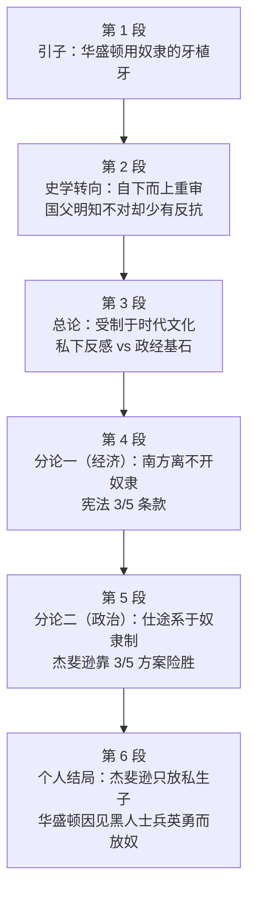

# Passage 41 · 国父们的奴隶制困境

## 答题记录

| 轮次  | 日期         | 题号  | 正确  | 错误  | 正确率 | 用时    | 错题归因 |
| --- | --- | --- | --- | --- | --- | --- | --- |
| 1 |  | 1-5 |  |  |  |  |  |
| 2 |  | 1-5 |  |  |  |  |  |
| 3 |  | 1-5 |  |  |  |  |  |

> [!tip] 填写口径
> - **用时**以分钟计，只计做题时间，不含精读复盘。
> - **错题归因**填「题型·错误类型」，如：例证题·把例子当论点、推理题·过度推断、细节题·偷换概念。
> - 纵向看趋势：正确率升而用时过长 → 熟练度不足；用时降而正确率波动 → 定位不稳。
> - 本篇 5 题，题号栏填 1-5；第 3 题是**跨段合成题**、第 4 题是**通篇判断正误题**，两题都不能只盯一段，错因建议分别写「细节题·跨段信息未合成」「判断题·未逐项回原文核对」。

> [!info] 文章档案
> - **来源**：考研英语（一）2008 年 Text 4
> - **题材**：社会生活（历史 × 政治文化）——从华盛顿用奴隶的牙给自己植牙这件史实切入，重审美国开国元勋与奴隶制之间盘根错节的关系
> - **结构**：6 段 / 19 句 ＋ 5 题（按句号断句与行首缩进实测；与解析引用的「第二段③句」「第三段②句」「第四段②句」「第五段①②句」「第六段①句／②句」全部吻合）
> - **难度**：★★★★☆
> - **一句话主旨**：1784 年华盛顿用从奴隶口中拔出的九颗牙给自己植牙，这幅形象与课本里砍樱桃树的华盛顿判若两人；近三十年来史学界自下而上重审建国一代，发现国父们明知奴隶制不对却少有反抗——因为南方的经济与政治家们的仕途都系于奴隶制：宪法里的「五分之三条款」既保住了奴隶主的利益，也把杰斐逊送上了总统位；最终杰斐逊只释放了自己与女奴所生的孩子，而华盛顿在目睹黑人士兵的英勇后，于遗嘱中给了奴隶自由。

## 一、篇章脉络

- **第 1 段**：**引子**。1784 年，离就任总统还有五年、时年 52 岁的华盛顿几乎掉光了牙，于是雇牙医把九颗牙移植进自己颌骨——**那些牙是从他的奴隶嘴里拔出来的**（第 1 题的战场）。
- **第 2 段**：**史学转向**。这幅形象与历史课本里砍樱桃树的乔治判若两人。近来史学家开始聚焦奴隶制在建国一代生活中扮演的角色：1998 年的 DNA 证据几乎确证杰斐逊与其女奴萨莉·海明斯育有子女；近三十年来学者们**自下而上**地审视历史，揭示出建国领袖们的**道德妥协**与建国初期的**脆弱本质**（第 2 题的战场）。
- **第 3 段**：**总论**。最重要的是，史学家说国父们**受制于他们那个时代的文化**：华盛顿与杰斐逊私下都表示反感奴隶制，但也都明白它是这个国家**政治与经济基石**的一部分。
- **第 4 段**：**分论一（经济）**。一方面，南方离不开奴隶：拥有奴隶「就像拥有一笔巨额存款」；南方各州若不在宪法中写入对这一「特殊制度」的保护（包括把一名奴隶计为五分之三个人以确定国会代表名额的条款），就不会签署宪法。
- **第 5 段**：**分论二（政治）**。政治家们的**政治生命**也依赖奴隶制：五分之三方案靠放大南方各州的选举人票，让杰斐逊在 1800 年总统大选中以微弱优势胜出；上任后他又通过路易斯安那购地**扩大了奴隶制的范围**（第 4 题的战场）。
- **第 6 段**：**个人结局**。然而杰斐逊只给了海明斯的孩子们自由，既没给海明斯本人，也没给另外约 150 名奴隶。华盛顿则是在目睹独立战争中黑人士兵的英勇之后**开始相信人人生而平等**，不顾亲属的强烈反对，在遗嘱中让自己的奴隶获得自由——而仅仅十年前，这样的举动在弗吉尼亚还须经立法机关批准（第 3、5 题的战场）。

> [!tip] 行文逻辑
> 全篇是历史评论型的「**由一人一事切入、再逐层展开**」结构：第 1 段是**引子**（一个反差强烈的细节），第 2 段是**史学背景**，第 3 段是**总论**（受制于时代），第 4、5 段是**分论**（经济、政治两条腿），第 6 段是**个人结局**。三条线索贯穿全篇：**slavery 与 the founding generation 的关系**（全篇话题）、**compromise**（moral compromises → the peculiar institution → three-fifths formula，一条「妥协」链）、**华盛顿与杰斐逊的对照**（一个放了一个没放）。命题格局大体**题文同序**，但有两处例外必须留意：其一，**第 3 题是跨段合成题**——关于杰斐逊的信息散落在第 2、3、5、6 四段，只在一段里找必然漏；其二，**第 4 题是通篇判断正误题**，四个选项分别落在第 5 段①②句、第 5 段②句、第 4 段②句、第 4 段③句，必须逐项回原文核对。**读本篇的正确姿势是：读到人物细节就随手标注段落号**，第 3 题的四个落点正是这样攒出来的。

## 二、逐段精读

### 第 1 段 · 引子：华盛顿用奴隶的牙植牙

**原文**

① In 1784, five years before he became president of the United States, George Washington, 52, was nearly toothless.
② So he hired a dentist to transplant nine teeth into his jaw—having extracted them from the mouths of his slaves.

**译文**

① 1784 年，也就是他成为美国总统的五年前，52 岁的乔治·华盛顿几乎掉光了牙。
② 于是他雇了一位牙医，把九颗牙移植进自己的颌骨——那些牙是从他的奴隶嘴里拔出来的。

> [!note] 段落要点
> - 功能：**全篇引子**，是第 1 题的唯一战场。全段只有 2 句，却完成了「时间锚定 → 引出爆点」两步。
> - ①句用三层时间标注（1784 年／就任总统前五年／52 岁）把这件小事钉在华盛顿**就任总统之前**，反差感因此更强——一个未来的国父，此刻只是个快没牙的老人。
> - ②句的破折号之后 having extracted them from the mouths of his slaves 是全段的**爆点**，也是第 1 题 D 项的语义来源：历史课本里砍樱桃树的诚实乔治没有这一面。
> - So 承接①句，逻辑是「因为几乎掉光了牙 → 所以雇牙医」，读时不要当并列。
> - **破折号在这里承担「迟到的真相」**：作者先把「植牙」这件平常事说完，再用破折号补出牙齿的来源，这是英语叙事里最常用的悬念手法。

#### 长难句 · 本段

> [!abstract] 本段第 ② 句 · So he hired a dentist to transplant nine teeth into his jaw—having extracted them from the mouths of his slaves.

**结构拆解**

- **主干**：he **hired** a dentist **to transplant** nine teeth into his jaw
  - hire sb to do 雇某人做某事；to transplant... 作**目的状语**
- **破折号后**：**having extracted** them from the mouths of his slaves
  - 现在分词的**完成式**（having done），表示该动作**发生在 transplant 之前**——先拔牙，后植牙
  - 逻辑主语是 he（他先让牙医从奴隶口中拔出，再植入自己口中）
- **指代**：them ＝ nine teeth
- **词汇**：transplant v. 移植（器官、植物）；extract v. 拔（牙）、提取；jaw n. 颌、下巴

**参考译文**

于是他雇了一位牙医，把九颗牙移植进自己的颌骨——那些牙是从他的奴隶嘴里拔出来的。

> [!tip] 拆解要点
> 抓两处：①**having done 是现在分词的完成式**，标志「先于谓语发生」，此处即「先拔后植」；②**破折号后接分词短语**是英语补出「背景／真相」的高效手段，语气上比用 and 另起一句更有冲击力。命题角度：本段与第 2 段①句共同构成第 1 题的战场，**例证题的铁律是「例子服务于它支撑的论点」**——本例的论点就在第 2 段①句 That's a far different image from the cherry-tree-chopping George...（这与历史课本上砍樱桃树的乔治形象大相径庭）。第 1 题的 A 项（原始的医疗行为）正是**例子内容的表面信息**，属于典型的「把例子当论点」。

#### 本段重点词汇

| 单词 / 短语 | 词性 | 文中意 | 常用考义与拓展 | 英文示例搭配（中译） |
| --- | --- | --- | --- | --- |
| **toothless** | adj. | 没牙的，无牙的 | 构词 tooth ＋ -less（无……的）：homeless 无家可归的、useless 无用的 | George Washington, 52, was nearly toothless（52 岁的华盛顿几乎掉光了牙） |
| **hire** | v./n. | 雇用；租用 | hire sb to do 雇某人做；hire out 出租；同义 employ（雇用）、rent（租用） | he hired a dentist to transplant nine teeth（他雇了一位牙医来移植九颗牙） |
| **dentist** | n. | 牙医 | dental adj. 牙齿的、牙科的；dental surgery 牙科手术（第 1 题题干词）；dentistry n. 牙科学 | he hired a dentist（他雇了一位牙医） |
| **transplant** | v./n. | 移植 | transplant sth into 把……移植到；organ transplant 器官移植；trans- 前缀表「转移」 | transplant nine teeth into his jaw（把九颗牙移植进他的颌骨） |
| **jaw** | n. | 颌，下巴 | the upper/lower jaw 上／下颌；jaw 亦指「下巴」；jaws of death 鬼门关 | nine teeth into his jaw（九颗牙植入他的颌骨） |
| **extract** | v./n. | 拔（牙）；提取，摘录 | extract a tooth 拔牙；extract from 从……中提取／摘录；extraction n. | having extracted them from the mouths of his slaves（从他的奴隶口中拔出的） |
| **slave** | n./v. | 奴隶；辛苦地工作 | slavery n. 奴隶制（第 3 段）；slave owner 奴隶主；slave state 蓄奴州 | the mouths of his slaves（他的奴隶们的嘴） |
| **five years before** | 短语 | （过去某时点的）五年前 | five years ago 以现在为基准；five years before 以过去某时点为基准 | five years before he became president（在他成为总统的五年前） |
| **president** | n. | 总统；总裁；校长 | presidential adj. 总统的（第 5 段 presidential election）；presidency n. 总统任期 | he became president of the United States（他成为美国总统） |
| **dental surgery** | n. | 牙科手术（第 1 题题干词） | surgery n. 外科手术；外科（学）（第 5 段另有 surgeon）；surgical adj. 外科的 | George Washington's dental surgery（乔治·华盛顿的牙科手术） |

### 第 2 段 · 史学转向：自下而上重审建国一代

**原文**

① That's a far different image from the cherry-tree-chopping George most people remember from their history books.
② But recently, many historians have begun to focus on the roles slavery played in the lives of the founding generation.
③ They have been spurred in part by DNA evidence made available in 1998, which almost certainly proved Thomas Jefferson had fathered at least one child with his slave Sally Hemings.
④ And only over the past 30 years have scholars examined history from the bottom up.
⑤ Works of several historians reveal the moral compromises made by the nation's early leaders and the fragile nature of the country's infancy.
⑥ More significantly, they argue that many of the Founding Fathers knew slavery was wrong—and yet most did little to fight it.

**译文**

① 这与大多数人在历史课本里记得的那个砍樱桃树的乔治，是截然不同的形象。
② 但近来，许多历史学家开始关注奴隶制在建国一代的生活中所扮演的角色。
③ 他们之所以着手研究，部分是因为 1998 年公开的 DNA 证据——它几乎可以确证托马斯·杰斐逊与其女奴萨莉·海明斯至少育有一名子女。
④ 而且只是在过去三十年里，学者们才开始自下而上地审视历史。
⑤ 几位历史学家的著作揭示了这个国家早期领袖们所作的道德妥协，以及这个国家在初创期的脆弱本质。
⑥ 更重要的是，他们指出：许多开国元勋明知奴隶制是错的——然而大多数人却几乎没有采取任何行动去反抗它。

> [!note] 段落要点
> - 功能：**给出史学背景并提出全文论点**，是第 2 题的唯一战场，也是第 1 题答案句的所在。
> - ①句是**承上启下的过渡句**：That's a far different image from... 直接回应第 1 段的植牙形象，同时点明「课本形象 vs 真实形象」的反差——这正是第 1 题 D 项（reveal some unknown aspect of his life）的依据。
> - ②句的 But 是**全文的转向标记**：从「华盛顿个人的怪事」转向「整个建国一代与奴隶制的关系」。
> - ③句给出**史学界转向的第一推力**（DNA 证据）；④句给出第二推力（自下而上的研究视角）；两句合起来说明这是一场**方法论与材料的双重革新**。
> - ⑤句的 **moral compromises（道德妥协）**与 **the fragile nature of the country's infancy（建国初期的脆弱本质）**是第 2 题 B 项的来源（fragile ↔ delicate，infancy ↔ early days）。
> - ⑥句 **More significantly** 引出全篇最重的一句：国父们**明知奴隶制不对，却几乎没有反抗**。「know...was wrong—and yet...did little to fight it」是全篇的中心矛盾，后文第 3—5 段都在解释「为什么不反抗」。

#### 长难句 · 本段

> [!abstract] 本段第 ③ 句 · They have been spurred in part by DNA evidence made available in 1998, which almost certainly proved Thomas Jefferson had fathered at least one child with his slave Sally Hemings.

**结构拆解**

- **主干**：They **have been spurred** in part by DNA evidence...（现在完成时的被动语态）
  - spur v. 激励、促使；be spurred by 受到……的推动
  - in part 部分地（＝ partly）
- **后置定语**：DNA evidence **made available** in 1998（过去分词短语，＝ which was made available in 1998）
- **非限制性定语从句**：**which** almost certainly **proved** (that)...
  - which 指代前面的 DNA evidence（也可理解为指代整个「DNA 证据公开」这件事）
- **宾语从句**：Thomas Jefferson **had fathered** at least one child with his slave Sally Hemings
  - father 作**动词**：成为……的父亲、生（子女）
  - 过去完成时 had fathered，表示该动作发生在 proved 之前
- **词汇**：evidence n. 证据（不可数）；at least 至少

**参考译文**

他们之所以着手研究，部分是因为 1998 年公开的 DNA 证据——它几乎可以确证托马斯·杰斐逊与其女奴萨莉·海明斯至少育有一名子女。

> [!tip] 拆解要点
> 抓三处：①**father 作动词**是本篇最典型的熟词僻义（名词「父亲」→ 动词「生、成为……的父亲」），同类还有 mother、nurse、host；②**made available in 1998 是过去分词作后置定语**，读时按「1998 年被公开的」处理；③**which 引导的非限制性定语从句**在此指代 DNA evidence，功能是对证据作补充说明。命题角度：本句是第 2 题 A 项的出处——原文只说 DNA 证据**确证了一件事**，A 项却说 DNA 技术**已被广泛应用于历史研究**，属**过度推断**。凡选项把「文中某技术被用过一次」说成「被广泛使用／已成为主流」，一律是过度推断。

> [!abstract] 本段第 ④ 句 · And only over the past 30 years have scholars examined history from the bottom up.

**结构拆解**

- **标志**：**Only over the past 30 years** 置于句首 → 主句**部分倒装**
- **倒装结构**：have scholars examined（正常语序：scholars have examined）
- **主干**：scholars **have examined** history **from the bottom up**
  - from the bottom up 自下而上（与 from the top down 自上而下相对）
- **时态**：over the past 30 years ＋ 现在完成时（表示「三十年以来一直」）
- **And**：承接上句的第二个推动因素

**参考译文**

而且只是在过去三十年里，学者们才开始自下而上地审视历史。

> [!tip] 拆解要点
> 抓两处：①**only ＋ 状语置于句首必须部分倒装**（助动词提前），这是考研语法的常考点，也是读长句时最容易卡壳的地方——看到句首的 Only，先把助动词 have 拽回主语后面再读；②**from the bottom up 与 only 呼应**：不只是「自下而上」，而且是「直到最近三十年才开始」，两层含义叠加，强调的是**史学研究视角的迟到**。命题角度：本句与③句共同构成第 2 题的「史学转向」信息区，第 2 题的 C 项（历史学家捏造故事）与原文**方向相反**——文中说私生子事件已被 DNA 证实，不可能同时是捏造。

> [!abstract] 本段第 ⑥ 句 · More significantly, they argue that many of the Founding Fathers knew slavery was wrong—and yet most did little to fight it.

**结构拆解**

- **评注性状语**：**More significantly**（更重要的是），标志本句比前几句更进一层
- **主干**：they **argue that**...（argue 在此＝主张、认为，不是「争论」）
- **宾语从句**：many of the Founding Fathers **knew** (that) slavery was wrong
  - 嵌套的宾语从句：slavery was wrong
- **并列转折**：**and yet** most **did little to fight** it
  - and yet ＝ but nevertheless 然而
  - do little to do 几乎没有做什么来……（little 表否定意义）
  - it ＝ slavery
- **破折号**：此处连接两个分句，功能相当于「却」，强化转折

**参考译文**

更重要的是，他们指出：许多开国元勋明知奴隶制是错的——然而大多数人却几乎没有采取任何行动去反抗它。

> [!tip] 拆解要点
> 抓三处：①**More significantly 是段落内的层级标记**，它引出的句子通常是该段的重心，考场上可优先读；②**knew...was wrong 与 did little to fight it 构成「知与行」的对立**——这正是全篇的中心矛盾，第 3 段至第 5 段回答的正是「为什么知而不行」；③**do little to do 是否定表达**，little 表「几乎没有」，选项中若把它换成 did something / tried hard 即为与原文相反。命题角度：本句是理解全篇的钥匙——**先立矛盾，后作解释**，掌握这一结构，第 3、4 题的落点（经济依赖、政治依赖）就能预判。

#### 本段重点词汇

| 单词 / 短语 | 词性 | 文中意 | 常用考义与拓展 | 英文示例搭配（中译） |
| --- | --- | --- | --- | --- |
| **a far different image** | 短语 | 截然不同的形象 | far 修饰比较级表程度（far better 好得多）；different from 与……不同 | a far different image from...（与……截然不同的形象） |
| **cherry-tree-chopping** | adj. | 砍樱桃树的 | 复合形容词：名词 ＋ 现在分词；源自华盛顿砍樱桃树的传说 | the cherry-tree-chopping George（砍樱桃树的那个乔治） |
| **history books** | n. | 历史课本，史书 | book 复数为「书籍」；history n. 历史、史学；historic 有历史意义的／historical 历史上的 | most people remember from their history books（大多数人从历史课本里记得的） |
| **historian** | n. | 历史学家 | history n. 历史；historic adj. 有历史意义的；historical adj. 历史上的、史学的 | many historians have begun to focus on（许多历史学家开始关注） |
| **focus on** | 短语 | 关注，聚焦于 | focus n. 焦点、焦距；v. 集中；focus one's attention on 把注意力集中于 | focus on the roles slavery played（关注奴隶制所扮演的角色） |
| **the founding generation** | n. | 建国一代（开国那一代人） | found v. 建立（find—found—found 是「找到」，found—founded—founded 是「建立」）；founder n. 建立者、国父（第 3 段） | the lives of the founding generation（建国一代的生活） |
| **spur** | v./n. | 激励，促使；马刺 | be spurred by 受到……的推动；spur sb to do 促使某人做；on the spur of the moment 一时冲动 | They have been spurred in part by DNA evidence（他们部分地受到 DNA 证据的推动） |
| **in part** | 短语 | 部分地，在某种程度上 | 同义 partly；in parts 分开地；part n. 部分、角色（play a role in） | spurred in part by（部分地被……促使） |
| **DNA evidence** | n. | DNA 证据 | evidence n. 证据（不可数，＋ of/that）；evident adj. 明显的；DNA ＝ 脱氧核糖核酸 | DNA evidence made available in 1998（1998 年公开的 DNA 证据） |
| **father** | v./n. | （动词）成为……的父亲、生（子女） | 熟词僻义：由名词「父亲」转化而来；同类 mother v. 生育、养育 | Jefferson had fathered at least one child（杰斐逊至少育有一名子女） |
| **examine...from the bottom up** | 短语 | 自下而上地审视 | from the bottom up 自下而上；反义 from the top down 自上而下；examine v. 审查、审视 | examined history from the bottom up（自下而上地审视历史） |
| **reveal** | v. | 揭示，显示 | reveal that... 表明……；revealing adj. 有启发的；revelation n. 揭示 | Works of several historians reveal...（几位历史学家的著作揭示了……） |
| **moral compromises** | n. | 道德妥协 | moral adj. 道德的；n. 道德、寓意；morality n. 道德（体系）；compromise n./v. 妥协 | the moral compromises made by the nation's early leaders（建国领袖们所作的道德妥协） |
| **the fragile nature of** | 短语 | ……的脆弱本质 | fragile adj. 脆弱的、易碎的；同义 delicate；nature n. 本质、性质、自然 | the fragile nature of the country's infancy（国家初创期的脆弱本质） |
| **infancy** | n. | 初期，初创期；婴儿期 | infant n. 婴儿；adj. 初期的（infant industry 幼稚产业）；in its infancy 处于初期 | the country's infancy（这个国家的初创期） |
| **more significantly** | 短语 | 更重要的是 | significantly adv. 重要地、显著地；significant adj. 重要的；significance n. 意义 | More significantly, they argue that...（更重要的是，他们主张……） |
| **the Founding Fathers** | n. | （美国的）开国元勋 | founding adj. 创建的；father 此处＝元勋、奠基人；亦可小写 the founding fathers | many of the Founding Fathers（许多开国元勋） |
| **do little to fight it** | 短语 | 几乎没有采取任何行动去反抗它 | do little to do 几乎没做什么；little 表否定；fight v. 反抗、斗争 | most did little to fight it（大多数人几乎没有去反抗它） |

### 第 3 段 · 总论：受制于他们那个时代的文化

**原文**

① More than anything, the historians say, the founders were hampered by the culture of their time.
② While Washington and Jefferson privately expressed distaste for slavery, they also understood that it was part of the political and economic bedrock of the country they helped to create.

**译文**

① 史学家们说，最重要的是，这些建国者受到了他们那个时代文化的束缚。
② 虽然华盛顿与杰斐逊私下里都表示过对奴隶制的反感，但他们也都明白，奴隶制是他们所协助缔造的这个国家的政治与经济基石的一部分。

> [!note] 段落要点
> - 功能：**给出总论，解释第 2 段⑥句「知而不行」的原因**，是第 3 题关于杰斐逊的一个落点。
> - ①句的 **More than anything**（最重要的是）与第 2 段⑥句的 More significantly 同为层级标记，说明本段是解释部分的**第一层、也是最高层**：时代文化的束缚。
> - ①句 **were hampered by the culture of their time**：「受制于时代」是史学界评价历史人物的经典立场——不以后世道德苛责前人，但仍指出其局限。
> - ②句用 **While** 把「私下反感」与「公开依存」并列，正是「道德妥协」的具体化：私德与公利的撕裂。
> - ②句的 **political and economic bedrock** 是本段的关键词，它预告了后文的两条分论——第 4 段讲经济（bedrock 的一半），第 5 段讲政治（另一半）。

#### 长难句 · 本段

> [!abstract] 本段第 ② 句 · While Washington and Jefferson privately expressed distaste for slavery, they also understood that it was part of the political and economic bedrock of the country they helped to create.

**结构拆解**

- **让步状语从句**：**While** Washington and Jefferson privately **expressed distaste for** slavery
  - while 置于句首表「虽然、尽管」（注意：while 亦可表「当……时」「而」）
- **主句**：they also **understood that**...
- **宾语从句**：that it **was** part of **the political and economic bedrock** of the country...
  - it ＝ slavery
- **定语从句**：the country **(that)** they helped **to create**（省略关系代词 that）
- **词汇**：privately adv. 私下地（反义 publicly 公开地）；distaste n. 反感；bedrock n. 基石、基岩

**参考译文**

虽然华盛顿与杰斐逊私下里都表示过对奴隶制的反感，但他们也都明白，奴隶制是他们所协助缔造的这个国家的政治与经济基石的一部分。

> [!tip] 拆解要点
> 抓三处：①**句首的 while 是让步连词「虽然」**，不是时间连词「当……时」——判断依据是主从句之间是「反感」与「理解其必要性」的对立而非时间关系；②**privately 与后文的 publicly 视角对照**，暗示「私下的态度」与「公开的作为」并不一致，这正是「道德妥协」的实质；③**they helped to create 是省略关系代词的定语从句**，还原为 the country that they helped to create，读时按「他们协助缔造的那个国家」理解。命题角度：本句是第 3 题 C 项（杰斐逊态度复杂）的四大落点之一——**私下的反感**与**公开的依存**并存，正是「复杂」的定义。**凡问某历史人物对某事的态度，若文中同时出现正面与负面的表述，答案多半是 complex / mixed / ambivalent。**

#### 本段重点词汇

| 单词 / 短语 | 词性 | 文中意 | 常用考义与拓展 | 英文示例搭配（中译） |
| --- | --- | --- | --- | --- |
| **more than anything** | 短语 | 最重要的是，超过一切地 | 同义 above all、most importantly；more than ＋ 名词表「不止是」 | More than anything, the founders were hampered（最重要的是，建国者受到了束缚） |
| **founder** | n. | 建立者，国父 | found v. 建立、创立（规则动词 founded）；founding n. 创建；注意 find 的过去式也是 found | the founders were hampered by the culture of their time（建国者受制于他们时代的文化） |
| **hamper** | v./n. | 束缚，阻碍 | hamper sb/sth 阻碍……；同义 hinder、impede；hamper n. 有盖大篮 | were hampered by the culture of their time（受到他们那个时代文化的束缚） |
| **the culture of one's time** | 短语 | （某人）所处的时代文化 | time 此处＝时代、时期（in ancient times 在古代）；culture n. 文化 | the culture of their time（他们那个时代的文化） |
| **while** | conj. | 虽然，尽管（句首表让步） | while 三义：当……时／而（对比）／虽然；句首且主从句对立时取「虽然」 | While Washington and Jefferson privately expressed distaste（虽然华盛顿与杰斐逊私下表示反感） |
| **privately** | adv. | 私下地，秘密地 | private adj. 私人的、私下的；反义 publicly 公开地；privacy n. 隐私 | privately expressed distaste for slavery（私下表示对奴隶制的反感） |
| **express distaste for** | 短语 | 表达对……的反感 | distaste n. 反感、厌恶（a distaste for）；taste n. 品味、口味；express v. 表达 | express distaste for slavery（表达对奴隶制的反感） |
| **slavery** | n. | 奴隶制 | slave n. 奴隶（第 1 段）；slave owner 奴隶主；abolish slavery 废除奴隶制 | expressed distaste for slavery（表达对奴隶制的反感） |
| **bedrock** | n. | 基石，基础；基岩 | 复合词 bed ＋ rock；同义 foundation、cornerstone；economic bedrock 经济基石 | the political and economic bedrock（政治与经济的基石） |
| **political and economic bedrock** | 短语 | 政治与经济的基石 | political adj. 政治的；economic adj. 经济的（economy n. 经济；economics 经济学） | part of the political and economic bedrock of the country（该国政治经济基石的一部分） |

### 第 4 段 · 分论一（经济）：南方离不开奴隶

**原文**

① For one thing, the South could not afford to part with its slaves.
② Owning slaves was "like having a large bank account," says Wiencek, author of An Imperfect God: George Washington, His Slaves, and the Creation of America.
③ The southern states would not have signed the Constitution without protections for the "peculiar institution," including a clause that counted...as... a slave three fifths of a man for the purposes of congressional representation.

**译文**

① 一方面，南方承受不起放弃奴隶的代价。
② 维恩切克说，拥有奴隶「就像是拥有一笔巨额存款的银行账户」——他是《一个不完美的上帝：乔治·华盛顿、他的奴隶与美国的缔造》一书的作者。
③ 倘若宪法不写入对这一「特殊制度」的保护条款，南方各州是不会签署这部宪法的；这些保护包括这样一项条款：为了确定国会代表名额，一名奴隶被计为五分之三个人的份额。

> [!note] 段落要点
> - 功能：**分论一，讲经济层面的依赖**，是第 4 题 C、D 两项的出处，也是第 4 段「政治与经济基石」中「经济」那一半。
> - ①句的 **For one thing** 标志并列分论的开始（与之呼应的第 5 段首句是 And...），读时立刻意识到「还有另一面」。
> - ②句用引语＋书名的形式给出**权威佐证**；「像拥有一笔巨额存款」是**比喻**，第 4 题 C 项正是把它当成事实（奴隶主真的有大额存款账户）——**偷换概念**。
> - ③句的 **would not have signed...without...** 是**含蓄虚拟语气**：南方各州签署宪法**是以保护奴隶制为前提条件的**。
> - ③句的 **the "peculiar institution"** 加有引号，是南方对奴隶制的**委婉称呼**，并非普遍公认的定性——第 4 题 D 项（Slavery was regarded as a peculiar institution）正是把这一地方性委婉语说成普遍事实，**偷换范围**。
> - ③句的五分之三条款（three-fifths clause）是第 5 题／第 4 题的关键史实：奴隶**被计票，但只按 3/5 计**——所以第 4 题 B 项（奴隶没有投票权）与原文相反。

#### 长难句 · 本段

> [!abstract] 本段第 ③ 句 · The southern states would not have signed the Constitution without protections for the "peculiar institution," including a clause that counted a slave as three fifths of a man for the purposes of congressional representation.

**结构拆解**

- **主干**：The southern states **would not have signed** the Constitution **without** protections...
  - **含蓄虚拟语气**：would not have done（本不会做），条件由介词短语 without... 表达（＝ if there had not been...）
- **介词短语作条件**：**without** protections for the "peculiar institution"
- **伴随成分**：**including** a clause...（现在分词，补充说明 protections 的具体内容）
- **定语从句**：a clause **that counted** a slave **as** three fifths of a man
  - count...as... 把……计为……
- **目的状语**：**for the purposes of** congressional representation（为了……的目的）
- **词汇**：sign v. 签署；protection n. 保护（条款）；peculiar adj. 特殊的、古怪的；institution n. 制度、机构

**参考译文**

倘若宪法不写入对这一「特殊制度」的保护条款，南方各州是不会签署这部宪法的；这些保护包括这样一项条款：为了确定国会代表名额，一名奴隶被计为五分之三个人。

> [!tip] 拆解要点
> 抓三处：①**without ＋ 名词 可以表达一个虚拟条件**（若没有……），主句用 would not have done 呼应——这类「介词短语代替 if 从句」的含蓄虚拟在阅读中极常见，识别方法是看主句谓语是否用了 would have done；②**including 引出的成分是 protections 的下位例子**，读时按「其中包括……」处理；③**the "peculiar institution" 带引号，是特定人群在特定语境下的称呼**，引号在这里的功能是「引用他人的说法／表示保留」，凡选项中把带引号的他称当成作者或公认的定性，一律要警惕。命题角度：本句同时提供了第 4 题 B、D 两项的出处——B 项与「奴隶被按 3/5 计票」相反，D 项把带引号的南方委婉语说成了普遍事实。

#### 本段重点词汇

| 单词 / 短语 | 词性 | 文中意 | 常用考义与拓展 | 英文示例搭配（中译） |
| --- | --- | --- | --- | --- |
| **for one thing** | 短语 | 一方面（用于列举） | 常与 for another (thing) 呼应；for one thing...for another... 一方面……另一方面…… | For one thing, the South could not afford to part with its slaves（一方面，南方承受不起放弃奴隶） |
| **the South** | n. | （美国的）南方（各州） | 专指美国南北战争前的南方蓄奴州；the North 北方；southern adj. 南方的 | The South could not afford...（南方承受不起……） |
| **afford to** | 短语 | 承受得起（做某事的代价） | can/could afford to do 有能力／承受得起做；afford 常与 can、could 连用 | could not afford to part with its slaves（承受不起放弃奴隶的代价） |
| **part with** | 短语 | 放弃，出让（不舍得的东西） | part v. 分开、分离；part with sth 割舍某物；part from sb 与某人分别 | part with its slaves（放弃它的奴隶） |
| **owning slaves** | 短语 | 拥有奴隶（动名词作主语） | own v. 拥有；adj. 自己的；owner n. 物主、奴隶主（slave owner） | Owning slaves was "like having a large bank account"（拥有奴隶「就像拥有一笔巨额存款」） |
| **like having a large bank account** | 短语 | 就像拥有一笔巨额存款（比喻） | bank account 银行账户；like 此处是介词「像」；比喻用法，非事实 | "like having a large bank account"（「就像是拥有一笔巨额存款」） |
| **author of** | 短语 | ……的作者 | author n. 作者、作家；v. 撰写；authorship n. 作者身份 | author of An Imperfect God（《一个不完美的上帝》的作者） |
| **sign the Constitution** | 短语 | 签署宪法 | sign v. 签署、签名；signature n. 签名；Constitution n. 宪法（the U.S. Constitution） | would not have signed the Constitution（本不会签署这部宪法） |
| **protection** | n. | （此处指）保护性条款；保护 | protect v. 保护；protective adj. 保护的；protections for... 对……的保护（条款） | protections for the "peculiar institution"（对这一「特殊制度」的保护条款） |
| **the peculiar institution** | n. | 「特殊制度」（南方对奴隶制的委婉称呼） | peculiar adj. 特殊的、古怪的；institution n. 制度、机构、习俗 | protections for the "peculiar institution"（对这一「特殊制度」的保护） |
| **peculiar** | adj. | 特殊的，独特的；古怪的 | peculiarity n. 特性、怪癖；be peculiar to 为……所特有 | the "peculiar institution"（「特殊制度」） |
| **clause** | n. | （法律文件的）条款；从句 | a clause in a contract 合同中的一项条款；main clause 主句／subordinate clause 从句 | a clause that counted a slave as three fifths of a man（把奴隶计为 3/5 个人的条款） |
| **count...as...** | 短语 | 把……计为／算作…… | count v. 计算、计入；count on 依赖；count for 有……价值 | counted a slave as three fifths of a man（把一名奴隶计为五分之三个人） |
| **three fifths of a man** | 短语 | 五分之三个人 | 分数表达：分子用基数词、分母用序数词（three fifths）；3/5 条款是本篇的重要史实 | counted a slave as three fifths of a man（把奴隶计为五分之三个人） |
| **for the purposes of** | 短语 | 为了……的目的 | for the purpose of 为了……；on purpose 故意地；purpose n. 目的、用途 | for the purposes of congressional representation（为了国会代表名额的确定） |
| **congressional representation** | n. | 国会代表（名额） | congressional adj. 国会的（Congress n. 国会）；representation n. 代表、代表权；represent v. 代表 | congressional representation（国会代表权／代表名额） |

### 第 5 段 · 分论二（政治）：仕途系于奴隶制

**原文**

① And the statesmen's political lives depended on slavery.
② The three-fifths formula handed Jefferson his narrow victory in the presidential election of 1800 by inflating the votes of the southern states in the Electoral College.
③ Once in office, Jefferson extended slavery with the Louisiana Purchase in 1803; the new land was carved into 13 states, including three slave states.

**译文**

① 而且，这些政治家的政治生涯也依赖于奴隶制。
② 五分之三方案通过放大南方各州在选举人团中的选票，把 1800 年总统选举的微弱胜利交到了杰斐逊手上。
③ 一上任，杰斐逊就通过 1803 年的路易斯安那购地扩大了奴隶制的范围；这片新土地后来被划分为 13 个州，其中三个是蓄奴州。

> [!note] 段落要点
> - 功能：**分论二，讲政治层面的依赖**，是第 4 题 A、B 两项的出处，也是第 3 题关于杰斐逊的一个落点。
> - ①句句首的 **And** 承接第 4 段的 For one thing，构成「经济 ＋ 政治」的双支柱论证——这正是第 3 段②句 political and economic bedrock 的展开。
> - ②句是**第 4 题 A 项的核心依据**：政治家们**从奴隶制中获得政治好处**（杰斐逊靠 3/5 方案险胜）。hand sb sth 是双宾语结构，「把某物交给某人」。
> - ②句同时是**第 4 题 B 项的证伪依据**：3/5 条款的作用是**放大南方选票**，前提是奴隶被计入人口——所以奴隶并非「没有投票权」，而是**按 3/5 折算被计入**，B 项与原文相反。
> - ③句讲杰斐逊上任后的作为：**扩大而非废除**奴隶制（路易斯安那购地 → 13 个州，其中 3 个蓄奴州）。这是第 3 题「态度复杂」的又一证据。
> - 注意 **slave states（蓄奴州）** 与 free states（自由州）的对立是美国史的固定术语。

#### 长难句 · 本段

> [!abstract] 本段第 ② 句 · The three-fifths formula handed Jefferson his narrow victory in the presidential election of 1800 by inflating the votes of the southern states in the Electoral College.

**结构拆解**

- **主干**：The three-fifths formula **handed** Jefferson his narrow victory（双宾语：hand sb sth）
  - hand v. 递给、交给；引申为「使某人获得」
- **宾语**：Jefferson（间接宾语）＋ his narrow victory（直接宾语）
- **定语**：in the presidential election of 1800（修饰 victory）
- **方式状语**：**by inflating** the votes of the southern states in the Electoral College
  - by doing 通过做……（表手段）
  - inflate v. 使膨胀、抬高（此处指「放大选票权重」）
- **词汇**：formula n. 方案、公式；narrow adj. 勉强的、微弱的（a narrow victory 险胜）; Electoral College 选举人团

**参考译文**

五分之三方案通过放大南方各州在选举人团中的选票，把 1800 年总统选举的微弱胜利交到了杰斐逊手上。

> [!tip] 拆解要点
> 抓三处：①**hand sb sth 是双宾语结构**，此处是拟人化用法——「方案把胜利交到某人手上」，读成「使某人获得」最自然；②**by doing 表手段**，是本题的因果链：3/5 方案（因）→ 放大南方选票（手段）→ 杰斐逊险胜（果）；③**narrow 修饰 victory 是「微弱的、勉强的」**（a narrow escape 九死一生；a narrow majority 微弱多数），不要读成「狭窄的胜利」。命题角度：本句是**第 4 题 A 项的直接出处**（Some Founding Fathers benefit politically from slavery），也是 B 项的证伪点（奴隶按 3/5 被计入 → 并非「没有投票权」）。第 4 题是通篇判断题，凡此类题务必**逐项回原文定位**，不要凭历史常识作答。

#### 本段重点词汇

| 单词 / 短语 | 词性 | 文中意 | 常用考义与拓展 | 英文示例搭配（中译） |
| --- | --- | --- | --- | --- |
| **statesman** | n. | 政治家（常含褒义） | statesmanship n. 政治才干；state n. 国家、州；politician 政治家（中性或贬义） | the statesmen's political lives（政治家们的政治生涯） |
| **political lives** | n. | 政治生涯，政治生命 | political adj. 政治的；politics n. 政治；politician n. 政治家；life 复数为 lives | the statesmen's political lives depended on slavery（政治家们的政治生涯依赖于奴隶制） |
| **depend on** | 短语 | 依赖，取决于 | depend on sb/sth 依靠；dependent adj. 依赖的（be dependent on）；independence n. 独立 | depended on slavery（依赖于奴隶制） |
| **the three-fifths formula** | 短语 | 五分之三方案（3/5 妥协） | formula n. 方案、公式、配方（复数 formulas / formulae）；第 4 段作 three fifths of a man | The three-fifths formula handed Jefferson his narrow victory（3/5 方案使杰斐逊险胜） |
| **hand sb sth** | 短语 | 把某物交给某人；使某人获得 | hand v. 递、交；n. 手；hand in 上交；on the other hand 另一方面 | handed Jefferson his narrow victory（把微弱的优势胜利交给了杰斐逊） |
| **a narrow victory** | n. | 微弱优势的胜利，险胜 | narrow adj. 勉强的、狭窄的；v. 变窄；a narrow escape 死里逃生；narrowly adv. 勉强地 | his narrow victory in the presidential election（他在总统选举中的险胜） |
| **presidential election** | n. | 总统选举 | presidential adj. 总统的（第 1 段 president）；election n. 选举；elect v. 选举 | the presidential election of 1800（1800 年的总统选举） |
| **inflate** | v. | 抬高，放大；使充气 | inflation n. 通货膨胀；inflated adj. 夸张的、膨胀的 | inflating the votes of the southern states（放大南方各州的选票） |
| **the Electoral College** | n. | （美国）选举人团 | electoral adj. 选举的；college 此处＝团体、机构（非「学院」） | inflating the votes ... in the Electoral College（放大在选举人团中的选票） |
| **once in office** | 短语 | 一上任，一旦执政 | once conj. 一旦；in office 执政、在任；office n. 公职、办公室 | Once in office, Jefferson extended slavery（一上任，杰斐逊就扩大了奴隶制） |
| **extend slavery** | 短语 | 扩大奴隶制（的范围） | extend v. 扩大、延长；extension n. 延伸；extensive adj. 广泛的 | Jefferson extended slavery with the Louisiana Purchase（杰斐逊通过购地扩大奴隶制） |
| **the Louisiana Purchase** | n. | （美国）路易斯安那购地（1803 年） | purchase n./v. 购买（正式用语，＝ buy）；the Louisiana Purchase 是专有历史事件名 | with the Louisiana Purchase in 1803（通过 1803 年的路易斯安那购地） |
| **carve into** | 短语 | 被划分为，被分割成 | carve v. 雕刻、切分；carve out 开创出；carve up 瓜分 | the new land was carved into 13 states（这片新土地被划分为 13 个州） |
| **slave states** | n. | 蓄奴州 | slave n. 奴隶；state n. 州、国家；对比 free states 自由州 | including three slave states（其中包括三个蓄奴州） |

### 第 6 段 · 个人结局：只放了孩子，与终于放了奴隶

**原文**

① Still, Jefferson freed Hemings's children—though not Hemings herself or his approximately 150 other slaves.
② Washington, who had begun to believe that all men are created equal after observing the bravery of the black soldiers during the Revolutionary War, overcame the strong opposition of his relatives to grant his slaves their freedom in his will.
③ Only a decade earlier, such an act would have required legislative approval in Virginia.

**译文**

① 尽管如此，杰斐逊还是给了海明斯的孩子们自由——尽管既没给海明斯本人，也没给另外约 150 名奴隶。
② 华盛顿则是在目睹独立战争中黑人士兵的英勇表现之后，开始相信人人生而平等；他不顾亲属的强烈反对，在遗嘱中让自己的奴隶获得了自由。
③ 而仅仅十年前，这样的举动在弗吉尼亚州还须经立法机关批准。

> [!note] 段落要点
> - 功能：**交代两位国父的个人结局，形成鲜明对照**，是第 3、5 题的战场。
> - ①句句首的 **Still**（尽管如此）标志转折：杰斐逊终究做了一点什么——但只放了自己的孩子。这是第 3 题「态度复杂」的第四处证据（亦是其 B 项的证伪点：「父亲的身份」只能解释放走孩子，解释不了没放海明斯本人与另外 150 人）。
> - ②句是**第 5 题的答案句**：华盛顿释放奴隶的动因是**目睹黑人士兵在独立战争中的英勇**（military experience），其后才「开始相信人人生而平等」。
> - ②句还包含三重阻力：**亲属的强烈反对**、**以遗嘱（而非生前）方式**、**须经批准的法律环境**——这些都在说明解放奴隶之难。
> - ③句的 **would have required legislative approval** 是虚拟语气：仅仅十年前，这样的举动**本来是需要**立法机关批准的（言下之意：到他立遗嘱时或许已不必，或强调其艰难）。
> - 对照结构：杰斐逊「放了孩子，没放其他人」 ↔ 华盛顿「放了全部奴隶」——作者未作褒贬，只把事实并列，这是历史评论的克制笔法。

#### 长难句 · 本段

> [!abstract] 本段第 ② 句 · Washington, who had begun to believe that all men are created equal after observing the bravery of the black soldiers during the Revolutionary War, overcame the strong opposition of his relatives to grant his slaves their freedom in his will.

**结构拆解**

- **主干**：Washington... **overcame** the strong opposition of his relatives **to grant** his slaves their freedom in his will
  - overcome v. 克服、战胜（overcome—overcame—overcome）
  - to grant... 是**目的状语**（为了给予……）
  - grant sb sth 双宾语：给予某人某物
- **非限制性定语从句**：**who had begun to believe** that...（修饰 Washington）
  - 内含宾语从句：that all men **are created** equal（**一般现在时的被动**，因为是引用《独立宣言》的恒常命题）
  - 内含时间状语：after **observing** the bravery of the black soldiers during the Revolutionary War
- **词汇**：bravery n. 英勇（brave adj. 勇敢的）；opposition n. 反对（oppose v.）；will n. 遗嘱（熟词僻义）

**参考译文**

华盛顿则是在目睹独立战争中黑人士兵的英勇表现之后，开始相信人人生而平等；他不顾亲属的强烈反对，在遗嘱中让自己的奴隶获得了自由。

> [!tip] 拆解要点
> 抓三处：①**从句套从句**：who 定语从句 → that 宾语从句 → after observing 时间状语，读时先抓主干「Washington overcame the opposition」，再把从句内容回填；②**all men are created equal 用一般现在时**是因为它引自《独立宣言》这一恒常命题，与叙述的过去时态形成对照，这本身就是一条「引文标记」；③**will 在此是名词「遗嘱」**（in his will 在他的遗嘱中），不是助动词。命题角度：本句是**第 5 题的唯一答案句**——题干问 originated from（源于），答案必须是**触发善举的那个经历**（observing the bravery of the black soldiers during the Revolutionary War → military experience）。第 5 题 A 项（moral considerations 道德考量）是强干扰：华盛顿确实「开始相信人人生而平等」，但那是**结果**而非源头，题干问的是 originated from——**凡问「原因／源头」的题，要分清「触发事件」与「随之形成的观念」，前者才是答案。**

> [!abstract] 本段第 ③ 句 · Only a decade earlier, such an act would have required legislative approval in Virginia.

**结构拆解**

- **时间状语**：**Only a decade earlier**（仅仅十年前）——a decade ＝ ten years
- **主语**：such an act（这样的举动，指代上句「在遗嘱中解放奴隶」）
- **谓语**：**would have required** legislative approval
  - **虚拟语气**：would have done 表示「（在过去某条件下）本来会……」，此处隐含条件为「若是在十年前做这件事」
  - require v. 需要；approval n. 批准（approve v.）
- **状语**：in Virginia（在弗吉尼亚州）

**参考译文**

而仅仅十年前，这样的举动在弗吉尼亚州还须经立法机关批准。

> [!tip] 拆解要点
> 抓两处：①**Only a decade earlier ＋ would have required 构成对过去的虚拟**：作者是在说「要是早十年做这件事，本来是需要立法批准的」——言下之意是法律环境正在松动，或强调此举在当时有多不容易；②**such an act 回指上一句整件事**（在遗嘱中给奴隶自由），这类「such ＋ 名词」的回指是英语篇章衔接的常用手段。命题角度：本句不直接命题，却是理解第 5 题的关键背景——**解放奴隶在当时是法律上的难事**，这为「华盛顿不顾亲属反对、在遗嘱中放奴」的份量作了注脚。

#### 本段重点词汇

| 单词 / 短语 | 词性 | 文中意 | 常用考义与拓展 | 英文示例搭配（中译） |
| --- | --- | --- | --- | --- |
| **free** | v./adj. | 释放，使自由；自由的 | free v. 释放（＝ set free、release）；adj. 自由的、免费的；freedom n. 自由 | Jefferson freed Hemings's children（杰斐逊给了海明斯的孩子们自由） |
| **approximately** | adv. | 大约，大概 | approximate adj. 近似的；v. 接近；同义 about、roughly、some | his approximately 150 other slaves（他的另外约 150 名奴隶） |
| **all men are created equal** | 引文 | 人人生而平等 | 出自美国《独立宣言》；create v. 创造；引文用一般现在时 | believe that all men are created equal（相信人人生而平等） |
| **observe** | v. | 目睹，观察；遵守；评论 | observation n. 观察；observer n. 观察者；observe a rule 遵守规则 | after observing the bravery of the black soldiers（在目睹黑人士兵的英勇之后） |
| **bravery** | n. | 英勇，勇敢 | brave adj. 勇敢的；v. 勇敢面对；bravely adv. 勇敢地 | the bravery of the black soldiers（黑人士兵的英勇） |
| **black soldiers** | n. | 黑人士兵 | soldier n. 士兵；black adj. 黑人的、黑色的；African American 非裔美国人 | the black soldiers during the Revolutionary War（独立战争中的黑人士兵） |
| **the Revolutionary War** | n. | （美国）独立战争（1775—1783） | revolution n. 革命；revolutionary adj. 革命的；the American Revolution 美国独立革命 | during the Revolutionary War（在独立战争期间） |
| **overcome** | v. | 克服，战胜 | overcome—overcame—overcome；overcome difficulties 克服困难；be overcome by 被……压倒 | overcame the strong opposition of his relatives（克服了亲属的强烈反对） |
| **strong opposition** | n. | 强烈的反对 | opposition n. 反对（oppose v.；be opposed to 反对）；strong adj. 强烈的 | the strong opposition of his relatives（他亲属的强烈反对） |
| **relatives** | n. | 亲属，亲戚 | relative n. 亲属；adj. 相对的、相关的（relative to）；relation n. 关系、亲属 | the strong opposition of his relatives（亲属的强烈反对） |
| **grant sb sth** | 短语 | 给予某人某物（双宾语） | grant v. 给予、授予；n. 拨款；take sth for granted 想当然 | grant his slaves their freedom（给予他的奴隶自由） |
| **in one's will** | 短语 | 在某人的遗嘱中 | **will 熟词僻义**：n. 遗嘱（非助动词「将」）；make a will 立遗嘱 | grant his slaves their freedom in his will（在遗嘱中给奴隶自由） |
| **only a decade earlier** | 短语 | 仅仅十年前 | decade n. 十年；only 强调时间之短；earlier 以过去某时为基准 | Only a decade earlier, such an act...（仅仅十年前，这样的举动……） |
| **would have required legislative approval** | 短语 | （在过去条件下）本需要立法批准 | legislative adj. 立法的（legislature n. 立法机关）；approval n. 批准（approve v. 批准、赞同） | would have required legislative approval in Virginia（在弗吉尼亚本需立法批准） |

## 三、全篇重点词汇汇总（自测用）

> [!info] 说明
> 本表只列「单词 / 词性 / 所在段」，不含释义与搭配，用于遮表自测：说出词义后再回该段核对。
> 收录**全篇所有段落词汇，共 82 条，不删减**，与各段「本段重点词汇」等长同源（跨段复现的词只在其首次出现的段落收录一次，如 historian 只在第 2 段收录）。

| 单词 / 短语 | 词性 | 所在段 |
| --- | --- | --- |
| **toothless** | adj. | 第 1 段 |
| **hire** | v./n. | 第 1 段 |
| **dentist** | n. | 第 1 段 |
| **transplant** | v./n. | 第 1 段 |
| **jaw** | n. | 第 1 段 |
| **extract** | v./n. | 第 1 段 |
| **slave** | n./v. | 第 1 段 |
| **five years before** | 短语 | 第 1 段 |
| **president** | n. | 第 1 段 |
| **dental surgery** | n. | 第 1 段 |
| **a far different image** | 短语 | 第 2 段 |
| **cherry-tree-chopping** | adj. | 第 2 段 |
| **history books** | n. | 第 2 段 |
| **historian** | n. | 第 2 段 |
| **focus on** | 短语 | 第 2 段 |
| **the founding generation** | n. | 第 2 段 |
| **spur** | v./n. | 第 2 段 |
| **in part** | 短语 | 第 2 段 |
| **DNA evidence** | n. | 第 2 段 |
| **father** | v./n. | 第 2 段 |
| **examine...from the bottom up** | 短语 | 第 2 段 |
| **reveal** | v. | 第 2 段 |
| **moral compromises** | n. | 第 2 段 |
| **the fragile nature of** | 短语 | 第 2 段 |
| **infancy** | n. | 第 2 段 |
| **more significantly** | 短语 | 第 2 段 |
| **the Founding Fathers** | n. | 第 2 段 |
| **do little to fight it** | 短语 | 第 2 段 |
| **more than anything** | 短语 | 第 3 段 |
| **founder** | n. | 第 3 段 |
| **hamper** | v./n. | 第 3 段 |
| **the culture of one's time** | 短语 | 第 3 段 |
| **while** | conj. | 第 3 段 |
| **privately** | adv. | 第 3 段 |
| **express distaste for** | 短语 | 第 3 段 |
| **slavery** | n. | 第 3 段 |
| **bedrock** | n. | 第 3 段 |
| **political and economic bedrock** | 短语 | 第 3 段 |
| **for one thing** | 短语 | 第 4 段 |
| **the South** | n. | 第 4 段 |
| **afford to** | 短语 | 第 4 段 |
| **part with** | 短语 | 第 4 段 |
| **owning slaves** | 短语 | 第 4 段 |
| **like having a large bank account** | 短语 | 第 4 段 |
| **author of** | 短语 | 第 4 段 |
| **sign the Constitution** | 短语 | 第 4 段 |
| **protection** | n. | 第 4 段 |
| **the peculiar institution** | n. | 第 4 段 |
| **peculiar** | adj. | 第 4 段 |
| **clause** | n. | 第 4 段 |
| **count...as...** | 短语 | 第 4 段 |
| **three fifths of a man** | 短语 | 第 4 段 |
| **for the purposes of** | 短语 | 第 4 段 |
| **congressional representation** | n. | 第 4 段 |
| **statesman** | n. | 第 5 段 |
| **political lives** | n. | 第 5 段 |
| **depend on** | 短语 | 第 5 段 |
| **the three-fifths formula** | 短语 | 第 5 段 |
| **hand sb sth** | 短语 | 第 5 段 |
| **a narrow victory** | n. | 第 5 段 |
| **presidential election** | n. | 第 5 段 |
| **inflate** | v. | 第 5 段 |
| **the Electoral College** | n. | 第 5 段 |
| **once in office** | 短语 | 第 5 段 |
| **extend slavery** | 短语 | 第 5 段 |
| **the Louisiana Purchase** | n. | 第 5 段 |
| **carve into** | 短语 | 第 5 段 |
| **slave states** | n. | 第 5 段 |
| **free** | v./adj. | 第 6 段 |
| **approximately** | adv. | 第 6 段 |
| **all men are created equal** | 引文 | 第 6 段 |
| **observe** | v. | 第 6 段 |
| **bravery** | n. | 第 6 段 |
| **black soldiers** | n. | 第 6 段 |
| **the Revolutionary War** | n. | 第 6 段 |
| **overcome** | v. | 第 6 段 |
| **strong opposition** | n. | 第 6 段 |
| **relatives** | n. | 第 6 段 |
| **grant sb sth** | 短语 | 第 6 段 |
| **in one's will** | 短语 | 第 6 段 |
| **only a decade earlier** | 短语 | 第 6 段 |
| **would have required legislative approval** | 短语 | 第 6 段 |

> [!example] 同义替换链（阅读题高频）
> - **That's a far different image from the cherry-tree-chopping George（第 2 段①句）↔ reveal some unknown aspect of his life（第 1 题 D 项）**：far different image ↔ unknown aspect，第 1 题的核心替换。
> - **the fragile nature of the country's infancy（第 2 段⑤句）↔ in its early days the U.S. was confronted with delicate situations（第 2 题 B 项）**：fragile ↔ delicate，infancy ↔ early days，全篇最精妙的一组替换。
> - **DNA evidence...proved Jefferson had fathered at least one child（第 2 段③句）↔ historians deliberately made up some stories（第 2 题 C 项）**：已被证明 ↔ 纯属捏造，与原文相反。
> - **DNA evidence made available in 1998（第 2 段③句）↔ DNA technology has been widely applied to history research（第 2 题 A 项）**：用过一次 ↔ 广泛应用，属**过度推断**。
> - **moral compromises（第 2 段⑤句）↔ political compromises（第 2 题 D 项）**：道德妥协 ↔ 政治妥协，同根词偷换（moral ↔ political）。
> - **the statesmen's political lives depended on slavery（第 5 段①句）＋ handed Jefferson his narrow victory（第 5 段②句）↔ Some Founding Fathers benefit politically from slavery（第 4 题 A 项）**：跨句合成的概括项。
> - **counted a slave as three fifths of a man（第 4 段③句）↔ Slaves in the old days did not have the right to vote（第 4 题 B 项）**：被按 3/5 计票 ↔ 没有投票权，与原文相反。
> - **Owning slaves was "like having a large bank account"（第 4 段②句）↔ Slave owners usually had large savings accounts（第 4 题 C 项）**：比喻 ↔ 事实，偷换概念。
> - **the "peculiar institution"（第 4 段③句）↔ Slavery was regarded as a peculiar institution（第 4 题 D 项）**：带引号的南方委婉语 ↔ 普遍定性，偷换范围。
> - **after observing the bravery of the black soldiers during the Revolutionary War（第 6 段②句）↔ military experience（第 5 题 B 项）**：第 5 题的核心替换，触发性经历 ↔ 答案词。

> [!warning] 熟词僻义专列
> - **father**：父亲（n.）→ **成为……的父亲、生（子女）**（v.）。
> - **free**：自由的、免费的（adj.）→ **释放、使自由**（v.）。
> - **will**：将（助动词）→ **遗嘱**（n.，in his will）。
> - **founder**：**建立者、国父**（n.）——注意 find（找到）的过去式也拼作 found，但 found 作动词是规则动词「建立」。
> - **institution**：机构 → **制度、习俗**（the peculiar institution 特殊制度）。
> - **college**：学院 → **团体、机构**（the Electoral College 选举人团）。
> - **purchase**：购买（v.）→ **所购之物、购买行为**（n.，the Louisiana Purchase）。
> - **narrow**：狭窄的 → **勉强的、微弱的**（a narrow victory 险胜）。
> - **infancy**：婴儿期 → **初期、初创期**（the country's infancy）。
> - **spur**：马刺（n.）→ **激励、促使**（v.）。
> - **hand**：手（n.）→ **交给、递给**（v.，hand sb sth）。
> - **grant**：拨款（n.）→ **给予、授予**（v.，grant sb sth）。
> - **carve**：雕刻 → **划分、分割**（be carved into 13 states）。
> - **extract**：提取 → **拔（牙）**（extract a tooth）。
> - **peculiar**：古怪的 → **特殊的、独特的**。
> - **observe**：观察 → **目睹；遵守（规则）**。

## 四、知识点补充

> [!question] 背景知识
> - **华盛顿与奴隶制**：华盛顿终身蓄奴，弗农山庄最多时有 300 余名奴隶。1799 年他的遗嘱规定：其名下的奴隶在妻子玛莎去世后获得自由（玛莎实际在 1801 年提前释放了他们）。他是**唯一一位在遗嘱中解放奴隶的蓄奴总统**。本文第 1 段提到的「用奴隶的牙植牙」也是史实——他一生饱受牙病困扰，多副假牙中确有人牙成分。
> - **「砍樱桃树」的传说**：华盛顿幼年砍倒父亲心爱的樱桃树、却勇敢承认的故事，出自牧师 Mason Locke Weems 1800 年代撰写的畅销传记，属**后世编造的教化故事**。本文第 2 段①句正是用这个课本形象作反衬。
> - **杰斐逊与萨莉·海明斯（Sally Hemings）**：杰斐逊的混血女奴（据信是他妻妹所生）。1998 年《自然》杂志刊载的 DNA 研究比对杰斐逊家族与海明斯后代的 Y 染色体，结论是**杰斐逊极可能是海明斯至少一名子女的父亲**——这正是第 2 段③句所说的 DNA evidence。本文第 6 段①句「只放了海明斯的孩子，没放海明斯本人」即是这段纠葛的收尾。
> - **五分之三妥协（Three-Fifths Compromise，1787）**：制宪会议上，南方主张把奴隶计入人口以增加众议院席位与选举人票，北方主张不计。最终妥协为**每名奴隶按五分之三个自由人计算**。它的讽刺之处在于：奴隶本人毫无权利，却为奴隶主**增加了政治权重**——这正是第 4 题 A 项（政治家从奴隶制中获得政治好处）的历史依据，也是 B 项（奴隶没有投票权）的证伪点。
> - **路易斯安那购地（Louisiana Purchase，1803）**：杰斐逊总统以约 1500 万美元从法国购得约 214 万平方公里土地，使美国国土翻倍。这片土地后来被划分为多个州，其中一部分成为**蓄奴州**——第 5 段③句所说「扩大了奴隶制的范围」即指此。
> - **An Imperfect God: George Washington, His Slaves, and the Creation of America**：美国历史作家 Henry Wiencek 2003 年的著作，是较早系统讨论华盛顿与奴隶制的作品。
> - **选举人团（the Electoral College）**：美国总统的间接选举机制，各州选举人票数等于该州在国会的参众两院席位总数——因此众议院席位按人口分配，而人口又按 3/5 计入奴隶，奴隶制便直接转化为南方的选举优势。1800 年杰斐逊正是靠这一机制以微弱优势击败亚当斯。

> [!warning] 语法点
> - **破折号后接现在分词完成式（第 1 段②）**：having extracted...（先于谓语发生）。
> - **现在完成时的被动（第 2 段③）**：have been spurred by。
> - **过去分词作后置定语（第 2 段③）**：DNA evidence made available in 1998。
> - **非限制性定语从句（第 2 段③、第 6 段②）**：which 指物；who 指人并常隔开主谓。
> - **Only ＋ 状语置于句首的部分倒装（第 2 段④）**：have scholars examined。
> - **评注性状语（第 2 段⑥、第 3 段①）**：More significantly / More than anything。
> - **嵌套的宾语从句（第 2 段⑥、第 3 段②）**：argue that... knew (that)...；understood that it was...。
> - **while 置于句首表让步（第 3 段②）**：虽然……。
> - **省略关系代词的定语从句（第 3 段②、第 1 段①）**：the country (that) they helped to create。
> - **含蓄虚拟语气一：without ＋ 名词 表条件（第 4 段③）**：would not have signed... without...。
> - **含蓄虚拟语气二：Only a decade earlier ＋ would have required（第 6 段③）**。
> - **现在分词 including 引出下位例子（第 4 段③）**：including a clause that...。
> - **双宾语结构（第 5 段②、第 6 段②）**：hand sb sth / grant sb sth。
> - **by doing 表手段（第 5 段②）**：by inflating the votes。
> - **引文用一般现在时（第 6 段②）**：all men are created equal。

> [!success] 写作可迁移句型
> - **In 1784, five years before he became..., X, 52, was nearly...**：在……年，也就是他成为……的五年前，52 岁的 X 几乎……（时间锚定式开场）。
> - **That's a far different image from the...most people remember from their history books.**：这与大多数人在历史课本里记得的那个……截然不同（反差式过渡句）。
> - **Recently, many historians have begun to focus on the roles...played in...**：近来，许多历史学家开始关注……在……中所扮演的角色（学术转向句）。
> - **Only over the past 30 years have scholars examined...from the bottom up.**：只是在过去三十年里，学者们才开始自下而上地审视……（倒装强调句）。
> - **More significantly, they argue that...knew...was wrong—and yet most did little to fight it.**：更重要的是，他们指出……明知……是错的，然而大多数人却几乎没有反抗（知与行对立句）。
> - **More than anything, X were hampered by the culture of their time.**：最重要的是，X 受到了他们那个时代文化的束缚（历史评价句）。
> - **While X privately expressed distaste for..., they also understood that it was part of the bedrock of...**：虽然 X 私下表示反感，但他们也明白它是……的基石之一（两面性表述句）。
> - **X would not have signed...without protections for...**：倘若没有对……的保护条款，X 是不会签署……的（含蓄虚拟句）。
> - **X handed Y his narrow victory in...by inflating...**：X 通过放大……，把……的微弱胜利交到了 Y 手上（因果＋手段句）。
> - **X, who had begun to believe that...after observing..., overcame the strong opposition of...to grant...**：X 在目睹……之后开始相信……，因而不顾……的强烈反对去给予……（人物转变句）。

> [!danger] 易混辨析
> - **moral compromises / political compromises**：道德妥协 ↔ 政治妥协。第 2 题 D 项用后者替换前者。
> - **fragile / delicate**：都作「脆弱的、微妙的」，第 2 题 B 项正是用 delicate 替换原文的 fragile。
> - **infancy（初创期）/ infant（婴儿）**：第 2 题 B 项的 early days 对应 infancy。
> - **founder（建立者）/ found（v. 建立）／ find 的过去式 found**：拼写相同而词源不同，极易混淆。
> - **historical / historic**：historical 历史上的、史学的；historic 有历史意义的（a historic event 历史性事件）。
> - **institution（制度）／ institute（机构、学院）**：the peculiar institution 是「特殊制度」。
> - **clause（法律条款／从句）／ article（条约、法律中的「条」）**：本篇用 clause。
> - **protection（保护条款）／ protectionism（贸易保护主义）**：本篇指宪法中保护奴隶制的条款。
> - **will（遗嘱）／ will（将）**：in his will 是「在他的遗嘱中」。
> - **observe（目睹／遵守／评论）**：三义皆常见，本段取「目睹」。
> - **free（释放）／ liberate（解放）／ emancipate（解放奴隶）**：本文用 free。
> - **the South（美国南方蓄奴州）／ the North（北方）**：专名，首字母大写。

## 五、题目分析

> [!info] 题目总览
> | 题号 | 题型 | 定位 | 答案 |
> | --- | --- | --- | --- |
> | 1 | 引子／例证题（引用植牙一事的目的） | 第 1 段（论点在第 2 段①句） | D |
> | 2 | 推理判断题（第 2 段可推断出什么） | 第 2 段⑤句（fragile nature of the country's infancy） | B |
> | 3 | 细节推断题（关于杰斐逊能了解到什么） | 第 2 段③句＋第 3 段②句＋第 5 段③句＋第 6 段①句（**跨段合成**） | C |
> | 4 | 通篇判断正误题 | 第 4 段②③句＋第 5 段①②句（**逐项定位**） | A |
> | 5 | 细节题（华盛顿放奴决定的缘由） | 第 6 段②句 | B |

### 第 1 题 · 引子题（提到华盛顿的牙科手术是为了什么）

> [!question] 原题
> George Washington's dental surgery is mentioned to
> - A. show the primitive medical practice in the past.
> - B. demonstrate the cruelty of slavery in his days.
> - C. stress the role of slaves in the U.S. history.
> - D. reveal some unknown aspect of his life.

**正确答案**：**D. reveal some unknown aspect of his life.（揭示他生活中鲜为人知的某个方面）**

**定位与依据**
- 题干 George Washington's dental surgery 定位第 1 段：1784 年华盛顿雇牙医植牙，牙齿是从他的奴隶口中拔出的。
- 判断引用目的的**直接标志**是第 2 段①句：**That's a far different image from the cherry-tree-chopping George most people remember from their history books.**（这与大多数人在历史课本里记得的那个砍樱桃树的乔治，是截然不同的形象。）「far different image」＝「unknown aspect」，两者是同一件事的两种说法。
- 后文全篇正是对这一「不为人知的方面」的展开：史学家重新审视奴隶制在建国一代生活中的角色。
- A 项（说明过去原始的医疗行为）是**例子内容的表面信息**：植牙确实发生在 18 世纪，但作者引用它显然不是为了谈医学史——**把例子当论点**。
- B 项（证明他那个时代奴隶制的残酷）**过度引申**：本文的论题是「建国者与奴隶制的关系」，不是控诉奴隶制的残酷；且第 1 段只写「从奴隶口中拔牙」这一事实，未作残酷性渲染。
- C 项（强调奴隶在美国历史上的作用）**无中生有**：全文谈的是奴隶制对建国者的影响，不是奴隶的历史作用。
- 书中解析：「例子本身不重要，重要的是例子支撑的论点，实际上第一段在全文的功能为一个引子，目的是引出下文第二段①句：这与多数人记得的历史课本上砍樱桃树的乔治形象大相径庭。故[D] 项正确。」

**干扰项分析**

| 选项 | 选项内容 | 判断 | 排除理由 |
| --- | --- | --- | --- |
| A | show the primitive medical practice in the past. | ✗ | 把例子当论点：植牙确是 18 世纪的医疗行为，但那只是例子的表面信息，不是引用它的目的。 |
| B | demonstrate the cruelty of slavery in his days. | ✗ | 过度引申：本文论题是「建国者与奴隶制的关系」，不是控诉奴隶制的残酷。 |
| C | stress the role of slaves in the U.S. history. | ✗ | 无中生有：全文谈的是奴隶制对建国者的影响，从未讨论奴隶自身的历史作用。 |
| D | reveal some unknown aspect of his life. | ✓ | 正确项：第 2 段①句 a far different image from the cherry-tree-chopping George 的同义改写。 |

> [!tip] 解题思路
> **引子题（...is mentioned to...）的解法与 Passage 40 第 1 题完全一致**：①确认例子在第几段；②**跳过例子本身，读它后面的论点句**。本篇的格局是「第 1 段举例 ＋ 第 2 段首句点题」，与 Passage 39、40 同类（论点在例子**之后**）。三条通用经验：其一，**首段举例几乎总是为了引出全文主题**；其二，**A 项「例子内容的表面信息」是引子题最经典的陷阱**——凡选项只是在复述例子里出现的某个名词（medical practice），基本可以排除；其三，**B 项式的「升华过度」也常见**：把作者中立陈述的事实，拔高成某种控诉或赞美，凡原文未带评价色彩的，选项里的评价词都属外加。

### 第 2 题 · 推理判断题（从第二段可推断出什么）

> [!question] 原题
> We may infer from the second paragraph that
> - A. DNA technology has been widely applied to history research.
> - B. in its early days the U.S. was confronted with delicate situations.
> - C. historians deliberately made up some stories of Jefferson's life.
> - D. political compromises are easily found throughout the U.S. history.

**正确答案**：**B. in its early days the U.S. was confronted with delicate situations.（美国在建国初期面临着微妙的处境）**

**定位与依据**
- 题干限定 the second paragraph，四个选项分别落在本段的不同句上，须逐项核对。
- B 项是第 2 段⑤句 **the fragile nature of the country's infancy** 的同义改写：**fragile ↔ delicate**，**infancy ↔ early days**，**the country ↔ the U.S.**——三项一一对应，是本篇最精妙的一组替换。
- A 项出自第 2 段③句：原文只说 1998 年公开的 DNA 证据**证明了杰斐逊与女奴育有子女**这一件事，并未说 DNA 技术**已被广泛（widely）应用于历史研究**——**过度推断**。
- C 项与原文**方向相反**：③句说私生子事件已被 DNA 证据 almost certainly proved（几乎确证），不可能是历史学家「故意捏造」（deliberately made up）。
- D 项是**同根词偷换**：⑤句说的是 **moral compromises（道德妥协）**，D 项说成 **political compromises（政治妥协）**；且 throughout the U.S. history（贯穿整个美国历史）在文中毫无依据——**偷换概念 ＋ 扩大范围**。
- 书中解析：「做此题可以用排除法选出答案……文中是用了 DNA 检测法，但是并没有说该技术已经被广泛地应用于历史研究，属于过度推断，故排除[A]项；历史学家没有捏造事实，私生子的事件已经被 DNA 证明了，[C] 项与原文不符；文中没有提到政治妥协，而是 moral compromises（道德妥协），故排除[D] 项。因此，正确答案为[B] 项，而且[B] 项是对第二段⑤句 the fragile nature of the country's infancy（美国建国初期的脆弱本质）的同义改写。」

**干扰项分析**

| 选项 | 选项内容 | 判断 | 排除理由 |
| --- | --- | --- | --- |
| A | DNA technology has been widely applied to history research. | ✗ | 过度推断：原文只说 DNA 证据确证了一件事，未说该技术已被广泛应用。 |
| B | in its early days the U.S. was confronted with delicate situations. | ✓ | 正确项：第 2 段⑤句 the fragile nature of the country's infancy 的同义改写。 |
| C | historians deliberately made up some stories of Jefferson's life. | ✗ | 与原文相反：③句说私生子事件已被 DNA 证据 almost certainly proved。 |
| D | political compromises are easily found throughout the U.S. history. | ✗ | 偷换概念＋扩大范围：原文是 moral compromises，且未说「贯穿整个美国历史」。 |

> [!tip] 解题思路
> **限定段落的推理题，最优解法是「排除法 ＋ 逐项回原文」**：四个选项各自落在本段的一句上，别急着找「哪个像答案」，而是把四项逐一钉回原文。三个可复制的判据：①**「用过一次」≠「广泛应用」**——凡选项把文中某技术／方法的**单次使用**说成 widely / commonly / mainstream，一律是过度推断；②**已被证明 ≠ 被人捏造**——凡选项与原文的**肯定／否定方向相反**，一眼排除；③**认准修饰语**：moral ↔ political、fragile ↔ delicate，这类**只换一个形容词的干扰**最难识别，核对时必须把定语也一起对上。另记本题的答案逻辑：**推理题的正确答案往往是原文某句的「同义改写」，而非「进一步推论」**——B 项几乎没有推理成分，它只是把 fragile nature of the country's infancy 换成了 delicate situations in its early days。

### 第 3 题 · 细节推断题（关于杰斐逊能了解到什么）

> [!question] 原题
> What do we learn about Thomas Jefferson?
> - A. His political view changed his attitude towards slavery.
> - B. His status as a father made him free the child slaves.
> - C. His attitude towards slavery was complex.
> - D. His affair with a slave stained his prestige.

**正确答案**：**C. His attitude towards slavery was complex.（他对奴隶制的态度是复杂的）**

**定位与依据**
- 本题是**跨段合成题**：题干只给出人名 Thomas Jefferson，而关于他的信息散落在**第 2、3、5、6 四段**，只读任何一段都会漏掉一半。
- 落点一：第 2 段③句——DNA 证据几乎确证**他与自己的女奴育有子女**（私生活层面）。
- 落点二：第 3 段②句——他**私下表示过对奴隶制的反感**，但又明白奴隶制对国家的政治经济非常重要（态度层面：**反感 vs 依存**）。
- 落点三：第 5 段③句——他就任后**通过路易斯安那购地扩大了奴隶制的范围**（作为层面：扩大而非废除）。
- 落点四：第 6 段①句——他最终**只给了海明斯的孩子们自由**，既没给海明斯本人，也没给另外约 150 名奴隶（结局层面：部分解放）。
- 四处合起来只有一个结论：**他对奴隶制的态度是复杂的**——既有私下的反感，又有公开的依赖；既扩大了它，又部分地否定了它。
- A 项（政治观点改变了他对奴隶制的态度）**无中生有**：文中从未说他的政治观点改变了他对奴隶制的态度——恰恰相反，他明知不对却因政治经济利益而容忍，是**利益压倒了态度**，而非态度被改变。
- B 项（父亲的身份使他释放了童奴）**以偏概全**：他确实放了「自己的」孩子，却没放海明斯本人和另外约 150 名奴隶——「父亲的身份」只能解释前半截，解释不了后半截，属**部分真理**。
- D 项（与奴隶的关系玷污了他的名声）**无中生有**：文中只写这件事**被史学界重新审视**，从未评价他的名声（prestige）受损。
- 书中解析：「定位到第二段、第三段、第五段和第六段，从原文中的多处细节可以看出托马斯·杰斐逊对奴隶制的看法是复杂的，主要表现在：第二段③句指出他与自己的女奴有私生子；第三段②句指出杰斐逊私底下表示过对奴隶制的反感，但又知道奴隶制对政治经济非常重要；第五段③句指出他就任后扩大了奴隶制的范围；第六段①句提到他最后给予这些私生子自由，却没有给其他奴隶自由，由此可见他对奴隶制的态度是复杂的。因此[C] 项正确。」

**干扰项分析**

| 选项 | 选项内容 | 判断 | 排除理由 |
| --- | --- | --- | --- |
| A | His political view changed his attitude towards slavery. | ✗ | 无中生有：文中未说政治观点改变态度；实际是明知不对却因利益容忍。 |
| B | His status as a father made him free the child slaves. | ✗ | 以偏概全：只解释了放走孩子，解释不了没放海明斯本人与另外约 150 名奴隶。 |
| C | His attitude towards slavery was complex. | ✓ | 正确项：第 2、3、5、6 段四处细节合成的结论。 |
| D | His affair with a slave stained his prestige. | ✗ | 无中生有：文中只说此事被重审，从未评价其名声受损。 |

> [!tip] 解题思路
> **凡题干只给一个人名、不指定段落的，一律按「跨段合成题」处理**：先在全文**扫出所有含该人名的句子**，标好段落号，再看它们的**共同指向**。本篇杰斐逊的四个落点分别给出「私生活／态度／作为／结局」四类信息，单独看任何一条都不足以定性，合起来才指向 complex。三条经验：其一，**凡问某人对某事的态度，若文中同时出现正面与负面表述，答案多半是 complex / mixed / ambivalent**（本篇：私下反感 vs 公开依存）；其二，**「以偏概全」型干扰项（B）最难识别**——它说的是**原文确有的事实**，只是覆盖不全，识别方法是问一句「它能解释全部吗」；其三，A、D 两项都引入了**原文没有的评价词**（changed / stained his prestige），凡选项自带褒贬评价而原文只是平实叙述的，多半是外加。

### 第 4 题 · 通篇判断正误题

> [!question] 原题
> Which of the following is true according to the text?
> - A. Some Founding Fathers benefit politically from slavery.
> - B. Slaves in the old days did not have the right to vote.
> - C. Slave owners usually had large savings accounts.
> - D. Slavery was regarded as a peculiar institution.

**正确答案**：**A. Some Founding Fathers benefit politically from slavery.（一些开国元勋在政治方面得益于奴隶制）**

**定位与依据**
- 本题是**通篇判断正误题**，四个选项分别落在不同的段落，必须逐项回原文核对。
- A 项出自第 5 段①句 **And the statesmen's political lives depended on slavery**（政治家的政治生涯依赖于奴隶制）与②句 **The three-fifths formula handed Jefferson his narrow victory...by inflating the votes of the southern states**（3/5 方案靠放大南方选票让杰斐逊险胜）——两句合起来正是「一些开国元勋在政治上得益于奴隶制」的概括。
- B 项与原文**相反**：第 4 段③句的 3/5 条款说的是**把一名奴隶计为五分之三个人以确定国会代表名额**，其前提是奴隶被计入人口——所以奴隶并非「没有投票权」，而是**按 3/5 折算计入**。
- C 项是**偷换概念**：第 4 段②句 Owning slaves was "like having a large bank account" 是**比喻**（拥有奴隶「就像」有一笔巨额存款），不是说奴隶主真有大额储蓄账户。
- D 项是**偷换范围**：第 4 段③句的 "peculiar institution" **加有引号**，是**南方各州**为争取宪法保护而对奴隶制使用的**委婉称呼**，并非奴隶制被普遍视为一种「特殊制度」。
- 书中解析：「这道题需要纵观全文，根据选项的信息进行原文定位。第五段①句 And the statesmen's political lives depended on slavery（而且政治家们的政治前途也依赖于奴隶制）和②句 The three-fifths formula handed Jefferson his narrow victory in the presidential election...（3/5 方案的规定令杰斐逊在总统选举中以微弱优势胜出）都体现出政治家们从奴隶制中获得的好处，[A]项是对这两句内容的总结和概括，为正确选项。由第五段②句可知，奴隶也是有投票权的，只是一个奴隶当作 3/5 个人来计算，故排除[B] 项；第四段②句 Owning slaves was like having a large bank account 提到的拥有奴隶『就像是拥有一个巨额存款的银行账户』只是比喻，可知[C]项偷换概念，明显错误；[D]项的错误在于原文中的 "peculiar institution" 加有双引号，这只是南方各州对『奴隶制』的委婉称呼，并非奴隶制真正被视为一种特殊的制度，故[D]项错误。」

**干扰项分析**

| 选项 | 选项内容 | 判断 | 排除理由 |
| --- | --- | --- | --- |
| A | Some Founding Fathers benefit politically from slavery. | ✓ | 正确项：第 5 段①句（政治生命依赖奴隶制）＋②句（3/5 方案助杰斐逊险胜）的概括。 |
| B | Slaves in the old days did not have the right to vote. | ✗ | 与原文相反：奴隶被按 3/5 折算计入人口、放大南方选票，并非没有投票权。 |
| C | Slave owners usually had large savings accounts. | ✗ | 偷换概念：第 4 段②句 "like having a large bank account" 是比喻，不是事实。 |
| D | Slavery was regarded as a peculiar institution. | ✗ | 偷换范围：带引号的 "peculiar institution" 是南方各州的委婉称呼，非普遍定性。 |

> [!tip] 解题思路
> **通篇判断正误题（Which of the following is true...）的固定打法是「逐项回原文定位 ＋ 给每个错误项贴上错误类型」**，本篇四个选项恰好演示了四种最常见的错误类型：**正确项是跨句概括**（A：两句合成）、**与原文相反**（B）、**比喻当事实**（C）、**局部当全部／带引号的他称当普遍定性**（D）。三条经验：其一，**正确项常常是「概括」而非「原句复现」**——A 项在原文中找不到一模一样的句子，它是第 5 段①②句的提炼，凡选项看起来「什么都没具体说」却处处对得上的，往往就是答案；其二，**看到引号要警觉**——引号内的称呼属于**特定人群的说法**，不等于作者或公众的定性；其三，**比喻（like / as if）永远不能当事实**，凡选项把比喻去掉「像」字直接陈述，一律是偷换概念。

### 第 5 题 · 细节题（华盛顿释放奴隶的决定源自什么）

> [!question] 原题
> Washington's decision to free slaves originated from his
> - A. moral considerations.
> - B. military experience.
> - C. financial conditions.
> - D. political stand.

**正确答案**：**B. military experience.（军事经历）**

**定位与依据**
- 题干 Washington's decision to free slaves 与 originated from（源于）定位到第 6 段②句：**Washington, who had begun to believe that all men are created equal after observing the bravery of the black soldiers during the Revolutionary War, overcame the strong opposition of his relatives to grant his slaves their freedom in his will.**
- 句子的因果链非常清楚：**after observing the bravery of the black soldiers during the Revolutionary War**（在独立战争中目睹黑人士兵的英勇）→ **began to believe that all men are created equal**（开始相信人人生而平等）→ **grant his slaves their freedom**（给奴隶自由）。**最前一环就是源头**，而「在战争中目睹士兵」正对应 B 项的 **military experience（军事经历）**。
- A 项（moral considerations 道德考量）是**最强干扰**：华盛顿确实形成了「人人生而平等」的**道德信念**，但那是**被军事经历触发的结果**，不是源头——题干问 originated from（源于），要的是**触发事件**而非**随之形成的观念**。
- C 项（financial conditions 经济状况）**无中生有**：全文从未把华盛顿放奴与财政状况联系起来（第 4 段谈的是南方**离不开**奴隶，方向相反）。
- D 项（political stand 政治立场）**无中生有**：文中说他**不顾亲属的强烈反对**（overcame the strong opposition of his relatives），恰恰说明这不是出于政治立场——政治考量会让他随大流，而不是顶着反对。
- 书中解析：「根据题干中的关键信息将答案精确定位到最后一段②句 Washington, who had begun to believe that all men were created equal after observing the bravery of the black soldiers during the Revolutionary War, overcame the strong opposition of his relatives to grant his slaves their freedom in his will（华盛顿目睹了黑人士兵在独立战争中的英勇表现后，开始相信人人生而平等，他不顾亲属的强烈反对，在遗嘱中让他的奴隶们得到了自由）。该句指出华盛顿释放他的奴隶源于他自己的军事经历，由此可见[B] 项正确。」

**干扰项分析**

| 选项 | 选项内容 | 判断 | 排除理由 |
| --- | --- | --- | --- |
| A | moral considerations. | ✗ | 因果层次错位：「人人生而平等」的道德信念是**被军事经历触发的结果**，不是源头；题干问 originated from。 |
| B | military experience. | ✓ | 正确项：第 6 段②句 observing the bravery of the black soldiers during the Revolutionary War（独立战争中的经历）。 |
| C | financial conditions. | ✗ | 无中生有：全文未把放奴与财政状况联系；第 4 段说的是南方离不开奴隶。 |
| D | political stand. | ✗ | 无中生有＋方向相反：他是不顾亲属反对而行事，恰非出于政治立场。 |

> [!tip] 解题思路
> **凡题干出现 originated from / stem from / be attributed to / be motivated by 等「追问源头」的表达，都要分清「触发事件」与「随之形成的观念」**：原文用的是 **after observing... → began to believe... → grant freedom** 的三级链条，after 之后那个才是源头，began to believe 的内容是**中间产物**。A 项正是因为把中间产物当成了源头才落选——这类干扰最难识别，因为它说的**在原文里确有其事**（他确实相信人人生而平等）。识别口诀：**题干问 origin，就找时间轴上最靠前的那一环**。另记：C、D 两项是**常识干扰**（经济状况、政治立场都是谈奴隶制时常见的角度，但本文没提），凡选项「听起来很合理却定位不到」的，一律是常识干扰。

## 六、复盘清单

- [ ] 过汇总表 82 词（逐段 10/18/10/16/14/14），遮住「所在段」列自测，重点过 16 个熟词僻义（father / free / will / founder / institution / college / purchase / narrow / infancy / spur / hand / grant / carve / extract / peculiar / observe 等）
- [ ] 重做 9 个长难句的口头翻译，特别是第 4 段③句（without 含蓄虚拟 ＋ including ＋ 定语从句）与第 6 段②句（who 定语从句套 that 宾语从句套 after observing）
- [ ] 画一张「六段功能表」：①引子 ②史学背景 ③总论 ④分论（经济）⑤分论（政治）⑥个人结局，并标出五道题的落点——特别注意第 3 题跨四段、第 4 题逐项定位
- [ ] 整理本文干扰项类型：把例子当论点 ×1、过度推断 ×2、与原文相反 ×3、偷换概念 ×2、偷换范围 ×1、以偏概全 ×1、无中生有 ×5、因果层次错位 ×1
- [ ] 复记三组对偶／近义词：fragile ↔ delicate、moral compromises ↔ political compromises、military experience ↔ moral considerations；以及两条时间线索：1784（植牙）→ 1800（3/5 方案助选）→ 1803（购地扩奴）→ 遗嘱放奴
- [ ] 练一遍第 2 题的排除法：四项分别落在第 2 段的哪一句上，各属什么错误类型
- [ ] 积累三条通用解法：**引子题跳过例子读后面的论点句**；**推理题的正确答案常是原文的同义改写而非进一步推论**；**问 origin 就找时间轴上最靠前的一环**
- [ ] 把答题记录填进顶部表格，对照正确率决定是否二刷

## 七、关联笔记

- [[Passage40-卓越是练出来的]]
- [[考研英语 · 阅读六大题型方法论]]
- [[考研英语 · 熟词僻义汇总]]
