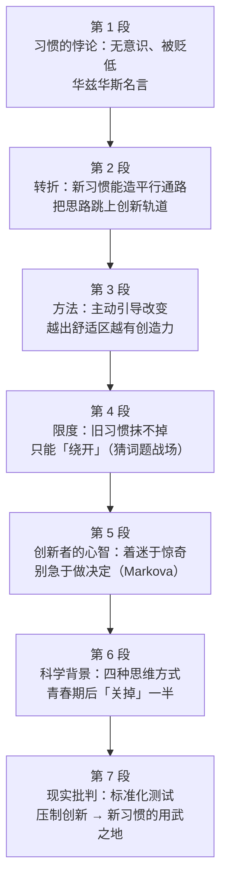

# Passage 42 · 习惯的悖论与创新

## 答题记录

| 轮次  | 日期         | 题号  | 正确  | 错误  | 正确率 | 用时    | 错题归因 |
| --- | --- | --- | --- | --- | --- | --- | --- |
| 1 |  | 1-5 |  |  |  |  |  |
| 2 |  | 1-5 |  |  |  |  |  |
| 3 |  | 1-5 |  |  |  |  |  |

> [!tip] 填写口径
> - **用时**以分钟计，只计做题时间，不含精读复盘。
> - **错题归因**填「题型·错误类型」，如：例证题·把例子当论点、推理题·过度推断、细节题·偷换概念。
> - 纵向看趋势：正确率升而用时过长 → 熟练度不足；用时降而正确率波动 → 定位不稳。
> - 本篇 5 题，题号栏填 1-5；第 3 题是**猜词题**、第 5 题是**跨句推理题**（要读到末段末句才成链），错因建议分别写「猜词题·未找后句回指」「推理题·未读到结尾句」。

> [!info] 文章档案
> - **来源**：考研英语（一）2009 年 Text 1
> - **题材**：社会生活（心理认知 × 教育与创新）——从「习惯」这个看似与创新水火不容的词切入，讲大脑如何用「另辟平行路径」的方式容纳改变
> - **结构**：7 段 / 22 句 ＋ 5 题（按句号断句与行首缩进实测；与解析引用的「第一段③句」「第二段②句」「第四段①句」「第五段①句」「最后一段②③句」全部吻合；第 3 题题干标「Line 1, Paragraph 4」，ruts 正落在第 4 段第 1 印刷行）
> - **难度**：★★★☆☆
> - **一句话主旨**：习惯是件怪事——我们无意识地依赖它，华兹华斯说「支配不思考的芸芸众生的是习惯而非选择」，21 世纪更给「习惯」一词添了贬义；可大脑研究者发现，有意识地培养新习惯能造出平行通路甚至新脑细胞，把思路跳转到创新轨道上，人也因此越变越有创造力；旧习惯抹不掉，但新习惯可以绕开它；创新的起点是对惊奇的着迷而非急于「做决定」，而当下盛行的标准化测试偏偏只重分析与程序，压制了创新与协作——这正是培养新习惯的意义所在。

## 一、篇章脉络

- **第 1 段**：**提出悖论**。习惯是件怪事：我们无意识地伸手取用，让大脑进入自动驾驶，安睡于熟悉常规的舒适里。华兹华斯说「支配那些不思考的芸芸众生的不是选择，而是习惯」；到了瞬息万变的 21 世纪，「习惯」一词更带上贬义（第 1 题的战场）。
- **第 2 段**：**科学反转**。既然如此，把习惯与创新放在同一语境下谈就显得自相矛盾——但大脑研究者发现：有意识地培养新习惯时，我们会**创建平行通路、甚至全新的脑细胞**，它们能把我们的思路列车**跳上全新的创新轨道**（第 2 题的战场）。
- **第 3 段**：**给出方法**。与其把自己当作不可改变的习惯动物而放弃，不如**主动引导**自己的改变；事实上，尝试的新事物越多、越走出舒适区，我们就**越是从内在变得有创造力**，职场与私人生活皆然。
- **第 4 段**：**限定边界**。但别费劲去**消灭**旧习惯——那些程序的**车辙**一旦磨进大脑就留在那儿了；取而代之的是，我们刻意压进自身的新习惯会造出**平行通路**，绕开那些老路（第 3 题的战场）。
- **第 5 段**：**创新者的心智**。《开放的思维》作者 Dawna Markova 说：创新所需要的第一样东西是**对惊奇的着迷**；可我们被教的却是「做决定」，正如总统自称「决策者」。她补充道，决定就是**扼杀掉除一种以外的所有可能性**，而优秀的创新型思考者永远在探索其他多种可能（第 4 题的战场）。
- **第 6 段**：**科学背景**。我们都是在自己觉察不到的方式下解决问题的。20 世纪 60 年代末的研究者发现，人天生具备用**四种主要方式**应对挑战的能力：分析式、程序式、关系式（协作式）与创新式；然而青春期结束时，大脑会**关掉**其中一半，只留下生命最初十年里显得最有用的那些思维模式。
- **第 7 段**：**现实批判**。当下对**标准化测试**的推崇只凸显分析与程序，意味着我们中很少有人天生用到创新与协作的思维模式。M. J. Ryan 说，这打破了美国人信仰体系里的主要规则——「任何人都无所不能」，那是一个被我们延续下去的谎言，它助长的是平庸；了解自己擅长什么并多做一点，才造就卓越——**这正是培养新习惯的用武之地**（第 5 题的战场）。

> [!tip] 行文逻辑
> 全篇是**「先立靶、再翻案、层层递进」**的科普评论结构：第 1 段把习惯**贬到最低**（无意识、被支配、带贬义），第 2 段用一个 But 把它**翻过来**（习惯可以被有意识地造），第 3 段讲**怎么做**，第 4 段讲**不能做什么**（抹不掉旧习惯，只能绕开），第 5—6 段**换视角**（创新者怎么想、科学怎么说），第 7 段**落回现实**（标准化测试压制创新，于是新习惯有了用武之地）。三条线索贯穿全篇：**habit（habit → new habits → old habits → developing new habits）**、**创新（creativity → innovation → innovative → innovational → innovatively）**、**路径比喻（parallel paths / trains of thought / tracks → ruts / old roads / parallel pathways → bypass）**——第三条线索正是第 3 题的解法所在。命题格局**基本题文同序**（1→P1，2→P2，3→P4，4→P5，5→P7），但**第 5 题必须读到末段末句**才能成链，只看到第 7 段①句会得出不完整的答案。**读本篇的正确姿势是：把「路径」类的比喻词（paths / tracks / ruts / roads / pathways）随手圈出来**，它们构成一条完整的语义链。

## 二、逐段精读

### 第 1 段 · 提出悖论：习惯是「不思考」的代名词

**原文**

① Habits are a funny thing.
② We reach for them mindlessly, setting our brains on auto-pilot and relaxing into the unconscious comfort of familiar routine.
③ "Not choice, but habit rules the unreflecting herd," William Wordsworth said in the 19th century.
④ In the ever-changing 21st century, even the word "habit" carries a negative implication.

**译文**

① 习惯是件怪事。
② 我们不加思考地伸手取用它，让大脑进入自动驾驶状态，放松地沉浸于熟悉常规所带来的无意识的舒适中。
③ 「支配那些不思考的芸芸众生的，不是选择，而是习惯，」威廉·华兹华斯在 19 世纪这样说。
④ 在瞬息万变的 21 世纪，就连「习惯」这个词也带上了负面的含义。

> [!note] 段落要点
> - 功能：**全篇的靶子**，也是第 1 题的唯一战场。四句话分两步走：①②句讲**我们与习惯的实际关系**，③④句讲**外界对习惯的评价**。
> - ①句 funny 是本段最容易被读浅的词：它不是「滑稽」，而是「**古怪、耐人寻味**」——习惯明明是我们自己养成的，却反过来支配我们。
> - ②句一气用了四个「无意识」色彩的词：**mindlessly（不加思考地）、on auto-pilot（自动驾驶）、unconscious（无意识的）、routine（常规）**，这四词正是第 1 题 C 项 **mechanical（机械的）**所概括的全部内容。
> - ③句是**引文**，注意 Not choice, but habit 是 **not A but B（不是 A 而是 B）**结构，真正的主语是 habit，谓语 rules——也就是说「发号施令的是习惯」。
> - ④句的 ever-changing（不断变化）与 habit（固定不变）构成**词内部的对立**，为第 2 段的 So it seems paradoxical 埋好引线。
> - 全段**没有任何转折词**，解析正是据此判断「本段观点前后一致」，于是用四个同向词推出 mechanical。

#### 长难句 · 本段

> [!abstract] 本段第 ② 句 · We reach for them mindlessly, setting our brains on auto-pilot and relaxing into the unconscious comfort of familiar routine.

**结构拆解**

- **主干**：We **reach for** them mindlessly
  - reach for 伸手去取（them ＝ habits）；mindlessly 作方式状语
- **伴随状语一**：**setting** our brains **on auto-pilot**
  - set sth on auto-pilot 让……进入自动驾驶；set ＋ 宾语 ＋ 介词短语＝「使……处于某种状态」
- **伴随状语二**：（and）**relaxing into** the unconscious comfort of familiar routine
  - relax into 放松地进入／安然习惯于；of familiar routine 修饰 comfort
- **两处现在分词并列**：setting... and relaxing... 同时说明 reach for 时的**伴随状态**，是英文写「一边……一边……」的高效手段
- **词汇**：mindlessly adv. 不加思考地；auto-pilot n. 自动驾驶；unconscious adj. 无意识的

**参考译文**

我们不加思考地伸手取用它，让大脑进入自动驾驶状态，放松地沉浸于熟悉常规所带来的无意识的舒适中。

> [!tip] 拆解要点
> 抓两点：①**两个现在分词短语并列作伴随状语**，译时拆成「一边……一边……」或干脆并列三个动词；②**set sth on auto-pilot 是「使役结构」（动词 ＋ 宾语 ＋ 补语）**，同类还有 set sb free / put sth in order / keep sth under control。命题角度：本段是第 1 题的战场，解题的钥匙恰在②句这**四个同向形容词／副词**上——**当题干问「某人眼中 X 的特征」时，答案往往是原文一组并列修饰语的「上位概括词」**，而不是其中任何一个原词（所以 familiar 只是邻域词，不是答案）。

> [!abstract] 本段第 ③ 句 · "Not choice, but habit rules the unreflecting herd," William Wordsworth said in the 19th century.

**结构拆解**

- **引文主干**：habit **rules** the unreflecting herd
  - 主语 habit，谓语 rules（**rule 此处是动词「支配、统治」**），宾语 the unreflecting herd
- **Not A but B 结构**：Not choice, but habit —— 否定 choice、肯定 habit；**谓语动词与 B 保持一致**（habit 单数 → rules）
- **引文倒装**：直接引语前置时，said 可放在主语之前（William Wordsworth said），也可倒装为 said William Wordsworth
- **词汇**：unreflecting adj. 不思考的（un- ＋ reflecting）；herd n. 兽群 → 人群（贬义）

**参考译文**

「支配那些不思考的芸芸众生的，不是选择，而是习惯，」威廉·华兹华斯在 19 世纪这样说。

> [!tip] 拆解要点
> 抓两点：①**Not A but B 后的谓语单复数随 B 走**（Not he but I **am**...；Not choice but habit **rules**...）；②**rule 是本篇第一个熟词僻义**——名词「规则」变动词「支配」，与下句的 herd（芸芸众生）合起来才构成「习惯统治着不思考的大众」这层贬义。命题角度：第 1 题的 D 项 changeable 正是拿第 3 段「习惯可以被改变」来反向干扰，**做第 1 题时务必把范围锁死在 Wordsworth's view 里**。

#### 本段重点词汇

| 单词 / 短语 | 词性 | 文中意 | 常用考义与拓展 | 英文示例搭配（中译） |
| --- | --- | --- | --- | --- |
| **habit** | n. | 习惯 | form/develop a habit 养成习惯；break/kick a habit 戒掉习惯；be in the habit of 有……的习惯；habitual adj. 习惯性的 | Habits are a funny thing（习惯是件怪事） |
| **funny** | adj. | 古怪的，耐人寻味的 | 熟词僻义：由 fun 派生，此处非「滑稽」而是「奇怪、说不清的」；funny business 不正当的事 | Habits are a funny thing（习惯是件怪事） |
| **reach for** | 短语 | 伸手去取；引申为「求助于、诉诸」 | reach for the stars 志存高远；reach out to sb 向某人伸出援手；reach a conclusion 得出结论 | We reach for them mindlessly（我们不加思考地伸手取用它们） |
| **mindlessly** | adv. | 不加思考地，无意识地 | 构词 mind ＋ -less ＋ -ly；mindless adj. 无需动脑的、盲目的 | We reach for them mindlessly（我们不加思考地伸手取用它们） |
| **set...on auto-pilot** | 短语 | 使……进入自动驾驶状态 | set ＋ 宾语 ＋ 补语（使役结构）；auto-pilot 亦拼 autopilot；on automatic pilot 同义 | setting our brains on auto-pilot（让我们的大脑进入自动驾驶状态） |
| **relax into** | 短语 | 放松地进入，安然习惯于 | relax into a chair 瘫坐在椅子上；relax into the silence 安于寂静；relaxation n. 放松 | relaxing into the unconscious comfort（放松地沉浸于那种无意识的舒适中） |
| **unconscious** | adj. | 无意识的，不自觉的 | un- ＋ conscious；be unconscious of 未察觉；subconscious 潜意识（的）；反义 conscious 有意识的 | the unconscious comfort of familiar routine（熟悉常规的无意识的舒适） |
| **comfort** | n./v. | 舒适，安逸；安慰 | comfort zone 舒适区（第 3 段）；comfortable adj. 舒适的； discomfort n. 不适 | the unconscious comfort of familiar routine（熟悉常规所带来的无意识舒适） |
| **familiar routine** | n. | 熟悉的例行常规 | routine n./adj. 常规（的）、例行公事；daily routine 日常作息；familiarity n. 熟悉 | the comfort of familiar routine（熟悉常规带来的舒适） |
| **rule** | v./n. | 支配，统治；规则 | 熟词僻义：名词「规则」→ 动词「支配、统治」；rule out 排除；as a rule 通常 | Not choice, but habit rules the unreflecting herd（不是选择，而是习惯支配着不思考的芸芸众生） |
| **unreflecting** | adj. | 不思考的，缺乏反省的 | un- ＋ reflecting；reflect v. 反射、反省；reflection n. 反思、映像 | habit rules the unreflecting herd（习惯支配着不思考的芸芸众生） |
| **herd** | n. | 兽群；人群（含贬义「芸芸众生」） | a herd of cattle 一群牛；the herd instinct 从众本能；herd mentality 从众心理 | the unreflecting herd（不思考的芸芸众生） |
| **ever-changing** | adj. | 不断变化的 | 构词 ever ＋ changing；ever-growing 不断增长的；ever-increasing 持续上升的 | In the ever-changing 21st century（在瞬息万变的 21 世纪） |
| **implication** | n. | 含义，言外之意 | carry/ have implications for 对……有影响；imply v. 暗示、意味着；by implication 含蓄地 | the word "habit" carries a negative implication（「习惯」一词带有负面含义） |

### 第 2 段 · 科学反转：新习惯能造出平行通路

**原文**

① So it seems paradoxical to talk about habits in the same context as creativity and innovation.
② But brain researchers have discovered that when we consciously develop new habits, we create parallel paths, and even entirely new brain cells, that can jump our trains of thought onto new, innovative tracks.

**译文**

① 因此，把习惯与创造力、创新放在同一语境下来谈，似乎显得自相矛盾。
② 但大脑研究者已经发现：当我们有意识地培养新习惯时，我们会创建出平行的通路，甚至是全新的脑细胞，它们能把我们的思路列车跳转到全新的、富有创新性的轨道上去。

> [!note] 段落要点
> - 功能：**全篇的转折枢纽**，也是第 2 题的唯一战场。①句用 So 收束第 1 段的贬义铺垫，②句用 But 一举翻案。
> - ①句的 paradoxical（看似矛盾）是**作者的措辞，不是结论**——它只是把第 1 段与第 2 段的对立摆出来，真正的话在 But 之后。
> - ②句是全篇**信息密度最高的一句**：when 从句给条件、**create** 给结果、that 从句给功能，三层套在一起。
> - 注意 **that can jump...** 这个定语从句的先行词是**并列的两项**（parallel paths ＋ brain cells），不只是 brain cells——这是读长句的常见岔路。
> - **consciously（有意识地）是本段的题眼**：第 1 段说习惯是 mindlessly/unconscious，本段说新习惯是 consciously 养成的，一词之差就是第 2 题 guided（可被引导）的根据。
> - 比喻在这里第一次出现：**trains of thought（思路列车）→ tracks（轨道）**，第 4 段的 ruts（车辙）/ old roads（老路）正是它的延续。

#### 长难句 · 本段

> [!abstract] 本段第 ② 句 · But brain researchers have discovered that when we consciously develop new habits, we create parallel paths, and even entirely new brain cells, that can jump our trains of thought onto new, innovative tracks.

**结构拆解**

- **主干**：brain researchers **have discovered** that...
  - 现在完成时，强调「已经发现」这一既成事实
- **宾语从句**：（that）when we consciously develop new habits, we **create** parallel paths, and even entirely new brain cells
  - 内嵌 **when 时间／条件状语从句**：when we consciously develop new habits
  - 从句谓语 create 带**并列宾语**：parallel paths ＋ (and even entirely new) brain cells
- **定语从句**：that can **jump** our trains of thought **onto** new, innovative tracks
  - 先行词是**前面并列的两者**（paths 与 cells），不是只指 cells
  - jump A onto B 把 A 弹／跳到 B 上；onto 引出目的地
- **词汇**：consciously adv. 有意识地；parallel adj. 平行的；innovative adj. 创新的；track n. 轨道

**参考译文**

但大脑研究者已经发现：当我们有意识地培养新习惯时，我们会创建出平行的通路，甚至是全新的脑细胞，它们能把我们的思路列车跳转到全新的、富有创新性的轨道上去。

> [!tip] 拆解要点
> 抓三点：①**that 从句的先行词要往前找到并列的两项**，凡「A, and even B, that...」结构，that 多半同时涵盖 A 与 B；②**jump A onto B 是「动词 ＋ 宾语 ＋ 介词短语」的使役式**，等于「使 A 跳到 B 上」；③**when 从句在此兼表条件**（「一旦我们有意识地……」），不只是时间。命题角度：本句是第 2 题的落点，**consciously develop（主动去养成）＋ can jump...onto new tracks（可被引到新轨道）合起来正是 guided（可被引导）**；三个干扰项 predicted（预测）、regulated（受规制）、traced（追踪）在原文均无任何落点，属**无中生有**。

#### 本段重点词汇

| 单词 / 短语 | 词性 | 文中意 | 常用考义与拓展 | 英文示例搭配（中译） |
| --- | --- | --- | --- | --- |
| **paradoxical** | adj. | 看似矛盾的，悖论式的 | paradox n. 悖论、自相矛盾；paradoxically adv. 矛盾地；a paradoxical situation 看似矛盾的处境 | it seems paradoxical to talk about habits in the same context as creativity（把习惯与创造力放在同一语境下谈似乎自相矛盾） |
| **in the same context as** | 短语 | 与……放在同一语境／背景下 | context n. 语境、背景；in the context of 在……背景下；out of context 断章取义 | habits in the same context as creativity and innovation（与创造力和创新同处一个语境的习惯） |
| **creativity** | n. | 创造力，创造性 | create v. 创造；creative adj. 有创造力的；creature n. 生物（第 3 段） | creativity and innovation（创造力与创新） |
| **innovation** | n. | 创新，革新 | innovate v. 革新；innovative adj. 创新的（本段②句）；innovational adj. 创新的（第 5 段）；innovator n. 创新者 | creativity and innovation（创造力与创新） |
| **brain researchers** | n. | 大脑研究者 | researcher n. 研究者；research v./n. 研究；brain research 脑科学研究 | brain researchers have discovered that（大脑研究者已经发现） |
| **consciously** | adv. | 有意识地，自觉地 | conscious adj. 有意识的（反义 unconscious 第 1 段）；consciousness n. 意识；subconsciously adv. 潜意识地 | when we consciously develop new habits（当我们有意识地培养新习惯时） |
| **develop new habits** | 短语 | 培养新习惯 | develop a habit 养成习惯；develop v. 培养、发展、开发；habit formation 习惯的形成（第 2 题题干词） | consciously develop new habits（有意识地培养新习惯） |
| **parallel paths** | n. | 平行通路 | parallel adj./n./v. 平行的；平行线；与……相当；parallel to/with 与……平行；unparalleled 无与伦比的 | we create parallel paths（我们创建出平行通路） |
| **brain cells** | n. | 脑细胞 | cell n. 细胞；小室；电池；cell phone 手机 | even entirely new brain cells（甚至是全新的脑细胞） |
| **jump...onto** | 短语 | 使……跳到……上 | jump to conclusions 妄下结论；jump at 欣然接受；onto prep. 到……之上 | jump our trains of thought onto new tracks（把我们的思路列车跳上新的轨道） |
| **trains of thought** | n. | 思路，思绪（train 此处＝一连串） | a train of thought 一串思绪；train of events 一连串事件；lose one's train of thought 思路中断 | jump our trains of thought onto new tracks（把我们的思路列车跳上新轨道） |
| **innovative** | adj. | 创新的，革新的 | innovation n. 创新；innovate v. 革新；innovatively adv. 创新地（第 6 段） | new, innovative tracks（全新的、富有创新性的轨道） |
| **track** | n./v. | 轨道；踪迹；追踪 | 第 3 题 A 项词；keep track of 掌握……的动态；lose track of 失去……的线索；on track 在正轨上 | jump our trains of thought onto new, innovative tracks（把思路跳上创新的新轨道） |
| **discover** | v. | 发现 | discovery n. 发现；discoverer n. 发现者；同义 find out / detect | brain researchers have discovered that...（大脑研究者已经发现……） |

### 第 3 段 · 给出方法：与其认命，不如主动引导

**原文**

① Rather than dismissing ourselves as unchangeable creatures of habit, we can instead direct our own change by consciously developing new habits.
② In fact, the more new things we try—the more we step outside our comfort zone—the more inherently creative we become, both in the workplace and in our personal lives.

**译文**

① 与其把自己当作不可改变的习惯性动物而一笔勾销，我们不如通过有意识地培养新习惯来引导自己的改变。
② 事实上，我们尝试的新事物越多——我们越是走出自己的舒适区——我们就越是会从本质上变得有创造力，无论是在职场还是在个人生活中。

> [!note] 段落要点
> - 功能：**从「科学发现」过渡到「个人可为」**。第 2 段说「新习惯能造平行通路」，本段说「那就去做」。
> - ①句是 **Rather than A, we can instead B** 的取舍结构：Rather than 后接**动名词** dismissing，主句用 **direct**（动词），把「被动认命」换成「主动引导」。
> - **direct 是本段最值得记的熟词僻义**：形容词「直接的」→ 动词「指引、引导」。它与第 2 题的 guided 是同一语义场。
> - ②句是 **the more..., the more..., the more... 三级连锁**，中间用两个破折号插入第二级——这是本篇最有节奏感的一句。
> - 注意 **inherently creative（从本质上变得有创造力）**：不是「多做几次就有了」，而是**内在属性**被改变，与第 1 段的 unchangeable（不可改变）形成正面回应。
> - 本段**没有命题**，但它是第 2 题 D 项 guided 的语义支撑（能主动引导 ⇒ 可被引导）。

#### 长难句 · 本段

> [!abstract] 本段第 ② 句 · In fact, the more new things we try—the more we step outside our comfort zone—the more inherently creative we become, both in the workplace and in our personal lives.

**结构拆解**

- **句型**：**the more...，the more...，the more...** 三级「越……越……」
  - 第一级：the more new things **we try**
  - 第二级（破折号插入）：the more **we step outside** our comfort zone
  - 第三级（主句）：the more inherently creative **we become**
- **省略**：the more new things we try ＝ the more new things (that) we try，省略关系代词
- **插入语**：两个破折号之间的 the more we step outside our comfort zone 是**对第一级的补充说明**，读时可先跳过
- **状语**：both in the workplace and in our personal lives（both...and... 并列两个范围）
- **词汇**：step outside 走出；comfort zone 舒适区；inherently adv. 本质上

**参考译文**

事实上，我们尝试的新事物越多——我们越是走出自己的舒适区——我们就越是会从本质上变得有创造力，无论是在职场还是在个人生活中。

> [!tip] 拆解要点
> 抓三点：①**the ＋ 比较级……，the ＋ 比较级…… 是固定句型**，两端都要用比较级，且常用省略（the more, the better）；②**破折号之间的二级比较是插入成分**，第一遍阅读可整体略过，直接读「the more we try... the more creative we become」；③**become 后接形容词比较级作表语**，creative 被 inherently 修饰。命题角度：本段虽不直接命题，但 **inherently creative 与第 1 段的 unchangeable 构成全篇最关键的一对反义**——「人是不可改变的」被彻底推翻。写作角度：**the more..., the more... 是考研作文最好用的递进句型之一**，务必能脱口而出。

#### 本段重点词汇

| 单词 / 短语 | 词性 | 文中意 | 常用考义与拓展 | 英文示例搭配（中译） |
| --- | --- | --- | --- | --- |
| **rather than** | 短语 | 而不是，与其……不如 | 后接动词时常用 -ing（Rather than dismissing...）或原形（rather than do）；prefer to do rather than do 宁愿……而不愿 | Rather than dismissing ourselves as unchangeable creatures of habit（与其把自己当作不可改变的习惯性动物） |
| **dismiss...as** | 短语 | 把……当作……而不予考虑／摒弃 | dismiss v. 解散、驳回、不予考虑；dismiss an idea 否掉一个想法；dismissal n. 解雇、驳回 | dismissing ourselves as unchangeable creatures of habit（把自己当作不可改变的习惯性动物而一笔勾销） |
| **unchangeable** | adj. | 不可改变的 | un- ＋ changeable；change v./n. 改变、变化；changeable adj. 易变的；**注**：第 1 题 D 项 changeable 即由此反向设陷 | unchangeable creatures of habit（不可改变的习惯性动物） |
| **creature** | n. | 生物，造物 | create v. 创造；creation n. 创造、作品；the Creator 造物主；a creature of habit 受习惯支配的人 | unchangeable creatures of habit（不可改变的习惯性生物） |
| **direct** | v./adj. | 引导，指引；直接的 | 熟词僻义：形容词「直接的」→ 动词「引导、指挥」；direct one's attention to 把注意力引向；direction n. 方向；director n. 导演、主管 | we can instead direct our own change（我们不如反过来引导自己的改变） |
| **comfort zone** | n. | 舒适区 | step outside one's comfort zone 走出舒适区；comfort n. 舒适（第 1 段）；zone n. 区域 | the more we step outside our comfort zone（我们越是走出舒适区） |
| **step outside** | 短语 | 走出，跨出 | step out 外出、退出；step up 加紧、提升；step into 介入、踏入 | step outside our comfort zone（走出我们的舒适区） |
| **the more...the more...** | 句型 | 越……越…… | 两端均用 the ＋ 比较级；可三级连用（本篇即三级）；常省略成分 | the more new things we try, the more creative we become（尝试的新事物越多，我们就越有创造力） |
| **inherently** | adv. | 内在地，本质上 | inherent adj. 固有的、内在的（be inherent in 为……所固有）；同义 intrinsically | the more inherently creative we become（我们就越是本质上具有创造力） |
| **the workplace** | n. | 职场，工作场所 | work n./v. 工作；workforce 劳动力；workaholic 工作狂 | both in the workplace and in our personal lives（无论是在职场还是在个人生活中） |
| **personal lives** | n. | 个人生活 | personal adj. 个人的、私人的；personality n. 个性；personnel n. 人事、员工 | in our personal lives（在我们的个人生活中） |
| **in fact** | 短语 | 事实上 | 同义 as a matter of fact / actually；常引出对前文的加强或修正 | In fact, the more new things we try（事实上，我们尝试的新事物越多） |
| **by doing** | 短语 | 通过做……（表手段） | by ＋ 动名词表方式；means of / through 近义 | direct our own change by consciously developing new habits（通过有意识地培养新习惯来引导自己的改变） |

### 第 4 段 · 限定边界：旧习惯抹不掉，只能绕开

**原文**

① But don't bother trying to kill off old habits; once those ruts of procedure are worn into the brain, they're there to stay.
② Instead, the new habits we deliberately press into ourselves create parallel pathways that can bypass those old roads.

**译文**

① 但别费心去消灭旧习惯；那些程序性的车辙一旦被磨进大脑，它们就留在那儿不走了。
② 取而代之的是，我们刻意压进自身的那些新习惯会创建出平行通路，可以绕开那些老路。

> [!note] 段落要点
> - 功能：**给方法加「边界条件」**，同时是第 3 题（猜词题）的战场。前两段讲「可以造新习惯」，本段补一句「但旧的去不掉」。
> - ①句用**分号**连接两个分句：前句是祈使句（别费劲去消灭），后句用 **once（一旦）**给出原因。
> - **ruts 是全篇比喻链的关键一环**：rut 本义「车辙」，引申「老一套、惯例」；第 3 题正是要把它还原成 **tracks（车辙／路径）**。
> - ②句的 **those old roads 回指①句的 those ruts of procedure**——这个回指就是猜词题的标准解法：**被猜的词与其后句的复现词同义**。
> - **deliberately（刻意地）与第 2 段的 consciously（有意识地）呼应**，都在强调「新习惯是主动造的」。
> - 注意本段的**路径比喻达到全篇最密**：ruts / procedure / worn into / parallel pathways / bypass / old roads，六词一气呵成。

#### 长难句 · 本段

> [!abstract] 本段第 ① 句 · But don't bother trying to kill off old habits; once those ruts of procedure are worn into the brain, they're there to stay.

**结构拆解**

- **分句一（祈使句）**：**don't bother trying to** kill off old habits
  - bother doing / bother to do 费心去做（常用于否定 don't bother）
  - kill off 消灭、除掉；old habits 作宾语
- **分号**：连接两个**并列但语义为「命令 ＋ 理由」**的分句
- **分句二**：**once** those ruts of procedure **are worn into** the brain, they're **there to stay**
  - once 引导**时间／条件状语从句**「一旦……」
  - are worn into 是 wear 的**被动式**（wear-wore-worn），wear into 磨出、刻进
  - there to stay 固定表达「留在那儿、赖着不走」
- **词汇**：rut n. 车辙；procedure n. 程序；worn adj. 磨出来的

**参考译文**

但别费心去消灭旧习惯；那些程序性的车辙一旦被磨进大脑，它们就留在那儿不走了。

> [!tip] 拆解要点
> 抓三点：①**分号在此连接「祈使句 ＋ 陈述理由」**，功能上相当于 because；②**once 从句＝「一旦……就……」**，兼有时间与条件两义；③**be worn into 是 wear 的被动**，wear 的「磨损」义派生出 wear away（磨掉）、worn out（筋疲力尽的／穿旧的）。命题角度：本句是第 3 题题干指定的位置（Line 1, Paragraph 4），**猜词题的铁律是「答案就在被猜词的同句或紧邻的后句里」**——本句的 those ruts 在下句被 those old roads 复现，而 roads 与 A 项 tracks 同属「路」的语义场，故 A 正确。

> [!abstract] 本段第 ② 句 · Instead, the new habits we deliberately press into ourselves create parallel pathways that can bypass those old roads.

**结构拆解**

- **主干**：the new habits... **create** parallel pathways
- **定语从句一（省略关系代词）**：the new habits **(that) we deliberately press into ourselves**
  - press sth into sth 把……压进……；此处比喻「把新习惯刻进自身」
  - deliberately adv. 刻意地
- **定语从句二**：pathways **that can bypass** those old roads
  - bypass v. 绕过、避开（by- ＋ pass）
- **指代**：those old roads 回指上句的 **those ruts of procedure**，是第 3 题的解题钥匙
- **词汇**：parallel adj. 平行的；pathway n. 通路；bypass v. 绕过

**参考译文**

取而代之的是，我们刻意压进自身的那些新习惯会创建出平行通路，可以绕开那些老路。

> [!tip] 拆解要点
> 抓两点：①**「名词 ＋ (that) 主语 ＋ 谓语」是省略关系代词的最常见形态**（the habits we develop / the book I read），识别标志是「名词后紧跟一个主谓结构」；②**those old roads 是回指（回指上句的 ruts），不是新信息**——凡看到 **those / these / such ＋ 名词**，第一反应就该往前找它指的是什么。命题角度：本句是第 3 题的**答案句**，书中解析正是用「those old roads 指的就是 those ruts of procedure」推出 A 项 tracks。

#### 本段重点词汇

| 单词 / 短语 | 词性 | 文中意 | 常用考义与拓展 | 英文示例搭配（中译） |
| --- | --- | --- | --- | --- |
| **don't bother doing** | 短语 | 不必费心去做 | bother doing / bother to do 费心做；don't bother 别费事了；bothered adj. 感到困扰的 | don't bother trying to kill off old habits（别费心去消灭旧习惯） |
| **kill off** | 短语 | 消灭，根除 | kill off 强调「彻底除掉」；kill time 消磨时间；kill two birds with one stone 一石二鸟 | kill off old habits（消灭旧习惯） |
| **rut** | n. | 车辙；惯例，老一套 | 第 3 题题干词；be in a rut / get into a rut 墨守成规；rutted adj. 有车辙的 | those ruts of procedure（那些程序性的车辙） |
| **procedure** | n. | 程序，流程，步骤 | procedural adj. 程序性的（第 6 段 procedurally）；proceed v. 继续进行；process n. 过程 | ruts of procedure（程序性的车辙） |
| **be worn into** | 短语 | 被磨进，被刻入 | wear-wore-worn；wear into 磨出；wear away 磨掉；worn out 破旧的／筋疲力尽的 | once those ruts of procedure are worn into the brain（一旦那些程序性的车辙被磨进大脑） |
| **there to stay** | 短语 | 留在那里不走，不会消失 | be here/there to stay 固定表达「已被普遍接受、不会消失」；stay put 原地不动 | they're there to stay（它们就留在那儿了） |
| **deliberately** | adv. | 刻意地，有意识地 | deliberate adj. 蓄意的、从容的；deliberation n. 深思熟虑；同义 on purpose / intentionally | the new habits we deliberately press into ourselves（我们刻意压进自身的新习惯） |
| **press into** | 短语 | 压入，压印进 | press v. 按、压、催促；press for 迫切要求；press on 继续前进；pressure n. 压力 | press into ourselves（压进我们自己身上） |
| **parallel pathways** | n. | 平行通路 | pathway ＝ path ＋ way 通路、途径；与第 2 段 parallel paths 同义复现 | create parallel pathways（创建平行通路） |
| **bypass** | v./n. | 绕过，避开；旁路 | by- ＋ pass；bypass surgery 搭桥手术；bypass a problem 回避问题 | parallel pathways that can bypass those old roads（可以绕开那些老路的平行通路） |
| **old roads** | n. | 老路 | 此处为比喻，回指 those ruts of procedure；road map 路线图；on the road to 在通往……的路上 | bypass those old roads（绕开那些老路） |
| **instead** | adv. | 相反，取而代之 | instead of 而不是（后接名词／动名词）；同义 rather than | Instead, the new habits... create parallel pathways（取而代之的是，新习惯会创建平行通路） |

### 第 5 段 · 创新者的心智：着迷于惊奇，而非急于决定

**原文**

① "The first thing needed for innovation is a fascination with wonder," says Dawna Markova, author of The Open Mind.
② "But we are taught instead to 'decide', just as our president calls himself 'the Decider.'"
③ She adds, however, that "to decide is to kill off all possibilities but one."
④ A good innovational thinker is always exploring the many other possibilities."

**译文**

① 「创新所需要的第一样东西，是对惊奇的着迷，」《开放的思维》一书的作者道娜·马尔科娃说。
② 「但我们被教的却是去『做决定』，正如我们的总统自称『决策者』一样。」
③ 她补充说，然而，「做决定就是扼杀掉除一种以外的所有可能性。
④ 优秀的创新型思考者永远在探索其他诸多的可能性。」

> [!note] 段落要点
> - 功能：**换到创新者的视角**，是第 4 题的唯一战场。全段几乎全是直接引语，四句话分属两次发言（①②为第一次，③④为第二次）。
> - ①句是**全段也是第 4 题的答案句**：a fascination with wonder（对惊奇的着迷）↔ D 项 curiosity activates creative minds（好奇心激发创造性思维）——**fascination ↔ curiosity，wonder ↔ creative，innovation ↔ minds**。
> - ②句的 'decide' 与 'the Decider' **都带引号**，是作者（借 Markova 之口）要**嘲讽**的对象，不是正面概念；第 4 题 B 项（创新可以被教）正是把**被否定的「被教做决定」**反向包装成「被教创新」。
> - ③句的 **to decide is to kill off all possibilities but one** 是全篇最锋利的一句：**but 在此作介词「除……之外」**（all...but one ＝ 除一种以外的全部）。
> - ④句给出**正面示范**：创新者不是不决定，而是**始终保留多种可能**。
> - **add 是又一个熟词僻义**：「加」→「补充说」，用于引语动词。

#### 长难句 · 本段

> [!abstract] 本段第 ① 句 · "The first thing needed for innovation is a fascination with wonder," says Dawna Markova, author of The Open Mind.

**结构拆解**

- **引语主干**：The first thing **needed for innovation** **is** a fascination with wonder
  - 主语 the first thing，后接**过去分词短语 needed for innovation 作后置定语**（＝ that is needed for innovation）
  - 表语 a fascination with wonder（**fascination 后固定搭配 with**）
- **引语动词倒装**：**says** Dawna Markova —— 直接引语前置时，主语与谓语可倒装
- **同位语**：**author of The Open Mind** 说明 Dawna Markova 的身份
- **词汇**：innovation n. 创新；fascination n. 着迷；wonder n. 惊奇

**参考译文**

「创新所需要的第一样东西，是对惊奇的着迷，」《开放的思维》一书的作者道娜·马尔科娃说。

> [!tip] 拆解要点
> 抓三点：①**过去分词短语作后置定语**（the thing needed / the book written by...）＝ 省略的定语从句，识别标志是「名词 ＋ -ed 短语」；②**fascination with / fascination for 固定搭配**，凡抽象名词后的介词要连带记忆；③**「引语 ＋ says sb ＋ 同位语」是英语报刊引述的标准模板**，同段②句、第 7 段②句都是同一结构。命题角度：本句是第 4 题落点，**人物观点题（X would most probably agree that...）的答案一定是该人物说过的某句话的同义改写**，先在原文里锁定 X 说的话，再逐项比对即可。

> [!abstract] 本段第 ③ 句 · She adds, however, that "to decide is to kill off all possibilities but one."

**结构拆解**

- **主干**：She **adds**, however, **that**...
  - add 熟词僻义「补充说」；however 作**插入状语**，位置灵活（可放句中也可放句首）
- **宾语从句**（本身是一句引语）：**to decide** is **to kill off** all possibilities **but** one
  - 不定式作主语与表语：**to decide is to do**（做决定就是做……）
  - **but 作介词「除……之外」**：all possibilities but one ＝ 除一种以外的所有可能性
- **词汇**：add v. 补充说；possibility n. 可能性；but prep. 除……之外

**参考译文**

她补充说，然而，「做决定就是扼杀掉除一种以外的所有可能性。」

> [!tip] 拆解要点
> 抓两点：①**「to do is to do」是英语下定义／作判断的极简句式**，译作「做……就是做……」，写作中可直接使用（To hesitate is to lose.）；②**but 作介词表「除……之外」是高频考点**（anything but 决不；nothing but 只有；all but one 除一个外全部）。命题角度：本句是第 4 题 C 项（decisiveness derives from fantastic ideas）的**证伪句**——原文说「决断扼杀可能性」，C 项却说「决断源于奇思」，属**与原文方向相反**；同时它也是 B 项（创新可被教）的证伪依据：被教的恰恰是 decide 而非 innovate。

#### 本段重点词汇

| 单词 / 短语 | 词性 | 文中意 | 常用考义与拓展 | 英文示例搭配（中译） |
| --- | --- | --- | --- | --- |
| **fascination** | n. | 着迷，迷恋 | fascinate v. 使着迷；fascinating adj. 迷人的；be fascinated by 被……迷住；**搭配 with** | a fascination with wonder（对惊奇的着迷） |
| **wonder** | n./v. | 惊奇，奇观；想知道 | 熟词僻义：动词「想知道」→ 名词「惊奇、好奇」；no wonder 难怪；wonderful adj. 奇妙的；wander v. 漫游（形近） | a fascination with wonder（对惊奇的着迷） |
| **author of** | 短语 | ……的作者 | author n. 作者、创造者；authorship n. 著作权；authority n. 权威、当局 | author of The Open Mind（《开放的思维》的作者） |
| **be taught to do** | 短语 | 被教会去做 | teach-taught-taught；teach sb a lesson 给某人教训；teaching n. 教学、教义 | we are taught instead to 'decide'（我们被教的却是去『做决定』） |
| **decide** | v. | 决定，决断 | decide on/upon 决定；decisive adj. 决定性的；decision n. 决定；decisiveness n. 果断（第 4 题 C 项词） | we are taught instead to 'decide'（我们被教的却是去『做决定』） |
| **just as** | 短语 | 正如，就像 | just as...so... 正如……也……；just as well 倒也无妨；as 引导方式状语从句 | just as our president calls himself 'the Decider'（正如我们的总统自称『决策者』） |
| **the Decider** | n. | 「决策者」（自称） | decide v. 决定；-er 后缀表「做……的人」；带引号，含讽刺意味 | our president calls himself 'the Decider'（我们的总统自称『决策者』） |
| **add** | v. | 补充说；增加 | 熟词僻义：「加」→ 引述时「补充说」；add to 增添；add up 合计；in addition 此外 | She adds, however, that...（她补充说，然而……） |
| **all possibilities but one** | 短语 | 除一种以外的所有可能性 | but 作**介词**表「除……之外」；anything but 决不；nothing but 只不过；all but 几乎 | to decide is to kill off all possibilities but one（做决定就是扼杀掉除一种以外的所有可能性） |
| **innovational** | adj. | 创新的，革新的 | 与 innovative 近义；innovation n. 创新；innovate v. 革新；innovator n. 创新者 | A good innovational thinker（优秀的创新型思考者） |
| **explore** | v. | 探索，探究 | exploration n. 探索；explorer n. 探险者；explore a possibility 探索一种可能性 | always exploring the many other possibilities（永远在探索其他多种可能性） |
| **possibility** | n. | 可能性 | possible adj. 可能的；possibly adv. 可能地；impossible 不可能的；possibility of/that | the many other possibilities（其他诸多的可能性） |
| **curiosity** | n. | 好奇心（第 4 题 D 项词） | curious adj. 好奇的；curiosity about 对……的好奇；out of curiosity 出于好奇 | curiosity activates creative minds（好奇心激发创造性思维） |
| **activate** | v. | 激发，激活（第 4 题 D 项词） | active adj. 活跃的；activate v. 激活；activity n. 活动；activation n. 激活 | curiosity activates creative minds（好奇心激发创造性思维） |
| **The Open Mind** | 书名 | 《开放的思维》 | Markova 的著作；open-minded adj. 思想开放的；closed-minded 思想闭塞的 | author of The Open Mind（《开放的思维》的作者） |

### 第 6 段 · 科学背景：四种思维方式与青春期的「关闸」

**原文**

① All of us work through problems in ways of which we're unaware, she says.
② Researchers in the late 1960s discovered that humans are born with the capacity to approach challenges in four primary ways: analytically, procedurally, relationally (or collaboratively) and innovatively.
③ At the end of adolescence, however, the brain shuts down half of that capacity, preserving only those modes of thought that have seemed most valuable during the first decade or so of life.

**译文**

① 我们所有人都是在自己觉察不到的方式下解决问题的，她说。
② 20 世纪 60 年代末的研究者发现，人天生就具备用四种主要方式应对挑战的能力：分析式、程序式、关系式（或协作式）以及创新式。
③ 然而在青春期结束时，大脑会关掉这一能力的一半，只保留那些在生命最初的十年左右显得最有价值的思维方式。

> [!note] 段落要点
> - 功能：**为第 7 段的现实批判铺垫科学背景**。本段不直接命题，但没有它，第 7 段的「创新模式被压制」就失去了根据。
> - ①句是**过渡句**（she says 回指上段的 Markova），同时把话题从「创新者怎么想」拉回「我们所有人怎么想」。
> - ②句的**冒号列举**是全段信息核心：四种思维方式 analytically / procedurally / relationally (collaboratively) / innovatively——**前两种正是第 7 段所说的标准化测试所看重的**。
> - ③句的 **shuts down half of that capacity（关掉一半能力）**是本篇最「狠」的一句：它说明**创新力不是没有，而是被关掉了**，从而为「用新习惯把它重新打开」留出空间。
> - 注意 **preserving（保留）的宾语是 modes of thought**，后接 that 定语从句限定「哪些模式被保留」——**留下的恰好是最常用的那些**，这正是习惯的生物学定义。
> - 本段的 **capacity（能力）**与第 1 段的 unchangeable、第 3 段的 inherently 构成一条暗线：**能力是天生的、会被关掉的，但也能被重新激活**。

#### 长难句 · 本段

> [!abstract] 本段第 ② 句 · Researchers in the late 1960s discovered that humans are born with the capacity to approach challenges in four primary ways: analytically, procedurally, relationally (or collaboratively) and innovatively.

**结构拆解**

- **主干**：Researchers **discovered** that...
  - 介词短语 in the late 1960s 作后置定语修饰 Researchers
- **宾语从句**：humans **are born with** the capacity **to approach** challenges in four primary ways
  - be born with 天生具有；**capacity 后接不定式作定语**（the capacity to do 做……的能力）
  - approach 此处是**动词「应对、着手处理」**，不是「接近」
- **冒号列举**：analytically, procedurally, relationally (or collaboratively) and innovatively —— 四个副词具体说明 four primary ways
- **构词**：-ally 后缀由 -al ＋ -ly 构成，把形容词变副词
- **词汇**：capacity n. 能力；primary adj. 主要的；challenge n. 挑战

**参考译文**

20 世纪 60 年代末的研究者发现，人天生就具备用四种主要方式应对挑战的能力：分析式、程序式、关系式（或协作式）以及创新式。

> [!tip] 拆解要点
> 抓三点：①**抽象名词后接不定式作定语**是固定搭配群（the capacity/ability/attempt/effort/chance to do），凡看到 capacity 就要预判后面的 to do；②**approach 作动词「处理、着手」是熟词僻义**（approach a problem 处理问题），其名词「方法」也很常考；③**冒号用于列举同位内容**，四项并列副词的排列顺序（分析 → 程序 → 关系 → 创新）与第 7 段「只凸显分析与程序」形成对照，是第 5 题的隐含线索。

> [!abstract] 本段第 ③ 句 · At the end of adolescence, however, the brain shuts down half of that capacity, preserving only those modes of thought that have seemed most valuable during the first decade or so of life.

**结构拆解**

- **主干**：the brain **shuts down** half of that capacity
  - shut-shut-shut（原形、过去式、过去分词同形）；shut down 关掉、停止运转
- **状语**：At the end of adolescence（在青春期结束时）；however 作插入转折
- **现在分词作伴随／结果状语**：**preserving** only those modes of thought
  - preserving 的逻辑主语是 the brain；表「关掉一半的同时，只保留了……」
- **定语从句**：those modes of thought **that have seemed most valuable** during the first decade or so of life
  - 先行词是 modes of thought；现在完成时 have seemed 强调「一直显得」
- **指代**：**that capacity** 回指上句的 the capacity to approach challenges in four primary ways
- **词汇**：adolescence n. 青春期；preserve v. 保留；mode n. 方式；or so 大约

**参考译文**

然而在青春期结束时，大脑会关掉这一能力的一半，只保留那些在生命最初的十年左右显得最有价值的思维方式。

> [!tip] 拆解要点
> 抓三点：①**shut 三态同形**（shut-shut-shut），类似的还有 put/cut/set/cost；②**现在分词 preserving 作结果／伴随状语**，逻辑主语即主句主语 the brain，阅读时可拆成一个并列分句「and it preserves...」；③**that capacity 是回指**，必须回上句找准它指「用四种方式应对挑战的能力」，否则会把「关掉一半」理解错。命题角度：本句是第 5 题的**科学前提**——正因为我们天生有创新模式却在青春期后被关掉，第 7 段才说标准化测试「压制」了它、而新习惯能「重新打开」它。

#### 本段重点词汇

| 单词 / 短语 | 词性 | 文中意 | 常用考义与拓展 | 英文示例搭配（中译） |
| --- | --- | --- | --- | --- |
| **work through** | 短语 | 解决，逐步处理（问题） | work through a problem 解决问题；work out 解决、算出、锻炼；work on 从事 | All of us work through problems（我们所有人解决问题） |
| **unaware** | adj. | 未察觉的，不知道的 | un- ＋ aware；be unaware of/that 未察觉；awareness n. 意识；反义 aware | in ways of which we're unaware（以我们觉察不到的方式） |
| **in the late 1960s** | 短语 | 在 20 世纪 60 年代后期 | 年代表达：in the 1960s（20 世纪 60 年代）／in the early/mid/late 1960s（60 年代前／中／后期） | Researchers in the late 1960s（20 世纪 60 年代末的研究者） |
| **be born with** | 短语 | 天生具有 | bear-bore-born（生育）；be born in 出生于；born adj. 天生的（a born leader 天生的领袖） | humans are born with the capacity（人天生具备这种能力） |
| **capacity** | n. | 能力；容量 | 熟词僻义：「容量」→「能力」；the capacity to do / for doing 做……的能力；capacity for 有……的容量；capable adj. 有能力的 | the capacity to approach challenges（应对挑战的能力） |
| **approach** | v./n. | 应对，着手处理；方法 | 熟词僻义：「靠近」→「处理、应对」；an approach to 一种……的方法；approachable adj. 平易近人的 | approach challenges in four primary ways（以四种主要方式应对挑战） |
| **four primary ways** | 短语 | 四种主要方式 | primary adj. 主要的、初级的（primary school 小学）；primarily adv. 主要地；同义 main / principal | in four primary ways（以四种主要方式） |
| **analytically** | adv. | 分析性地 | analysis n. 分析（第 7 段）；analyze v. 分析；analytical adj. 分析的；analyst n. 分析者 | approach challenges analytically（分析式地应对挑战） |
| **procedurally** | adv. | 程序性地 | procedure n. 程序（第 4 段）；proceed v. 继续进行；process n. 过程、工序 | approach challenges procedurally（程序式地应对挑战） |
| **relationally (or collaboratively)** | adv. | 关系式地（或协作式地） | relation n. 关系；relationship n. 关系；collaborate v. 协作；collaboration n. 合作；collaborative adj. 协作的（第 7 段） | relationally (or collaboratively)（关系式地／协作式地） |
| **innovatively** | adv. | 创新地 | innovate v. 革新；innovation n. 创新；innovative / innovational adj. 创新的（第 2、5 段） | approach challenges innovatively（创新式地应对挑战） |
| **at the end of adolescence** | 短语 | 在青春期结束时 | adolescence n. 青春期；adolescent n./adj. 青少年（的）；at the end of 在……末尾 | At the end of adolescence（在青春期结束时） |
| **shut down** | 短语 | 关闭，停止运转 | shut-shut-shut（三态同形）；shut up 闭嘴；shut out 把……关在外面；shutdown n. 停工 | the brain shuts down half of that capacity（大脑关掉那一半能力） |
| **preserve** | v. | 保留，保存 | preserve v. 保护、保存、腌制；preservation n. 保护；preservative n. 防腐剂；well-preserved 保养得好的 | preserving only those modes of thought（只保留那些思维方式） |
| **mode of thought** | n. | 思维方式 | mode n. 方式、模式（mode of production 生产方式）；model n. 模型、模范；mood n. 情绪（形近） | those modes of thought（那些思维方式） |
| **the first decade or so of life** | 短语 | 生命最初的十年左右 | decade n. 十年；or so 大约、左右（置于数量词后）；century 百年；millennium 千年 | during the first decade or so of life（在生命最初的十年左右） |

### 第 7 段 · 现实批判：标准化测试压制创新，新习惯的用武之地

**原文**

① The current emphasis on standardized testing highlights analysis and procedure, meaning that few of us use our innovative and collaborative modes of thought.
② "This breaks the major rule in the American belief system—that anyone can do anything," explains M. J. Ryan, author of the 2006 book This Year I Will... and Ms. Markova's business partner.
③ "That's a lie that we have perpetuated, and it fosters commonness.
④ Knowing what you're good at and doing even more of it creates excellence."
⑤ This is where developing new habits comes in.

**译文**

① 当下对标准化测试的推崇，凸显的是分析与程序，这意味着我们中很少有人真正用上创新与协作的思维模式。
② 「这打破了美国人信仰体系中的那条主要规则——任何人都无所不能，」2006 年出版的《今年我要……》一书的作者、马尔科娃女士的商业伙伴 M. J. 赖安解释说。
③ 「那是一个被我们延续下来的谎言，它助长的是平庸。
④ 了解自己擅长什么，并在这上面做得更多，才造就卓越。」
⑤ 这正是培养新习惯的用武之地。

> [!note] 段落要点
> - 功能：**全篇的落点与现实批判**，是第 5 题的战场。五句话里①③是作者叙述，②③④是 Ryan 的引语，⑤是作者的收束。
> - ①句的 **highlight（凸显、强调）**是熟词僻义：名词「最精彩的部分」→ 动词「突出、强调」；**meaning that** 是现在分词引出的**结果状语**，把「重分析程序」与「不用创新模式」连成因果。
> - ②句的 **breaks the major rule（打破主要规则）**是第 5 题 D 项（complies with 符合）的**直接证伪点**——一个说「打破」，一个说「符合」，方向完全相反。
> - ③句的 **fosters commonness（助长平庸）**是第 5 题 B 项（no longer emphasizes commonness 不再强调平庸）的**直接证伪点**。
> - ④句给出 Ryan 的正面主张：**了解所长并多做**→ 卓越，与第 3 段「越出舒适区越有创造力」遥相呼应。
> - ⑤句 **This is where...comes in（这正是……的用武之地／意义所在）**是全篇的**收束句**，也是第 5 题的**最后一环**：标准化测试压制创新 → 而新习惯能促进创新 → 所以测试阻碍了新习惯的养成。**不读到这一句，第 5 题的推理链就断了一半**。

#### 长难句 · 本段

> [!abstract] 本段第 ① 句 · The current emphasis on standardized testing highlights analysis and procedure, meaning that few of us use our innovative and collaborative modes of thought.

**结构拆解**

- **主干**：The current emphasis on standardized testing **highlights** analysis and procedure
  - emphasis on 对……的重视（emphasis 后固定接 on）；emphasize v. 强调
  - highlight 熟词僻义：名词「高光部分」→ 动词「突出、强调」
- **现在分词作结果状语**：**meaning that** few of us use our innovative and collaborative modes of thought
  - 逻辑主语是**前面整件事**（重分析程序这一现象），等于 which means that...
- **宾语从句**：（that）few of us use...modes of thought
  - few of us 表否定含义「我们中几乎没有几个人」
- **词汇**：standardized adj. 标准化的；analysis n. 分析；procedure n. 程序（第 4 段）

**参考译文**

当下对标准化测试的推崇，凸显的是分析与程序，这意味着我们中很少有人真正用上创新与协作的思维模式。

> [!tip] 拆解要点
> 抓三点：①**emphasis on / emphasize 后固定搭配 on**，不是 of；②**现在分词 meaning that 的逻辑主语是前面整个事件**，这是英语「一句话带出后果」的常用写法（...，making / meaning / causing...）；③**few of us 是否定含义**，凡选项把它换成 many / most 即为反向干扰。命题角度：本句是第 5 题的**起点**——但只凭本句只能得出「测试压制创新」，还推不出 A 项「阻碍新习惯养成」，必须再读末句⑤才能补全链条。**这是本篇最值得记的一条教训：末段末句往往是推理题的最后一环。**

> [!abstract] 本段第 ② 句 · "This breaks the major rule in the American belief system—that anyone can do anything," explains M. J. Ryan, author of the 2006 book This Year I Will... and Ms. Markova's business partner.

**结构拆解**

- **引语主干**：This **breaks** the major rule in the American belief system
  - This 回指上句「标准化测试只重分析与程序」这件事
- **破折号后的同位语从句**：**that anyone can do anything** —— 说明 the major rule 的具体内容
- **引语动词倒装**：**explains** M. J. Ryan（＝ M. J. Ryan explains）
- **双同位语**：**author of the 2006 book This Year I Will...** 与 **（and）Ms. Markova's business partner** 并列说明 Ryan 的身份
- **词汇**：break a rule 违反规则；belief system 信仰体系；business partner 商业伙伴

**参考译文**

「这打破了美国人信仰体系中的那条主要规则——任何人都无所不能，」2006 年出版的《今年我要……》一书的作者、马尔科娃女士的商业伙伴 M. J. 赖安解释说。

> [!tip] 拆解要点
> 抓三点：①**破折号后接 that 从句说明前面某个抽象名词的内容**（the rule that... / the fact that... / the belief that...），属**同位语从句**，与定语从句的区别在 that 不作成分；②**「引语 ＋ explains sb ＋ 同位语」与第 5 段①句同构**，是报刊英语的标准引述模板；③**两个同位语用 and 并列**（书名作者 ＋ 某人的合伙人），翻译时拆成两个身份。命题角度：本句是第 5 题 D 项（complies with the American belief system 符合美国信仰体系）的**直接证伪句**——原文 breaks，选项 complies with，属**与原文相反**。

#### 本段重点词汇

| 单词 / 短语 | 词性 | 文中意 | 常用考义与拓展 | 英文示例搭配（中译） |
| --- | --- | --- | --- | --- |
| **current emphasis on** | 短语 | 当前对……的重视 | emphasis n. 强调、重视（复数 emphases）；emphasize v. 强调；put emphasis on 重视；current adj. 当前的 | The current emphasis on standardized testing（当下对标准化测试的推崇） |
| **standardized testing** | n. | 标准化测试（第 5 题题干词） | standardize v. 使标准化；standard n./adj. 标准（的）；standard of living 生活水平 | the current emphasis on standardized testing（当下对标准化测试的重视） |
| **highlight** | v./n. | 突出，强调；最精彩的部分 | 熟词僻义：名词「高光、亮点」→ 动词「突出、强调」；highlight the importance of 凸显……的重要性 | highlights analysis and procedure（凸显分析与程序） |
| **analysis** | n. | 分析 | analyze v. 分析；analytical adj. 分析的（第 6 段 analytically）；analyst n. 分析者；复数 analyses | highlights analysis and procedure（凸显分析与程序） |
| **meaning that** | 短语 | 这意味着（现在分词引出结果） | 同义 which means that；现在分词作结果状语时逻辑主语常为前面整件事 | meaning that few of us use our innovative modes of thought（这意味着我们很少有人用上创新思维模式） |
| **break the major rule** | 短语 | 打破那条主要规则 | break a rule/law 违反规则／法律；break the record 破纪录；major adj. 主要的 | This breaks the major rule in the American belief system（这打破了美国信仰体系中的主要规则） |
| **the American belief system** | n. | 美国人的信仰体系 | belief n. 信念（believe v. 相信）；system n. 体系、系统；systematic adj. 系统的 | the major rule in the American belief system（美国信仰体系中的主要规则） |
| **anyone can do anything** | 引文 | 任何人都无所不能 | 美国梦式通俗信条；本句被 Ryan 称为 a lie（谎言），是第 5 题 D 项的干扰源 | that anyone can do anything（任何人都无所不能） |
| **explain** | v. | 解释说，说明道 | 熟词僻义：「解释」→ 引述时「解释说」；explanation n. 解释；explain away 为……辩解 | "This breaks the major rule..." explains M. J. Ryan（「这打破了那条主要规则……」赖安解释说） |
| **business partner** | n. | 商业伙伴，生意搭档 | partner n. 伙伴、合伙人；partnership n. 合伙关系；partner with 与……合作 | Ms. Markova's business partner（马尔科娃女士的商业伙伴） |
| **perpetuate** | v. | 使永久化，使延续 | perpetual adj. 永久的、不断的；perpetuate a myth 使谬见延续；perpetuity n. 永久 | a lie that we have perpetuated（一个被我们延续下来的谎言） |
| **foster** | v./adj. | 助长，促进；收养的 | foster v. 培养、助长（foster creativity 培养创造力）；foster parents 养父母；同义 cultivate / nurture | it fosters commonness（它助长平庸） |
| **commonness** | n. | 平庸，普通 | common adj. 普通的、共同的；commonly adv. 通常；commonplace adj. 平庸的、司空见惯的；反义 excellence | it fosters commonness（它助长平庸） |
| **be good at** | 短语 | 擅长 | good at doing 擅长做；be skilled in / excel at 近义；do well in 在……方面做得好 | Knowing what you're good at（了解自己擅长什么） |
| **create excellence** | 短语 | 造就卓越 | excellence n. 卓越、优秀；excellent adj. 优秀的；excel v. 擅长、优于；excel at/in 在……方面出类拔萃 | doing even more of it creates excellence（在这上面做得更多就造就卓越） |
| **This is where...comes in** | 句型 | 这正是……的用武之地／意义所在 | come in 在此为「起作用、派上用场」；Where do I come in? 那我做什么？；同义 This is where...plays a role | This is where developing new habits comes in（这正是培养新习惯的意义所在） |
| **prevent...from** | 短语 | 阻止……做（第 5 题 A 项词） | prevent sb (from) doing 阻止某人做；prevention n. 预防；同义 stop / keep...from | prevents new habits from being formed（阻碍新习惯的形成） |
| **comply with** | 短语 | 符合，遵守（第 5 题 D 项词） | comply with a rule 遵守规定；compliance n. 合规；同义 conform to / abide by / adhere to | complies with the American belief system（符合美国的信仰体系） |

## 三、全篇重点词汇汇总（自测用）

> [!info] 说明
> 本表只列「单词 / 词性 / 所在段」，不含释义与搭配，用于遮表自测：说出词义后再回该段核对。
> 收录**全篇所有段落词汇，共 102 条，不删减**，与各段「本段重点词汇」等长同源（跨段复现的词只在其首次出现的段落收录一次，如 habit 只在第 1 段收录）。

| 单词 / 短语 | 词性 | 所在段 |
| --- | --- | --- |
| **habit** | n. | 第 1 段 |
| **funny** | adj. | 第 1 段 |
| **reach for** | 短语 | 第 1 段 |
| **mindlessly** | adv. | 第 1 段 |
| **set...on auto-pilot** | 短语 | 第 1 段 |
| **relax into** | 短语 | 第 1 段 |
| **unconscious** | adj. | 第 1 段 |
| **comfort** | n./v. | 第 1 段 |
| **familiar routine** | n. | 第 1 段 |
| **rule** | v./n. | 第 1 段 |
| **unreflecting** | adj. | 第 1 段 |
| **herd** | n. | 第 1 段 |
| **ever-changing** | adj. | 第 1 段 |
| **implication** | n. | 第 1 段 |
| **paradoxical** | adj. | 第 2 段 |
| **in the same context as** | 短语 | 第 2 段 |
| **creativity** | n. | 第 2 段 |
| **innovation** | n. | 第 2 段 |
| **brain researchers** | n. | 第 2 段 |
| **consciously** | adv. | 第 2 段 |
| **develop new habits** | 短语 | 第 2 段 |
| **parallel paths** | n. | 第 2 段 |
| **brain cells** | n. | 第 2 段 |
| **jump...onto** | 短语 | 第 2 段 |
| **trains of thought** | n. | 第 2 段 |
| **innovative** | adj. | 第 2 段 |
| **track** | n./v. | 第 2 段 |
| **discover** | v. | 第 2 段 |
| **rather than** | 短语 | 第 3 段 |
| **dismiss...as** | 短语 | 第 3 段 |
| **unchangeable** | adj. | 第 3 段 |
| **creature** | n. | 第 3 段 |
| **direct** | v./adj. | 第 3 段 |
| **comfort zone** | n. | 第 3 段 |
| **step outside** | 短语 | 第 3 段 |
| **the more...the more...** | 句型 | 第 3 段 |
| **inherently** | adv. | 第 3 段 |
| **the workplace** | n. | 第 3 段 |
| **personal lives** | n. | 第 3 段 |
| **in fact** | 短语 | 第 3 段 |
| **by doing** | 短语 | 第 3 段 |
| **don't bother doing** | 短语 | 第 4 段 |
| **kill off** | 短语 | 第 4 段 |
| **rut** | n. | 第 4 段 |
| **procedure** | n. | 第 4 段 |
| **be worn into** | 短语 | 第 4 段 |
| **there to stay** | 短语 | 第 4 段 |
| **deliberately** | adv. | 第 4 段 |
| **press into** | 短语 | 第 4 段 |
| **parallel pathways** | n. | 第 4 段 |
| **bypass** | v./n. | 第 4 段 |
| **old roads** | n. | 第 4 段 |
| **instead** | adv. | 第 4 段 |
| **fascination** | n. | 第 5 段 |
| **wonder** | n./v. | 第 5 段 |
| **author of** | 短语 | 第 5 段 |
| **be taught to do** | 短语 | 第 5 段 |
| **decide** | v. | 第 5 段 |
| **just as** | 短语 | 第 5 段 |
| **the Decider** | n. | 第 5 段 |
| **add** | v. | 第 5 段 |
| **all possibilities but one** | 短语 | 第 5 段 |
| **innovational** | adj. | 第 5 段 |
| **explore** | v. | 第 5 段 |
| **possibility** | n. | 第 5 段 |
| **curiosity** | n. | 第 5 段 |
| **activate** | v. | 第 5 段 |
| **The Open Mind** | 书名 | 第 5 段 |
| **work through** | 短语 | 第 6 段 |
| **unaware** | adj. | 第 6 段 |
| **in the late 1960s** | 短语 | 第 6 段 |
| **be born with** | 短语 | 第 6 段 |
| **capacity** | n. | 第 6 段 |
| **approach** | v./n. | 第 6 段 |
| **four primary ways** | 短语 | 第 6 段 |
| **analytically** | adv. | 第 6 段 |
| **procedurally** | adv. | 第 6 段 |
| **relationally (or collaboratively)** | adv. | 第 6 段 |
| **innovatively** | adv. | 第 6 段 |
| **at the end of adolescence** | 短语 | 第 6 段 |
| **shut down** | 短语 | 第 6 段 |
| **preserve** | v. | 第 6 段 |
| **mode of thought** | n. | 第 6 段 |
| **the first decade or so of life** | 短语 | 第 6 段 |
| **current emphasis on** | 短语 | 第 7 段 |
| **standardized testing** | n. | 第 7 段 |
| **highlight** | v./n. | 第 7 段 |
| **analysis** | n. | 第 7 段 |
| **meaning that** | 短语 | 第 7 段 |
| **break the major rule** | 短语 | 第 7 段 |
| **the American belief system** | n. | 第 7 段 |
| **anyone can do anything** | 引文 | 第 7 段 |
| **explain** | v. | 第 7 段 |
| **business partner** | n. | 第 7 段 |
| **perpetuate** | v. | 第 7 段 |
| **foster** | v./adj. | 第 7 段 |
| **commonness** | n. | 第 7 段 |
| **be good at** | 短语 | 第 7 段 |
| **create excellence** | 短语 | 第 7 段 |
| **This is where...comes in** | 句型 | 第 7 段 |
| **prevent...from** | 短语 | 第 7 段 |
| **comply with** | 短语 | 第 7 段 |

> [!example] 同义替换链（阅读题高频）
> - **mindlessly / on auto-pilot / unconscious / unreflecting（第 1 段②③句）↔ mechanical（第 1 题 C 项）**：四个同向词的上位概括，第 1 题的核心替换。
> - **familiar routine（第 1 段②句）↔ familiar（第 1 题 B 项）**：邻域词干扰——原文确有 familiar，但它只是被修饰的名词，不是 habit 的特征。
> - **unchangeable creatures of habit（第 3 段①句）↔ changeable（第 1 题 D 项）**：不可改变 ↔ 可变的，与原文相反（且第 3 段说的是「可以主动改变」，被移用来回答华兹华斯的观点）。
> - **when we consciously develop new habits...can jump our trains of thought onto new, innovative tracks（第 2 段②句）↔ the formation of new habits can be guided（第 2 题 D 项）**：consciously develop ＋ can jump onto new tracks ↔ guided，第 2 题的核心替换。
> - **those ruts of procedure（第 4 段①句）↔ those old roads（第 4 段②句）↔ tracks（第 3 题 A 项）**：ruts → old roads → tracks，猜词题的三级还原链。
> - **a fascination with wonder（第 5 段①句）↔ curiosity activates creative minds（第 4 题 D 项）**：fascination ↔ curiosity，wonder ↔ creative，innovation ↔ minds，第 4 题的核心替换。
> - **we are taught instead to 'decide'（第 5 段②句）↔ innovativeness could be taught（第 4 题 B 项）**：被教的是「做决定」而非「创新」，**反向干扰**。
> - **to decide is to kill off all possibilities but one（第 5 段③句）↔ decisiveness derives from fantastic ideas（第 4 题 C 项）**：决断扼杀可能性 ↔ 决断源于奇思，**与原文相反**。
> - **it fosters commonness（第 7 段③句）↔ no longer emphasizes commonness（第 5 题 B 项）**：助长平庸 ↔ 不再强调平庸，**与原文相反**。
> - **breaks the major rule in the American belief system（第 7 段②句）↔ complies with the American belief system（第 5 题 D 项）**：打破 ↔ 符合，**与原文相反**。
> - **highlights analysis and procedure（第 7 段①句）＋ This is where developing new habits comes in（第 7 段⑤句）↔ prevents new habits from being formed（第 5 题 A 项）**：第 5 题的两段式推理链，缺末句则不成链。

> [!warning] 熟词僻义专列
> - **funny**：滑稽的 → **古怪的、耐人寻味的**（Habits are a funny thing）。
> - **rule**：规则（n.）→ **支配、统治**（v.）。
> - **herd**：兽群 → **芸芸众生**（含贬义，the unreflecting herd）。
> - **direct**：直接的（adj.）→ **引导、指引**（v.）。
> - **add**：加 → **补充说**（引述动词）。
> - **wonder**：想知道（v.）→ **惊奇、好奇**（n.）。
> - **capacity**：容量 → **能力、才能**（the capacity to do）。
> - **approach**：靠近 → **应对、着手处理**（approach challenges）。
> - **highlight**：最精彩的部分（n.）→ **突出、强调**（v.）。
> - **explain**：解释 → **（引述时）解释说、说明道**。
> - **foster**：收养 → **助长、培养**。
> - **commonness**：共同性 → **平庸**（与 excellence 对举）。
> - **excellence**：优秀 → **卓越**（create excellence）。
> - **track**：踪迹 → **轨道、路径**（第 3 题 A 项）。
> - **rut**：车辙 → **惯例、老一套**（get into a rut 墨守成规）。
> - **primary**：初级的 → **主要的、首要的**（four primary ways）。
> - **context**：上下文 → **语境、情境**（in the same context as）。
> - **unchangeable / changeable**：一对反义构词，第 1 题 D 项正是拿后者替换前者。

## 四、知识点补充

> [!question] 背景知识
> - **威廉·华兹华斯（William Wordsworth，1770—1850）**：英国浪漫主义诗人，与柯勒律治合出《抒情歌谣集》（1798），主张用普通人的日常语言写诗。本文所引 "Not choice, but habit rules the unreflecting herd" 是其关于习惯的名句，句中 herd 原指「兽群」，用于人则带轻蔑色彩，译作「芸芸众生」最贴切。
> - **Dawna Markova 与《The Open Mind》**：美国教育与思维领域的作家、演说家，长期研究人的思维偏好与学习风格。本文引用她「创新始于对惊奇的着迷」的观点，是第 4 题的答案来源。
> - **M. J. Ryan 与《This Year I Will...》**：美国作家（2006 年出版《This Year I Will...: How to Finally Change Your Habits, Keep Your Resolutions, and Make Your Dreams Come True》），是 Markova 的商业伙伴。她在本文中对美国「任何人都无所不能」的信条提出质疑。
> - **"the Decider"（决策者）**：美国前总统小布什（George W. Bush）对自己决策风格的戏称，2000 年代被媒体反复引用（也常被讽刺）。本文第 5 段②句借它来嘲讽「凡事必先做决定」的思维定式。
> - **标准化测试（standardized testing）**：以统一命题、统一评分方式进行的考试（如美国的 SAT、各州的学业水平统考）。本文的批评点在于：它**只考查分析与程序两种思维**，而把创新与协作排除在外——这正是第 5 题的现实背景。
> - **四种思维方式**：本文提到的 analytically（分析式）、procedurally（程序式）、relationally / collaboratively（关系式／协作式）、innovatively（创新式），是教育心理学对认知风格的常见分类；文章称人天生四者皆有，青春期后「关掉」一半，只留下童年最常用的那些。

> [!warning] 语法点
> - **现在分词短语并列作伴随状语（第 1 段②）**：setting... and relaxing...。
> - **Not A but B 结构，谓语随 B 一致（第 1 段③）**：Not choice, but habit rules...。
> - **引语动词倒装（第 1 段③、第 5 段①、第 7 段②）**：said Wordsworth / says Markova / explains Ryan。
> - **嵌套的宾语从句 ＋ when 状语从句（第 2 段②）**：discovered that when..., we create...。
> - **定语从句先行词为并列的两项（第 2 段②）**：paths, and even...cells, that...。
> - **Rather than ＋ 动名词（第 3 段①）**：Rather than dismissing...。
> - **the ＋ 比较级…, the ＋ 比较级… 三级连用（第 3 段②）**。
> - **分号连接「祈使句 ＋ 理由」（第 4 段①）**。
> - **once 引导时间／条件状语从句（第 4 段①）**。
> - **省略关系代词的定语从句（第 4 段②）**：the new habits (that) we press into ourselves。
> - **过去分词作后置定语（第 5 段①）**：the first thing needed for innovation。
> - **不定式作主语与表语（第 5 段③）**：to decide is to kill off...。
> - **but 作介词「除……之外」（第 5 段③）**：all possibilities but one。
> - **介词 ＋ which 引导定语从句（第 6 段①）**：ways of which we're unaware。
> - **抽象名词后接不定式作定语（第 6 段②）**：the capacity to approach...。
> - **冒号列举同位内容（第 6 段②）**。
> - **现在分词作结果／伴随状语，逻辑主语为整件事（第 6 段③ preserving、第 7 段① meaning that）**。
> - **破折号后接同位语从句（第 7 段②）**：the major rule—that anyone can do anything。
> - **This is where...comes in 收束句型（第 7 段⑤）**。

> [!success] 写作可迁移句型
> - **X is a funny thing: we reach for it mindlessly, setting...and relaxing into...**：X 是件怪事：我们不假思索地取用，一边……一边……（现象式开场）。
> - **So it seems paradoxical to talk about A in the same context as B.**：因此，把 A 与 B 放在同一语境下谈似乎自相矛盾（铺陈转折句）。
> - **But researchers have discovered that when we consciously do A, we create B, and even C, that can...**：但研究者发现，当我们有意识地做 A 时，会创造出 B、甚至 C，它们能够……（科学发现句）。
> - **Rather than dismissing ourselves as..., we can instead...by doing...**：与其把自己当作……而一笔勾销，我们不如通过……来……（取舍＋对策句）。
> - **In fact, the more...we try—the more...—the more...we become, both in...and in...**：事实上，越……越……越……，无论是在……还是在……（递进句）。
> - **Once those...are worn into..., they're there to stay.**：一旦那些……被刻进……，它们就赖着不走了（不可逆句）。
> - **The first thing needed for...is a fascination with wonder.**：做……所需要的第一样东西，是对惊奇的着迷（下定义句）。
> - **To decide is to kill off all possibilities but one.**：做决定就是扼杀掉除一种以外的所有可能性（判断句）。
> - **The current emphasis on...highlights..., meaning that few of us...**：当下对……的推崇凸显了……，这意味着我们中很少有人……（批判＋后果句）。
> - **This is where developing new habits comes in.**：这正是培养新习惯的用武之地（收束点题句）。

> [!danger] 易混辨析
> - **mechanical / mindless / unconscious / automatic**：机械的／不动脑的／无意识的／自动的。第 1 题 C 项 mechanical 是对后三者的**上位概括**，不是其中任何一个的等价词。
> - **rut / track / path / road / pathway**：车辙／轨道／路径／道路／通路。第 3 题考 rut，关键在它是「被车轮磨出来的路」，与 track 最近。
> - **guide / regulate / predict / trace**：引导／规制／预测／追踪。第 2 题四个选项，只有 guide 与 consciously develop...can jump onto new tracks 同向。
> - **curiosity / wonder / fascination**：好奇心／惊奇／着迷。第 4 题 D 项用 curiosity 替换原文的 a fascination with wonder。
> - **commonness / common / commonplace / average**：平庸／常见的／司空见惯的／平均的。第 5 题 B 项考 commonness。
> - **excellence / excellence in / excel / expert / expertise**：卓越／在……方面卓越／擅长（v.）／专家／专门知识。
> - **capacity / ability / capability / competence**：都作「能力」，capacity 后常接 to do 或 for，且可指「容量」。
> - **collaborative / cooperative / collective**：协作的／合作的／集体的。本文用 relationally (or collaboratively)。
> - **innovative / innovational / innovation / innovate**：形容词两形（innovative 更常用）／名词／动词。
> - **comply with / conform to / abide by / adhere to**：均作「遵守、符合」，第 5 题 D 项用 comply with。
> - **unconscious / subconscious / unaware**：无意识的／潜意识的／未察觉的。第一段用 unconscious，第六段用 unaware。
> - **herd / crowd / group / flock**：兽群／人群／群体／（鸟、羊）群。herd 用于人时含贬义。
> - **routine / habit / custom / tradition**：例行常规／习惯／习俗／传统。routine 偏「流程」，habit 偏「个人下意识行为」。

## 五、题目分析

> [!info] 题目总览
> | 题号 | 题型 | 定位 | 答案 |
> | --- | --- | --- | --- |
> | 1 | 观点细节题（华兹华斯眼中 habit 的特征） | 第 1 段②句＋③句 | C |
> | 2 | 细节题（新习惯的形成是怎样的） | 第 2 段②句 | D |
> | 3 | 猜词题（ruts 的含义） | 第 4 段①句＋②句 | A |
> | 4 | 人物观点题（Markova 最可能赞同哪项） | 第 5 段①句（辅以②③句排除） | D |
> | 5 | 推理判断题（Ryan 的评论说明什么） | 第 7 段①句＋②③句＋⑤句 | A |

### 第 1 题 · 观点细节题（华兹华斯眼中「习惯」的特征）

> [!question] 原题
> In Wordsworth's view, "habit" is characterized by being
> - A. casual.
> - B. familiar.
> - C. mechanical.
> - D. changeable.

**正确答案**：**C. mechanical.（机械的）**

**定位与依据**
- 题干 **In Wordsworth's view** 把范围**锁死在第 1 段③句**（文中唯一一处华兹华斯的观点），但答案的证据来自**同段的②句**——因为③句只说「习惯支配不思考的芸芸众生」，「如何支配」的细节在②句。
- ②句一气给出四个同向的修饰语：**mindlessly（不加思考地）、on auto-pilot（自动驾驶）、unconscious（无意识的）、routine（常规）**；③句再补一个 **unreflecting（不思考的）**。这五个词指向同一个特征：**人像机器一样自动运转，没有意识参与**——正是 C 项的 **mechanical（机械的）**。
- 书中解析的判断逻辑值得记：「该句（③句）与上下文间没有出现任何转折，因此本段观点前后应一致」——**凡段落内无转折词，段内各句同向**，于是可用②句的词去解释③句的观点。
- A 项（casual 随意的、漫不经心的）**偷换语义**：casual 强调「态度不认真、随便」，而原文强调的是「**未经意识参与**」，两者不同；且原文无任何 casual 的落点。
- B 项（familiar 熟悉的）是**邻域词干扰**：原文确有 familiar routine（熟悉的常规），但 familiar 修饰的是 **routine**，不是 habit 的特征——**凡选项照抄原文里挨着的形容词，都要回头确认它修饰的是谁**。
- D 项（changeable 可变的）是**跨段反向干扰**：第 3 段①句说的是 unchangeable creatures of habit（不可改变的习惯动物），第 3 段②句才说人可以通过新习惯改变自己——那是**作者**的观点，不是华兹华斯的，且方向与被猜对象相反。
- 书中解析：「通过题干关键词"Wordsworth's"……③句。该句提到华兹华斯的话"习惯支配着那些不善思考的人们"，体现了对习惯的否定态度，此外，该句与上下文间没有出现任何转折，因此本段观点前后应一致。通读首段可知，第一段的内容都在谈论习惯对我们行为的影响，这些习惯的特点是 mindlessly（无意识地）、auto-pilot（自动操作）、unconscious（无意识的）、routine（常规）、unreflecting（无思想的），而[C]项 mechanical（机械的）是对这些特点的总结，故[C]项正确。」

**干扰项分析**

| 选项 | 选项内容 | 判断 | 排除理由 |
| --- | --- | --- | --- |
| A | casual. | ✗ | 偷换语义：casual 指「随便、不认真」，原文强调的是「未经意识参与」，并非态度随意。 |
| B | familiar. | ✗ | 邻域词干扰：原文 familiar 修饰 routine（熟悉的常规），不是 habit 的特征。 |
| C | mechanical. | ✓ | 正确项：mindlessly / on auto-pilot / unconscious / routine / unreflecting 五个同向词的上位概括。 |
| D | changeable. | ✗ | 跨段反向干扰：第 3 段说的是 unchangeable，且「可以改变」是作者的观点而非华兹华斯的。 |

> [!tip] 解题思路
> **「In sb's view, X is characterized by being...」这类题的通用解法是「先锁人、再攒词、后上位」**：第一步，用专有名词把范围钉死（华兹华斯只在第 1 段③句出现）；第二步，**把该段内所有同向的修饰语列出来**（本题五个：mindlessly / auto-pilot / unconscious / routine / unreflecting）；第三步，**找一个能同时涵盖它们的上位词**（mechanical）——**正确答案几乎从不是其中任何一个原词，而是它们的概括**。三条经验：其一，**「段内无转折即同向」**是判断能否跨句取证的可靠依据；其二，**邻域词干扰（B 项 familiar）**的识别方法是「回原文确认它修饰的是谁」，修饰错了对象就是干扰；其三，**跨段反向干扰（D 项 changeable）**专钓「读到后面忘了前面」的人——凡选项与原文某词**只差一个否定前缀**（unchangeable ↔ changeable），一律按「与原文相反」处理。

### 第 2 题 · 细节题（新习惯的形成是怎样的）

> [!question] 原题
> Brain researchers have discovered that the formation of new habits can be
> - A. predicted.
> - B. regulated.
> - C. traced.
> - D. guided.

**正确答案**：**D. guided.（可被引导的）**

**定位与依据**
- 题干 **Brain researchers** 与 **the formation of new habits** 直接定位第 2 段②句：**But brain researchers have discovered that when we consciously develop new habits, we create parallel paths, and even entirely new brain cells, that can jump our trains of thought onto new, innovative tracks.**
- 句中两处关键信息共同指向 D 项：其一，**consciously develop（有意识地培养）**——既然是「我们主动去培养」，那就说明形成过程**可以被人的意志引导**；其二，**can jump our trains of thought onto new, innovative tracks（能把思路列车跳上创新新轨道）**——「可被引导到新方向」正是 guided 的字面义。
- 三个干扰项在原文**均无落点**：**predicted（可预测的）**——原文从未谈「能否预知习惯的形成」；**regulated（可被规制的、受调控的）**——regulated 强调的是「受外部规则约束」，与「主动引导」方向相反；**traced（可被追踪的）**——原文未谈「追溯习惯形成的轨迹」。
- 注意 A、B、C 三项都以 -ed 结尾、都是「可被……的」，**形态上高度齐整**，是典型的「同形干扰群」——**凡四个选项语法形态完全一致时，必须回原文逐项找落点，不能凭语感选**。
- 书中解析：「根据题干关键词"Brain researchers"和"the formation of new habits"，我们可以把答案精确定位到第二段②句：但大脑研究人员发现，当我们有意识地培养新习惯时，就创建了平行路径，甚至生成全新的脑细胞，这可以让我们思维的列车跳转到新的创新轨道上来。通过句中 consciously、can jump 和 onto 等关键信息我们可以得出结论：习惯的形成是可以被引导的。故[D]项为正确选项。」

**干扰项分析**

| 选项 | 选项内容 | 判断 | 排除理由 |
| --- | --- | --- | --- |
| A | predicted. | ✗ | 无中生有：原文从未讨论「习惯的形成能否被预测」。 |
| B | regulated. | ✗ | 无中生有＋方向偏差：regulated 指「受外部规则约束」，与「主动培养、主动引导」不同。 |
| C | traced. | ✗ | 无中生有：原文未谈「追溯习惯形成的轨迹」。 |
| D | guided. | ✓ | 正确项：consciously develop（主动培养）＋ can jump...onto new tracks（可被带上新轨道）＝ 可被引导。 |

> [!tip] 解题思路
> **细节题的落点往往由「题干原词」直接给出**：本题的 Brain researchers 与 new habits 都在第 2 段②句原样出现，定位毫无难度，难度全在**把原句压缩成一个形容词**。可复制的做法：**先把原句的动词链写出来（develop → create → jump onto），再问「这条链说明这个过程是被动还是主动」**——是主动（we consciously develop），而四个选项里只有 guided 保留「人的主动性」。另记一条：**选项形态越整齐（四项同形同尾），越不能凭语感选**，必须逐项回原文找落点；A、B、C 三项在原文中**连一个同根词都没有**，属纯粹的无中生有。

### 第 3 题 · 猜词题（ruts 的含义）

> [!question] 原题
> The word "ruts" (Line 1, Paragraph 4) is closest in meaning to
> - A. tracks.
> - B. series.
> - C. characteristics.
> - D. connections.

**正确答案**：**A. tracks.（车辙，路径）**

**定位与依据**
- 题干已给出精确定位：**Line 1, Paragraph 4** → 第 4 段①句 **once those ruts of procedure are worn into the brain, they're there to stay**（一旦那些程序性的 ruts 被磨进大脑，它们就留在那儿了）。
- 猜词题的**标准解法是「往后读一句找复现」**：第 4 段②句说 **the new habits we deliberately press into ourselves create parallel pathways that can bypass those old roads**——**those old roads（那些老路）回指的正是①句的 those ruts of procedure**。既然 ruts ＝ old roads，那答案必在「路」的语义场里，四个选项中只有 **tracks（车辙、路径）**是「路」。
- 本句内部也有线索：**are worn into the brain（被磨进大脑）**——「被磨出来的沟槽」正是 rut 的本义「车辙」，而 track 同样指「被踩／被碾出来的路」。
- B 项（series 系列）、C 项（characteristics 特征）、D 项（connections 联系）**都与「路」的语义场无关**，且无法代入原句：把「那些程序的系列被磨进大脑」读一遍，明显不通。
- 书中解析：「本题是典型的猜词题，需要通过上下文寻找相关信息。根据题干信息 ruts，将答案精确定位到第四段①句 once those ruts of procedure are worn into the brain, they're there to stay（一旦那些____融进脑部，它们就会留在那里），后面②句提到，我们刻意培养的新习惯会创建平行路径，它们可以绕过原来那些路径。由此可知，those old roads 指的就是 those ruts of procedure，故[A]项正确。」

**干扰项分析**

| 选项 | 选项内容 | 判断 | 排除理由 |
| --- | --- | --- | --- |
| A | tracks. | ✓ | 正确项：与 those old roads 同属「路」的语义场，且 rut 本义即「车辙」。 |
| B | series. | ✗ | 无关义：series 指「系列」，与「被磨进大脑的沟槽／路径」不搭。 |
| C | characteristics. | ✗ | 无关义：characteristics 指「特征」，无法与 be worn into 搭配。 |
| D | connections. | ✗ | 无关义：connections 指「联系」，后文 those old roads 不支持此义。 |

> [!tip] 解题思路
> **猜词题的三步法在本篇演示得最标准**：①**定位**（题干已给 Line 1, Paragraph 4）；②**往后读一句找「回指复现」**——本题的钥匙就是②句的 **those old roads 回指①句的 those ruts of procedure**；③**在选项中找与复现词同语义场的词**（roads ↔ tracks）。两条通用经验：其一，**凡看到 those / these / such ＋ 名词，第一反应就是往前找它指什么**，这条反射能直接秒掉一半猜词题；其二，**代入法兜底**——把四个选项逐个填回原句读一遍，「那些程序的 series 被磨进大脑」读不通，而「那些程序的车辙被磨进大脑」通顺，凡代入后搭配不通的必是干扰项。另记：本篇的比喻链（parallel paths → trains of thought → tracks → ruts → old roads → parallel pathways → bypass）**全篇贯通**，做题时把这些词圈出来，答案往往自己就浮出来了。

### 第 4 题 · 人物观点题（Markova 最可能赞同哪项）

> [!question] 原题
> Dawna Markova would most probably agree that
> - A. ideas are born of a relaxing mind.
> - B. innovativeness could be taught.
> - C. decisiveness derives from fantastic ideas.
> - D. curiosity activates creative minds.

**正确答案**：**D. curiosity activates creative minds.（好奇心激发创造性思维）**

**定位与依据**
- 题干人名 **Dawna Markova** 定位第 5 段：她在①句说 **The first thing needed for innovation is a fascination with wonder**（创新所需要的第一样东西，是对惊奇的着迷）。
- D 项是这句的**同义改写**：**a fascination with wonder（对惊奇的着迷）↔ curiosity（好奇心）**，**innovation（创新）↔ creative minds（创造性思维）**，**is the first thing needed for（是……的第一要素）↔ activates（激发、启动）**——三项一一对应。
- A 项（ideas are born of a relaxing mind 想法来自放松的心态）**无中生有**：原文从未出现 relaxing / relaxation 之类的词，谈的是 wonder（惊奇）而非放松。
- B 项（innovativeness could be taught 创新可以被教）是**反向干扰**：第 5 段②句说 **we are taught instead to 'decide'**——被教的恰恰是「做决定」，而不是创新；③句更明说 **to decide is to kill off all possibilities but one**，与创新的方向完全相反。B 项把「被教的对象」偷换成了「创新」。
- C 项（decisiveness derives from fantastic ideas 决断源于新奇的想法）**与原文相反**：③句说决定是**扼杀**可能性（kill off all possibilities but one），而创新的思考者**始终在探索其他可能**（always exploring the many other possibilities）——决断与创新在原文里是**对立**的，C 项却说决断源于奇思。
- 书中解析：「根据题干信息"Dawna Markova"我们可以把答案精确定位到文章第五段①句 The first thing needed for innovation is a fascination with wonder（创新所需要的第一样东西就是对好奇的着迷）。[D]项的 curiosity activates creative minds 是对该段这句话的同义改写，curiosity 对应 a fascination with wonder，creative minds 对应 innovation。故[D]项为正确选项。」

**干扰项分析**

| 选项 | 选项内容 | 判断 | 排除理由 |
| --- | --- | --- | --- |
| A | ideas are born of a relaxing mind. | ✗ | 无中生有：原文谈的是 wonder（惊奇），从未提到 relaxing（放松）。 |
| B | innovativeness could be taught. | ✗ | 反向干扰：②句说 we are taught instead to 'decide'——被教的是「做决定」，不是创新。 |
| C | decisiveness derives from fantastic ideas. | ✗ | 与原文相反：③句说 to decide is to kill off all possibilities，决断与创新是对立的。 |
| D | curiosity activates creative minds. | ✓ | 正确项：第 5 段①句 a fascination with wonder 的同义改写。 |

> [!tip] 解题思路
> **人物观点题（X would most probably agree that...）的固定打法是「先锁人说的话，再逐项比对」**：Markova 在本文只发了两次言（第 5 段①②为第一次，③④为第二次），把她说的话摆在面前，答案必然是其中一句的**同义改写**。三条经验：其一，**答案项与原文是「词对词」的替换**，本题三组对应（fascination ↔ curiosity、wonder ↔ creative、innovation ↔ minds）正是典型；其二，**B 项这类「偷换被教的对象」最难识别**——它保留了原文的 taught，只把宾语从 decide 换成 innovativeness，**凡选项保留了原文的动词却换了宾语，一律回原文核对宾语**；其三，**C 项展示的是「把原文对立的两件事说成因果」**——原文里 decide 与 explore 是「二选一」的死对头，选项却把 decisiveness 说成 derives from ideas，凡选项给原文对立项加上因果关系的，必错。

### 第 5 题 · 推理判断题（Ryan 的评论说明标准化测试怎样）

> [!question] 原题
> Ryan's comments suggest that the practice of standardized testing
> - A. prevents new habits from being formed.
> - B. no longer emphasizes commonness.
> - C. maintains the inherent American thinking mode.
> - D. complies with the American belief system.

**正确答案**：**A. prevents new habits from being formed.（阻碍新习惯的形成）**

**定位与依据**
- 题干 **Ryan's comments** 与 **the practice of standardized testing** 定位第 7 段：①句点名 standardized testing，②—④句是 Ryan 的评论，⑤句是作者的收束。
- 本题是**三段式推理链**，缺任何一段都不成：
  - ①句：标准化测试 **highlights analysis and procedure**（只凸显分析与程序）→ 结果是 **few of us use our innovative and collaborative modes of thought**（很少有人用上创新与协作的思维）。
  - ②③句：Ryan 说这 **breaks the major rule in the American belief system**（打破了美国信仰体系的主要规则），是个被延续的谎言，且 **fosters commonness**（助长平庸）；④句给出正面主张——**了解所长并多做，才造就卓越**。
  - ⑤句（**最后一环**）：**This is where developing new habits comes in.**（这正是培养新习惯的用武之地。）——既然新习惯是**解决**这个问题的办法，反推可知：标准化测试**阻碍了新习惯的养成**，故 A 项正确。
- B 项（no longer emphasizes commonness 不再强调平庸）**与原文相反**：③句明确说 it **fosters** commonness（助长平庸）。
- C 项（maintains the inherent American thinking mode 保持了美国人固有的思维方式）**无中生有**：原文说测试打破了美国信仰体系的主要规则，且「固有的思维方式」（inherent thinking mode）在文中没有落点——第 6 段说的是天生四种能力、第 7 段①句说很少有人用其中两种，**恰恰说明它没有保住，而是压制了**。
- D 项（complies with the American belief system 符合美国的信仰体系）**与原文相反**：②句用的是 **breaks**（打破），D 项用的是 complies with（符合），方向完全相反。
- 书中解析：「根据题干关键词"Ryan's comments"和"practice of standardized testing"定位到最后一段。②③句引用赖安对标准化测试的评价：这打破了美国信仰体系中的主要规则——任何人都无所不能。这是一个我们已经使之永久化的谎言，这会造成平庸。Ryan 的评论意在说明标准化测试正是基于上述的观念实施的；标准化测试过于强调分析法模式和程序法，而忽视了对创新思维模式和协作思维模式的考查，阻碍了人们对创新的探索。可见，Ryan 认为标准化测试不利于培养创新思维，而紧接 Ryan 的评论之后，也就是文章的结尾句说道，'这就是培养新习惯的意义所在'。由此可知，新习惯的形成可以促进创新思维的培养，由此不难推断出标准化测试阻碍了新习惯的养成。四个选项中，只有[A]项符合这一要求，为正确选项。」

**干扰项分析**

| 选项 | 选项内容 | 判断 | 排除理由 |
| --- | --- | --- | --- |
| A | prevents new habits from being formed. | ✓ | 正确项：①句（压制创新）＋⑤句（新习惯正是解决之道）反推得出。 |
| B | no longer emphasizes commonness. | ✗ | 与原文相反：③句说 it fosters commonness（助长平庸）。 |
| C | maintains the inherent American thinking mode. | ✗ | 无中生有＋方向相反：文中说测试打破规则、压制创新与协作模式，谈不上「保持」。 |
| D | complies with the American belief system. | ✗ | 与原文相反：②句用 breaks（打破），D 项却说 complies with（符合）。 |

> [!tip] 解题思路
> **本题是本篇最值得反复练的一题，因为它演示了「推理题的最后一环常在末段末句」**：只看第 7 段①句只能得出「测试压制创新」，而 A 项说的是「阻碍**新习惯**」——这中间缺的一环，正由末段末句 **This is where developing new habits comes in** 补上（既然新习惯是解法，那问题就是「新习惯没能形成」）。三条经验：其一，**凡推理题做不出，先问自己「读到段落最后一句了吗」**——英语议论文的结论句常在段末；其二，**B、D 两项都是「与原文反义」的干扰**，识别方法是把选项的核心动词与原文对齐：fosters ↔ no longer emphasizes，breaks ↔ complies with，**凡动词方向相反的，一眼排除**；其三，**C 项演示了「拼接原文词汇」的干扰**：inherent（第 3 段 inherently）+ American（第 7 段）+ thinking mode（第 6 段 modes of thought）三个词在文中都有，但拼在一起的意思原文从未说过——**「处处有原词」恰恰是最可疑的干扰项**。

## 六、复盘清单

- [ ] 过汇总表 102 词（逐段 14/14/13/12/15/16/18），遮住「所在段」列自测，重点过 18 个熟词僻义（funny / rule / herd / direct / add / wonder / capacity / approach / highlight / explain / foster / commonness / excellence / track / rut / primary / context / unchangeable）
- [ ] 重做 12 个长难句的口头翻译，特别是第 2 段②句（that 从句先行词涵盖并列两项）与第 3 段②句（三级 the more...the more...）
- [ ] 画一张「七段功能表」：①提悖论 ②科学反转 ③给方法 ④定边界 ⑤创新者心智 ⑥科学背景 ⑦现实批判，并标出五道题的落点——特别注意第 5 题的链条**必须读到第 7 段⑤句**
- [ ] 整理本文干扰项类型：邻域词干扰 ×1、跨段反向干扰 ×1、偷换语义 ×1、无中生有 ×4、反向干扰 ×3、与原文相反 ×3、拼接原文词 ×1
- [ ] 复记一条全篇比喻链：parallel paths → trains of thought → innovative tracks → ruts of procedure → old roads → parallel pathways → bypass（第 3 题的全部依据）
- [ ] 练一遍第 3 题的猜词三步法：定位 → 往后一句找 those 回指 → 在选项里找同语义场词
- [ ] 积累五条通用解法：**「In sb's view」题先锁人再攒同向词后取上位概括**；**段落内无转折词即各句同向**；**选项形态整齐时必须逐项找落点**；**猜词题看 those/these 回指**；**推理题做不出先读末段末句**
- [ ] 写作模板背诵：the more...the more...、Rather than doing..., we can instead...by doing...、Once..., they're there to stay.、This is where...comes in.
- [ ] 把答题记录填进顶部表格，对照正确率决定是否二刷

## 七、关联笔记

- [[Passage41-国父们的奴隶制困境]]
- [[考研英语 · 阅读六大题型方法论]]
- [[考研英语 · 熟词僻义汇总]]
