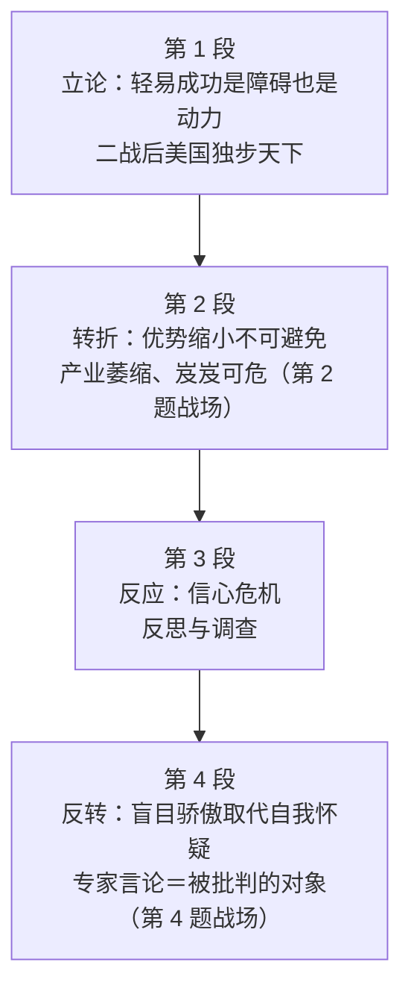

# Passage 43 · 美国战后霸主地位的兴衰

## 答题记录

| 轮次  | 日期         | 题号  | 正确  | 错误  | 正确率 | 用时    | 错题归因 |
| --- | --- | --- | --- | --- | --- | --- | --- |
| 1 |  | 1-4 |  |  |  |  |  |
| 2 |  | 1-4 |  |  |  |  |  |
| 3 |  | 1-4 |  |  |  |  |  |

> [!tip] 填写口径
> - **用时**以分钟计，只计做题时间，不含精读复盘。
> - **错题归因**填「题型·错误类型」，如：因果细节题·把结果当原因、细节判断题·时态偷换、推理题·过度推断。
> - 纵向看趋势：正确率升而用时过长 → 熟练度不足；用时降而正确率波动 → 定位不稳。
> - 本篇 **4 题**（同 P22、P28、P33、P34，2000–2003 年真题多为 4 题），题号栏填 1-4；第 2 题是**四选一排除题**（三个错项全错在「时态与程度」）、第 3 题是**全篇推理题**（要串起第 2—4 段的因果链）、第 4 题是**作者观点题**（题眼是 Few Americans 这个「少数派」标记），错因建议分别写「细节题·未辨时态」「推理题·链条未串到末段」「观点题·把专家观点当作者观点」。

> [!info] 文章档案
> - **来源**：考研英语（一）2000 年 Text 1
> - **题材**：商业经济（美国经济史 × 产业竞争力）——以「轻易得来的成功」开篇，讲美国二战后独步天下、八十年代优势丧失、九十年代复苏的完整兴衰弧线
> - **结构**：4 段 / 25 句 ＋ 4 题（按句号断句与行首缩进实测；与解析引用的「第一段②句＋④句」「第四段④句」「第四段③句」全部吻合；书中对第 2 段句序的标号与实测编号有出入，笔记按实测标注）
> - **难度**：★★★☆☆
> - **一句话主旨**：长期不费力就能成功的历史可能成为可怕的包袱，但处理得当也会变成动力——美国二战后的霸主地位建立在对手被战争摧毁之上，随着别国富裕，优势的缩小不可避免且痛苦：八十年代产业萎缩、信心崩塌；可正是这场危机逼出了反思与调整，到 1995 年美国已连续五年稳健增长，于是自我怀疑让位给了盲目骄傲——而作者认为，复苏的真正原因恰恰是那些被美国人轻视的「显而易见的原因」。

## 一、篇章脉络

- **第 1 段**：**立论＋铺陈**。一段漫长而毫不费力就能成功的历史，可能成为可怕的障碍，但处理得当就会变成推动力。美国在二战后正是进入这样一个光辉时期：市场比任何竞争对手大八倍，工业享有无与伦比的规模经济，科学家世界第一、工人最熟练，其富足程度超出那些经济被战争摧毁的欧亚人民的梦想（第 1 题的战场）。
- **第 2 段**：**优势的必然丧失**。随着别国变富，这种首要地位的缩小不可避免；同样不可避免的是，从主导地位退下是痛苦的。到八十年代中期，美国人对日渐衰弱的工业竞争力束手无策：消费电子等产业萎缩或消失，电视制造商到 1987 年只剩 Zenith（如今一家不剩），外国汽车与纺织品大举涌入，机床业岌岌可危，连美国发明的、处于计算机时代核心的半导体制造业，一度看起来也要成为下一个牺牲品（第 2 题的战场）。
- **第 3 段**：**信心危机与反思**。这一切引发了信心危机：美国人不再把繁荣视为理所当然，开始相信自己的经营方式正在失败、收入也会随之下降；八十年代中期，针对美国工业衰落原因的调查一个接一个，那些时而耸人听闻的发现里满是关于海外竞争加剧的警告。
- **第 4 段**：**反转与盲目骄傲**。情况变化多大啊！1995 年美国可以回顾五年的稳健增长，而日本一直在挣扎。很少有美国人把这仅仅归因于美元贬值或商业周期转向这类显而易见的原因——自我怀疑已经让位于盲目骄傲。随后三段引语（结构调整与瘦身、生产率的提高、企业管理的黄金时代）都是「盲目骄傲」的**引证**，也正是作者批判的对象（第 3、4 题的战场）。

> [!tip] 行文逻辑
> 全篇是**「立论—转折—危机—反转」的四段式经济评论**：第 1 段先把「轻易得来的成功」定性为**双面物**（handicap ↔ driving force），这个「双面性」正是第 3 题 D 项的陷阱所在（它只取了正面的一半）；第 2 段用两个 **inevitable** 把「优势必然丧失」钉死，并用**五个产业实例**铺陈惨状（第 2 题的四项分别对应其中四个）；第 3 段写**心理后果**（crisis of confidence、stopped taking prosperity for granted）；第 4 段用 **How things have changed!** 完成反转，并把「复苏」与「盲目骄傲」绑在一起——**作者的态度恰恰藏在 Few Americans 与 blind pride 这两个词里**。三条线索贯穿全篇：**地位（primacy → predominance → retreat → revival）**、**竞争（foreign competition → overseas competition → intense competition）**、**心理（prosperity → crisis of confidence → self-doubt → blind pride）**。第三条线索是第 4 题的唯一钥匙：**凡是带引号的专家言论，都是「别人认为」，不是「作者认为」**。命题格局**题文同序**（1→P1，2→P2，3→P2—P4 全篇，4→P4），第 3 题是唯一需要跨段成链的题。

## 二、逐段精读

### 第 1 段 · 立论：轻易得来的成功既是障碍，也是动力

**原文**

① A history of long and effortless success can be a dreadful handicap, but, if properly handled, it may become a driving force.
② When the United States entered just such a glowing period after the end of the Second World War, it had a market eight times larger than any competitor, giving its industries unparalleled economies of scale.
③ Its scientists were the world's best; its workers the most skilled.
④ America and Americans were prosperous beyond the dreams of the Europeans and Asians whose economies the war had destroyed.

**译文**

① 一段漫长而**毫不费力**就能取得成功的历史，可能是一种**可怕的障碍**；但如果**处理得当**，它也可能变成一股**推动力**。
② 当美国在第二次世界大战结束后进入这样一个**光辉**时期时，它所拥有的市场比任何竞争对手都**大八倍**，这使其工业获得了**无与伦比的规模经济**。
③ 它的科学家是世界上最优秀的；它的工人是最**熟练的**。
④ 美国和美国人的**富裕**程度，超出了那些经济被战争**摧毁**的欧洲人和亚洲人的梦想。

#### 本段重点词汇

| 单词 | 词性 | 文中意 | 拓展 | 文中用法 |
| --- | --- | --- | --- | --- |
| **effortless** | adj. | 毫不费力的，不费吹灰之力的 | effort n. 努力；effortlessly adv. 轻松地；反义 painstaking adj. 煞费苦心的（第 1 题 A 项） | a history of long and effortless success（一段漫长而不费力就能成功的历史） |
| **dreadful** | adj. | 可怕的，糟糕透顶的 | dread v./n. 畏惧；副词口语化用法 dreadfully＝非常 | a dreadful handicap（一种可怕的障碍） |
| **handicap** | n./v. | 障碍，不利条件；妨碍 | 原指给强者加 handicap 的让步赛；handicapped adj. 有生理缺陷的（注意词义演变） | can be a dreadful handicap（可能是一种可怕的障碍） |
| **properly handled** | 短语 | 若处理得当 | handle v. 处理、应对；＝if it is properly handled（省略主谓的状语从句） | if properly handled, it may become a driving force（若处理得当，它可能变成推动力） |
| **driving force** | n. | 推动力，驱动力 | driving adj. 驱动的、强劲的；the driving force behind sth. 某事物背后的推动力 | it may become a driving force（它可能变成一股推动力） |
| **glowing** | adj. | 光辉的，耀眼的；热烈赞扬的 | glow v. 发光、容光焕发；a glowing account/report 充满赞誉的描述／报告 | entered just such a glowing period（进入这样一个光辉时期） |
| **eight times larger than** | 句型 | 比……大八倍 | 倍数表达三式：eight times as large as / eight times larger than / eight times the size of | a market eight times larger than any competitor（比任何竞争对手大八倍的市场） |
| **competitor** | n. | 竞争对手 | compete v. 竞争；competition n. 竞争；competitive adj. 有竞争力的（第 2 段 competitiveness） | larger than any competitor（比任何竞争对手都大） |
| **unparalleled** | adj. | 无与伦比的，无可匹敌的 | parallel n./adj. 平行线／平行的；un- 否定 ＋ -ed；without parallel 无与伦比 | unparalleled economies of scale（无与伦比的规模经济） |
| **economies of scale** | 短语 | 规模经济（因产量大而单位成本降低） | economy 此处为可数名词，义「节约、经济效益」；scale n. 规模 | giving its industries unparalleled economies of scale（使其工业获得无与伦比的规模经济） |
| **giving** | v. | （现在分词）从而带来 | 现在分词短语作**结果状语**，＝which gave；逻辑主语是前面整个情况 | giving its industries unparalleled economies of scale（从而给其工业带来……） |
| **skilled** | adj. | 熟练的，有技能的 | skill n. 技能；skilled worker 熟练工；unskilled 非熟练的；注意 workforce（劳动力总量）≠ workers（第 1 题 D 项陷阱） | its workers the most skilled（它的工人最熟练） |
| **prosperous** | adj. | 繁荣的，富裕的 | prosper v. 繁荣；prosperity n. 繁荣（第 3 段②句） | America and Americans were prosperous（美国和美国人是富裕的） |
| **beyond the dreams of** | 短语 | 超出……的梦想 | beyond prep. 超出（beyond belief 难以置信、beyond repair 无法修复） | prosperous beyond the dreams of the Europeans and Asians（富足得超出欧亚人的梦想） |
| **destroy** | v. | 摧毁，毁坏 | destruction n. 破坏；destructive adj. 破坏性的 | whose economies the war had destroyed（他们的经济被战争摧毁） |

#### 长难句 · 本段第 ① 句

> [!abstract] 本段第 ① 句 · 原句
> A history of long and effortless success can be a dreadful handicap, but, if properly handled, it may become a driving force.

**结构拆解**
- **主干**：A history ... can be a dreadful handicap, **but** it may become a driving force.（并列句，由 but 连接的两个分句）
- **主语的修饰**：of long and effortless success 介词短语作后置定语，修饰 A history——「一段漫长而不费力气的成功史」。
- **插入的省略状语从句**：if properly handled ＝ **if (it is) properly handled**，省略了主语 it 与系动词 is，插在 but 与第二个分句之间，前后用逗号隔开。

**参考译文**
一段漫长而毫不费力就能取得成功的历史，可能是一种可怕的障碍；但如果处理得当，它也可能变成一股推动力。

> [!tip] 拆解要点
> 这句是全篇的**论点句**，也是第 3 题 D 项的陷阱来源。两个要点：其一，**but 把同一个「历史」判成了两副面孔**（handicap 障碍 ↔ driving force 动力），两者不是二选一，而是**取决于条件**；其二，条件就是插入语 **if properly handled**——**凡选项丢掉这个条件、只取正面那一半，就是断章取义**（第 3 题 D 项 A long history of success may pave the way for further development 正是这么干的，它还顺手删掉了 effortless 这个关键修饰语）。

#### 长难句 · 本段第 ② 句

> [!abstract] 本段第 ② 句 · 原句
> When the United States entered just such a glowing period after the end of the Second World War, it had a market eight times larger than any competitor, giving its industries unparalleled economies of scale.

**结构拆解**
- **主干**：... it had a market eight times larger than any competitor, giving its industries unparalleled economies of scale.
- **时间状语从句**：When the United States entered just such a glowing period after the end of the Second World War（其中 such 回指首句的 glowing period 所指的那种辉煌期）。
- **比较结构**：a market **eight times larger than** any competitor（＝比任何竞争对手的市场大八倍；完整理解为 a market eight times larger than that of any competitor）。
- **结果状语**：giving its industries unparalleled economies of scale —— 现在分词短语，说明「市场大」带来的结果。

**参考译文**
当美国在第二次世界大战结束后进入这样一个光辉时期时，它所拥有的市场比任何竞争对手都大八倍，这使其工业获得了无与伦比的规模经济。

> [!tip] 拆解要点
> 本句是第 1 题的**定位句**（题干 World War II 在此），却**不是答案句**——它只讲「美国有多强」（市场八倍、规模经济），答案「为什么强」在④句（对手的经济被战争摧毁）。三条经验：其一，**倍数表达里被比较的双方常常省略**：eight times larger than any competitor 实际是「比任何竞争对手（的市场）大八倍」，第 1 题 B 项正是把 **any competitor（对手）**偷换成 **before（过去的自己）**；其二，**逗号后 giving... 是结果状语，不是伴随动作**，翻译时加「从而／这使」；其三，**题干原词所在的句子未必是答案句**，因果题要往同段的因果标记词找（本题是④句的 whose economies the war had destroyed）。

#### 长难句 · 本段第 ③ 句

> [!abstract] 本段第 ③ 句 · 原句
> Its scientists were the world's best; its workers the most skilled.

**结构拆解**
- **并列的两个分句**，用分号隔开：Its scientists were the world's best; （its workers were）the most skilled.
- **第二分句省略了谓语** were——这是英语并列句中常见的**承前省略**（gapping），补充完整为 its workers (were) the most skilled。

**参考译文**
它的科学家是世界上最优秀的；它的工人是最熟练的。

> [!tip] 拆解要点
> 分号在这里相当于**轻量版的并列连词**，前后两个分句结构平行、语义同向，后句可以放心地省掉与前句相同的成分。这句看似简单，却藏着第 1 题 D 项的机关：原文说的是 **workers the most skilled（工人技术好）**，而 D 项说的是 **the unparalleled size of its workforce（劳动力规模空前）**——**「工人的素质」被换成了「工人的数量」，workforce 一词全文未出现**。识别方法：**凡选项的名词在原文找不到同源词，先按无中生有处理**。

#### 长难句 · 本段第 ④ 句

> [!abstract] 本段第 ④ 句 · 原句
> America and Americans were prosperous beyond the dreams of the Europeans and Asians whose economies the war had destroyed.

**结构拆解**
- **主干**：America and Americans were prosperous beyond the dreams of the Europeans and Asians...
- **程度状语**：beyond the dreams of the Europeans and Asians（超出欧亚人民的梦想），beyond 引导介词短语修饰 prosperous。
- **定语从句**：whose economies the war had destroyed 修饰 the Europeans and Asians——whose 在此指「他们的（＝欧亚人民的）经济」。

**参考译文**
美国和美国人的富裕程度，超出了那些经济被战争摧毁的欧洲人和亚洲人的梦想。

> [!tip] 拆解要点
> 这是第 1 题的**答案句**：把定语从句单独抽出来读，就是 **the war had destroyed their economies（战争摧毁了他们的经济）**，正对应 C 项 the war had destroyed the economies of most potential competitors。两点提醒：其一，**whose 引导的定语从句常是被命题人挖出来的「因」**——本句的 whose 从句既是「欧亚人穷」的原因，也是「美国富」的相对原因；其二，**beyond the dreams of 是「超出梦想」而非「在梦想之外」**，不要译成否定。

### 第 2 段 · 转折：优势的丧失不可避免且痛苦

**原文**

① It was inevitable that this primacy should have narrowed as other countries grew richer.
② Just as inevitably, the retreat from predominance proved painful.
③ By the mid-1980s, Americans had found themselves at a loss over their fading industrial competitiveness.
④ Some huge American industries, such as consumer electronics, had shrunk or vanished in the face of foreign competition.
⑤ By 1987 there was only one American television maker left, Zenith.
⑥ (Now there is none: Zenith was bought by South Korea's LG Electronics in July.)
⑦ Foreign-made cars and textiles were sweeping into the domestic market.
⑧ America's machine-tool industry was on the ropes.
⑨ For a while it looked as though the making of semiconductors, which America had invented and which sat at the heart of the new computer age, was going to be the next casualty.

**译文**

① 随着其他国家变得富裕，这种**首要地位**的**缩小**是**不可避免的**。
② 同样不可避免的是，从**主导地位**上的**退却**被证明是痛苦的。
③ 到二十世纪八十年代中期，美国人发现自己对其日渐**衰退的**工业**竞争力****束手无策**。
④ 一些庞大的美国产业，比如消费电子业，在外国竞争**面前**已经**萎缩**或**消失**。
⑤ 到 1987 年，美国只剩下唯一一家电视制造商，即 Zenith。
⑥ （现在一家也没有了：Zenith 于 7 月被韩国的 LG 电子收购。）
⑦ 外国制造的汽车和纺织品正**大举涌入****国内市场**。
⑧ 美国的机床工业**岌岌可危**。
⑨ 有一段时间，半导体制造业——它由美国发明、并**处于**新计算机时代**的核心**——看起来将成为下一个**牺牲品**。

#### 本段重点词汇

| 单词 | 词性 | 文中意 | 拓展 | 文中用法 |
| --- | --- | --- | --- | --- |
| **inevitable** | adj. 不可避免的 | 不可避免的，必然发生的 | inevitably adv. 不可避免地（②句 Just as inevitably）；inevitability n. 必然性 | It was inevitable that this primacy should have narrowed（这种首要地位的缩小是不可避免的） |
| **primacy** | n. | 首要地位，霸主地位 | prime adj. 首要的、最好的；primary adj. 主要的；primacy 多用于「国家／领域的领先地位」 | this primacy should have narrowed（这种首要地位本会缩小） |
| **narrow** | v./adj. | （使）变窄、缩小；狭窄的 | 熟词僻义：**动词「缩小」**（narrow the gap 缩小差距）；narrowly adv. 勉强地 | this primacy should have narrowed（这种首要地位缩小了） |
| **retreat** | n./v. | 退却，撤退；后退 | 军事义「撤退」引申为「退出某种地位」；retreat from 从……退却 | the retreat from predominance（从主导地位上的退却） |
| **predominance** | n. | 主导地位，优势 | predominant adj. 占主导地位的；predominate v. 占主导；pre-（在前）＋ dominate（支配） | the retreat from predominance proved painful（从主导地位退下是痛苦的） |
| **prove** | v. | 证明是，结果是 | 系动词用法：prove (to be) ＋ adj. 结果是……；不作「证明」解 | the retreat ... proved painful（退却证明是痛苦的） |
| **at a loss** | 短语 | 不知所措，茫然 | loss n. 损失；at a loss for words 说不出话；at a loss over/about 对……束手无策 | found themselves at a loss over their fading industrial competitiveness（对衰退的竞争力束手无策） |
| **fading** | adj. | 日渐衰退的，正在消退的 | fade v. 褪色、衰退；fade away 逐渐消失 | their fading industrial competitiveness（他们日渐衰退的工业竞争力） |
| **competitiveness** | n. | 竞争力 | compete v. → competitive adj. → competitiveness n.；competitor n. 对手（第 1 段②句） | their fading industrial competitiveness（日渐衰退的工业竞争力） |
| **shrink** | v. | 萎缩，收缩 | 过去式 shrank／过去分词 shrunk；shrinkage n. 收缩量；shrunken adj. 萎缩的 | had shrunk or vanished（已经萎缩或消失） |
| **vanish** | v. | 消失，不复存在 | ＝disappear；vanish into thin air 化为乌有 | had shrunk or vanished in the face of foreign competition（在外国竞争面前萎缩或消失） |
| **in the face of** | 短语 | 面对，在……面前 | 表让步／对抗：in the face of danger 面对危险；＝despite | in the face of foreign competition（面对外国竞争） |
| **consumer electronics** | n. | 消费电子（业） | consumer n. 消费者；electronics n. 电子学／电子设备（以 -s 结尾但作单数） | such as consumer electronics（比如消费电子业） |
| **sweep into** | 短语 | 大举涌入，席卷而入 | sweep v. 扫、席卷（过去式 swept）；sweep the board 大获全胜 | were sweeping into the domestic market（正大举涌入国内市场） |
| **domestic market** | n. | 国内市场 | domestic adj. 国内的、家庭的（domestic violence 家庭暴力）；反义 overseas market 海外市场 | Foreign-made cars ... were sweeping into the domestic market（外国车涌入国内市场） |
| **machine-tool industry** | n. | 机床工业 | machine tool n. 机床；machine-tool 作复合定语 | America's machine-tool industry was on the ropes（美国机床业岌岌可危） |
| **on the ropes** | 短语 | 岌岌可危，濒临失败 | 源自拳击：被打得靠在绳上；**不是**「在绳子上」，更不含「自杀」义（第 2 题 C 项 suicidal actions 即由此生造） | America's machine-tool industry was on the ropes（美国机床业岌岌可危） |
| **for a while** | 短语 | 有一段时间，一度 | while n. 一段时间；for a while 只表过去「一度」，与「已经」无关（第 2 题 B 项陷阱） | For a while it looked as though ...（有一段时间看起来似乎……） |
| **as though** | 连词 | 似乎，好像 | ＝as if；后接虚拟或陈述，视语境而定 | it looked as though the making of semiconductors ... was going to be the next casualty（看起来半导体制造业将成为下一个牺牲品） |
| **semiconductor** | n. | 半导体 | semi-（半）＋ conductor（导体）；silicon 硅 | the making of semiconductors（半导体制造） |
| **sit at the heart of** | 短语 | 处于……的核心 | sit 此处为「位于、处于」；at the heart of 在……的核心 | which sat at the heart of the new computer age（处于新计算机时代的核心） |
| **casualty** | n. | 牺牲品，受害者；伤亡人员 | casual adj. 偶然的、随意的（第 1 题 A 项 casual）；casualty 与 casual 同源却义远，勿混 | was going to be the next casualty（将成为下一个牺牲品） |

#### 长难句 · 本段第 ① 句

> [!abstract] 本段第 ① 句 · 原句
> It was inevitable that this primacy should have narrowed as other countries grew richer.

**结构拆解**
- **主干**：It was inevitable that...（**形式主语 it**，真正的主语是 that 引导的主语从句）。
- **主语从句**：that this primacy **should have narrowed** —— 此处 should 不表「应该」，而用于 **It is/was inevitable/important/natural that...** 结构中的**虚拟或陈述性 should**，强调「竟然／不可避免地发生了」，结合完成式 have narrowed 表「已经发生」。
- **时间／原因状语从句**：as other countries grew richer（随着其他国家变得更富裕），as ＝「随着」。

**参考译文**
随着其他国家变得富裕，这种首要地位的缩小是不可避免的。

> [!tip] 拆解要点
> 两个易错点：其一，**It was inevitable that... 是形式主语句型**，真正主语在后面，翻译时先把 that 从句提出来（「……是不可避免的」），不要硬译成「它是不可避免的」；其二，**should have narrowed 不是「本该缩小却没缩小」**（那是 should have done 的虚拟责备义），在 inevitable 类形容词后 should 只表「竟然／自然地」，此处等于 had narrowed。判断方法：**看主句形容词——若是 inevitable/natural/appropriate 等评价词，should 无责备义**。

#### 长难句 · 本段第 ⑨ 句

> [!abstract] 本段第 ⑨ 句 · 原句
> For a while it looked as though the making of semiconductors, which America had invented and which sat at the heart of the new computer age, was going to be the next casualty.

**结构拆解**
- **主干**：it looked as though ...（**it 为无人称主语**，look 为系动词，as though 引导表语从句）。
- **表语从句**：as though the making of semiconductors ... was going to be the next casualty（半导体制造业将成为下一个牺牲品）。
- **两个并列的非限定性定语从句**：which America had invented 与 which sat at the heart of the new computer age，共同修饰 **the making of semiconductors**（注意：不是修饰 semiconductors 这个词本身，而是「半导体制造」这件事），前后用逗号隔开，插在主语与谓语之间。

**参考译文**
有一段时间，半导体制造业——它由美国发明，并且处于新计算机时代的核心——看起来将成为下一个牺牲品。

> [!tip] 拆解要点
> 三层机关：其一，**主语与谓语被两个 which 从句生生隔开**（the making of semiconductors ..., ..., was going to be...），读时先把插入部分括起来，主谓才能接上；其二，**两个 which 的先行词是同一个**：the making of semiconductors（制造这件事），因为后面的 sat at the heart of 只能由「制造／产业」来发出，半导体本身不会「处于核心」——**判断非限定性定语从句的先行词，靠的是语义搭配而非就近原则**；其三，**was going to be 是「将然」不是「已然」**，第 2 题 B 项正是把「将成为下一个牺牲品」改成了 **had been taken over（已经被接管）**，属典型的**时态偷换**。

### 第 3 段 · 反应：信心危机与全面反思

**原文**

① All of this caused a crisis of confidence.
② Americans stopped taking prosperity for granted.
③ They began to believe that their way of doing business was failing, and that their incomes would therefore shortly begin to fall as well.
④ The mid-1980s brought one inquiry after another into the causes of America's industrial decline.
⑤ Their sometimes sensational findings were filled with warnings about the growing competition from overseas.

**译文**

① 所有这一切引发了一场**信心危机**。
② 美国人不再**把繁荣视为理所当然**。
③ 他们开始相信，自己的经营方式正在**失败**，他们的**收入**也会因此**很快**开始下降。
④ 二十世纪八十年代中期，**一个又一个调查**指向美国工业**衰落**的原因。
⑤ 它们那些**时而耸人听闻的**调查**结果**，充满了对来自**海外**日益加剧的竞争的警告。

#### 本段重点词汇

| 单词 | 词性 | 文中意 | 拓展 | 文中用法 |
| --- | --- | --- | --- | --- |
| **crisis of confidence** | n. | 信心危机 | crisis n. 危机（复数 crises）；confidence n. 信心；confident adj. 自信的 | All of this caused a crisis of confidence（这一切引发了信心危机） |
| **take ... for granted** | 短语 | 把……视为理所当然 | take it for granted that... 想当然地认为；grant v. 同意、授予 | stopped taking prosperity for granted（不再把繁荣视为理所当然） |
| **prosperity** | n. | 繁荣，富足 | prosper v. 繁荣；prosperous adj. 繁荣的（第 1 段④句） | taking prosperity for granted（把繁荣视为理所当然） |
| **way of doing business** | 短语 | 经营方式，做生意的方式 | business n. 商业、企业；do business 做生意 | their way of doing business was failing（他们的经营方式正在失败） |
| **fail** | v. | 失败；衰退，失灵 | failure n. 失败；failing n. 缺点（第 4 段未出现，注意区分） | their way of doing business was failing（他们的经营方式正在失败） |
| **income** | n. | 收入 | income tax 所得税；salary 月薪、wage 周薪（时薪）；revenue（企业／国家）收入 | their incomes would therefore shortly begin to fall（他们的收入也会因此很快开始下降） |
| **shortly** | adv. | 不久，很快 | short adj. 短的；shortly after 不久之后；shortly before 不久之前 | would therefore shortly begin to fall（因此很快开始下降） |
| **as well** | 短语 | 也，同样 | ＝too，置于句末；as well as 和、以及（连接两个并列项） | begin to fall as well（也会开始下降） |
| **one after another** | 短语 | 一个接一个，接连地 | ＝one by one；one inquiry after another 一个接一个的调查 | brought one inquiry after another into the causes（带来一个又一个针对原因的调查） |
| **inquiry** | n. | 调查，探究；询问 | enquire/inquire v. 询问、调查；inquiry into 对……的调查 | one inquiry after another into the causes of ... industrial decline（对工业衰落原因的一个个调查） |
| **decline** | n./v. | 衰落，下降；婉拒 | 熟词僻义：**「衰落、衰退」**（industrial decline）；另义「婉言谢绝」 | the causes of America's industrial decline（美国工业衰落的原因） |
| **sensational** | adj. | 耸人听闻的；轰动性的 | sensation n. 感觉、轰动；sensible 明智的、sensitive 敏感的（三词易混） | Their sometimes sensational findings（它们那些时而耸人听闻的发现） |
| **findings** | n. | 调查／研究的发现、结论 | 常用复数；find v. 发现；the findings of the report 报告的结论 | Their sometimes sensational findings were filled with warnings（它们那些耸人听闻的结论充满警告） |
| **be filled with** | 短语 | 充满，满是 | fill v. 填满；be full of 同义 | were filled with warnings about the growing competition（充满了关于竞争加剧的警告） |
| **growing** | adj. | 日益增长的 | grow v. 增长、变得；growing competition 竞争加剧 | the growing competition from overseas（来自海外的日益加剧的竞争） |
| **overseas** | adv./adj. | 海外（的），国外（的） | overseas students 留学生；overseas market 海外市场 | the growing competition from overseas（来自海外的日益加剧的竞争） |

#### 长难句 · 本段第 ③ 句

> [!abstract] 本段第 ③ 句 · 原句
> They began to believe that their way of doing business was failing, and that their incomes would therefore shortly begin to fall as well.

**结构拆解**
- **主干**：They began to believe **that** ..., **and that** ... —— **两个由 and 连接的并列宾语从句**，同作 believe 的宾语。
- **宾语从句一**：that their way of doing business was failing（他们的经营方式正在失败）。
- **宾语从句二**：that their incomes would therefore shortly begin to fall as well（他们的收入也会因此很快开始下降）；其中 **therefore** 是连接性副词，表明从句二与从句一之间是**因果承接**关系。

**参考译文**
他们开始相信，自己的经营方式正在失败，他们的收入也会因此很快开始下降。

> [!tip] 拆解要点
> 识别并列宾语从句的硬指标：**第二个从句前的 that 不能省**——英语里多个宾语从句并列时，只有第一个 that 可省略，后面的 that 必须保留，所以看到 **", and that ..."** 就立刻知道前面还有一个 that 从句与它并列。另一个值得记的点是 **therefore 的位置**：它插在助动词 would 之后、实义动词 begin 之前，是连接性副词的标准位置——**凡 therefore/however/thus 出现在句中而非句首，多半是插入语，可先用逗号括掉再读主干**。

### 第 4 段 · 反转：自我怀疑让位于盲目骄傲

**原文**

① How things have changed!
② In 1995 the United States can look back on five years of solid growth while Japan has been struggling.
③ Few Americans attribute this solely to such obvious causes as a devalued dollar or the turning of the business cycle.
④ Self-doubt has yielded to blind pride.
⑤ "American industry has changed its structure, has gone on a diet, has learnt to be more quick-witted," according to Richard Cavanaugh, executive dean of Harvard's Kennedy School of Government.
⑥ "It makes me proud to be an American just to see how our businesses are improving their productivity," says Stephen Moore of the Cato Institute, a think-tank in Washington, DC.
⑦ And William Sahlman of the Harvard Business School believes that people will look back on this period as a golden age of business management in the United States.

**译文**

① 情况的变化有多大啊！
② 1995 年，美国可以**回顾**五年的**稳健增长**，而日本却一直在**挣扎**。
③ 很少有美国人把这**仅仅归因于**美元**贬值**或**商业周期的转向**这类显而易见的原因。
④ **自我怀疑**已经**让位于****盲目骄傲**。
⑤ 哈佛大学肯尼迪政府学院**执行院长** Richard Cavanaugh 说：「美国工业已经改变了结构，已经**瘦身**，已经学会变得更**机敏**。」
⑥ 位于华盛顿特区的**智库**卡托研究所的 Stephen Moore 说：「光是看到我们的企业在如何提高**生产力**，就让我为自己是个美国人而自豪。」
⑦ 哈佛商学院的 William Sahlman 则认为，人们会回顾这一时期，把它当作美国**企业管理**的**黄金时代**。

#### 本段重点词汇

| 单词 | 词性 | 文中意 | 拓展 | 文中用法 |
| --- | --- | --- | --- | --- |
| **look back on** | 短语 | 回顾，回想 | look back 回顾；look forward to 期待（to 为介词）；look down on 轻视 | can look back on five years of solid growth（可以回顾五年的稳健增长） |
| **solid growth** | n. | 稳健的增长 | solid adj. 稳固的、扎实的；a solid foundation 坚实的基础 | five years of solid growth（五年的稳健增长） |
| **struggle** | v./n. | 挣扎，艰难求生 | struggle for 为……而奋斗；struggle to do 艰难地做 | while Japan has been struggling（而日本一直在挣扎） |
| **attribute ... to ...** | 短语 | 把……归因于…… | attribute v. 归因（attribute A to B＝认为 A 由 B 造成）；attribute n. 属性；另见 contribute to 有助于 | attribute this solely to such obvious causes as ...（把这仅仅归因于……这类显而易见的原因） |
| **solely** | adv. | 仅仅，唯一地 | sole adj. 唯一的；solely 常与 attribute/responsible/depend 连用 | Few Americans attribute this solely to ...（很少有美国人把这仅仅归因于……） |
| **obvious** | adj. | 明显的，显而易见的 | obviously adv. 显然；obvious causes 显而易见的原因（与「深层原因」相对） | such obvious causes as a devalued dollar（美元贬值这类显而易见的原因） |
| **devalued** | adj. | 贬值的 | devalue v. 使贬值；de-（降低）＋ value；a devalued dollar 贬了值的美元 | a devalued dollar（贬值的美元） |
| **the turning of the business cycle** | 短语 | 商业／经济周期的转向 | turning n. 转向、转折；business cycle 经济周期（繁荣—衰退—萧条—复苏） | the turning of the business cycle（商业周期的转向） |
| **self-doubt** | n. | 自我怀疑 | self- 前缀：self-confidence 自信、self-respect 自尊；与第 3 段 crisis of confidence 呼应 | Self-doubt has yielded to blind pride（自我怀疑已让位于盲目骄傲） |
| **yield to** | 短语 | 让位于，屈服于 | yield v. 屈服、产出；yield to pressure 屈从于压力；此处为「被……取代」 | Self-doubt has yielded to blind pride（自我怀疑让位于盲目骄傲） |
| **blind pride** | n. | 盲目骄傲 | blind adj. 盲目的（blind faith 盲信）；与第 3 段 self-doubt 构成**单向取代** | Self-doubt has yielded to blind pride（自我怀疑让位于盲目骄傲） |
| **go on a diet** | 短语 | 节食；此处喻「瘦身、精简」 | diet n. 饮食；be on a diet 在节食；文中喻指企业裁撤冗余、压缩成本 | has gone on a diet（已经瘦了身／做了精简） |
| **quick-witted** | adj. | 机敏的，反应快的 | wit n. 机智；witted 构成复合词：slow-witted 迟钝的、sharp-witted 敏锐的 | has learnt to be more quick-witted（学会了变得更机敏） |
| **executive dean** | n. | 执行院长 | executive adj. 执行的、行政的（CEO＝Chief Executive Officer）；dean n. 院长、系主任 | executive dean of Harvard's Kennedy School of Government（哈佛肯尼迪政府学院执行院长） |
| **improve** | v. | 提高，改善 | improvement n. 改进；improve productivity 提高生产率 | improving their productivity（提高他们的生产力） |
| **productivity** | n. | 生产力，生产率 | produce v. 生产；product n. 产品；productive adj. 多产的；productivity 是经济类高频词 | improving their productivity（提高生产率） |
| **think-tank** | n. | 智库，智囊团 | tank n. 坦克、水槽；think-tank 为固定复合词（亦作 think tank） | a think-tank in Washington, DC（位于华盛顿特区的智库） |
| **golden age** | n. | 黄金时代 | golden adj. 黄金般的、极好的；golden age／golden opportunity 黄金时代／绝佳机会 | a golden age of business management（企业管理的黄金时代） |
| **business management** | n. | 企业管理，工商管理 | manage v. 管理；management n. 管理（层）；MBA＝Master of Business Administration | a golden age of business management（企业管理的黄金时代） |
| **structure** | n./v. | 结构；构造，组织 | structural adj. 结构的；restructuring n. 结构调整（第 4 题 B 项） | American industry has changed its structure（美国工业已改变结构） |

#### 长难句 · 本段第 ③ 句

> [!abstract] 本段第 ③ 句 · 原句
> Few Americans attribute this solely to such obvious causes as a devalued dollar or the turning of the business cycle.

**结构拆解**
- **主干**：Few Americans attribute this solely to such obvious causes as...（主谓宾状结构）。
- **谓语搭配**：**attribute A to B** —— A ＝ this（回指上一句的 five years of solid growth），B ＝ such obvious causes as a devalued dollar or the turning of the business cycle。
- **举例结构**：**such ... as ...** ＝「诸如……之类的……」；as 后列举两项：a devalued dollar 与 the turning of the business cycle。
- **限定词**：solely（仅仅）与 Few（几乎没有）共同把句子的否定意味推向极致。

**参考译文**
很少有美国人把这仅仅归因于美元贬值或商业周期转向这类显而易见的原因。

> [!tip] 拆解要点
> 这是第 4 题的**唯一答案句**，也是全篇最难的一句——难在**态度藏在量词里**。三层意思：其一，**Few Americans 是「几乎没有美国人」**，含否定意味，放在句首时**句子等于半否定句**；其二，**such ... as ... 是举例结构**，as 之后的两项（美元贬值、周期转向）正是 **A 项 turning of the business cycle** 的原文出处；其三，**作者的态度由下一句的 blind pride 反推**——作者把美国人的这种「不归因于显而易见原因」的态度称为**盲目骄傲**，等于**站在美国人（多数派）的反面**，也就是认为真正的原因**恰恰**是这些显而易见的原因。于是 A 项成立。**凡题干问 the author seems to believe，而原文出现 Few/Most ... believe 的结构，先判断作者是站多数派还是少数派**。

#### 长难句 · 本段第 ⑤ 句

> [!abstract] 本段第 ⑤ 句 · 原句
> "American industry has changed its structure, has gone on a diet, has learnt to be more quick-witted," according to Richard Cavanaugh, executive dean of Harvard's Kennedy School of Government.

**结构拆解**
- **主干**：American industry **has changed** its structure, **has gone on a diet**, **has learnt** to be more quick-witted —— **同一个主语带三个并列的谓语**（现在完成时），构成排比。
- **引述方式**：according to Richard Cavanaugh 放在**引语之后**（英语引述语可前可后）；executive dean of Harvard's Kennedy School of Government 是 Cavanaugh 的同位语，说明身份。
- **修辞**：has gone on a diet（节食）是**拟人／比喻**，把「企业裁撤冗余」说成「瘦身」。

**参考译文**
哈佛大学肯尼迪政府学院执行院长 Richard Cavanaugh 说：「美国工业已经改变了结构，已经瘦身，已经学会变得更机敏。」

> [!tip] 拆解要点
> 两个考点：其一，**三重排比谓语共用一个主语**，读时先抓 American industry，再把三个 has done 串起来，句意立刻清晰；其二，**引述语后置时，according to 前往往有逗号**，翻译按中文习惯把「某某说」提到前面。更重要的是位置意识：**本句与⑥⑦句都是引号里的专家言论，属于「别人认为」**——第 4 题的 B 项（restructuring of industry 出自⑤句）与 C 项（improved business management 出自⑦句）正是从这三句引语里摘出来的，**而题目问的是作者的观点**。**带引号的人物言论＝干扰项矿藏**，这是考研阅读的常规套路。

#### 长难句 · 本段第 ⑦ 句

> [!abstract] 本段第 ⑦ 句 · 原句
> And William Sahlman of the Harvard Business School believes that people will look back on this period as a golden age of business management in the United States.

**结构拆解**
- **主干**：William Sahlman ... believes **that**...（宾语从句）。
- **宾语从句**：that people will **look back on** this period **as** a golden age of business management in the United States —— 其中 **look back on A as B** ＝「把 A 回顾为／视作 B」，as 引出宾语补足语。
- **后置定语**：of the Harvard Business School 修饰 William Sahlman；of business management 与 in the United States 层层修饰 a golden age。

**参考译文**
哈佛商学院的 William Sahlman 则认为，人们会回顾这一时期，把它当作美国企业管理的黄金时代。

> [!tip] 拆解要点
> 关键搭配是 **look back on A as B（回顾 A，把它视作 B）**：on 后接被回顾的对象，as 后接给出的评价。它与②句的 look back on five years of solid growth（只接对象、不给评价）构成同中有异的对照——**同一个短语，②句用来陈述事实，⑦句用来表达溢美**，而⑦句的溢美正是「blind pride」的注脚，也因此成了第 4 题 C 项（improved business management）的出处。记一条：**段末最后一句若是人物言论，多半是作者要批判的靶子，而不是作者的观点**。

## 三、全篇重点词汇汇总（自测用）

> [!info] 说明
> 本表只列「单词 / 词性 / 所在段」，不含释义与搭配，用于遮表自测：说出词义后再回该段核对。
> 收录**全篇所有段落词汇，共 73 条，不删减**，与各段「本段重点词汇」等长同源（跨段复现的词只在其首次出现的段落收录一次，如 compete 一族只在第 1 段以 competitor 收录）。

| 单词 / 短语 | 词性 | 所在段 |
| --- | --- | --- |
| **effortless** | adj. | 第 1 段 |
| **dreadful** | adj. | 第 1 段 |
| **handicap** | n./v. | 第 1 段 |
| **properly handled** | 短语 | 第 1 段 |
| **driving force** | n. | 第 1 段 |
| **glowing** | adj. | 第 1 段 |
| **eight times larger than** | 句型 | 第 1 段 |
| **competitor** | n. | 第 1 段 |
| **unparalleled** | adj. | 第 1 段 |
| **economies of scale** | 短语 | 第 1 段 |
| **giving** | v. | 第 1 段 |
| **skilled** | adj. | 第 1 段 |
| **prosperous** | adj. | 第 1 段 |
| **beyond the dreams of** | 短语 | 第 1 段 |
| **destroy** | v. | 第 1 段 |
| **inevitable** | adj. | 第 2 段 |
| **primacy** | n. | 第 2 段 |
| **narrow** | v./adj. | 第 2 段 |
| **retreat** | n./v. | 第 2 段 |
| **predominance** | n. | 第 2 段 |
| **prove** | v. | 第 2 段 |
| **at a loss** | 短语 | 第 2 段 |
| **fading** | adj. | 第 2 段 |
| **competitiveness** | n. | 第 2 段 |
| **shrink** | v. | 第 2 段 |
| **vanish** | v. | 第 2 段 |
| **in the face of** | 短语 | 第 2 段 |
| **consumer electronics** | n. | 第 2 段 |
| **sweep into** | 短语 | 第 2 段 |
| **domestic market** | n. | 第 2 段 |
| **machine-tool industry** | n. | 第 2 段 |
| **on the ropes** | 短语 | 第 2 段 |
| **for a while** | 短语 | 第 2 段 |
| **as though** | 连词 | 第 2 段 |
| **semiconductor** | n. | 第 2 段 |
| **sit at the heart of** | 短语 | 第 2 段 |
| **casualty** | n. | 第 2 段 |
| **crisis of confidence** | n. | 第 3 段 |
| **take ... for granted** | 短语 | 第 3 段 |
| **prosperity** | n. | 第 3 段 |
| **way of doing business** | 短语 | 第 3 段 |
| **fail** | v. | 第 3 段 |
| **income** | n. | 第 3 段 |
| **shortly** | adv. | 第 3 段 |
| **as well** | 短语 | 第 3 段 |
| **one after another** | 短语 | 第 3 段 |
| **inquiry** | n. | 第 3 段 |
| **decline** | n./v. | 第 3 段 |
| **sensational** | adj. | 第 3 段 |
| **findings** | n. | 第 3 段 |
| **be filled with** | 短语 | 第 3 段 |
| **growing** | adj. | 第 3 段 |
| **overseas** | adv./adj. | 第 3 段 |
| **look back on** | 短语 | 第 4 段 |
| **solid growth** | n. | 第 4 段 |
| **struggle** | v./n. | 第 4 段 |
| **attribute ... to ...** | 短语 | 第 4 段 |
| **solely** | adv. | 第 4 段 |
| **obvious** | adj. | 第 4 段 |
| **devalued** | adj. | 第 4 段 |
| **the turning of the business cycle** | 短语 | 第 4 段 |
| **self-doubt** | n. | 第 4 段 |
| **yield to** | 短语 | 第 4 段 |
| **blind pride** | n. | 第 4 段 |
| **go on a diet** | 短语 | 第 4 段 |
| **quick-witted** | adj. | 第 4 段 |
| **executive dean** | n. | 第 4 段 |
| **improve** | v. | 第 4 段 |
| **productivity** | n. | 第 4 段 |
| **think-tank** | n. | 第 4 段 |
| **golden age** | n. | 第 4 段 |
| **business management** | n. | 第 4 段 |
| **structure** | n./v. | 第 4 段 |

> [!example] 同义替换链（阅读题高频）
> - **the war had destroyed the economies of the Europeans and Asians（第 1 段④句）↔ the war had destroyed the economies of most potential competitors（第 1 题 C 项）**：第 1 题的核心替换，几乎逐词对应。
> - **effortless（第 1 段①句）↔ painstaking efforts（第 1 题 A 项）**：毫不费力 ↔ 煞费苦心，**与原文相反**。
> - **larger than any competitor（第 1 段②句）↔ larger than before（第 1 题 B 项）**：比**对手**大 ↔ 比**过去的自己**大，**偷换比较对象**。
> - **its workers the most skilled（第 1 段③句）↔ the unparalleled size of its workforce（第 1 题 D 项）**：工人的**素质** ↔ 工人的**数量**，**无中生有**（workforce 全文未出现）。
> - **Foreign-made cars ... sweeping into the domestic market（第 2 段⑦句）↔ auto industry had lost part of its domestic market（第 2 题 D 项）**：第 2 题的核心替换。
> - **was going to be the next casualty（第 2 段⑨句）↔ had been taken over by foreign enterprises（第 2 题 B 项）**：**将然 ↔ 已然**，时态偷换。
> - **was on the ropes（第 2 段⑧句）↔ had collapsed after suicidal actions（第 2 题 C 项）**：**濒临崩溃 ↔ 已经崩溃**，程度偷换，且 suicidal 无中生有。
> - **Foreign competition → fading industrial competitiveness → crisis of confidence → inquiry → solid growth（第 2—4 段）↔ intense competition may contribute to economic progress（第 3 题 B 项）**：第 3 题的跨段因果链。
> - **Self-doubt has yielded to blind pride（第 4 段④句）↔ shift between self-doubt and blind pride（第 3 题 A 项）**：**单向取代 ↔ 来回转换**，无中生有。
> - **a devalued dollar or the turning of the business cycle（第 4 段③句）↔ turning of the business cycle（第 4 题 A 项）**：第 4 题的核心替换，出自被美国人**轻视**的那些「显而易见的原因」。
> - **has changed its structure（第 4 段⑤句）↔ restructuring of industry（第 4 题 B 项）**：出自 Cavanaugh 的引语，**专家观点 ≠ 作者观点**。
> - **a golden age of business management（第 4 段⑦句）↔ improved business management（第 4 题 C 项）**：出自 Sahlman 的引语，同上。

> [!warning] 熟词僻义专列
> - **handicap**：残疾 → **障碍、不利条件**（a dreadful handicap）。
> - **glowing**：发光的 → **光辉的、热烈赞扬的**（a glowing period / a glowing report）。
> - **economy**：经济 → **节约、经济效益**（economies of scale 规模经济）。
> - **narrow**：狭窄的（adj.）→ **缩小**（v.）。
> - **retreat**：撤退（v.）→ **退却**（n.，the retreat from predominance）。
> - **prove**：证明（v.）→ **证明是、结果是**（系动词，prove painful）。
> - **loss**：损失 → **at a loss 不知所措**（茫然无措）。
> - **shrink**：缩水 → **（产业）萎缩**（过去式 shrank／过去分词 shrunk）。
> - **sweep**：打扫 → **席卷、大举涌入**（sweep into）。
> - **domestic**：家庭的 → **国内的**（domestic market 国内市场）。
> - **on the ropes**：在绳子上 → **岌岌可危**（拳击术语，被逼到绳角）。
> - **casualty**：伤亡人员 → **牺牲品、受害者**（the next casualty）。
> - **decline**：婉拒 → **衰落、衰退**（industrial decline）。
> - **sensational**：轰动的 → **耸人听闻的**（含贬义）。
> - **findings**：发现 → **调查／研究的结论**（常用复数）。
> - **solid**：固体的 → **稳健的、扎实的**（solid growth）。
> - **yield**：产出 → **屈服、让位于**（yield to）。
> - **blind**：瞎的 → **盲目的**（blind pride 盲目骄傲）。
> - **diet**：饮食 → **go on a diet 节食／喻指瘦身精简**。
> - **turning**：转弯处 → **转向、转折**（the turning of the business cycle）。

## 四、知识点补充

> [!question] 背景知识
> - **二战后美国的经济地位**：二战使欧亚主要工业国的经济遭受严重破坏，而美国本土未受战火波及，1945 年前后其工业产出占世界一半以上，拥有「比任何竞争对手大八倍」的市场——这正是第 1 题 C 项的历史背景（美国的优势**并非**自己「付出了艰辛努力」，而是对手被削弱，故 A 项 painstaking 与原文 effortless 正反对立）。
> - **Zenith 与 LG 电子**：Zenith 是美国老牌电视制造商，文中说 1987 年它是「仅存的一家美国电视制造商」，后被韩国 LG 电子收购；第 2 段⑥句 (Now there is none...) 是作者写作时的补注，也是第 2 题 A 项的反证——不是「退回国内市场」，而是**一家不剩**。
> - **消费电子业的外迁**：1970—80 年代，美国在彩电、收音机等消费电子领域被日本企业全面超越，文中 shrunk or vanished in the face of foreign competition 即指此。
> - **半导体业的「下一个牺牲品」**：半导体由美国发明（1947 年贝尔实验室发明晶体管），但到 1980 年代日本在存储器（DRAM）上占据优势，美国一度担心失去这一「处于新计算机时代核心」的产业。文中用 **was going to be（将然）**，第 2 题 B 项却写成 had been taken over（已然）。
> - **machine-tool industry（机床工业）**：为制造业提供「工作母机」的基础产业，其衰退被视为制造业整体竞争力下滑的信号；文中说它 **on the ropes（岌岌可危）**，第 2 题 C 项却写成 had collapsed（已经崩溃）。
> - **business cycle（商业／经济周期）**：经济活动的周期性波动，通常分为繁荣、衰退、萧条、复苏四阶段；the turning of the business cycle 指周期由低谷转向上行——第 4 题 A 项，也是被美国人**轻视**的「显而易见的原因」之一。
> - **economies of scale（规模经济）**：产量越大、单位成本越低。注意 economy 在此为**可数名词**，义为「节约、经济效益」，不是「经济」。
> - **机构与身份**：Cato Institute（卡托研究所）是位于华盛顿特区的自由意志主义智库；Harvard's Kennedy School of Government 即哈佛大学肯尼迪政府学院；Harvard Business School 即哈佛商学院。文中这三处身份说明都在**给「盲目骄傲」的发言人背书**，也正是第 4 题 B、C 两项的出处。
> - **全篇的兴衰弧线（复述模板）**：优势的**来源**（对手被战争摧毁）→ 优势的**丧失**（别国富裕，不可避免且痛苦）→ **反应**（信心危机、反思与调查）→ **复苏**（五年稳健增长）→ **副作用**（自我怀疑让位于盲目骄傲）。这条弧线是第 3 题的答题依据：竞争既是「衰落」的原因，又通过倒逼反思间接促成了「复苏」，所以 B 项 Intense competition may contribute to economic progress 成立——注意其中的 **may（可能）**，推理题的正确项往往带**弱化的情态动词**。

> [!warning] 语法点
> - **形式主语 it ＋ 主语从句（第 2 段①）**：It was inevitable that this primacy should have narrowed...
> - **should have done 在 inevitable / natural 类形容词后不表责备**：should have narrowed ＝ had narrowed（第 2 段①）。
> - **省略型状语从句（第 1 段①）**：if (it is) properly handled。
> - **分号连接的并列句与承前省略（第 1 段③）**：Its scientists were the world's best; its workers (were) the most skilled.
> - **现在分词短语作结果状语（第 1 段②）**：..., giving its industries unparalleled economies of scale.
> - **倍数表达三式（第 1 段②）**：eight times larger than / eight times as large as / eight times the size of——**比较对象必须同类**，第 1 题 B 项把 any competitor 换成 before，正是破坏了可比性。
> - **whose 引导定语从句，whose 指「他们的」（第 1 段④）**：the Europeans and Asians whose economies the war had destroyed.
> - **as though 引导表语从句（第 2 段⑨）**：it looked as though...
> - **两个非限定性定语从句并列修饰同一先行词（第 2 段⑨）**：the making of semiconductors, which America had invented and which sat at the heart of...
> - **系动词 prove / look（第 2 段②、第 2 段⑨）**：prove painful、look as though —— 后接形容词或从句。
> - **并列宾语从句，第二个 that 不可省（第 3 段③）**：began to believe that..., and that...
> - **attribute A to B ＋ such ... as ... 举例结构（第 4 段③）**。
> - **引述语后置（第 4 段⑤）**："...", according to Richard Cavanaugh, executive dean of...
> - **look back on A as B（第 4 段⑦）**：回顾 A，把它视作 B。
> - **现在完成时排比（第 4 段⑤）**：has changed..., has gone on a diet, has learnt...
> - **现在完成进行时表持续（第 4 段②）**：while Japan has been struggling.

> [!success] 写作可迁移句型
> - **A ... can be a dreadful handicap, but, if properly handled, it may become a driving force.**：……可能是可怕的障碍，但处理得当也会变成推动力（双面性开场句，适用于「危机／压力／失败」类话题）。
> - **It was inevitable that...should have...as...**：随着……，……的……是不可避免的（历史趋势句）。
> - **Just as inevitably, ...proved painful.**：同样不可避免的是，……被证明是痛苦的（递进呼应句）。
> - **By the mid-1980s, ...had found themselves at a loss over...**：到八十年代中期，……发现自己已对……束手无策（时间轴＋困境句）。
> - **Some huge industries, such as..., had shrunk or vanished in the face of foreign competition.**：一些庞大的产业，比如……，已在外国竞争面前萎缩或消失。
> - **Foreign-made...were sweeping into the domestic market.**：外国制造的……正大举涌入国内市场。
> - **America's...industry was on the ropes.**：……产业岌岌可危（成语化表达）。
> - **For a while it looked as though...was going to be the next casualty.**：有一段时间，……看起来将成为下一个牺牲品（**将然**，勿写成已然）。
> - **All of this caused a crisis of confidence.**：这一切引发了信心危机（因果收束句）。
> - **...stopped taking prosperity for granted.**：……不再把繁荣视为理所当然。
> - **How things have changed!**：情况变化多大啊（反转段的感叹式过渡）。
> - **Few...attribute this solely to such obvious causes as A or B.**：很少有人把这仅仅归因于 A 或 B 这类显而易见的原因（引出「少数派＝作者」的句式）。
> - **Self-doubt has yielded to blind pride.**：自我怀疑让位于盲目骄傲（态度转折句）。
> - **...will look back on this period as a golden age of...**：人们会回顾这一时期，把它当作……的黄金时代。

> [!danger] 易混辨析
> - **primacy / predominance / priority / dominance**：首要地位／主导地位／优先事项／支配地位。文中 primacy（第 2 段①）与 predominance（第 2 段②）近义换用，都指「美国的霸主地位」。
> - **workforce / workers / labor / staff**：劳动力总量／工人们／劳动（力）／员工。第 1 题 D 项用 workforce（数量）偷换原文的 workers the most skilled（素质）。
> - **effortless / painstaking / laborious / arduous**：毫不费力的／煞费苦心的／费力的／艰苦的。第 1 题 A 项的 painstaking 与原文 effortless 反义。
> - **shrink / vanish / collapse / decline**：萎缩／消失／崩溃／衰落。第 2 题 C 项用 collapsed（已然崩溃）替换 on the ropes（濒临失败），程度不同。
> - **on the ropes / at the end of one's rope**：岌岌可危（拳击术语）／山穷水尽。二者都不含「自杀」义，第 2 题 C 项的 suicidal actions 纯属生造。
> - **casualty / casual / causality**：牺牲品／随意的／因果关系。形近义远：第 2 段⑨句用 casualty，第 1 题 A 项 casual 是另一个词。
> - **sensational / sensible / sensitive / sensory**：耸人听闻的／明智的／敏感的／感觉的。第 3 段⑤句用 sensational，含贬义。
> - **inquiry / investigation / survey / research**：调查／（官方）侦查／问卷调查／研究。inquiry into 后接调查对象。
> - **decline / decrease / reduce / fall**：衰落／减少／（人为）降低／下降。industrial decline 用 decline，强调「由盛转衰」。
> - **attribute to / contribute to / owe to / ascribe to**：归因于／**促成**／归功于／归咎于。第 4 题用 attribute A to B；第 3 题 B 项用的是 **contribute to（促成）**，二者不是一回事——这正是两题的分水岭。
> - **yield to / give way to / submit to**：让位于／被……取代／屈服于。第 4 段④句是**单向取代**，第 3 题 A 项的 shift between（来回转换）属无中生有。
> - **self-doubt / self-confidence / self-respect**：自我怀疑／自信／自尊，self- 前缀构成的一族心理名词。
> - **economic / economical**：经济的／节约的。economic progress（第 3 题 B 项）≠ economical（省钱的）。
> - **overseas / foreign / abroad / domestic**：海外的／外国的／在国外／国内的。文中 foreign competition 与 competition from overseas 换用，domestic market 与之相对。

## 五、题目分析

> [!info] 题目总览
> | 题号 | 题型 | 定位 | 答案 |
> | --- | --- | --- | --- |
> | 1 | 因果细节题（美国战后取得优势的原因） | 第 1 段②句定位、④句作答 | C |
> | 2 | 细节判断题（霸主地位丧失的表现） | 第 2 段⑤—⑨句（逐项排除） | D |
> | 3 | 推理判断题（全篇可推出什么） | 第 2—4 段因果链＋第 1 段①句 | B |
> | 4 | 作者观点题（复苏归因于什么） | 第 4 段③句＋④句 | A |

### 第 1 题 · 因果细节题（美国战后取得优势的原因）

> [!question] 原题
> The U.S. achieved its predominance after World War II because
> - A. it had made painstaking efforts towards this goal.
> - B. its domestic market was eight times larger than before.
> - C. the war had destroyed the economies of most potential competitors.
> - D. the unparalleled size of its workforce had given an impetus to its economy.

**正确答案**：**C. the war had destroyed the economies of most potential competitors.（战争摧毁了大部分潜在竞争对手的经济）**

**定位与依据**
- 题干 **World War II** 把定位锁在第 1 段②句：When the United States entered just such a glowing period after the end of the Second World War, it had a market eight times larger than any competitor...
- 但②句只讲「美国有多强」（市场八倍、规模经济），**没讲为什么强**；真正的原因在同段④句：**America and Americans were prosperous beyond the dreams of the Europeans and Asians whose economies the war had destroyed.** 把定语从句拆出来就是「战争摧毁了他们的经济」——正对应 C 项的 the war had destroyed the economies of most potential competitors。
- 书中解析把②—④句视为**同一个意群**：「该段②③④句为同一个意群，描述了二战后美国经济空前繁荣的景象。其中④句指出：美国的国富民强是那些经济遭到战争破坏的欧亚诸国做梦也无法想象的。由此可以看出，美国取得经济上的优势，主要原因是对手的经济被战争破坏了。」
- A 项（painstaking efforts 艰辛的努力）**与原文相反**：第 1 段①句说的是 **A history of long and effortless success**（一段毫不费力就能成功的历史），effortless ↔ painstaking 正反对立。
- B 项（eight times larger than before）**偷换比较对象**：原文是 eight times larger than **any competitor**（比任何竞争对手大八倍），选项把「对手」换成了「过去的美国自己」。
- D 项（workforce 劳动力规模）**无中生有**：原文③句说的是 workers **the most skilled**（工人的素质），而 D 项说的是 the unparalleled size of its **workforce**（工人的数量），workforce 一词全文未出现；且原文的 unparalleled 修饰的是 economies of scale，被搬来修饰 workforce。

**干扰项分析**

| 选项 | 选项内容 | 判断 | 排除理由 |
| --- | --- | --- | --- |
| A | it had made painstaking efforts towards this goal. | ✗ | 与原文相反：原文为 effortless（毫不费力），painstaking（煞费苦心）与之正反对立。 |
| B | its domestic market was eight times larger than before. | ✗ | 偷换比较对象：原文是 larger than any competitor（比对手大八倍），非「比过去大八倍」。 |
| C | the war had destroyed the economies of most potential competitors. | ✓ | 正确项：第 1 段④句 whose economies the war had destroyed 的同义改写。 |
| D | the unparalleled size of its workforce had given an impetus to its economy. | ✗ | 无中生有：workforce（劳动力总量）全文未出现；原文说的是 workers the most skilled（素质而非数量）。 |

> [!tip] 解题思路
> **因果细节题要分清「定位句」与「答案句」**：题干的原词（World War II）只负责把你带到某一段，真正的「因」往往在**同段的因果标记处**——本题是④句定语从句里的 **whose economies the war had destroyed**。可复制的三步：**①用专有名词定位段落 → ②在该段找因果标记（because / whose / giving / as）→ ③把从句单独抽出来读**。本题的三个干扰项恰好演示了因果题的三种经典错法：**与原文相反（A，effortless ↔ painstaking）、偷换比较对象（B，competitor → before）、无中生有（D，workforce）**——**凡选项的核心名词在原文找不到同源词，先按无中生有处理**。

### 第 2 题 · 细节判断题（霸主地位丧失的表现）

> [!question] 原题
> The loss of U.S. predominance in the world economy in the 1980s is manifested in the fact that the American
> - A. TV industry had withdrawn to its domestic market.
> - B. semiconductor industry had been taken over by foreign enterprises.
> - C. machine-tool industry had collapsed after suicidal actions.
> - D. auto industry had lost part of its domestic market.

**正确答案**：**D. auto industry had lost part of its domestic market.（汽车产业失去了部分国内市场）**

**定位与依据**
- 题干 **The loss of U.S. predominance ... in the 1980s** 指向第 2 段（整段都在讲优势的丧失），四个选项分别对应段内四个产业，需**逐项回原文比对**。
- D 项对应第 2 段⑦句：**Foreign-made cars and textiles were sweeping into the domestic market.**（外国制造的汽车和纺织品正大举涌入国内市场）——外国车涌入美国国内市场，也就是美国汽车业**失去了部分国内市场**，与 D 项同义替换。书中解析：「[D] 项的定位句是该段 Foreign-made cars and textiles were sweeping into the domestic market（外国制造的汽车和纺织品正在大举进入美国国内市场），与[D]项『汽车产业失去了部分国内市场』同义替换，故选[D]项。」
- A 项（电视业退回国内市场）**与原文相反**：第 2 段⑤⑥句说 By 1987 there was only one American television maker left, Zenith. (Now there is none...)——**到 1987 年只剩一家，如今一家不剩**，美国人不是「退回国内市场」，而是**彻底退出**。
- B 项（半导体业已被外国企业接管）**时态偷换**：第 2 段⑨句说的是 For a while it looked as though ... **was going to be** the next casualty（**一度看起来将成为**下一个牺牲品），是**将然**；选项写成 **had been taken over（已经被接管）**，是**已然**。
- C 项（机床业已经崩溃）**程度偷换＋无中生有**：第 2 段⑧句说的是 America's machine-tool industry **was on the ropes**（**岌岌可危、濒临失败**），不是「已经崩溃」；且 suicidal actions（自杀行为）在原文毫无依据——on the ropes 是拳击术语，与「自杀」无关。

**干扰项分析**

| 选项 | 选项内容 | 判断 | 排除理由 |
| --- | --- | --- | --- |
| A | TV industry had withdrawn to its domestic market. | ✗ | 与原文相反：1987 年只剩 Zenith，如今一家不剩，是「彻底退出」而非「退回国内市场」。 |
| B | semiconductor industry had been taken over by foreign enterprises. | ✗ | 时态偷换：原文为 was going to be the next casualty（将成为），选项改为 had been taken over（已经被接管）。 |
| C | machine-tool industry had collapsed after suicidal actions. | ✗ | 程度偷换＋无中生有：原文为 on the ropes（濒临失败），非 collapsed（已经崩溃）；suicidal actions 全文无据。 |
| D | auto industry had lost part of its domestic market. | ✓ | 正确项：Foreign-made cars ... sweeping into the domestic market 的同义改写。 |

> [!tip] 解题思路
> 这类「**四选一排除题**」的正解逻辑是：**题干只给范围（第 2 段），答案靠逐项比对原文得出**，所以要**把四个选项的名词变成定位词**（TV industry → ⑤⑥句、semiconductor → ⑨句、machine-tool → ⑧句、auto → ⑦句）**逐个击破**。三个错项错在同一个维度——**时态与程度**：A（还剩 vs 一家不剩）、B（将然 vs 已然）、C（濒临 vs 已经）。**看到选项用过去完成时（had done）、而原文用过去进行时（were sweeping into）、一般过去进行时或 be going to，第一反应就是比时态**。另记一条：**on the ropes 只表「濒临」，不表「已经」，更不含「自杀」义**——成语类短语按字面臆断必错。

### 第 3 题 · 推理判断题（从全篇可推出什么）

> [!question] 原题
> What can be inferred from the passage?
> - A. It is human nature to shift between self-doubt and blind pride.
> - B. Intense competition may contribute to economic progress.
> - C. The revival of the economy depends on international cooperation.
> - D. A long history of success may pave the way for further development.

**正确答案**：**B. Intense competition may contribute to economic progress.（激烈的竞争有可能促进经济发展）**

**定位与依据**
- 全篇推断题没有单一答案句，要靠**串起第 2—4 段的因果链**：**激烈竞争**（第 2 段④句 foreign competition、第 3 段⑤句 the growing competition from overseas）→ **美国丧失优势**（第 2 段）→ **信心危机与反思**（第 3 段 crisis of confidence、one inquiry after another into the causes of America's industrial decline）→ **调整与复苏**（第 4 段②句 five years of solid growth、⑤句 changed its structure / gone on a diet）。竞争逼出了反思与调整，进而带来复苏——**间接促成了经济进步**，故 B 项成立。注意其中的 **may（可能）**，推理题的正确项往往是**弱化的、留有余地的**表述。
- 书中解析：「此题的信息跨越多个段落，需要回归原文进行推理，第二至四段的因果链条是：激烈竞争致使美国的经济统治地位丧失——反省……经济复苏，论证了首段首句中第二层次（若处理得当，这种障碍则可以成为推动力）。[B]项指出了该链条中隐含的间接因果关系，故正确。」
- A 项（在自我怀疑与盲目骄傲间来回转换是人的本性）**无中生有**：第 4 段④句只说 **Self-doubt has yielded to blind pride**（自我怀疑**让位于**盲目骄傲），是**单向取代**，既没说「来回转换」，更没往上升级到「人性」。
- C 项（经济复苏取决于国际合作）**无中生有**：全文谈的是**竞争**（competition）而非**合作**（cooperation），cooperation 一词从未出现。
- D 项（持续成功的历史可能为进一步发展铺路）**断章取义**：回第 1 段①句 A history of long and **effortless** success can be a dreadful handicap, **but, if properly handled**, it may become a driving force——选项**删掉了 effortless 这个关键修饰语，也丢掉了 if properly handled 这个条件**，把一个「有条件的两面判断」压缩成了「无条件的正面断言」。

**干扰项分析**

| 选项 | 选项内容 | 判断 | 排除理由 |
| --- | --- | --- | --- |
| A | It is human nature to shift between self-doubt and blind pride. | ✗ | 无中生有：原文为单向取代（yielded to），未说「来回转换」，也未上升到「人性」。 |
| B | Intense competition may contribute to economic progress. | ✓ | 正确项：第 2—4 段「竞争→危机→反思→复苏」链条中隐含的间接因果，may 表留有余地。 |
| C | The revival of the economy depends on international cooperation. | ✗ | 无中生有：全文谈 competition（竞争），cooperation（合作）从未出现。 |
| D | A long history of success may pave the way for further development. | ✗ | 断章取义：删去第 1 段①句的 effortless 与 if properly handled，把条件判断压成无条件断言。 |

> [!tip] 解题思路
> **全篇推断题（What can be inferred）的解法是「串线不串词」**：不要找某一句的原词，而要把各段的**因果动词**串成链（shrunk/vanished → caused a crisis of confidence → inquiry into the causes → solid growth），再看哪个选项是这条链的合理概括。三个错项恰好是推断题的三种经典错法：**把单向说成双向（A，yielded to → shift between）、塞进原文没有的概念（C，cooperation）、抽掉条件与修饰语（D，删 effortless 与 if properly handled）**。记两条硬规则：其一，**凡选项把原文的「让步条件句」简化成无条件断言，一律排除**；其二，**正确项偏爱弱情态（may / might / could）**，凡出现 must / all / never / depends on 这类绝对化措辞，先打问号。

### 第 4 题 · 作者观点题（90 年代复苏归因于什么）

> [!question] 原题
> The author seems to believe the revival of the U.S. economy in the 1990s can be attributed to the
> - A. turning of the business cycle.
> - B. restructuring of industry.
> - C. improved business management.
> - D. success in education.

**正确答案**：**A. turning of the business cycle.（商业周期的转向）**

**定位与依据**
- 题干关键词 **1990s** 与 **be attributed to** 定位到第 4 段③句：**Few Americans attribute this solely to such obvious causes as a devalued dollar or the turning of the business cycle.**
- 答案的判断**不靠③句本身，而靠紧随其后的④句**：**Self-doubt has yielded to blind pride.**——作者把美国人「不把复苏归因于显而易见原因」的态度直接定性为**盲目骄傲**，这说明**作者并不赞同多数美国人的看法**；既然美国人不肯承认那些显而易见的原因，而作者又认为这种不肯承认是「盲目」，那么**作者眼中的真正原因恰恰就是这些被轻视的显而易见的原因**——其中之一正是 A 项 the turning of the business cycle（另一项是美元贬值，未列入选项）。
- 书中解析：「很少有美国人将经济的增长单纯归因于美元贬值或经济周期循环这些显而易见的原因。接着下文称这种态度为『盲目乐观』。由此可知，作者的看法和大多数美国人是不一致的，即他认为真正的原因就是③句中的原因，故[A]项正确。」
- B 项（restructuring of industry 产业改组）出自第 4 段⑤句 Cavanaugh 的引语（American industry **has changed its structure**），C 项（improved business management）出自第 4 段⑦句 Sahlman 的引语（a golden age of **business management**）——它们都是**「盲目骄傲」的引证**，即作者**批判**的对象，不是作者自己的观点。书中解析：「[B]项和[C]项分别是下文引用的专家理查德·卡瓦诺和史蒂芬·莫尔认可的原因，它们是『盲目乐观』的引证，因此是作者批判的观点。」
- D 项（success in education 教育的成功）**无中生有**：全文未谈教育。

**干扰项分析**

| 选项 | 选项内容 | 判断 | 排除理由 |
| --- | --- | --- | --- |
| A | turning of the business cycle. | ✓ | 正确项：出自第 4 段③句被美国人轻视的「显而易见的原因」，而作者以 blind pride 否定美国人的态度，故站到少数派一边。 |
| B | restructuring of industry. | ✗ | 张冠李戴：出自⑤句 Cavanaugh 的引语，是「盲目骄傲」的引证，非作者观点。 |
| C | improved business management. | ✗ | 张冠李戴：出自⑦句 Sahlman 的引语，同为「盲目骄傲」的引证。 |
| D | success in education. | ✗ | 无中生有：全文未谈教育。 |

> [!tip] 解题思路
> **作者观点题（the author seems to believe）的两把钥匙**：**钥匙一——量词**。句中 **Few Americans** 是「几乎没有美国人」，作者紧接着用 **blind pride** 给这种态度定性，等于**站到了多数派的反面**；所以**凡题干问作者观点、原文又出现 Few/Most...believe 的结构，先判作者站哪一边**，本题答案是被多数人**否定**的那一方。**钥匙二——引号**。第 4 段⑤⑥⑦三句全是带引号的人物言论，其功能是给 blind pride 提供**引证**，也就是作者要批判的靶子；**凡选项的内容出自引号之内，而题干问的是作者，一律先按「张冠李戴」排除**（本题 B、C 两项正是如此）。附加一条：**作者的态度词往往是评价性形容词**（blind / dreadful / sensational），**看到这类词要立刻标出，它附近就是观点句**。

## 六、复盘清单

- [ ] 过汇总表 73 词（逐段 15/22/16/20），遮住「所在段」列自测，重点过 20 个熟词僻义（handicap / glowing / economy / narrow / retreat / prove / loss / shrink / sweep / domestic / on the ropes / casualty / decline / sensational / findings / solid / yield / blind / diet / turning）
- [ ] 重做 10 个长难句的口头翻译，特别是第 2 段⑨句（两个 which 从句把主谓隔开）与第 4 段③句（attribute A to B ＋ such...as...）
- [ ] 画一张「四段功能表」：①立论（双面性）②优势丧失（五个产业实例）③信心危机与反思④反转与盲目骄傲，并标出四道题的落点——特别注意**第 1 题的定位句与答案句不在同一句**
- [ ] 整理本文干扰项类型：与原文相反 ×1、偷换比较对象 ×1、无中生有 ×3、时态偷换 ×1、程度偷换 ×1、断章取义 ×1、张冠李戴（专家观点当作者观点）×2
- [ ] 复记第 2 段的五个产业实例及其措辞（TV→只剩一家／如今一家不剩、semiconductors→**将**成为下一个牺牲品、machine-tool→on the ropes 濒临、cars & textiles→sweeping into 涌入、consumer electronics→shrunk or vanished），这是第 2 题的全部依据
- [ ] 练一遍第 3 题的「串线法」：把各段因果动词串成链（shrunk/vanished → caused a crisis of confidence → inquiry → solid growth），再找能概括该链的选项
- [ ] 积累五条通用解法：**因果题分清定位句与答案句**；**细节排除题用选项名词当定位词、优先比时态**；**推断题串线不串词、正确项偏爱弱情态**；**作者观点题看量词（Few）与引号（专家观点≠作者观点）**；**凡选项抽掉原文条件句，一律按断章取义排除**
- [ ] 写作模板背诵：A ... , but, if properly handled, it may become ...；倍数表达三式；attribute A to such ... as ...；look back on A as B
- [ ] 把答题记录填进顶部表格，对照正确率决定是否二刷

## 七、关联笔记

- [[Passage42-习惯的悖论与创新]]
- [[考研英语 · 阅读六大题型方法论]]
- [[考研英语 · 熟词僻义汇总]]
