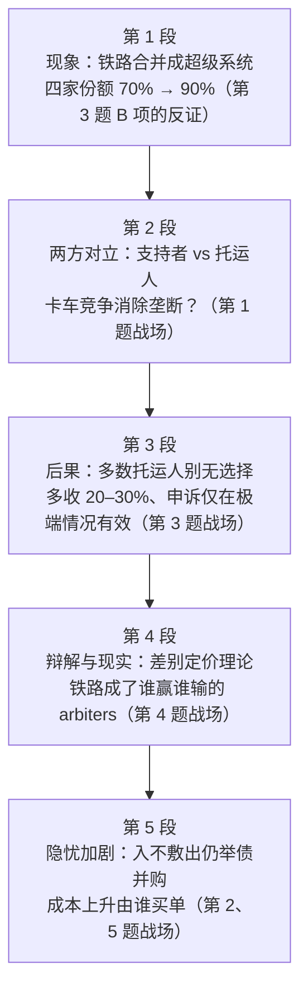

# Passage 44 · 铁路大合并的垄断隐忧

## 答题记录

| 轮次  | 日期         | 题号  | 正确  | 错误  | 正确率 | 用时    | 错题归因 |
| --- | --- | --- | --- | --- | --- | --- | --- | --- |
| 1 |  | 1-5 |  |  |  |  |  |
| 2 |  | 1-5 |  |  |  |  |  |
| 3 |  | 1-5 |  |  |  |  |  |

> [!tip] 填写口径
> - **用时**以分钟计，只计做题时间，不含精读复盘。
> - **错题归因**填「题型·错误类型」，如：因果细节题·答非所问、态度题·混淆态度主体、推断题·与原文相反、猜词题·被邻域词带走。
> - 纵向看趋势：正确率升而用时过长 → 熟练度不足；用时降而正确率波动 → 定位不稳。
> - 本篇 **5 题**，题号栏填 1-5；第 2 题是**态度题**（要注意问的是**托运人**的态度，不是作者的），第 3 题是**段落推断题**（四个选项要逐项回第 3 段比对），第 4 题是**猜词题**（靠上文 determining which...will flourish and which will fail 定位），第 5 题是**因果细节题**（问「成本增加的主要原因」，末段②句是最大干扰）。错因建议分别写「态度题·混淆态度主体」「推断题·与原文相反」「猜词题·未找重复信息」「因果题·把次要原因当主要原因」。

> [!info] 文章档案
> - **来源**：考研英语（一）2003 年 Text 3
> - **题材**：商业经济（铁路运输业 × 反垄断）——铁路公司连年合并成超级系统，支持者说能降本增效、卡车竞争足以消除垄断，托运人却抱怨自己「被扼住喉咙」
> - **结构**：5 段 / 20 句 ＋ 5 题（按句号断句与行首缩进实测；与解析引用的「第二段③句」「第三段②③句」「第四段末句」「最后一段①句／②句／③④句／末句」全部吻合）
> - **难度**：★★★☆☆
> - **一句话主旨**：铁路公司正在合并成少数几家超级系统，支持者以「降本增效＋卡车竞争」为合并辩护，但受制于单一铁路的托运人因此被多收费、申诉无门，而铁路业自身入不敷出却仍在举债并购——这场合并的真正买单者，正是那些别无选择的「受制托运人」。

## 一、篇章脉络

- **第 1 段**：**现象与数据**。近年来铁路公司彼此合并，形成超级系统，引发对垄断的高度担忧。就在 1995 年，四家顶级铁路公司的运量还占不到全行业吨英里数的 70%；而明年，在一系列合并完成后，仅四家铁路公司就将控制主要铁路承运商货运量的 90% 以上。
- **第 2 段**：**两方对立**。新超级系统的支持者认为，合并能大幅降低成本、提供更协调的服务；他们认为任何垄断威胁都会被来自卡车的激烈竞争消除。但许多托运人抱怨说，煤炭、化工品、谷物这类长途运输的大宗散货，公路运输太贵，铁路公司因此「掐住了他们的喉咙」（第 1 题的战场）。
- **第 3 段**：**合并的直接后果**。铁路业的大规模整合意味着多数托运人只有一家铁路公司可供选择；铁路公司对这类「受制」托运人的收费，比存在另一家铁路竞争时要高出 20% 到 30%。自觉被多收费的托运人有权向联邦政府的地面运输委员会申诉要求降费，但这个过程费钱、费时，而且只有在真正极端的情况下才管用（第 3 题的战场）。
- **第 4 段**：**铁路方的辩解与现实的落差**。铁路公司为对受制托运人的差别定价辩护，理由是长远来看这会降低所有人的成本：如果对所有客户收同样的平均费率，那些可以改用卡车或其他运输方式的托运人就会真的改，留下的客户就得独自承担维持线路的成本。这套理论许多经济学家认同，但在实践中它常常把铁路公司置于「决定哪家公司兴旺、哪家公司倒闭」的位置——「我们真的想让铁路公司成为市场上判定谁赢谁输的仲裁者吗？」经常代理托运人的华盛顿律师马丁·贝科维奇问道（第 4 题的战场）。
- **第 5 段**：**托运人的进一步担忧**。许多受制托运人还担心很快会遭遇一轮大幅涨价。整个铁路业尽管前景转好，其收入仍不足以支付为跟上激增的运量所必须投入的资本成本。然而铁路公司仍在举债数十亿去相互收购，华尔街还在为他们鼓劲。看看今年诺福克南方铁路与 CSX 以 102 亿美元竞购联合铁路公司吧：联合铁路 1996 年的铁路运营净收入只有 4.27 亿美元，还不到这笔交易融资成本的一半。剩下的账单谁来付？许多受制托运人担心，会是他们来付——随着诺福克南方与 CSX 对市场的掌控进一步加强（第 2、5 题的战场）。

> [!tip] 行文逻辑
> 全篇是**「现象—对立—后果—辩解—隐忧」的五段式经济评论**，两方立场贯穿始终：**support（支持者）↔ complain / worry / fear（托运人）**。第 1 段只给**客观数据**（under 70% → well over 90%），一句评价也没有，却把「垄断」这个词摆到台面上；第 2 段立刻把两方摆开对垒，第 1 题正是在这里考「**支持者的理由**」；第 3、4 段是**托运人处境的 deepening**——从「多收 20–30%」到「申诉无门」再到「铁路成了裁决者」；第 5 段把账算到实处：行业**入不敷出**却**举债并购**，于是涨价不可避免，第 5 题问的「成本增加的主要原因」就在末段③④句的例证里。三个反复出现的核心词串起全篇：**combine / merge / consolidation / acquisition（合并）**、**monopoly / captive / overcharged（垄断与受制）**、**cost / rate / bill（成本与账单）**。命题格局**题文同序**（1→P2、2→P2/P5、3→P3、4→P4、5→P5），第 2 题是唯一需要跨段（P2③＋P5①⑦）合成的态度题。

## 二、逐段精读

### 第 1 段 · 现象：铁路合并成超级系统，垄断担忧升温

**原文**

① In recent years, railroads have been combining with each other, merging into super systems, causing heightened concerns about monopoly.
② As recently as 1995, the top four railroads accounted for under 70 percent of the total ton-miles moved by rails.
③ Next year, after a series of mergers is completed, just four railroads will control well over 90 percent of all the freight moved by major rail carriers.

**译文**

① 近年来，铁路公司一直在相互**联合**，**合并**成**超级系统**，引发了人们对**垄断**日益**强烈**的**担忧**。
② **就在** 1995 年，四家顶级铁路公司**占**铁路运输总**吨英里**数的比例还不到 70%。
③ 明年，在**一系列**合并完成后，仅四家铁路公司就将控制主要铁路**承运商**所运全部**货物**的 90% **以上**。

#### 本段重点词汇

| 单词 | 词性 | 文中意 | 拓展 | 文中用法 |
| --- | --- | --- | --- | --- |
| **combine** | v. | （使）结合，联合 | combine A with B 把 A 与 B 结合；combination n. 组合 | railroads have been combining with each other（铁路公司一直在相互联合） |
| **merge** | v. | （企业）合并 | merger n. 合并（第三段③句、第一段③句）；merge into 并入、合成 | merging into super systems（合并成超级系统） |
| **super systems** | n. | 超级系统 | super- 前缀＝超级（supermarket / superpower）；文中指合并后的巨型铁路集团 | merging into super systems（合并成超级系统） |
| **heighten** | v. | 提高，增强 | height n. 高度；-en 动词后缀（widen / sharpen / strengthen） | causing heightened concerns about monopoly（引发对垄断日益强烈的担忧） |
| **concern** | n. | 担忧，关切 | 熟词僻义：常见义「关心」，此处为「担忧」；concerned adj. 担心的；as far as sb is concerned 就某人而言 | heightened concerns about monopoly（对垄断的高度担忧） |
| **monopoly** | n. | 垄断，独占 | mono- 前缀＝单一（monologue 独白）；monopolize v. 垄断 | concerns about monopoly（对垄断的担忧） |
| **as recently as** | 短语 | 就在（不久前的）…… | 强调时间之近，暗含「变化之快」；as long ago as 早在……（往前推） | As recently as 1995（就在 1995 年） |
| **account for** | 短语 | （数量上）占；解释 | 本段取「占（比例）」义；第 3 段取「解释」义的文章语境不同 | accounted for under 70 percent of the total ton-miles（占总吨英里数不到 70%） |
| **ton-mile** | n. | 吨英里（货运量单位） | 复合单位：1 吨货物运送 1 英里；同类 mile-per-gallon 每加仑英里数 | the total ton-miles moved by rails（铁路运输的总吨英里数） |
| **a series of** | 短语 | 一系列的 | series 单复数同形；a series of ＋ 复数名词，谓语用单数（文中 is completed） | after a series of mergers is completed（在一系列合并完成后） |
| **well over** | 短语 | 大大超过，……以上 | well ＋ 介词＝远远（well beyond / well above / well before） | control well over 90 percent（控制 90% 以上） |
| **freight** | n. | 货物，货运 | freight train 货运列车；freighter n. 货轮／货机；近义 cargo（船／飞机的货） | all the freight moved by major rail carriers（主要铁路承运商运输的全部货物） |
| **carrier** | n. | 承运人，运输公司 | carry v. 运送；common carrier 公共承运人；aircraft carrier 航空母舰 | major rail carriers（主要铁路承运商） |

#### 长难句 · 本段第 ① 句

> [!abstract] 本段第 ① 句 · 原句
> In recent years, railroads have been combining with each other, merging into super systems, causing heightened concerns about monopoly.

**结构拆解**
- **主干**：railroads have been combining with each other（现在完成进行时，强调「一直持续到现在」）。
- **伴随状语一**：merging into super systems，现在分词短语，说明 combining 的**结果**——合并成了超级系统。
- **伴随状语二**：causing heightened concerns about monopoly，现在分词短语，说明前面整个动作的**后果**——引发担忧。
- **三层 -ing 递进**：combining（动作）→ merging（结果）→ causing（后果），一句话完成「现象—结果—影响」的完整推进。

**参考译文**
近年来，铁路公司一直在相互联合，合并成超级系统，引发了人们对垄断日益强烈的担忧。

> [!tip] 拆解要点
> 这句是**全篇的现象句**，一句话里塞进了三层 -ing，读的时候要按「动作 → 结果 → 后果」的顺序拆：combining（在合并）→ merging into super systems（合并成了什么）→ causing concerns（带来了什么）。注意 **have been combining** 是**现在完成进行时**，强调的是「从过去一直持续到现在、还在继续」——这个时态本身就暗示了合并是个**未完成的过程**，为第 1 段③句 Next year 的「明年会更集中」埋下伏笔。另记：**concerns 用复数**表示「种种担忧」，是考研英语里极为常见的「担忧」载体词。

### 第 2 段 · 两方对立：支持者说有卡车竞争，托运人说被扼住喉咙

**原文**

① Supporters of the new super systems argue that these mergers will allow for substantial cost reductions and better coordinated service.
② Any threat of monopoly, they argue, is removed by fierce competition from trucks.
③ But many shippers complain that for heavy bulk commodities traveling long distances, such as coal, chemicals and grain, trucking is too costly and the railroads therefore have them by the throat.

**译文**

① 新超级系统的**支持者**认为，这些合并将带来**大幅**的**成本削减**和更**协调**的**服务**。
② 他们认为，任何垄断的**威胁**都会被来自**卡车**的**激烈竞争**所**消除**。
③ 但许多**托运人抱怨**说，对于煤炭、**化工品**和**谷物**这类长途运输的沉重**大宗散货**，**公路运输**太**昂贵**，因此铁路公司**掐住了他们的喉咙**。

#### 本段重点词汇

| 单词 | 词性 | 文中意 | 拓展 | 文中用法 |
| --- | --- | --- | --- | --- |
| **supporter** | n. | 支持者 | support v./n. 支持；supportive adj. 支持的（第 2 题 B 项）；反义 opponent 反对者 | Supporters of the new super systems（新超级系统的支持者） |
| **allow for** | 短语 | 使……成为可能；考虑到 | 文中取「使可能」义；另一义「把……考虑进去」（allowing for inflation） | these mergers will allow for substantial cost reductions（这些合并将带来大幅成本削减） |
| **substantial** | adj. | 大量的，可观的；实质的 | substance n. 物质、实质；substantially adv. 大幅度地 | substantial cost reductions（大幅度的成本削减） |
| **cost reduction** | n. | 成本削减 | reduce v. 减少；cut costs 削减成本（同义） | allow for substantial cost reductions（带来大幅成本削减） |
| **coordinated** | adj. | 协调的，统筹的 | coordinate v. 协调；coordination n. 协调（第 1 题 B 项 cross-trade coordination） | better coordinated service（更协调的服务） |
| **service** | n. | 服务 | serve v. 服务（第 3 段 served by）；public service 公共服务 | better coordinated service（更协调的服务） |
| **threat** | n. | 威胁，隐患 | threaten v. 威胁；threatening adj. 威胁的；a threat to... 对……的威胁 | Any threat of monopoly（任何垄断的威胁） |
| **remove** | v. | 消除，移除 | removal n. 移除；熟词僻义：常见义「移走、搬走」，此处为「消除（威胁）」 | is removed by fierce competition from trucks（被来自卡车的激烈竞争消除） |
| **fierce** | adj. | 激烈的；凶猛的 | fiercely adv. 激烈地；fierce competition＝cut-throat competition 激烈竞争 | fierce competition from trucks（来自卡车的激烈竞争） |
| **competition** | n. | 竞争 | compete v. 竞争（第 3 段 competing）；competitive adj. 有竞争力的；competitor n. 竞争对手 | fierce competition from trucks（来自卡车的激烈竞争） |
| **truck** | n. | 卡车 | trucking n. 公路运输业；近义 lorry（英式） | competition from trucks（来自卡车的竞争） |
| **shipper** | n. | 托运人，货主 | ship v. 运送；shipment n. 装运、货物；-er 表「发出动作的一方」 | many shippers complain that...（许多托运人抱怨说……） |
| **complain** | v. | 抱怨，投诉 | complaint n. 抱怨、投诉；complain about/of 抱怨…… | many shippers complain that...（许多托运人抱怨说……） |
| **bulk commodity** | n. | 大宗散货，大宗商品 | bulk n. 大量、体积；in bulk 批量地；commodity n. 商品、日用品 | heavy bulk commodities traveling long distances（长途运输的沉重大宗散货） |
| **chemical** | n. | 化工品，化学制品 | chemistry n. 化学；chemical adj. 化学的 | such as coal, chemicals and grain（如煤炭、化工品和谷物） |
| **grain** | n. | 谷物，粮食 | 不可数；a grain of 一粒……（a grain of sand 一粒沙） | such as coal, chemicals and grain（如煤炭、化工品和谷物） |
| **trucking** | n. | 公路货运（业） | truck ＋ -ing 构成行业名词；railroading 铁路业（同理） | trucking is too costly（公路运输太昂贵） |
| **costly** | adj. | 昂贵的，代价高的 | cost ＋ -ly；注意是形容词不是副词（副词为 dearly） | trucking is too costly（公路运输太昂贵） |
| **have sb by the throat** | 习语 | 掐住某人的喉咙，扼住要害 | 同义 have sb at one's mercy；第 1 题 D 项颠倒了主宾 | the railroads therefore have them by the throat（铁路公司因此掐住了他们的喉咙） |

#### 长难句 · 本段第 ③ 句

> [!abstract] 本段第 ③ 句 · 原句
> But many shippers complain that for heavy bulk commodities traveling long distances, such as coal, chemicals and grain, trucking is too costly and the railroads therefore have them by the throat.

**结构拆解**
- **主干**：many shippers complain **that**...（主句 ＋ 宾语从句）。
- **宾语从句内部是 and 连接的并列句**：trucking is too costly **and** the railroads therefore have them by the throat（前因后果，therefore 点明因果）。
- **句首的介词短语提前**：for heavy bulk commodities traveling long distances —— 正常语序是 trucking is too costly **for** heavy bulk commodities...，把 for 短语提到句首是为了**突出适用范围**。
- **举例插入**：such as coal, chemicals and grain，三个名词并列说明 bulk commodities 的具体所指。
- **现在分词作后置定语**：traveling long distances 修饰 commodities。

**参考译文**
但许多托运人抱怨说，对于煤炭、化工品和谷物这类长途运输的沉重大宗散货，公路运输太昂贵，因此铁路公司掐住了他们的喉咙。

> [!tip] 拆解要点
> 这句是**全篇第一次亮出托运人的处境**，也是第 2 题的判定依据之一。两个要点：其一，**therefore 是题眼**——它把「卡车太贵」和「铁路掐喉咙」接成因果，说明托运人**没有替代方案**，这正是第 3 段 captive（受制的）一词的由来；其二，**have them by the throat 中的 them 指 shippers**，主宾关系是「铁路公司 → 托运人」，第 1 题 D 项 shippers will have the railway by the throat 正是把主宾**倒了过来**，属「主宾颠倒」型干扰。另记：**complain 是态度题的明文标记词**，第 2 题的答案 Apprehensive 就靠本句 complain、第 5 段①句 worry、第 5 段⑦句 fear 三处合成。

### 第 3 段 · 后果：多数托运人别无选择，申诉昂贵耗时

**原文**

① The vast consolidation within the rail industry means that most shippers are served by only one rail company.
② Railroads typically charge such "captive" shippers 20 to 30 percent more than they do when another railroad is competing for the business.
③ Shippers who feel they are being overcharged have the right to appeal to the federal government's Surface Transportation Board for rate relief, but the process is expensive, time consuming, and will work only in truly extreme cases.

**译文**

① 铁路行业内部**大规模**的**整合**意味着，大多数托运人只有一家铁路公司为他们**提供服务**。
② 铁路公司**通常**对这类「**受制的**」托运人的**收费**，比存在另一家铁路公司**竞争**这项业务时高出 20% 到 30%。
③ 那些觉得自己被**多收费**的托运人，有权向**联邦**政府的地面运输委员会**申诉**，要求**降低费率**；但这个过程费用高昂、**耗时费力**，而且只有在真正**极端**的情况下才会起作用。

#### 本段重点词汇

| 单词 | 词性 | 文中意 | 拓展 | 文中用法 |
| --- | --- | --- | --- | --- |
| **vast** | adj. | 巨大的，大规模的 | vastness n. 浩瀚；近义 enormous / massive / tremendous | The vast consolidation within the rail industry（铁路行业内部大规模的整合） |
| **consolidation** | n. | 合并，整合；巩固 | consolidate v. 合并、巩固；形容词 consolidated（consolidated financial statements 合并报表） | The vast consolidation within the rail industry（铁路行业内部大规模的整合） |
| **rail industry** | n. | 铁路业 | 同义 the railroad industry（第 5 段②句）；industry 此处为「行业」 | within the rail industry（在铁路行业内部） |
| **serve** | v. | 为……提供服务 | service n. 服务；serve as 充当；serve the purpose 达到目的 | most shippers are served by only one rail company（大多数托运人只有一家铁路公司为之服务） |
| **typically** | adv. | 通常，一般地 | typical adj. 典型的；近义 usually / generally | Railroads typically charge...（铁路公司通常收取……） |
| **charge** | v. | 收费；指控 | 熟词僻义：常见义「负责／充电」，此处为「收费」；charge sb money for sth 因某事向某人收费；free of charge 免费 | charge such "captive" shippers 20 to 30 percent more（对这类受制托运人多收 20% 到 30%） |
| **captive** | adj. | 受制的，别无选择的 | 本义「被俘虏的」；captive audience  captive 受众（不得不听的人）；captive market  captive 市场 | such "captive" shippers（这类「受制的」托运人） |
| **compete** | v. | 竞争 | competition n. 竞争；competitive adj. 有竞争力的；compete for 争夺 | when another railroad is competing for the business（当另一家铁路公司竞争这项业务时） |
| **overcharge** | v. | 对……多收费 | over- 前缀＝过度（overestimate 高估、overwork 过度工作）；反义 undercharge | Shippers who feel they are being overcharged（觉得自己被多收费的托运人） |
| **appeal to** | 短语 | 向……申诉；呼吁；对……有吸引力 | 熟词僻义：文中为法律义「申诉」；appeal to sb for sth 为某事向某人呼吁／申诉 | have the right to appeal to the ... Board for rate relief（有权向委员会申诉要求降低费率） |
| **federal** | adj. | 联邦的 | federation n. 联邦；federal government 联邦政府（美国）；FBI ＝ Federal Bureau of Investigation | the federal government's Surface Transportation Board（联邦政府的地面运输委员会） |
| **rate relief** | n. | 费率减免，降费 | rate n. 费率；relief n. 减轻、救济（relieve v.）；tax relief 减税 | appeal to ... for rate relief（申诉要求降低费率） |
| **time consuming** | adj. | 耗时的 | consume v. 消耗；同类构词 energy-consuming 耗能的 | the process is expensive, time consuming（这个过程费用高昂、耗时费力） |
| **extreme** | adj. | 极端的，极度的 | extremely adv. 极其；go to extremes 走极端 | will work only in truly extreme cases（只有在真正极端的情况下才起作用） |

#### 长难句 · 本段第 ② 句

> [!abstract] 本段第 ② 句 · 原句
> Railroads typically charge such "captive" shippers 20 to 30 percent more than they do when another railroad is competing for the business.

**结构拆解**
- **主干**：Railroads charge such "captive" shippers 20 to 30 percent more（charge sb ＋ 金额，双宾语结构）。
- **比较结构**：more **than** they do —— than 后是比较状语从句；**they do 中的 do 替代前面的 charge**，避免重复，补全即 than they **charge**。
- **时间状语从句**：when another railroad is competing for the business，限定 they do 发生的时间。
- **倍数／幅度表达**：20 to 30 percent more than... ＝ 比……高出 20% 到 30%。

**参考译文**
铁路公司通常对这类「受制的」托运人的收费，比存在另一家铁路公司竞争这项业务时高出 20% 到 30%。

> [!tip] 拆解要点
> 这句是**第 3 题 A 项的正面反证**，也是全篇最典型的「比较 ＋ 替代」结构。两个要点：其一，**they do 的 do 是替代动词**，指代前面的 charge，补全后比较才成立——考研英语的比较状语从句几乎都用 do / does / did 替代前文动词，读到 than 时要立刻回找被替代的动词；其二，**方向**：没有竞争对手时收得**更多**（20–30% more），第 3 题 A 项 shippers will be charged **less** without a rival railroad 把方向**说反了**，属「与原文相反」型干扰。

#### 长难句 · 本段第 ③ 句

> [!abstract] 本段第 ③ 句 · 原句
> Shippers who feel they are being overcharged have the right to appeal to the federal government's Surface Transportation Board for rate relief, but the process is expensive, time consuming, and will work only in truly extreme cases.

**结构拆解**
- **主干是两个并列分句**：Shippers ... have the right to appeal ... , **but** the process is ... and will work ...。
- **定语从句**：who feel they are being overcharged 修饰主语 Shippers；从句内部还嵌一个宾语从句 they are being overcharged（**现在进行时的被动**，表「正在被多收费」）。
- **介词链条**：appeal **to** the Board **for** rate relief —— to 引出申诉的对象，for 引出申诉的目的。
- **第二分句是三项并列**：expensive、time consuming、**and** will work only in truly extreme cases（前两项形容词作表语，第三项是谓语，用 and 串起来）。

**参考译文**
那些觉得自己被多收费的托运人，有权向联邦政府的地面运输委员会申诉，要求降低费率；但这个过程费用高昂、耗时费力，而且只有在真正极端的情况下才会起作用。

> [!tip] 拆解要点
> 这句是**第 3 题 C、D 两项的共同出处**，but 之后才是命题重点。读这句要抓住**三层递进的否定**：权利**存在**（have the right to appeal）→ 但**代价高**（expensive, time consuming）→ 且**几乎没用**（will work only in truly extreme cases）。第 3 题 C 项 overcharged shippers are unlikely to appeal for rate relief 正是对这三层否定的合理推断；D 项 a government board ensures fair play 则只取了「有申诉渠道」这半句，忽略了 but 之后的全部限定，属「**正反混淆**」——**凡原文用 but / yet / however 转过弯、而选项只取转弯前那一半的，一律按以偏概全处理**。

### 第 4 段 · 辩解与现实：差别定价理论让铁路成了「裁决者」

**原文**

① Railroads justify rate discrimination against captive shippers on the grounds that in the long run it reduces everyone's cost.
② If railroads charged all customers the same average rate, they argue, shippers who have the option of switching to trucks or other forms of transportation would do so, leaving remaining customers to shoulder the cost of keeping up the line.
③ It's a theory to which many economists subscribe, but in practice it often leaves railroads in the position of determining which companies will flourish and which will fail.
④ "Do we really want railroads to be the arbiters of who wins and who loses in the marketplace?" asks Martin Bercovici, a Washington lawyer who frequently represents shippers.

**译文**

① 铁路公司为针对受制托运人的**差别费率**辩护，**理由是**从**长远来看**这会降低所有人的成本。
② 他们认为，如果铁路公司对所有客户收取同样的**平均**费率，那些有**选择**可以**改用**卡车或其他**运输**方式的托运人就会真的这么做，剩下的客户便要**承担**维持线路**运营**的成本。
③ 这是许多经济学家**认同**的理论，但**在实践**中，它常常使铁路公司处于决定哪些公司**兴旺**、哪些公司倒闭的位置。
④ 「我们真的想让铁路公司成为**市场**上裁定谁赢谁输的**仲裁者**吗？」经常**代理**托运人的华盛顿律师马丁·贝科维奇问道。

#### 本段重点词汇

| 单词 | 词性 | 文中意 | 拓展 | 文中用法 |
| --- | --- | --- | --- | --- |
| **justify** | v. | 证明……正当，为……辩护 | justice n. 正义；justified adj. 有正当理由的；justify doing sth | Railroads justify rate discrimination（铁路公司为差别费率辩护） |
| **rate discrimination** | n. | 费率差别待遇 | discriminate v. 歧视／区别对待；discrimination n. 歧视；此处为中性义「差别定价」 | rate discrimination against captive shippers（针对受制托运人的费率差别待遇） |
| **on the grounds that** | 短语 | 理由是，基于……的理由 | ground 熟词僻义：常见义「地面」，此处为「理由」（常用复数）；on the grounds of ＋ 名词 | on the grounds that in the long run it reduces everyone's cost（理由是长远来看这会降低所有人的成本） |
| **in the long run** | 短语 | 从长远来看 | 反义 in the short run／in the short term 短期来看 | in the long run it reduces everyone's cost（从长远来看这会降低所有人的成本） |
| **average** | adj. | 平均的 | on average 平均而言；average n. 平均数、平均水平 | the same average rate（同样的平均费率） |
| **option** | n. | 选择，选择权 | optional adj. 可选的；have no option but to do 别无选择只能…… | shippers who have the option of switching to trucks（可以选择改用卡车的托运人） |
| **switch** | v. | 转变，改用 | switch to 转向；switch n. 开关、转变 | the option of switching to trucks（改用卡车的选择） |
| **transportation** | n. | 运输，交通 | transport v./n. 运输；means of transportation 交通工具 | other forms of transportation（其他运输方式） |
| **shoulder** | v. | 承担，肩负 | 熟词僻义：常见义「肩膀」（n.），此处为动词；shoulder the responsibility 承担责任 | leaving remaining customers to shoulder the cost（使剩下的客户承担成本） |
| **keep up** | 短语 | 维持，保持 | keep up with 跟上；keep up the line 维持线路（运营） | the cost of keeping up the line（维持线路的成本） |
| **subscribe** | v. | 同意，赞成；订阅 | 熟词僻义：常见义「订阅」，subscribe to a theory 意为「认同某一理论」；subscription n. 订阅 | a theory to which many economists subscribe（许多经济学家认同的理论） |
| **in practice** | 短语 | 在实践中，实际上 | 反义 in theory 理论上；put...into practice 付诸实践 | but in practice it often leaves railroads in the position of...（但在实践中它常使铁路公司处于……的位置） |
| **flourish** | v. | 兴旺，繁荣 | flourishing adj. 繁荣的；近义 thrive / prosper | determining which companies will flourish and which will fail（决定哪些公司兴旺、哪些倒闭） |
| **arbiter** | n. | 仲裁者，裁决者 | arbitrate v. 仲裁；arbitration n. 仲裁；arbitrary adj. 任意的、专断的（同根） | the arbiters of who wins and who loses（裁定谁赢谁输的仲裁者） |
| **marketplace** | n. | 市场，市集 | 比 market 更强调「交易的场所／竞争的环境」 | who wins and who loses in the marketplace（市场上谁赢谁输） |
| **represent** | v. | 代理，代表 | representation n. 代表；representative n. 代表 adj. 代表性的；（律师）represent clients 代理客户 | a Washington lawyer who frequently represents shippers（经常代理托运人的华盛顿律师） |

#### 长难句 · 本段第 ② 句

> [!abstract] 本段第 ② 句 · 原句
> If railroads charged all customers the same average rate, they argue, shippers who have the option of switching to trucks or other forms of transportation would do so, leaving remaining customers to shoulder the cost of keeping up the line.

**结构拆解**
- **虚拟语气**：If railroads **charged**（一般过去式）... , ... **would do** so —— 与现在／将来事实相反的假设（事实上铁路公司并没有收统一费率）。
- **插入语**：they argue，插在从句与主句之间，提示后面整段是**铁路方的观点**（不是作者观点）。
- **定语从句**：who have the option of switching to trucks or other forms of transportation 修饰 shippers。
- **结果状语**：leaving remaining customers to shoulder the cost —— 现在分词短语表结果；leave sb to do sth 意为「使某人去承担……」。
- **would do so 中的 so**：替代前面的 switch to trucks or other forms of transportation（**替代前文动作**）。

**参考译文**
他们认为，如果铁路公司对所有客户收取同样的平均费率，那些可以选择改用卡车或其他运输方式的托运人就会真的这么做，剩下的客户便要承担维持线路的成本。

> [!tip] 拆解要点
> 这句是全篇**唯一的虚拟语气句**，也是第 4 段「理论与实践落差」的论证核心。两个要点：其一，**charged ... would do 是与现在事实相反的虚拟**——它描述的情况**并未发生**，是铁路方为差别定价辩解时假设出来的「如果那样会怎样」；读虚拟句必须先确认「事实与句子相反」，否则会把假设当现实。其二，**they argue 是观点归属标记**：本段①—②句全部是**铁路方的话**，第 3 段与第 5 段才是托运人的处境与担忧——**分清「谁在说」是本篇所有题目的第一道闸门**。

#### 长难句 · 本段第 ③ 句

> [!abstract] 本段第 ③ 句 · 原句
> It's a theory to which many economists subscribe, but in practice it often leaves railroads in the position of determining which companies will flourish and which will fail.

**结构拆解**
- **主干是 but 连接的并列句**：It's a theory ..., **but** ... it often leaves railroads in the position of ...。
- **介词 ＋ 关系代词引导的定语从句**：a theory **to which** many economists subscribe —— 还原为 many economists subscribe **to** a theory（subscribe to 是固定搭配，介词 to 提前到关系代词前）。
- **leave sb in the position of doing sth**：使某人处于做某事的地位／境地。
- **两个并列的宾语从句**：determining **which** companies will flourish **and which** will fail（后一个 which 前省略了 companies）。

**参考译文**
这是许多经济学家认同的理论，但在实践中，它常常使铁路公司处于决定哪些公司兴旺、哪些公司倒闭的位置。

> [!tip] 拆解要点
> 这句是**第 4 题的直接出处**，也是全篇「理论 vs 实践」的分水岭。三个要点：其一，**to which 的还原**——看见「介词 ＋ which」先把介词放回句末还原成陈述句（subscribe to a theory），这是猜词题与长难句的高频考点；其二，**in practice 与前面的 theory 构成对照**，but 之后才是作者真正要说的；其三，**determining which...flourish and which...fail 正是 arbiters 的同义解释**——第 4 题问 arbiters 指谁，答案 B（who function as judges）就藏在这半句里，判定「谁赢谁输」即行使法官职能。**猜词题的标准解法就是：先找上文有没有对生词的解释性复述，本篇有，且是原词所在的上一句。**

#### 长难句 · 本段第 ④ 句

> [!abstract] 本段第 ④ 句 · 原句
> "Do we really want railroads to be the arbiters of who wins and who loses in the marketplace?" asks Martin Bercovici, a Washington lawyer who frequently represents shippers.

**结构拆解**
- **引语前置 ＋ 主谓倒装**：引语占据句首，谓语 asks 提到主语 Martin Bercovici 之前（正常语序：Martin Bercovici asks, "...?"）。
- **同位语**：a Washington lawyer 补充说明 Martin Bercovici 的身份。
- **嵌套定语从句**：who frequently represents shippers 修饰 lawyer。
- **引语内部**：who wins and who loses 是两个并列的宾语从句，作介词 of 的宾语。

**参考译文**
「我们真的想让铁路公司成为市场上裁定谁赢谁输的仲裁者吗？」经常代理托运人的华盛顿律师马丁·贝科维奇问道。

> [!tip] 拆解要点
> 这句是**全篇的情绪高潮**，也是第 4 题的题干出处（Line 6, Paragraph 4）。两个要点：其一，**这是个反问句，答案不言自明**——「我们真的想吗？」＝「我们不想」，用疑问的形式表达否定的判断，是论说文收尾的常见手法；其二，**说话人的身份决定立场**：Martin Bercovici 是「经常代理托运人的律师」，他的话代表托运人一方，与第 2 段③句 complain 遥相呼应。**凡引语题，先看说话人是谁**——这是分辨「作者观点 vs 他人观点」的关键。

### 第 5 段 · 隐忧：入不敷出却仍在举债并购，账单谁付

**原文**

① Many captive shippers also worry they will soon be hit with a round of huge rate increases.
② The railroad industry as a whole, despite its brightening fortunes, still does not earn enough to cover the cost of the capital it must invest to keep up with its surging traffic.
③ Yet railroads continue to borrow billions to acquire one another, with Wall Street cheering them on.
④ Consider the $10.2 billion bid by Norfolk Southern and CSX to acquire Conrail this year.
⑤ Conrail's net railway operating income in 1996 was just $427 million, less than half of the carrying costs of the transaction.
⑥ Who's going to pay for the rest of the bill?
⑦ Many captive shippers fear that they will, as Norfolk Southern and CSX increase their grip on the market.

**译文**

① 许多受制托运人还担心，他们很快会**遭遇****一轮**大幅的**费率上涨**。
② **整个**铁路**行业**尽管**前景**日渐**光明**，其收入仍不足以**支付**为跟上**激增的**运量而必须**投入**的**资本**成本。
③ 然而铁路公司仍在继续**举借**数十亿美元去**收购**彼此，华尔街还在一旁为他们鼓劲。
④ 看看今年诺福克南方铁路公司与 CSX 以 102 亿美元**竞购**联合铁路公司这件事吧。
⑤ 联合铁路公司 1996 年的铁路**运营净收入**仅为 4.27 亿美元，还不到这笔**交易****融资成本**的一半。
⑥ 剩下的账单由谁来付？
⑦ 许多受制托运人担心，会由他们来付——随着诺福克南方与 CSX 对市场的**掌控**进一步加强。

#### 本段重点词汇

| 单词 | 词性 | 文中意 | 拓展 | 文中用法 |
| --- | --- | --- | --- | --- |
| **be hit with** | 短语 | 遭受，受到……的打击 | hit n. 打击、击中；be hit by 被……击中；文中指「遭遇（涨价）」 | worry they will soon be hit with a round of huge rate increases（担心很快会遭遇一轮大幅涨价） |
| **a round of** | 短语 | 一轮，一系列 | a round of talks 一轮谈判；a round of applause 一阵掌声 | a round of huge rate increases（一轮大幅涨价） |
| **rate increase** | n. | 费率上涨 | 反义 rate relief 降费（第 3 段③句）；increase v./n. 增加 | be hit with a round of huge rate increases（遭遇一轮大幅涨价） |
| **as a whole** | 短语 | 作为一个整体，总体上 | on the whole 总的来看；whole adj. 整体的 | The railroad industry as a whole（整个铁路行业） |
| **brightening** | adj. | 正在变好的，日渐光明的 | brighten v. 使明亮、使好转；bright adj. 明亮的、光明的 | despite its brightening fortunes（尽管其前景日渐光明） |
| **fortune** | n. | 财富；境况，运气 | 熟词僻义：复数 fortunes 常指「（企业／个人的）境况、财运」；make a fortune 发财；fortune cookie 幸运饼干 | despite its brightening fortunes（尽管其前景日渐光明） |
| **cover** | v. | 足以支付，覆盖 | 熟词僻义：常见义「覆盖」，此处为「（钱）足够支付」；cover the cost 支付费用 | does not earn enough to cover the cost（收入不足以支付成本） |
| **capital** | n. | 资本，资金 | 熟词僻义：常见义「首都／大写字母」，此处为「资本」；capital market 资本市场；working capital 营运资金 | the cost of the capital it must invest（必须投入的资本成本） |
| **invest** | v. | 投资，投入 | investment n. 投资；investor n. 投资者；invest in 投资于 | the capital it must invest to keep up with its surging traffic（为跟上激增运量必须投入的资本） |
| **surging** | adj. | 激增的，汹涌的 | surge v./n. 激增、涌动；surging demand 激增的需求 | keep up with its surging traffic（跟上其激增的运量） |
| **borrow** | v. | 借入，举债 | borrow from 从……借；反义 lend 借出；borrower n. 借款人 | railroads continue to borrow billions（铁路公司继续举债数十亿） |
| **acquire** | v. | 收购，获得 | acquisition n. 收购（第 5 题 A 项）；acquisitive adj. 贪得无厌的、热衷收购的 | borrow billions to acquire one another（举债数十亿去相互收购） |
| **bid** | n./v. | 出价，投标，竞购 | bidder n. 出价者；takeover bid 收购要约 | the $10.2 billion bid by Norfolk Southern and CSX（诺福克南方与 CSX 的 102 亿美元竞购） |
| **net** | adj. | 净的，纯的 | 反义 gross 毛的；net income 净收入；net weight 净重 | Conrail's net railway operating income（联合铁路的铁路运营净收入） |
| **operating income** | n. | 营业收入 | operate v. 运营；operating costs 运营成本；operating profit 营业利润 | net railway operating income（铁路运营净收入） |
| **carrying costs** | n. | 持有成本，融资成本 | carry v. 持有（债务／资产）；carrying charge 持有费用 | less than half of the carrying costs of the transaction（不到这笔交易融资成本的一半） |
| **transaction** | n. | 交易，并购交易 | transact v. 办理、交易；financial transaction 金融交易 | the carrying costs of the transaction（这笔交易的融资成本） |
| **grip** | n. | 掌控，控制 | 熟词僻义：常见义「紧握」（v.），此处为名词；get a grip on 控制住；in the grip of 受制于 | increase their grip on the market（加强他们对市场的掌控） |

#### 长难句 · 本段第 ② 句

> [!abstract] 本段第 ② 句 · 原句
> The railroad industry as a whole, despite its brightening fortunes, still does not earn enough to cover the cost of the capital it must invest to keep up with its surging traffic.

**结构拆解**
- **主干**：The railroad industry ... still does not earn enough to cover the cost of the capital（主谓 ＋ enough to do 结构）。
- **插入的让步状语**：despite its brightening fortunes，前后用逗号隔开，先承认「前景变好」，再用 still 转折回「还是不够」。
- **省略关系代词的定语从句**：the capital (**that**) it must invest —— 修饰 capital。
- **目的状语**：to keep up with its surging traffic，修饰 invest，说明投资的目的。
- **三层 to 不定式链式**：earn enough **to cover** → the capital it must **invest** → **to keep up with**，一层套一层。

**参考译文**
整个铁路行业尽管前景日渐光明，其收入仍不足以支付为跟上激增的运量而必须投入的资本成本。

> [!tip] 拆解要点
> 这句是**第 5 题 B 项的出处**，也是末段「入不敷出」论断的承重墙。两个要点：其一，**despite ... still ... 是「让步—转折」结构**——承认好运（brightening fortunes）是为了让后面的否定更有力，这类结构里**答案永远在 still 之后**；其二，**B 项为什么错**：本句说的是「收入不足以支付**为跟上运量所需的投资**」，运量增长是**投资的原因**，不是**成本上升的原因**；第 5 题问的是 the cost increase ... is mainly caused by，书中解析明说「最后一段②句……并不是引起成本增加的主要原因，文章的重点并不在此」。**因果题里，正确项必须落在题干所问的那个因果环节上，不能落在相邻环节。**

#### 长难句 · 本段第 ⑤ 句

> [!abstract] 本段第 ⑤ 句 · 原句
> Conrail's net railway operating income in 1996 was just $427 million, less than half of the carrying costs of the transaction.

**结构拆解**
- **主干**：Conrail's net railway operating income ... was just $427 million（主系表）。
- **同位性质的补充说明**：less than half of the carrying costs of the transaction —— 省略了 which was，补充说明 $427 million 的**相对规模**。
- **比较结构**：less than half **of** ... ＝ 不到……的一半。
- **数字对比**：$10.2 billion（收购价，④句） vs $427 million（年收入） vs less than half of the carrying costs（连交易融资成本的一半都不到）。

**参考译文**
联合铁路公司 1996 年的铁路运营净收入仅为 4.27 亿美元，还不到这笔交易融资成本的一半。

> [!tip] 拆解要点
> 这句是末段例证的**落点**，也是第 5 题 A 项成立的关键证据。读这句要把三个数字放在一起看：**收购价 102 亿美元**（④句）→ **年收入 4.27 亿美元** → **连这笔交易的融资成本一半都不到**。三者构成的落差说明：并购花的钱**远超**被收购方自身的盈利能力，缺口只能由**涨价**来填——这正是第 6—⑦句 Who's going to pay for the rest of the bill? / Many captive shippers fear that they will 的答案。**考研英语的数字例证题，答案从来不在数字本身，而在数字之间的落差所指向的结论。**

## 三、全篇重点词汇汇总（自测用）

> [!info] 说明
> 本表只列「单词 / 词性 / 所在段」，不含释义与搭配，用于遮表自测：说出词义后再回该段核对。
> 收录**全篇所有段落词汇，共 80 条，不删减**，与各段「本段重点词汇」等长同源（跨段复现的词只在其首次出现的段落收录一次，如 captive 只在第 3 段收录）。

| 单词 / 短语 | 词性 | 所在段 |
| --- | --- | --- |
| **combine** | v. | 第 1 段 |
| **merge** | v. | 第 1 段 |
| **super systems** | n. | 第 1 段 |
| **heighten** | v. | 第 1 段 |
| **concern** | n. | 第 1 段 |
| **monopoly** | n. | 第 1 段 |
| **as recently as** | 短语 | 第 1 段 |
| **account for** | 短语 | 第 1 段 |
| **ton-mile** | n. | 第 1 段 |
| **a series of** | 短语 | 第 1 段 |
| **well over** | 短语 | 第 1 段 |
| **freight** | n. | 第 1 段 |
| **carrier** | n. | 第 1 段 |
| **supporter** | n. | 第 2 段 |
| **allow for** | 短语 | 第 2 段 |
| **substantial** | adj. | 第 2 段 |
| **cost reduction** | n. | 第 2 段 |
| **coordinated** | adj. | 第 2 段 |
| **service** | n. | 第 2 段 |
| **threat** | n. | 第 2 段 |
| **remove** | v. | 第 2 段 |
| **fierce** | adj. | 第 2 段 |
| **competition** | n. | 第 2 段 |
| **truck** | n. | 第 2 段 |
| **shipper** | n. | 第 2 段 |
| **complain** | v. | 第 2 段 |
| **bulk commodity** | n. | 第 2 段 |
| **chemical** | n. | 第 2 段 |
| **grain** | n. | 第 2 段 |
| **trucking** | n. | 第 2 段 |
| **costly** | adj. | 第 2 段 |
| **have sb by the throat** | 习语 | 第 2 段 |
| **vast** | adj. | 第 3 段 |
| **consolidation** | n. | 第 3 段 |
| **rail industry** | n. | 第 3 段 |
| **serve** | v. | 第 3 段 |
| **typically** | adv. | 第 3 段 |
| **charge** | v. | 第 3 段 |
| **captive** | adj. | 第 3 段 |
| **compete** | v. | 第 3 段 |
| **overcharge** | v. | 第 3 段 |
| **appeal to** | 短语 | 第 3 段 |
| **federal** | adj. | 第 3 段 |
| **rate relief** | n. | 第 3 段 |
| **time consuming** | adj. | 第 3 段 |
| **extreme** | adj. | 第 3 段 |
| **justify** | v. | 第 4 段 |
| **rate discrimination** | n. | 第 4 段 |
| **on the grounds that** | 短语 | 第 4 段 |
| **in the long run** | 短语 | 第 4 段 |
| **average** | adj. | 第 4 段 |
| **option** | n. | 第 4 段 |
| **switch** | v. | 第 4 段 |
| **transportation** | n. | 第 4 段 |
| **shoulder** | v. | 第 4 段 |
| **keep up** | 短语 | 第 4 段 |
| **subscribe** | v. | 第 4 段 |
| **in practice** | 短语 | 第 4 段 |
| **flourish** | v. | 第 4 段 |
| **arbiter** | n. | 第 4 段 |
| **marketplace** | n. | 第 4 段 |
| **represent** | v. | 第 4 段 |
| **be hit with** | 短语 | 第 5 段 |
| **a round of** | 短语 | 第 5 段 |
| **rate increase** | n. | 第 5 段 |
| **as a whole** | 短语 | 第 5 段 |
| **brightening** | adj. | 第 5 段 |
| **fortune** | n. | 第 5 段 |
| **cover** | v. | 第 5 段 |
| **capital** | n. | 第 5 段 |
| **invest** | v. | 第 5 段 |
| **surging** | adj. | 第 5 段 |
| **borrow** | v. | 第 5 段 |
| **acquire** | v. | 第 5 段 |
| **bid** | n./v. | 第 5 段 |
| **net** | adj. | 第 5 段 |
| **operating income** | n. | 第 5 段 |
| **carrying costs** | n. | 第 5 段 |
| **transaction** | n. | 第 5 段 |
| **grip** | n. | 第 5 段 |

> [!example] 同义替换链（阅读题高频）
> - **is removed by fierce competition from trucks（第 2 段②句）↔ outside competitors will continue to exist（第 1 题 C 项）**：第 1 题的核心替换——「垄断威胁被卡车竞争消除」＝「外部竞争者仍将存在」。
> - **better coordinated service（第 2 段①句）↔ services call for cross-trade coordination（第 1 题 B 项）**：**跨行业协调**是无中生有，原文只是说服务更协调。
> - **substantial cost reductions（第 2 段①句）↔ cost reduction is based on competition（第 1 题 A 项）**：原文说合并带来降本，**与竞争无关**，A 项强加因果。
> - **the railroads therefore have them by the throat（第 2 段③句）↔ shippers will have the railway by the throat（第 1 题 D 项）**：**主宾颠倒**，原文是铁路公司掐托运人。
> - **complain（第 2 段③句）＋ worry（第 5 段①句）＋ fear（第 5 段⑦句）↔ Apprehensive（第 2 题 D 项）**：第 2 题的三处态度标记合成「忧虑的」。
> - **charge ... 20 to 30 percent more than they do when another railroad is competing（第 3 段②句）↔ shippers will be charged less without a rival railroad（第 3 题 A 项）**：**与原文相反**（没有对手时收得更多，不是更少）。
> - **served by only one rail company（第 3 段①句）↔ there will soon be only one railroad company nationwide（第 3 题 B 项）**：**程度上偷换**——「多数托运人只有一家可选」≠「全国只剩一家铁路公司」。
> - **the process is expensive, time consuming, and will work only in truly extreme cases（第 3 段③句）↔ overcharged shippers are unlikely to appeal for rate relief（第 3 题 C 项）**：第 3 题的核心推断，三层递进否定推出「不大可能申诉」。
> - **appeal to the ... Board for rate relief（第 3 段③句）↔ a government board ensures fair play in railway business（第 3 题 D 项）**：**正反混淆**，but 之后的限定全被抽掉。
> - **determining which companies will flourish and which will fail（第 4 段③句）↔ who function as judges（第 4 题 B 项）**：第 4 题的核心替换——「判定谁兴旺谁倒闭」＝「行使法官职能」。
> - **better coordinated service（第 2 段①句）↔ who work as coordinators（第 4 题 A 项）**：**跨段邻域词干扰**，协调者出自第 2 段，与 arbiters 无关。
> - **borrow billions to acquire one another（第 5 段③句）＋ the $10.2 billion bid ... to acquire Conrail（第 5 段④句）↔ the continuing acquisition（第 5 题 A 项）**：第 5 题的核心替换——持续不断的收购。
> - **keep up with its surging traffic（第 5 段②句）↔ the growing traffic（第 5 题 B 项）**：**答非所问**，运量增长是需要投资的理由，不是成本上升的主因。
> - **with Wall Street cheering them on（第 5 段③句）↔ the cheering Wall Street（第 5 题 C 项）**：**答非所问**，华尔街欢呼本身不造成成本增加。

> [!warning] 熟词僻义专列
> - **concern**：关心 → **担忧**（heightened concerns about monopoly）。
> - **account for**：解释 → **（数量上）占**（accounted for under 70 percent）。
> - **carrier**：携带者 → **承运人、运输公司**（major rail carriers）。
> - **substantial**：实质的 → **大量的、可观的**（substantial cost reductions）。
> - **remove**：移走 → **消除（威胁）**（is removed by fierce competition）。
> - **fierce**：凶猛的 → **激烈的**（fierce competition）。
> - **costly**：昂贵的（注意是**形容词**，不是副词）。
> - **charge**：负责／充电 → **收费**（charge shippers 20 to 30 percent more）。
> - **captive**：被俘虏的 → **受制的、别无选择的**（captive shippers）。
> - **appeal**：呼吁／有吸引力 → **申诉**（appeal to the Board for rate relief）。
> - **extreme**：极端的（in truly extreme cases）。
> - **grounds**：地面 → **理由**（on the grounds that）。
> - **shoulder**：肩膀 → **承担**（shoulder the cost）。
> - **subscribe**：订阅 → **同意、赞成**（subscribe to a theory）。
> - **represent**：代表 → **（律师）代理**（represents shippers）。
> - **fortune**：运气 → **（企业）境况、财运**（brightening fortunes）。
> - **cover**：覆盖 → **足以支付**（cover the cost）。
> - **capital**：首都 → **资本**（the cost of the capital）。
> - **net**：网 → **净的**（net operating income）。
> - **grip**：紧握（v.）→ **掌控、控制**（n.，their grip on the market）。
> - **bid**：出价 → **竞购、收购要约**（the $10.2 billion bid）。
> - **arbiter**：仲裁者 → 引申为**裁定成败的人**（第 4 题考点）。

## 四、知识点补充

> [!question] 背景知识
> - **美国铁路业的合并潮**：1990 年代美国铁路业经历大规模整合，一级铁路公司（Class I railroads）由数十家缩减为个位数。文中 1995 年「四家占不到 70%」、次年合并完成后「四家占 90% 以上」，正是这一进程的写照。
> - **Surface Transportation Board（STB，地面运输委员会）**：美国联邦机构，负责铁路费率与服务的经济监管；托运人认为被多收费时可向它申诉（rate relief）。文中说申诉「昂贵、耗时、且只在极端情况下有效」，暗示救济渠道形同虚设。
> - **captive shipper（受制托运人）**：指所在地只有一家铁路公司服务、无法改用卡车或其他运输方式的货主，因缺乏替代方案而只能接受高价，是反垄断讨论中的核心概念。
> - **rate discrimination（费率差别待遇）**：对同一服务向不同客户收取不同费率。铁路方辩称这是「交叉补贴」——对有替代方案的客户收低价、对受制客户收高价，长期看能降低全行业的线路维持成本。第 4 段①—②句即此辩解。
> - **Norfolk Southern 与 CSX 竞购 Conrail（1997）**：美国东部两大铁路公司联合以约 102 亿美元收购联合铁路公司（Conrail），是当时美国铁路史上最大的并购案之一，需 STB 批准。文中说 Conrail 1996 年运营净收入仅 4.27 亿美元，「不到这笔交易融资成本的一半」。
> - **Wall Street cheering them on**：华尔街（投资者与投行）支持并购，因为并购往往推高股价、带来手续费收入——这与托运人的利益**正相反**，是第 5 题 C 项「答非所问」的现实依据。
> - **垄断与竞争的经济学常识**：判断是否构成垄断，关键看**是否存在替代品**（此处是卡车运输）。第 1 题正是考这一点：支持者认为卡车竞争足以遏制垄断，托运人则认为大宗长途货物**用不起卡车**，所以卡车的「竞争」对他们并不存在。

> [!warning] 语法点
> - **三层 -ing 递进作伴随／结果状语（第 1 段①）**：combining ..., merging into ..., causing ...。
> - **现在完成进行时表持续（第 1 段①）**：have been combining（一直持续到现在）。
> - **account for 的两个义项（第 1 段②「占」vs 常见义「解释」）**。
> - **并列宾语从句（第 2 段①）**：argue that these mergers will allow for A and B。
> - **被动语态 ＋ by 短语引出手段（第 2 段②）**：is removed by fierce competition from trucks。
> - **for 介词短语提前表适用范围（第 2 段③）**：for heavy bulk commodities ..., trucking is too costly。
> - **比较状语从句中用 do 替代前文动词（第 3 段②）**：more than they **do**（＝ than they charge）。
> - **现在进行时的被动（第 3 段③）**：they are being overcharged。
> - **appeal to sb for sth 的双介词结构（第 3 段③）**。
> - **on the grounds that ＋ 同位语从句（第 4 段①）**：grounds 后接 that 从句说明「理由」的内容。
> - **与现在事实相反的虚拟语气（第 4 段②）**：If ... **charged** ..., ... **would do** so。
> - **leave sb to do sth（第 4 段②）**：使某人去承担……。
> - **介词 ＋ 关系代词引导定语从句（第 4 段③）**：a theory **to which** many economists subscribe（＝ subscribe to a theory）。
> - **leave sb in the position of doing sth（第 4 段③）**。
> - **引语前置 ＋ 主谓倒装（第 4 段④）**："..." **asks** Martin Bercovici。
> - **despite ＋ 名词短语作让步状语（第 5 段②）**：despite its brightening fortunes, still ...。
> - **省略关系代词的定语从句（第 5 段②）**：the capital (**that**) it must invest。
> - **with ＋ 宾语 ＋ 现在分词复合结构（第 5 段③）**：with Wall Street cheering them on。
> - **省略 which was 的补充说明结构（第 5 段⑤）**：less than half of the carrying costs。
> - **as 引导时间／原因状语从句置于句末（第 5 段⑦）**：..., as Norfolk Southern and CSX increase their grip on the market。

> [!success] 写作可迁移句型
> - **... have been combining with each other, merging into ..., causing heightened concerns about ...**：……一直在相互合并，形成……，引发了人们对……日益强烈的担忧（现象引入句，三层 -ing 递进）。
> - **As recently as ... , ... accounted for under ... percent of ...**：就在……年，……占……的比例还不到……%（数据铺垫句）。
> - **Next year, after a series of ... is completed, just ... will control well over ... percent of ...**：明年，在一系列……完成后，仅……就将控制……的……% 以上（趋势对比句）。
> - **Supporters of ... argue that ...**：……的支持者认为……（引出正方观点）。
> - **Any threat of ... is removed by fierce competition from ...**：任何……的威胁都会被来自……的激烈竞争所消除（反驳担忧句）。
> - **But ... complain that for ..., ... is too costly and ... therefore have them by the throat.**：但……抱怨说，对……而言……太昂贵，因此……掐住了他们的喉咙（反方处境句）。
> - **... means that most ... are served by only one ...**：……意味着大多数……只有一家……提供服务（垄断后果句）。
> - **... charge such "captive" ... 20 to 30 percent more than they do when ...**：……对这类「受制的」……的收费比……时高出 20% 到 30%（量化差距句）。
> - **... have the right to appeal to ... for ..., but the process is expensive, time consuming, and will work only in truly extreme cases.**：……有权向……申诉要求……，但这个过程费钱费时且只在极端情况下有用（「有名无实」句式）。
> - **... justify ... on the grounds that in the long run it reduces everyone's cost.**：……以长远来看能降低所有人的成本为理由为……辩护（辩解引入句）。
> - **It's a theory to which many ... subscribe, but in practice it often leaves ... in the position of ...**：这是许多……认同的理论，但在实践中它常使……处于……的位置（**理论 vs 实践**的转折句，极好用）。
> - **"Do we really want ... to be the arbiters of who wins and who loses in the marketplace?"**：我们真的想让……成为市场上裁定谁赢谁输的仲裁者吗？（反问收尾句）。
> - **Despite its brightening fortunes, ... still does not earn enough to cover the cost of ...**：尽管前景日渐光明，……的收入仍不足以支付……的成本（让步转折句）。
> - **Yet ... continue to borrow billions to acquire one another, with ... cheering them on.**：然而……仍在举债数十亿相互收购，……还在为他们鼓劲（批判性推进句）。
> - **Who's going to pay for the rest of the bill?**：剩下的账单由谁来付？（设问承上启下句）。
> - **Many ... fear that they will, as ... increase their grip on the market.**：许多……担心会由他们来付——随着……对市场的掌控进一步加强（担忧收束句）。

> [!danger] 易混辨析
> - **combine / merge / consolidate / acquire**：结合／合并／整合／收购。combine 最泛；merge 强调两家合成一体；consolidation 指行业层面的整合；acquire（收购）是**一方买下另一方**，第 5 题 A 项 the continuing acquisition 即此。
> - **monopoly / monopoly threat / competition**：垄断／垄断威胁／竞争。文中「垄断」始终以**担忧**的形式出现（concerns about monopoly），而支持者的反驳是「有卡车竞争」。
> - **shipper / carrier / receiver**：托运人（发货方）／承运人（运输方）／收货人。第 1 题 D 项正是把铁路（carrier）与托运人（shipper）的施受关系弄反。
> - **freight / cargo / goods / commodity**：（铁路／公路）货物／（船／飞机）货物／货物（泛称）／大宗商品。文中 bulk commodities 指煤炭、化工品、谷物这类**散装大宗货**。
> - **costly / expensive / dear**：costly 强调「代价高」（可指金钱也可指代价），expensive 仅指「价格贵」。
> - **threat / risk / danger**：威胁／风险／危险。threat of monopoly 指「形成垄断的可能性」。
> - **rate / fare / fee / toll**：费率／（车船）票价／（专业服务）费用／（道路）通行费。铁路用 **rate**（rate relief / rate increases / average rate）。
> - **appeal to / appeal for / appeal against**：向……申诉／呼吁要求……／不服……上诉。文中是 appeal **to** the Board **for** rate relief。
> - **discrimination / difference / distinction**：（此处）差别待遇／差异／区分。rate discrimination 是中性术语，不含「歧视」的贬义。
> - **option / choice / alternative / substitute**：选择（权）／选择（行为）／替代方案／替代品。第 4 段②句用 option of switching，指「可以改用」的**选择权**。
> - **subscribe to / agree with / approve of**：认同（理论）／同意（人／意见）／赞成（行为）。subscribe to 多用于**理论、观点、杂志**。
> - **flourish / thrive / prosper / boom**：兴旺／茁壮成长／繁荣／（短期）激增。flourish 与 fail 对举，是第 4 题的题眼。
> - **arbiter / arbitrator / judge / referee**：（喻）仲裁者／（正式）仲裁员／法官／裁判。第 4 题 B 项 function as judges 是 arbiters 的**功能解释**。
> - **capital / fund / asset / investment**：资本／资金／资产／投资。文中 the cost of the capital 指「资本的成本」。
> - **income / revenue / profit / turnover**：收入／营收／利润／营业额。net operating income 是**运营净收入**，不是净利润。
> - **transaction / deal / trade / business**：（并购）交易／交易（口语）／贸易／生意。文中指 Conrail 并购案。

## 五、题目分析

> [!info] 题目总览
> | 题号 | 题型 | 定位 | 答案 |
> | --- | --- | --- | --- |
> | 1 | 因果细节题（支持者认为垄断不会形成的理由） | 第 2 段①②句 | C |
> | 2 | 态度题（托运人对铁路合并的态度） | 第 2 段③句 ＋ 第 5 段①⑦句 | D |
> | 3 | 段落推断题（从第 3 段可推出什么） | 第 3 段①②③句（逐项比对） | C |
> | 4 | 猜词题（arbiters 指谁） | 第 4 段④句 ＋ ③句 | B |
> | 5 | 因果细节题（铁路业成本增加的主因） | 第 5 段③④句 | A |

### 第 1 题 · 因果细节题（支持者认为垄断不会形成的理由）

> [!question] 原题
> According to those who support mergers, railway monopoly is unlikely because
> - A. cost reduction is based on competition.
> - B. services call for cross-trade coordination.
> - C. outside competitors will continue to exist.
> - D. shippers will have the railway by the throat.

**正确答案**：**C. outside competitors will continue to exist.（外部竞争者将继续存在）**

**定位与依据**
- 题干 **those who support mergers** 与 **railway monopoly** 直接锁定第 2 段前两句：**Supporters of the new super systems argue that...**（①句）与 **Any threat of monopoly, they argue, is removed by fierce competition from trucks.**（②句）。
- ②句是答案句：「任何垄断的威胁，都会被来自卡车的激烈竞争所消除」——卡车即铁路之外的**外部竞争者**，它们继续存在，垄断就形成不了，正对应 C 项的 outside competitors will continue to exist。
- 书中解析：「根据题干关键词 support mergers 和 railway monopoly 定位到第二段的前两句...（新超级系统的支持者认为，这些合并将有助于大幅降低成本，更好地协调服务。他们认为，任何垄断的威胁都能通过公路运输的激烈竞争来消除）。由此可知，因为要和卡车（指公路运输）竞争，所以不存在垄断的可能，所以[C]项最符合文章的意思。」
- A 项（cost reduction is based on competition）**强加因果**：文章说支持者认为**合并**能降低成本，与竞争没有因果关系；书中明确指出「[A] 项不正确，文章说支持者认为合并能降低成本，与竞争没有关系」。
- B 项（services call for cross-trade coordination）**无中生有**：原文①句说的是 better **coordinated** service（服务更协调），并没有说需要**跨行业（cross-trade）**协调；书中判定「[B]项为无中生有」。
- D 项（shippers will have the railway by the throat）**主宾颠倒**：原文③句是 the railroads ... **have them**（the shippers）**by the throat**，是铁路公司掐住托运人；而且这**不是支持者的观点**，是托运人的抱怨——书中：「[D] 项把主语和宾语的关系弄反了，文章表述的是铁路公司扼住托运人的喉咙，而且这也不是支持者的观点」。

**干扰项分析**

| 选项 | 选项内容 | 判断 | 排除理由 |
| --- | --- | --- | --- |
| A | cost reduction is based on competition. | ✗ | 强加因果：原文是合并带来降本，与「竞争」无因果关系。 |
| B | services call for cross-trade coordination. | ✗ | 无中生有：原文只说 better coordinated service，未提 cross-trade（跨行业）。 |
| C | outside competitors will continue to exist. | ✓ | 正确项：第 2 段②句 is removed by fierce competition from trucks 的同义改写（卡车＝外部竞争者）。 |
| D | shippers will have the railway by the throat. | ✗ | 主宾颠倒＋观点归属错误：原文是铁路公司掐住托运人，且这是托运人的抱怨而非支持者的观点。 |

> [!tip] 解题思路
> 因果细节题要**先锁观点主体再找因果标记**。本题题干里的 **those who support mergers** 就是「观点主体」——它把答题范围死死限定在第 2 段①②句（③句已经是 But 转到托运人了）。可复制的三步：**①用观点主体词定位（support / argue / they argue）→ ②在该范围内找因果标记（is removed by / because / allow for）→ ③把被动句还原成主动再比对选项**。三个干扰项恰好演示了因果题的三种经典错法：**强加因果（A，把「合并降本」与「竞争」接在一起）、无中生有（B，cross-trade 一词在原文无对应）、主宾颠倒（D，have sb by the throat 的施受关系反过来）**——**凡题干出现 according to those who...，第一件事就是确认选项是不是该主体说的话**。

### 第 2 题 · 态度题（托运人对铁路合并的态度）

> [!question] 原题
> What is many captive shippers' attitude towards the consolidation in the rail industry?
> - A. Indifferent.
> - B. Supportive.
> - C. Indignant.
> - D. Apprehensive.

**正确答案**：**D. Apprehensive.（忧虑的，担心的）**

**定位与依据**
- 本题问的是**托运人（captive shippers）**的态度，**不是作者的态度**，也不是支持者的态度——这是本题最大的坑。书中解析开头即提醒：「需要注意的是本题问的不是作者的态度，而是托运人的态度，做态度题要注意判断对象。」
- 三处态度标记合成答案：第 2 段③句 **But many shippers complain that...**（抱怨被掐住喉咙）、第 5 段①句 **Many captive shippers also worry they will soon be hit with a round of huge rate increases.**（担心遭遇涨价）、第 5 段⑦句 **Many captive shippers fear that they will...**（担心由他们来买单）。
- 书中解析：「通过文章中几处对托运人的描述，如 But many shippers complain that...（第二段③句）, Many captive shippers also worry...（第五段①句）, Many captive shippers fear that...（第五段最后一句），我们可以判断出托运人的态度是忧心忡忡的，即对未来的状况很担忧，所以[D]项是正确的。」
- A 项（Indifferent 冷漠的）与 B 项（Supportive 支持的）**与原文相反**：托运人又抱怨又担忧，显然既不冷漠也不支持；书中：「[A]项、[B]项错误的原因是托运人其实是关心铁路行业的合并的，并且对此并不支持」。
- C 项（Indignant 愤慨的）**过度推断**：文中对托运人的描述多用**将来时**（will soon be hit with / fear that they will），是对**未来的推测**而非对既成事实的愤怒；书中：「[C]项的含义是『愤怒的』……文中的许多描述用的是将来时，因为是对未来的推测，文中并没有线索说明托运人对铁路行业的合并有强烈的敌对情绪，[C]项过度推理了」。

**干扰项分析**

| 选项 | 选项内容 | 判断 | 排除理由 |
| --- | --- | --- | --- |
| A | Indifferent. | ✗ | 与原文相反：托运人 complain / worry / fear 三处表明他们高度关切，并非冷漠。 |
| B | Supportive. | ✗ | 与原文相反：抱怨与担忧都指向反对，支持者是第 2 段①句的 Supporters。 |
| C | Indignant. | ✗ | 过度推断：原文用将来时表「对未来的担忧」，没有「强烈敌对／愤慨」的依据。 |
| D | Apprehensive. | ✓ | 正确项：由 complain（P2③）＋ worry（P5①）＋ fear（P5⑦）三处合成的「忧虑」。 |

> [!tip] 解题思路
> 态度题的**第一道工序永远是「确认态度的主体」**——题干写的是 many captive shippers，就不能拿作者或支持者的态度去套；本篇第 2 段①句有 Supporters、③句有 shippers complain、第 5 段有 shippers worry / fear，三个主体并存，正是命题人设置的混淆点。可复制的做法：**①圈出题干的态度主体 → ②在全篇搜该主体作主语的句子 → ③收集这些句子里的态度动词（complain / worry / fear / complain about）→ ④合成一个形容词**。第二步的要点是**态度词往往成串出现**：本题三个动词（complain → worry → fear）强度递增，合起来恰好是 Apprehensive（忧虑、担心），既不是「无所谓」，也不是「愤怒」——**态度题的正确项几乎总是「中间强度」，两端（冷漠／愤怒）多为干扰**。

### 第 3 题 · 段落推断题（从第 3 段可推出什么）

> [!question] 原题
> It can be inferred from Paragraph 3 that
> - A. shippers will be charged less without a rival railroad.
> - B. there will soon be only one railroad company nationwide.
> - C. overcharged shippers are unlikely to appeal for rate relief.
> - D. a government board ensures fair play in railway business.

**正确答案**：**C. overcharged shippers are unlikely to appeal for rate relief.（被多收费的托运人不大可能去申诉要求降费）**

**定位与依据**
- 题干把范围锁定在**第 3 段**，四个选项要**逐项回原文比对**，属于典型的「段落推断题」。
- C 项对应第 3 段③句：Shippers ... **have the right to appeal** to the ... Board for rate relief, **but** the process is **expensive, time consuming, and will work only in truly extreme cases.**——申诉「有名无实」，自然可以推出「不大可能申诉」。书中解析：「第三段③句指出，如果托运人觉得收费过高，他们有权上诉到联邦政府的地面运输委员会，要求降低费率。但这个过程耗财、耗时，并且只有在真正极端的情况下才有作用。由此我们可以推断出多数托运人不大可能因为收费高提出申诉，故[C]项是正确的」。
- A 项（shippers will be charged less without a rival railroad）**与原文相反**：第 3 段②句说 Railroads typically charge such "captive" shippers **20 to 30 percent more** than they do when another railroad is competing——没有竞争对手时收得**更多**，不是更少。书中：「②句提到……铁路公司对『受制』托运人的收费要比存在另一家铁路公司竞争业务时多 20% ~ 30%，故可以排除[A]项」。
- B 项（there will soon be only one railroad company nationwide）**断章取义**：第 3 段①句说的是 most shippers are **served by only one rail company**（多数托运人只有一家铁路公司**为他们服务**），不是说全国只剩一家铁路公司；而且第 1 段③句明说「明年**四家**铁路公司将控制 90% 以上」。书中：「[B] 项是对①句 served by only one rail company 的断章取义。①句提到，多数托运商由唯一的一家铁路公司提供服务，但并不能由此推出『全国只有一家铁路公司』，而且第一段末句提到『明年四家铁路公司将控制主要铁路公司货运业务的 90% 以上』，[B]项显然与事实不符」。
- D 项（a government board ensures fair play in railway business）**正反混淆**：③句说申诉渠道虽在，但只在极端情况下有效，暗示**用处不大**，无法保证公平竞争。书中：「[D] 项属于正反混淆，③句提到 Surface Transportation Board 虽然可以管理价格问题的申诉，但申诉只有在极端情况下才有效，暗示其用处不大，无法保证公平竞争」。

**干扰项分析**

| 选项 | 选项内容 | 判断 | 排除理由 |
| --- | --- | --- | --- |
| A | shippers will be charged less without a rival railroad. | ✗ | 与原文相反：第 3 段②句明说没有竞争对手时多收 20%–30%。 |
| B | there will soon be only one railroad company nationwide. | ✗ | 断章取义：原文是「多数托运人只有一家可选」，且第 1 段③句说「明年四家占 90% 以上」。 |
| C | overcharged shippers are unlikely to appeal for rate relief. | ✓ | 正确项：由③句 but 之后「昂贵、耗时、只在极端情况有效」合理推出。 |
| D | a government board ensures fair play in railway business. | ✗ | 正反混淆：申诉只在极端情况有效，暗示无法保障公平竞争。 |

> [!tip] 解题思路
> 段落推断题（It can be inferred from Paragraph X）的正解逻辑是：**题干只给段落范围，答案靠四个选项逐项回该段比对**。可复制的三步：**①把四个选项的核心名词变成定位词**（charged → ②句、only one railroad company → ①句、appeal for rate relief → ③句、government board → ③句）**②逐句核对方向、程度与限定语** **③凡是原文有 but / only / extreme 这类限定、而选项把它们抽掉的，先按以偏概全排除**。本题的三个错项错在三个不同维度：**方向相反（A，more ↔ less）、程度偷换（B，「只有一家可选」≠「全国只剩一家」）、抽掉限定（D，丢掉 only in truly extreme cases）**——**「抽掉限定语」是推断题最高频的错法，看到选项把原文的 only / but / in practice 抹平就要警觉**。

### 第 4 题 · 猜词题（arbiters 指谁）

> [!question] 原题
> The word "arbiters" (Line 6, Paragraph 4) most probably refers to those
> - A. who work as coordinators.
> - B. who function as judges.
> - C. who supervise transactions.
> - D. who determine the price.

**正确答案**：**B. who function as judges.（行使法官职能的人）**

**定位与依据**
- 题干给出 **Line 6, Paragraph 4**，arbiters 出现在第 4 段④句："Do we really want railroads to be the **arbiters** of who wins and who loses in the marketplace?"
- 猜词的关键在**上文**：第 4 段③句说 ...it often leaves railroads in the position of **determining which companies will flourish and which will fail**——决定哪些公司兴旺、哪些公司倒闭，也就是**裁定谁赢谁输**，正是 arbiters 的同义解释。书中解析：「本题考查根据上下文猜测词义。考生可以通过寻找上下文中出现的重复信息来解题……该句提到『难道我们真的想让铁路公司成为市场上决定谁败谁荣的 arbiters 吗？』。上句谈道：but in practice it often leaves railroads in the position of determining which companies will flourish and which will fail（但在实际中，它常使铁路公司处于一个决定家公司赢利哪家公司亏损的位置）。由此，我们可以猜测出 arbiters 指的是那些 determining which companies will flourish and which will fail（决定家公司赢利哪家公司亏损）的人，故可以推断出[B]项符合 arbiters 的描述。」
- A 项（who work as coordinators）**跨段邻域词干扰**：coordinated 出自第 2 段①句 better coordinated service，与 arbiters 无关，且「协调者」不承担裁定职能。
- C 项（who supervise transactions）**无中生有**：原文没有「监督交易」的语义；supervise transactions 是从第 5 段 transaction 一词拼来的。
- D 项（who determine the price）**偷换宾语**：铁路公司确实在决定**费率**，但 arbiters 的宾语是 **who wins and who loses**（谁赢谁输／谁兴谁衰），不是价格；把「决定成败」换成「决定价格」是典型的**保留动词、换宾语**。

**干扰项分析**

| 选项 | 选项内容 | 判断 | 排除理由 |
| --- | --- | --- | --- |
| A | who work as coordinators. | ✗ | 跨段邻域词干扰：coordinated 出自第 2 段①句，与「裁决」无关。 |
| B | who function as judges. | ✓ | 正确项：第 4 段③句 determining which companies will flourish and which will fail 的同义解释（裁定成败＝法官职能）。 |
| C | who supervise transactions. | ✗ | 无中生有：原文无「监督交易」义，transaction 出自第 5 段。 |
| D | who determine the price. | ✗ | 保留动词换宾语：原文裁定的是 who wins and who loses（成败），不是价格。 |

> [!tip] 解题思路
> 猜词题的标准解法是**「找重复信息」而不是「猜词义」**：生词几乎从不孤立出现，命题人一定在它的**上一句或下一句**埋了同义复述。本题的复述就在上一句：determining which companies will **flourish** and which will **fail** ↔ the arbiters of who **wins** and who **loses**——两组反义词对（flourish/fail、wins/loses）一一对应，答案（judges）由此确定。可复制的三步：**①按题干行号定位原句 → ②读上一句找对生词的解释性复述（尤其注意反义词对与同义词对）→ ③把复述抽象成一个功能词**。三个干扰项演示了猜词题的三种经典错法：**跨段邻域词（A，coordinators 出自第 2 段）、无中生有（C，supervise transactions）、保留动词换宾语（D，determine 的宾语由「成败」换成「价格」）**。

### 第 5 题 · 因果细节题（铁路业成本增加的主因）

> [!question] 原题
> According to the text, the cost increase in the rail industry is mainly caused by
> - A. the continuing acquisition.
> - B. the growing traffic.
> - C. the cheering Wall Street.
> - D. the shrinking market.

**正确答案**：**A. the continuing acquisition.（持续不断的收购）**

**定位与依据**
- 题干问的是「铁路行业**成本增加**的**主要原因**」，考的是对文中**因果关系**的把握，答案在**第 5 段**（末段讲钱从哪来、账单谁付）。
- A 项对应第 5 段③④句：③句 **Yet railroads continue to borrow billions to acquire one another, with Wall Street cheering them on.**（仍在举债数十亿相互收购）；④句 **Consider the $10.2 billion bid by Norfolk Southern and CSX to acquire Conrail this year.**（102 亿美元竞购 Conrail）；⑤句再补一刀：Conrail 的年收入**还不到这笔交易融资成本的一半**。三句合起来说明：**并购耗资巨大、远超收益，成本由此上升**。书中解析：「题干问的是铁路行业成本增加的主要原因……最后一段③④句以具体事例说明，铁路公司并购需要耗费很多的资金，这是铁路公司目前的收入远远不能填补的。所以，并购是造成铁路行业成本增加的主要原因，故[A]项为正确选项。」
- B 项（the growing traffic）**答非所问**：第 5 段②句确实提到 surging traffic（激增的运量），但那是铁路公司「需要投资」的**理由**，不是成本增加的**原因**。书中：「最后一段②句提到铁路公司还没有足够的钱去增加投资，以满足快速发展的运输需要，但是，这并不是引起成本增加的主要原因，文章的重点并不在此，故[B]项错误」。
- C 项（the cheering Wall Street）**答非所问**：华尔街为并购欢呼，是**态度**，本身不造成成本增加。书中：「[C]项『答非所问』。华尔街为铁路行业的合并行为欢呼，而其本身并不会造成铁路行业成本的增加」。
- D 项（the shrinking market）**无中生有**：文中说的是运量**激增（surging）**、前景**转好（brightening fortunes）**，市场并未萎缩。书中：「[D] 项显然是无中生有，故排除」。

**干扰项分析**

| 选项 | 选项内容 | 判断 | 排除理由 |
| --- | --- | --- | --- |
| A | the continuing acquisition. | ✓ | 正确项：第 5 段③④句并购耗资巨大、收入远不能填补的例证直接支撑。 |
| B | the growing traffic. | ✗ | 答非所问：运量激增是「需要投资」的理由，不是成本增加的主因（对应末段②句）。 |
| C | the cheering Wall Street. | ✗ | 答非所问：华尔街欢呼是一种态度，本身不产生成本。 |
| D | the shrinking market. | ✗ | 无中生有：原文是运量 surging、前景 brightening，市场并未萎缩。 |

> [!tip] 解题思路
> 因果题里出现 **mainly（主要）** 二字，说明文中**不止一个原因**，必须分辨主次。本题两个候选：末段②句的「运量激增 → 需要投资」与末段③④句的「并购耗资 → 入不敷出」。分辨主次的方法是**看篇幅与落点**：②句只是背景交代（despite ... still ...），③④⑤句才是**展开论证的具体例证**（Consider...），且第 6—⑦句 Who's going to pay for the rest of the bill? 的设问正是指向并购留下的缺口。可复制的三步：**①识别题干中限定词（mainly / primarily）→ ②列出文中所有候选原因 → ③按「是否展开举例、是否落在设问与结论处」定主次**。另记一条：**Consider... 是考研英语里「举例论证」的显式标记词，紧随其后的内容往往是段落真正的论点所在**——本题正是靠它锁定了 A 项。

## 六、复盘清单

- [ ] 过汇总表 80 词（逐段 13/19/14/16/18），遮住「所在段」列自测，重点过 22 个熟词僻义（concern / account for / carrier / substantial / remove / fierce / costly / charge / captive / appeal / grounds / shoulder / subscribe / represent / fortune / cover / capital / net / grip / bid / arbiter / extreme）
- [ ] 重做 9 个长难句的口头翻译，特别是第 3 段②句（than they do 的替代）与第 4 段②句（虚拟语气 charged...would do）
- [ ] 画一张「两方立场对照表」：支持者（allow for / is removed by / they argue）vs 托运人（complain / worry / fear），并标出五道题的落点——特别注意**第 1 题的观点主体是支持者、第 2 题的态度主体是托运人**
- [ ] 整理本文干扰项类型：与原文相反 ×2、无中生有 ×3、主宾颠倒 ×1、强加因果 ×1、断章取义 ×1、正反混淆 ×1、过度推断 ×1、答非所问 ×2、保留动词换宾语 ×1
- [ ] 复记第 5 段的三个数字及其落差（102 亿美元收购价 → 4.27 亿美元年收入 → 不到融资成本一半），这是第 5 题的全部依据
- [ ] 练一遍第 4 题的「找重复信息」猜词法：flourish/fail ↔ wins/loses 两组反义词对，是本题的钥匙
- [ ] 积累五条通用解法：**因果题先锁观点主体再找因果标记**；**态度题先确认态度主体、正确项偏爱中间强度**；**段落推断题把选项名词当定位词、优先查限定语是否被抽掉**；**猜词题在上一句找同义复述，警惕跨段邻域词**；**带 mainly 的因果题按「是否展开举例」定主次**
- [ ] 写作模板背诵：... have been combining with each other, merging into ..., causing heightened concerns about ...；It's a theory to which many ... subscribe, but in practice it often leaves ... in the position of ...；Despite its brightening fortunes, ... still does not earn enough to cover the cost of ...
- [ ] 把答题记录填进顶部表格，对照正确率决定是否二刷

## 七、关联笔记

- [[Passage43-美国战后霸主地位的兴衰]]
- [[考研英语 · 阅读六大题型方法论]]
- [[考研英语 · 熟词僻义汇总]]
