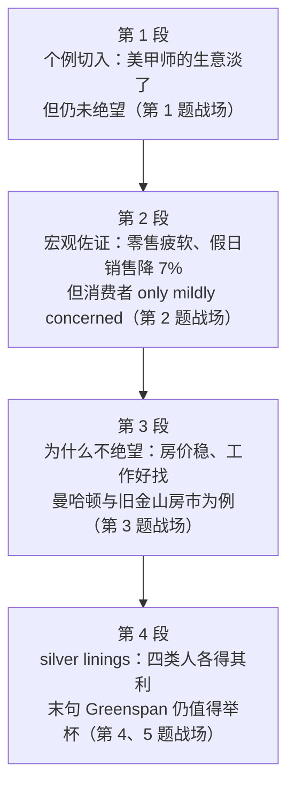

# Passage 45 · 经济放缓中的一线希望

## 答题记录

| 轮次  | 日期         | 题号  | 正确  | 错误  | 正确率 | 用时    | 错题归因 |
| --- | --- | --- | --- | --- | --- | --- | --- | --- |
| 1 |  | 1-5 |  |  |  |  |  |
| 2 |  | 1-5 |  |  |  |  |  |
| 3 |  | 1-5 |  |  |  |  |  |

> [!tip] 填写口径
> - **用时**以分钟计，只计做题时间，不含精读复盘。
> - **错题归因**填「题型·错误类型」，如：猜句意题·望文生义、态度题·程度把握失当、例证题·被邻域词带走、细节推断题·偷换概念、观点态度题·过度推断。
> - 纵向看趋势：正确率升而用时过长 → 熟练度不足；用时降而正确率波动 → 定位不稳。
> - 本篇 **5 题**，题号栏填 1-5；第 1 题是**猜句意题**（考习语 bite one's nails，靠 But 前后正反推），第 2 题是**态度题**（问的是**公众**的态度，且四个选项是情绪强度梯度，答案落在「乐观」而非「无忧无虑」），第 3 题是**例证题**（问引语在谈什么，要找例子支撑的论点：房地产业），第 4 题是**细节推断题**（silver linings 定位末段首句，后文四类受益者即是依据），第 5 题是**观点态度题**（要综合全文取「中间强度」）。错因建议分别写「猜句意题·望文生义」「态度题·程度过度」「例证题·邻域词干扰」「细节题·偷换概念」「态度题·过度推断」。

> [!info] 文章档案
> - **来源**：考研英语（一）2004 年 Text 3
> - **题材**：商业经济（宏观经济 × 消费心理）——美国经济放缓已现，但消费者只是「略感担忧」而非「惊慌失措」，甚至能在放缓中看到买房、用工、订餐等一处处好处
> - **结构**：4 段 / 28 句 ＋ 5 题（按句号断句与行首缩进实测；与解析引用的「第一段②③句」「第三段②句／③句」「最后一段④句」全部吻合；第 2 题解析所称「第二段③句」在本文按句号断句为第 **⑥** 句，已在题目分析中注明）
> - **难度**：★★★☆☆
> - **一句话主旨**：美国经济确实在降温——零售疲软、假日销售下滑、美甲师都少了一半客人——但公众并未因此恐慌：房价稳定、工作好找，甚至有人在放缓里看到了低利率、少泡沫、订得到位子等「一线希望」，作者的结论是「谨慎可以，恐慌不必」。

## 一、篇章脉络

- **第 1 段**：**以个例切入**。说到经济放缓，美甲师埃伦·斯佩罗还不至于焦虑到咬指甲——但这位 47 岁的美甲师修甲、锉甲、涂指甲油的次数也确实不如她希望的那么多了。她的客户大多每周消费 12 到 50 美元，上个月却有两位老客户突然不再上门。斯佩罗把这归咎于经济疲软：「我是一个很好的经济指标，我提供的是人们想省钱时可以不做的一项服务。」于是她开始降低消费档次，改去中档的迪拉德百货而不再光顾高端的内曼·马库斯（第 1 题的战场）。
- **第 2 段**：**从个例推到宏观**。早在格林斯潘承认美国炽热的经济正在降温之前，许多上班族自己就已看到了放缓的迹象：从汽车经销店到盖普门店，销售连续数月疲软，因为购物者开始节制开支。对零售商而言，这来得很不是时候——去年他们有 24% 的营收来自感恩节到圣诞节这段时间；专家说假日销售已比去年同期下降 7%。但笔锋随即一转：先别拉警报，消费者只是略有担忧，并未惊慌，许多人在适度紧缩开支的同时仍对长期前景保持乐观（第 2 题的战场）。
- **第 3 段**：**解释「为什么不绝望」**。消费者说自己没有绝望，因为尽管新闻标题骇人，他们自己的财务状况仍然不错：房价在大多数地区保持稳定，曼哈顿 400 万到 1000 万美元的豪宅正在上演新一轮「淘金热」，资金主要来自华尔街的奖金；旧金山房价仍在上涨，只是疯狂的高价抢购已经平息——过去一套房有二三十个报价，现在只有两三个。多数人对自己找到并保住工作的能力依旧感到踏实（第 3 题的战场）。
- **第 4 段**：**放缓中的「一线希望」并给出结论**。许多人在这场放缓里看到了好处：潜在购房人会因低利率而高兴，雇主不介意就业市场少些泡沫，投资者把股市波动看成持续繁荣的必要因素，食客也能订到以前订不到的位子——曼哈顿新开的热门餐厅阿兰·杜卡斯过去一座难求，如今不再是了。就凭这一点，格林斯潘他们或许仍值得举杯（第 4、5 题的战场）。

> [!tip] 行文逻辑
> 全篇是**「个例 → 宏观 → 原因 → 好处」的四段式经济评论**，情绪基调贯穿始终且层层递升：**not biting her nails（还没焦虑）→ mildly concerned, not panicked（略忧不慌）→ not in despair（并未绝望）→ see silver linings（看到希望）**。第 1 段只写一个美甲师，却用 **But** 把「还没到那一步」和「生意确实淡了」两面同时摆出，第 1 题正是考这个 But；第 2 段把个例放大成宏观数据（24% 营收、降 7%），再用 **But don't sound any alarms just yet** 把调子拨回来，第 2 题的答案就在这半句之后；第 3 段用 **because** 明确回答「为什么不绝望」（房价＋就业）；第 4 段以 **silver linings** 领起四类受益者，末句用 Greenspan & Co. may still be worth toasting 收束——**「谨慎可以，恐慌不必」**由此定型，第 5 题的答案 C 项正是对这八个字的改写。三个反复出现的词串起全篇：**slowdown / slowing / cooling / softening（放缓）**、**concerned / panicked / in despair（情绪梯度）**、**gold rush / boom / bubbles（繁荣与泡沫）**。命题格局**题文同序**（1→P1、2→P2、3→P3、4→P4、5→全文），除第 5 题需综合全文外，其余四题都能单段解决。

## 二、逐段精读

### 第 1 段 · 个例：美甲师的生意淡了，但还没到绝望的地步

**原文**

① When it comes to the slowing economy, Ellen Spero isn't biting her nails just yet.
② But the 47-year-old manicurist isn't cutting, filing or polishing as many nails as she'd like to, either.
③ Most of her clients spend $12 to $50 weekly, but last month two longtime customers suddenly stopped showing up.
④ Spero blames the softening economy.
⑤ "I'm a good economic indicator," she says.
⑥ "I provide a service that people can do without when they're concerned about saving some dollars."
⑦ So Spero is downscaling, shopping at middle-brow Dillard's department store near her suburban Cleveland home, instead of Neiman Marcus.
⑧ "I don't know if other clients are going to abandon me, too," she says.

**译文**

① 说到**经济放缓**，埃伦·斯佩罗还不至于**咬指甲**（焦虑不安）。
② 但这位 47 岁的**美甲师**修剪、**锉磨**和**抛光**指甲的次数，也不像她希望的那么多了。
③ 她的多数**客户每周**消费 12 到 50 美元，但上个月有两位**长期的**顾客突然不再**登门**了。
④ 斯佩罗把这**归咎于**经济的**疲软**。
⑤ 「我是一个很好的经济**指标**。」她说。
⑥ 「我提供的这项服务，人们在想着省几个钱的时候是可以**不做**的。」
⑦ 于是斯佩罗开始**降低消费档次**，去她克利夫兰**郊区**家附近**中档的**迪拉德**百货商店**购物，而不再光顾内曼·马库斯。
⑧ 「我不知道其他客户是否也会**离我而去**。」她说。

> [!note] 段落要点
> - **本段是一个「两面并存」的开场**：一面是生意确实在下滑（客人减少、改去中档商场），另一面是还没到绝望的地步（isn't biting her nails just yet）。第 1 题考的正是这两面之间的那道 **But**。
> - **结构上承担「以个例引出话题」的功能**：美甲师是典型的「非必需服务业」，她的生意好坏直接反映消费者的余钱多少，所以她自称 a good economic indicator——这句话是全段乃至全文的**方法论铺垫**：用微观个体的处境去折射宏观经济的温度。
> - **与下段的衔接**：本段的 softening economy 在下一段被放大为零售数据（销量下滑、假日销售降 7%），个体案例 → 宏观数据，是考研英语经济类文章最常见的开篇推进方式。

#### 本段重点词汇

| 单词 | 词性 | 文中意 | 拓展 | 文中用法 |
| --- | --- | --- | --- | --- |
| **when it comes to** | 短语 | 说到，谈到，就……而言 | to 是介词，后接名词／动名词（不能接原形动词）；同义 as for / speaking of | When it comes to the slowing economy（说到经济放缓） |
| **slowing economy** | n. | 放缓的经济 | slowdown n. 放缓（第 2、4 段）；slow v. 放慢；economic adj. 经济的（≠ economical 节约的） | When it comes to the slowing economy（说到经济放缓） |
| **bite one's nails** | 习语 | 咬指甲（形容焦虑、紧张不安） | 文中 isn't biting her nails just yet＝「还没到焦虑的地步」；第 1 题考点，C 项正是按字面理解设的干扰 | Ellen Spero isn't biting her nails just yet（埃伦·斯佩罗还不至于焦虑不安） |
| **manicurist** | n. | 美甲师 | manicure n. 美甲 v. 修指甲；mani-（手，manual 手工的）＋ cure（照料） | the 47-year-old manicurist（这位 47 岁的美甲师） |
| **file** | v. | 锉（指甲） | 熟词僻义：常见义「文件；把……归档」，此处为「锉」；file one's nails 锉指甲 | isn't cutting, filing or polishing as many nails（修剪、锉磨和抛光指甲的次数没那么多） |
| **polish** | v. | 擦亮，抛光；涂指甲油 | polish n. 上光剂、指甲油（nail polish）；polished adj.  polished 的、优雅的 | filing or polishing as many nails（锉磨或抛光那么多指甲） |
| **client** | n. | 客户，（接受专业服务的）顾客 | clientele n. 客户群；与 customer 的区别：client 偏「专业／长期服务关系」，customer 偏「一次性买卖」 | Most of her clients spend $12 to $50 weekly（她的大多数客户每周消费 12 到 50 美元） |
| **weekly** | adv. | 每周地 | -ly 结尾可作形容词也可作副词（a weekly magazine 周刊）；同类 daily / monthly / yearly | spend $12 to $50 weekly（每周消费 12 到 50 美元） |
| **longtime** | adj. | 长期的，老资格的 | long ＋ time 合成的形容词；longtime customer 老客户；long-term 长期的（第 2 段 long-term prospects） | two longtime customers（两位长期客户） |
| **show up** | 短语 | 出现，露面，到场 | 同义 turn up / appear；反义 stand sb up 放某人鸽子 | two longtime customers suddenly stopped showing up（两位老客户突然不再登门） |
| **blame** | v. | 归咎于，责怪 | blame A for B / blame A on B 把 B 归咎于 A；be to blame (for) 应受责备（主动形式表被动） | Spero blames the softening economy（斯佩罗把这归咎于经济疲软） |
| **softening** | adj. | 疲软的，变软的 | soften v. 变软、变疲软（经济语境＝走弱）；soft landing 软着陆 | blames the softening economy（归咎于经济的疲软） |
| **indicator** | n. | 指标，指示器 | indicate v. 表明、指示；economic indicator 经济指标（如失业率、零售额） | I'm a good economic indicator（我是一个很好的经济指标） |
| **do without** | 短语 | 没有……也行，将就，舍弃 | do without sth 不用某物也能应付；can't do without 离不开 | a service that people can do without（人们可以不做的一项服务） |
| **downscale** | v. | 降低档次，缩减（开支／规模） | down- 前缀＝向下（downgrade 降级、downsize 裁员）；反义 upscale 高档的、提升档次 | So Spero is downscaling（于是斯佩罗开始降低消费档次） |
| **middle-brow** | adj. | 中档的，品位中等的 | brow 原指「额头」，high-brow 高雅的／low-brow 通俗的；-brow 三档是英语里评价文化品位的固定说法 | shopping at middle-brow Dillard's department store（到中档的迪拉德百货购物） |
| **department store** | n. | 百货商店 | department n. 部门、系；store n. 商店（美式）＝ shop（英式）；chain store 连锁店 | middle-brow Dillard's department store（中档的迪拉德百货商店） |
| **suburban** | adj. | 郊区的 | suburb n. 郊区；sub- 前缀＝次、近（subway 地铁）；urban 城市的 → suburban 城郊的 | near her suburban Cleveland home（在她克利夫兰郊区的家附近） |
| **abandon** | v. | 抛弃，放弃，离弃 | abandoned adj. 被遗弃的；abandon oneself to 沉溺于 | other clients are going to abandon me（其他客户也会离我而去） |

#### 长难句 · 本段第 ① 句

> [!abstract] 本段第 ① 句 · 原句
> When it comes to the slowing economy, Ellen Spero isn't biting her nails just yet.

**结构拆解**

- **句首固定句式**：When it comes to ＋ 名词，意为「说到……、就……而言」，是全句的**话题状语**（to 是介词，后面必须接名词或动名词）。
- **主干**：Ellen Spero（主）＋ isn't biting（谓，现在进行时）＋ her nails（宾）。
- **习语**：bite one's nails 字面是「咬指甲」，实际表示**焦虑、紧张不安**。
- **句末副词短语**：just yet 意为「（到目前为止）还（不）」，常与否定连用，暗含「现在还没到那一步，但再发展下去也许会」。

**参考译文**

说到经济放缓，埃伦·斯佩罗还不至于咬指甲（焦虑不安）。

> [!tip] 拆解要点
> 这句是**第 1 题的题干出处**（Line 1, Paragraph 1），也是全篇的**情绪基调句**。两个要点：其一，**bite one's nails 是习语不是动作**——第 1 题 C 项 Spero has grown out of her bad habit（改掉了咬指甲的坏习惯）正是把习语**按字面理解**设的干扰，凡题干给引号标注行号的句子，第一反应应当是「这里很可能考习语或语境义」；其二，**just yet 暗含时间性**——「还没到那一步」，说明情况正在变坏但尚未失控，这与第 2 题的 mildly concerned、第 5 题的 Caution all right, panic not 是同一条情绪线。**猜句意题的第一步永远是看本句与下一句之间的逻辑词**，本句后面紧跟 But，转折之后才是「真实处境」。

#### 长难句 · 本段第 ⑦ 句

> [!abstract] 本段第 ⑦ 句 · 原句
> So Spero is downscaling, shopping at middle-brow Dillard's department store near her suburban Cleveland home, instead of Neiman Marcus.

**结构拆解**

- **主干**：Spero is downscaling（现在进行时，表「正在发生的转变」）。
- **伴随状语**：shopping at middle-brow Dillard's department store，现在分词短语，说明 downscaling 的**具体表现**——换了个档次更低的商场。
- **后置定语**：near her suburban Cleveland home，介词短语修饰 department store。
- **对比状语**：instead of Neiman Marcus，instead of 后接名词，表示「（是前者）而不是（后者）」。
- **专有名词对举**：Dillard's（中档百货）vs Neiman Marcus（高端百货），一低一高，把 downscaling 具象化。

**参考译文**

于是斯佩罗开始降低消费档次，去她克利夫兰郊区家附近中档的迪拉德百货商店购物，而不再光顾内曼·马库斯。

> [!tip] 拆解要点
> 这句是**第 1 段「生意确实淡了」这一面的落点**，也是第 1 题判定 A 项（can hardly maintain her business）不成立的关键。读这句要抓住 **So 的因果指向**：因为客人少了（③句）、因为经济疲软（④句），所以才 downscaling——**是「缩减档次」而不是「维持不下去」**。第 1 题 A 项把「降低消费档次」说成「几乎无法维持生意」，属**程度过重**；而 D 项 not in a desperate situation 正与本句的分寸相合。另记：**instead of ＋ 专有名词**是英语里最经济的「档次对比」写法，两个商场名就把 downscaling 讲清楚了——**读经济类文章时，凡出现具体品牌／商场名，多半是用来给抽象趋势做标尺的**。

### 第 2 段 · 宏观佐证：销量疲软、假日销售下滑，但消费者只是略感担忧

**原文**

① Even before Alan Greenspan's admission that America's red-hot economy is cooling, lots of working folks had already seen signs of the slowdown themselves.
② From car dealerships to Gap outlets, sales have been lagging for months as shoppers temper their spending.
③ For retailers, who last year took in 24 percent of their revenue between Thanksgiving and Christmas, the cautious approach is coming at a crucial time.
④ Already, experts say, holiday sales are off 7 percent from last year's pace.
⑤ But don't sound any alarms just yet.
⑥ Consumers seem only mildly concerned, not panicked, and many say they remain optimistic about the economy's long-term prospects even as they do some modest belt-tightening.

**译文**

① 早在艾伦·格林斯潘**承认**美国**炽热的**经济正在**降温**之前，许多**上班族**自己就已经看到了**放缓**的迹象。
② 从汽车**经销店**到盖普**折扣门店**，数月来销售额一直**疲软滞后**，因为购物者开始**节制**开支。
③ 对**零售商**来说——去年他们有 24% 的**营收**来自感恩节到圣诞节之间——这种**谨慎的**消费态度正出现在一个**关键的**时刻。
④ 专家们说，**假日销售额**已经比去年同期的**水平**下降了 7%。
⑤ 但先别急着拉响**警报**。
⑥ 消费者看起来只是**略有担忧**，并没有**惊慌失措**；许多人说，即便在适度**紧缩开支**的同时，他们对经济的**长期前景**仍保持**乐观**。

> [!note] 段落要点
> - **本段是全篇的转折中枢**：前三句半列数据（销量数月疲软、假日销售降 7%），证明放缓是真的；⑤句 **But don't sound any alarms just yet** 一句话把方向拨回来，⑥句给出公众的真实态度——**mildly concerned, not panicked**（第 2 题的答案句）。
> - **「官方承认 vs 民间先知」的对比**：①句的 Even before ... admission 说明普通人比格林斯潘更早感知到降温，这个「先于权威」的写法强化了放缓的真实性，也让后面「但也不必恐慌」更有分量。
> - **与上下文的衔接**：上承第 1 段美甲师的个体处境（她的 softening economy 在此变成 24% 与 7% 两个数字），下启第 3 段的 because——既然不绝望，原因是什么，第 3 段逐条作答。

#### 本段重点词汇

| 单词 | 词性 | 文中意 | 拓展 | 文中用法 |
| --- | --- | --- | --- | --- |
| **admission** | n. | 承认，坦承 | admit v. 承认、准许进入；另一义「入场费／录取」（admission ticket） | Alan Greenspan's admission that America's red-hot economy is cooling（格林斯潘承认美国炽热的经济正在降温） |
| **red-hot** | adj. | 炽热的，极热门的 | red ＋ hot 合成的形容词；经济语境指「过热的」；red-hot economy 过热的经济 | America's red-hot economy（美国炽热的经济） |
| **cool** | v. | 降温，变凉；冷却 | 熟词僻义：常见义「凉爽的（adj.）／冷静的」，此处为动词「降温」；cool down 冷静下来、降温 | America's red-hot economy is cooling（美国炽热的经济正在降温） |
| **working folks** | n. | 上班族，劳动者 | folks n. 人们（口语化，＝ people）；working class 工人阶级 | lots of working folks（许多上班族） |
| **slowdown** | n. | （经济）放缓，减速 | slow down v. 放慢；同义 deceleration；反义 pickup／boom | signs of the slowdown（经济放缓的迹象） |
| **dealership** | n. | （汽车）经销店，特许经销商 | dealer n. 商人、经销商；-ship 名词后缀表「身份／行业」（friendship / leadership） | From car dealerships（从汽车经销店） |
| **outlet** | n. | 门店，折扣店；出口；发泄途径 | outlet store 工厂折扣店；an outlet for one's anger 发泄怒气的途径 | from car dealerships to Gap outlets（从汽车经销店到盖普门店） |
| **lag** | v. | 滞后，落后，疲软 | lag behind 落后于；lag n. 时滞（time lag）；jet lag 时差反应 | sales have been lagging for months（销售额数月来一直疲软） |
| **temper** | v. | 节制，使缓和，调和 | 熟词僻义：常见义「脾气（n.）」，此处为动词「节制、调和」；temper enthusiasm 给热情降温 | shoppers temper their spending（购物者节制开支） |
| **retailer** | n. | 零售商 | retail n./v. 零售；retail price 零售价；反义 wholesaler 批发商 | For retailers（对零售商来说） |
| **take in** | 短语 | 收入，赚得；吸收；收留；欺骗 | 熟词僻义：文中取「（营业）收入」义；take in a movie 看场电影；be taken in 受骗 | who last year took in 24 percent of their revenue（去年赚取了 24% 的营收） |
| **revenue** | n. | 营收，收入（企业／政府） | tax revenue 税收；annual revenue 年收入；与 income（个人收入）、profit（利润）有别 | 24 percent of their revenue（他们 24% 的营收） |
| **cautious** | adj. | 谨慎的，小心的 | caution n. 谨慎、警告；cautious about/of 对……谨慎 | the cautious approach（这种谨慎的消费态度） |
| **crucial** | adj. | 关键的，至关重要的 | 近义 critical / vital / decisive；crucially adv. 关键地 | is coming at a crucial time（正出现在一个关键的时刻） |
| **holiday sales** | n. | 假日销售额 | the holiday season 假日季（美国指感恩节至新年）；sales n. 销售额（复数） | holiday sales are off 7 percent（假日销售额下降了 7%） |
| **off** | prep./adv. | （数量）低于，减少了 | 熟词僻义：常见义「离开／关闭」，此处为「低于、差」；off 7 percent＝降了 7%；10% off 打九折 | are off 7 percent from last year's pace（比去年同期的水平低 7%） |
| **pace** | n. | 速度，步调，水平 | keep pace with 跟上；at one's own pace 按自己的节奏 | from last year's pace（比去年的水平） |
| **alarm** | n. | 警报；惊恐 | alarm v. 使惊恐；alarmed adj. 惊恐的；alarm clock 闹钟；sound the alarm 拉响警报 | don't sound any alarms just yet（先别急着拉响警报） |
| **mildly concerned** | 短语 | 略感担忧 | mildly adv. 轻微地；concerned adj. 担忧的（≠ 关切的，见熟词僻义）；第 2 题判定「并非无忧无虑」的依据 | Consumers seem only mildly concerned（消费者看起来只是略有担忧） |
| **panicked** | adj. | 惊慌失措的 | panic n./v. 恐慌（过去式 panicked）；panic buying 抢购 | only mildly concerned, not panicked（只是略感担忧，并不惊慌） |
| **optimistic** | adj. | 乐观的 | optimism n. 乐观主义；optimist n. 乐观者；反义 pessimistic 悲观的；optimistic about 对……乐观 | remain optimistic about the economy's long-term prospects（对经济的长期前景保持乐观） |
| **long-term prospects** | n. | 长期前景 | prospect n. 前景、前途（常用复数）；job prospects 就业前景；long-term adj. 长期的 | optimistic about the economy's long-term prospects（对经济的长期前景乐观） |
| **modest** | adj. | 适度的，不大的；谦虚的 | modesty n. 谦逊；a modest increase 小幅增长 | some modest belt-tightening（适度的紧缩开支） |
| **belt-tightening** | n. | 勒紧裤腰带，紧缩开支 | tighten one's belt 固定习语；tighten v. 收紧；第 5 题 B 项 Tighten the belt 即此 | they do some modest belt-tightening（他们适度地紧缩开支） |

#### 长难句 · 本段第 ① 句

> [!abstract] 本段第 ① 句 · 原句
> Even before Alan Greenspan's admission that America's red-hot economy is cooling, lots of working folks had already seen signs of the slowdown themselves.

**结构拆解**

- **主干**：lots of working folks（主）＋ had already seen（谓，**过去完成时**）＋ signs of the slowdown（宾）。
- **时间状语从句**：Even before Alan Greenspan's admission...，由 before 引导，说明主句动作发生的时间点。
- **同位语从句**：that America's red-hot economy is cooling，说明 admission（承认）的**具体内容**——抽象名词后接 that 从句是同位语从句的标配。
- **时态呼应**：从句用一般过去时（admission 所指的承认发生在过去），主句用过去完成时（had seen），表示「在承认之前就已经看到」。
- **反身强调**：themselves 强调「是他们自己（而非听专家说）看到的」。

**参考译文**

早在艾伦·格林斯潘承认美国炽热的经济正在降温之前，许多上班族自己就已经看到了经济放缓的迹象。

> [!tip] 拆解要点
> 这句是**第 2 段的引子句**，两个要点：其一，**抽象名词 ＋ that 同位语从句**是考研英语的高频结构（admission / evidence / fact / idea / belief 后面几乎都跟 that 从句），识别方法是把 that 从句还原成「承认的内容是……」，若成立即为同位语从句；其二，**had already seen 的过去完成时**是「时间先后」的明示——民间比官方更早感知，这句话的作用是**坐实放缓的真实性**（不是专家在吓人），从而为⑤句 But don't sound any alarms just yet 的转折蓄势：**先承认事情是真的，再否定「因此就该恐慌」**。另记人名 **Alan Greenspan**（时任美联储主席），末段末句的 Greenspan & Co. 正是由此埋下的伏笔。

#### 长难句 · 本段第 ③ 句

> [!abstract] 本段第 ③ 句 · 原句
> For retailers, who last year took in 24 percent of their revenue between Thanksgiving and Christmas, the cautious approach is coming at a crucial time.

**结构拆解**

- **主干**：the cautious approach（主）＋ is coming（谓）＋ at a crucial time（时间状语）。
- **句首介词短语**：For retailers，把「对谁而言」提到最前面，点明本句的**受影响方**。
- **非限定性定语从句**：who last year took in 24 percent of their revenue between Thanksgiving and Christmas，由 who 引导，前后有逗号，补充说明 retailers 的**经营特点**（去年的营收结构）。
- **现在进行时**：is coming at a crucial time —— come 用进行时表示「正在逼近」，强调**时机的敏感**。
- **数字信息**：24 percent ＋ Thanksgiving to Christmas，说明假日季对零售商的分量。

**参考译文**

对零售商来说——去年他们有 24% 的营收来自感恩节到圣诞节之间——这种谨慎的消费态度正出现在一个关键的时刻。

> [!tip] 拆解要点
> 这句是**第 2 段数据的承重句**，也是「放缓确实存在」最硬的一条证据。读这句要抓住**两层的「时」**：一层是 **last year 的 24%**（假日季贡献了近四分之一的年营收），另一层是 **a crucial time**（谨慎消费偏偏发生在这个节骨眼上）——两相对照，「雪上加霜」的评价不必作者明说就出来了。**非限定性定语从句（有逗号、用 who／which）在考研英语里几乎总是「补充背景」而非「限定对象」**，读到时可以快速扫过，但要记住它提供的数据往往是细节题的出处。另记 **take in 的「营收」义**是熟词僻义高频考点，与 revenue 搭配时几乎只作此解。

#### 长难句 · 本段第 ⑥ 句

> [!abstract] 本段第 ⑥ 句 · 原句
> Consumers seem only mildly concerned, not panicked, and many say they remain optimistic about the economy's long-term prospects even as they do some modest belt-tightening.

**结构拆解**

- **主干是 and 连接的并列句**：Consumers seem ...（分句一）＋ and many say ...（分句二）。
- **分句一**：Consumers（主）＋ seem（系动词）＋ only mildly concerned, not panicked（表语，肯定与否定并置，用逗号隔开）。
- **分句二**：many say（主谓）＋ 省略 that 的宾语从句 they remain optimistic about the economy's long-term prospects。
- **让步状语从句**：even as they do some modest belt-tightening —— even as 意为「即便在……的同时」，把「紧缩开支」与「保持乐观」放在同一时间轴上对照。
- **do some modest belt-tightening**：do ＋ 动名词是英语里表示「进行某项活动」的常用搭配（do some shopping / reading）。

**参考译文**

消费者看起来只是略有担忧，并没有惊慌失措；许多人说，即便在适度紧缩开支的同时，他们对经济的长期前景仍保持乐观。

> [!tip] 拆解要点
> 这句是**第 2 题唯一的判定句**，也是全篇情绪线的中枢（书中解析称其为「第二段③句」，本文按句号断句为第 **⑥** 句）。三个要点：其一，**only mildly concerned, not panicked 是「肯定＋否定」并置结构**，否定词 not 后面那个词（panicked）就是**被排除的选项**——第 2 题 D 项 Panicked 直接就此出局；其二，**even as 是「同时性让步」**，紧缩开支不妨碍保持乐观，说明态度是「清醒的乐观」而非「盲目的乐观」；其三，**mildly 与 modest 这两个弱化词决定了 C 项 Carefree（无忧无虑）不成立**——作者在句中塞了两个限定词，就是为了防止读者把「乐观」读成「无忧」。**态度题的正确项几乎总是「中间强度」，两端（冷漠／狂热、无忧／恐慌）必是干扰**，本句的两个弱化词正是这一规律的教科书式示范。

### 第 3 段 · 原因：房价稳定、工作好找，所以并未绝望

**原文**

① Consumers say they're not in despair because, despite the dreadful headlines, their own fortunes still feel pretty good.
② Home prices are holding steady in most regions.
③ In Manhattan, "there's a new gold rush happening in the $4 million to $10 million range, predominantly fed by Wall Street bonuses," says broker Barbara Corcoran.
④ In San Francisco, prices are still rising even as frenzied overbidding quiets.
⑤ "Instead of 20 to 30 offers, now maybe you only get two or three," says John Tealdi, a Bay Area real-estate broker.
⑥ And most folks still feel pretty comfortable about their ability to find and keep a job.

**译文**

① 消费者说他们并没有**绝望**，因为尽管**新闻标题骇人听闻**，他们自己的**经济状况**感觉仍然相当不错。
② **房价**在大多数地区**保持稳定**。
③ 在曼哈顿，「**淘金热**正在 400 万到 1000 万美元的**价位区间**上演，其资金**主要**由华尔街的**奖金供给**。」**经纪人**芭芭拉·科科伦说。
④ 在旧金山，房价仍在上涨，**即便**疯狂的**高价抢购**已经**平息**。
⑤ 「过去有二三十个**报价**，现在也许只有两三个。」湾区**房地产**经纪人约翰·蒂尔迪说。
⑥ 而且大多数人对于自己找到并保住工作的能力仍感到相当踏实。

> [!note] 段落要点
> - **本段用 because 直接回答上段留下的疑问**：为什么消费者不绝望？两个支柱——**资产端**（房价在多数地区稳定，豪宅甚至还在涨）与**收入端**（找得到工作、保得住工作）。
> - **「新闻标题」与「自身处境」的对照是暗线**：①句的 despite the dreadful headlines 点明「宏观叙事悲观、微观体感尚可」的落差，这正是消费者不恐慌的心理根源，也呼应第 1 段「我是一个很好的经济指标」——**体感比数据更早、也更私人**。
> - **两个城市的例证一冷一热**：曼哈顿仍在淘金（豪宅抢手），旧金山只是抢购降温（价格仍在涨）——即便是在放缓中，房市也远未崩塌，第 3 题的论点（房地产业）正由此立住。

#### 本段重点词汇

| 单词 | 词性 | 文中意 | 拓展 | 文中用法 |
| --- | --- | --- | --- | --- |
| **in despair** | 短语 | 处于绝望中 | despair n./v. 绝望；desperate adj. 绝望的、孤注一掷的（第 1 题 D 项 desperate situation 即此）； despair of 对……绝望 | they're not in despair（他们并没有绝望） |
| **dreadful** | adj. | 可怕的，糟糕透顶的 | dread n./v. 畏惧；dreadfully adv. 极其；近义 terrible / awful | despite the dreadful headlines（尽管新闻标题骇人听闻） |
| **headline** | n. | （新闻）标题；头条 | headline news 头条新闻；make headlines 成为头条；head ＋ line | despite the dreadful headlines（尽管那些可怕的头条） |
| **fortune** | n. | 财富；境况，时运 | 熟词僻义：复数 fortunes 常指「（个人／家庭的）经济状况、财运」；make a fortune 发财；fortune-teller 算命先生 | their own fortunes still feel pretty good（他们自己的经济状况仍然不错） |
| **home price** | n. | 房价 | 同义 housing price；home n. 此处指「住房」这一商品 | Home prices are holding steady（房价保持稳定） |
| **hold steady** | 短语 | 保持稳定 | hold v. 保持（某一状态）；hold firm／hold one's ground 坚守；steady adj. 稳定的 | Home prices are holding steady in most regions（房价在大多数地区保持稳定） |
| **gold rush** | n. | 淘金热 | 原指 1849 年美国加州淘金热，引申为「一窝蜂争抢某物的热潮」；第 3 题 A 项 gold market 即由此捏造 | there's a new gold rush happening（正在上演一场新的淘金热） |
| **range** | n. | 区间，范围；系列 | in the ... range 在……区间内；range v. 变化（range from A to B）；a range of 一系列 | in the $4 million to $10 million range（在 400 万到 1000 万美元的区间内） |
| **predominantly** | adv. | 主要地，占主导地 | predominant adj. 占主导的；pre-（在前）＋ dominant（统治的） | predominantly fed by Wall Street bonuses（主要由华尔街的奖金供给） |
| **feed** | v. | 供给，滋养；喂 | 熟词僻义：常见义「喂养」，此处为「为……提供资金／动力」；feed on 以……为食 | predominantly fed by Wall Street bonuses（资金主要来自华尔街的奖金） |
| **bonus** | n. | 奖金，红利 | annual bonus 年终奖；bonus payment 奖金支付；同义 incentive／premium | fed by Wall Street bonuses（由华尔街的奖金供给） |
| **broker** | n. | 经纪人，中介 | real-estate broker 房产经纪人；stock broker 股票经纪人；brokerage n. 经纪业务 | says broker Barbara Corcoran（经纪人芭芭拉·科科伦说） |
| **even as** | 短语 | 即便在……的同时；正当 | 同义 just as／at the same time as；表「同时性让步」，第 2 段⑥句亦用此结构 | prices are still rising even as frenzied overbidding quiets（即便疯狂抢购降温，房价仍在上涨） |
| **frenzied** | adj. | 疯狂的，狂热的 | frenzy n. 狂热、疯狂；frenzied activity 疯狂的活动 | frenzied overbidding（疯狂的高价抢购） |
| **overbid** | v. | 出价高于（他人／价值） | over- 前缀＝过度；bidding n. 竞拍、投标；outbid 出价高于对手 | frenzied overbidding quiets（疯狂的竞高出价平息下来） |
| **quiet** | v. | 平静下来，平息 | 熟词僻义：常见义「安静的（adj.）」，此处为动词「平息」；quiet down 安静下来 | even as frenzied overbidding quiets（即便疯狂的高价抢购已经平息） |
| **offer** | n. | （购房）报价；出价 | 熟词僻义：常见义「提供（v.）」，此处为名词「报价」；make an offer on a house 对房子出价；同义 bid | Instead of 20 to 30 offers（过去有二三十个报价） |
| **real-estate** | adj./n. | 房地产（的） | real estate 不动产；estate n. 地产、庄园；real-estate agent 房产中介 | a Bay Area real-estate broker（一位湾区房地产经纪人） |
| **feel comfortable about** | 短语 | 对……感到踏实／安心 | comfortable adj. 舒适的、自在的；feel comfortable doing sth 做某事感到自在 | feel pretty comfortable about their ability to find and keep a job（对自己找得到并保得住工作的能力感到相当踏实） |

#### 长难句 · 本段第 ① 句

> [!abstract] 本段第 ① 句 · 原句
> Consumers say they're not in despair because, despite the dreadful headlines, their own fortunes still feel pretty good.

**结构拆解**

- **主干**：Consumers（主）＋ say（谓）＋ 省略 that 的宾语从句。
- **宾语从句内部**：they're not in despair（主句）＋ **because** 引导的原因状语从句 their own fortunes still feel pretty good。
- **插入的让步状语**：despite the dreadful headlines，前后用逗号隔开，先承认「新闻很难看」，再转折回「自己感觉还不错」。
- **系表结构**：feel pretty good —— 主语是 fortunes（经济状况），用 feel 作系动词，是英语里「把抽象事物拟人化感受」的写法。
- **对照结构**：headlines（宏观叙事）vs their own fortunes（微观体感）。

**参考译文**

消费者说他们并没有绝望，因为尽管新闻标题骇人听闻，他们自己的经济状况感觉仍然相当不错。

> [!tip] 拆解要点
> 这句是**第 3 段的主题句**，也是全篇「不恐慌」的第一次正面解释。两个要点：其一，**despite ＋ 名词短语的插入式让步**——前后都有逗号，读时可以先用括号括起来（...because, (despite the dreadful headlines), their own fortunes still feel pretty good），主干一下子就清爽了；其二，**「宏观 vs 微观」的对照是本句的立意**：headlines 是可怕的，fortunes 是不错的，两者并存正是第 2 题「清醒的乐观」的注脚，也为第 5 题 C 项（谨慎可以，恐慌不必）提供了**第一条理由**。**凡 because 引导的段落首句，其后多半跟着两三条并列论据**，本段②—⑥句正是按「房价」与「就业」两条展开——看到 because 就预判下文的列举结构，能大幅提速。

#### 长难句 · 本段第 ③ 句

> [!abstract] 本段第 ③ 句 · 原句
> In Manhattan, "there's a new gold rush happening in the $4 million to $10 million range, predominantly fed by Wall Street bonuses," says broker Barbara Corcoran.

**结构拆解**

- **引语前置 ＋ 主谓倒装**：引语占据句首，谓语 says 提到主语 broker Barbara Corcoran 之前（正常语序：broker Barbara Corcoran says, "..."。）
- **引语内部主干**：there's a new gold rush（there be 句型）＋ happening in the $4 million to $10 million range（现在分词短语作后置定语，修饰 gold rush）。
- **过去分词短语作定语**：predominantly fed by Wall Street bonuses，修饰 gold rush，说明这波热潮的**资金来源**；fed 是 feed 的过去分词。
- **价格区间表达**：in the $4 million to $10 million range（在 400 万到 1000 万美元的区间内）。
- **地点状语**：In Manhattan，置于引语之前。

**参考译文**

在曼哈顿，「淘金热正在 400 万到 1000 万美元的价位区间上演，其资金主要由华尔街的奖金供给。」经纪人芭芭拉·科科伦说。

> [!tip] 拆解要点
> 这句是**第 3 题的题干出处**（"the $4 million to $10 million range"，Line 3, Paragraph 3），也是本段最容易被误读的一句。两个要点：其一，**gold rush 是比喻不是黄金**——第 3 题 A 项 gold market 正是把它**按字面**拿走设的干扰，凡比喻性名词（gold rush / silver linings / bubbles）在选项里被换成字面近邻词，一律按「望文生义」排除；其二，**fed by Wall Street bonuses 是资金来源，不是交易对象**——第 3 题 C 项 stock exchange 就是在这里设的「邻域词干扰」，华尔街的奖金买的是**房子**，不是股票。**引语题（题干给出引号与行号）的标准解法是：先把引语还原成陈述句、看清它的主语与介词宾语，再去上文找它支撑的论点**——本段②句 Home prices are holding steady 就是那个论点，答案 real estate 由此确定。

### 第 4 段 · 好处与结论：放缓里的一线希望，仍值得为之举杯

**原文**

① Many folks see silver linings to this slowdown.
② Potential home buyers would cheer for lower interest rates.
③ Employers wouldn't mind a little fewer bubbles in the job market.
④ Many consumers seem to have been influenced by stock-market swings, which investors now view as a necessary ingredient to a sustained boom.
⑤ Diners might see an upside, too.
⑥ Getting a table at Manhattan's hot new Alain Ducasse restaurant used to be impossible.
⑦ Not anymore.
⑧ For that, Greenspan & Co. may still be worth toasting.

**译文**

① 许多人在这场放缓中看到了**一线希望**。
② **潜在的购房人**会因更低的**利率**而**欢呼**。
③ **雇主**们不会介意**就业市场**上少那么一点点**泡沫**。
④ 许多消费者似乎已经受到**股市波动**的影响，而**投资者**如今把这种波动**视为**走向**持续繁荣**所必需的**因素**。
⑤ **食客**们也可能看到**好的一面**。
⑥ 在曼哈顿新开的热门餐厅阿兰·杜卡斯**过去**订个**位子**是不可能的。
⑦ 现在不再是了。
⑧ 就凭这一点，格林斯潘他们或许仍值得为之**举杯**。

> [!note] 段落要点
> - **本段是全文的收束与立意所在**：①句以 silver linings 领起「一线希望」，②—⑦句列举四类受益者（买房人、雇主、投资者、食客），⑧句用 Greenspan & Co. may still be worth toasting 把调子定在「谨慎但不必悲观」。
> - **②—⑦句的列举是第 4 题的全部依据**：低利率利好买房人、泡沫减少利好雇主、股市波动被投资者视为繁荣的必要因素、餐厅不再一座难求利好食客——四条合起来就是「人们在某些方面得了好处」，A 项 They would benefit in certain ways 由此成立。
> - **末句的 Greenspan & Co. 回扣第 2 段**：第 2 段①句格林斯潘承认经济在降温（坏消息），末段末句却说他和同仁仍值得举杯（因为放缓也有好处）——首尾呼应的同时，把第 5 题的答案（Caution all right, panic not）稳稳落在「中间强度」上。

#### 本段重点词汇

| 单词 | 词性 | 文中意 | 拓展 | 文中用法 |
| --- | --- | --- | --- | --- |
| **silver lining** | n. | （困境中的）一线希望 | 源自谚语 Every cloud has a silver lining（每朵乌云都有银边）；第 4 题题干词 | Many folks see silver linings to this slowdown（许多人在这场放缓中看到了一线希望） |
| **potential** | adj. | 潜在的，可能的 | potential n. 潜力；potentially adv. 潜在地；potential customer 潜在客户 | Potential home buyers（潜在的购房人） |
| **home buyer** | n. | 购房人，买房者 | buyer n. 买方；buying power 购买力；first-time home buyer 首次购房者 | Potential home buyers would cheer for lower interest rates（潜在购房人会为更低的利率而高兴） |
| **cheer** | v. | 欢呼，感到高兴 | cheer n. 欢呼；cheerful adj. 高兴的；cheer up 振作起来；cheer for 为……欢呼 | would cheer for lower interest rates（会因更低的利率而高兴） |
| **interest rate** | n. | 利率 | interest n. 利息（≠ 兴趣）；rate n. 费率、比率；raise／cut interest rates 加息／降息 | cheer for lower interest rates（为更低的利率而欢呼） |
| **employer** | n. | 雇主，用人单位 | employ v. 雇用；employee n. 雇员；employment n. 就业（-er 是雇佣方，-ee 是被雇佣方） | Employers wouldn't mind a little fewer bubbles（雇主们不会介意少一点泡沫） |
| **bubble** | n. | 泡沫（经济）；气泡 | bubble economy 泡沫经济；the dot-com bubble 互联网泡沫；burst the bubble 戳破泡沫 | a little fewer bubbles in the job market（就业市场少一点泡沫） |
| **job market** | n. | 就业市场，人才市场 | 同义 labor market；a tight job market 供不应求的就业市场 | fewer bubbles in the job market（就业市场上更少的泡沫） |
| **stock-market swings** | n. | 股市波动 | swing n./v. 摆动、波动；swing voter 摇摆选民；stock market 股市 | influenced by stock-market swings（受到股市波动的影响） |
| **investor** | n. | 投资者 | invest v. 投资；investment n. 投资；in-（进入）＋ vest（衣服，引申为「投入」） | which investors now view as a necessary ingredient（投资者如今把它视为必要因素） |
| **view... as** | 短语 | 把……看作 | 同义 regard...as／see...as／treat...as；view n. 观点、视野；in view of 鉴于 | view as a necessary ingredient to a sustained boom（视为持续繁荣的必要因素） |
| **ingredient** | n. | （构成）要素，因素；配料 | 原义「食材、配料」，引申为「要素」；the key ingredient of success 成功的关键要素 | a necessary ingredient to a sustained boom（持续繁荣的必要因素） |
| **sustained** | adj. | 持续的，持久的 | sustain v. 维持、支撑；sustainable adj. 可持续的（sustainable development 可持续发展） | a necessary ingredient to a sustained boom（持续繁荣的必要因素） |
| **boom** | n. | 繁荣，景气 | boom v. 迅猛发展；baby boom 婴儿潮；boom and bust 繁荣与萧条 | a sustained boom（持续的繁荣） |
| **diner** | n. | （餐厅的）用餐者，食客 | dine v. 用餐；dinner n. 晚餐；diner 另指「美式小餐馆」 | Diners might see an upside, too（食客们也可能看到好的一面） |
| **upside** | n. | 好的一面，上行空间 | 反义 downside（不利面）；up- ＋ side；upside potential 上行潜力 | see an upside（看到好的一面） |
| **table** | n. | （餐厅的）桌位，座位 | 熟词僻义：常见义「桌子」，此处指「餐厅的位子」；get a table 订到位子；book a table 订座 | Getting a table at Manhattan's hot new Alain Ducasse restaurant（在曼哈顿新开的热门餐厅阿兰·杜卡斯订到位子） |
| **used to** | 短语 | 过去（常常／一度） | used to do 过去常常（现在不）；be used to doing 习惯于；注意两者 to 后接法不同 | used to be impossible（过去是不可能的） |
| **toast** | v. | 为……举杯祝酒 | toast n. 祝酒、吐司；propose a toast to 提议为……干杯；be worth toasting 值得为之举杯 | Greenspan & Co. may still be worth toasting（格林斯潘他们或许仍值得为之举杯） |

#### 长难句 · 本段第 ④ 句

> [!abstract] 本段第 ④ 句 · 原句
> Many consumers seem to have been influenced by stock-market swings, which investors now view as a necessary ingredient to a sustained boom.

**结构拆解**

- **主干**：Many consumers（主）＋ seem（系动词）＋ to have been influenced（**不定式的完成被动式**）＋ by stock-market swings（by 引出施动者）。
- **非限定性定语从句**：which investors now view as a necessary ingredient to a sustained boom —— which 指代前面的 stock-market swings，在从句中作 view 的宾语。
- **view A as B 结构**：view ... **as** ...，意为「把……看作……」；此处 A ＝ which（股市波动），B ＝ a necessary ingredient。
- **介词链条**：a necessary ingredient **to** a sustained boom —— to 表示「通向／达成……的」。
- **时态**：seem to **have been** influenced 表示「似乎**已经**受到了影响」（发生在 seem 之前）。

**参考译文**

许多消费者似乎已经受到股市波动的影响，而投资者如今把这种波动视为走向持续繁荣所必需的因素。

> [!tip] 拆解要点
> 这句是**第 4 题 B 项的唯一出处**，也是本段唯一带从句的长句。两个要点：其一，**which 引导的非限定性定语从句里，which 指代的是 swings（波动）而不是整个主句**——B 项 The stock market shows signs of recovery 把「投资者把波动看作繁荣的必要因素」偷换成了「股市已经出现复苏迹象」，**「把 A 看作通往 B 的要素」≠「B 已经发生」**；其二，**seem to have been influenced 是「不定式的完成被动」**——完成式表「先于 seem 发生」，被动式表「被影响」，两层套在一起，读时要拆成「似乎（已经）被……影响了」。**凡选项把原文的「被视为……的因素」改写成「已经出现……」，一律按偷换概念（把可能性说成现实性）排除。**

#### 长难句 · 本段第 ⑧ 句

> [!abstract] 本段第 ⑧ 句 · 原句
> For that, Greenspan & Co. may still be worth toasting.

**结构拆解**

- **主干**：Greenspan & Co.（主）＋ may still be（系动词）＋ worth toasting（表语）。
- **worth 的用法**：be worth **doing** —— worth 后接动名词，用主动形式表被动含义（＝ 值得被举杯祝酒）。
- **still 的位置**：may **still** be，still 放在情态动词与 be 之间，表「仍然、依旧」——与第 2 段「先别拉警报」形成呼应。
- **For that**：介词短语置于句首，that 回指上文全部好处（低利率、少泡沫、订到位子），意为「就凭这一点」。
- **& Co.**：and Company 的缩写，此处指「格林斯潘及其同仁」，即美联储一班人。

**参考译文**

就凭这一点，格林斯潘他们或许仍值得为之举杯。

> [!tip] 拆解要点
> 这句是**全文的收束句，也是第 5 题的题眼**。三个要点：其一，**Greenspan & Co. 回扣第 2 段①句的 admission**——第 2 段里格林斯潘是「承认经济降温」的人（坏消息的宣布者），末段却说他和同仁仍值得举杯，这个回环把全篇的调子从「放缓是真的」推向「但也不必悲观」；其二，**still 是态度题的明示标记**——它承认「此前有理由不看好」，再补一句「但眼下仍值得」，正是第 5 题 C 项 Caution all right, panic not 的语气；其三，**be worth doing 是写作高频句型**（worth 后接主动形式表被动），一句里同时完成了「评价 ＋ 呼应」，值得整句背下来。**末段末句在考研英语里承担「立意定型」的功能，观点态度题的答案几乎都能在这类句子里找到语气依据。**

## 三、全篇重点词汇汇总（自测用）

> [!info] 说明
> 本表只列「单词 / 词性 / 所在段」，不含释义与搭配，用于遮表自测：说出词义后再回该段核对。
> 收录**全篇所有段落词汇，共 81 条，不删减**，与各段「本段重点词汇」等长同源（跨段复现的词只在其首次出现的段落收录一次，如 optimistic 只在第 2 段收录）。

| 单词 / 短语 | 词性 | 所在段 |
| --- | --- | --- |
| **when it comes to** | 短语 | 第 1 段 |
| **slowing economy** | n. | 第 1 段 |
| **bite one's nails** | 习语 | 第 1 段 |
| **manicurist** | n. | 第 1 段 |
| **file** | v. | 第 1 段 |
| **polish** | v. | 第 1 段 |
| **client** | n. | 第 1 段 |
| **weekly** | adv. | 第 1 段 |
| **longtime** | adj. | 第 1 段 |
| **show up** | 短语 | 第 1 段 |
| **blame** | v. | 第 1 段 |
| **softening** | adj. | 第 1 段 |
| **indicator** | n. | 第 1 段 |
| **do without** | 短语 | 第 1 段 |
| **downscale** | v. | 第 1 段 |
| **middle-brow** | adj. | 第 1 段 |
| **department store** | n. | 第 1 段 |
| **suburban** | adj. | 第 1 段 |
| **abandon** | v. | 第 1 段 |
| **admission** | n. | 第 2 段 |
| **red-hot** | adj. | 第 2 段 |
| **cool** | v. | 第 2 段 |
| **working folks** | n. | 第 2 段 |
| **slowdown** | n. | 第 2 段 |
| **dealership** | n. | 第 2 段 |
| **outlet** | n. | 第 2 段 |
| **lag** | v. | 第 2 段 |
| **temper** | v. | 第 2 段 |
| **retailer** | n. | 第 2 段 |
| **take in** | 短语 | 第 2 段 |
| **revenue** | n. | 第 2 段 |
| **cautious** | adj. | 第 2 段 |
| **crucial** | adj. | 第 2 段 |
| **holiday sales** | n. | 第 2 段 |
| **off** | prep./adv. | 第 2 段 |
| **pace** | n. | 第 2 段 |
| **alarm** | n. | 第 2 段 |
| **mildly concerned** | 短语 | 第 2 段 |
| **panicked** | adj. | 第 2 段 |
| **optimistic** | adj. | 第 2 段 |
| **long-term prospects** | n. | 第 2 段 |
| **modest** | adj. | 第 2 段 |
| **belt-tightening** | n. | 第 2 段 |
| **in despair** | 短语 | 第 3 段 |
| **dreadful** | adj. | 第 3 段 |
| **headline** | n. | 第 3 段 |
| **fortune** | n. | 第 3 段 |
| **home price** | n. | 第 3 段 |
| **hold steady** | 短语 | 第 3 段 |
| **gold rush** | n. | 第 3 段 |
| **range** | n. | 第 3 段 |
| **predominantly** | adv. | 第 3 段 |
| **feed** | v. | 第 3 段 |
| **bonus** | n. | 第 3 段 |
| **broker** | n. | 第 3 段 |
| **even as** | 短语 | 第 3 段 |
| **frenzied** | adj. | 第 3 段 |
| **overbid** | v. | 第 3 段 |
| **quiet** | v. | 第 3 段 |
| **offer** | n. | 第 3 段 |
| **real-estate** | adj./n. | 第 3 段 |
| **feel comfortable about** | 短语 | 第 3 段 |
| **silver lining** | n. | 第 4 段 |
| **potential** | adj. | 第 4 段 |
| **home buyer** | n. | 第 4 段 |
| **cheer** | v. | 第 4 段 |
| **interest rate** | n. | 第 4 段 |
| **employer** | n. | 第 4 段 |
| **bubble** | n. | 第 4 段 |
| **job market** | n. | 第 4 段 |
| **stock-market swings** | n. | 第 4 段 |
| **investor** | n. | 第 4 段 |
| **view... as** | 短语 | 第 4 段 |
| **ingredient** | n. | 第 4 段 |
| **sustained** | adj. | 第 4 段 |
| **boom** | n. | 第 4 段 |
| **diner** | n. | 第 4 段 |
| **upside** | n. | 第 4 段 |
| **table** | n. | 第 4 段 |
| **used to** | 短语 | 第 4 段 |
| **toast** | v. | 第 4 段 |

> [!example] 同义替换链（阅读题高频）
> - **isn't biting her nails just yet（第 1 段①句）↔ not in a desperate situation（第 1 题 D 项）**：第 1 题的核心替换——「还没焦虑到咬指甲」＝「还没到绝望的境地」。
> - **bite one's nails（第 1 段①句）↔ grown out of her bad habit（第 1 题 C 项）**：**望文生义**，把习语按「咬指甲的坏习惯」字面理解。
> - **clients ... stopped showing up / downscaling（第 1 段③⑦句）↔ can hardly maintain her business（第 1 题 A 项）**：**程度过重**，原文是「档次下降」，不是「维持不下去」。
> - **only mildly concerned, not panicked ... remain optimistic（第 2 段⑥句）↔ Optimistic（第 2 题 A 项）**：第 2 题的核心替换，remain optimistic 原词复现。
> - **not panicked（第 2 段⑥句）↔ Panicked（第 2 题 D 项）**：**与原文相反**，被原句明文否定。
> - **mildly concerned ＋ modest belt-tightening（第 2 段⑥句）↔ Carefree（第 2 题 C 项）**：**程度过度**，两个弱化词决定了消费者并非无忧无虑。
> - **Home prices are holding steady（第 3 段②句）↔ real estate（第 3 题 B 项）**：第 3 题的核心替换，论点句即「房价稳定」，谈的是房地产业。
> - **a new gold rush（第 3 段③句）↔ gold market（第 3 题 A 项）**：**望文生义**，gold rush 是比喻「抢购热潮」，不是黄金市场。
> - **predominantly fed by Wall Street bonuses（第 3 段③句）↔ stock exchange（第 3 题 C 项）**：**邻域词干扰**，华尔街奖金是**购房资金的来源**，交易的仍是房子。
> - **lower interest rates / fewer bubbles / an upside（第 4 段②—⑥句）↔ They would benefit in certain ways（第 4 题 A 项）**：第 4 题的核心替换，四类受益者合成「在某些方面获益」。
> - **stock-market swings ... view as a necessary ingredient to a sustained boom（第 4 段④句）↔ The stock market shows signs of recovery（第 4 题 B 项）**：**偷换概念**，把「被视为通往繁荣的要素」说成「已出现复苏迹象」。
> - **Getting a table ... used to be impossible. Not anymore.（第 4 段⑥⑦句）↔ Diners might see an upside（第 4 段⑤句）**：放缓带来的具体好处之一，订位不再一座难求。
> - **mildly concerned, not panicked（第 2 段⑥句）＋ still worth toasting（第 4 段⑧句）↔ Caution all right, panic not（第 5 题 C 项）**：第 5 题的核心替换——「谨慎可以，恐慌不必」正是「略感担忧但不惊慌 ＋ 仍值得举杯」的合写。
> - **A new boom, on the horizon（第 5 题 A 项）↔ a sustained boom（第 4 段④句）**：**过度乐观**，原文只说投资者把波动视为繁荣的要素，并未说繁荣即将到来。
> - **Tighten the belt, the single remedy（第 5 题 B 项）↔ some modest belt-tightening（第 2 段⑥句）**：**过度悲观 ＋ 绝对化**，原文的紧缩是「适度的」而非「唯一的办法」。

> [!warning] 熟词僻义专列
> - **bite one's nails**：咬指甲 → **焦虑、紧张不安**（第 1 题考点）。
> - **file**：文件／归档 → **锉（指甲）**（cutting, filing or polishing）。
> - **longtime**：长时间的 → **长期的、老资格的**（longtime customers）。
> - **soften**：变软 → **（经济）走弱、疲软**（the softening economy）。
> - **do without**：没有 → **将就、不用也行**（a service that people can do without）。
> - **cool**：凉爽的／冷静的 → **（经济）降温**（the economy is cooling）。
> - **temper**：脾气 → **节制、调和**（temper their spending）。
> - **take in**：吸收／收留／欺骗 → **（营业）收入**（took in 24 percent of their revenue）。
> - **off**：离开／关闭 → **（数量上）低于、减少了**（are off 7 percent）。
> - **alarm**：闹钟 → **警报、惊恐**（don't sound any alarms）。
> - **modest**：谦虚的 → **适度的、不大的**（some modest belt-tightening）。
> - **fortune**：运气 → **财富、（个人）境况**（their own fortunes）。
> - **feed**：喂养 → **供给、为……提供资金**（fed by Wall Street bonuses）。
> - **offer**：提供（v.）→ **（购房）报价**（n.，20 to 30 offers）。
> - **quiet**：安静的（adj.）→ **平息、平静下来**（v.，overbidding quiets）。
> - **interest**：兴趣 → **利息**（lower interest rates）。
> - **bubble**：气泡 → **（经济）泡沫**（fewer bubbles in the job market）。
> - **ingredient**：配料 → **要素、因素**（a necessary ingredient）。
> - **table**：桌子 → **（餐厅的）桌位、座位**（getting a table）。
> - **toast**：吐司 → **为……举杯祝酒**（worth toasting）。
> - **concerned**：关切的 → **担忧的**（mildly concerned）。

## 四、知识点补充

> [!question] 背景知识
> - **艾伦·格林斯潘（Alan Greenspan）**：1987—2006 年任美国联邦储备委员会主席，任期跨越多次经济周期，其公开表态被视为美国经济的风向标。文中第 2 段①句提到他「承认美国炽热的经济正在降温」，末段末句又说 Greenspan & Co.（格林斯潘及其同仁，即美联储一班人）「仍值得为之举杯」——首尾呼应，构成全文的情绪框架。
> - **2004 年前后的美国经济**：互联网泡沫（dot-com bubble）在 2000 年前后破裂，此后经济经历衰退与缓慢复苏，美联储长期维持低利率。本文写于此背景下：宏观数据疲软，但资产价格（房价）坚挺、就业尚可，正是「降温但未失速」的典型状态。
> - **Dillard's 与 Neiman Marcus**：美国两家定位截然不同的百货公司——Dillard's 主打中档（middle-brow），Neiman Marcus 是高端奢侈品百货。文中用「改去迪拉德而不去内曼·马库斯」具象化 downscaling（降低消费档次）。
> - **Gap outlets**：Gap 是美国大众服装品牌，outlet 指品牌折扣门店；「从汽车经销店到盖普门店」是英语里以两端代表全行业的写法，意为「零售各行各业」。
> - **感恩节到圣诞节的假日季**：美国零售业全年最重要的销售窗口，文中说零售商「去年有 24% 的营收来自这段时间」，因此假日销售同比降 7% 是个足够严重的信号。
> - **曼哈顿与旧金山房市**：文中两地同为高房价城市，却是两种状态——曼哈顿 400 万至 1000 万美元的豪宅区间出现「新淘金热」，资金主要来自华尔街年终奖金；旧金山房价仍在涨但疯狂竞价（20 到 30 个报价）已降温到只有两三个。两者共同支撑「房价并未崩塌」这一论点。
> - **Alain Ducasse 餐厅**：法国名厨阿兰·杜卡斯在纽约开设的高端餐厅，一位难求是常态；文中用「过去订不到位子，现在不再是了」说明连高消费场所都因经济放缓而变得容易进入，是放缓带来的**具体好处**之一。
> - **silver lining 的来源**：出自谚语 Every cloud has a silver lining（每朵乌云都镶着银边），指不幸中的希望之光。第 4 题直接以该短语设题。
> - **tighten one's belt（勒紧裤腰带）**：英语固定习语，指缩减开支、节衣缩食；文中作 some modest belt-tightening（适度紧缩开支），第 5 题 B 项 Tighten the belt, the single remedy 即由此设干扰。

> [!warning] 语法点
> - **When it comes to ＋ 名词／动名词（第 1 段①）**：to 是介词，后接名词或动名词，不能接原形动词。
> - **as many ＋ 可数名词 ＋ as 结构（第 1 段②）**：as many nails as she'd like to。
> - **stop doing sth（第 1 段③）**：停止做某事（stopped showing up）。
> - **抽象名词 ＋ that 同位语从句（第 2 段①）**：Greenspan's admission **that** America's ... economy is cooling。
> - **过去完成时表「先于过去某时」（第 2 段①）**：had already seen（在承认之前就已看到）。
> - **as 引导原因状语从句（第 2 段②）**：sales have been lagging ... **as** shoppers temper their spending。
> - **非限定性定语从句作背景补充（第 2 段③）**：For retailers, **who** last year took in 24 percent ...。
> - **现在进行时表「正在逼近」（第 2 段③）**：the cautious approach is coming at a crucial time。
> - **系表结构中「肯定 ＋ not」并置（第 2 段⑥）**：only mildly concerned, **not** panicked。
> - **even as 引导同时性让步状语从句（第 2 段⑥、第 3 段④）**：即便在……的同时。
> - **do ＋ 动名词表示进行某项活动（第 2 段⑥）**：do some modest belt-tightening（同类 do some shopping / reading）。
> - **despite ＋ 名词短语作插入让步（第 3 段①）**：because, **despite the dreadful headlines**, their own fortunes still feel pretty good。
> - **引语前置 ＋ 主谓倒装（第 3 段③、⑤）**："..." **says** broker Barbara Corcoran。
> - **there be ＋ 现在分词作后置定语（第 3 段③）**：there's a new gold rush **happening** in the ... range。
> - **过去分词短语作定语（第 3 段③）**：predominantly **fed by** Wall Street bonuses。
> - **不定式的完成被动式（第 4 段④）**：seem to **have been** influenced。
> - **view A as B（第 4 段④）**：把 A 看作 B；同类 regard／see／treat ... as。
> - **which 引导非限定性定语从句指代前文名词（第 4 段④）**：which 指 stock-market swings。
> - **情态动词 ＋ would 表委婉推测（第 4 段②③）**：would cheer for / wouldn't mind。
> - **used to do 表过去状态（第 4 段⑥）**：used to be impossible（现在不）。
> - **省略句（第 4 段⑦）**：Not anymore.（＝ It is not impossible anymore.）。
> - **be worth doing（第 4 段⑧）**：worth 后接动名词，主动形式表被动含义。
> - **may still be 中 still 的位置（第 4 段⑧）**：情态动词与 be 之间。

> [!success] 写作可迁移句型
> - **When it comes to ..., ... isn't ... just yet.**：说到……，……还不至于……（话题引入 ＋ 分寸拿捏句）。
> - **But the ... isn't ... as many ... as she'd like to, either.**：但这位……做……的次数也不像她希望的那么多了（转折＋量化落差句）。
> - **... blames the softening economy.**：……把这归咎于经济的疲软（归因句）。
> - **I provide a service that people can do without when they're concerned about saving some dollars.**：我提供的服务，是人们在想省钱时可以舍弃的（自我定位句，说明行业性质）。
> - **So ... is downscaling, shopping at ..., instead of ...**：于是……开始降低消费档次，去……而不再去……（行为转变句，两个专名形成对比）。
> - **Even before ...'s admission that ..., lots of ... had already seen signs of the slowdown themselves.**：早在……承认……之前，许多……自己就已看到了放缓的迹象（「民间先于官方」句）。
> - **From ... to ..., sales have been lagging for months as shoppers temper their spending.**：从……到……，数月来销售一直疲软，因为购物者开始节制开支（行业全景句）。
> - **For ..., who last year took in ... percent of their revenue between ... and ..., the cautious approach is coming at a crucial time.**：对……来说——去年他们有……% 的营收来自……到……之间——这种谨慎态度来得正是时候／恰逢关键时刻（数据加持的严重性句）。
> - **But don't sound any alarms just yet.**：但先别急着拉响警报（转折缓冲句，极好用）。
> - **... seem only mildly concerned, not panicked, and many say they remain optimistic about ...'s long-term prospects even as they do some modest belt-tightening.**：……只是略感担忧而非惊慌，许多人在适度紧缩的同时仍对……的长期前景保持乐观（态度分层句）。
> - **... say they're not in despair because, despite the dreadful headlines, their own fortunes still feel pretty good.**：……说他们并不绝望，因为尽管新闻骇人，自己的境况仍然不错（宏观 vs 微观对照句）。
> - **... are holding steady in most regions.**：……在大多数地区保持稳定（趋势平稳句）。
> - **There's a new gold rush happening in the ... range, predominantly fed by ...**：在……区间正上演一场新的淘金热，资金主要来自……（热潮描写句）。
> - **... are still rising even as ... quiets.**：即便……已经平息，……仍在上涨（同时性让步句）。
> - **Instead of 20 to 30 offers, now maybe you only get two or three.**：过去有二三十个报价，现在也许只有两三个（今昔对比句）。
> - **Many folks see silver linings to this slowdown.**：许多人在这场放缓中看到了一线希望（主题句，可直接迁移到「危机中的机遇」类作文）。
> - **... would cheer for lower interest rates.**：……会因更低的利率而欢呼（受益者描写句）。
> - **... wouldn't mind a little fewer bubbles in the job market.**：……不会介意就业市场少一点泡沫（受益者描写句）。
> - **... view ... as a necessary ingredient to a sustained boom.**：……把……视为持续繁荣的必要因素（观点归属句）。
> - **Getting a table at ... used to be impossible. Not anymore.**：在……订到位子过去是不可能的，现在不再是了（今昔对比＋具体好处句）。
> - **For that, ... may still be worth toasting.**：就凭这一点，……或许仍值得为之举杯（收束评价句）。

> [!danger] 易混辨析
> - **economic / economical**：经济的／节约的。文中 slowing economy、economic indicator 均用 economic。
> - **slow / slowdown / slowing / softening**：放慢（v.）／放缓（n.）／正在放缓的（adj.）／疲软的（adj.）。本文四个词都在讲同一件事，是「放缓」语义场的集中展示。
> - **client / customer / consumer / diner**：（专业／长期服务关系的）客户／（一次性买卖的）顾客／消费者／（餐厅的）食客。第 1 段美甲师称来客为 clients，第 2 段起改称 consumers（宏观视角）。
> - **concerned / panicked / in despair / optimistic**：担忧／恐慌／绝望／乐观。**情绪强度由轻到重的梯度**，第 2 题四个选项全在这条线上，答案 Optimistic 位于「乐观」而非「无忧」。
> - **mildly / modest / moderate**：轻微地／适度的／中等的。文中 two 个弱化词（mildly concerned、modest belt-tightening）共同排除 Carefree。
> - **revenue / income / profit / bonus**：（企业）营收／（个人）收入／利润／奖金。第 2 段③句用 revenue，第 3 段③句用 bonuses（华尔街奖金）。
> - **price / rate / interest rate**：价格／费率、比率／利率。房价是 home prices，利率是 interest rates，不可互换。
> - **boom / bubble / prosperity**：繁荣／泡沫／兴旺。boom 指真实的高速增长，bubble 指虚高的、会破的增长；文中两者都出现，且 bubble 是「希望减少」的对象。
> - **steady / stable / sustained**：稳定（不波动）／稳固（不倒）／持续（不断）。hold steady（价格不跌）、sustained boom（持续增长）。
> - **offer / bid / overbid**：（购房）报价／竞标价／过高出价。第 3 段⑤句用 offers（买方的报价），第 3 段④句用 overbidding（竞拍加价的行为）。
> - **outlet / store / department store / dealership**：折扣门店／商店／百货公司／（汽车）经销店。第 2 段②句用「car dealerships 到 Gap outlets」两端代表全零售。
> - **upside / silver lining / benefit / advantage**：好的一面／（困境中的）一线希望／好处／优势。silver lining 专指「坏事情里的那点好」，是本段的题眼。
> - **used to do / be used to doing**：过去常常（现在不）／习惯于做某事。第 4 段⑥句 used to be impossible 属前者。
> - **blame A for B / blame B on A / be to blame**：因 B 责怪 A／把 B 归咎于 A／应受责备（主动表被动）。
> - **be worth doing / be worthy of being done / be worthwhile to do**：值得被做（三种表达，worth 后直接用动名词最简单）。

## 五、题目分析

> [!info] 题目总览
> | 题号 | 题型 | 定位 | 答案 |
> | --- | --- | --- | --- |
> | 1 | 猜句意题（习语 bite one's nails） | 第 1 段①句 ＋ ②③句 | D |
> | 2 | 态度题（公众对当前经济形势的感受） | 第 2 段⑥句 | A |
> | 3 | 例证题（引语在谈什么） | 第 3 段②—⑤句 | B |
> | 4 | 细节推断题（为什么看得到 silver linings） | 第 4 段①—⑦句 | A |
> | 5 | 观点态度题（作者可能同意哪一项） | 全文（第 2 段⑥句 ＋ 第 4 段⑧句） | C |

### 第 1 题 · 猜句意题（习语 bite one's nails）

> [!question] 原题
> By "Ellen Spero isn't biting her nails just yet" (Line 1, Paragraph 1), the author means
> - A. Spero can hardly maintain her business.
> - B. Spero is too much engaged in her work.
> - C. Spero has grown out of her bad habit.
> - D. Spero is not in a desperate situation.

**正确答案**：**D. Spero is not in a desperate situation.（斯佩罗还没处于绝望的境地）**

**定位与依据**

- 题干给出 **Line 1, Paragraph 1**，直接锁定第 1 段①句：When it comes to the slowing economy, Ellen Spero isn't **biting her nails** just yet.
- 书中的解法是**靠上下文的逻辑关系词**：「做猜句意题应通过上下文寻找相关信息，同时注意逻辑关系词、标点等。首先看看斯佩罗经历了什么，然后再来推测这句话是什么意思。文章第一段②③句指出『But the 47-year-old manicurist isn't cutting, filing or polishing as many nails as she'd like to, either. Most of her clients spend $12 to $50 weekly, but last month two longtime customers suddenly stopped showing up.』单词 But 后面的内容大致意思是：她的生意不如以前了，收入减少。But 前面的内容通常和后面的描述相反，下文均为负面信息，由此可推出上文（即所考查句）应该为正面信息，[D] 项符合此意。」
- 也就是说：**But 之后是负面（生意淡了、客人少了）→ But 之前（即所考句）应为正面**，四个选项里只有 D（没有绝望）是正面表述。
- A 项（can hardly maintain her business）**程度过重**：原文③⑦句只说客人少了、她改去中档商场（downscaling），并未说维持不下去；且与 But 前的正面信息冲突。
- B 项（too much engaged in her work）**与原文相反**：她的活儿**变少了**（isn't cutting, filing or polishing as many nails as she'd like to），不是忙得不可开交。
- C 项（has grown out of her bad habit）**望文生义**：把习语 bite one's nails（焦虑不安）按字面理解成「咬指甲的坏习惯」。

**干扰项分析**

| 选项 | 选项内容 | 判断 | 排除理由 |
| --- | --- | --- | --- |
| A | Spero can hardly maintain her business. | ✗ | 程度过重：原文只是客人减少、降低消费档次，未到「难以维持」的地步。 |
| B | Spero is too much engaged in her work. | ✗ | 与原文相反：第 1 段②句明说活儿没她希望的那么多，是清闲不是忙碌。 |
| C | Spero has grown out of her bad habit. | ✗ | 望文生义：把习语 bite one's nails 按字面「咬指甲」理解。 |
| D | Spero is not in a desperate situation. | ✓ | 正确项：由 But 之后的负面信息反推所考句为正面信息，即「尚未绝望」。 |

> [!tip] 解题思路
> 猜句意题（题干给引号与行号）的通用解法是**「看逻辑词定方向，看上下文定内容」**，而不是靠词汇量硬猜。本题的标准三步：**①确认所考句与下一句之间的逻辑词（此处是 But）→ ②读 But 之后的内容判方向（负面：生意淡、客人少）→ ③按「转折前后相反」反推所考句的方向（正面）→ ④在四个选项中挑唯一符合该方向的**。三个干扰项恰好演示了猜句意题的三种经典错法：**程度过重（A，把「缩减档次」说成「维持不下去」）、与原文相反（B，把活儿少说成太忙）、望文生义（C，把习语当字面）**——**凡题干用引号引出一句习语或比喻，C 类「字面义」干扰几乎必配一个，看到即可优先排除。**

### 第 2 题 · 态度题（公众对当前经济形势的感受）

> [!question] 原题
> How do the public feel about the current economic situation?
> - A. Optimistic.
> - B. Confused.
> - C. Carefree.
> - D. Panicked.

**正确答案**：**A. Optimistic.（乐观的）**

**定位与依据**

- 题干问的是**公众（the public）**的感受，按「段落顺序定位原则」落到第 2 段——该段先列举经济形势不好的例子，再谈公众看法。书中解析：「根据段落顺序定位原则及题干关键词定位到第二段，该段先列举了一些经济形势不好的例子，然后在③句谈及公众对此的看法，即 Consumers seem only mildly concerned, not panicked, and many say they remain optimistic about the economy's long-term prospects even as they do some modest belt-tightening（消费者看起来只是稍微担忧，并没有惊慌失措。许多人说，即便在稍微缩减开支的时候，他们对于经济的长期前景还是乐观的）。由此可知，[A] 项符合文意。」
- **该句在本文按句号断句为第 2 段第 ⑥ 句**（书中作「第二段③句」，口径不同，所指为同一句）。
- 关键依据：句中 **remain optimistic about the economy's long-term prospects** 与 A 项 Optimistic 是**原词复现**。
- B 项（Confused 困惑的）与 D 项（Panicked 恐慌的）**被原文直接否定**：D 项对应句中有明文 not panicked；B 项的「困惑」在文中毫无依据，消费者清楚自己在做什么（正在适度紧缩开支）。书中：「也可以使用排除法：[B] 项和 [D] 项可以首先排除，因为被作者在文中直接否定了。」
- C 项（Carefree 无忧无虑的）**程度过度**：书中「从 mildly concerned 和 do some modest belt-tightening 等处，可以看出公众对于目前状况的态度并不是无忧无虑的，因此 [C] 项错误。」

**干扰项分析**

| 选项 | 选项内容 | 判断 | 排除理由 |
| --- | --- | --- | --- |
| A | Optimistic. | ✓ | 正确项：第 2 段⑥句 remain optimistic about the economy's long-term prospects 的原词复现。 |
| B | Confused. | ✗ | 无中生有：文中消费者清楚自己在做什么（适度紧缩），没有「困惑」的依据。 |
| C | Carefree. | ✗ | 程度过度：mildly concerned 与 modest belt-tightening 两个弱化词表明并非无忧无虑。 |
| D | Panicked. | ✗ | 与原文相反：原句明文 not panicked，且⑤句说 don't sound any alarms just yet。 |

> [!tip] 解题思路
> 态度题的**第一道工序是确认态度的主体**（本题是 the public／consumers，不是专家、不是零售商、也不是作者），第二步是**在该主体作主语的句子里找态度词**。本题四个选项构成一条**情绪强度梯度**：Carefree（无忧）→ Optimistic（乐观）→ Confused（困惑）→ Panicked（恐慌），答案落在**偏正面但有限定**的 Optimistic。可复制的做法：**①圈出题干主体 → ②回原文找该主体作主语的句子 → ③摘出句中的态度形容词／动词 → ④特别注意句中的弱化词与否定词（mildly、modest、not panicked）**。本题的弱化词与否定词各司其职：**not panicked 排除 D（反向端），mildly／modest 排除 C（正向极端），而 remain optimistic 锁定 A**——**态度题的正确项几乎总在「中间强度」，两个极端（无忧／恐慌）必是干扰**，这是本篇与同类态度题共通的判定规律。

### 第 3 题 · 例证题（引语在谈什么）

> [!question] 原题
> When mentioning "the $4 million to $10 million range" (Line 3, Paragraph 3), the author is talking about
> - A. gold market.
> - B. real estate.
> - C. stock exchange.
> - D. venture investment.

**正确答案**：**B. real estate.（房地产业）**

**定位与依据**

- 题干给出 **Line 3, Paragraph 3**，引语出自第 3 段③句：In Manhattan, "there's a new gold rush happening in the $4 million to $10 million range, predominantly fed by Wall Street bonuses," says broker Barbara Corcoran.
- 书中解法是**先找例子所支撑的论点**：「做例证题重要的是找到例子支持的论点。第三段②句提到房屋价格在大多数地区保持稳定，接着开始分别介绍曼哈顿和圣弗朗西斯科（旧金山）的房地产情况，可见是通过举例来谈论房地产业。那么，其中引用的话语也应该是围绕这个主题展开的。因而正确答案为 [B] 项。」
- 也就是说：**②句 Home prices are holding steady in most regions 是论点，③④⑤句曼哈顿与旧金山的两个案例是论据，引语是论据的一部分**——论点谈的是房价，引语自然也谈房地产。
- A 项（gold market）**望文生义**：书中「[A] 项是借用了文中的 gold rush 而捏造的干扰项」，gold rush 是比喻「抢购热潮」，与黄金市场无关。
- C 项（stock exchange）**邻域词干扰**：书中「[C] 项根据③句中 Wall Street bonuses 设置干扰，但它指的是房产投资的资金来源」——华尔街奖金是**买房的钱从哪来**，交易的标的仍是房子。
- D 项（venture investment）**无中生有**：书中「[D] 项文中没有提及」。

**干扰项分析**

| 选项 | 选项内容 | 判断 | 排除理由 |
| --- | --- | --- | --- |
| A | gold market. | ✗ | 望文生义：借用文中比喻 gold rush（抢购热潮）捏造，与黄金无关。 |
| B | real estate. | ✓ | 正确项：第 3 段②句论点「房价保持稳定」＋③④⑤句曼哈顿、旧金山房市例证共同支撑。 |
| C | stock exchange. | ✗ | 邻域词干扰：Wall Street bonuses 是购房资金的**来源**，交易标的仍是房产。 |
| D | venture investment. | ✗ | 无中生有：文中未提及风险投资。 |

> [!tip] 解题思路
> 例证题（题干问「作者提到 X 是在谈论什么」）的正解逻辑是**「往例子的上一句找论点」**，而不是就例子本身做推理。可复制的三步：**①按行号定位引语所在的句子 → ②读它的上一句（往往是论点句）→ ③把论点句的关键词与选项比对**。本段的结构极其典型：**②句论点（Home prices are holding steady）→ ③④句曼哈顿案例 → ⑤句旧金山案例 → ⑥句就业补充**，引语嵌在曼哈顿案例里，答案只能随论点走。三个干扰项演示了例证题的三种经典错法：**望文生义（A，gold rush 被当成黄金）、邻域词干扰（C，Wall Street 被当成股市）、无中生有（D）**——**凡选项里的词都能在原文找到、但语义层级被换掉的，一律优先怀疑（A、C 都是这种「原文有词、意思不对」的干扰）。**

### 第 4 题 · 细节推断题（为什么看得到 silver linings）

> [!question] 原题
> Why can many people see "silver linings" to the economic slowdown?
> - A. They would benefit in certain ways.
> - B. The stock market shows signs of recovery.
> - C. Such a slowdown usually precedes a boom.
> - D. The purchasing power would be enhanced.

**正确答案**：**A. They would benefit in certain ways.（他们会在某些方面获益）**

**定位与依据**

- 题干关键词 **silver linings** 直接定位第 4 段①句：Many folks see silver linings to this slowdown.
- 书中解法是**读论点之后的列举**：「根据题干关键词 silver linings 定位到最后一段首句。在这句话之后，作者罗列了多个事例对其加以说明：买房人会因低利率而高兴；雇主不介意人才市场少点泡沫；投资者把股市波动看作经济繁荣必不可少的因素；就餐者也可以去以前去不起的饭馆吃饭。从这些事实中推断出 silver linings 的意思是『他们得到了好处』，因此，正确答案为 [A] 项。」
- 四类受益者一一对应：②句 **Potential home buyers would cheer for lower interest rates**（买房人受益于低利率）；③句 **Employers wouldn't mind a little fewer bubbles in the job market**（雇主受益于泡沫减少）；④句投资者把股市波动视为繁荣的必要因素；⑤—⑦句 **Diners might see an upside** ＋ 餐厅不再一座难求（食客受益）。
- B 项（The stock market shows signs of recovery）**偷换概念**：书中「[B] 项偷梁换柱，将④句 (stock-market) swings 改为 signs of recovery」——原文是「投资者把**波动**看作繁荣的必要因素」，不是「股市已现复苏迹象」。
- C 项（Such a slowdown usually precedes a boom）**偷换概念／过度推断**：原文只说投资者把波动视为**走向**繁荣的要素，并未说「放缓通常先于繁荣出现」这一规律。
- D 项（The purchasing power would be enhanced）**无中生有**：书中「[C] 项、[D] 项属于无中生有」，文中没有提到购买力增强（只提到利率降低、泡沫减少）。

**干扰项分析**

| 选项 | 选项内容 | 判断 | 排除理由 |
| --- | --- | --- | --- |
| A | They would benefit in certain ways. | ✓ | 正确项：第 4 段②—⑦句四类受益者（买房人／雇主／投资者／食客）的概括。 |
| B | The stock market shows signs of recovery. | ✗ | 偷换概念：把④句 stock-market **swings**（波动）改成 **signs of recovery**（复苏迹象）。 |
| C | Such a slowdown usually precedes a boom. | ✗ | 无中生有＋过度推断：原文未说「放缓通常先于繁荣」这一规律。 |
| D | The purchasing power would be enhanced. | ✗ | 无中生有：文中未提购买力增强。 |

> [!tip] 解题思路
> 题干问 **Why**，说明答案不是一句话能抄来的，而是要从**列举中归纳**。可复制的三步：**①用题干关键词（silver linings）定位到论点句 → ②确认论点句之后是不是「列举结构」（本篇②—⑦句共四类受益者，是典型的列举）→ ③把列举项合并成抽象表述，再与选项比对**。本题的列举极其整齐：**Potential home buyers / Employers / investors / Diners** 四类人各得一项好处，合起来正是 A 项的 **benefit in certain ways**（在某些方面获益）。**凡题干问 why／what ... mean 而答案句后有若干并列短句的，答案一定是这些短句的抽象概括，不会是其中任何一条**——B 项正是「取其中一条再偷换一个词」的典型干扰（把 swings 换成 signs of recovery），C、D 则是凭空补的两条。

### 第 5 题 · 观点态度题（作者可能同意哪一项）

> [!question] 原题
> To which of the following is the author likely to agree?
> - A. A new boom, on the horizon.
> - B. Tighten the belt, the single remedy.
> - C. Caution all right, panic not.
> - D. The more ventures, the more chances.

**正确答案**：**C. Caution all right, panic not.（谨慎可以，恐慌不必）**

**定位与依据**

- 题干问作者的整体立场，需**综合全文**。书中解法是**梳理篇章结构后取中间强度**：「这篇文章主要涉及美国经济，开篇以一个事例引出话题：美国经济滑坡。紧接着第二段谈到，人们已经感觉到了经济在滑坡，但消费者只是有一些担心而没有恐慌。第三、四段分析消费者没有处于绝望境地的原因。综合全文，[C] 项最能反映出作者对当前经济形势的态度。[A] 项过于乐观，[B] 项过于悲观，[D] 项不符合文意。」
- 两条硬证据：**第 2 段⑥句** Consumers seem only mildly concerned, not panicked（略忧不慌）＝ **Caution all right** ＋ **panic not**；**第 4 段⑧句** For that, Greenspan & Co. may still be worth toasting（仍值得举杯）＝ 不必悲观。
- A 项（A new boom, on the horizon 新的繁荣即将出现）**过度乐观**：第 4 段④句只说投资者把股市波动视为 a necessary ingredient **to** a sustained boom（走向持续繁荣的必要因素），并未说繁荣已近在眼前。
- B 项（Tighten the belt, the single remedy 勒紧裤腰带是唯一的办法）**过度悲观 ＋ 绝对化**：第 2 段⑥句的紧缩是 **some modest** belt-tightening（适度的），且是消费者的自发行为，不是作者推荐的「唯一办法」；single 一词本身就过于绝对。
- D 项（The more ventures, the more chances 投资越多机会越多）**无中生有**：文中没有鼓励冒险投资的意思，ventures 一词在文中也无对应（第 3 题 D 项的 venture investment 同样是无中生有）。

**干扰项分析**

| 选项 | 选项内容 | 判断 | 排除理由 |
| --- | --- | --- | --- |
| A | A new boom, on the horizon. | ✗ | 过度乐观：原文只说波动是走向繁荣的「必要因素」，未说繁荣即将到来。 |
| B | Tighten the belt, the single remedy. | ✗ | 过度悲观＋绝对化：原文是 modest belt-tightening（适度紧缩），且 single 一词绝对化。 |
| C | Caution all right, panic not. | ✓ | 正确项：第 2 段⑥句 mildly concerned, not panicked 与第 4 段⑧句 still worth toasting 的合写。 |
| D | The more ventures, the more chances. | ✗ | 无中生有：文中未鼓励冒险投资，ventures 无对应。 |

> [!tip] 解题思路
> 「To which of the following is the author likely to agree」是**观点态度题的变体**，答案不在某一段，而在**全篇的语气曲线**上。可复制的三步：**①画出全文的情绪线（本文：还没焦虑 → 略忧不慌 → 并未绝望 → 看到希望 → 仍值得举杯）→ ②确认这条线落在强度轴的哪一段（本文落在「谨慎但乐观」的偏中段）→ ③在两个极端选项之间挑中间的那个**。本题四个选项恰好是两对极端：**A 过乐观 vs B 过悲观**，**C 居中 vs D 跑题**，答案必在 C。**观点态度题的通用规律：正确项的分寸必定与原文中的弱化词／否定词保持一致**——本文的 mildly、modest、not panicked、still 四个词共同决定了作者说的是「谨慎可以，恐慌不必」，既不是「繁荣将至」，也不是「只能勒紧裤带」。

## 六、复盘清单

- [ ] 过汇总表 81 词（逐段 19/24/19/19），遮住「所在段」列自测，重点过 21 个熟词僻义（bite one's nails / file / soften / do without / cool / temper / take in / off / alarm / modest / fortune / feed / offer / quiet / interest / bubble / ingredient / table / toast / concerned / longtime）
- [ ] 重做 9 个长难句的口头翻译，特别是第 2 段⑥句（only mildly concerned, not panicked ＋ even as 让步）与第 4 段④句（which 指代 swings ＋ seem to have been influenced 完成被动）
- [ ] 画一条「情绪强度轴」：not biting her nails → mildly concerned → not panicked → not in despair → silver linings → still worth toasting，标出第 1、2、5 题的落点
- [ ] 整理本文干扰项类型：望文生义 ×2、程度过重／过度 ×2、与原文相反 ×2、无中生有 ×4、邻域词干扰 ×1、偷换概念 ×2、过度推断 ×1、绝对化 ×1
- [ ] 复记第 2 段的两个数字（营收 24% 来自假日季、假日销售同比降 7%）：这是「放缓是真的」的全部依据，也是⑤句 But 转折的蓄势
- [ ] 练一遍第 3 题的「往上一句找论点」例证法：②句 Home prices are holding steady 是论点，③⑤句引语是论据，答案随论点走
- [ ] 积累五条通用解法：**猜句意题看逻辑词定方向、警惕字面义选项**；**态度题先确认主体、再看弱化词与否定词、答案取中间强度**；**例证题往例子的上一句找论点**；**问 why 且答案句后有列举的，答案是列举的抽象概括**；**观点态度题按「两个极端之间取中间」选**
- [ ] 写作模板背诵：When it comes to ..., ... isn't ... just yet；But don't sound any alarms just yet；... seem only mildly concerned, not panicked, and many say they remain optimistic about ... even as ...；Many folks see silver linings to this ...；For that, ... may still be worth toasting
- [ ] 把答题记录填进顶部表格，对照正确率决定是否二刷

## 七、关联笔记

- [[Passage44-铁路大合并的垄断隐忧]]
- [[考研英语 · 阅读六大题型方法论]]
- [[考研英语 · 熟词僻义汇总]]
