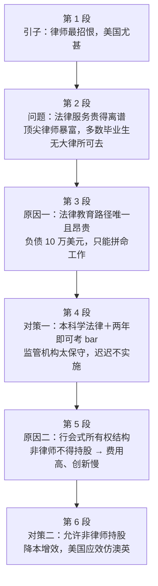

# Passage 46 · 法律教育成本与律师行业改革

## 答题记录

| 轮次  | 日期         | 题号  | 正确  | 错误  | 正确率 | 用时    | 错题归因 |
| --- | --- | --- | --- | --- | --- | --- | --- | --- |
| 1 |  | 1-5 |  |  |  |  |  |
| 2 |  | 1-5 |  |  |  |  |  |
| 3 |  | 1-5 |  |  |  |  |  |

> [!tip] 填写口径
> - **用时**以分钟计，只计做题时间，不含精读复盘。
> - **错题归因**填「题型·错误类型」，如：细节题·无中生有、细节题·混淆概念、细节题·与原文相反、猜词题·偷换概念、主旨题·局部夸大。
> - 纵向看趋势：正确率升而用时过长 → 熟练度不足；用时降而正确率波动 → 定位不稳。
> - 本篇 **5 题**，题号栏填 1-5；第 1 题是**事实细节题**（问学生为何涌向法学院，定位第二段②句的 money），第 2 题是**事实细节题**（问哪一项**增加**了法律教育成本，定位第三段③句，答案 D 与原文是同义替换），第 3 题是**事实细节题**（问改革阻力源自谁，定位第四段②句的 too conservative to implement them），第 4 题是**猜词题**（问 guild-like ownership structure 为何「限制性」，定位第五段，答案 B 是原文 ban 的同义替换），第 5 题是**主旨大意题**（六段式「问题—原因—对策—原因—对策」，答案 B）。错因建议分别写「细节题·无中生有」「细节题·混淆概念」「细节题·与原文相反」「猜词题·偷换概念」「主旨题·局部夸大」。

> [!info] 文章档案
> - **来源**：考研英语（一）2014 年 Text 2
> - **题材**：政治法律（美国律师行业 × 法律教育成本 × 行业准入管制）——律师招人恨、法律服务贵，根子在法律教育路径唯一与行会式所有权结构，改革方案早已存在却迟迟推不动
> - **结构**：6 段 / 24 句 ＋ 5 题（按句号断句与行首缩进实测；与解析引用的「第二段①②③句」「第三段③句」「第四段②句」「第五段①句／②句／④句」「第四段③句『本科即可开始学习法律』」全部吻合；**第 3 题解析所称「第四段③句……资格考试」按本文编号为第 ⑤ 句**，已在题目分析中注明）
> - **难度**：★★★★☆
> - **一句话主旨**：美国律师既贵又招恨，根源有二——法律教育路径单一昂贵（四年无关本科＋三年法学院＋昂贵备考，毕业生负债 10 万美元）与行会式的限制性所有权结构（非律师不得持股，费用高、创新慢）；改革方案（本科学法律、两年即可考 bar、允许非律师持股）早已存在，只因监管机构太保守而搁浅，美国应学澳大利亚和英国放开。

## 一、篇章脉络

- **第 1 段**：**引子，两句话完成「律师最招恨、美国最典型」的立论**。在全世界，律师招致的敌意比任何其他职业都多——可能除了新闻业；但很少有地方的客户比在美国更有理由抱怨。第 2 题的选项 A「客户不断增长的需求」、第 5 题 B 项「美国律师行业的问题」都由此埋线。
- **第 2 段**：**问题展开——贵，且毕业生出路差**。经济危机前十年，美国法律服务支出增速是通胀的两倍；顶尖律师赚得摩天大楼都装不下，诱使更多学生涌入法学院；但多数法科毕业生从未得到大律所职位，转而成为骚扰式诉讼的提起者，把侵权法体系变成代价高昂的噩梦。
- **第 3 段**：**原因一——法律教育路径唯一且昂贵**。美国大多数州只有一条路：四年无关学科本科＋三年法律学位（美国律师协会授权的 200 所法学院之一）＋昂贵的 bar 备考；这让普通毕业生在本科债务之上再背 10 万美元，只能 fearsomely hard 地工作。第 2 题的战场。
- **第 4 段**：**对策一——降低教育成本，且已有人提出**。改革会同时惠及律师和客户；合理想法早已存在，但州级行业管理机构太保守，未能实施：本科即可学法律、两年法学院后即可考 bar（若 bar 真是足够严格的考试，就应允许早考），不需要额外培训的学生可少背三分之一债务。第 3 题的战场。
- **第 5 段**：**原因二——行会式所有权结构**。除哥伦比亚特区外，非律师不得持有律所任何股份；这让费用居高不下、创新缓慢。行业内部有改革压力，监管者却坚称挡住外行能让律师远离赚钱压力、恪守职业伦理。第 4 题的战场。
- **第 6 段**：**对策二并收束**——允许非律师持股反而会降低成本、改善服务（促使用技术、聘职业经理人提效）；澳大利亚、英国已经放开，美国应当效仿。

> [!tip] 行文逻辑
> 全篇是考研阅读最典型的**「问题—原因—对策」三段式，且被复用两轮**：第 1–2 段立问题（贵、招恨）→ 第 3 段原因一（教育路径）→ 第 4 段对策一（本科学法／两年考 bar）→ 第 5 段原因二（所有权结构）→ 第 6 段对策二（允许非律师持股）＋ 以澳英为例的收尾。书中解析把这个结构讲得极清楚：「文章第一、二段引出话题，美国律师行业存在的问题；第三段提出原因；第四段给出建议；第五段给出另一个原因；第六段给出另一个建议。」**第 5 题主旨题的答案正是这条结构线本身**（problem and solutions to it）。三个贯穿全篇的词串：**hostility / complaint（律师招恨）**、**costs / fees / debt / debt mountain（钱）**、**reform / change / liberalize / follow（改革）**。另注意第 5 段与第 6 段是同一条因果链的两端：第 5 段讲「监管者认为挡住外行能让律师远离赚钱压力、恪守伦理」，第 6 段用 In fact 一句反转——挡住外行只会让费用高、创新慢。**命题格局题文同序**（1→P2、2→P3、3→P4、4→P5、5→全文）。

## 二、逐段精读

### 第 1 段 · 引子：律师最招恨，美国尤甚

**原文**

① All around the world, lawyers generate more hostility than the members of any other profession—with the possible exception of journalism.
② But there are few places where clients have more grounds for complaint than America.

**译文**

① 在全世界，律师招致的敌意比任何其他职业的从业者都多——可能除了新闻业之外。
② 但很少有地方的客户比在美国更有理由抱怨。

> [!note] 段落要点
> - **两句话完成立论**：第一句把「律师招恨」设为全球共识（唯一可能的例外是新闻业），第二句用 **But there are few places ... than America** 把焦点收窄到美国，**比较级 + few places 的「否定式最高级」**是「美国最典型」的经典写法。
> - **本段只立论不举证**，举证的任务全在第 2 段（法律服务贵、毕业生出路差）——这是考研阅读「引子段」的标准形态：**只负责划定讨论对象，不负责论证**。
> - **与下段的衔接**：profession 一词在第 4、5 段以 the profession 复现（指律师这一行业），hostility 的根由（费用高、创新慢、伦理争议）在后面五段逐一拆解。

#### 本段重点词汇

| 单词 | 词性 | 文中意 | 拓展 | 文中用法 |
| --- | --- | --- | --- | --- |
| **all around the world** | 短语 | 在全世界，全球各地 | 同义 around the globe / worldwide；all around the world 语气更强 | All around the world, lawyers generate more hostility（在全世界，律师招致的敌意最多） |
| **generate** | v. | 招致，引起，产生 | 熟词僻义：常见义「产生（电力／收入）」，此处主语是 lawyers、宾语是 hostility，作「招致」；generate interest 引发兴趣 | lawyers generate more hostility（律师招致更多敌意） |
| **hostility** | n. | 敌意，敌对（情绪） | hostile adj. 敌对的、不友好的；hostility toward/to sb 对某人的敌意 | generate more hostility than the members of any other profession（招致比其他任何职业从业者更多的敌意） |
| **profession** | n. | 职业（尤指需专门训练的） | the profession 特指本行业（本文指律师业）；professional n. 专业人士 adj. 专业的 | than the members of any other profession（比其他任何职业的从业者） |
| **with the possible exception of** | 短语 | 除……之外可能还有例外 | with the exception of 除……之外（不包括）；exception n. 例外 | with the possible exception of journalism（可能除了新闻业之外） |
| **journalism** | n. | 新闻业，新闻工作 | journalist n. 记者；journal n. 期刊、日志 | with the possible exception of journalism（可能除了新闻业之外） |
| **grounds for complaint** | 短语 | 抱怨的理由 | grounds n. 理由、依据（常用复数，＝ reason）；complaint n. 抱怨、投诉；have grounds for (doing) sth 有理由…… | clients have more grounds for complaint（客户更有理由抱怨） |
| **client** | n. | 委托人，客户 | client n. 尤指律师／专业人士的委托人（≠ customer 一般顾客）；client base 客户群 | where clients have more grounds for complaint（客户更有理由抱怨的地方） |

#### 长难句 · 本段第 ① 句

> [!abstract] 本段第 ① 句 · 原句
> All around the world, lawyers generate more hostility than the members of any other profession—with the possible exception of journalism.

**结构拆解**

- **句首状语**：All around the world，范围状语，把结论的适用范围扩到全球。
- **主干**：lawyers（主）＋ generate（谓）＋ more hostility（宾）。
- **比较状语**：than the members of any other profession —— **than any other ＋ 单数名词**是「最高级意义的比较级」，意为「比任何其他的都……」。
- **插入语**：with the possible exception of journalism，破折号后置，为前面的全称判断**留一个例外口子**——这是议论文「先立全称、再补例外」的严谨写法。

**参考译文**

在全世界，律师招致的敌意比任何其他职业的从业者都多——可能除了新闻业之外。

> [!tip] 拆解要点
> 这句是**全篇的引子句**，也是「律师最招恨」这一立论的起点。三个要点：其一，**than any other profession 看似比较级、实为最高级**，读的时候要把它读成「律师是（除新闻业外）最招恨的职业」；其二，**with the possible exception of 是「严谨性标记」**——作者主动补一个例外，反而让主干判断更可信，这个手法在考研阅读的立论段里极常见；其三，**hostility 是情绪名词，generate 作「招致」而非「产生」**——这是本篇第一个熟词僻义，若按「产生敌意」理解虽不离谱，却读不出「公众对律师这一职业的普遍反感」这层含义，而第 1 题 A 项 the growing demand from clients 恰是要你把注意力从「敌意」引向「需求」，从而跑偏。**引子段的第一句往往就是全文话题的定义句，务必把它的比较对象（any other profession）与例外（journalism）都圈出来。**

### 第 2 段 · 问题：法律服务贵得离谱，毕业生出路差

**原文**

① During the decade before the economic crisis, spending on legal services in America grew twice as fast as inflation.
② The best lawyers made skyscrapers-full of money, tempting ever more students to pile into law schools.
③ But most law graduates never get a big-firm job.
④ Many of them instead become the kind of nuisance-lawsuit filer that makes the tort system a costly nightmare.

**译文**

① 经济危机前的十年间，美国法律服务支出的增长速度是通货膨胀的两倍。
② 顶尖律师赚得摩天大楼都装不下，这诱使越来越多的学生涌入法学院。
③ 但多数法科毕业生从未得到过在大律所工作的机会。
④ 相反，他们中的许多人成了那种骚扰式诉讼的提起者，使侵权法体系变成一场代价高昂的噩梦。

> [!note] 段落要点
> - **本段是全篇「问题」的实证**，四句一条递进线：①句**贵**（法律服务支出增速是通胀两倍）→ ②句**顶尖者暴富**（摩天大楼都装不下）→ ③句**多数人进不去**（never get a big-firm job）→ ④句**于是流向低端诉讼**（nuisance-lawsuit filer 把 tort system 变成 costly nightmare）。
> - **②句是第 1 题的定位句**：tempting ever more students to pile into law schools 对应题干 A lot of students take up law as their profession，而「吸引他们的东西」就是 made skyscrapers-full of money。
> - **③句的 But 是第 1 题 C 项的死刑判决**：most law graduates never get a big-firm job 与选项 the prospect of working in big firms（在大公司就职的愿景）**意思正好相反**——书中解析：「[C] 项中的『big firms』源自第二段③句，该句指出，大多数法律专业的毕业生并未能获得在大公司工作的机会。选项表述的意思与原文正好相反，故排除。」
> - **④句把「贵」转成「社会代价」**：tort system（侵权法体系）变成 nightmare，说明个体困境已外溢为系统性问题，为后文「改革同时惠及律师和客户」（第 4 段①句）埋下因果。

#### 本段重点词汇

| 单词 | 词性 | 文中意 | 拓展 | 文中用法 |
| --- | --- | --- | --- | --- |
| **decade** | n. | 十年（间） | the decade before the economic crisis 经济危机前的十年；per decade 每十年 | During the decade before the economic crisis（在经济危机前的十年间） |
| **legal services** | n. | 法律服务 | legal adj. 法律的；services n. 服务（复数表行业整体）；同义 legal aid 法律援助 | spending on legal services（法律服务支出） |
| **inflation** | n. | 通货膨胀 | inflate v. 使膨胀、（价格）上涨；inflation rate 通胀率；第 1 题 B 项词 | grew twice as fast as inflation（增速是通胀的两倍） |
| **twice as fast as** | 短语 | 是……的两倍快 | 倍数表达：twice/half as ... as；同级比较结构 as ... as | grew twice as fast as inflation（增速是通胀的两倍） |
| **skyscrapers-full of** | adj. | 摩天大楼都装不下的（形容极多） | skyscraper n. 摩天大楼；A-full of B「装满 B 的 A」是夸张构词法（roomful of money） | The best lawyers made skyscrapers-full of money（顶尖律师赚得摩天大楼都装不下） |
| **tempt** | v. | 引诱，诱使 | temptation n. 诱惑；tempt sb to do sth 诱使某人做某事；resist temptation 抵制诱惑 | tempting ever more students to pile into law schools（诱使越来越多的学生涌入法学院） |
| **pile into** | 短语 | 涌入，蜂拥而入 | pile n. 堆 v. 堆积；pile into/onto 涌进（拥挤处）；同义 flood into | tempting ever more students to pile into law schools（诱使更多学生涌入法学院） |
| **big-firm job** | n. | 大律所的工作 | firm n. 公司、事务所（律所惯用 firm）；big-firm 复合形容词；第 1 题 C 项词 | never get a big-firm job（从未得到大律所的工作） |
| **nuisance** | n. | 令人讨厌的人／事；骚扰 | nuisance adj. 无理的；make a nuisance of oneself 惹人厌 | the kind of nuisance-lawsuit filer（那种骚扰式诉讼的提起者） |
| **lawsuit** | n. | 诉讼（案件） | law ＋ suit（起诉）；file a lawsuit 提起诉讼；同义 litigation | nuisance-lawsuit filer（骚扰式诉讼的提起者） |
| **filer** | n. | 提起（诉讼／申请）的人 | file v. 提交、提起；-er 表施动者；同 applicant／claimant | nuisance-lawsuit filer（骚扰式诉讼的提起者） |
| **tort** | n. | 侵权（法）；侵权行为 | tort system 侵权法体系；tort reform 侵权法改革；legal term | makes the tort system a costly nightmare（使侵权法体系变成代价高昂的噩梦） |
| **costly** | adj. | 代价高昂的 | cost n. 成本 v. 花费；costly mistake 代价惨重的错误 | a costly nightmare（一场代价高昂的噩梦） |
| **nightmare** | n. | 噩梦；噩梦般的事物 | night ＋ mare（母马，古英语梦魇）；a logistical nightmare 后勤噩梦 | a costly nightmare（一场代价高昂的噩梦） |
| **take up** | 短语 | 从事（职业），开始（学习） | take up law as one's profession 从事法律职业；take up a hobby 开始某项爱好；第 1 题题干关键词 | A lot of students take up law as their profession（许多学生选择法律专业） |

#### 长难句 · 本段第 ② 句

> [!abstract] 本段第 ② 句 · 原句
> The best lawyers made skyscrapers-full of money, tempting ever more students to pile into law schools.

**结构拆解**

- **主干**：The best lawyers（主）＋ made（谓）＋ skyscrapers-full of money（宾）。
- **夸张构词**：skyscrapers-full of money —— 「装满摩天大楼的钱」，英语里 **A-full of B** 的类推构词（roomful / armful），极言其多。
- **现在分词短语作伴随／结果状语**：tempting ever more students to pile into law schools，逻辑主语是 the best lawyers。
- **不定式嵌套**：tempt sb **to do** sth（诱使某人做）→ pile into law schools（涌入法学院）。

**参考译文**

顶尖律师赚得摩天大楼都装不下，这诱使越来越多的学生涌入法学院。

> [!tip] 拆解要点
> 这句是**第 1 题的唯一定位句**，全句只有一个谓语 made，其余全是修饰成分，读的时候抓住「**谁在做什么、导致什么**」：顶尖律师赚钱（made ... money）→ 诱使学生涌入（tempting ... to pile into）。两个要点：其一，**现在分词短语 tempting ... 是「因 → 果」的桥梁**，题干问 A lot of students take up law ... due to，due to 的「因」就在这个分词里找——答案是 money，即 D 项 financial rewards；其二，**skyscrapers-full of money 是夸张，不要去找「摩天大楼」这个实体**，它只是量化「多」。另注意本段③句的 But most law graduates never get a big-firm job 是对本句的**反转**——②句说「顶尖律师暴富吸引人进来」，③句说「多数人根本进不去」，第 1 题 C 项 the prospect of working in big firms 正是踩在这个反转上：**凡选项把原文的 never／few／hardly 拿掉、换成 prospect／opportunity 一类正面词，一律按「与原文相反」排除**。

#### 长难句 · 本段第 ④ 句

> [!abstract] 本段第 ④ 句 · 原句
> Many of them instead become the kind of nuisance-lawsuit filer that makes the tort system a costly nightmare.

**结构拆解**

- **主干**：Many of them（主）＋ become（系动词）＋ the kind of nuisance-lawsuit filer（表语）。
- **instead 的位置**：置于系动词前，表「相反、反而」，回指③句的 never get a big-firm job。
- **复合结构**：the kind of ＋ 名词（filer）＋ **that** 定语从句。
- **that 定语从句**：that makes the tort system a costly nightmare —— that 指 filer，从句用 **make ＋ 宾语 ＋ 名词**（使……成为……）结构。

**参考译文**

相反，他们中的许多人成了那种骚扰式诉讼的提起者，使侵权法体系变成一场代价高昂的噩梦。

> [!tip] 拆解要点
> 这句是**第 2 段「问题外溢」的落点**，也是全篇唯一一处把个体困境升级为社会代价的地方。两个要点：其一，**the kind of ＋ 名词 ＋ that 从句是考研阅读的超高频框架**（the kind of person that ... / the sort of thing that ...），that 永远指它前面的那个名词——这里是 filer，因此「使 tort system 变成 nightmare」的主语是「这批诉讼提起者」，不是律师、也不是客户；其二，**nuisance-lawsuit filer 是生造复合词，要按构词拆开读**：nuisance（骚扰）＋ lawsuit（诉讼）＋ filer（提起者）＝「靠打骚扰式诉讼吃饭的人」，这个词把「毕业生出路差」与「侵权法体系成本高」直接焊在一起，为第 4 段①句 Reforming the system would help **both lawyers and their customers** 提供了因果：**改制度既救律师（少背债、不必打骚扰诉讼），也救客户（不必承担 nightmare 的成本）**。读到这类生造复合词时，**按「名词串」逐段拆解比猜整体意思可靠得多**。

### 第 3 段 · 原因一：法律教育路径唯一且昂贵

**原文**

① There are many reasons for this.
② One is the excessive costs of a legal education.
③ There is just one path for a lawyer in most American states: a four-year undergraduate degree in some unrelated subject, then a three-year law degree at one of 200 law schools authorized by the American Bar Association and an expensive preparation for the bar exam.
④ This leaves today's average law-school graduate with $100,000 of debt on top of undergraduate debts.
⑤ Law-school debt means that they have to work fearsomely hard.

**译文**

① 造成这种情况的原因有很多。
② 其一是法律教育成本过高。
③ 在美国大多数州，成为律师只有一条路可走：先拿一个不相干学科的四年制本科学位，然后在美国律师协会授权的 200 所法学院之一攻读三年法律学位，还要为律师资格考试做昂贵的准备。
④ 这让如今普通的法学院毕业生在本科债务之上还背上 10 万美元的债务。
⑤ 法学院债务意味着他们必须极其拼命地工作。

> [!note] 段落要点
> - **本段是第 2 题的定位战场，也是全篇「原因一」的论证**：①②句一句话点题（excessive costs），③句把「贵」拆成三个叠加项（四年无关本科＋三年法律学位＋昂贵的 bar 备考），④句给出代价（负债 10 万美元），⑤句给出后果（只能拼命工作）。
> - **③句的冒号是本段的骨架**：There is just one path ... **:** A, then B and C——冒号后三个并列成分共同构成「唯一路径」，第 2 题 D 项正是对第一项的同义替换（a four-year undergraduate degree in some unrelated subject ↔ Pursuing a bachelor's degree in another major）。
> - **④句的 on top of 是「雪上加霜」的标记词**：本科债务之上再叠 10 万美元法学院债务，这是理解第 4 段⑥句「cut their debt mountain by a third（砍掉三分之一债务大山）」的前提——改革方案直接瞄准这个数字。

#### 本段重点词汇

| 单词 | 词性 | 文中意 | 拓展 | 文中用法 |
| --- | --- | --- | --- | --- |
| **excessive** | adj. | 过度的，过高的 | excess n. 过量 v. 超过；excessively adv. 过度地；excessive costs 过高的成本 | the excessive costs of a legal education（法律教育过高的成本） |
| **legal education** | n. | 法律教育 | legal adj. 法律的、合法的（≠ illegal 非法的）；第 2 题题干关键词 | the excessive costs of a legal education（法律教育过高的成本） |
| **path** | n. | 路径，途径 | the only path to success 唯一成功之路；同义 route／approach | There is just one path for a lawyer（成为律师只有一条路） |
| **undergraduate** | n./adj. | 本科生（的）；本科（阶段）的 | under-（低于）＋ graduate（毕业生）；undergraduate degree 本科学位；反义 graduate／postgraduate | a four-year undergraduate degree（四年制本科学位） |
| **unrelated** | adj. | 无关的，不相关的 | un- ＋ related（相关的）；unrelated to sth 与某事无关；近义 irrelevant | a four-year undergraduate degree in some unrelated subject（某个不相干学科的四年本科学位） |
| **law degree** | n. | 法律学位 | law school 法学院；a law degree 法律学位；JD（Juris Doctor）法律博士 | a three-year law degree（三年法律学位） |
| **authorize** | v. | 授权，批准，认可 | authority n. 权威、授权；authorized adj. 经授权的；同义 approve／accredit | 200 law schools authorized by the American Bar Association（美国律师协会授权的 200 所法学院） |
| **the American Bar Association** | n. | 美国律师协会（ABA） | bar n. 律师界（the bar 律师职业）；bar association 律师协会 | authorized by the American Bar Association（经美国律师协会授权） |
| **preparation** | n. | 准备（过程） | prepare v. 准备；prepare for the bar exam 备考；preparatory adj. 预备的 | an expensive preparation for the bar exam（为律师资格考试所做的昂贵准备） |
| **the bar exam** | n. | （美国）律师资格考试 | bar n. 律师界；sit for the bar 参加律师资格考试；the bar 律师职业 | an expensive preparation for the bar exam（为律师资格考试所做的昂贵准备） |
| **on top of** | 短语 | 在……之上，此外，加之 | 本义「在……上面」，引申「除……之外还有」；on top of everything else 更有甚者 | $100,000 of debt on top of undergraduate debts（在本科债务之上再背 10 万美元） |
| **debt** | n. | 债务，欠款 | in debt 负债；debt mountain 债务大山；debtor n. 债务人；反义 asset 资产 | $100,000 of debt（10 万美元的债务） |
| **fearsomely** | adv. | 极其，非常；可怕地 | fearsome adj. 可怕的、极大的（＝ formidable）；fear n. 恐惧 | work fearsomely hard（极其拼命地工作） |
| **average** | adj. | 普通的，平均的，一般的 | 熟词僻义：常见义「平均的」，此处修饰 graduate 作「普通的、一般的」；the average person 普通人 | today's average law-school graduate（如今普通的法学院毕业生） |
| **tuition** | n. | 学费 | tuition fees 学费；tuition-free 免学费的；第 2 题 A 项词 | Higher tuition fees for undergraduate studies（本科阶段高额的学费） |
| **due to** | 短语 | 因为，由于 | to 是介词，后接名词／动名词；同义 because of／owing to；第 1 题题干关键词 | A lot of students take up law as their profession due to（许多学生选择法律专业是因为） |

#### 长难句 · 本段第 ③ 句

> [!abstract] 本段第 ③ 句 · 原句
> There is just one path for a lawyer in most American states: a four-year undergraduate degree in some unrelated subject, then a three-year law degree at one of 200 law schools authorized by the American Bar Association and an expensive preparation for the bar exam.

**结构拆解**

- **主干**：There is just one path for a lawyer（there be 表存在）＋ in most American states（地点状语）。
- **冒号的作用**：冒号后是**对 one path 的逐项拆解**，三项由 then / and 串成一个时间流程：①a four-year undergraduate degree in some unrelated subject（四年无关学科本科）→ ②a three-year law degree at one of 200 law schools（三年法律学位）→ ③an expensive preparation for the bar exam（昂贵的备考）。
- **后置定语一**：in some unrelated subject，介词短语修饰 degree。
- **后置定语二**：at one of 200 law schools，介词短语修饰 law degree；其中 one of 200 law schools 又是 200 所中的「其一」。
- **后置定语三**：**authorized by** the American Bar Association，过去分词短语修饰 200 law schools（被动：被 ABA 授权）。
- **并列连词**：and an expensive preparation —— 与前面的 degree 并列，同作 path 的组成部分。

**参考译文**

在美国大多数州，成为律师只有一条路可走：先拿一个不相干学科的四年制本科学位，然后在美国律师协会授权的 200 所法学院之一攻读三年法律学位，还要为律师资格考试做昂贵的准备。

> [!tip] 拆解要点
> 这句是**第 2 题的唯一定位句**，也是全篇信息密度最高的一句。三个要点：其一，**冒号后是「成本清单」**，题干问 Which of the following **adds to the costs of** legal education，答案必须是清单上的某一项——D 项 Pursuing a bachelor's degree in another major 正是第一项（a four-year undergraduate degree in some unrelated subject）的同义替换，**bachelor's degree ＝ undergraduate degree、another major ＝ some unrelated subject**；其二，**authorized by the American Bar Association 的功能是「认证法学院」**，第 2 题 C 项 Admissions approval from the bar association 把它错解成「协会给个人发准入许可」——**凡选项里出现原文的机构名，先核对它在原文中的语法功能**（此处 ABA 是 authorized 的逻辑主语，动作对象是 law schools，不是人）；其三，**in some unrelated subject 的 some 是「任意一个」**，强调本科专业与法律无关——这正是「路径唯一且昂贵」的要害：四年时间花在不相干学科上，却仍是执业的前置成本。**冒号后的并列项是细节题的答案池，读到这里要逐项编号，选项拿来即对号。**

#### 长难句 · 本段第 ④ 句

> [!abstract] 本段第 ④ 句 · 原句
> This leaves today's average law-school graduate with $100,000 of debt on top of undergraduate debts.

**结构拆解**

- **主干**：This（主）＋ leaves（谓）＋ today's average law-school graduate（宾）＋ with $100,000 of debt（宾补）。
- **leave sb with sth**：使某人处于某种状态、给某人留下某物——此处是「让……背上（债务）」。
- **复合定语**：today's average law-school graduate，三层修饰叠一个名词（时间＋评价＋类别）。
- **叠加状语**：on top of undergraduate debts，意为「在本科债务之上」，表**雪上加霜**。
- **数字**：$100,000 of debt，具体金额是后文 debt mountain 的量化依据。

**参考译文**

这让如今普通的法学院毕业生在本科债务之上还背上 10 万美元的债务。

> [!tip] 拆解要点
> 这句是**第 3 段③句的后果句**，也是第 4 段改革方案（⑥句 cut their debt mountain by a third）的数字来源。两个要点：其一，**leave sb with sth 结构里，with 短语是「结果」而非「伴随」**——不是「毕业生带着 10 万美元离开」，而是「这套制度使毕业生负债 10 万」，理解偏一点，因果就反了；其二，**on top of undergraduate debts 是全句的语义重心**：本科已经负债，法学院再叠 10 万，因此第 4 段⑥句的改革收益才会以「三分之一」计——**议论文里凡出现具体数字＋叠加词（on top of / in addition / what's more），后面的「对策」几乎一定会给出一个对应的量化改善（by a third / by half），这两处是配套出题的**。另记 average 在此作「普通的、一般的」（today's average law-school graduate），不是「平均的」——**考研阅读中 average 修饰人时几乎总是「普通人」义**，别误读成「平均数意义上的毕业生」。

### 第 4 段 · 对策一：本科学法律、两年即可考 bar

**原文**

① Reforming the system would help both lawyers and their customers.
② Sensible ideas have been around for a long time, but the state-level bodies that govern the profession have been too conservative to implement them.
③ One idea is to allow people to study law as an undergraduate degree.
④ Another is to let students sit for the bar after only two years of law school.
⑤ If the bar exam is truly a stern enough test for a would-be lawyer, those who can sit it earlier should be allowed to do so.
⑥ Students who do not need the extra training could cut their debt mountain by a third.

**译文**

① 改革这一制度将同时惠及律师和他们的客户。
② 合理的想法早已存在，但管理这个行业的州级机构一直太保守，未能付诸实施。
③ 一个想法是允许人们在本科阶段就学法律。
④ 另一个想法是让学生在只读两年法学院后就参加律师资格考试。
⑤ 如果律师资格考试对想当律师的人来说真是一场足够严格的考试，那么那些可以早点参加的人就应当被允许早点参加。
⑥ 不需要额外培训的学生可以把自己的债务大山砍掉三分之一。

> [!note] 段落要点
> - **本段是第 3 题的定位战场**：题干问 Hindrance to the reform ... originates from，答案在②句——Sensible ideas have been around for a long time, **but** the state-level bodies that govern the profession have been **too conservative to implement them**。书中解析：「又依据 Hindrance 定位到本段②句内容 too conservative to implement them（因太保守而未能实施）。同样表示否定，而导致计划未能实施（出现阻碍）的是 the state-level bodies that govern the profession（各州行业管理机构）。」
> - **「改革对双方都有利」是①句的立场铺垫**：would help both lawyers and their customers，因此第 3 题 B 项 lawyers' and clients' strong resistance 与原文表述相反（书中：「①句说改革会给律师和客户带来益处，[B] 项中的 resistance（反对）和原文表述相反，故排除」）。
> - **③④⑤⑥句是「对策一」的具体内容**：本科学法律（对应第 3 段③句的四年无关本科）＋ 两年即可考 bar（⑤句用条件句论证其合理性：若 bar 真够严，就该允许早考）＋ ⑥句给出收益（债务大山砍三分之一）。注意⑤⑥句是第 3 题 C 项 stern exam 的出处——书中强调「这是改革的措施而不是改革的障碍」。

#### 本段重点词汇

| 单词 | 词性 | 文中意 | 拓展 | 文中用法 |
| --- | --- | --- | --- | --- |
| **reform** | v./n. | 改革，改良 | reform the system 改革制度；reformer n. 改革者；同义 overhaul | Reforming the system would help both lawyers and their customers（改革这一制度将同时惠及律师和客户） |
| **sensible** | adj. | 合理的，明智的 | sense n. 判断力；sensibility n. 感性；同义 reasonable／sound | Sensible ideas have been around for a long time（合理的想法早已存在） |
| **state-level** | adj. | 州一级的 | state n.（美国）州；-level 后缀表层级（federal-level 联邦级） | the state-level bodies（州级机构） |
| **govern** | v. | 管理，治理，支配 | government n. 政府；governor n.（美）州长；the bodies that govern the profession 行业管理机构 | bodies that govern the profession（管理这个行业的机构） |
| **conservative** | adj. | 保守的，守旧的 | conserve v. 保存；conservatism n. 保守主义；反义 radical 激进的 | too conservative to implement them（太保守而未能实施） |
| **implement** | v. | 实施，执行 | implementation n. 实施；implement a policy 执行政策；同义 carry out | too conservative to implement them（太保守而未能实施它们） |
| **sit for** | 短语 | 参加（考试） | 英式用法：sit for an exam 参加考试；同义 take | let students sit for the bar（让学生参加律师资格考试） |
| **stern** | adj. | 严格的，严峻的 | stern test 严格的考验；同义 strict／rigorous；第 3 题 C 项词 | a stern enough test for a would-be lawyer（对想当律师的人足够严格的考试） |
| **would-be** | adj. | 想要成为的，准……的 | would-be writer 想成为作家的人；同义 aspiring／prospective | a stern enough test for a would-be lawyer（对想当律师的人足够严格的考试） |
| **cut their debt mountain** | 短语 | 砍掉债务大山 | cut v. 削减；debt mountain 债务大山（比喻性搭配） | could cut their debt mountain by a third（可以把债务大山砍掉三分之一） |
| **by a third** | 短语 | 三分之一（表幅度） | by ＋ 分数 表「增减幅度」；by half 减半；第 4 段⑥句的改革收益 | cut their debt mountain by a third（砍掉三分之一的债务） |
| **hindrance** | n. | 阻碍，障碍 | hinder v. 阻碍；第 3 题题干关键词 | Hindrance to the reform of the legal system（法律体系改革的阻碍） |
| **originate** | v. | 源自，发源；创始 | origin n. 起源；originate from/in 源于；同义 stem from | Hindrance ... originates from（阻碍来源于） |
| **rigid** | adj. | 死板的，僵硬的 | rigidly adv. 僵硬地；同义 inflexible；反义 flexible；第 3 题 A 项词 | the rigid bodies governing the profession（行业监管机构的死板） |

#### 长难句 · 本段第 ② 句

> [!abstract] 本段第 ② 句 · 原句
> Sensible ideas have been around for a long time, but the state-level bodies that govern the profession have been too conservative to implement them.

**结构拆解**

- **本句是 but 连接的并列句**：分句一 Sensible ideas have been around for a long time（现在完成时）；分句二 the state-level bodies ... have been too conservative to implement them。
- **分句二主干**：the state-level bodies（主）＋ have been（系）＋ too conservative（表）＋ to implement them（结果状语）。
- **too ... to ... 结构**：太……以致不能……——**否定意义**，说明「未能实施」。
- **定语从句**：that govern the profession，修饰 bodies（管理这个行业的机构），that 在从句中作主语。
- **指代**：them 回指 sensible ideas（合理想法）。

**参考译文**

合理的想法早已存在，但管理这个行业的州级机构一直太保守，未能付诸实施。

> [!tip] 拆解要点
> 这句是**第 3 题的唯一定位句**。三个要点：其一，**too ... to ... 是「阻碍题」的标准信号**——题干问 Hindrance to the reform ... originates from，原文没有 hinder 这个词，它藏在 too conservative to implement 这个否定结构里；看到 too ... to ... 就问「**谁 too？做不了什么？**」，本题的答案是「谁」（the state-level bodies that govern the profession），对应 A 项 the rigid bodies governing the profession；其二，**分句一的 have been around 是「早已存在」**，与分句二的「未能实施」构成「有方案、推不动」的落差——这正是本题题眼的来源：阻碍不在方案，在机构；其三，**them 回指 sensible ideas**，说明被搁置的是「合理想法」，因此 B 项 lawyers' and clients' strong resistance（律师与客户强烈反对）与①句 would help both lawyers and their customers 直接矛盾——**凡选项把「改革对双方有利」说成「双方强烈反对」，是与原文相反的标准错法**。

#### 长难句 · 本段第 ⑤ 句

> [!abstract] 本段第 ⑤ 句 · 原句
> If the bar exam is truly a stern enough test for a would-be lawyer, those who can sit it earlier should be allowed to do so.

**结构拆解**

- **条件状语从句**：If the bar exam is truly a stern enough test for a would-be lawyer —— if 置于句首，主句用 should（建议语气）。
- **adj. ＋ enough ＋ to do 结构**：a stern **enough** test（足够严格的考试），enough 后置修饰形容词。
- **主句主干**：those（主）＋ should be allowed（谓语，**含情态动词的被动语态**）＋ to do so（主语补足语）。
- **定语从句**：who can sit it earlier，修饰 those；其中 **it 回指 the bar exam**，sit 取「参加（考试）」义（sit for the bar）。
- **do so 回指**：替代 sit for the bar earlier，避免重复。

**参考译文**

如果律师资格考试对想当律师的人来说真是一场足够严格的考试，那么那些可以早点参加的人就应当被允许早点参加。

> [!tip] 拆解要点
> 这句是**第 3 题 C 项的出处，也是「措施 vs 障碍」的最佳教材**。两个要点：其一，**本句是改革方案（④句）的论证句**——④句说「两年即可考 bar」，⑤句用「如果 bar 真够严，就该允许早考」为其背书，因此第 3 题 C 项 the stern exam for would-be lawyers 虽与原文用词一致，却是**改革的措施**而不是改革的障碍，按混淆概念排除；**凡选项用原文的词，先分清它在原文里是「问题／原因」还是「对策／方案」**，这是本篇最值得记的一条；其二，**sit it earlier 里的 it 是代词回指**——考研阅读中「动词 ＋ it」的 it 几乎总回指上文某个名词（此处＝the bar exam），抓住它才能读懂 those who can sit it earlier 是「哪些能早点考的人」。另记 enough 的三个位置：**adj. ＋ enough ＋ to do（足够……以致能）／enough ＋ n.／enough for sb**——本句 a stern enough test for a would-be lawyer 三样占全。

### 第 5 段 · 原因二：行会式所有权结构

**原文**

① The other reason why costs are so high is the restrictive guild-like ownership structure of the business.
② Except in the District of Columbia, non-lawyers may not own any share of a law firm.
③ This keeps fees high and innovation slow.
④ There is pressure for change from within the profession, but opponents of change among the regulators insist that keeping outsiders out of a law firm isolates lawyers from the pressure to make money rather than serve clients ethically.

**译文**

① 成本如此之高的另一个原因是这一行业限制性的、行会式的所有权结构。
② 除哥伦比亚特区外，非律师不得拥有律师事务所的任何股份。
③ 这使得费用居高不下，创新缓慢。
④ 行业内部存在改革的压力，但监管者中的反对者坚称，把外行挡在律所之外能让律师远离赚钱的压力，从而合乎职业道德地为委托人服务。

> [!note] 段落要点
> - **本段是第 4 题的定位战场**：①句给出术语 restrictive guild-like ownership structure，②句解释其内涵（Except in the District of Columbia, non-lawyers may not own any share of a law firm），③句给出后果（keeps fees high and innovation slow），④句给出**反对改革的理由**（isolates lawyers from the pressure to make money rather than serve clients ethically）。
> - **②句的 Except in the District of Columbia 是「规则＋唯一例外」的标准句式**：先划规则（非律师不得持股），再圈例外（哥伦比亚特区除外），第 4 题 B 项 bans outsiders' involvement in the profession 正是对这条规则的同义替换。
> - **④句是全篇最绕的一句，也是第 4 题三个干扰项的产地**：主干是 There is pressure for change ... **but** opponents ... insist **that** keeping outsiders out of a law firm isolates lawyers from the pressure to make money rather than serve clients ethically——that 从句里动名词短语 keeping outsiders out of a law firm 作主语，isolates 作谓语。书中解析正是据此逐项排除：「[A] 项与④句的表述相反，原文说的是阻止外行人进入律所，能让律师远离赚钱的压力……；[C] 项将④句『让律师恪守职业道德为委托人服务』曲解为『使得该行业道德恶化』……；[D] 项将『非律师身份者 (non-lawyers)』偷换为『律师 (lawyers)』」。

#### 本段重点词汇

| 单词 | 词性 | 文中意 | 拓展 | 文中用法 |
| --- | --- | --- | --- | --- |
| **restrictive** | adj. | 限制性的，约束的 | restrict v. 限制；restriction n. 限制；第 4 题题干词 | the restrictive guild-like ownership structure（限制性的行会式所有权结构） |
| **guild-like** | adj. | 行会式的 | guild n. 行会、同业公会（中世纪手工业者组织）；-like 后缀「像……的」；第 4 题题干词 | the restrictive guild-like ownership structure（限制性的行会式所有权结构） |
| **ownership structure** | n. | 所有权结构 | ownership n. 所有权（own ＋ -ship）；structure n. 结构；own shares 持股 | the restrictive guild-like ownership structure（限制性的行会式所有权结构） |
| **except in** | 短语 | 除……（地方）之外 | except 除……之外（不含）；except for 除……之外（补充说明）；exception n. 例外 | Except in the District of Columbia（除哥伦比亚特区外） |
| **the District of Columbia** | n. | 哥伦比亚特区（华盛顿特区） | 美国联邦直辖区，缩写 D.C.；美国唯一非律师也可持股的地方 | Except in the District of Columbia（除哥伦比亚特区外） |
| **non-lawyer** | n. | 非律师（人员） | non- 前缀表「非」；反义 lawyer／member of the bar | non-lawyers may not own any share of a law firm（非律师不得拥有律所股份） |
| **share** | n. | 股份 | own shares 持股；shareholder n. 股东；同义 stock（美式） | may not own any share of a law firm（不得拥有律所的任何股份） |
| **law firm** | n. | 律师事务所 | firm n. 事务所、公司（律所专用量词）；a law firm 一家律所 | own any share of a law firm（拥有律师事务所的股份） |
| **fee** | n. | （专业服务）费用 | fees n. 费用（复数）；legal fees 律师费；tuition 学费；fee n. 与 charge／cost 有别（专业服务收费） | This keeps fees high（这使得费用居高不下） |
| **keep fees high** | 短语 | 使费用居高不下 | keep ＋ 宾语 ＋ 形容词（使……保持某状态）；keep prices low 压低价格 | This keeps fees high and innovation slow（这使费用居高不下、创新缓慢） |
| **innovation** | n. | 创新 | innovate v. 创新；innovative adj. 创新的；technological innovation 技术创新 | keeps fees high and innovation slow（使费用高、创新慢） |
| **pressure for change** | 短语 | 改革的压力 | pressure n. 压力（on／for）；under pressure 在压力下 | There is pressure for change from within the profession（行业内部存在改革的压力） |
| **from within** | 短语 | 来自内部 | from within the profession 来自行业内部；反义 from outside | pressure for change from within the profession（来自行业内部的改革压力） |
| **opponent** | n. | 反对者 | oppose v. 反对；opposed to sth 反对某事；opposing adj. 对立的 | opponents of change among the regulators（监管者中反对改革的人） |
| **regulator** | n. | 监管者，监管机构 | regulate v. 监管；regulation n. 法规；regulatory adj. 监管的 | opponents of change among the regulators（监管者中的反对者） |
| **isolate** | v. | 使隔离，使孤立 | isolated adj. 孤立的；isolate sb from sth 使某人与某事隔绝；同义 shield／insulate | keeping outsiders out of a law firm isolates lawyers from the pressure to make money（把外行挡在律所外使律师远离赚钱压力） |
| **rather than** | 短语 | 而不是 | 表取舍，后接与前面平行的成分（to make money rather than serve clients） | from the pressure to make money rather than serve clients ethically（远离赚钱而非合乎职业道德地为委托人服务的压力） |
| **ethically** | adv. | 合乎职业道德地，合乎伦理地 | ethical adj. 伦理的、道德的；ethics n. 伦理学、职业道德 | serve clients ethically（合乎职业道德地为委托人服务） |
| **resistance** | n. | 反对，抵抗 | resist v. 抵抗；resistance to sth 对某事的反对；第 3 题 B 项词 | lawyers' and clients' strong resistance（律师和委托人的强烈反对） |
| **criticism** | n. | 批评 | criticize v. 批评；critical adj. 批评的、关键的；第 3 题 D 项词 | non-professionals' sharp criticism（非专业人士的尖锐批评） |
| **ban** | v. | 禁止 | ban sb from doing sth 禁止某人做某事；同义 forbid；第 4 题 B 项词 | bans outsiders' involvement in the profession（禁止外行涉足该行业） |
| **involvement** | n. | 参与，介入 | involve v. 使参与；involvement in sth 对某事的参与；第 4 题 B 项词 | bans outsiders' involvement in the profession（禁止外行涉足该行业） |
| **aggravate** | v. | 使恶化，加剧 | aggravation n. 恶化；同义 worsen；第 4 题 C 项词 | aggravates the ethical situation in the trade（使该行业的道德状况恶化） |
| **ethical** | adj. | 伦理的，道德的 | ethical situation 道德状况；ethical standards 道德标准；第 4 题 C 项词 | aggravates the ethical situation in the trade（使该行业的道德状况恶化） |

#### 长难句 · 本段第 ④ 句

> [!abstract] 本段第 ④ 句 · 原句
> There is pressure for change from within the profession, but opponents of change among the regulators insist that keeping outsiders out of a law firm isolates lawyers from the pressure to make money rather than serve clients ethically.

**结构拆解**

- **本句是 but 连接的并列句**：分句一 There is pressure for change from within the profession；分句二 opponents ... insist that ...。
- **分句一**：there be 句型，主语是 pressure for change，from within the profession 是后置定语。
- **分句二主干**：opponents of change（主）＋ among the regulators（介词短语作定语）＋ insist（谓）＋ that 宾语从句。
- **宾语从句内部**：**keeping outsiders out of a law firm**（动名词短语作主语）＋ isolates（谓）＋ lawyers（宾）＋ from the pressure to make money rather than serve clients ethically（状语）。
- **isolate A from B**：使 A 与 B 隔绝——此处是「使律师远离赚钱的压力」。
- **rather than 表取舍**：to make money **rather than** serve clients ethically，than 前后为平行不定式（「赚钱」而非「合乎伦理地服务客户」）。

**参考译文**

行业内部存在改革的压力，但监管者中的反对者坚称，把外行挡在律所之外能让律师远离赚钱的压力，从而合乎职业道德地为委托人服务。

> [!tip] 拆解要点
> 这句是**全篇最长、也是第 4 题三个干扰项的产地**，还是第 5 段与第 6 段 In fact 反转的支点。三个要点：其一，**insist that 从句的主语是动名词短语 keeping outsiders out of a law firm**，不是 lawyers、也不是 regulators——凡从句开头是 doing 的，先把它整体当成一个名词性成分，再找它后面的谓语（isolates）；其二，**isolate ... from ... 的语义是「隔绝、远离」，不是「阻止、无法获得」**——第 4 题 A 项 prevents lawyers from gaining due profits 把「远离赚钱压力」反转成「无法获得应有收益」，是与原文相反的标准错法；其三，**rather than 连接的是两个不定式**（to make money / serve clients ethically），第 4 题 C 项 aggravates the ethical situation 把「恪守伦理为委托人服务」曲解成「道德状况恶化」，是曲解的样本；而 D 项 keeps lawyers from holding law-firm shares 则把②句的 non-lawyers（非律师）偷换成 lawyers（律师）——**猜词题的干扰项最爱在「主语对象」和「肯定／否定」上做手脚，比对时先圈原文主语是谁（non-lawyers），再圈谓语方向（may not own），两样都对上才算数**。

### 第 6 段 · 对策二：允许非律师持股，美国应效仿

**原文**

① In fact, allowing non-lawyers to own shares in law firms would reduce costs and improve services to customers, by encouraging law firms to use technology and to employ professional managers to focus on improving firms' efficiency.
② After all, other countries, such as Australia and Britain, have started liberalizing their legal professions.
③ America should follow.

**译文**

① 事实上，允许非律师持有律所股份将降低成本并改善对客户的服务，因为它会促使律所采用技术、聘请职业经理人来专注于提升律所的效率。
② 毕竟，澳大利亚和英国等其他国家已经开始放开它们的法律行业。
③ 美国应当效仿。

> [!note] 段落要点
> - **本段用 In fact 一句反转第 5 段④句的反对意见**：第 5 段说「挡住外行能让律师远离赚钱压力、恪守伦理」，本段①句说「允许持股反而能降本增效」——**In fact 是作者亮明立场的信号词**，其后必是作者的真实主张。
> - **①句内部是完整的因果链**：允许持股（因）→ 促使律所用技术、聘职业经理人（中介）→ 降本增效（果），第 5 题 B 项 solutions to it 的落点正在这里。
> - **②句以别国为证、③句给出主张**：After all 引出他例（澳大利亚、英国），America should follow 收束全文——**「他国已做＋本国应做」是考研阅读政策类文章最常见的收尾句型**，也是作者态度题的显性依据。

#### 本段重点词汇

| 单词 | 词性 | 文中意 | 拓展 | 文中用法 |
| --- | --- | --- | --- | --- |
| **in fact** | 短语 | 事实上，其实 | 用于纠正前文或亮明真实观点，作者立场信号词 | In fact, allowing non-lawyers to own shares（事实上，允许非律师持股） |
| **reduce costs** | 短语 | 降低成本 | reduce v. 减少；cost n. 成本；同义 cut costs | would reduce costs and improve services（将降低成本并改善服务） |
| **cost** | n. | 成本，费用 | at all costs 不惜代价；cost-effective 划算的；与 fee（专业服务费）、price（售价）有别 | would reduce costs（将降低成本） |
| **improve services** | 短语 | 改善服务 | improve v. 改善、提升；service n. 服务 | improve services to customers（改善对客户的服务） |
| **encourage** | v. | 鼓励，促使 | encouragement n. 鼓励；encourage sb to do sth 促使某人做某事 | by encouraging law firms to use technology（通过促使律所采用技术） |
| **professional managers** | n. | 职业经理人 | professional n. 专业人士 adj. 专业的；manager n. 管理者 | employ professional managers（聘请职业经理人） |
| **employ** | v. | 雇用，使用 | employee n. 雇员；employer n. 雇主；同义 hire | employ professional managers（聘请职业经理人） |
| **focus on** | 短语 | 专注于，聚焦于 | focus one's attention on 把注意力集中于；同义 concentrate on | focus on improving firms' efficiency（专注于提升律所效率） |
| **efficiency** | n. | 效率 | efficient adj. 高效的；inefficiency n. 低效；improve efficiency 提高效率 | improving firms' efficiency（提升律所的效率） |
| **after all** | 短语 | 毕竟，终究 | 用于引出理由或例证；after all 毕竟（≠ at all 完全） | After all, other countries ...（毕竟，其他国家……） |
| **liberalize** | v. | （使）自由化，放开 | liberal adj. 自由的；liberalization n. 自由化；liberalize the market 放开市场 | have started liberalizing their legal professions（已开始放开它们的法律行业） |
| **follow** | v. | 效仿，跟随 | follow suit 跟着做；as follows 如下；follow one's example 效仿某人 | America should follow（美国应当效仿） |
| **financial** | adj. | 经济的，财务的 | finance n. 财政、金融；financial rewards 经济报酬；第 1 题 D 项词 | the attraction of financial rewards（经济报酬的吸引力） |
| **attraction** | n. | 吸引力 | attract v. 吸引；attractive adj. 有吸引力的；the attraction of ...……的吸引力 | the attraction of financial rewards（经济报酬的吸引力） |
| **prospect** | n. | 前景，可能性 | job prospects 就业前景；prospective adj. 未来的、预期的 | the prospect of working in big firms（在大公司就职的前景） |
| **flawed** | adj. | 有缺陷的 | flaw n. 缺陷；flawless adj. 无瑕的；第 5 题 D 项词 | flawed ownership of America's law firms（美国律师事务所所有权的缺陷） |

#### 长难句 · 本段第 ① 句

> [!abstract] 本段第 ① 句 · 原句
> In fact, allowing non-lawyers to own shares in law firms would reduce costs and improve services to customers, by encouraging law firms to use technology and to employ professional managers to focus on improving firms' efficiency.

**结构拆解**

- **句首状语**：In fact，作者立场信号词，其后必是真实主张（此处用于**反转第 5 段④句的反对意见**）。
- **主干**：**allowing non-lawyers to own shares in law firms**（动名词短语作主语）＋ would reduce（谓）＋ costs（宾）＋ **and** improve（谓）＋ services to customers（宾）。
- **方式状语**：by encouraging law firms to use technology and to employ professional managers —— by doing 表「通过……方式」。
- **嵌套不定式**：encourage sb to do → employ ... **to focus on** ... → focus on **improving** firms' efficiency（focus on 后接动名词）。
- **would 的用法**：表委婉推断（「将会」），使主张听起来是推论而非断言。

**参考译文**

事实上，允许非律师持有律所股份将降低成本并改善对客户的服务，因为它会促使律所采用技术、聘请职业经理人来专注于提升律所的效率。

> [!tip] 拆解要点
> 这句是**第 5 题 B 项 solutions to it 的落点，也是全篇的结论句**。三个要点：其一，**主语是动名词短语 allowing non-lawyers to own shares in law firms**——动名词作主语时，谓语用 would（而非 will），这是「政策建议句」的时态标配；其二，**by encouraging ... 是「因 → 中介 → 果」的完整因果链**：允许持股（因）→ 促用技术、聘职业经理人（中介）→ 降本增效（果），第 5 题 B 项的 solutions 正是这一串的内容；其三，**In fact 是「反转前文」的硬信号**——第 5 段④句监管者说「挡住外行能让律师恪守伦理」，本句用 In fact 起头直接反驳，**考研阅读中 In fact / As a matter of fact / Actually 之后的句子往往是作者的真实立场，态度题与主旨题都要重点读它**。另记本句的**平行结构**：to use technology **and to** employ professional managers **to focus on** improving ...——三个不定式／动名词层层嵌套，是写作中「对策＋机制＋收益」的范本句。

## 三、全篇重点词汇汇总（自测用）

> [!info] 说明
> 本表只列「单词 / 词性 / 所在段」，不含释义与搭配，用于遮表自测：说出词义后再回该段核对。
> 收录**全篇所有段落词汇，共 93 条，不删减**，与各段「本段重点词汇」等长同源（跨段复现的词只在其首次出现的段落收录一次，如 non-lawyer 只在第 5 段收录、share 只在第 5 段收录、cost 只在第 6 段收录）。

| 单词 / 短语 | 词性 | 所在段 |
| --- | --- | --- |
| **all around the world** | 短语 | 第 1 段 |
| **generate** | v. | 第 1 段 |
| **hostility** | n. | 第 1 段 |
| **profession** | n. | 第 1 段 |
| **with the possible exception of** | 短语 | 第 1 段 |
| **journalism** | n. | 第 1 段 |
| **grounds for complaint** | 短语 | 第 1 段 |
| **client** | n. | 第 1 段 |
| **decade** | n. | 第 2 段 |
| **legal services** | n. | 第 2 段 |
| **inflation** | n. | 第 2 段 |
| **twice as fast as** | 短语 | 第 2 段 |
| **skyscrapers-full of** | adj. | 第 2 段 |
| **tempt** | v. | 第 2 段 |
| **pile into** | 短语 | 第 2 段 |
| **big-firm job** | n. | 第 2 段 |
| **nuisance** | n. | 第 2 段 |
| **lawsuit** | n. | 第 2 段 |
| **filer** | n. | 第 2 段 |
| **tort** | n. | 第 2 段 |
| **costly** | adj. | 第 2 段 |
| **nightmare** | n. | 第 2 段 |
| **take up** | 短语 | 第 2 段 |
| **excessive** | adj. | 第 3 段 |
| **legal education** | n. | 第 3 段 |
| **path** | n. | 第 3 段 |
| **undergraduate** | adj. | 第 3 段 |
| **unrelated** | adj. | 第 3 段 |
| **law degree** | n. | 第 3 段 |
| **authorize** | v. | 第 3 段 |
| **the American Bar Association** | n. | 第 3 段 |
| **preparation** | n. | 第 3 段 |
| **the bar exam** | n. | 第 3 段 |
| **on top of** | 短语 | 第 3 段 |
| **debt** | n. | 第 3 段 |
| **fearsomely** | adj. | 第 3 段 |
| **average** | adj. | 第 3 段 |
| **tuition** | n. | 第 3 段 |
| **due to** | 短语 | 第 3 段 |
| **reform** | v./n. | 第 4 段 |
| **sensible** | adj. | 第 4 段 |
| **state-level** | adj. | 第 4 段 |
| **govern** | v. | 第 4 段 |
| **conservative** | adj. | 第 4 段 |
| **implement** | v. | 第 4 段 |
| **sit for** | 短语 | 第 4 段 |
| **stern** | adj. | 第 4 段 |
| **would-be** | adj. | 第 4 段 |
| **cut their debt mountain** | 短语 | 第 4 段 |
| **by a third** | 短语 | 第 4 段 |
| **hindrance** | n. | 第 4 段 |
| **originate** | v. | 第 4 段 |
| **rigid** | adj. | 第 4 段 |
| **restrictive** | adj. | 第 5 段 |
| **guild-like** | adj. | 第 5 段 |
| **ownership structure** | n. | 第 5 段 |
| **except in** | 短语 | 第 5 段 |
| **the District of Columbia** | n. | 第 5 段 |
| **non-lawyer** | n. | 第 5 段 |
| **share** | n. | 第 5 段 |
| **law firm** | n. | 第 5 段 |
| **fee** | n. | 第 5 段 |
| **keep fees high** | 短语 | 第 5 段 |
| **innovation** | n. | 第 5 段 |
| **pressure for change** | 短语 | 第 5 段 |
| **from within** | 短语 | 第 5 段 |
| **opponent** | n. | 第 5 段 |
| **regulator** | n. | 第 5 段 |
| **isolate** | v. | 第 5 段 |
| **rather than** | 短语 | 第 5 段 |
| **ethically** | adv. | 第 5 段 |
| **resistance** | n. | 第 5 段 |
| **criticism** | n. | 第 5 段 |
| **ban** | v. | 第 5 段 |
| **involvement** | n. | 第 5 段 |
| **aggravate** | v. | 第 5 段 |
| **ethical** | adj. | 第 5 段 |
| **in fact** | 短语 | 第 6 段 |
| **reduce costs** | 短语 | 第 6 段 |
| **cost** | n. | 第 6 段 |
| **improve services** | 短语 | 第 6 段 |
| **encourage** | v. | 第 6 段 |
| **professional managers** | n. | 第 6 段 |
| **employ** | v. | 第 6 段 |
| **focus on** | 短语 | 第 6 段 |
| **efficiency** | n. | 第 6 段 |
| **after all** | 短语 | 第 6 段 |
| **liberalize** | v. | 第 6 段 |
| **follow** | v. | 第 6 段 |
| **financial** | adj. | 第 6 段 |
| **attraction** | n. | 第 6 段 |
| **prospect** | n. | 第 6 段 |
| **flawed** | adj. | 第 6 段 |

> [!example] 同义替换链（阅读题高频）
> - **made skyscrapers-full of money（第 2 段②句）↔ the attraction of financial rewards（第 1 题 D 项）**：第 1 题的核心替换——「赚得摩天大楼都装不下」＝「经济报酬的吸引力」。
> - **tempting ever more students to pile into law schools（第 2 段②句）↔ A lot of students take up law as their profession（第 1 题题干）**：题干即本句的同义改写，这是定位句的判据。
> - **never get a big-firm job（第 2 段③句）↔ the prospect of working in big firms（第 1 题 C 项）**：**与原文相反**，原文说「从未得到」，选项说「前景」。
> - **grew twice as fast as inflation（第 2 段①句）↔ the increasing pressure of inflation（第 1 题 B 项）**：**混淆概念**，原文的 inflation 只是比较基准，与「通胀压力」无关。
> - **the growing demand from clients（第 1 题 A 项）↔ 文中无对应**：**无中生有**，全文未提及客户需求增长。
> - **a four-year undergraduate degree in some unrelated subject（第 3 段③句）↔ Pursuing a bachelor's degree in another major（第 2 题 D 项）**：第 2 题的核心替换——undergraduate degree＝bachelor's degree、unrelated subject＝another major。
> - **an expensive preparation for the bar exam（第 3 段③句）↔ the costs of legal education（第 2 题题干）**：题干关键词的原文对应，定位的入口。
> - **authorized by the American Bar Association（第 3 段③句）↔ Admissions approval from the bar association（第 2 题 C 项）**：**混淆概念**，原文是「律所经协会授权」，不是「协会给予准入许可」。
> - **Higher tuition fees for undergraduate studies（第 2 题 A 项）↔ 文中无对应**：**无中生有**，原文未提本科学费（成本是「学制与备考」，不是「学费高」）。
> - **too conservative to implement them（第 4 段②句）↔ Hindrance ... originates from（第 3 题题干）**：第 3 题的核心替换——「因太保守而未能实施」＝「阻碍的来源」。
> - **the state-level bodies that govern the profession（第 4 段②句）↔ the rigid bodies governing the profession（第 3 题 A 项）**：第 3 题的核心替换，state-level bodies＝rigid bodies、govern 原词复现。
> - **would help both lawyers and their customers（第 4 段①句）↔ lawyers' and clients' strong resistance（第 3 题 B 项）**：**与原文相反**，改革对双方有利，不存在双方的强烈反对。
> - **If the bar exam is truly a stern enough test（第 4 段⑤句）↔ the stern exam for would-be lawyers（第 3 题 C 项）**：**混淆概念**，严格的考试是**改革的措施**，不是改革的障碍。
> - **non-professionals' sharp criticism（第 3 题 D 项）↔ 文中无对应**：**无中生有**，文中未提及非专业人士的批评。
> - **non-lawyers may not own any share of a law firm（第 5 段②句）↔ bans outsiders' involvement in the profession（第 4 题 B 项）**：第 4 题的核心替换——non-lawyers＝outsiders、may not own＝bans。
> - **keeping outsiders out of a law firm（第 5 段④句）↔ bans outsiders' involvement（第 4 题 B 项）**：第二处对应，④句复述②句的规则。
> - **isolates lawyers from the pressure to make money（第 5 段④句）↔ prevents lawyers from gaining due profits（第 4 题 A 项）**：**与原文相反**，原文是「远离赚钱压力」，不是「无法获得应有收益」。
> - **serve clients ethically（第 5 段④句）↔ aggravates the ethical situation in the trade（第 4 题 C 项）**：**曲解**，原文是「恪守职业道德」，选项改成「道德状况恶化」。
> - **non-lawyers（第 5 段②句）↔ keeps lawyers from holding law-firm shares（第 4 题 D 项）**：**偷换概念**，把「非律师」偷换成「律师」。
> - **reduce costs and improve services to customers（第 6 段①句）↔ solutions to it（第 5 题 B 项）**：第 5 题的核心替换，「对策」的具体内容就是降本增效。
> - **flawed ownership of America's law firms and its causes（第 5 题 D 项）↔ 第 5、6 段局部**：**局部夸大**，所有权问题只是两大原因之一，不是全文核心。
> - **the role of undergraduate studies（第 5 题 C 项）↔ 第 3、4 段局部**：**非主旨**，本科教育只是教育路径中的一个环节。
> - **the factors that help make a successful lawyer（第 5 题 A 项）↔ 文中无对应**：**无中生有**，全文未谈「如何成为成功律师」。

> [!warning] 熟词僻义专列
> - **generate**：产生（电力／收入）→ **招致、引起**（generate hostility 招致敌意）。
> - **profession**：职业 → **the profession 特指本行业**（本文指律师业）。
> - **grounds**：地面 → **理由、依据**（grounds for complaint 抱怨的理由）。
> - **client**：顾客 → **（律师的）委托人**（比 customer 更正式、更专业）。
> - **take up**：拿起、占据 → **从事（职业）**（take up law 学法律／做律师）。
> - **pile into**：堆积 → **涌入、蜂拥而入**（pile into law schools）。
> - **filer**：文件柜 → **提起（诉讼）的人**（lawsuit filer）。
> - **tort**： tort 无常见义 → **侵权（法）**（tort system 侵权法体系）。
> - **average**：平均的 → **普通的、一般的**（today's average law-school graduate）。
> - **sit for**：坐下 → **参加（考试）**（sit for the bar）。
> - **stern**：船尾 → **严格的、严峻的**（a stern enough test）。
> - **conservative**：保守的（政治）→ **（改革上）保守、守旧**（too conservative to implement）。
> - **guild**：行会 → **行会式（的）**（guild-like ownership 行会式所有权）。
> - **share**：分享 → **股份**（own shares 持股）。
> - **fee**：费用 → **（专业服务的）收费**（legal fees 律师费）。
> - **isolate**：隔离 → **使与……隔绝**（isolate lawyers from the pressure）。
> - **follow**：跟随 → **效仿**（America should follow 美国应当效仿）。
> - **liberalize**：使自由 → **（行业）放开、自由化**（liberalize legal professions）。
> - **implement**：工具（n.）→ **实施（v.）**（implement them 付诸实施）。
> - **hostility**：敌意（军事）→ **（公众对职业的）敌意、反感**。
> - **restrictive**：限制性的 → **（规则）约束性的**（restrictive ownership structure）。
> - **due to**：应归于 → **因为、由于**（后接名词，第 1 题题干即此结构）。

## 四、知识点补充

> [!question] 背景知识
> - **美国律师的职业路径（本文的核心制度背景）**：与英联邦国家「本科即学法律」不同，美国采「先本科、后法学院」的**双阶段制**——先读四年**非法学**本科（any unrelated subject），再进美国律师协会（ABA）认可的法学院读三年 JD（Juris Doctor，法律博士），毕业后再备考数月并通过**州级**律师资格考试（bar exam）才能执业。这就是第 3 段③句所说的 just one path，也是第 4 段③句改革建议（本科即可学法律）针对的对象。
> - **美国律师协会（American Bar Association, ABA）**：全国性律师行业组织，负责**认证法学院**（本文提到全美约 200 所 ABA 认可的法学院）。第 2 题 C 项「律师协会的准入许可」正是把「协会认证法学院」错解为「协会给予个人准入许可」——混淆概念的标准样本。
> - **bar exam（律师资格考试）**：美国各州自行组织的执业资格考试，难度高、备考成本大（培训班、资料、时间），第 3 段③句的 an expensive preparation 即指此项。第 4 段④⑤句的改革建议是「两年法学院后即可参加」。
> - **州级监管（state-level bodies）**：美国的律师执照由**各州**发放和管理，州律师协会／最高法院是监管主体。第 4 段②句把改革受阻归因于这些机构的 too conservative，第 5 段④句的 regulators 也是指他们——**第 3 题的答案正是这套制度的「保守」属性**。
> - **行会式所有权结构（guild-like ownership structure）**：美国律所传统上只允许持牌律师持股（除哥伦比亚特区外），禁止外部资本与非律师进入。第 5 段①句称之为 restrictive，②句给出规则，③句给出后果（fees high and innovation slow）；第 6 段①句给出放开后的收益（降本增效）。澳大利亚与英国自 2010 年前后相继放开（英国的 Legal Services Act 2007、澳大利亚的各州立法），这就是②句 other countries, such as Australia and Britain 的所指。
> - **侵权法体系（tort system）与骚扰式诉讼（nuisance lawsuit）**：美国侵权诉讼常伴随高额赔偿与按风险收费（contingency fee），催生大量「碰瓷式」诉讼。第 2 段④句把大量法科毕业生成为 nuisance-lawsuit filer 与 tort system 变成 costly nightmare 连起来，暗示「毕业生出路差」会转化为「社会成本高」。
> - **哥伦比亚特区（District of Columbia）**：华盛顿特区，本文唯一的例外——第 5 段②句 Except in the District of Columbia 说明只有这里允许非律师持有律所股份。
> - **skyscrapers-full of money**：英语的夸张构词（roomful / armful 的类推），形容钱多到「摩天大楼都装满」。同类表达还有 **coffers full**（金库充盈）。

> [!warning] 语法点
> - **All around the world ＋ 比较级 than any other（第 1 段①）**：than any other profession 是「最高级意义的比较级」，意为「比任何其他职业都……」。
> - **with the possible exception of（第 1 段①）**：介词短语插入，先总说再留例外。
> - **there be 句型表存在 ＋ few places where ... than America（第 1 段②）**：where 引导定语从句修饰 places，从句内再用比较级（more grounds ... than America），构成「否定式最高级」。
> - **倍数表达：twice as fast as（第 2 段①）**：倍数 ＋ as ＋ 形容词/副词原级 ＋ as。
> - **现在分词短语作结果／伴随状语（第 2 段②）**：tempting ever more students to pile into law schools，逻辑主语是 the best lawyers。
> - **the kind of ＋ 名词 ＋ that 定语从句（第 2 段④）**：that makes the tort system a costly nightmare，that 指 filer。
> - **There is just one path ... : A, then B and C（第 3 段③）**：冒号后三项并列（degree → law degree → preparation），用 then / and 串成流程。
> - **过去分词短语作后置定语（第 3 段③）**：200 law schools **authorized by** the American Bar Association。
> - **leave sb with sth（第 3 段④）**：使某人处于……状态、给某人留下（债务），on top of 表叠加。
- **too ... to ... 结构（第 4 段②）**：too conservative to implement them＝「太保守，以致无法实施」——**否定意义**，第 3 题即考这个否定所指向的主体。
> - **sensible ideas have been around（第 4 段②）**：have been around＝「早已存在」，现在完成时。
> - **if 条件句 ＋ 含情态动词的被动语态（第 4 段⑤）**：those who **can sit it earlier should be allowed** to do so——should be allowed 是被动，do so 回指 sit for the bar earlier。
> - **who 引导的定语从句（第 4 段⑥）**：Students **who do not need the extra training** could cut their debt mountain by a third。
> - **The other reason why costs are so high is ...（第 5 段①）**：why 引导定语从句修饰 reason（reason 在从句中作状语）。
> - **Except in ... 引导的条件性排除（第 5 段②）**：Except in the District of Columbia 是「规则＋例外」的紧凑写法。
> - **keep ＋ 宾语 ＋ 形容词（第 5 段③）**：keeps fees high and innovation slow（使……保持某状态）。
> - ** insist that 宾语从句（第 5 段④）**：opponents ... insist **that** keeping outsiders out of a law firm isolates ...——从句中动名词短语 keeping outsiders out ... 作主语。
> - **rather than 表取舍（第 5 段④）**：the pressure **to make money rather than serve clients** ethically，than 前后为平行的不定式。
> - **动名词短语作主语 ＋ would 表委婉（第 6 段①）**：**allowing non-lawyers to own shares** ... would reduce costs。
> - **by doing 表方式（第 6 段①）**：by encouraging law firms to use technology and to employ ...。
> - **have started doing（第 6 段②）**：现在完成进行式的简化，表「已开始并持续」。

> [!success] 写作可迁移句型
> - **All around the world, ... generate more ... than the members of any other profession—with the possible exception of ...**：在全世界，……招致的……比任何其他职业都多——可能除了……之外（「全球共识＋唯一例外」的立论句）。
> - **But there are few places where ... have more grounds for complaint than ...**：但很少有地方的……比在……更有理由抱怨（「否定式最高级」的聚焦句）。
> - **During the decade before ..., spending on ... grew twice as fast as inflation.**：在……前的十年间，……支出的增速是通胀的两倍（数据对比句）。
> - **The best ... made skyscrapers-full of money, tempting ever more ... to pile into ...**：顶尖的……赚得摩天大楼都装不下，诱使越来越多的……涌入……（暴富＋涌入的连锁句）。
> - **Many of them instead become the kind of ... that makes ... a costly nightmare.**：相反，他们中的许多人成了那种……使……变成代价高昂的噩梦（问题外溢句）。
> - **There are many reasons for this. One is the excessive costs of ...**：造成这种情况的原因有很多，其一是……成本过高（分层归因句，可直接用于议论文「原因分析」段）。
> - **There is just one path for ...: A, then B and C.**：对……而言只有一条路：先 A，再 B 和 C（流程列举句）。
> - **This leaves today's average ... with ... of debt on top of ... debts.**：这让如今普通的……在……债务之上再背……（雪上加霜句）。
> - **... would help both ... and their customers.**：……将同时惠及……和他们的客户（双赢判断句）。
> - **Sensible ideas have been around for a long time, but the ... bodies that govern ... have been too conservative to implement them.**：合理的想法早已存在，但管理……的……机构太保守，未能实施（「有方案却不动」的批评句）。
> - **If ... is truly a stern enough test for a would-be ..., those who can ... earlier should be allowed to do so.**：如果……对想成为……的人来说真是一场足够严格的考试，那些能早点……的人就应当被允许早点……（条件式论证句）。
> - **... who do not need the extra training could cut their debt mountain by a third.**：不需要额外培训的……可以把债务大山砍掉三分之一（量化收益句）。
> - **The other reason why ... are so high is the restrictive ... structure of the business.**：……如此之高的另一个原因是该行业限制性的……结构（第二层归因句）。
> - **Except in ..., ... may not own any share of ...**：除……之外，……不得拥有……的任何股份（规则＋例外句）。
> - **This keeps fees high and innovation slow.**：这使得费用居高不下、创新缓慢（双宾语＋形容词的后果句）。
> - **There is pressure for change from within ..., but opponents ... insist that ...**：……内部存在改革的压力，但反对者坚称……（压力＋反驳句）。
> - **In fact, allowing ... would reduce costs and improve services to customers, by encouraging ... to use technology and to employ professional managers to focus on improving ... efficiency.**：事实上，允许……将降低成本并改善服务，因为它促使……用技术、聘职业经理人专注于提效（对策＋机制＋收益的完整句，政策类作文可直接套）。
> - **After all, other countries, such as ... and ..., have started liberalizing their ... America should follow.**：毕竟，……和……等国已开始放开它们的……，美国应当效仿（他国例证＋本国主张的收尾句）。

> [!danger] 易混辨析
> - **profession / occupation / job / career**：profession 指需专门训练与执照的职业（律师、医生）；occupation 中性泛指；job 指具体岗位；career 指职业生涯整体。
> - **client / customer / consumer**：client 是律师、医生等专业人士的**委托人／病人**；customer 是一般顾客；consumer 是经济学意义上的消费者。
> - **legal / lawful / illegal**：legal 法律的、合法的（法律术语）；lawful 合法（与 unlawful 相对）；illegal 违法的。
> - **cost / fee / price / tuition / debt**：cost 成本；fee 专业服务收费（律师费、学费之外的杂费）；price 售价；tuition 学费；debt 债务。
> - **excessive / excess / extra**：excessive 过度的（贬义）；excess 过量的（n.）；extra 额外的（中性）。
> - **unrelated / irrelevant / disinterested**：unrelated 无关的（无关联）；irrelevant 不切题的；disinterested 公正的、无利害关系的（≠ uninterested 不感兴趣的）。
> - **reform / reformer / reformatory**：reform 改革（v./n.）；reformer 改革者；reformatory 管教所（少见）。
> - **conservative / conservative estimate**：conservative 保守的（改革上守旧）；a conservative estimate 保守估计（不低估）。
> - **stern / strict / severe**：stern 严格的（尤指考验、标准，带严峻意味）；strict 严格的（守规则）；severe 严重的、严厉的。
> - **would-be / will-be / should-be**：would-be 想要成为的（准……）；will-be 将要成为的；should-be 本应如此的。
> - **restrictive / restricted / restricting**：restrictive（规则本身）限制性的；restricted 受限制的（被动）；restricting 正在限制的。
> - **guild / union / association / bar**：guild 行会（中世纪同业组织）；union 工会；association 协会（如 ABA）；bar 律师界（the bar）。
> - **isolate / insulate / shield**：isolate 使隔绝（中性，本文用）；insulate 使绝缘、隔离（技术性）；shield 保护、遮挡。
> - **rather than / instead of / other than**：rather than 而不是（连接平行结构）；instead of 代替（后接名词／动名词）；other than 除了（＝ except）。
> - **ethically / ethically speaking / moral**：ethically 合乎伦理地；ethical 道德的（专业语境）；moral 道德的（个人品德语境）。
> - **liberalize / liberate / liberal**：liberalize（政策）放开、自由化；liberate 解放（人／地区）；liberal 自由的（adj.）、开明的。
> - **improve / improve on / improve upon**：improve 改善；improve on/upon 在……基础上改进（对已有成果）。

## 五、题目分析

> [!info] 题目总览
> | 题号 | 题型 | 定位 | 答案 |
> | --- | --- | --- | --- |
> | 1 | 事实细节题（学生为何学法律） | 第 2 段②句 | D |
> | 2 | 事实细节题（哪一项增加教育成本） | 第 3 段③句 | D |
> | 3 | 事实细节题（改革阻力源自谁） | 第 4 段②句 | A |
> | 4 | 猜词题（为何 restrictive） | 第 5 段①—④句 | B |
> | 5 | 主旨大意题 | 全文六段首句 | B |

### 第 1 题 · 事实细节题（学生为何学法律）

> [!question] 原题
> A lot of students take up law as their profession due to
> - A. the growing demand from clients.
> - B. the increasing pressure of inflation.
> - C. the prospect of working in big firms.
> - D. the attraction of financial rewards.

**正确答案**：**D. the attraction of financial rewards.（经济报酬的吸引力）**

**定位与依据**

- 题干关键词 **students** 与 **take up law as their profession** 直接锁定第 2 段②句：The best lawyers made skyscrapers-full of money, **tempting ever more students to pile into law schools**.
- 书中解析：「根据题干关键词『students』和『take up law as their profession』，我们可以迅速定位到原文第二段②句 The best lawyers made skyscrapers-full of money, tempting ever more students to pile into law schools（顶尖律师们赚的盆满钵满，这吸引着更多的学生涌入法学院）。很明显吸引学生学法律的是 money，所以正确答案为 [D] 项。」
- 也就是说：吸引学生的是 **money**（made skyscrapers-full of money），D 项的 **financial rewards** 是它的同义替换。
- A 项（the growing demand from clients）**无中生有**：书中「[A] 项『客户不断增长的需求』，文中并未提及相关信息，属于无中生有」。
- B 项（the increasing pressure of inflation）**混淆概念**：书中「根据 [B] 项中的 inflation 可定位到原文第二段①句 During the decade before the economic crisis, spending on legal services in America grew twice as fast as inflation。这句话的大致意思是：经济危机前十年间，美国法律支出的增长速度是通货膨胀的两倍。这里的 inflation（通货膨胀）只是作为一个对比，与选项表述的毫无关联，故 [B] 项不正确。」
- C 项（the prospect of working in big firms）**与原文相反**：书中「而 [C] 项中的『big firms』源自第二段③句，该句指出，大多数法律专业的毕业生并未能获得在大公司工作的机会。选项表述的意思与原文正好相反，故排除。」

**干扰项分析**

| 选项 | 选项内容 | 判断 | 排除理由 |
| --- | --- | --- | --- |
| A | the growing demand from clients. | ✗ | 无中生有：全文未提及客户需求增长。 |
| B | the increasing pressure of inflation. | ✗ | 混淆概念：inflation 只是①句的比较基准，与「通胀压力」无关。 |
| C | the prospect of working in big firms. | ✗ | 与原文相反：③句说多数毕业生 never get a big-firm job。 |
| D | the attraction of financial rewards. | ✓ | 正确项：②句 made skyscrapers-full of money 的同义替换。 |

> [!tip] 解题思路
> 事实细节题的通用解法是**「题干关键词 → 定位句 → 答案＝定位句核心信息的同义替换」**。本题的三个干扰项全是「**原文有词、意思不对**」的典型：A 项凭空补一个「需求增长」；B 项把①句的**比较基准** inflation 偷换成「压力」；C 项把③句的**否定表述**（never get）反转为「前景」。可复制的动作：**①划出题干里最有辨识度的两个词（本题 students ＋ take up law）→ ②回原文找同时含这两个信息的句子（②句）→ ③问自己「这一句的主语在做什么、为什么」（顶尖律师赚钱 → 吸引学生）→ ④选与此因果一致的选项**。**凡选项中的关键词能在原文找到、但所在的句子与题干所问的因果无关，优先按「混淆概念」排除**——这是本篇也是考研细节题最高频的设错法。

### 第 2 题 · 事实细节题（哪一项增加教育成本）

> [!question] 原题
> Which of the following adds to the costs of legal education in most American states?
> - A. Higher tuition fees for undergraduate studies.
> - B. Receiving training by professional associations.
> - C. Admissions approval from the bar association.
> - D. Pursuing a bachelor's degree in another major.

**正确答案**：**D. Pursuing a bachelor's degree in another major.（攻读另一专业的学士学位）**

**定位与依据**

- 题干关键词 **the costs of legal education** 与 **most American states** 直接锁定第 3 段③句（本文按句号断句为第 ③ 句，与书中口径一致）：There is just one path for a lawyer in most American states: a four-year undergraduate degree in some unrelated subject, then a three-year law degree at one of 200 law schools authorized by the American Bar Association and an expensive preparation for the bar exam.
- 书中解析：「根据题干关键词 the costs of legal education，我们可以回文定位到第三段③句。该句介绍当前的法律教育体制：首先进行一些不相干学科的四年本科学位学习，然后在美国律师协会认可的 200 所法学院之一进行三年的法律学位学习，同时还要花重金准备律师资格考试。[D] 项『Pursuing a bachelor's degree in another major』正是对原文『a four-year undergraduate degree in some unrelated subject』的同义替换，故为正确答案。」
- 替换关系：**bachelor's degree ＝ undergraduate degree**、**another major ＝ some unrelated subject**——四年「不相干专业」的本科本身就是法律教育成本的一部分（时间成本＋学费成本）。
- A 项（Higher tuition fees for undergraduate studies）**无中生有**：书中「[A] 项『本科阶段学习高额的学费』，原文并未提及本科阶段学习费用的相关信息，故排除」——原文说的是**学制长**，不是**学费高**。
- B 项（Receiving training by professional associations）**无中生有**：书中「[B] 项『接受职业协会的培训』同样是文中未提及的信息，故排除」。
- C 项（Admissions approval from the bar association）**混淆概念**：书中「[C] 项『律师协会』，源自该段③句『then a three-year law degree at one of 200 law schools authorized by the American Bar Association and an expensive preparation for the bar exam』，但原文表述的是律师资格考试花费高昂，与律师协会给予准入许可无关，这属于典型的混淆概念，故排除。」

**干扰项分析**

| 选项 | 选项内容 | 判断 | 排除理由 |
| --- | --- | --- | --- |
| A | Higher tuition fees for undergraduate studies. | ✗ | 无中生有：原文未提本科学费，只提学制长。 |
| B | Receiving training by professional associations. | ✗ | 无中生有：文中未提及职业协会培训。 |
| C | Admissions approval from the bar association. | ✗ | 混淆概念：ABA 是「认证法学院」，不是「给予准入许可」。 |
| D | Pursuing a bachelor's degree in another major. | ✓ | 正确项：a four-year undergraduate degree in some unrelated subject 的同义替换。 |

> [!tip] 解题思路
> 本题是**「哪一项属于／造成 X」型细节题**，答案必须能在定位句里找到**结构性对应**（是路径的组成部分），而不是语义上「听起来相关」。可复制的三步：**①用题干关键词定位到唯一的制度描述句（③句）→ ②把该句的冒号后三项（四年本科 → 三年法律学位 → 昂贵备考）列为「成本清单」→ ③拿四个选项逐一对照清单，只有能挂上某一项的才是答案**。本题三个干扰项分别演示：**无中生有 ×2（A、B 都往原文里塞没提过的信息）＋ 混淆概念 ×1（C 把「协会认证法学院」错解为「协会给个人发准入许可」）**。**特别提醒：当选项里出现原文出现过的机构名／术语时，务必核对它在原文中的功能**（ABA 在原文的功能是「授权法学院」，不是「准许个人执业」）——机构名错配是本篇最值得记的设错法。

### 第 3 题 · 事实细节题（改革阻力源自谁）

> [!question] 原题
> Hindrance to the reform of the legal system originates from
> - A. the rigid bodies governing the profession.
> - B. lawyers' and clients' strong resistance.
> - C. the stern exam for would-be lawyers.
> - D. non-professionals' sharp criticism.

**正确答案**：**A. the rigid bodies governing the profession.（行业监管机构的死板）**

**定位与依据**

- 题干关键词 **reform** 与 **Hindrance** 定位第 4 段，并由 Hindrance 锁定②句：Sensible ideas have been around for a long time, **but** the state-level bodies that govern the profession have been **too conservative to implement them**.
- 书中解析：「根据题干关键词 reform 定位到第四段，又依据 Hindrance 定位到本段②句内容 too conservative to implement them（因太保守而未能实施）。同样表示否定，而导致计划未能实施（出现阻碍）的是 the state-level bodies that govern the profession（各州行业管理机构）。[A] 项 the rigid bodies governing the profession（行业监管机构的死板）和原文意思一致，故为正确答案。」
- 替换关系：**the state-level bodies that govern the profession ＝ the rigid bodies governing the profession**（state-level bodies＝rigid bodies，govern 原词复现）。
- B 项（lawyers' and clients' strong resistance）**与原文相反**：书中「①句说改革会给律师和客户带来益处，[B] 项中的 resistance（反对）和原文表述相反，故排除」——第 4 段①句 Reforming the system would help both lawyers and their customers。
- C 项（the stern exam for would-be lawyers）**混淆概念**：书中「③句虽然提到了对准律师严格的资格考试，但这是改革的措施而不是改革的障碍，故排除 [C] 项。」（该句按本文编号为第 ⑤ 句：If the bar exam is truly a stern enough test for a would-be lawyer...）
- D 项（non-professionals' sharp criticism）**无中生有**：书中「[D] 项中的 criticism（批评）在原文中没有提及，故排除。」

**干扰项分析**

| 选项 | 选项内容 | 判断 | 排除理由 |
| --- | --- | --- | --- |
| A | the rigid bodies governing the profession. | ✓ | 正确项：与②句 the state-level bodies that govern the profession ... too conservative 同义。 |
| B | lawyers' and clients' strong resistance. | ✗ | 与原文相反：①句说改革会同时惠及律师和客户。 |
| C | the stern exam for would-be lawyers. | ✗ | 混淆概念：严格的考试是改革措施（⑤句），不是障碍。 |
| D | non-professionals' sharp criticism. | ✗ | 无中生有：文中未提及非专业人士的批评。 |

> [!tip] 解题思路
> 本题的关键是**把「阻碍」翻译成原文里的否定表述**。题干问 Hindrance ... originates from，而原文并没有出现 hinder 这个词——它藏在 **too conservative to implement them** 这个否定结构里。可复制的动作：**①用题干关键词定位段落（reform → 第 4 段）→ ②在该段里找「改革没有发生／没能推进」的表述（too ... to ... 是标准否定标记）→ ③看这个否定动作的**主语**是谁（the state-level bodies that govern the profession）→ ④把这个主语与选项比对**。**too ... to ...（太……以致不能……）在考研阅读里几乎总是「阻碍题」的信号词**，看到它就问「谁 too？谁做不了什么？」，答案往往就是「谁」。另注意 C 项的错法很隐蔽：stern exam 确在原文出现，但它是**对策**（④⑤句）而非**障碍**——**凡选项用原文的词，先分清它在原文里扮演的是「问题」还是「对策」**。

### 第 4 题 · 猜词题（为何 restrictive）

> [!question] 原题
> The guild-like ownership structure is considered "restrictive" partly because it
> - A. prevents lawyers from gaining due profits.
> - B. bans outsiders' involvement in the profession.
> - C. aggravates the ethical situation in the trade.
> - D. keeps lawyers from holding law-firm shares.

**正确答案**：**B. bans outsiders' involvement in the profession.（禁止外行涉足该行业）**

**定位与依据**

- 题干关键词 **guild-like ownership structure** 与 **restrictive** 直接定位第 5 段①句：The other reason why costs are so high is the restrictive guild-like ownership structure of the business.
- 书中解析：「根据题干信息精确定位至第五段①句，②句解释①句所述概念『限制性所有权结构』：除了哥伦比亚特区，非律师身份的人不允许拥有律师事务所的股份；④句也提到『阻止外行人进入律所』。由此可见，[B] 项正确。」
- 替换关系：②句 **non-lawyers may not own any share of a law firm** 与④句 **keeping outsiders out of a law firm** 同义，对应 B 项的 **bans outsiders' involvement in the profession**（non-lawyers＝outsiders，may not own＝bans）。
- A 项（prevents lawyers from gaining due profits）**与原文相反**：书中「[A] 项与④句的表述相反，原文说的是阻止外行人进入律所，能让律师远离赚钱的压力，且和题干不构成因果关联」——原文是「**远离**赚钱压力」，不是「无法获得应有收益」。
- C 项（aggravates the ethical situation in the trade）**曲解**：书中「[C] 项将④句『让律师恪守职业道德为委托人服务』曲解为『使得该行业道德恶化』，且和题干不构成因果关联」。
- D 项（keeps lawyers from holding law-firm shares）**偷换概念**：书中「[D] 项将『非律师身份者 (non-lawyers)』偷换为『律师 (lawyers)』，故均排除」——原文禁止的是**非律师**持股，律师本身是可以持股的。

**干扰项分析**

| 选项 | 选项内容 | 判断 | 排除理由 |
| --- | --- | --- | --- |
| A | prevents lawyers from gaining due profits. | ✗ | 与原文相反：④句说的是「远离赚钱压力」，非「无法获得收益」。 |
| B | bans outsiders' involvement in the profession. | ✓ | 正确项：②句 non-lawyers may not own any share ＋ ④句 keeping outsiders out 的同义替换。 |
| C | aggravates the ethical situation in the trade. | ✗ | 曲解：把④句「恪守职业道德」改成「道德状况恶化」。 |
| D | keeps lawyers from holding law-firm shares. | ✗ | 偷换概念：被禁止持股的是 non-lawyers（非律师），不是 lawyers。 |

> [!tip] 解题思路
> 猜词题（题干给引号词）的解法是**「先找该词所在句，再找解释它的下一句」**——第 5 段①句给出术语，②句立刻解释（Except in the District of Columbia, non-lawyers may not own any share of a law firm），答案就是这句的同义改写。可复制的动作：**①定位术语句 → ②读紧随其后的解释句（术语后紧跟 Except in ... 往往是「规则＋例外」的解释句）→ ③用解释句的核心成分（non-lawyers ＋ may not own any share）比对选项**。本题三个干扰项极其典型：**A 项把原文的「远离压力」反转成「无法获益」（反）、C 项把「恪守伦理」曲解为「伦理恶化」（曲）、D 项把 non-lawyers 偷换成 lawyers（偷）**——**猜词题的干扰项最爱在「主语对象」和「肯定／否定」上做手脚，比对时先圈出原文的主语是谁（non-lawyers），再圈出谓语的方向（may not own），两样都对上才算数**。

### 第 5 题 · 主旨大意题

> [!question] 原题
> In this text, the author mainly discusses
> - A. the factors that help make a successful lawyer in America.
> - B. a problem in America's legal profession and solutions to it.
> - C. the role of undergraduate studies in America's legal education.
> - D. flawed ownership of America's law firms and its causes.

**正确答案**：**B. a problem in America's legal profession and solutions to it.（美国律师行业的问题及应对策略）**

**定位与依据**

- 主旨题需综合全文，书中给出的正是**读各段首句串结构**的方法：「该题是主旨题，可以通过读首尾段及其他各段首句来获取文章大意。文章第一、二段引出话题，美国律师行业存在的问题；第三段提出原因；第四段给出建议；第五段给出另一个原因；第六段给出另一个建议。综合可知，文章论述的中心是『美国律师行业的问题与对策』，故 [B] 项正确。」
- 六段首句连读即是答案：①All around the world, lawyers generate more hostility ...（问题）→ ②During the decade before the economic crisis, spending on legal services ... grew twice as fast as inflation（问题）→ ③There are many reasons for this. One is the excessive costs of a legal education（原因一）→ ④Reforming the system would help both lawyers and their customers（对策一）→ ⑤The other reason why costs are so high is the restrictive guild-like ownership structure（原因二）→ ⑥In fact, allowing non-lawyers to own shares in law firms would reduce costs ...（对策二）。
- A 项（the factors that help make a successful lawyer）**无中生有**：书中「[A] 项由第三段③句『想要成为一名律师所必须接受的教育路径』捏造出『在美国成为成功律师的影响要素』，属于无中生有」。
- C 项（the role of undergraduate studies）**非主旨**：书中「[C] 项由第三段③句『成为律师首先必须学习四年非法学本科专业』及第四段③句『本科即可开始学习法律』衍生出文章在探讨『本科教育在美国法律教育中的作用』，而这并非文章主旨」——本科教育只是第 3、4 段的一个环节。
- D 项（flawed ownership of America's law firms and its causes）**局部夸大**：书中「[D] 项将第五、六段『美国律师事务所所有权制度有一定缺陷』这一局部内容夸大为文章核心内容，故均排除」——所有权结构只是两大原因之一。

**干扰项分析**

| 选项 | 选项内容 | 判断 | 排除理由 |
| --- | --- | --- | --- |
| A | the factors that help make a successful lawyer in America. | ✗ | 无中生有：由③句教育路径捏造「成功律师要素」。 |
| B | a problem in America's legal profession and solutions to it. | ✓ | 正确项：六段结构「问题—原因—对策—原因—对策」的概括。 |
| C | the role of undergraduate studies in America's legal education. | ✗ | 非主旨：本科教育只是第 3、4 段的一个环节。 |
| D | flawed ownership of America's law firms and its causes. | ✗ | 局部夸大：所有权只是两大原因之一，非全文核心。 |

> [!tip] 解题思路
> 主旨题的标准解法是**「段落首句串联法」**：把每段首句（或前两句）按顺序摘出来，看它们合起来讲什么。本篇六段首句连读，结构一目了然：**问题（1–2 段）→ 原因一（3 段）→ 对策一（4 段）→ 原因二（5 段）→ 对策二（6 段）**，答案只能是「问题＋对策」。三个干扰项演示主旨题的三种经典错法：**无中生有（A，把「成为律师的路径」捏造成「成功律师的要素」）、以偏概全（C，把一个环节当主题）、局部夸大（D，把两个原因中的一个当全文核心）**。可复制的自检动作：**①串完首句后先自己用一句话概括 → ②再去看选项，凡是只覆盖其中一两段的一律排除 → ③注意「problem(s) and solution(s)」这类**成对出现的名词**（问题＋对策）常是正确答案的标配，因为考研评论类文章几乎都以「问题—对策」为骨架。另记本篇的段落功能标记：**There are many reasons for this（原因）／Reforming the system would help（对策）／The other reason（第二层原因）／In fact（作者亮明主张）**——这些句子是串结构的抓手。

## 六、复盘清单

- [ ] 过汇总表 93 词（逐段 8/15/16/14/24/16），遮住「所在段」列自测，重点过 22 个熟词僻义（generate / profession / grounds / client / take up / pile into / filer / tort / average / sit for / stern / conservative / guild / share / fee / isolate / follow / liberalize / implement / hostility / restrictive / due to）
- [ ] 重做 9 个长难句的口头翻译，特别是第 5 段④句（keeping outsiders out of a law firm isolates lawyers from the pressure to make money rather than serve clients ethically—— insist that 从句＋动名词主语）与第 3 段③句（冒号后三项并列的制度路径）
- [ ] 画一遍六段结构图：**问题（1–2 段）→ 原因一（3 段）→ 对策一（4 段）→ 原因二（5 段）→ 对策二（6 段）**，并标出第 3、4、5 题的定位段
- [ ] 整理本篇干扰项类型：无中生有 ×4、混淆概念 ×3、与原文相反 ×3、曲解 ×1、偷换概念 ×1、局部夸大 ×1、以偏概全 ×1
- [ ] 复记四个数字／专名：**200 所 ABA 认可法学院、10 万美元债务、砍掉三分之一债务、除哥伦比亚特区外禁止非律师持股**——这四个是全篇的硬信息，细节题全从这里出
- [ ] 背熟 too ... to ... 的「阻碍题」用法：看到 too conservative to implement them 就问「谁 too？做不了什么？」
- [ ] 积累四条通用解法：**细节题先找题干关键词、答案必须是定位句核心信息的同义替换**；**选项含原文机构名时先核对它在原文中的功能**；**猜词题先读术语句的下一句解释句、比对时先圈主语再圈谓语方向**；**主旨题串各段首句，只覆盖一两段的选项一律排除**
- [ ] 写作模板背诵：There are many reasons for this. One is ...；There is just one path for ...: A, then B and C；This leaves today's average ... with ... of debt on top of ...；Sensible ideas have been around for a long time, but ... have been too conservative to implement them；In fact, allowing ... would reduce costs and improve services ...；After all, other countries ... have started ... America should follow
- [ ] 把答题记录填进顶部表格，对照正确率决定是否二刷

## 七、关联笔记

- [[Passage45-经济放缓中的一线希望]]
- [[考研英语 · 阅读六大题型方法论]]
- [[考研英语 · 熟词僻义汇总]]
