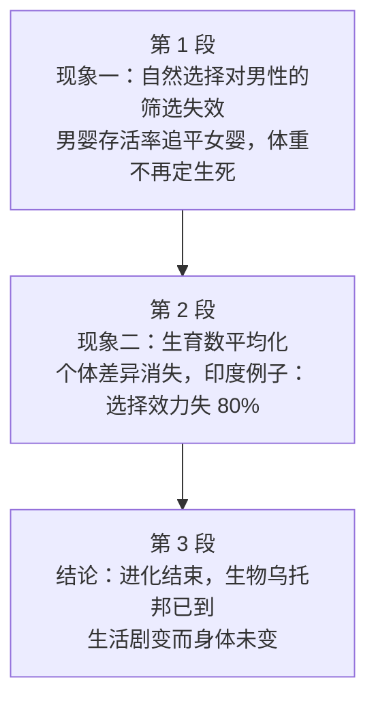

# Passage 47 · 人类进化毫无进展

## 答题记录

| 轮次  | 日期         | 题号  | 正确  | 错误  | 正确率 | 用时    | 错题归因 |
| --- | --- | --- | --- | --- | --- | --- | --- |
| 1 |  | 1-4 |  |  |  |  |  |
| 2 |  | 1-4 |  |  |  |  |  |
| 3 |  | 1-4 |  |  |  |  |  |

> [!tip] 填写口径
> - **用时**以分钟计，只计做题时间，不含精读复盘。
> - **错题归因**填「题型·错误类型」，如：细节题·混淆时间、细节题·无中生有、例证题·偷换概念、主旨题·以偏概全。
> - 纵向看趋势：正确率升而用时过长 → 熟练度不足；用时降而正确率波动 → 定位不稳。
> - 本篇 **4 题**，题号栏填 1-4；第 1 题是**事实细节题**（问过去身为男性的危险是什么，定位第一段，答案 C 是 male mortality 的同义替换），第 2 题是**例证题**（问印度的例子说明什么，例子前找论点，答案 B 是 differences ... have diminished 的同义替换），第 3 题是**事实细节题**（问身体停止进化的原因，定位第三段⑤句，答案 A 是 machines and society did it for us 的同义替换），第 4 题是**主旨大意题**（三段式「现象—机制—结论」，答案 D）。错因建议分别写「细节题·混淆时间」「例证题·偷换概念」「细节题·无中生有」「主旨题·以偏概全」。

> [!info] 文章档案
> - **来源**：考研英语（一）2000 年 Text 2
> - **题材**：文艺教育（进化论 × 人类社会）——书中栏目「文艺教育类」，实为科普议论文：自然选择作用于人类的两大杠杆（生死筛选、生育差异）逐一失灵，进化已然结束，「生物乌托邦」已经到来
> - **结构**：3 段 / 27 句（10＋9＋8）＋ 4 题（按句号断句与行首缩进实测；正文在 PDF p068 下半–p069，题目全在 p069，解析在 p174 右栏–p176）。与解析引用多数吻合；**两处书中编号差异已在题目分析注明**：第 1 题思路所称「③句所述如今出现的问题」按本文编号为第 **④** 句，第 2 题思路所称「③句指出差异减少」按本文编号为第 **⑥** 句
> - **难度**：★★★☆☆
> - **一句话主旨**：男婴不再比女婴更易夭折、体重不再决定生死，生育数量又全面平均化——自然选择的杠杆一一拆除，对人类而言进化已经结束，生物乌托邦已经到来。

## 一、篇章脉络

- **第 1 段**：**现象一——自然选择对男性的筛选失效**。身为男人历来危险：出生时男女比 105:100，到成年期接近平衡，70 岁人群中女性是男性两倍。但这一格局正在改变：男婴存活率几乎追平女婴，关键择偶年龄段将首次出现男性过剩；五十年前体重差一公斤即几乎必死，如今毫无差别——变异多由基因决定，进化的又一个动因消失了。第 1 题的战场。
- **第 2 段**：**现象二——另一条进化自杀之路：活着，但少生孩子**。除部分宗教社区外极少有妇女生 15 个孩子；出生数像死亡年龄一样平均化，多数人子女数大致相同；个体差异与自然选择利用差异的机会都在减少。印度例子把这一点量化：城市财富与部落贫困并存的「大平均主义」，意味着自然选择在印度中上阶层相比部落已失去 80% 的效力。第 2 题的战场。
- **第 3 段**：**结论——进化结束，生物乌托邦已经到来**。奇怪的是它几乎没有带来身体变化：没有其他物种占据自然界如此多的位置，但过去十万年（甚至一百年）里生活剧变而身体未变——机器和社会代替我们进化；达尔文那句「野蛮人看船」正是我们对进化的无知；后人记住 20 世纪将因其丑陋，但无论我们离乌托邦多远，他们看上去都和我们一样。第 3、4 题的战场。

> [!tip] 行文逻辑
> 全篇是**「两个现象 + 一个结论」的科普三段式**，每一段内部都是「先给结论、再给证据」：第 1 段先抛「男性死亡率这一普遍现象正在被改变」，再用 105:100→平衡→女性两倍的数据链、男婴存活率追平、体重不再定生死三组事实逐层印证；第 2 段用 evolutionary suicide（进化上的自杀）这一惊人概括领起，再用生育数平均化、印度 80% 两个证据收束；第 3 段一句 For us, this means that evolution is over 直接落地结论，随后三层展开——**没有身体变化**（Strangely, it has involved little physical change）→ **生活变而身体没变**（machines and society did it for us）→ **后人看我们如我们看野蛮人**（达尔文引语）。**第 4 题主旨题的答案正压在第 3 段①句上**（evolution is over ＝ Human Evolution Going Nowhere）。两个贯穿全篇的词串：**mortality / survival / survive / death / alive（生死）**、**natural selection / variation / differences / diminish / gone（选择机制）**。另注意第 1 段与第 2 段的并列关系不是递进而是**并列归因**：①段拆「生死筛选」，②段拆「生育差异」——书中解析把②段称为「另一条进化自杀之路」，用的正是并列标记词 another。**命题格局题文同序**（1→P1、2→P2、3→P3、4→全文）。

## 二、逐段精读

### 第 1 段 · 现象一：自然选择对男性的筛选失效

**原文**

① Being a man has always been dangerous.
② There are about 105 males born for every 100 females, but this ratio drops to near balance at the age of maturity, and among 70-year-olds there are twice as many women as men.
③ But the great universal of male mortality is being changed.
④ Now, boy babies survive almost as well as girls do.
⑤ This means that, for the first time, there will be an excess of boys in those crucial years when they are searching for a mate.
⑥ More important, another chance for natural selection has been removed.
⑦ Fifty years ago, the chance of a baby (particularly a boy baby) surviving depended on its weight.
⑧ A kilogram too light or too heavy meant almost certain death.
⑨ Today it makes almost no difference.
⑩ Since much of the variation is due to genes, one more agent of evolution has gone.

**译文**

① 身为男人一直是危险的。
② 出生的男女比例约为 105:100，但到成年期这一比例降到接近平衡，而在 70 岁的人群中女性是男性的两倍。
③ 但男性死亡率这一普遍现象正在被改变。
④ 如今，男婴的存活率几乎和女婴一样高。
⑤ 这意味着，在那些关键的择偶年份里，将首次出现男性过剩。
⑥ 更重要的是，自然选择的又一个机会被消除了。
⑦ 五十年前，婴儿（尤其是男婴）的存活机会取决于体重。
⑧ 轻一公斤或重一公斤都几乎意味着必死无疑。
⑨ 如今，这几乎没有什么差别了。
⑩ 由于变异大多由基因决定，进化的又一个动因已经消失了。

> [!note] 段落要点
> - **开篇立论：Being a man has always been dangerous.** 一句话把「男性」设为被考察对象，dangerous 的全部含义由②句的数据链解释——**「危险」不是抽象形容，而是可量化的存活率差**，这正是第 1 题 C 项 a lower survival rate 的出处。
> - **②句三连数据，读作一条衰减曲线**：出生 105:100（男多）→ 成年期 near balance（持平）→ 70 岁女性两倍（女多）。时间轴上的「男多→持平→女少」说明男性在各年龄段持续折损，第 1 题就要求把这条曲线读成一句话：男性存活率低于女性。
> - **③句 But 是全段枢纽**：the great universal of male mortality is being changed——注意 universal 此处作名词「普遍现象」（= something universally true），不是形容词「普遍的」；is being changed 进行时态暗示「改变正在发生」。此后④⑤句讲「男婴不再更易死」，⑥句以下讲「自然选择的机会被拆除」。
> - **④⑤句是第 1 题 A 项的陷阱源**：excess of boys ... searching for a mate 讲的是**如今**的婚配市场，而题干问的是 used to be——书中解析：「[A] 项混淆时间，把如今出现的问题当成过去存在的问题」。
> - **⑥句 More important 是逻辑升级标记**：⑤句只是性别比失衡的表层后果，⑥句点出深层机制——自然选择少了一次「动手」的机会；⑦⑧⑨句随即给出机制样本（体重筛选的消失），⑩句用 Since 给出机制原理（变异源自基因，故体重的生死权重被移除）。
> - **⑩句是第 1 题 D 项的死刑判决**：variation is due to genes 说的是「个体差异源于基因」，而 D 项 a defective gene 把它歪曲为「基因缺陷」——书中解析：「第一段的最后一句只提到了 variation is due to genes（差异是由基因决定的），并不是基因缺陷」。

#### 本段重点词汇

| 单词 | 词性 | 文中意 | 拓展 | 文中用法 |
| --- | --- | --- | --- | --- |
| **dangerous** | adj. | 危险的 | danger n. 危险；dangerously adv. 危险地；in danger 处于危险中 | Being a man has always been dangerous（身为男人一直是危险的） |
| **male** | n./adj. | 男性（的） | 反义 female 女性（的）；male mortality 男性死亡率 | 105 males born for every 100 females（每 100 名女婴对应约 105 名男婴） |
| **female** | n./adj. | 女性（的） | 反义 male 男性（的）；female babies 女婴 | for every 100 females（对应每 100 名女性） |
| **ratio** | n. | 比例，比率 | the ratio of A to B A 与 B 之比；rate 侧重速率／概率，ratio 侧重构成比 | this ratio drops to near balance（这一比例降到接近平衡） |
| **maturity** | n. | 成熟；成年期 | mature adj. 成熟的 v. 成熟；at the age of maturity 到达成年期时 | at the age of maturity（在成年期） |
| **twice as many** | 短语 | 是……的两倍多 | 倍数结构 twice/half as ＋ adj./adv. ＋ as；同级比较 as ... as | twice as many women as men（女性是男性的两倍） |
| **universal** | n. | 普遍现象，普遍特征 | 熟词僻义：常见义为形容词「普遍的、全体的」，此处 the great universal 指「放之四海而皆准的事实」；universally adv. | the great universal of male mortality（男性死亡率这一普遍现象） |
| **mortality** | n. | 死亡率；（必死性） | mortal adj. 终有一死的；mortality rate 死亡率；反义 survival 存活 | the great universal of male mortality（男性死亡率这一普遍现象） |
| **survive** | v. | 存活，生存；幸存 | survival n. 存活、生存；survivor n. 幸存者；survive on 靠……维持 | boy babies survive almost as well as girls do（男婴存活率几乎和女婴一样高） |
| **excess** | n. | 过量，过剩 | excessive adj. 过度的；in excess of 超过；an excess of boys 男性过剩 | an excess of boys in those crucial years（在那些关键年份里男性过剩） |
| **crucial** | adj. | 关键的，至关重要的 | crucially adv.；同义 critical／vital；crucial years 关键岁月 | in those crucial years when they are searching for a mate（在择偶的关键年龄段） |
| **mate** | n. | 配偶，伴侣 | 熟词僻义：常见义「同事、同伴（classmate／teammate）」，此处指婚配对象；search for a mate 择偶 | searching for a mate（寻找配偶） |
| **natural selection** | 短语 | 自然选择 | 达尔文进化论核心机制：适者生存、不适者被淘汰；select v. 选择；selection n. 选择 | another chance for natural selection has been removed（自然选择的又一个机会被消除了） |
| **remove** | v. | 移除，消除 | removal n. 移除；remove ... from ... 把……从……去掉；同义 eliminate | another chance for natural selection has been removed（自然选择的又一个机会被消除了） |
| **weight** | n. | 体重；重量 | weigh v. 称重；put on/lose weight 增重／减肥；birth weight 出生体重 | depended on its weight（取决于它的体重） |
| **kilogram** | n. | 千克，公斤 | kilo- 前缀「千」；kilogram 缩写 kg；gram 克 | A kilogram too light or too heavy（轻一公斤或重一公斤） |
| **variation** | n. | 变异，差异 | vary v. 变化；various adj. 各种各样的；variation between ... ……之间的差异 | much of the variation is due to genes（变异大多由基因决定） |
| **due to** | 短语 | 由于，因为 | to 是介词，后接名词／动名词；同义 because of／owing to；注意与 thanks to（多含褒义）有别 | much of the variation is due to genes（变异大多由基因决定） |
| **agent** | n. | 动因，作用因素 | 熟词僻义：常见义「代理人、特工」，此处指「起作用的力量」；agent of evolution 进化的动因 | one more agent of evolution has gone（进化的又一个动因已经消失了） |

#### 长难句 · 本段第 ② 句

> [!abstract] 本段第 ② 句 · 原句
> There are about 105 males born for every 100 females, but this ratio drops to near balance at the age of maturity, and among 70-year-olds there are twice as many women as men.

**结构拆解**

- **第一分句**：There are about 105 males born for every 100 females —— there be 句型，born for every 100 females 是**过去分词短语后置修饰 males**（每出生 100 名女婴对应的男婴数）。
- **转折连词 but**：笔锋从「出生时」转向「此后」，全句的骨架是三个时间切片。
- **第二分句**：this ratio drops to near balance at the age of maturity —— 主语 this ratio 回指第一分句的男女出生比，drops to near balance「降到接近平衡」。
- **并列连词 and**：among 70-year-olds there are twice as many women as men —— 第三个时间切片，**twice as many ... as ...** 倍数结构收尾。

**参考译文**

出生的男女比例约为 105:100，但到成年期这一比例降到接近平衡，而在 70 岁的人群中女性是男性的两倍。

> [!tip] 拆解要点
> 这是**用三个数据点讲完一个趋势**的范本：105:100（起点男多）→ near balance（中年持平）→ twice as many women（老年女多），一条向下倾斜的男性占比曲线。读数据句要**先找时间坐标**（at birth → at the age of maturity → among 70-year-olds），再找数量词（105:100 → balance → twice as many），趋势自然浮现：男性在各个年龄段持续「折损」。这句话是第 1 题的题眼——题干问 What used to be the danger in being a man，答案 C a lower survival rate 就是对这条曲线的**一句话概括**：如果男性只是「少」，不叫危险；「越活越少」才叫危险。另注意 twice as many women as men 的**比较对象是 men（男性人数）**，不是男性出生数，读快了容易把 70 岁的性别比和出生性别比混为一谈。

#### 长难句 · 本段第 ⑤ 句

> [!abstract] 本段第 ⑤ 句 · 原句
> This means that, for the first time, there will be an excess of boys in those crucial years when they are searching for a mate.

**结构拆解**

- **主句**：This means that ... —— this 回指④句「男婴存活率几乎和女婴一样高」，means 引出**推论**（「这意味着」）。
- **宾语从句**：there will be an excess of boys ... —— there be 的将来时，excess of boys「男性过剩」是推论的核心。
- **插入状语**：for the first time —— 「首次」，强调这一局面的历史性。
- **时间状语**：in those crucial years —— those 回指前文已暗示的「成年期／婚配期」，crucial 点明其分量（择偶窗口）。
- **定语从句**：when they are searching for a mate —— 修饰 crucial years，把「关键」落实为「找配偶的年纪」。

**参考译文**

这意味着，在那些关键的择偶年份里，将首次出现男性过剩。

> [!tip] 拆解要点
> 两个阅读陷阱都藏在这句里。其一，**这是「如今」的推论，不是「过去」的事实**——第 1 题问 What **used to be** the danger，而⑤句讲的是男婴存活率追平之后**将要**出现的新局面（for the first time 恰是时间标记），书中解析把 A 项 A lack of mates 判为「混淆时间」正踩此点：A 项是拿「未来的择偶困难」冒充「过去的男性危险」。其二，**searching for a mate 是生活化表达，别按字面理解成「危险」**——婚配期男性过剩是性别比失衡的社会后果，与②句讲的「死亡率差异」是两个时间维度的事。读推论句的标准动作：先回指（this＝上句），再标时间词（for the first time／used to be），最后问「这个结论在时间轴上站在哪一端」。

#### 长难句 · 本段第 ⑦ 句

> [!abstract] 本段第 ⑦ 句 · 原句
> Fifty years ago, the chance of a baby (particularly a boy baby) surviving depended on its weight.

**结构拆解**

- **时间状语**：Fifty years ago —— 与⑨句 Today 形成**今昔对照**，两句是同一枚硬币的两面。
- **主干**：the chance ... depended on its weight —— 主语 the chance，谓语 depended on，宾语 its weight（its 回指 a baby）。
- **后置定语**：of a baby ... surviving —— **of ＋ 名词 ＋ 现在分词**结构修饰 chance，a baby 是 surviving 的逻辑主语（「婴儿存活的机会」）。
- **插入语**：(particularly a boy baby) —— 把焦点收窄到男婴，呼应③句的 male mortality。

**参考译文**

五十年前，婴儿（尤其是男婴）的存活机会取决于体重。

> [!tip] 拆解要点
> 这句是⑧⑨句「体重不再定生死」的**对照锚点**，也是理解⑥句 another chance for natural selection has been removed 的样本：自然选择曾经掌握的一项「筛选指标」（出生体重）如今已失效。语法上重点掌握 **the chance of sb doing sth**（某人做某事的机会）——of 后接「逻辑主语＋动名词」，阅读中见到 the possibility／likelihood／risk of ... doing 都可照此拆解。另注意 particularly a boy baby 的**窄化功能**：作者举例时特意回到「男婴」，因为⑤句讲的是男婴存活率追平女婴，⑦⑧⑨句用体重筛选的消失来**解释这一追平是如何发生的**——「过去体重不达标者死，男婴首当其冲；如今体重无关生死，男婴的死亡率劣势随之瓦解」。

### 第 2 段 · 现象二：生育数平均化，差异消失

**原文**

① There is another way to commit evolutionary suicide: stay alive, but have fewer children.
② Few people are as fertile as in the past.
③ Except in some religious communities, very few women have 15 children.
④ Nowadays the number of births, like the age of death, has become average.
⑤ Most of us have roughly the same number of offspring.
⑥ Again, differences between people and the opportunity for natural selection to take advantage of it have diminished.
⑦ India shows what is happening.
⑧ The country offers wealth for a few in the great cities and poverty for the remaining tribal peoples.
⑨ The grand mediocrity of today—everyone being the same in survival and number of offspring—means that natural selection has lost 80% of its power in upper-middle-class India compared to the tribes.

**译文**

① 还有另一种方式可以犯下进化上的自杀：活着，但少生孩子。
② 很少有人在过去那样多育。
③ 除了一些宗教社区外，很少有妇女生 15 个孩子。
④ 如今，出生数量就像死亡年龄一样趋于平均。
⑤ 我们大多数人拥有的子女数量大致相同。
⑥ 再者，人与人之间的差异，以及自然选择利用这种差异的机会，都已经减少。
⑦ 印度就说明了正在发生的一切。
⑧ 这个国家在大城市里把财富给予少数人，而把贫困留给剩余的部落民族。
⑨ 今天的大平均主义——每个人在生存和子女数量上都相同——意味着与部落相比，自然选择在印度中上阶层已经失去了 80% 的效力。

> [!note] 段落要点
> - **①句是全文最刺眼的概括**：commit evolutionary suicide: stay alive, but have fewer children——「活得久」与「生得少」本是一对伦理美德，却被作者命名为「进化上的自杀」；冒号把定义拆成两个动词短语，是考研阅读「惊人观点 + 即时解释」的标准句式。**这是第 3 题 A 项的反向垫脚石**：机器与社会延续了我们的生命，却也替我们关掉了生育差异。
> - **②③句给出证据链**：as fertile as in the past（纵向比过去）、very few women have 15 children（横向极端值），Except in some religious communities 是**例外兜底**，说明「多育」只剩宗教社区这一死角。
> - **④句是精读级的一句**：the number of births, like the age of death, has become average——出生数「像死亡年龄一样」平均化，与第 1 段⑨句 Today it makes almost no difference 遥相呼应（生死两端都失去方差）。
> - **⑥句 Again 是第二根杠杆的落点**：differences between people **and** the opportunity for natural selection to take advantage of it——注意主语是**并列的两者**（差异本身＋利用差异的机会），diminished 对两者同时生效。第 2 题答案 B hardly works 正是这一句的同义替换。
> - **⑦⑧⑨句是印度例子的完整三层**：⑦句 India shows what is happening（亮例子）→ ⑧句财富／贫困的空间并置（摆事实）→ ⑨句 grand mediocrity + 80%（下判断）。第 2 题问 What does the example of India illustrate，按例证题解法须**往例子上文找论点**，即⑥句。
> - **⑨句的 compared to the tribes 是精度所在**：失去 80% 效力的是「印度中上阶层**相比部落**」——80% 是比较级结论，不是绝对数字；第 2 题 C 项 the middle class population is 80% smaller 正是把这层「效力比较」偷换成「人口比较」，书中解析：「文中说的是自然选择的效力的比较，而不是人口比较」。

#### 本段重点词汇

| 单词 | 词性 | 文中意 | 拓展 | 文中用法 |
| --- | --- | --- | --- | --- |
| **evolutionary** | adj. | 进化的 | evolution n. 进化；evolve v. 进化、逐步发展；evolutionary suicide 进化上的自杀 | commit evolutionary suicide（犯下进化上的自杀） |
| **suicide** | n. | 自杀 | commit suicide 自杀；同根 suicide 与前缀构词（legalize 等）注意拼写 | evolutionary suicide（进化上的自杀） |
| **stay alive** | 短语 | 活着，维持生命 | stay ＋ 形容词表「保持某种状态」；stay healthy／stay single | stay alive, but have fewer children（活着，但少生孩子） |
| **fertile** | adj. | 多育的，肥沃的 | fertility n. 生育力、肥沃；fertilizer n. 肥料；反义 infertile／barren | Few people are as fertile as in the past（很少有人在过去那样多育） |
| **religious communities** | 短语 | 宗教社区 | religious adj. 宗教的；community n. 社区、群体；religious belief 宗教信仰 | Except in some religious communities（除了一些宗教社区外） |
| **birth** | n. | 出生；分娩 | give birth to 生（孩子）；birth rate 出生率；at birth 出生时 | the number of births（出生数量） |
| **average** | n./adj. | 平均水平；平均的 | 熟词僻义：常见义「平均的」，此处 become average 指「趋于平均、失去差异」；on average 平均而言 | has become average（已经趋于平均） |
| **offspring** | n. | 后代，子女 | 单复数同形；正式用词，= children／descendants；a number of offspring 子女数 | the same number of offspring（子女数量大致相同） |
| **diminish** | v. | 减少，降低 | diminished adj. 减少了的；同义 decrease／dwindle；反义 increase | have diminished（都已经减少） |
| **show** | v. | 表明，说明 | show (sb) sth；show what is happening 说明正在发生什么；注意与「展示」义区分语境 | India shows what is happening（印度就说明了正在发生的一切） |
| **wealth** | n. | 财富 | wealthy adj. 富有的；a wealth of 大量的；反义 poverty | offers wealth for a few in the great cities（在大城市里把财富给予少数人） |
| **poverty** | n. | 贫困 | poor adj. 贫穷的；poverty line 贫困线；live in poverty 生活在贫困中 | poverty for the remaining tribal peoples（把贫困留给剩余的部落民族） |
| **remaining** | adj. | 剩余的，其余的 | remain v. 剩余、保持；the remaining ... 其余的…… | the remaining tribal peoples（剩余的部落民族） |
| **tribal peoples** | 短语 | 部落民族 | tribal adj. 部落的；tribe n. 部落；tribal society 部落社会 | the remaining tribal peoples（剩余的部落民族） |
| **mediocrity** | n. | 平庸，平均化；平庸状态 | mediocre adj. 平庸的、不好不坏的；the grand mediocrity 大平均主义（本文自造性强表达） | The grand mediocrity of today（今天的大平均主义） |
| **survival** | n. | 生存，存活 | survive v. 存活；survival rate 存活率；survival of the fittest 适者生存 | everyone being the same in survival（每个人在生存上相同） |
| **power** | n. | 效力，力量 | powerful adj. 强有力的；lose 80% of its power 失去八成效力；come to power 上台 | has lost 80% of its power（已经失去了 80% 的效力） |
| **compared to** | 短语 | 与……相比 | compare ... to ... 把……比作……；compare ... with ... 拿……和……对比；compared to/with 置于句末表比较基准 | compared to the tribes（与部落相比） |

#### 长难句 · 本段第 ① 句

> [!abstract] 本段第 ① 句 · 原句
> There is another way to commit evolutionary suicide: stay alive, but have fewer children.

**结构拆解**

- **There be 句型**：There is another way —— 「还有另一种方式」，another 是**并列标记**，宣告这是与第 1 段「生死筛选失效」并列的第二条路径。
- **不定式后置定语**：to commit evolutionary suicide —— 修饰 way（「……的方式」），commit 与 suicide 搭配为固定表达。
- **冒号**：全句的**解释装置**——冒号后不是从句，而是两个动词短语的对照，直接拆解 suicide 的含义。
- **冒号后**：stay alive, but have fewer children —— 「活着」与「少生孩子」由 but 连接，悖论式的并列正是这句的全部张力。

**参考译文**

还有另一种方式可以犯下进化上的自杀：活着，但少生孩子。

> [!tip] 拆解要点
> 这是**全篇的题眼句**，读懂它需要一次视角转换：作者站在「进化」的立场说话——对进化而言，个体活得久而不生育，等于主动退出基因传递游戏，故称 suicide。阅读时切忌用日常伦理（优生优育）去套，否则整段读不通。结构上记住 **There is another way to ...: A, but B** 这个「惊人概括＋冒号拆解」的句型，考研阅读中类似装置极多（如 There is another way to ... / The answer is ...: ...）。另注意 another 的**结构功能**：它告诉你第 1 段讲了一条路（男性死亡率被改变），第 2 段讲另一条路（生育数平均化）——两条路殊途同归：都在拆除自然选择的杠杆。第 4 题主旨题的 B 项 Ways of Continuing Man's Evolution（延续人类进化的方式）正是拿「进化的方式」冒充「进化的终结」，方向恰好相反。

#### 长难句 · 本段第 ⑥ 句

> [!abstract] 本段第 ⑥ 句 · 原句
> Again, differences between people and the opportunity for natural selection to take advantage of it have diminished.

**结构拆解**

- **句首副词 Again**：逻辑连接词——第 1 段讲过一轮「自然选择的机会被消除」，这里是**第二轮**（生育差异维度）。
- **并列主语（一）**：differences between people —— 「人与人之间的差异」，between people 后置修饰 differences。
- **并列主语（二）**：the opportunity for natural selection to take advantage of it —— 「自然选择利用这种差异的机会」；it 回指 differences，构成**「差异—利用差异」的配对关系**。
- **并列连词 and**：连接上述两个名词短语，共用一个谓语。
- **谓语**：have diminished —— 「已经减少」，现在完成时强调从过去到现在的累积变化。

**参考译文**

再者，人与人之间的差异，以及自然选择利用这种差异的机会，都已经减少。

> [!tip] 拆解要点
> 这句是**第 2 题的论点句**，也是全段的心脏。三个要点：其一，**主语是并列双主语**，diminished 同时削减「差异本身」与「利用差异的机会」——只读前一半会以为作者在说「人越来越像」，漏掉后半截「选择也无从下手」的机制层；其二，**it 的回指**（it＝differences）是长难句标准考点，见到代词先回指，回指错了整句逻辑就反了；其三，**Again 的段落定位功能**——它像路标一样告诉你：第 1 段 dismantle 的是「生死杠杆」，第 2 段 dismantle 的是「生育杠杆」，两段是并列归因，不是层层递进。做例证题（第 2 题）时的标准动作就是盯住这种「论点句」：印度的例子出现在⑦⑧⑨句，往前找论点即⑥句，B 项 hardly works 正是 diminished 的同义替换。

#### 长难句 · 本段第 ⑨ 句

> [!abstract] 本段第 ⑨ 句 · 原句
> The grand mediocrity of today—everyone being the same in survival and number of offspring—means that natural selection has lost 80% of its power in upper-middle-class India compared to the tribes.

**结构拆解**

- **主语**：The grand mediocrity of today —— 「今天的大平均主义」，of today 限定时间；grand 与 mediocrity 的搭配是**修辞性反讽**（宏大的平庸）。
- **插入的独立主格**：everyone being the same in survival and number of offspring —— 「每个人在生存和子女数量上都相同」，逻辑主语 everyone ＋ being，对 mediocrity 作**即时定义**（破折号夹住，可整块抠出）。
- **谓语**：means that ... —— 引出判断。
- **宾语从句**：natural selection has lost 80% of its power in upper-middle-class India —— 「自然选择在印度中上阶层已失去 80% 的效力」。
- **比较状语**：compared to the tribes —— 「与部落相比」，为 80% 提供**比较基准**。

**参考译文**

今天的大平均主义——每个人在生存和子女数量上都相同——意味着与部落相比，自然选择在印度中上阶层已经失去了 80% 的效力。

> [!tip] 拆解要点
> 这句把「量化」玩到了极致，也把「精度」埋成了陷阱。其一，**独立主格 everyone being the same ... 是破折号内的插入定义**——阅读时可以先抠掉它读主干（mediocrity means that ...），再回头看它如何定义 mediocrity；写作时可直接化用「……——sb doing sth——……」的插入装置。其二，**80% 的比较基准是 the tribes**，不是「全印度」「全世界」，更不是「中产阶级人口」——第 2 题 C 项 the middle class population is 80% smaller than that of the tribes 把「选择效力失去八成」偷换成「人口少八成」，书中解析点名的正是这处精度：「文中说的是自然选择的效力的比较，而不是人口比较」。其三，**upper-middle-class（中上阶层）与 tribes（部落）的并置**是社会阶层维度的对照：越是现代化的阶层，生育与生存越平均，选择效力流失越彻底——⑧句的 wealth for a few / poverty for the remaining 正是在铺这个对照。**读数字先问「和谁比」，是细节题保命习惯。**

### 第 3 段 · 结论：进化结束，生物乌托邦已到

**原文**

① For us, this means that evolution is over; the biological Utopia has arrived.
② Strangely, it has involved little physical change.
③ No other species fills so many places in nature.
④ But in the past 100,000 years—even the past 100 years—our lives have been transformed but our bodies have not.
⑤ We did not evolve, because machines and society did it for us.
⑥ Darwin had a phrase to describe those ignorant of evolution: they "look at an organic being as a savage looks at a ship, as at something wholly beyond his comprehension."
⑦ No doubt we will remember a 20th century way of life beyond comprehension for its ugliness.
⑧ But however amazed our descendants may be at how far from Utopia we were, they will look just like us.

**译文**

① 对我们来说，这意味着进化已经结束；生物乌托邦已经到来。
② 奇怪的是，它几乎没有带来身体上的变化。
③ 没有其他物种在自然界中占据如此多的位置。
④ 但在过去的十万年里——甚至过去一百年里——我们的生活发生了改变，而我们的身体没有。
⑤ 我们没有进化，因为机器和社会代替我们完成了进化。
⑥ 达尔文有一句话用来描述那些对进化一无所知的人：他们「看待一种生物，就像野蛮人看一艘船，把它看作某种完全超出其理解范围的东西」。
⑦ 毫无疑问，我们将记住 20 世纪的生活方式，因为它的丑陋而完全无法理解。
⑧ 但是，无论我们的后代对我们离乌托邦有多远感到多么惊讶，他们看上去都会和我们一模一样。

> [!note] 段落要点
> - **①句是全文结论，也是第 4 题答案 D 的原文对应**：evolution is over ＝ Human Evolution Going Nowhere。分号连接两个判断——前半收束前两段的机制论证，后半抛出全文最著名的概念 biological Utopia（生物乌托邦：人类已不必为生存而挣扎的状态）。
> - **②句 Strangely 是理解全文的关键副词**：「进化结束」却不伴随身体变化，这违背直觉（通常认为进化必然体现为形态改变）——作者用 strangely 主动承认悖论，随即在③④句给出解释框架。
> - **③句是空间维度的铺垫**：No other species fills so many places in nature——人类占据生态位之广无可比拟；④句用 But 把「广」反转为「浅」：生活（lives）剧变而身体（bodies）未变，**but our bodies have not 是省略句**（＝have not been transformed），对比之锋利全在省略处。
> - **⑤句给出「谁代替我们进化」的答案**：machines and society did it for us——did it 回指 evolved，**代替者（机器＋社会）正是第 3 题 A 项 life has been improved by technological advance 的原文依据**。
> - **⑥句达尔文引语是全篇最著名的修辞**：those ignorant of evolution（对进化一无所知的人）＋ 「野蛮人看船」的双重比喻——ignorant 后置＝ignorant of 结构；as a savage looks at a ship 是**明喻槽**，as at something wholly beyond his comprehension 把比喻推到理解力的边界。
> - **⑦句 beyond comprehension 二次复用，对象却是 20 世纪生活方式**：我们记住过去，不是因其进步而恰因其 ugliness；⑧句 however amazed ... may be 让步收尾——后人与我们「看上去一样」，身体停在原地，这就是乌托邦的代价与讽刺。第 4 题 C 项 The Evolutionary Future of Nature 的 future 与全篇时态（讲的是进化已结束、不再有 future）正面冲突，书中解析：「future 和文中的时态也不符」。

#### 本段重点词汇

| 单词 | 词性 | 文中意 | 拓展 | 文中用法 |
| --- | --- | --- | --- | --- |
| **evolution** | n. | 进化 | evolve v. 进化、逐步发展；evolutionary adj. 进化的；theory of evolution 进化论 | evolution is over（进化已经结束） |
| **Utopia** | n. | 乌托邦 | 音译自托马斯·莫尔《乌托邦》；biological Utopia 生物乌托邦；反义 dystopia 反乌托邦 | the biological Utopia has arrived（生物乌托邦已经到来） |
| **arrive** | v. | 到来，到达 | arrival n. 到达；arrive at/in 后接地点（at 小地方／in 大地方）；引申「（时代）来临」 | the biological Utopia has arrived（生物乌托邦已经到来） |
| **strangely** | adv. | 奇怪的是 | strange adj. 奇怪的；strangely enough 说来奇怪；作评注性状语修饰全句 | Strangely, it has involved little physical change（奇怪的是，它几乎没有带来身体上的变化） |
| **involve** | v. | 涉及；使包含，带来 | involvement n. 参与、涉及；involve little physical change 几乎不涉及身体变化 | has involved little physical change（几乎没有带来身体上的变化） |
| **physical change** | 短语 | 身体上的变化 | physical adj. 身体的、物理的；physical examination 体检 | involved little physical change（几乎没有带来身体上的变化） |
| **species** | n. | 物种 | 单复数同形（a species／many species）；endangered species 濒危物种 | No other species fills so many places in nature（没有其他物种占据自然界中如此多的位置） |
| **fill** | v. | 占据，填满 | fill ... with ... 用……填满……；fill a position 占位；fill the gap 填补空白 | fills so many places in nature（占据自然界中如此多的位置） |
| **nature** | n. | 自然，自然界 | natural adj. 自然的；in nature 在自然界中；human nature 人性 | places in nature（自然界中的位置） |
| **transform** | v. | 使改变，使转变 | transformation n. 转变；transform ... into ... 把……变成……；transform 侧重形态／性质的改变 | our lives have been transformed（我们的生活发生了改变） |
| **society** | n. | 社会 | social adj. 社会的；society 与 community（社区）范围不同 | machines and society did it for us（机器和社会代替我们完成了进化） |
| **phrase** | n. | 话语，措辞 | phrased adj. 措辞……的；a phrase to describe ... 用来描述……的一句话；phrase 与 word／sentence 的层级区分 | Darwin had a phrase to describe those ignorant of evolution（达尔文有一句话用来描述那些对进化一无所知的人） |
| **describe** | v. | 描述，形容 | description n. 描述；describe ... as ... 把……描述为…… | to describe those ignorant of evolution（描述那些对进化一无所知的人） |
| **ignorant** | adj. | 无知的，不了解的 | ignorance n. 无知；be ignorant of sth 对某事一无所知（后置＝of 短语）；反义 knowledgeable | those ignorant of evolution（那些对进化一无所知的人） |
| **organic being** | 短语 | 生物，有机体 | organic adj. 有机的、生物的；being n. 生物（＝ living creature）；organic food 有机食品 | look at an organic being（看待一种生物） |
| **savage** | n./adj. | 野蛮人；野蛮的 | savagery n. 野蛮状态；savage 与 barbarian（未开化者）近义 | as a savage looks at a ship（就像野蛮人看一艘船） |
| **wholly** | adv. | 完全地 | whole adj. 整个的；wholly ＝ entirely；on the whole 大体上 | wholly beyond his comprehension（完全超出其理解范围） |
| **beyond comprehension** | 短语 | 无法理解，超出理解力 | beyond prep. 超出……；beyond belief／beyond doubt 类似结构；comprehension n. 理解（力） | wholly beyond his comprehension（完全超出其理解范围） |
| **No doubt** | 短语 | 毫无疑问 |  doubtless adv. 无疑地；There is no doubt that ... 毫无疑问……；no doubt 语气强于 probably | No doubt we will remember ...（毫无疑问，我们将记住……） |
| **ugliness** | n. | 丑陋 | ugly adj. 丑陋的；ugly 与 beautiful 反义；ugliness 是抽象名词后缀 -ness 构词 | for its ugliness（因为它的丑陋） |
| **descendant** | n. | 后代，后裔 | descend v. 下降；（祖上）传下来；descendant 与 ancestor（祖先）反义 | our descendants may be at how far from Utopia we were（我们的后代对我们离乌托邦有多远感到惊讶） |
| **amazed** | adj. | 惊讶的 | amaze v. 使惊讶；be amazed at sth 对某事感到惊讶；amazing adj. 令人惊叹的 | however amazed our descendants may be（无论我们的后代多么惊讶） |
| **however** | adv./conj. | 无论多么 | however ＋ adj./adv. ＋ 主语＋谓语＝让步状语从句；whatever／wherever 同构 | however amazed our descendants may be（无论我们的后代多么惊讶） |
| **look like** | 短语 | 看起来像 | look 是系动词；look like ＋ 名词；look the same 看起来一样 | they will look just like us（他们看上去都会和我们一模一样） |

#### 长难句 · 本段第 ④ 句

> [!abstract] 本段第 ④ 句 · 原句
> But in the past 100,000 years—even the past 100 years—our lives have been transformed but our bodies have not.

**结构拆解**

- **转折连词 But**：承接③句「人类占据自然位置之广」，把话题从**广度**扭到**速度差**。
- **时间状语**：in the past 100,000 years —— 「在过去十万年里」。
- **插入语**：even the past 100 years —— 破折号夹住，**把时间尺度急剧压缩**（十万年 → 一百年），强调变化之晚、之快。
- **第一分句**：our lives have been transformed —— 生活被彻底改变（现在完成时被动）。
- **第二分句**：but our bodies have not —— **省略句**，完整形式为 but our bodies have not been transformed；省略与前半相同的 been transformed，对比的锋利全压在省略处。

**参考译文**

但在过去的十万年里——甚至过去一百年里——我们的生活发生了改变，而我们的身体没有。

> [!tip] 拆解要点
> 这句是**全篇论证的转折枢纽**，也是「but our bodies have not」省略结构的教科书样本。三个要点：其一，**even 的压缩功能**——从 100,000 years 缩到 100 years，等于说「人类身体停止进化是最近一百年的事（与文明加速同步）」，为⑤句 machines and society did it for us 提供时间证据；其二，**have not 后必须脑补 been transformed**，读省略句的习惯是「回抄前文相同的谓语部分」，抄不出来就是回指失败；其三，lives 与 bodies 的**对位**（生活／身体）是全文的暗线：第 1 段拆「生死」、第 2 段拆「生育」、第 3 段收在「生活变而身体不变」——乌托邦的全部讽刺在于：我们改造了一切，唯独没有改造自己。第 3 题题干 our bodies have stopped evolving 即由此句设问。

#### 长难句 · 本段第 ⑥ 句

> [!abstract] 本段第 ⑥ 句 · 原句
> Darwin had a phrase to describe those ignorant of evolution: they "look at an organic being as a savage looks at a ship, as at something wholly beyond his comprehension."

**结构拆解**

- **主句**：Darwin had a phrase —— 「达尔文有一句话」。
- **不定式后置定语**：to describe those ignorant of evolution —— 修饰 phrase（「用来描述……的话」）；those ignorant of evolution ＝ those who are ignorant of evolution，**形容词短语后置＝定语从句的省略**。
- **冒号**：引出 phrase 的具体内容——引语。
- **引语第一层比喻**：look at an organic being as a savage looks at a ship —— 「看待一种生物，如同野蛮人看一艘船」，as ... as ... 结构串起两个认知主体（现代人 vs 野蛮人）与两个认知对象（生物 vs 船）。
- **引语第二层延伸**：as at something wholly beyond his comprehension —— 第二个 as 结构把比喻推到理解力的极限（「把它视为某种完全超出理解的东西」）。

**参考译文**

达尔文有一句话用来描述那些对进化一无所知的人：他们「看待一种生物，就像野蛮人看一艘船，把它看作某种完全超出其理解范围的东西」。

> [!tip] 拆解要点
> 这是**全文修辞密度最高的一句**，也是作者对人类处境的终极定性。三个要点：其一，**those ignorant of evolution** 的形容词后置＝「那些对进化一无所知的人」，阅读中见到 those ＋ adj.（the poor／the rich／the ignorant）立刻还原成「……的那类人」；其二，**as ... as ... 的双比喻槽**：第一个 as 比的是「认知姿态」（野蛮人看船＝看不懂却每天面对），第二个 as 比的是「认知边界」（wholly beyond his comprehension＝彻底超出理解），两层合起来才见达尔文这句的狠——现代人对自身进化的无知，不是暂时的知识缺口，而是结构性的视角缺失；其三，**his 回指 a savage**（不是 Darwin，也不是「我们」），代词回指先在最近的名词里找。这句话同时解释了⑦句——我们用 beyond comprehension 记住 20 世纪，正是「野蛮人看船」的当代翻版：我们看不懂自己造就的生活。**注意引语中的 look at A as B 结构可直接化用于写作：critics look at the phenomenon as a ... looks at a ...**

#### 长难句 · 本段第 ⑧ 句

> [!abstract] 本段第 ⑧ 句 · 原句
> But however amazed our descendants may be at how far from Utopia we were, they will look just like us.

**结构拆解**

- **让步状语从句**：however amazed our descendants may be at ... —— **however ＋ 形容词 ＋ 主语＋ 情态动词**引导让步（「无论多么……」），形容词 amazed 提前至 however 之后；may be 是虚拟化的委婉推测。
- **介词短语**：at how far from Utopia we were —— amazed at 的宾语是一个**宾语从句**（how far from Utopia we were），作 amazed 的补足语（「对我们离乌托邦之远感到惊讶」）。
- **主句**：they will look just like us —— 主语 they 回指 descendants；look like 系动词结构；just like us 收尾。

**参考译文**

但是，无论我们的后代对我们离乌托邦有多远感到多么惊讶，他们看上去都会和我们一模一样。

> [!tip] 拆解要点
> 这是**全文的收束句**，也是「生物乌托邦」的点题之笔。三个要点：其一，**however ＋ adj. ＋ 主谓倒装型让步**是考研高频语法点，标准变形是 no matter how amazed ... may be，考场上见到 however／whatever ＋ 形容词原级＋ 主谓，先标「让步从句到此结束、后面是主句」；其二，**be amazed at 后接 how 引导的宾语从句**，at 管的是「惊讶的内容」，拆长难句时把 at 及其宾语整体挪到 amazed 之后理解；其三，**they will look just like us 是全部论证的落点**——前两段拆掉了自然选择的两大杠杆（生死筛选、生育差异），本段宣布进化结束，而「后代与我们一模一样」就是进化停止的**肉身证据**：乌托邦的代价不是变得更糟，而是「不再变化」。第 4 题的干扰项 C 项 future 与时态、B 项 continuing 与文意，都是在这句上撞墙的。

## 三、全篇重点词汇汇总（自测用）

> 收录**全篇所有段落词汇，共 61 条，不删减**；按「逐段词汇表 → 本表」同源同序汇总，**跨段复现的词条只收入其首次出现的段落**（如 evolution 首现于第 1 段⑩句、natural selection 首现于第 1 段⑥句、survival 与 survive 词形不同故分列）。用法：遮住「词性」「所在段」两列自测。

| 单词 / 短语 | 词性 | 所在段 |
| --- | --- | --- |
| **dangerous** | adj. | 第 1 段 |
| **male** | n./adj. | 第 1 段 |
| **female** | n./adj. | 第 1 段 |
| **ratio** | n. | 第 1 段 |
| **maturity** | n. | 第 1 段 |
| **twice as many** | 短语 | 第 1 段 |
| **universal** | n. | 第 1 段 |
| **mortality** | n. | 第 1 段 |
| **survive** | v. | 第 1 段 |
| **excess** | n. | 第 1 段 |
| **crucial** | adj. | 第 1 段 |
| **mate** | n. | 第 1 段 |
| **natural selection** | 短语 | 第 1 段 |
| **remove** | v. | 第 1 段 |
| **weight** | n. | 第 1 段 |
| **kilogram** | n. | 第 1 段 |
| **variation** | n. | 第 1 段 |
| **due to** | 短语 | 第 1 段 |
| **agent** | n. | 第 1 段 |
| **evolutionary** | adj. | 第 2 段 |
| **suicide** | n. | 第 2 段 |
| **stay alive** | 短语 | 第 2 段 |
| **fertile** | adj. | 第 2 段 |
| **religious communities** | 短语 | 第 2 段 |
| **birth** | n. | 第 2 段 |
| **average** | n./adj. | 第 2 段 |
| **offspring** | n. | 第 2 段 |
| **diminish** | v. | 第 2 段 |
| **show** | v. | 第 2 段 |
| **wealth** | n. | 第 2 段 |
| **poverty** | n. | 第 2 段 |
| **remaining** | adj. | 第 2 段 |
| **tribal peoples** | 短语 | 第 2 段 |
| **mediocrity** | n. | 第 2 段 |
| **survival** | n. | 第 2 段 |
| **power** | n. | 第 2 段 |
| **compared to** | 短语 | 第 2 段 |
| **evolution** | n. | 第 3 段 |
| **Utopia** | n. | 第 3 段 |
| **arrive** | v. | 第 3 段 |
| **strangely** | adv. | 第 3 段 |
| **involve** | v. | 第 3 段 |
| **physical change** | 短语 | 第 3 段 |
| **species** | n. | 第 3 段 |
| **fill** | v. | 第 3 段 |
| **nature** | n. | 第 3 段 |
| **transform** | v. | 第 3 段 |
| **society** | n. | 第 3 段 |
| **phrase** | n. | 第 3 段 |
| **describe** | v. | 第 3 段 |
| **ignorant** | adj. | 第 3 段 |
| **organic being** | 短语 | 第 3 段 |
| **savage** | n./adj. | 第 3 段 |
| **wholly** | adv. | 第 3 段 |
| **beyond comprehension** | 短语 | 第 3 段 |
| **No doubt** | 短语 | 第 3 段 |
| **ugliness** | n. | 第 3 段 |
| **descendant** | n. | 第 3 段 |
| **amazed** | adj. | 第 3 段 |
| **however** | adv./conj. | 第 3 段 |
| **look like** | 短语 | 第 3 段 |

> [!info] 说明
> - 本表与逐段词汇表**等长同源同序**：第 1 段 19 条 → 第 2 段 18 条 → 第 3 段 24 条，共 61 条。
> - **跨段复现只收首现段**：evolution 见于第 1 段⑩句、第 2 段①句与第 3 段①句，仅收第 1 段；natural selection 见于第 1 段⑥句与第 2 段⑥⑨句，仅收第 1 段；Utopia 同段两现（①⑧）不重复列。
> - 标「熟词僻义」的重点词：**universal（普遍现象，非「普遍的」）／mate（配偶，非「同伴」）／agent（动因，非「代理人」）／average（趋于平均，非「平均的」）／show（表明，非「展示」）／ignorant（不了解的）／fill（占据）／physical（身体的）**。

> [!example] 同义替换链（阅读题高频）
> - **lower survival rate ＝ male mortality（第 1 题 C）**
> - **hardly works ＝ have diminished ＝ lost 80% of its power（第 2 题 B）**
> - **technological advance ＝ machines and society did it for us（第 3 题 A）**
> - **going nowhere ＝ evolution is over ＝ did not evolve（第 4 题 D）**
> - **dangerous ＝ an excess of boys ＝ searching for a mate（第 1 题的题干复现链）**
> - **no difference ＝ average ＝ the same ＝ mediocrity（全篇「平均化」词串）**

## 四、知识点补充

> [!question] 背景知识
> - **自然选择（natural selection）的两大杠杆**：达尔文进化论的核心是「可遗传变异＋差异繁殖」。本文拆的正是这两根杠杆——第 1 段拆「差异存活」（男性死亡率优势消失），第 2 段拆「差异繁殖」（子女数平均化）。两根都拆了，选择自然无从下手。
> - **生物乌托邦（biological Utopia）**：乌托邦（Utopia）音译自托马斯·莫尔 1516 年的《乌托邦》，本义「不存在的好地方」；biological Utopia 指人类已战胜生存竞争、不再被自然选择筛选的状态。注意这不是褒义终点——作者用 Strangely 与 ugliness 暗示代价：进化停止意味着人类把自身演化交给了技术与社会。
> - **达尔文引语的出处与语境**：⑥句中「野蛮人看船」出自达尔文《物种起源》结尾，原用以形容「无知者面对复杂机制时的茫然」。文中 those ignorant of evolution 正是这一姿态的自况——作者认为现代人对自己身体的进化史同样无知。
> - **印度的阶层并置**：⑧⑨句中 wealth for a few in the great cities 与 poverty for the remaining tribal peoples 的并置不是闲笔——自然选择效力的流失在阶层间是不均匀的：越「现代」的阶层（upper-middle-class）生育与生存越平均，与部落的差距越大（80%）。
> - **性别比的生物学背景**：人类出生性别比约为 105:100（男多），是进化上的补偿机制（男性各年龄段死亡率更高）；本文④句讲的是现代社会把这一补偿「拉平」之后的新问题——婚配期男性过剩。

> [!warning] 语法点
> - **however ＋ 形容词＋ 主语＋ 情态动词＝让步从句**（第 3 段⑧句 however amazed our descendants may be）：however／whatever／whoever ＋ 原级＋ 主谓，主句后置；考场上见到这类结构先标从句边界。变形：No matter how amazed ... may be。
> - **省略句回抄谓语**（第 3 段④句 but our bodies have not）：并列分句中省略与前句相同的部分（＝have not been transformed）；读省略句的标准动作是「回抄」，抄不出即回指失败。
> - **形容词短语后置＝定语从句省略**（第 3 段⑥句 those ignorant of evolution ＝ those who are ignorant of evolution）：those/the ＋ adj. 表「……的那类人」。
> - **独立主格插入**（第 2 段⑨句 everyone being the same ...）：逻辑主语＋being＋表语，破折号夹住作即时定义；抠掉后主干依然完整。
> - **of ＋ 名词＋ 现在分词**（第 1 段⑦句 the chance of a baby surviving）：the chance/possibility/risk of sb doing sth 结构。
> - **twice as many ... as ...**（第 1 段②句）：倍数＋as＋adj./adv.＋as，注意第二 as 后是比较对象（men）。
> - **现在完成时的「累积变化」功能**：have diminished／has been removed／has lost 80%／has arrived 贯穿全篇——科普议论文用现在完成时讲「从过去到现在一直如此、且已定型」的变化。

> [!success] 写作可迁移句型
> - **惊人概括＋冒号拆解**：There is another way to commit evolutionary suicide: stay alive, but have fewer children.（论点：把一个悖论命名后即时拆解）
> - **今昔对照**：Fifty years ago, ... depended on its weight. Today it makes almost no difference.（两个时间状语对置，中间省连接词）
> - **单例亮观点**：India shows what is happening.（主语＋show＋宾语从句，用于引出例证）
> - **量化收尾**：... means that natural selection has lost 80% of its power in upper-middle-class India compared to the tribes.（means that ＋ 带比较基准的百分比）
> - **双重比喻**：they "look at an organic being as a savage looks at a ship, as at something wholly beyond his comprehension."（as ... as ... 槽，可直接化用于评论「认知姿态」）
> - **让步收束**：But however amazed our descendants may be at how far from Utopia we were, they will look just like us.（however ＋ adj. ＋ 让步＋ 反直觉主句）

> [!danger] 易混辨析
> - **mortality（死亡率）vs morality（道德）**：词形只差一个字母，含义天壤；the great universal of male mortality 若读成 morality 全段崩。其形容词 mortal（终有一死的）与 moral（道德的）同样只差一尾。
> - **ratio（构成比）vs rate（速率／概率）**：this ratio 指男女出生构成比；rate 用于 birth rate／survival rate（单位时间内的发生率）。本文 survival rate 与 ratio 各司其职。
> - **agent（动因）vs agency（机构）vs agenda（议程）**：one more agent of evolution 的 agent 是「起作用的力量」；agency 是「代理机构」；三个词拼写接近，阅读中易混。
> - **Utopia（乌托邦）vs dystopia（反乌托邦）vs China/Chinese 音译词**：Utopia 双写 -ia；其形容词 utopian（乌托邦式的、不切实际的）在阅读中常见贬义。
> - **offspring（子女，单复同形）vs descent（血统／下降）vs descendant（后代，个体）**：a number of offspring 后接单数谓语（the number of ... 作主语）；descendants 是可数个体。
> - **comprehension（理解力）vs comprehensive（全面的）vs comprise（包含）**：beyond comprehension 是「超出理解」；comprehensive 与「理解」无关，＝covering everything。
> - **average（平均化，动词性用法 become average）vs common（常见的）vs ordinary（平凡的）**：has become average 是「趋于一致、失去差异」，不是「变得普通」；grand mediocrity 的 mediocrity 取「平庸状态」义，与「中庸之道」无关。

## 五、题目分析

> [!info] 题目总览
> | 题号 | 题型 | 定位 | 答案 |
> | --- | --- | --- | --- |
> | 1 | 事实细节题 | 全文 | C |
> | 2 | 例证题 | 第 2 段⑦⑧⑨句 | B |
> | 3 | 事实细节题 | 第 3 段④句 | A |
> | 4 | 主旨大意题 | 第 1 段末句 | D |
> 
> 本篇 4 题：第 1 题事实细节题（第一段）→ 第 2 题例证题（第二段）→ 第 3 题事实细节题（第三段）→ 第 4 题主旨大意题（全文）。**题文同序**，第 4 题答案压在第 3 段①句（evolution is over）。干扰项主力：**混淆时间 ×1、无中生有 ×4、与原文相反 ×1、偷换概念 ×1、以偏概全 ×1、反向干扰 ×1、过于宽泛 ×1**。

### 第 1 题 · 事实细节题

> [!question] 原题
> 1. What used to be the danger in being a man according to the first paragraph?
> - A. A lack of mates.
> - B. A fierce competition.
> - C. A lower survival rate.
> - D. A defective gene.

**正确答案**：**C. A lower survival rate.（较低的存活率）**

**定位与依据**

- 题干关键词 used to be ＋ the danger in being a man 直接锁定第一段。①句 Being a man has always been dangerous 给出「危险」的判断，②句随即用数据链**解释「危险」是什么**：出生 105:100 → 成年 near balance → 70 岁女性两倍。三个时间切片连起来是一条持续下滑的男性占比曲线——男性在各年龄段不断折损，即**存活率低于女性**。
- C 项 a lower survival rate 正是这条曲线的同义概括（male mortality／折损 ＝ lower survival）。

**干扰项分析**

| 选项 | 选项内容 | 判断 | 排除理由 |
| --- | --- | --- | --- |
| A | A lack of mates. | ✗ | 混淆时间：⑤句「男性过剩、择偶难」是男婴存活率追平**之后**的新局面（for the first time），不是 used to be 的旧危险。书中解析：「[A] 项混淆时间，把如今出现的问题当成过去存在的问题」。 |
| B | A fierce competition. | ✗ | 无中生有：全文未提男性面临「激烈竞争」，competition 一词在文中不存在。 |
| C | A lower survival rate. | ✓ | 正确项：②句数据链（男多→持平→女性两倍）的概括，即 male mortality。 |
| D | A defective gene. | ✗ | 曲解：⑩句 variation is due to genes 指「个体差异源于基因」，D 项歪曲为「基因缺陷」。书中解析：「第一段的最后一句只提到了 variation is due to genes（差异是由基因决定的），并不是基因缺陷」。 |

> [!tip] 解题思路
> **题干的时间状语是细节题的生命线**：used to be 三个字把答案钉死在「过去」的时间格子里，凡讲「如今／将要」的选项（A 项）一律出局——这不是意思题，是时态题。**「危险」类抽象名词要找解释句**：①句只给判断，②句才给内容，答案永远在「判断句的下一句」。**警惕把科学事实改写成缺陷叙事**：due to genes 是「差异的成因」，defective gene 是「缺陷」，一字之差，从科普滑向臆测——干扰项常用的「改写升级」手法。另注意：书中本题思路称「②句进而对"危险"进行解释」，与本文编号一致；其「把③句所述如今出现的问题当成过去存在的问题」一句，按本文句号编号为第 **④** 句（Now, boy babies survive almost as well as girls do）及其后第 ⑤ 句，所指同义。

### 第 2 题 · 例证题

> [!question] 原题
> 2. What does the example of India illustrate?
> - A. Wealthy people tend to have fewer children than poor people.
> - B. Natural selection hardly works among the rich and the poor.
> - C. The middle class population is 80% smaller than that of the tribes.
> - D. India is one of the countries with a very high birth rate.

**正确答案**：**B. Natural selection hardly works among the rich and the poor.（自然选择在富人与穷人之间几乎不起作用）**

**定位与依据**

- 例证题铁律：**往例子上文找论点**。印度例子在第 2 段⑦⑧⑨句（India shows what is happening → wealth/poverty 并置 → mediocrity＋80%），其上文⑥句即论点：differences between people and the opportunity for natural selection to take advantage of it **have diminished**——个体差异与利用差异的机会都已减少。
- B 项 Natural selection hardly works among the rich and the poor 是 diminished 的同义替换（hardly works ＝ 几乎不起作用），且 among the rich and the poor 对应⑧句的阶层并置与⑨句的 upper-middle-class ... compared to the tribes。

**干扰项分析**

| 选项 | 选项内容 | 判断 | 排除理由 |
| --- | --- | --- | --- |
| A | Wealthy people tend to have fewer children than poor people. | ✗ | 与原文相反：④句已明确指出「我们多数人的子女数量大相同」，不论贫富；⑨句更以 everyone being the same in ... number of offspring 坐实。书中解析：「③句已明确指出'我们多数人的子女数量大相同'，不论富人还是穷人，故排除[A]项」。 |
| B | Natural selection hardly works among the rich and the poor. | ✓ | 正确项：⑥句 have diminished 的同义替换，覆盖 rich（upper-middle-class）与 poor（tribes）两端。 |
| C | The middle class population is 80% smaller than that of the tribes. | ✗ | 偷换概念：⑨句的 80% 是「自然选择**效力**的流失」，比较基准是 the tribes，C 项偷换成「**人口**少八成」。书中解析：「文中说的是自然选择的效力的比较，而不是人口比较」。 |
| D | India is one of the countries with a very high birth rate. | ✗ | 无中生有：文中只说印度出生数 average，从未提「出生率很高」。 |

> [!tip] 解题思路
> **例证题三件套：例子定位 → 上文找论点 → 论点同义化**。本题⑦句 India shows what is happening 的 what 就是「论点在哪」的路标——例子前面紧跟的⑥句（Again, differences ... have diminished）必是论点。**数字选项先核对比较基准**：80% 是和谁比（the tribes）、比的是什么（power 效力），两个要素错一个就是偷换（C 项）。**「与原文相反」的选项常伪装成合理常识**：A 项「富人的孩子比穷人少」在现实世界或有讨论空间，但本文④句明确说子女数「大致相同」——选项是否符合常识不重要，是否符合**这篇**的原文才重要。另注意：书中本题思路称「③句指出：人与人之间的差异和利用这种差异进行自然选择的机会都已经减少」，按本文句号编号为第 **⑥** 句；其「印度的例子出现在第二段⑦⑧⑨句」与本文编号一致。

### 第 3 题 · 事实细节题

> [!question] 原题
> 3. The author argues that our bodies have stopped evolving because
> - A. life has been improved by technological advance.
> - B. the number of female babies has been declining.
> - C. our species has reached the highest stage of evolution.
> - D. the difference between wealth and poverty is disappearing.

**正确答案**：**A. life has been improved by technological advance.（技术进步改善了生活）**

**定位与依据**

- 题干 our bodies have stopped evolving 与第 3 段④句 our lives have been transformed but our bodies have not 直接对应；**because 问原因，答案在⑤句**：We did not evolve, because **machines and society did it for us**。
- A 项 life has been improved by technological advance 是 machines and society 的同义替换——机器（technological advance）与社会共同「代替我们进化」，故身体停止变化。

**干扰项分析**

| 选项 | 选项内容 | 判断 | 排除理由 |
| --- | --- | --- | --- |
| A | life has been improved by technological advance. | ✓ | 正确项：⑤句 machines and society did it for us 的同义替换。 |
| B | the number of female babies has been declining. | ✗ | 与题干无关且与事实相反：女婴数量并未减少（第 1 段讲的是男多女少、如今追平），且题干问身体停止进化的原因。 |
| C | our species has reached the highest stage of evolution. | ✗ | 无中生有：文中只说「进化结束」，从未说人类「达到了最高阶段」——「结束」不等于「登顶」，选项自行拔高了原文。 |
| D | the difference between wealth and poverty is disappearing. | ✗ | 无中生有：贫富差距仅在第 2 段印度例子中作为背景出现（wealth for a few / poverty for the remaining），既非「正在消失」更非身体停止进化的原因。书中解析：「[D] 项中的贫富差距问题在文中也没有涉及，文中只是提出了穷人和富人的子女数量问题，并没有提出其他的问题」。 |

> [!tip] 解题思路
> **because 题＝定位句的因果从句**：题干是「我们的身体已停止进化」的改写，先在原文找到这个现象的出处（④句），再看它的解释句（⑤句 because ...），答案就是 because 从句的同义替换。**「进化结束」≠「进化到顶」**：C 项是最典型的「程度升级」干扰——原文的 over 是中性陈述（停止），选项的 highest stage 是价值判断（登顶），阅读中见到选项比原文「更高级、更圆满」就要警觉。**背景词不等于原因词**：D 项的 wealth/poverty 在原文确实出现（第 2 段），但出现的段落与题干维度无关——「选项词汇在原文找得到」不等于「选项内容被原文支持」，这是无中生有最爱的画皮。

### 第 4 题 · 主旨大意题

> [!question] 原题
> 4. Which of the following would be the best title for the passage?
> - A. Sex Ratio Changes in Human Evolution.
> - B. Ways of Continuing Man's Evolution.
> - C. The Evolutionary Future of Nature.
> - D. Human Evolution Going Nowhere.

**正确答案**：**D. Human Evolution Going Nowhere.（人类进化毫无进展）**

**定位与依据**

- 主旨题串首尾句：第 1 段末句⑩「进化的又一个动因已经消失」→ 第 2 段末句⑨「自然选择在中上阶层失去 80% 效力」→ 第 3 段首句① **For us, this means that evolution is over**。
- 三个路标指向同一结论：自然选择的杠杆逐一拆除，人类进化已然终结。D 项 Human Evolution Going Nowhere（人类进化毫无进展）即 evolution is over 的同义改写。

**干扰项分析**

| 选项 | 选项内容 | 判断 | 排除理由 |
| --- | --- | --- | --- |
| A | Sex Ratio Changes in Human Evolution. | ✗ | 以偏概全：性别比只在第 1 段出现，不足以概括全文（第 2 段讲生育平均化、第 3 段讲进化结束）。书中解析：「'性别比例的改变'只在第一段提到、不足以概括全文内容」。 |
| B | Ways of Continuing Man's Evolution. | ✗ | 反向干扰：文中明确进化已经结束（evolution is over／did not evolve），不存在「延续进化的方式」；continuing 与文意正相反。 |
| C | The Evolutionary Future of Nature. | ✗ | 过于宽泛＋时态不符：文章只讲人类进化，不讲「自然的进化未来」；且 future 与全文「进化已结束」的时态冲突。书中解析：「文章围绕人类进化展开，它只是自然进化的一部分，且 future 和文中的时态也不符」。 |
| D | Human Evolution Going Nowhere. | ✓ | 正确项：evolution is over ＝ going nowhere，覆盖三段全部内容。 |

> [!tip] 解题思路
> **主旨题先看首段首句与尾段首尾句**：本文尾段①句 evolution is over 几乎是答案的原文复述（Going Nowhere），D 项几乎「送分」——难在排除三个画皮。**三项排除各有教科书意义**：A 是「局部冒充全文」（只覆盖一段）；B 是「方向反转」（把终结说成延续）；C 是「放大范围＋时态造假」（人类→自然、过去→future）。**标题题的两个核对点**：范围（全文 vs 一段）与时态（结束 vs 未来）。另可回看第 2 段①句 evolutionary suicide 的惊人概括——它和 D 项共享同一个语义场（停止、自杀、nowhere），这种「高危词复现」是主旨题答案的常见指纹。**命题善意提示**：本题四个选项有三个带 Evolution，但词频不等于答案，仍须回原文核对结论句。

## 六、复盘清单

- [ ] 过汇总表 61 词（逐段 19/18/24），遮住「所在段」列自测，重点过 8 个熟词僻义（universal 普遍现象／mate 配偶／agent 动因／average 趋于平均／show 表明／ignorant 不了解的／fill 占据／physical 身体的）
- [ ] 重做 9 个长难句的口头翻译，特别是第 2 段⑨句（grand mediocrity 独立主格＋80% 比较基准）与第 3 段⑥句（达尔文引语 as ... as ... 双比喻槽）
- [ ] 画一遍三段结构图：**现象一（1 段·生死筛选失效）→ 现象二（2 段·生育差异消失）→ 结论（3 段·进化结束、生物乌托邦）**，并标出第 1、2、3 题的定位句与第 4 题的结论句
- [ ] 整理本篇干扰项类型：无中生有 ×4（B/C/D 若干）、混淆时间 ×1、与原文相反 ×1、偷换概念 ×1、以偏概全 ×1、反向干扰 ×1、过于宽泛 ×1
- [ ] 复记四个数字：**出生性别比 105:100、70 岁女性两倍、15 个孩子、选择效力流失 80%**——这四个是全篇硬信息，第 1、2 题全从这里出
- [ ] 背熟 however ＋ adj. ＋ 主谓的让步结构（however amazed our descendants may be ...），考场上先标从句边界再读主句
- [ ] 积累四条通用解法：**题干时间状语（used to be／today）是时态题的生命线**；**例证题往上文找论点，论点句常带 Again／This means 类路标**；**数字选项先核对比较基准与比较对象**；**主旨题比对选项的范围（全文 vs 一段）与时态（结束 vs 未来）**
- [ ] 写作模板背诵：There is another way to commit evolutionary suicide: stay alive, but have fewer children.；Fifty years ago, ... depended on its weight. Today it makes almost no difference.；India shows what is happening.；The grand mediocrity of today—everyone being the same in survival and number of offspring—means that ...；Strangely, it has involved little physical change.；But however amazed ... may be at ..., they will ...
- [ ] 把答题记录填进顶部表格，对照正确率决定是否二刷

## 七、关联笔记

- [[Passage21-人类前景并不悲观]]
- [[Passage45-经济放缓中的一线希望]]
- [[考研英语 · 阅读六大题型方法论]]
