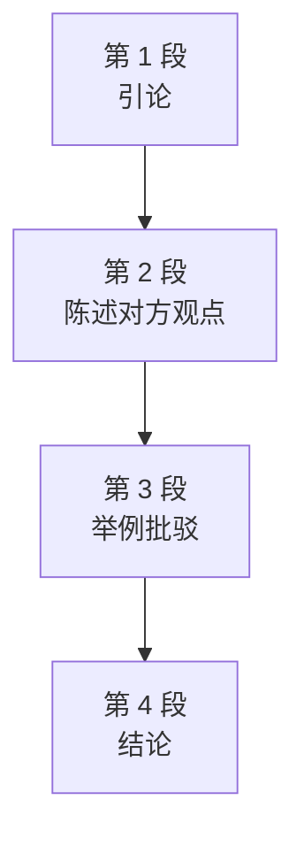

# Passage 48 · 未来主义诗歌之争

## 答题记录

| 轮次  | 日期         | 题号  | 正确  | 错误  | 正确率 | 用时    | 错题归因 |
| --- | --- | --- | --- | --- | --- | --- | --- |
| 1 |  | 1-4 |  |  |  |  |  |
| 2 |  | 1-4 |  |  |  |  |  |
| 3 |  | 1-4 |  |  |  |  |  |

> [!tip] 填写口径
> - **用时**以分钟计，只计做题时间，不含精读复盘。
> - **错题归因**填「题型·错误类型」，如：细节题·无中生有、细节题·混淆概念、细节题·与原文相反、猜词题·偷换概念、主旨题·局部夸大。
> - 纵向看趋势：正确率升而用时过长 → 熟练度不足；用时降而正确率波动 → 定位不稳。
> - 本篇 **4 题**，题号栏填 1-4；第 1 题是**主旨题**；第 2 题是**细节题**；第 3 题是**细节题**；第 4 题是**作者态度题**。（本篇答案：1.B　2.A　3.C　4.D）

> [!info] 文章档案
> - **来源**：考研英语（一）2000 年 Text 3
> - **题材**：文艺教育（未来主义（Futurist）诗歌能否被归入文学）
> - **结构**：4 段 / 13 句（2＋6＋2＋3）＋ 4 题（按句号断句与行首缩进实测；正文在 PDF p069 下半–p070，题目全在 p070，解析在 p176–p177）
> - **难度**：★★★☆☆
> - **一句话主旨**：作者先立标准（新艺术运动出现时应弄清其倡导者的目的），再介绍未来派诗人的主张，继而以「战斗描写」为例证指出其荒谬，最终判定其**不符合文学**，只承认其第一命题（情感生活巨变需要表达变化），并把问题留给读者：我们本质上改变了吗？

## 一、篇章脉络

- **第 1 段**：**引论**。先给通则——新艺术运动一旦成为时尚，明智的做法是弄清其倡导者的目的；随即转折：未来主义诗歌虽理论依据可能成立，却**很难归入文学**。
- **第 2 段**：**陈述对方观点**。以 This, in brief, is what the Futurist says 引出未来主义者的整套主张——生活节奏加速→情感变化→需要新表达形式→文学也要加速→倾泻基本词汇、造拟声词、变换字号与颜色。
- **第 3 段**：**举例批驳**。以「战斗描写」为例——一行诗竟只是落水声与体重的记录（"Pluff! Pluff! A hundred and eighty-five kilograms."），confused 与 upsetting 两个感情色彩词直接表达不满。
- **第 4 段**：**结论**。这符合未来主义诗歌的法则，却算不上文学；但其第一命题（情感生活巨变需要表达变化）无可拒绝；真正的问题是——**我们本质上变了吗？**

> [!tip] 行文逻辑
> 作者先立标准（新艺术运动出现时应弄清其倡导者的目的），再介绍未来派诗人的主张，继而以「战斗描写」为例证指出其荒谬，最终判定其**不符合文学**，只承认其第一命题（情感生活巨变需要表达变化），并把问题留给读者：我们本质上改变了吗？

## 二、逐段精读

### 第 1 段 · 引论：先弄清倡导者的目的，但未来主义诗歌难归文学

**原文**

① When a new movement in art attains a certain fashion, it is advisable to find out what its advocates are aiming at, for, however far-fetched and unreasonable their principles may seem today, it is possible that in years to come they may be regarded as normal.

② With regard to Futurist poetry, however, the case is rather difficult, for whatever Futurist poetry may be—even admitting that the theory on which it is based may be right—it can hardly be classed as Literature.

**译文**

① 当艺术界的一场新运动开始流行时，明智的做法是弄清楚它的倡导者到底想达到什么目的——因为无论他们的原则在今天看来多么牵强、多么不合理，多年以后都有可能被视为正常。

② 然而，就未来主义诗歌而言，事情就相当难办了：因为无论未来主义诗歌是什么——即便承认它所依据的理论可能正确——它也很难被归入文学之列。

#### 本段重点词汇

| 单词 | 词性 | 文中意 | 拓展 | 文中用法 |
| --- | --- | --- | --- | --- |
| **attain** | vt. | 达到，获得 | attain a fashion 达到某种时尚；attain one's goal 实现目标；辨析：obtain 经努力「获得」（实物、信息）、retain 保持 | 本段①句 |
| **fashion** | n. | 时尚，流行款式 | attain a fashion 成为时尚；in fashion 正流行；fashionable adj. 时髦的 | 本段①句 |
| **advisable** | adj. | 明智的，可取的 | It is advisable to do sth. 做某事是明智的（it 为形式主语）；advice n. 建议；辨析：advisory 顾问的 | 本段①句 |
| **advocate** | n. | 倡导者，拥护者 | advocate of Futurist poetry 未来主义诗歌的倡导者；vt. 拥护；advocacy n. 拥护 | 本段①句 |
| **aim at** | 短语 | 旨在，以……为目标 | what its advocates are aiming at 其倡导者的目的所在；aim to do；Q2 题干关键词 | 本段①句 |
| **far-fetched** | adj. | 牵强的，难以置信的 | far-fetched principles 牵强的原则；fetch v. 取来（引申为「把观点拉得很远」） | 本段①句 |
| **unreasonable** | adj. | 不合理的 | 反义 reasonable adj. 合理的；reason n. 理由 | 本段①句 |
| **principle** | n. | 原则，原理 | in principle 原则上；辨析：principal n. 校长／adj. 主要的 | 本段①句 |
| **with regard to** | 短语 | 关于，至于 | 用于切换话题，同义 as for／regarding | 本段②句 |
| **base on** | 短语 | 以……为基础 | the theory on which it is based 它所依据的理论（介词后接 which 从句）；based on sth. 基于…… | 本段②句 |
| **class** | vt. | 把……归类 | be classed as 被归入……一类；classify vt. 分类；classification n. | 本段②句 |
| **Literature** | n. | 文学（此处大写，指文学这一范畴） | be classed as Literature 归入文学；literary adj. 文学的（Q2 题干词） | 本段②句 |

#### 长难句 · 本段第 ① 句

> [!abstract] 本段第 ① 句 · 原句
> When a new movement in art attains a certain fashion, it is advisable to find out what its advocates are aiming at, for, however far-fetched and unreasonable their principles may seem today, it is possible that in years to come they may be regarded as normal.

**结构拆解**
- 主句：it is advisable **to find out** what its advocates are aiming at（it 为形式主语，真正主语是不定式短语；find out 后接 what 引导的宾语从句）
- 时间状语从句：When a new movement in art attains a certain fashion（when 引导）
- for 引导原因状语从句，内嵌 however 引导的**让步状语从句**：however far-fetched and unreasonable their principles may seem today（＝no matter how far-fetched...，形容词提前至 however 之后，构成「however＋adj.＋主语＋谓语」语序）
- for 从句主句：it is possible that in years to come they may be regarded as normal（it 为形式主语，that 从句为真正主语；in years to come 为插入时间状语）

**参考译文**

当艺术界的一场新运动开始流行时，明智的做法是弄清楚它的倡导者到底想达到什么目的——因为无论他们的原则在今天看来多么牵强、多么不合理，多年以后都有可能被视为正常。

> [!tip] 拆解要点
> ① however 引导让步从句时，被修饰的形容词/副词必须紧跟 however（however far-fetched... their principles **may seem**），阅读时先还原为正常语序 their principles may seem far-fetched and unreasonable；② 两个 it 都是形式主语，分别指向 to find out... 与 that...从句；③ for 在此引导原因从句（较 because 更正式、多用于补充说明），不要误判为并列连词。

#### 长难句 · 本段第 ② 句

> [!abstract] 本段第 ② 句 · 原句
> With regard to Futurist poetry, however, the case is rather difficult, for whatever Futurist poetry may be—even admitting that the theory on which it is based may be right—it can hardly be classed as Literature.

**结构拆解**
- 主干：the case is rather difficult（case 指「情况、事态」，the case is difficult 表示「事情很棘手」）
- 插入语：With regard to Futurist poetry, however（介词短语＋转折副词，限定讨论对象）
- for 引导原因状语从句，主干为 it can hardly be classed as Literature（it 指 Futurist poetry；class as 把……归入某类）
- 该从句内嵌 whatever 引导的让步状语从句：whatever Futurist poetry may be（无论它是什么）
- 破折号之间为插入性让步状语：even admitting that...（＝even if we admit that...，「即便承认……」），其中又嵌套 **介词＋which 的定语从句**：the theory on which it is based（＝the theory which it is based on，它所依据的理论）

**参考译文**

然而，就未来主义诗歌而言，事情就相当难办了：因为无论未来主义诗歌是什么——即便承认它所依据的理论可能正确——它也很难被归入文学之列。

> [!tip] 拆解要点
> ① even admitting that... 是「动词 -ing 短语」作插入性让步状语，逻辑主语省略（＝even if we admit），写作中可用 it is worth admitting that... 替换；② 介词后关系代词只能用 which/whom：the theory **on which** it is based 不能说 the theory on that it is based；③ 本句是全文立场句——「即便承认理论可能正确，也难归文学」，Q1 主旨题与 Q4 态度题都回到这句。

### 第 2 段 · 未来主义者的整套主张

**原文**

① This, in brief, is what the Futurist says: for a century, past conditions of life have been conditionally speeding up, till now we live in a world of noise and violence and speed.

② Consequently, our feelings, thoughts and emotions have undergone a corresponding change.

③ This speeding up of life, says the Futurist, requires a new form of expression.

④ We must speed up our literature too, if we want to interpret modern stress.

⑤ We must pour out a large stream of essential words, unhampered by stops, or qualifying adjectives, or finite verbs.

⑥ Instead of describing sounds we must make up words that imitate them: we must use many sizes of type and different colored inks on the same page, and shorten or lengthen words at will.

**译文**

① 简言之，未来主义者是这样说的：一个世纪以来，过去的生活条件一直在有条件地加速变迁，直到如今，我们生活在一个充满噪音、暴力与速度的世界里。

② 因此，我们的情感、思想与情绪都经历了相应的变化。

③ 未来主义者说，这种生活的加速需要一种新的表达形式。

④ 如果我们想诠释现代生活的压力，我们的文学也必须加速。

⑤ 我们必须倾泻出大量基本词汇，不受标点、修饰性形容词和限定动词的束缚。

⑥ 我们不必去描述声音，而必须造出模仿声音的词来：我们必须在同一页纸上使用多种字号和不同颜色的油墨，随意地缩短或加长单词。

#### 本段重点词汇

| 单词 | 词性 | 文中意 | 拓展 | 文中用法 |
| --- | --- | --- | --- | --- |
| **in brief** | 短语 | 简言之 | 总结提示语，同义 in short；brief adj. 简短的 | 本段①句 |
| **Futurist** | n. | 未来主义者，未来派诗人 | Futurist poetry 未来主义诗歌；futurism n. 未来主义；future n. 未来 | 本段①句 |
| **conditionally** | adv. | 有条件地；受制约地 | past conditions of life 过去的生活条件；conditional adj. 有条件的；condition n. 条件 | 本段①句 |
| **speed up** | 短语 | 加速 | 全文关键词：生活节奏加速→文学也要加速；speed-up n. 加速 | 本段①句 |
| **consequently** | adv. | 因此，结果 | 表因果，位置灵活（可放句首）；consequence n. 后果 | 本段②句 |
| **undergo** | vt. | 经历，经受 | undergo a change 经历变化；过去式 underwent；辨析：undertake 从事 | 本段②句 |
| **corresponding** | adj. | 相应的 | a corresponding change 相应的变化；correspond vi. 对应；correspondence n. | 本段②句 |
| **emotion** | n. | 情感，情绪 | emotional life 情感生活；emotional adj. 情感的；辨析：mood 心境 | 本段②句 |
| **require** | vt. | 需要，要求 | require a new form of expression 需要新的表达形式；requirement n. 要求 | 本段③句 |
| **expression** | n. | 表达，表述 | a new form of expression 新的表达形式；express vt. 表达；expressive adj. | 本段③句 |
| **interpret** | vt. | 诠释，解释；口译 | interpret modern stress 诠释现代生活的压力（≠ relieve 减轻，Q3 干扰项）；interpreter n. 口译员 | 本段④句 |
| **stress** | n. | 压力；强调 | modern stress 现代生活的压力（Q3 B 项关键词）；stressful adj. 有压力的；辨析：pressure 压力（更通用）、strain 拉伤／紧张 | 本段④句 |
| **pour out** | 短语 | 倾泻，大量涌出 | pour out a large stream of essential words 倾泻大量基本词汇；pour...into 把……倒入 | 本段⑤句 |
| **essential** | adj. | 基本的，本质的 | essential words 基本词汇；essence n. 本质；essentially adv. 本质上 | 本段⑤句 |
| **stream** | n. | 流，一股 | a large stream of 大量……；辨析：current 水流／电流 | 本段⑤句 |
| **unhampered** | adj. | 不受阻碍的 | hamper vt. 妨碍；unhampered by 不受……束缚 | 本段⑤句 |
| **stop** | n. | 标点，停顿 | 熟词僻义：stops＝标点符号；vi. 停止 | 本段⑤句 |
| **qualify** | vt. | 限定，修饰 | qualifying adjectives 修饰性形容词；qualified adj. 有资格的；qualification n. 资格 | 本段⑤句 |
| **adjective** | n. | 形容词 | 与 verb（动词）相对；adjectival adj. 形容词的 | 本段⑤句 |
| **finite** | adj. | 限定的 | finite verbs 限定动词（语言学概念，与 non-finite 非限定动词相对）；infinite adj. 无限的 | 本段⑤句 |
| **verb** | n. | 动词 | verbal adj. 言辞的；adverb n. 副词 | 本段⑤句 |
| **instead of** | 短语 | 而不是 | 后接名词／动名词；instead adv. 反而 | 本段⑥句 |
| **imitate** | vt. | 模仿 | make up words that imitate them 造出模仿声音的词；imitation n. 模仿；辨析：copy 复制 | 本段⑥句 |
| **type** | n. | 字号；类型 | 熟词僻义：many sizes of type 多种字号；typist n. 打字员；typography n. 排版 | 本段⑥句 |
| **ink** | n. | 墨水，油墨 | different colored inks 不同颜色的油墨 | 本段⑥句 |
| **at will** | 短语 | 任意，随意 | shorten or lengthen words at will 随意缩短或加长单词；will n. 意志 | 本段⑥句 |

#### 长难句 · 本段第 ① 句

> [!abstract] 本段第 ① 句 · 原句
> This, in brief, is what the Futurist says: for a century, past conditions of life have been conditionally speeding up, till now we live in a world of noise and violence and speed.

**结构拆解**
- 主干：This is what the Futurist says（what 引导表语从句，「未来主义者所说的话」）
- 冒号后为对表语从句内容的展开（同位性解释），含两个并列分句：
  - 分句一：for a century, past conditions of life have been **conditionally speeding up**（现在完成进行时＋副词 speeding，speed 在此活用为动词）
  - 分句二：till now we live in a world of noise and violence and speed（till now＝up to now 直到如今）

**参考译文**

简言之，未来主义者是这样说的：一个世纪以来，过去的生活条件一直在有条件地加速变迁，直到如今，我们生活在一个充满噪音、暴力与速度的世界里。

> [!tip] 拆解要点
> ① speed 既可作名词也可作动词，此处 speeding up 是动词用法；② till now 相当于 up to now，常与完成时搭配；③ 本句是未来主义者的理论起点——「生活加速」，其后的 Consequently... requires a new form of expression 构成完整因果链，Q3 正考这一链条的第三环。

#### 长难句 · 本段第 ⑤ 句

> [!abstract] 本段第 ⑤ 句 · 原句
> We must pour out a large stream of essential words, unhampered by stops, or qualifying adjectives, or finite verbs.

**结构拆解**
- 主干：We must **pour out** a large stream of essential words（pour out 倾泻；a large stream of 大量的）
- 过去分词短语作后置定语：unhampered by stops, or qualifying adjectives, or finite verbs（hamper 妨碍；by 引出三个并列的施动对象——stops 标点、qualifying adjectives 修饰性形容词、finite verbs 限定动词）

**参考译文**

我们必须倾泻出大量基本词汇，不受标点、修饰性形容词和限定动词的束缚。

> [!tip] 拆解要点
> ① unhampered by 是「过去分词＋by」结构，逻辑上等于 which are unhampered by，阅读时还原为定语从句更易懂；② stops 在此是熟词僻义——「标点符号」，不是「停止」；qualifying adjectives「修饰性形容词」、finite verbs「限定动词」均为语法术语，陌生但不必深究，能识别三项并列即可；③ 本句是 Q3 干扰项 D 的出处：原文是「不受……限制」（unhampered by），选项改成「避免使用」（avoid using），性质完全不同。

#### 长难句 · 本段第 ⑥ 句

> [!abstract] 本段第 ⑥ 句 · 原句
> Instead of describing sounds we must make up words that imitate them: we must use many sizes of type and different colored inks on the same page, and shorten or lengthen words at will.

**结构拆解**
- 第一分句：Instead of describing sounds we must make up words that imitate them（instead of＋动名词 表示「而不是……」；make up 编造；that 引导定语从句修饰 words）
- 冒号引出第二分句（对前句的展开说明）：we must use many sizes of type and different colored inks on the same page, and shorten or lengthen words at will（use／shorten／lengthen 三个并列谓语；at will 随意地）

**参考译文**

我们不必去描述声音，而必须造出模仿声音的词来：我们必须在同一页纸上使用多种字号和不同颜色的油墨，随意地缩短或加长单词。

> [!tip] 拆解要点
> ① Instead of describing sounds 位于句首，是全句的对比前提，译成「不去描述声音，反而去……」；② make up words that imitate them 中的 them 指代 sounds——未来主义诗歌的「自由词汇」手法即造拟声词；③ many sizes of type 的 type 是熟词僻义（字号），不是「类型」。

### 第 3 段 · 举例批驳：战斗描写的荒谬

**原文**

① Certainly their descriptions of battles are confused.

② But it is a little upsetting to read in the explanatory notes that a certain line describes a fight between a Turkish and a Bulgarian officer on a bridge off which they both fall into the river—and then to find that the line consists of the noise of their falling and the weights of the officers: "Pluff! Pluff! A hundred and eighty-five kilograms."

**译文**

① 诚然，他们对战斗的描写是混乱的。

② 但是，读到注释里说某一行诗描写的是一名土耳其军官与一名保加利亚军官在桥上打斗、两人双双落水——然后发现那一行诗不过是他们落水的声音加上两位军官的体重：「砰！砰！一百八十五公斤。」——这实在有点令人不安。

#### 本段重点词汇

| 单词 | 词性 | 文中意 | 拓展 | 文中用法 |
| --- | --- | --- | --- | --- |
| **description** | n. | 描述，描写 | descriptions of battles 对战斗的描写；describe vt.；descriptive adj. 描写性的 | 本段①句 |
| **confused** | adj. | 混乱的，令人困惑的 | 作者感情色彩词（Q4 思路点名的两个词之一）；confuse vt. 使困惑 | 本段①句 |
| **upsetting** | adj. | 令人不安的 | 作者感情色彩词（Q4 思路点名的两个词之一）；upset vt. 使不安 | 本段②句 |
| **explanatory** | adj. | 解释性的，说明性的 | explanatory notes 注释／说明文字；explain vt.；explanation n. | 本段②句 |
| **note** | n. | 注释，说明 | 熟词僻义：explanatory notes 中的 notes＝注释；take notes 记笔记 | 本段②句 |
| **line** | n. | 诗行；一行 | 熟词僻义：a certain line 某一行诗；line n. 线／排 | 本段②句 |
| **Turkish** | adj. | 土耳其的 | Turkey n. 土耳其；a Turkish officer 一名土耳其军官 | 本段②句 |
| **Bulgarian** | adj. | 保加利亚的 | Bulgaria n. 保加利亚；a Bulgarian officer 一名保加利亚军官 | 本段②句 |
| **officer** | n. | 军官 | 与 soldier（士兵）相对；official n. 官员 | 本段②句 |
| **fall into** | 短语 | 落入，陷入 | fall into the river 落入河中；fall into silence 陷入沉默 | 本段②句 |
| **consist of** | 短语 | 由……组成 | 主语为整体：the line consists of...；辨析：compose（be composed of）、constitute 组成 | 本段②句 |
| **weight** | n. | 重量 | the weights of the officers 两位军官的体重；weigh vt. 称重；weightless adj. 失重的 | 本段②句 |

#### 长难句 · 本段第 ② 句

> [!abstract] 本段第 ② 句 · 原句
> But it is a little upsetting to read in the explanatory notes that a certain line describes a fight between a Turkish and a Bulgarian officer on a bridge off which they both fall into the river—and then to find that the line consists of the noise of their falling and the weights of the officers: "Pluff! Pluff! A hundred and eighty-five kilograms."

**结构拆解**
- 主干：it is a little upsetting **to read**... **and then to find**...（it 为形式主语，两个不定式短语并列作真正主语：to read... 与 to find...）
- read 的宾语是 that 从句：that a certain line **describes** a fight between a Turkish and a Bulgarian officer **on a bridge**...
- 该从句内嵌「介词＋which」定语从句：a bridge **off which** they both fall into the river（＝a bridge which they both fall off into the river，他们双双落水的那座桥）
- find 的宾语是 that 从句：that the line **consists of** the noise of their falling and the weights of the officers（consist of 由……组成）
- 冒号后为直接引语，即那一行诗的「内容」："Pluff! Pluff! A hundred and eighty-five kilograms."

**参考译文**

但是，读到注释里说某一行诗描写的是一名土耳其军官与一名保加利亚军官在桥上打斗、两人双双落水——然后发现那一行诗不过是他们落水的声音加上两位军官的体重：「砰！砰！一百八十五公斤。」——这实在有点令人不安。

> [!tip] 拆解要点
> ① it is upsetting **to read**... **and then to find**... 中，and 连接两个不定式，共用一个形式主语 it——读时先在 and 处断开；② off which 指「从桥上（off the bridge）落入河里」，介词 off 提前至 which 前；③ 本句是全篇最富戏剧性的例证：诗行内容（拟声词＋数字）与注释所承诺的叙事（军官打斗落水）之间的巨大落差，正是作者「这不是文学」的实证。

### 第 4 段 · 结论：不算文学，但第一命题无可拒绝

**原文**

① This, though it fulfills the laws and requirements of Futurist poetry, can hardly be classed as Literature.

② At the same, no thinking man can refuse to accept their first proposition: that a great change in our emotional life calls for a change of expression.

③ The whole question is really this: have we essentially changed?

**译文**

① 这尽管符合未来主义诗歌的法则与要求，却很难被归入文学。

② 与此同时，任何一个有理智的人都不会拒绝接受他们的第一命题：我们情感生活的巨大变化需要表达方式的变化。

③ 真正的问题其实是：我们本质上改变了吗？

#### 本段重点词汇

| 单词 | 词性 | 文中意 | 拓展 | 文中用法 |
| --- | --- | --- | --- | --- |
| **fulfill** | vt. | 履行，满足 | fulfill the laws and requirements 符合法则与要求（＝fulfil）；fulfillment n. | 本段①句 |
| **requirement** | n. | 要求，必要条件 | laws and requirements 法则与要求（Q1 D 项关键词）；require vt. 需要 | 本段①句 |
| **proposition** | n. | 主张，命题；提议 | their first proposition 他们的第一命题（Q1／Q4 思路词）；propose vt. 提议 | 本段②句 |
| **call for** | 短语 | 需要，要求 | a great change calls for a change of expression 巨变需要表达的变化；另有「呼吁」义 | 本段②句 |
| **thinking** | adj. | 有思考能力的 | no thinking man 没有一个有头脑的人（＝any thinking man，双重否定）；think v. | 本段②句 |
| **refuse** | vt. | 拒绝 | refuse to accept 拒绝接受；refusal n. 拒绝 | 本段②句 |
| **essentially** | adv. | 本质上，根本上 | have we essentially changed? 我们本质上变了吗？essence n. 本质；essential adj. 本质的 | 本段③句 |

#### 长难句 · 本段第 ① 句

> [!abstract] 本段第 ① 句 · 原句
> This, though it fulfills the laws and requirements of Futurist poetry, can hardly be classed as Literature.

**结构拆解**
- 主干：This can hardly be classed as Literature（this 回指上段那个「Pluff! Pluff!」的例子）
- though 引导让步状语从句：though it fulfills the laws and requirements of Futurist poetry（即便它符合未来主义诗歌的法则与要求；fulfill 满足、符合）

**参考译文**

这尽管符合未来主义诗歌的法则与要求，却很难被归入文学。

> [!tip] 拆解要点
> ① though 从句插在主语 This 与谓语 can hardly be classed 之间，形成「主谓分隔」，读时可暂时跳过从句先抓主谓；② fulfill the laws and requirements 意为「符合／满足法则与要求」，不是「履行法律」——laws 在此指诗歌的「法则」；③ 本句与第 1 段②句首尾呼应，是作者否定立场的最强表达（Q4 思路点名的「末段」即此）。

#### 长难句 · 本段第 ② 句

> [!abstract] 本段第 ② 句 · 原句
> At the same, no thinking man can refuse to accept their first proposition: that a great change in our emotional life calls for a change of expression.

**结构拆解**
- 主干：no thinking man can refuse to accept their first proposition（**双重否定**：no...can refuse to accept＝任何一个……都会接受，加强肯定语气）
- 同位语从句：that a great change in our emotional life calls for a change of expression（that 从句解释 proposition 的内容；a great change in... 情感生活中的巨变；call for 需要）

**参考译文**

与此同时，任何一个有理智的人都不会拒绝接受他们的第一命题：我们情感生活的巨大变化需要表达方式的变化。

> [!tip] 拆解要点
> ① no thinking man can refuse to accept 是「否定主语＋否定谓语」的双重否定，等于 any thinking man would accept——议论文中用来表示「无可否认」；② that 从句是 proposition 的同位语从句（不是定语从句：that 在从句中不充当成分）；③ 作者先否定未来主义诗歌的形式（⑤句 unhampered by...），再肯定其第一命题，是典型的「破中有立」；而下一句 The whole question is really this: have we essentially changed? 又把这一命题的前提（情感生活是否真发生了巨变）重新变为疑问——全文的辩证结构尽在于此。

## 三、全篇重点词汇汇总（自测用）

> 收录**全篇所有段落词汇，共 57 条，不删减**；按「逐段词汇表 → 本表」同源同序汇总，**跨段复现的词条只收入其首次出现的段落**（如 require 首现于第 2 段③句、note 首现于第 3 段②句）。用法：遮住「词性」「所在段」两列自测。

| 单词 / 短语 | 词性 | 所在段 |
| --- | --- | --- |
| **attain** | vt. | 第 1 段 |
| **fashion** | n. | 第 1 段 |
| **advisable** | adj. | 第 1 段 |
| **advocate** | n. | 第 1 段 |
| **aim at** | 短语 | 第 1 段 |
| **far-fetched** | adj. | 第 1 段 |
| **unreasonable** | adj. | 第 1 段 |
| **principle** | n. | 第 1 段 |
| **with regard to** | 短语 | 第 1 段 |
| **base on** | 短语 | 第 1 段 |
| **class** | vt. | 第 1 段 |
| **Literature** | n. | 第 1 段 |
| **in brief** | 短语 | 第 2 段 |
| **Futurist** | n. | 第 2 段 |
| **conditionally** | adv. | 第 2 段 |
| **speed up** | 短语 | 第 2 段 |
| **consequently** | adv. | 第 2 段 |
| **undergo** | vt. | 第 2 段 |
| **corresponding** | adj. | 第 2 段 |
| **emotion** | n. | 第 2 段 |
| **require** | vt. | 第 2 段 |
| **expression** | n. | 第 2 段 |
| **interpret** | vt. | 第 2 段 |
| **stress** | n. | 第 2 段 |
| **pour out** | 短语 | 第 2 段 |
| **essential** | adj. | 第 2 段 |
| **stream** | n. | 第 2 段 |
| **unhampered** | adj. | 第 2 段 |
| **stop** | n. | 第 2 段 |
| **qualify** | vt. | 第 2 段 |
| **adjective** | n. | 第 2 段 |
| **finite** | adj. | 第 2 段 |
| **verb** | n. | 第 2 段 |
| **instead of** | 短语 | 第 2 段 |
| **imitate** | vt. | 第 2 段 |
| **type** | n. | 第 2 段 |
| **ink** | n. | 第 2 段 |
| **at will** | 短语 | 第 2 段 |
| **description** | n. | 第 3 段 |
| **confused** | adj. | 第 3 段 |
| **upsetting** | adj. | 第 3 段 |
| **explanatory** | adj. | 第 3 段 |
| **note** | n. | 第 3 段 |
| **line** | n. | 第 3 段 |
| **Turkish** | adj. | 第 3 段 |
| **Bulgarian** | adj. | 第 3 段 |
| **officer** | n. | 第 3 段 |
| **fall into** | 短语 | 第 3 段 |
| **consist of** | 短语 | 第 3 段 |
| **weight** | n. | 第 3 段 |
| **fulfill** | vt. | 第 4 段 |
| **requirement** | n. | 第 4 段 |
| **proposition** | n. | 第 4 段 |
| **call for** | 短语 | 第 4 段 |
| **thinking** | adj. | 第 4 段 |
| **refuse** | vt. | 第 4 段 |
| **essentially** | adv. | 第 4 段 |

> [!info] 说明
> - 本表与逐段词汇表**等长同源同序**：第 1 段 12 条 → 第 2 段 26 条 → 第 3 段 12 条 → 第 4 段 7 条，共 57 条。
> - 真题页脚、页眉与选项译名不收入；人名（Futurist 除外，它已普通名词化）不收入。
> - 重点自测对象是 8 个**熟词僻义**：stop（标点）、note（注释）、line（诗行）、type（字号）、class（把……归类）、case（情况）、Literature（文学范畴，大写）、thinking（有思考能力的）。

> [!example] 同义替换链（阅读题高频）
> - **aiming at**（第 1 段①句）→ **determine its purposes**（Q2 正确项）
> - **a new form of expression**（第 2 段③句）→ **develop new modes of expression**（Q3 正确项）
> - **can hardly be classed as Literature**（第 1 段②句、第 4 段①句）→ **more of a transient phenomenon than literature**（Q4 正确项）
> - **attains a certain fashion**（第 1 段①句）→ become fashionable／成为时尚（选项 C follow the new fashions 的仿作）
> - **a great change in our emotional life calls for a change of expression**（第 4 段②句）→ indicative of a basic change in human nature（Q4 C 项的仿作）

## 四、知识点补充

> [!question] 背景知识
> **未来主义（Futurism）**：1909 年，意大利诗人菲利波·马里内蒂（Filippo Tommaso Marinetti）在法国《费加罗报》头版发表《未来主义宣言》，随后该运动蔓延至文学、绘画、雕塑、音乐等领域。未来主义讴歌速度、机械、青春与现代工业文明，主张「摧毁博物馆、图书馆」，与传统彻底决裂。在诗歌上的实践即「自由词汇」（parole in libertà）：摒弃句法、标点、形容词与限定动词的束缚，大量使用拟声词、象声符号，并借字号、墨色、排列制造视觉冲击。本文评论的正是这一运动：文中 "Pluff! Pluff! A hundred and eighty-five kilograms." 是作者对「拟声＋数字」手法（以声音和体重取代战斗叙事）的讽刺性引用——它确实符合未来主义诗歌的全部法则，却不像文学。

> [!warning] 语法点
> ① **however 引导让步状语从句**：however far-fetched and unreasonable their principles may seem today＝no matter how far-fetched...，被强调的形容词/副词必须紧贴 however（however＋adj.＋主语＋谓语），这是阅读中还原语序的关键。
> ② **动词 -ing 短语作插入性让步状语**：even admitting that...＝even if we admit that...，「即便承认……」，用于先让步再转折，议论文极常用。
> ③ **双重否定表强肯定**：no thinking man can refuse to accept...＝any thinking man would accept...，比单纯肯定语气更重，且自带「凡有理智者皆然」的意味。
> ④ **「介词＋which」定语从句**：the theory on which it is based（＝the theory which it is based on）、a bridge off which they both fall（＝a bridge which they both fall off），介词后只能用 which/whom，阅读时须把介词还原到句末理解。

> [!success] 写作可迁移句型
> ① **When a new movement in X attains a certain fashion, it is advisable to find out what its advocates are aiming at.**（引入话题的标准句式：新现象登场→先审视倡导者目的）
> ② **With regard to X, however, the case is rather difficult...**（缩小论证范围、制造转折的承接句式）
> ③ **The whole question is really this: ...**（收束全文、抛出核心问题的结尾句式，后接一般疑问句尤其有锋芒）

> [!danger] 易混辨析
> ① **attain／obtain／retain**：attain 经努力「达到」（目标、地位、某种状态，如 attain a fashion 流行起来）；obtain 经努力「获得」（实物、信息、许可）；retain 保持、留住（不失去）。三个词形近易混，考研阅读与翻译均高频。
> ② **stress／pressure／strain**：stress 心理压力，也指「强调」；pressure 外部施加的压力（更通用，如 peer pressure）；strain 重负、拉伤、紧张（强调过度承压后的损伤）。本文 modern stress 指现代生活造成的心理压力。
> ③ **interpret／translate／relieve**：interpret 诠释、阐释（interpret modern stress 诠释现代压力）；translate 翻译（语言转换）；relieve 减轻、缓解（relieve pain/pressure）。Q3 正是用 relieve 偷换 interpret 设陷阱。
> ④ **future／Futurist／futurism**：future 未来（普通词）；Futurist 未来主义者／未来派的（专有概念）；futurism 未来主义（艺术运动名称）。选项 C The Evolutionary Future of Nature 中的 future 只是普通词，与本文主题无关。

## 五、题目分析

> [!info] 题目总览
> | 题号 | 题型 | 定位 | 答案 |
> | --- | --- | --- | --- |
> | 1 | 主旨题 | 第 1 段②句 | B |
> | 2 | 细节题 | 第 1 段①句 | A |
> | 3 | 细节题 | 第 2 段③句 | C |
> | 4 | 作者态度题 | 第 1 段末句 | D |

### 第 1 题 · 主旨题

> [!question] 原题
> 1. This passage is mainly
> [A] a survey of new approaches to art.
> [B] a review of Futurist poetry.
> [C] about merits of the Futurist movement.
> [D] about laws and requirements of literature.

**正确答案**：**B. a review of Futurist poetry.（对未来主义诗歌的评论）**

**定位与依据**

- 主旨题重点看首尾段及各段首（尾）句。首段最后一句（第 1 段②句）即给出作者对未来派诗歌的总体评价——「即便承认其理论依据可能正确，也很难将其归入文学」；第二段完整介绍了未来派诗歌倡导者的观点（生活加速→情感变化→新表达形式）；而全文最后一句（第 4 段③句）The whole question is really this: have we essentially changed? 又回头质疑其理论前提。可见全文围绕未来派诗歌展开：陈述其主张→以例证批驳→定性，是一篇**评论（review）**。

**干扰项分析**

| 选项 | 选项内容 | 判断 | 排除理由 |
| --- | --- | --- | --- |
| A | a survey of new approaches to art. | ✗ | 「新的艺术方法」只在第 1 段①句一笔带过（a new movement in art），是引出话题的由头，不足以概括全文内容 |
| B | a review of Futurist poetry. | ✓ | 正确项：见本题「定位与依据」。|
| C | about merits of the Futurist movement. | ✗ | 全文并未谈论未来主义运动的「优点／价值」，作者立场是否定的（hardly be classed as Literature） |
| D | about laws and requirements of literature. | ✗ | laws and requirements 是第 4 段①句的细节，且指的是**未来主义诗歌自己的**法则与要求，并非全文主题；文章也不是在谈「文学的法则」 |

> [!tip] 解题思路
> 主旨题的两步法：① 串各段首（尾）句概括每段职能——本文第 1 段亮立场、第 2 段述对方观点、第 3 段举例、第 4 段下判词；② 用「主体词」检验选项——全文反复出现的是 Futurist poetry，而非 art in general（A）、merits（C）或 literature in general（D）。选项中一旦出现原文未展开的概括性名词（survey／merits），先怀疑以偏概全或无中生有。

### 第 2 题 · 细节题

> [!question] 原题
> 2. When a novel literary idea appears, people should try to
> [A] determine its purposes.
> [B] ignore its flaws.
> [C] follow the new fashions.
> [D] accept the principles.

**正确答案**：**A. determine its purposes.（弄清其目的）**

**定位与依据**

- 题干关键词 novel literary idea 直接定位第 1 段①句：When a new movement in art attains a certain fashion, **it is advisable to find out what its advocates are aiming at**——当新的文艺观点（新艺术运动）出现时，人们应该努力**弄清其倡导者的目的所在**，即 determine its purposes。

**干扰项分析**

| 选项 | 选项内容 | 判断 | 排除理由 |
| --- | --- | --- | --- |
| A | determine its purposes. | ✓ | 正确项：见本题「定位与依据」。|
| B | ignore its flaws. | ✗ | 全文未提及「忽视缺陷」；且作者对新的文学观点恰恰持审视态度 |
| C | follow the new fashions. | ✗ | 第 1 段①句说新运动「成为某种时尚」（attains a certain fashion），那只是背景交代，作者的建议是「弄清目的」而非「追随时尚」 |
| D | accept the principles. | ✗ | 第 1 段②句对未来主义诗歌持否定态度；且作者只主张先「弄清」倡导者目的，从未主张「接受其原则」 |

> [!tip] 解题思路
> 题干里的 novel literary idea 是原文 a new movement in art 的同义改写，定位后把选项逐条与原文比对：原文只给了「一个动作」——find out what its advocates are aiming at（弄清目的）。凡比原文多走一步的（追随、接受）或少走一步的（忽视缺陷）都是干扰。注意 [C] 的迷惑性：它借用了原文 fashion 一词，但「成为时尚」是作者描述的现象，不是作者给出的建议。

### 第 3 题 · 细节题

> [!question] 原题
> 3. Futurists claim that we must
> [A] increase the production of literature.
> [B] use poetry to relieve modern stress.
> [C] develop new modes of expression.
> [D] avoid using adjectives and verbs.

**正确答案**：**C. develop new modes of expression.（发展新的表达形式）**

**定位与依据**

- 题干定位第 2 段③句：This speeding up of life, says the Futurist, **requires a new form of expression**——未来主义者声称，这种加速的生活节奏**需要一种新的表达形式**，与 C 项 develop new modes of expression（发展新的表达方式）同义替换。

**干扰项分析**

| 选项 | 选项内容 | 判断 | 排除理由 |
| --- | --- | --- | --- |
| A | increase the production of literature. | ✗ | 文中未出现「增加文学作品产量」之意 |
| B | use poetry to relieve modern stress. | ✗ | 第 2 段④句说加速文学是为了 **interpret**（诠释）现代生活的压力，而非 relieve（减轻）；relieve 与原文语义相反 |
| C | develop new modes of expression. | ✓ | 正确项：见本题「定位与依据」。|
| D | avoid using adjectives and verbs. | ✗ | 第 2 段⑤句说的是「**不受** stops、修饰性形容词和限定动词的限制」（unhampered by），是「摆脱束缚」而非「避免使用」；且漏掉了 stops |

> [!tip] 解题思路
> 本题是「观点转述准确性」的典型：先按题干找到未来主义者的主张链（生活加速→情感变化→新表达形式），再拿选项逐一核对动词。两个易错点：① relieve vs interpret——原文 interpret modern stress 的目的是「诠释压力」，选项改成「减轻压力」，一字之差、方向相反；② avoid using vs unhampered by——「不受限制」不等于「不使用」，未来主义者反对的是束缚而非词汇本身。

### 第 4 题 · 作者态度题

> [!question] 原题
> 4. The author believes that Futurist poetry is
> [A] based on reasonable principles.
> [B] new and acceptable to ordinary people.
> [C] indicative of a basic change in human nature.
> [D] more of a transient phenomenon than literature.

**正确答案**：**D. more of a transient phenomenon than literature.（与其说是文学，不如说是一种短暂现象）**

**定位与依据**

- 态度题可同主旨题一样，重点看首尾段和每段首（尾）句，同时留意**感情色彩词**。第一段末句（第 1 段②句）与末段（第 4 段①句）都亮明观点：即便承认未来派诗歌理论基础的合理性，也很难将其归入文学；第 3 段①②句更用了 confused 与 a little upsetting 两个感情色彩词直接表达不满。因此作者认为未来派诗歌**不是文学，只是一种短暂的现象（transient phenomenon）**。

**干扰项分析**

| 选项 | 选项内容 | 判断 | 排除理由 |
| --- | --- | --- | --- |
| A | based on reasonable principles. | ✗ | 第 1 段②句的「即便承认其理论依据可能正确」是**让步状语**（even admitting that...），是「退一步」的修辞，并非认同；全文整体基调是否定 |
| B | new and acceptable to ordinary people. | ✗ | 文中未提普通人是否接受未来派诗歌 |
| C | indicative of a basic change in human nature. | ✗ | 第 4 段③句 The whole question is really this: **have we essentially changed?** 恰恰是对「人性是否发生根本变化」表示**质疑**，选项把它变成了作者的信念 |
| D | more of a transient phenomenon than literature. | ✓ | 正确项：见本题「定位与依据」。|

> [!tip] 解题思路
> 态度题的抓手是感情色彩词与情态动词：本文的 confused、upsetting、hardly、rather difficult 构成一条完整的否定链；而 even admitting that...（即便承认）是典型的「假让步」，不能当成作者立场。选项 [C] 的迷惑性在于它化用了第 4 段②句的 a great change in our emotional life——但请注意，作者紧接着就以问句 have we essentially changed? 把这一命题的前提重新变成了问题。

## 六、复盘清单

- [ ] 不看笔记，口头复述篇章结构：引论（亮立场）→ 述对方主张 → 举例批驳 → 判词＋追问
- [ ] 重做 4 道题并口述理由，重点复盘 Q1 主旨题的「串段法」与 Q4 态度题的「感情色彩词法」
- [ ] 过汇总表 57 词（逐段 12/26/12/7），遮住「所在段」列自测，重点过 8 个熟词僻义（stop 标点／note 注释／line 诗行／type 字号／class 归类／case 情况／Literature 文学范畴／thinking 有思考能力的）
- [ ] 回看长难句 1、6 的拆解：however＋adj. 倒装与「介词＋which」结构各仿写一句
- [ ] 辨析四组易混词：attain/obtain/retain、stress/pressure/strain、interpret/translate/relieve、future/Futurist/futurism

## 七、关联笔记

- [[Passage47-人类进化毫无进展]]：同为 2000 年真题（Text 2），其 Q4 主旨题与本篇 Q1 可互证「串段首尾句」的主旨题解法；两篇均为 4 题老真题，考点分布高度相似。
- [[Passage38-正式英语的退场]]：同属「语言／文学体裁变迁」话题——一篇讲正式英语的退场，一篇讲未来主义诗歌的登场与受挫，对照可看出「语言变革类」文章的常见论证结构（现象→主张→例证→作者判词）。
- [[考研英语阅读长难句拆解]]：however 让步倒装、动词 -ing 插入语、双重否定、「介词＋which」定语从句四个句型的总索引。
