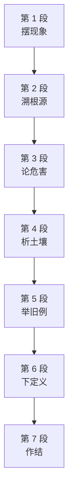

# Passage 49 · 被低估的才智

## 答题记录

| 轮次  | 日期         | 题号  | 正确  | 错误  | 正确率 | 用时    | 错题归因 |
| --- | --- | --- | --- | --- | --- | --- | --- |
| 1 |  | 1-5 |  |  |  |  |  |
| 2 |  | 1-5 |  |  |  |  |  |
| 3 |  | 1-5 |  |  |  |  |  |

> [!tip] 填写口径
> - **用时**以分钟计，只计做题时间，不含精读复盘。
> - **错题归因**填「题型·错误类型」，如：细节题·无中生有、细节题·混淆概念、细节题·与原文相反、猜词题·偷换概念、主旨题·局部夸大。
> - 纵向看趋势：正确率升而用时过长 → 熟练度不足；用时降而正确率波动 → 定位不稳。
> - 本篇 **5 题**，题号栏填 1-5；第 1 题是**细节题**；第 2 题是**细节题**；第 3 题是**观点对比题**；第 4 题是**推断题**；第 5 题是**观点态度题**。（本篇答案：1.C　2.A　3.D　4.B　5.C）

> [!info] 文章档案
> - **来源**：考研英语（一）2004 年 Text 4
> - **题材**：文艺教育（考研英语一 × 反智主义 × 教育）
> - **结构**：7 段 / 23 句（4＋3＋5＋3＋3＋3＋2）＋ 5 题（按句号断句与行首缩进实测；正文在 PDF p070 下半–p071，题目在 p071–p072，解析在 p177–p178）
> - **难度**：★★★☆☆
> - **一句话主旨**：作者先指出美国学校重实用轻才智的反智现象（第 1 段），借拉维奇（Ravitch）的书追溯其根源（第 2 段），再论忽视才智的危害（第 3 段），随后引霍夫施塔特（Hofstadter）剖析其历史与宗教土壤（第 4、6、7 段），并举爱默生、马克·吐温为例（第 5 段），最终表明立场：**才智理应被追求**。

## 一、篇章脉络

- **第 1 段**：**摆现象**。开篇立论——美国人不高度重视才智，英雄是运动员、艺人、企业家而非学者；学校只教实用技能；反智主义症状随处可见。
- **第 2 段**：**溯根源**。引拉维奇《Left Back》——学校本可成为抗衡力，实际上却不过是美国人对才智追求之厌恶的注脚。
- **第 3 段**：**论危害**。But they could and should be——让孩子摒弃心智生活易受剥削与控制；不能批判性思考就无法真正参与民主。
- **第 4 段**：**析土壤**。引霍夫施塔特——才智被当作权力与特权而遭怨恨；民主与民粹冲动使人排斥精英主义；实用性、常识、先天智力被视为比书本知识更高贵。
- **第 5 段**：**举旧例**。爱默生等超验主义者认为学校教育束缚天性；《哈克贝利·费恩历险记》的主人公以逃避上学保全天性善良。
- **第 6 段**：**下定义**。霍夫施塔特区分 intellect 与 native intelligence——前者是心智的批判、创造与沉思面。
- **第 7 段**：**作结**。学校依然不信任才智——教育体制掌握在敌视才智的人手中。

> [!tip] 行文逻辑
> 作者先指出美国学校重实用轻才智的反智现象（第 1 段），借拉维奇（Ravitch）的书追溯其根源（第 2 段），再论忽视才智的危害（第 3 段），随后引霍夫施塔特（Hofstadter）剖析其历史与宗教土壤（第 4、6、7 段），并举爱默生、马克·吐温为例（第 5 段），最终表明立场：**才智理应被追求**。

## 二、逐段精读

### 第 1 段 · 摆现象：美国人不高度重视才智

**原文**

① Americans today don't place a very high value on intellect.

② Our heroes are athletes, entertainers, and entrepreneurs, not scholars.

③ Even our schools are where we send our children to get a practical education—not to pursue knowledge for the sake of knowledge.

④ Symptoms of pervasive anti-intellectualism in our schools aren't difficult to find.

**译文**

① 今天的美国人并不高度重视才智。

② 他们心目中的英雄是运动员、演艺人员和企业家，而不是学者。

③ 即便是我们的学校，也只是我们送孩子去接受实用教育的地方——而不是为了知识本身去追求知识的地方。

④ 在我们的学校里，普遍存在的反智主义症状并不难发现。

#### 本段重点词汇

| 单词 | 词性 | 文中意 | 拓展 | 文中用法 |
| --- | --- | --- | --- | --- |
| **place a high value on** | 短语 | 高度重视 | value 此处作名词；place/put emphasis on 强调；Q5 作者立场的反话 | 本段①句 |
| **intellect** | n. | 才智，理性思考能力 | anti-intellectualism 反智主义；辨析：intelligence 先天智力（第 6 段区分二者） | 本段①句 |
| **hero** | n. | 英雄（复数 heroes） | our heroes 我们（崇拜）的英雄；heroine n. 女英雄 | 本段②句 |
| **athlete** | n. | 运动员 | athletic adj. 运动的；athletics n. 体育运动 | 本段②句 |
| **entertainer** | n. | 演艺人员，娱乐明星 | entertain vt. 娱乐；entertainment n. 娱乐 | 本段②句 |
| **entrepreneur** | n. | 企业家 | 源自法语，重音在末音节；entrepreneurship n. 企业家精神 | 本段②句 |
| **scholar** | n. | 学者 | scholarly adj. 学者风度的；scholarship n. 奖学金／学问 | 本段②句 |
| **practical** | adj. | 实用的，实际的 | practical education 实用教育；practically adv. 几乎；Q1 C 项关键词 | 本段③句 |
| **pursue** | vt. | 追求，从事 | pursue knowledge 求知；pursuit n. 追求（intellectual pursuits 才智追求） | 本段③句 |
| **for the sake of** | 短语 | 为了……的缘故 | for the sake of knowledge 为了知识本身；同义 for the purpose of | 本段③句 |
| **pervasive** | adj. | 普遍的，无处不在的 | pervasive anti-intellectualism 普遍的反智主义；pervade vt. 遍及 | 本段④句 |
| **symptom** | n. | 症状，迹象 | symptoms of... ……的迹象；symptomatic adj. 作为症状的 | 本段④句 |

#### 长难句 · 本段第 ③ 句

> [!abstract] 本段第 ③ 句 · 原句
> Even our schools are where we send our children to get a practical education—not to pursue knowledge for the sake of knowledge.

**结构拆解**
- 主干：our schools **are** where we send our children（where 引导表语从句，「学校是我们送孩子去……的地方」）
- 表语从句中：we send our children **to get** a practical education（不定式表目的）
- 破折号后为对比结构：not to pursue knowledge for the sake of knowledge（与 to get a practical education 并列，否定「为知识而求知」）

**参考译文**

即便是我们的学校，也只是我们送孩子去接受实用教育的地方——而不是为了知识本身去追求知识的地方。

> [!tip] 拆解要点
> ① 表语从句 where we send our children to get... 中，where＝the place in which，从句内又套不定式作目的状语，阅读时先抓 schools are where...；② 破折号后的 not to pursue... 与前面的 to get... 形成对照，not 只管 pursue 这一件——这是 Q1 的题眼：父母期望的是「实用技能」而非「才智追求的信心」。

#### 长难句 · 本段第 ② 句

> [!abstract] 本段第 ② 句 · 原句
> Our heroes are athletes, entertainers, and entrepreneurs, not scholars.

**结构拆解**
- 主干：Our heroes are athletes, entertainers, and entrepreneurs（三个名词并列作表语）
- 否定性并列成分：not scholars（不是学者）——以三个正面身份对照一个反面身份，形成价值排序

**参考译文**

他们心目中的英雄是运动员、演艺人员和企业家，而不是学者。

> [!tip] 拆解要点
> ① 本句极短，却是全文价值判断的缩影：英雄名单里没有学者＝才智不被尊为英雄品质；② 写作上可仿效这种「三正一反」的排比式否定（A, B, and C, not D）；③ 与①句合看，作者开篇即完成「现象勾勒」：价值排序颠倒＋学校功能窄化。

### 第 2 段 · 溯根源：拉维奇的书

**原文**

① "Schools have always been in a society where practical is more important than intellectual," says education writer Diane Ravitch.

② "Schools could be a counterbalance."

③ Ravitch's latest book, Left Back: A Century of Failed School Reforms, traces the roots of anti-intellectualism in our schools, concluding they are anything but a counterbalance to the American distaste for intellectual pursuits.

**译文**

① 教育作家黛安娜·拉维奇说：「学校一直处在一个实用重于才智的社会之中，而学校本可以成为一种抗衡力。」

② 「学校本可以成为一种抗衡力。」

③ 拉维奇的新作《落后一个世纪：失败的学校改革》追溯了学校里反智主义的根源，结论是：学校绝不是美国人对才智追求之厌恶的抗衡力。

#### 本段重点词汇

| 单词 | 词性 | 文中意 | 拓展 | 文中用法 |
| --- | --- | --- | --- | --- |
| **intellectual** | adj. | 才智的，智力的 | intellectual pursuits 才智追求；Q1 D 项、Q2 A 项关键词 | 本段①句 |
| **counterbalance** | n. | 抗衡力，制衡 | vt. 抗衡；a counterbalance to... 对……的制衡 | 本段②③句 |
| **latest** | adj. | 最新的，最近的 | one's latest book 某人的新作；late 的最高级之一 | 本段③句 |
| **trace** | vt. | 追溯，追踪 | trace the roots of 追溯……的根源；trace back to 追溯到 | 本段③句 |
| **root** | n. | 根，根源 | the roots of anti-intellectualism 反智主义的根源；rooted adj. 根深蒂固的 | 本段③句 |
| **anything but** | 短语 | 绝不，根本不 | ＝not at all，后接名词/形容词；辨析：nothing but 只不过 | 本段③句 |
| **distaste** | n. | 厌恶，不喜欢 | distaste for... 对……的厌恶；taste n. 口味／品味 | 本段③句 |

#### 长难句 · 本段第 ③ 句

> [!abstract] 本段第 ③ 句 · 原句
> Ravitch's latest book, Left Back: A Century of Failed School Reforms, traces the roots of anti-intellectualism in our schools, concluding they are anything but a counterbalance to the American distaste for intellectual pursuits.

**结构拆解**
- 主干：Ravitch's latest book **traces** the roots of anti-intellectualism in our schools（trace 追溯；the roots of... ……的根源）
- 插入性同位语：Left Back: A Century of Failed School Reforms（书名，与 book 同位；Left Back 双关「落后」）
- 现在分词短语作结果状语：concluding they are anything but a counterbalance to the American distaste for intellectual pursuits（concluding 的逻辑主语是 book；anything but 绝不；a counterbalance to... 对……的抗衡力）

**参考译文**

拉维奇的新作《落后一个世纪：失败的学校改革》追溯了学校里反智主义的根源，结论是：学校绝不是美国人对才智追求之厌恶的抗衡力。

> [!tip] 拆解要点
> ① 书名是 book 的同位语，两个逗号之间插入，阅读时可整块跳过；② concluding... 是「现在分词短语」表伴随/结果，相当于 which concludes that...；③ anything but 是绝对化否定＝「绝不是」，与 nothing but（只不过是）仅一字之差，含义相反，是考研高频陷阱。

### 第 3 段 · 论危害：摒弃心智生活的代价

**原文**

① But they could and should be.

② Encouraging kids to reject the life of the mind leaves them vulnerable to exploitation and control.

③ Without the ability to think critically, to defend their ideas and understand the ideas of others, they cannot fully participate in our democracy.

④ Continuing along this path, says writer Earl Shorris, "We will become a second-rate country.

⑤ We will have a less civil society."

**译文**

① 但学校本可以、也本应该成为这样的抗衡力。

② 鼓励孩子摒弃心智生活，会使他们容易受到剥削和控制。

③ 如果没有批判性思考、捍卫自己的观点并理解他人观点的能力，他们就不能充分参与我们的民主。

④ 作家厄尔·肖里斯说，沿着这条路走下去，「我们将成为一个二流国家。

⑤ 我们将拥有一个不那么文明的社会。」

#### 本段重点词汇

| 单词 | 词性 | 文中意 | 拓展 | 文中用法 |
| --- | --- | --- | --- | --- |
| **reject** | vt. | 拒绝，排斥 | reject the life of the mind 摒弃心智生活；rejection n. 拒绝 | 本段②句 |
| **life of the mind** | 短语 | 心智生活，精神生活 | 与 practical education 相对的概念；Q1 D 项 pursuits 的近义表达 | 本段②句 |
| **vulnerable** | adj. | 脆弱的，易受伤害的 | vulnerable to... 易受……伤害；vulnerability n. 脆弱性 | 本段②句 |
| **exploitation** | n. | 剥削，利用 | exploit vt. 剥削／开发；exploitative adj. 剥削的 | 本段②句 |
| **control** | n./vt. | 控制 | under control 在控制之下；beyond control 失控 | 本段②句 |
| **critically** | adv. | 批判性地 | think critically 批判性思考；critical adj. 批判的 | 本段③句 |
| **defend** | vt. | 捍卫，防御 | defend their ideas 捍卫自己的观点；defence n. 防御 | 本段③句 |
| **democracy** | n. | 民主 | participate in our democracy 参与民主；democratic adj. 民主的 | 本段③句 |
| **second-rate** | adj. | 二流的，次等的 | a second-rate country 二流国家；反义 first-rate | 本段④句 |
| **civil** | adj. | 文明的，公民的 | a less civil society 较不文明的社会；civilize vt. 使文明 | 本段⑤句 |

#### 长难句 · 本段第 ③ 句

> [!abstract] 本段第 ③ 句 · 原句
> Without the ability to think critically, to defend their ideas and understand the ideas of others, they cannot fully participate in our democracy.

**结构拆解**
- 主干：they cannot fully participate in our democracy（participate in 参与）
- 介词短语作条件状语：Without the ability to think critically（没有……的能力）
- 并列不定式短语作 ability 的同位性说明：to think critically, to defend their ideas and understand the ideas of others（think／defend／understand 三个并列动作）

**参考译文**

如果没有批判性思考、捍卫自己的观点并理解他人观点的能力，他们就不能充分参与我们的民主。

> [!tip] 拆解要点
> ① Without... 是含蓄条件句（＝If they do not have...），议论文中比 if 从句更紧凑；② to think, to defend... and understand... 三个不定式并列说明 ability 的内容，and 连接 defend 与 understand；③ 「捍卫自己观点＋理解他人观点」正是 intellect 的两面（第 6 段 criticizes vs imagines 的伏笔）。

#### 长难句 · 本段第 ④⑤ 句

> [!abstract] 本段第 ④⑤ 句 · 原句
> Continuing along this path, says writer Earl Shorris, "We will become a second-rate country. We will have a less civil society."

**结构拆解**
- 主句（引语）：We will become a second-rate country. We will have a less civil society.（两个将来时并列句）
- 插入式引述：says writer Earl Shorris（置于 Continuing... 之后，属「状语＋says sb.」的前置插入结构）
- 现在分词短语作方式/条件状语：Continuing along this path（沿着这条路走下去；this path 回指第 2–3 段描述的「学校沦为反智帮凶」之路）

**参考译文**

作家厄尔·肖里斯说，沿着这条路走下去，「我们将成为一个二流国家。我们将拥有一个不那么文明的社会。」

> [!tip] 拆解要点
> ① says sb. 插入语可放在引语前后或句中，本句是「状语前置＋says sb.＋引语」，阅读时先识别 says 的主谓关系；② second-rate 与 less civil 是作者引述的「滑坡论证」：反智→国家二流化＋社会粗鄙化；③ 注意引语内第一句与第二句是并列后果，不是因果。

### 第 4 段 · 析土壤：霍夫施塔特论反智的历史根源

**原文**

① "Intellect is resented as a form of power or privilege," writes historian and professor Richard Hofstadter in Anti-Intellectualism in American Life, a Pulitzer-Prize winning book on the roots of anti-intellectualism in US politics, religion, and education.

② From the beginning of our history, says Hofstadter, our democratic and populist urges have driven us to reject anything that smells of elitism.

③ Practicality, common sense, and native intelligence have been considered more noble qualities than anything you could learn from a book.

**译文**

① 「才智被当作一种权力或特权而遭人怨恨，」历史学家兼教授理查德·霍夫施塔特在《美国生活中的反智主义》中写道。这部荣获普利策奖的著作探讨了美国政治、宗教与教育中反智主义的根源。

② 霍夫施塔特说，自我们的历史开端以来，我们的民主与民粹冲动就驱使我们排斥任何带有精英主义味道的东西。

③ 实用性、常识和先天智力，一直被视为比任何能从书本上学到的东西更高贵的品质。

#### 本段重点词汇

| 单词 | 词性 | 文中意 | 拓展 | 文中用法 |
| --- | --- | --- | --- | --- |
| **resent** | vt. | 怨恨，对……不满 | is resented as 被当作……而遭怨恨；resentment n. 怨恨；辨析：resemble 相像 | 本段①句 |
| **privilege** | n. | 特权 | a form of power or privilege 一种权力或特权；privileged adj. 有特权的 | 本段①句 |
| **historian** | n. | 历史学家 | historic adj. 有历史意义的；historical adj. 与历史有关的 | 本段①句 |
| **religion** | n. | 宗教 | religious adj. 宗教的 | 本段①句 |
| **democratic** | adj. | 民主的 | democracy n. 民主；democrat n. 民主主义者 | 本段②句 |
| **populist** | adj. | 平民主义的，民粹的 | populist urges 民粹冲动；populace n. 平民 | 本段②句 |
| **urge** | n. | 冲动，强烈愿望 | urges have driven us 冲动驱使我们；urge vt. 敦促 | 本段②句 |
| **smell of** | 短语 | 带有……气味／意味 | anything that smells of elitism 任何带精英主义味道的东西 | 本段②句 |
| **elitism** | n. | 精英主义 | elite n. 精英；elitist adj. 精英主义的 | 本段②句 |
| **practicality** | n. | 实用性，实际 | practicality, common sense... 实用性、常识……；practical adj. 实用的 | 本段③句 |
| **common sense** | 短语 | 常识 | 与书本知识相对；common-sense adj. 常识性的 | 本段③句 |
| **native intelligence** | 短语 | 先天智力 | native adj. 天生的；与 intellect 相对（第 6 段） | 本段③句 |
| **noble** | adj. | 高尚的，高贵的 | more noble qualities 更高贵的品质；nobility n. 高尚 | 本段③句 |

#### 长难句 · 本段第 ① 句

> [!abstract] 本段第 ① 句 · 原句
> "Intellect is resented as a form of power or privilege," writes historian and professor Richard Hofstadter in Anti-Intellectualism in American Life, a Pulitzer-Prize winning book on the roots of anti-intellectualism in US politics, religion, and education.

**结构拆解**
- 主句（倒装）：writes historian and professor Richard Hofstadter...（引语在前，主谓倒装——引语动词 says/writes 后可倒装，使引语更突出）
- 引语：Intellect **is resented as** a form of power or privilege（被动语态；resent...as... 把……当作……而怨恨）
- 方式/处所状语：in Anti-Intellectualism in American Life（在《美国生活中的反智主义》一书中）
- 书名同位语的延伸：a Pulitzer-Prize winning book on the roots of anti-intellectualism in US politics, religion, and education（与 Anti-Intellectualism in American Life 同位，说明该书性质与内容范围）

**参考译文**

「才智被当作一种权力或特权而遭人怨恨，」历史学家兼教授理查德·霍夫施塔特在《美国生活中的反智主义》中写道。这部荣获普利策奖的著作探讨了美国政治、宗教与教育中反智主义的根源。

> [!tip] 拆解要点
> ① 「引语＋writes sb.＋in＋书名」是典型的学术引述句式，倒装后主语 historian and professor... 尾重，符合英语尾重原则；② 句末 a Pulitzer-Prize winning book... 是前面书名的同位语（不是新句子），说明「普利策奖获奖」修饰的是这本书；③ resent...as... 的被动式 is resented as 是 Q5 干扰项 D（underlies power）的出处——才智只是「被怨恨者误当作权力」，并非作者认为才智是权力的基础。

#### 长难句 · 本段第 ② 句

> [!abstract] 本段第 ② 句 · 原句
> From the beginning of our history, says Hofstadter, our democratic and populist urges have driven us to reject anything that smells of elitism.

**结构拆解**
- 时间状语：From the beginning of our history（自我们的历史开端以来）
- 插入式引述：says Hofstadter（插在状语与主句之间）
- 主干：our democratic and populist urges **have driven** us to reject anything...（drive sb. to do 驱使某人做某事；三个定语 democratic/populist 修饰 urges）
- 定语从句：anything that smells of elitism（that 指代 anything，smell of 带有……味道）

**参考译文**

霍夫施塔特说，自我们的历史开端以来，我们的民主与民粹冲动就驱使我们排斥任何带有精英主义味道的东西。

> [!tip] 拆解要点
> ① says Hofstadter 是插入语，去掉后句子依然完整（From... our urges have driven us...），这是识别插入语的标准方法；② smells of 是比喻用法（「带有……气味/意味」），与 reject 搭配构成「排斥任何带精英味的东西」；③ 本句是 Q2 的定位句：have a history of 正对应 From the beginning of our history——「历史上一以贯之」 undervaluing intellect。

### 第 5 段 · 举旧例：爱默生与哈克贝利·费恩

**原文**

① Ralph Waldo Emerson and other Transcendentalist philosophers thought schooling and rigorous book learning put unnatural restraints on children: "We are shut up in schools and college recitation rooms for 10 or 15 years and come out at last with a bellyful of words and do not know a thing."

② Mark Twain's Huckleberry Finn exemplified American anti-intellectualism.

③ Its hero avoids being civilized—going to school and learning to read—so he can preserve his innate goodness.

**译文**

① 拉尔夫·沃尔多·爱默生和其他超验主义哲学家认为，学校教育和严格的课本学习对孩子们施加了不自然的束缚：「我们被关在学校和大学的背诵室里十年十五年，最后出来时满腹词汇，却什么都不懂。」

② 马克·吐温的《哈克贝利·费恩历险记》体现了美国的反智主义。

③ 它的主人公逃避文明——也就是逃避上学和识字——以此保全他天生的善良。

#### 本段重点词汇

| 单词 | 词性 | 文中意 | 拓展 | 文中用法 |
| --- | --- | --- | --- | --- |
| **Transcendentalist** | n. | 超验主义者 | 美国超验主义运动（爱默生、梭罗等）；transcend vt. 超越 | 本段①句 |
| **philosopher** | n. | 哲学家 | philosophy n. 哲学；philosophical adj. 哲学的 | 本段①句 |
| **rigorous** | adj. | 严格的，严苛的 | rigorous book learning 严格的课本学习；rigor n. 严格 | 本段①句 |
| **restraint** | n. | 束缚，约束 | put restraints on 对……施加束缚；restrain vt. 抑制 | 本段①句 |
| **unnatural** | adj. | 不自然的 | unnatural restraints 不自然的束缚；反义 natural | 本段①句 |
| **bellyful** | n. | 一肚子（的量） | a bellyful of words 满腹词汇（讽喻）；belly n. 肚子 | 本段①句 |
| **exemplify** | vt. | 作为……典范，例证 | exemplified American anti-intellectualism 体现了美国反智主义；example n. 例子 | 本段②句 |
| **avoid** | vt. | 避免，逃避 | avoid being civilized 逃避文明；avoidable adj. 可避免的 | 本段③句 |
| **civilized** | adj. | 文明的 | being civilized 被文明化；civilize vt. 使文明 | 本段③句 |
| **preserve** | vt. | 保全，保存 | preserve his innate goodness 保全天性善良；preservation n. 保护 | 本段③句 |
| **innate** | adj. | 天生的，固有的 | innate goodness 天性善良；与 native intelligence 呼应 | 本段③句 |

#### 长难句 · 本段第 ① 句

> [!abstract] 本段第 ① 句 · 原句
> Ralph Waldo Emerson and other Transcendentalist philosophers thought schooling and rigorous book learning put unnatural restraints on children: "We are shut up in schools and college recitation rooms for 10 or 15 years and come out at last with a bellyful of words and do not know a thing."

**结构拆解**
- 主干：Ralph Waldo Emerson and other Transcendentalist philosophers **thought** (that) schooling and rigorous book learning put unnatural restraints on children（宾语从句省略 that；put restraints on 对……施加束缚）
- 宾语从句内部：schooling and rigorous book learning（并列主语）put（谓语）unnatural restraints（宾语）on children（状语）——**宾补前置的 SVOC 结构**
- 冒号引出引语：We are shut up in schools and college recitation rooms for 10 or 15 years and come out at last with a bellyful of words and do not know a thing（四个并列谓语：are shut up／come out／have（省略）／do not know）

**参考译文**

拉尔夫·沃尔多·爱默生和其他超验主义哲学家认为，学校教育和严格的课本学习对孩子们施加了不自然的束缚：「我们被关在学校和大学的背诵室里十年十五年，最后出来时满腹词汇，却什么都不懂。」

> [!tip] 拆解要点
> ① 宾从 put unnatural restraints on children 是 SVOC 结构（ restraints 为宾，unnatural 为定语），若看成「put...on...」短语更易误解；② 引语里 are shut up（被关）与 come out（出来）形成空间隐喻——学校是牢笼；③ bellyful of words 是反讽：满腹「词汇」却不懂事，直接支撑 Q4「爱默生反对才智主义」的判定。

#### 长难句 · 本段第 ③ 句

> [!abstract] 本段第 ③ 句 · 原句
> Its hero avoids being civilized—going to school and learning to read—so he can preserve his innate goodness.

**结构拆解**
- 主干：Its hero **avoids** being civilized（avoid＋动名词被动式）
- 破折号插入同位性解释：going to school and learning to read（解释「被文明化」的具体内容）
- 结果状语从句：so he can preserve his innate goodness（so 因此；preserve 保全；innate 天生的）

**参考译文**

它的主人公逃避文明——也就是逃避上学和识字——以此保全他天生的善良。

> [!tip] 拆解要点
> ① avoid 后必须接动名词（avoid being civilized），不接不定式；② 破折号之间是对 being civilized 的解释，语法上可与主句断开；③ 「逃避文明＝保全善良」的逻辑正是反智主义的文学表达——这是第 5 段举此例的目的，也是 Q4 把爱默生定位为 opponent of intellectualism 的旁证。

### 第 6 段 · 下定义：intellect 与 native intelligence 之辨

**原文**

① Intellect, according to Hofstadter, is different from native intelligence, a quality we reluctantly admire.

② Intellect is the critical, creative, and contemplative side of the mind.

③ Intelligence seeks to grasp, manipulate, re-order, and adjust, while intellect examines, ponders, wonders, theorizes, criticizes, and imagines.

**译文**

① 霍夫施塔特认为，才智不同于先天智力——先天智力是我们不太情愿欣赏的一种品质。

② 才智是心智的批判性、创造性和沉思性的一面。

③ 智力力求掌握、操纵、重组和调整，而才智则审视、沉思、怀疑、理论化、批评和想象。

#### 本段重点词汇

| 单词 | 词性 | 文中意 | 拓展 | 文中用法 |
| --- | --- | --- | --- | --- |
| **reluctantly** | adv. | 不情愿地 | reluctantly admire 不情愿地欣赏；reluctant adj. 不情愿的 | 本段①句 |
| **critical** | adj. | 批判的，批评的 | the critical, creative... side 批判、创造……的一面；critic n. 批评家 | 本段②句 |
| **creative** | adj. | 创造性的 | create vt. 创造；creativity n. 创造力 | 本段②句 |
| **contemplative** | adj. | 沉思的，冥想的 | contemplate vt. 沉思；contemplation n. 沉思 | 本段②句 |
| **grasp** | vt. | 抓住，领会 | seeks to grasp 力求掌握；grasp an idea 领会观点 | 本段③句 |
| **manipulate** | vt. | 操纵，操作 | manipulate 操纵（可含贬义）；manipulation n. 操纵 | 本段③句 |
| **adjust** | vt. | 调整，使适应 | adjust to 适应；adjustment n. 调整 | 本段③句 |

#### 长难句 · 本段第 ③ 句

> [!abstract] 本段第 ③ 句 · 原句
> Intelligence seeks to grasp, manipulate, re-order, and adjust, while intellect examines, ponders, wonders, theorizes, criticizes, and imagines.

**结构拆解**
- 第一分句：Intelligence **seeks to** grasp, manipulate, re-order, and adjust（seek to do 力求做；四个并列不定式）
- while 引导对比状语从句：while intellect **examines, ponders, wonders, theorizes, criticizes, and imagines**（六个并列谓语动词，与上文四个形成对照）
- 语义对位：grasp/manipulate/re-order/adjust（实操性动作）↔ examines/ponders/wonders/theorizes/criticizes/imagines（思辨性动作）

**参考译文**

智力力求掌握、操纵、重组和调整，而才智则审视、沉思、怀疑、理论化、批评和想象。

> [!tip] 拆解要点
> ① while 表对比（「而」），不是表时间——看到 while 先判断两种可能性，本句两个分句主语对举、结构平行，判为对比；② 两句的动词清单是全文最重要的概念区分：intelligence 向外「对付世界」，intellect 向内「审视世界」；③ 本句为 Q5 干扰项 A（second to intelligence）设防——原文只说 different from，从未排序。

### 第 7 段 · 作结：学校依然不信任才智

**原文**

① School remains a place where intellect is mistrusted.

② Hofstadter says our country's educational system is in the grips of people who "joyfully and militantly proclaim their hostility to intellect and their eagerness to identify with children who show the least intellectual promise."

**译文**

① 学校依然是一个不信任才智的地方。

② 霍夫施塔特说，我们国家的教育体制掌握在这样一些人手中——他们「兴高采烈而又激进地宣称自己对才智的敌意，以及自己与最没有才智前途的孩子为伍的热情」。

#### 本段重点词汇

| 单词 | 词性 | 文中意 | 拓展 | 文中用法 |
| --- | --- | --- | --- | --- |
| **mistrust** | vt. | 不信任，怀疑 | is mistrusted 被不信任；trust n./vt. 信任 | 本段①句 |
| **educational system** | 短语 | 教育体制 | system 体制；educate vt. 教育 | 本段②句 |
| **grip** | n. | 控制，掌握 | in the grips of... 在……的控制之下；grip vt. 紧握 | 本段②句 |
| **joyfully** | adv. | 高兴地 | joyful adj. 高兴的；joy n. 欢乐 | 本段②句 |
| **militantly** | adv. | 激进地，好战地 | militant adj. 激进的；military adj. 军事的 | 本段②句 |
| **proclaim** | vt. | 宣告，宣称 | proclaim their hostility 宣称其敌意；proclamation n. 宣言 | 本段②句 |
| **hostility** | n. | 敌意，敌对 | hostility to intellect 对才智的敌意；hostile adj. 敌意的 | 本段②句 |
| **eagerness** | n. | 渴望，热情 | eagerness to do 做……的热情；eager adj. 渴望的 | 本段②句 |
| **identify with** | 短语 | 与……认同，与……共鸣 | identify with children 与孩子认同；identity n. 身份 | 本段②句 |
| **promise** | n. | 前途，潜力 | show the least intellectual promise 最没有才智前途；promising adj. 有前途的 | 本段②句 |

#### 长难句 · 本段第 ② 句

> [!abstract] 本段第 ② 句 · 原句
> Hofstadter says our country's educational system is in the grips of people who "joyfully and militantly proclaim their hostility to intellect and their eagerness to identify with children who show the least intellectual promise."

**结构拆解**
- 主句：Hofstadter **says** (that) our country's educational system is in the grips of people...（in the grips of... 在……掌控中）
- 定语从句 1（嵌套引语）：people who "joyfully and militantly **proclaim** their hostility to intellect and their eagerness to identify with children..."（who 指 people；proclaim 后接两个并列宾语 their hostility... and their eagerness...）
- 定语从句 2：children who show the least intellectual promise（who 指 children；show promise 有前途）

**参考译文**

霍夫施塔特说，我们国家的教育体制掌握在这样一些人手中——他们「兴高采烈而又激进地宣称自己对才智的敌意，以及自己与最没有才智前途的孩子为伍的热情」。

> [!tip] 拆解要点
> ① 本句三层嵌套：says (that) → who（定语从句）→ who（二级定语从句），阅读时从最内层往外拆；② proclaim 的两个宾语用 and 连接：hostility to intellect（对才智的敌意）与 eagerness to identify with children（与孩子为伍的热情）——后者是反讽：追捧最没才智的孩子，正是敌视才智的极端表现；③ 本句是 Q5 思路引用的「文章最后指出」，与第 3 段「学校本可以也应该成为抗衡力」构成作者立场的两端。

## 三、全篇重点词汇汇总（自测用）

> 收录**全篇所有段落词汇，共 70 条，不删减**；按「逐段词汇表 → 本表」同源同序汇总，**跨段复现的词条只收入其首次出现的段落**（如 hero 首现于第 1 段②句「英雄」，第 5 段③句「（小说）主人公」为复现不重复收；practical 首现于第 1 段③句，第 2 段①句的 practical 作名词为复现）。用法：遮住「词性」「所在段」两列自测。

| 单词 / 短语 | 词性 | 所在段 |
| --- | --- | --- |
| **place a high value on** | 短语 | 第 1 段 |
| **intellect** | n. | 第 1 段 |
| **hero** | n. | 第 1 段 |
| **athlete** | n. | 第 1 段 |
| **entertainer** | n. | 第 1 段 |
| **entrepreneur** | n. | 第 1 段 |
| **scholar** | n. | 第 1 段 |
| **practical** | adj. | 第 1 段 |
| **pursue** | vt. | 第 1 段 |
| **for the sake of** | 短语 | 第 1 段 |
| **pervasive** | adj. | 第 1 段 |
| **symptom** | n. | 第 1 段 |
| **intellectual** | adj. | 第 2 段 |
| **counterbalance** | n. | 第 2 段 |
| **latest** | adj. | 第 2 段 |
| **trace** | vt. | 第 2 段 |
| **root** | n. | 第 2 段 |
| **anything but** | 短语 | 第 2 段 |
| **distaste** | n. | 第 2 段 |
| **reject** | vt. | 第 3 段 |
| **life of the mind** | 短语 | 第 3 段 |
| **vulnerable** | adj. | 第 3 段 |
| **exploitation** | n. | 第 3 段 |
| **control** | n./vt. | 第 3 段 |
| **critically** | adv. | 第 3 段 |
| **defend** | vt. | 第 3 段 |
| **democracy** | n. | 第 3 段 |
| **second-rate** | adj. | 第 3 段 |
| **civil** | adj. | 第 3 段 |
| **resent** | vt. | 第 4 段 |
| **privilege** | n. | 第 4 段 |
| **historian** | n. | 第 4 段 |
| **religion** | n. | 第 4 段 |
| **democratic** | adj. | 第 4 段 |
| **populist** | adj. | 第 4 段 |
| **urge** | n. | 第 4 段 |
| **smell of** | 短语 | 第 4 段 |
| **elitism** | n. | 第 4 段 |
| **practicality** | n. | 第 4 段 |
| **common sense** | 短语 | 第 4 段 |
| **native intelligence** | 短语 | 第 4 段 |
| **noble** | adj. | 第 4 段 |
| **Transcendentalist** | n. | 第 5 段 |
| **philosopher** | n. | 第 5 段 |
| **rigorous** | adj. | 第 5 段 |
| **restraint** | n. | 第 5 段 |
| **unnatural** | adj. | 第 5 段 |
| **bellyful** | n. | 第 5 段 |
| **exemplify** | vt. | 第 5 段 |
| **avoid** | vt. | 第 5 段 |
| **civilized** | adj. | 第 5 段 |
| **preserve** | vt. | 第 5 段 |
| **innate** | adj. | 第 5 段 |
| **reluctantly** | adv. | 第 6 段 |
| **critical** | adj. | 第 6 段 |
| **creative** | adj. | 第 6 段 |
| **contemplative** | adj. | 第 6 段 |
| **grasp** | vt. | 第 6 段 |
| **manipulate** | vt. | 第 6 段 |
| **adjust** | vt. | 第 6 段 |
| **mistrust** | vt. | 第 7 段 |
| **educational system** | 短语 | 第 7 段 |
| **grip** | n. | 第 7 段 |
| **joyfully** | adv. | 第 7 段 |
| **militantly** | adv. | 第 7 段 |
| **proclaim** | vt. | 第 7 段 |
| **hostility** | n. | 第 7 段 |
| **eagerness** | n. | 第 7 段 |
| **identify with** | 短语 | 第 7 段 |
| **promise** | n. | 第 7 段 |

> [!info] 说明
> - 本表与逐段词汇表**等长同源同序**：第 1 段 12 条 → 第 2 段 7 条 → 第 3 段 10 条 → 第 4 段 13 条 → 第 5 段 11 条 → 第 6 段 7 条 → 第 7 段 10 条，共 70 条。
> - 真题页眉、页脚与选项译名不收入；专有名词除已普通名词化的 anti-intellectualism 相关词外不单独收入。
> - 重点自测对象是 6 个**熟词僻义**：practical（实用教育，此处作名词性对照）、promise（前途、潜力）、bellyful（一肚子）、control（控制，与 exploitation 并列作「宰制」解）、civil（文明的）、grip（掌控）。

> [!example] 同义替换链（阅读题高频）
> - **place a very high value on**（第 1 段①句）→ **undervalue**（Q2 正确项）
> - **practical education**（第 1 段③句）→ **Practical abilities for future career**（Q1 正确项）
> - **anti-intellectualism**（第 1 段④句）→ **undervaluing intellect**（Q2 正确项）／**an opponent of intellectualism**（Q4 正确项）
> - **a quality we reluctantly admire**（第 6 段①句）→ **native intelligence**（Q2 D 项关键词，原文并未「压抑」它）
> - **hostility to intellect**（第 7 段②句）→ **resented as a form of power or privilege**（第 4 段①句）

## 四、知识点补充

> [!question] 背景知识
> **美国反智主义（Anti-intellectualism in America）**：本文三个关键出处——① 理查德·霍夫施塔特《美国生活中的反智主义》（*Anti-Intellectualism in American Life*, 1963，次年获普利策奖），本书系统梳理了美国宗教、政治、教育中的反智传统，是该领域的奠基之作；② 黛安娜·拉维奇《落后一个世纪：失败的学校改革》（*Left Back: A Century of Failed School Reforms*, 2000），检讨美国进步主义教育改革的失败；③ 拉尔夫·沃尔多·爱默生（1803–1882），美国超验主义（Transcendentalism）核心人物，主张直觉与天性高于学院式学问。文中《哈克贝利·费恩历险记》（*Huckleberry Finn*）是马克·吐温代表作，其主人公逃避上学与识字以「保全善良」，被作者视为美国反智主义的文学标本。

> [!warning] 语法点
> ① **否定转移式价值判断**：Americans today **don't place a very high value on** intellect——表面否定动词 place，实则否定整个价值排序，阅读时要把 don't 的语义范围扩展到 place a high value on 整个短语。
> ② **「引语＋says/writes sb.」倒装**：引语前置、主谓倒装（"...," writes historian...），主语越长越倾向倒装，这是考研阅读引述句的常见形态。
> ③ **插入语识别法**：says Hofstadter、according to Hofstadter 等插入成分去掉后句子主干不变，可用「删除法」快速定位主谓。
> ④ **anything but 与 nothing but**：anything but＝「绝不」（否定），nothing but＝「只不过」（肯定），仅一词之差，语义相反。
> ⑤ **while 表对比**：Intelligence seeks to grasp..., while intellect examines...——while 的两个分句主语对举、结构平行时，译作「而」。

> [!success] 写作可迁移句型
> ① **Americans today don't place a very high value on X.**（开篇现象句：某群体不重视 X）
> ② **Ravitch's latest book, [书名], traces the roots of X, concluding they are anything but Y.**（文献引述句：书名同位＋现在分词结论状语）
> ③ **X is different from Y, a quality we reluctantly admire.**（定义辨析句：先否定再定性，同位语补充评价）
> ④ **School remains a place where X is mistrusted.**（收束句：remains 表「依然」，暗含批评）

> [!danger] 易混辨析
> ① **intellect／intelligence**：intellect 指理性思考、批判沉思的「才智」（第 6 段：the critical, creative, and contemplative side of the mind）；intelligence 指先天智力、实用智能（native intelligence）。本文主旨正在为 intellect 正名——二者不同，也无高下之分（different from ≠ second to）。
> ② **resent／resemble**：resent 怨恨（a form of power or privilege 被怨恨）；resemble 相像。形近易混。
> ③ **historian／historic／historical**：historian 历史学家（人）；historic 有历史意义的（事件）；historical 与历史相关的（研究）。文中 Richard Hofstadter 的身份是 historian。
> ④ **anything but／nothing but／all but**：anything but 绝不；nothing but 只不过；all but 几乎（＝almost）。三者是考研完形与阅读的固定陷阱组合。
> ⑤ **civilization／civilized／civil**：civilized 文明的（being civilized 被文明化）；civil 公民的／文明的（a less civil society）；civilization 文明（名词总称）。第 5 段「逃避文明」用的是 civilized，与第 3 段「less civil society」首尾呼应。

## 五、题目分析

> [!info] 题目总览
> | 题号 | 题型 | 定位 | 答案 |
> | --- | --- | --- | --- |
> | 1 | 细节题 | 第 1 段③句 | C |
> | 2 | 细节题 | 第 4 段②句 | A |
> | 3 | 观点对比题 | 第 2 段①②句 | D |
> | 4 | 推断题 | 第 5 段①句 | B |
> | 5 | 观点态度题 | 第 3 段①②句 | C |

### 第 1 题 · 细节题

> [!question] 原题
> 1. What do American parents expect their children to acquire in school?
> [A] The habit of thinking independently.
> [B] Profound knowledge of the world.
> [C] Practical abilities for future career.
> [D] The confidence in intellectual pursuits.

**正确答案**：**C. Practical abilities for future career.（面向未来职业的实用能力）**

**定位与依据**

- 定位第 1 段③句：Even our schools are where we send our children to get **a practical education**—not to pursue knowledge for the sake of knowledge——即便是学校，也只是送孩子去接受**实用教育**的地方，而非求知的地方。可见美国父母期望孩子获得的是为未来职业做准备的实用技能。

**干扰项分析**

| 选项 | 选项内容 | 判断 | 排除理由 |
| --- | --- | --- | --- |
| A | The habit of thinking independently. | ✗ | 「独立思考」与实用教育相违背，且文中未提及 |
| B | Profound knowledge of the world. | ✗ | 「渊博的世界知识」同样与实用教育相违背，文中未提及 |
| C | Practical abilities for future career. | ✓ | 正确项：见本题「定位与依据」。|
| D | The confidence in intellectual pursuits. | ✗ | 与首段末句「学校中不难发现反智主义的普遍存在」相违背——才智追求正是美国学校所缺的 |

> [!tip] 解题思路
> 题干问「父母期望」，答案却在说「学校功能」——这是考研细节题的常见间接表述：第 1 段③句的 we send our children 即父母行为。破题点是把 get a practical education 与 C 项的 Practical abilities for future career 对应（practical＝practical abilities；for future career 是「为职业做准备」的合理补全）。干扰项 [D] 的迷惑性在于它用了原文 intellectual pursuits 原词，但方向与原文 not to pursue knowledge 相反。

### 第 2 题 · 细节题

> [!question] 原题
> 2. We can learn from the text that Americans have a history of
> [A] undervaluing intellect.
> [B] favoring intellectualism.
> [C] supporting school reform.
> [D] suppressing native intelligence.

**正确答案**：**A. undervaluing intellect.（低估才智）**

**定位与依据**

- 题干关键词 have a history 直接定位第 4 段②句：From the beginning of our history, says Hofstadter, our democratic and populist urges have driven us to reject anything that smells of elitism——自历史开端以来，民主与民粹冲动就驱使美国人排斥任何带精英主义味道的东西。结合该段③句「实用性、常识、先天智力被视为比书本知识更高贵的品质」与第 1 段总论，可见美国人历来**轻视才智**。

**干扰项分析**

| 选项 | 选项内容 | 判断 | 排除理由 |
| --- | --- | --- | --- |
| A | undervaluing intellect. | ✓ | 正确项：见本题「定位与依据」。|
| B | favoring intellectualism. | ✗ | 原文是 rejecting/hostility to intellect，方向完全相反 |
| C | supporting school reform. | ✗ | 文中未提「支持学校改革」；拉维奇的书恰恰检讨的是失败的改革 |
| D | suppressing native intelligence. | ✗ | 第 4 段③句说 native intelligence 被视为 more noble qualities——被压抑的是 intellect，不是先天智力 |

> [!tip] 解题思路
> have a history of 对应 From the beginning of our history（历史上一以贯之），答案必是全文反复出现的「反智」主题。本题最大的陷阱是 [D]：它把原文两处信息（第 4 段 resent...privilege 压抑的是 intellect；第 4 段③句 native intelligence 受推崇）嫁接成一个看似合理的选项。凡选项同时出现原文两个相邻概念并重组其关系，先回原文核对主谓搭配。

### 第 3 题 · 观点对比题

> [!question] 原题
> 3. The views of Ravitch and Emerson on schooling are
> [A] identical.
> [B] similar.
> [C] complementary.
> [D] opposite.

**正确答案**：**D. opposite.（相反的）**

**定位与依据**

- 分别找两人对 school 的表态——拉维奇（第 2 段①②句）：「学校一直处在一个重实用而轻才智的社会之中，但学校本可以成为一种抗衡力」——她肯定学校教育，认为学校本应追求才智；爱默生（第 5 段①句）：「学校教育和严格的课本学习对孩子们施加了不自然的束缚」「满腹词汇，却什么都不懂」——他否认学校教育。一个肯定、一个否定，两人观点**完全相反**。

**干扰项分析**

| 选项 | 选项内容 | 判断 | 排除理由 |
| --- | --- | --- | --- |
| A | identical. | ✗ | 「完全相同」与文中两人表态相反的事实不符 |
| B | similar. | ✗ | 「相似」同样与事实不符 |
| C | complementary. | ✗ | 「互补」要求两人从不同角度共同支撑学校教育，但爱默生根本否认学校教育，无从互补 |
| D | opposite. | ✓ | 正确项：见本题「定位与依据」。|

> [!tip] 解题思路
> 两人观点题的通用解法：先给每个人各贴一个标签（肯定/否定、支持/反对），再看标签关系。本题拉维奇＝「学校本可以是抗衡力」（肯定学校教育），爱默生＝「学校教育束缚天性」（否定学校教育），标签相反即选 opposite。三个干扰项 identical/similar/complementary 都是「两人立场一致」的变体，一旦确认立场相反，可同时排除。

### 第 4 题 · 推断题

> [!question] 原题
> 4. Emerson, according to the text, is probably
> [A] a pioneer of education reform.
> [B] an opponent of intellectualism.
> [C] a scholar in favor of intellect.
> [D] an advocate of regular schooling.

**正确答案**：**B. an opponent of intellectualism.（才智主义的反对者）**

**定位与依据**

- 第 5 段①句表明爱默生对学校教育持否定态度——而从前两段（及第 6 段）可知，学校教育正是才智教育（schooling and rigorous book learning），与实用性、常识和先天智力相对。否定学校教育即反对才智主义，故爱默生是 an opponent of intellectualism。选项 [B] 与 [C] 互为反义，答案往往在二者之中。

**干扰项分析**

| 选项 | 选项内容 | 判断 | 排除理由 |
| --- | --- | --- | --- |
| A | a pioneer of education reform. | ✗ | 文中只说爱默生是超验主义哲学家，未提「教育改革先驱」 |
| B | an opponent of intellectualism. | ✓ | 正确项：见本题「定位与依据」。|
| C | a scholar in favor of intellect. | ✗ | 爱默生否定作为才智教育的学校教育，与「支持才智」相反 |
| D | an advocate of regular schooling. | ✗ | 「常规学校教育的倡导者」与第 5 段①句直接矛盾 |

> [!tip] 解题思路
> 四个选项中 [B] 与 [C] 语义对反，这是选项设计的强信号——先锁定对立项，再用原文二选一。定位第 5 段①句后确认爱默生「反对」学校教育，而学校教育＝才智教育（第 2 段 practical vs intellectual 的对照框架），故「反对才智主义」成立。注意 [A] 的迷惑性：爱默生确实影响过美国教育思想，但本文未提，推断题必须严格以本文为据。

### 第 5 题 · 观点态度题

> [!question] 原题
> 5. What does the author think of intellect?
> [A] It is second to intelligence.
> [B] It evolves from common sense.
> [C] It is to be pursued.
> [D] It underlies power.

**正确答案**：**C. It is to be pursued.（才智应当被追求）**

**定位与依据**

- 作者观点散见全文——第 1 段提出问题（才智在美国教育中被忽视）；第 3 段①②句提出立场（学校本可以、也应该改变这种状况，摒弃心智生活使人易受剥削与控制）；末段批判教育体制敌视才智。作者从头至尾批判忽视才智的做法，并借肖里斯之口指出沿此路将「国家二流化、社会不文明化」——可见作者认为**才智应当被追求**。

**干扰项分析**

| 选项 | 选项内容 | 判断 | 排除理由 |
| --- | --- | --- | --- |
| A | It is second to intelligence. | ✗ | 第 6 段①句只说 intellect is different from native intelligence——「不同」不等于「次一等」，原文从未排序 |
| B | It evolves from common sense. | ✗ | 「才智起源于常识」文中未提；common sense 在第 4 段③句是与书本知识并列的受推崇品质 |
| C | It is to be pursued. | ✓ | 正确项：见本题「定位与依据」。|
| D | It underlies power. | ✗ | 第 4 段①句「才智被当作一种权力或特权而遭怨恨」是霍夫施塔特转述的美国人的偏见，不是作者观点 |

> [!tip] 解题思路
> 作者态度题的抓手：① 每段首尾句的感情色彩（第 3 段 But they could and should be、末段 remains a place where intellect is mistrusted 均是作者口吻）；② 引用与转述的界限——第 4 段①句、第 7 段②句都是「霍夫施塔特说」，选项 [D] 正是把转述的观点伪装成作者观点。本题四个选项对应四个概念（intelligence／common sense／pursued／power），做题时先排除原文未出现的概念（B），再排除被转述冒充的（D），最后排除程度错位的（A）。

## 六、复盘清单

- [ ] 不看笔记，口头复述篇章结构：现象（1）→ 根源（2）→ 危害（3）→ 历史土壤（4）→ 旧例（5）→ 概念辨析（6）→ 现状（7）
- [ ] 重做 5 道题并口述理由，重点复盘 Q2 的「概念嫁接」陷阱与 Q5 的「转述冒充观点」陷阱
- [ ] 过汇总表 70 词（逐段 12/7/10/13/11/7/10），遮住「所在段」列自测，重点过 6 个熟词僻义（promise 前途／bellyful 一肚子／control 宰制／civil 文明的／grip 掌控／practical 名词性对照）
- [ ] 回看长难句 6、10 的拆解：引述倒装句与 while 对比句各仿写一句
- [ ] 辨析五组易混词：intellect/intelligence、resent/resemble、historian/historic/historical、anything but/nothing but/all but、civil/civilized/civilization

## 七、关联笔记

- [[Passage46-法律教育成本与律师行业改革]]：同属「体制批判类」文章，一篇批法律教育成本，一篇批反智主义；可对照「问题→根源→对策」的论证骨架与引用手法。
- [[Passage12-穷国教育之谜]]：同属教育话题，可对照「教育期望」的两种视角——本篇谈美国父母只要实用技能，该篇谈穷国教育投入与回报的错位。
- [[Passage40-卓越是练出来的]]：本篇强调 intellect（批判、创造、沉思）的价值，该篇论证「成就靠练习而非天赋」；两篇合读可串起「才智观＋成才观」的考研高频话题链。
