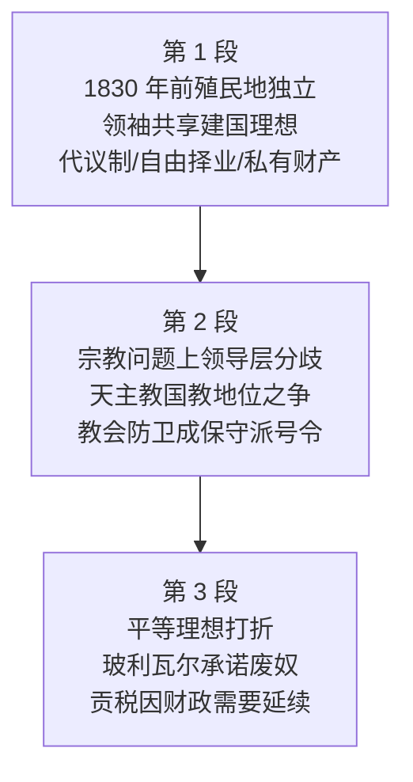

# Passage 50 · 拉美独立：理想与折扣

## 答题记录

| 轮次  | 日期         | 题号  | 正确  | 错误  | 正确率 | 用时    | 错题归因 |
| --- | --- | --- | --- | --- | --- | --- | --- |
| 1 |  | 1-20 |  |  |  |  |  |
| 2 |  | 1-20 |  |  |  |  |  |
| 3 |  | 1-20 |  |  |  |  |  |

> [!tip] 填写口径
> - **用时**以分钟计，只计做题时间，不含精读复盘。
> - **错题归因**填「题型·错误类型」，如：动词辨析·搭配不熟、逻辑关系题·句间关系误判、名词辨析·词义辨析不清。
> - 纵向看趋势：正确率升而用时过长 → 熟练度不足；用时降而正确率波动 → 上下文定位不稳。

> [!info] 文章档案
> - **来源**：考研英语（一）2007 年完形填空
> - **题材**：19 世纪拉美独立运动——西班牙、葡萄牙殖民地独立建国时，独立领袖们怀揣代议制、自由贸易、私有财产权等理想，但在宗教地位与奴隶制、贡税等旧制度上不得不打折扣
> - **结构**：3 段 / 13 句 / 20 个挖空
> - **难度**：★★★☆☆
> - **一句话主旨**：到 1830 年拉美殖民地纷纷独立，领袖们共享一整套现代国家理想；但宗教问题上领导层意见不一，平等理想（废奴、免税）也因财政需要而姗姗来迟——新国家的理想很丰满，兑现很骨感。

## 一、篇章脉络

- **第 1 段**：铺陈背景——1830 年前西属葡属殖民地成为独立国家，独立领袖们共享一整套现代建国理想（代议制政府、向人才开放的职业、工商业自由、私有财产权、个人本位的社会观）。
- **第 2 段**：转折——在宗教自由与教会地位的问题上，领导层远没有第 1 段那种一致；天主教曾是西班牙王室唯一认可的国教，多数领袖想维持其国教地位，少数想终止对其他信仰的排斥，教会防卫成了保守派的集结号。
- **第 3 段**：再转折——早期领袖的平等主义理想（废奴、免贡税）也打了折扣：玻利瓦尔得海地援助后承诺在其解放区废奴，1854 年除西班牙剩余殖民地外奴隶制已废；但结束印第安贡税与混血人种纳税的承诺兑现得慢得多，因为新国家还需要这些收入。

> [!tip] 行文逻辑
> 「理想（第 1 段，一派共享）→ 分歧（第 2 段，宗教问题 less agreement）→ 折扣（第 3 段，平等承诺 tempered）」。完形的逻辑题集中在三处段内/段间衔接：第 6 空（举例总结）、第 9 空（转折）、第 12 空（对比）。

## 二、逐段精读

### 第 1 段 · 殖民地独立与建国理想

**原文**

① By 1830 the former Spanish and Portuguese colonies had become independent nations.
② The roughly 20 million inhabitants of these nations looked hopefully〔2〕 to the future.
③ Born in the crisis of the old regime and Iberian colonialism, many of the leaders of independence **shared**〔3〕 the ideals of representative government, careers **open**〔4〕 to talent, freedom of commerce and trade, the right〔5〕 to private property, and a belief in the individual as the basis of society.
④ **Generally**〔6〕 there was a belief that the new nations should be sovereign and independent states, large enough to be economically viable and integrated by a common〔7〕 set of laws.

**译文**

① 到 1830 年，西班牙和葡萄牙的前殖民地已经变成了独立的国家。
② 这些国家约两千万的居民满怀希望地展望未来。
③ 许多独立领袖诞生于旧政权与伊比利亚殖民主义的危机之中，他们共享代议制政府、向有才能的人开放的职业、工商业自由、私有财产权以及以个人为社会基础的信念。
④ 总体而言，人们相信这些新国家应当成为主权独立的国家，疆域大到经济上可以存续，并由一套共有的法律整合为一体。

> [!note] 段落要点
> - 功能：交代历史节点（①句 By 1830）与人口规模（②句 roughly 20 million），随即用③句抛出本文核心线索——一整套并列的建国理想（five ideals），④句补充对新国家形态的总体期待（sovereign and independent states）。
> - ③句的五个并列宾语是**全篇词汇与逻辑的总纲**：第 4、5 空出自这里，第 8 空也靠与这里的 freedom of commerce and trade「同性质复现」定位。

#### 长难句 · 本段

> [!abstract] 本段第 ③ 句 · Born in the crisis of the old regime and Iberian colonialism, many of the leaders of independence shared the ideals of representative government, careers open to talent, freedom of commerce and trade, the right to private property, and a belief in the individual as the basis of society.

**结构拆解**

- **主干**：many of the leaders of independence shared the ideals...（主语 many of the leaders + 谓语 shared + 宾语 the ideals）
- **状语**：Born in the crisis... 是过去分词短语作状语，逻辑主语是 many of the leaders（领袖们「诞生于」危机之中），of the old regime 与 of Iberian colonialism 并列修饰 crisis。
- **并列宾语**：of 后接五个并列成分——① the ideals of representative government（代议制政府的理想）；② careers open to talent（向人才开放的职业）；③ freedom of commerce and trade（工商业自由）；④ the right to private property（私有财产权）；⑤ a belief in the individual as the basis of society（以个人为社会基础的信念）。
- **后置定语**：open to talent 是形容词短语修饰 careers；as the basis of society 是 as 短语修饰 the individual。

**参考译文**

许多独立领袖诞生于旧政权与伊比利亚殖民主义的危机之中，他们共享代议制政府、向有才能的人开放的职业、工商业自由、私有财产权以及以个人为社会基础的信念。

> [!tip] 拆解要点
> 五个并列宾语看似冗长，实则同构——都是「某种权利/自由/理想」；完形填第 4、5 空时正是利用这种同构性：所填词必须与其他成分的褒义色彩和「国家向好」的导向一致。

> [!abstract] 本段第 ④ 句 · Generally there was a belief that the new nations should be sovereign and independent states, large enough to be economically viable and integrated by a common set of laws.

**结构拆解**

- **主干**：there was a belief（there be 句型，a belief 是主语）
- **同位语从句**：that the new nations should be sovereign and independent states 解释 belief 的内容；从句中 should be 表「应当成为」。
- **并联形容词短语**：large enough to be... and integrated by... 共同修饰 states——前者是「形容词 + enough + 不定式」结构，后者是过去分词短语表被动（被一套法律整合）。

**参考译文**

总体而言，人们相信这些新国家应当成为主权独立的国家，疆域大到经济上可以存续，并由一套共有的法律整合为一体。

> [!tip] 拆解要点
> states 后拖了两条修饰：large enough to be economically viable（大到经济上能存续）与 integrated by a common set of laws（被共有法律整合）。判断第 6 空时正是用这条「列举 → 总结」关系：前面列了一串理想，这里总结「总体而言」。

#### 本段重点词汇

| 单词 / 短语 | 词性 | 文中意 | 常用考义与拓展 | 英文示例搭配（中译） |
| --- | --- | --- | --- | --- |
| **former** | adj. | 以前的；从前的 | 反义 latter（后者）；the former... the latter... 前者…后者… | the former Spanish and Portuguese colonies（西班牙和葡萄牙的前殖民地） |
| **colony** | n. | 殖民地 | 形容词 colonial；colonialism n. 殖民主义 | colonies had become independent nations（殖民地已成为独立国家） |
| **independent** | adj. | 独立的；自主的 | 名词 independence；反义 dependent（依赖的） | had become independent nations（已成为独立国家） |
| **roughly** | adv. | 大约；粗略地 | 同义 approximately；rough adj. 粗糙的／粗略的 | The roughly 20 million inhabitants（大约两千万居民） |
| **inhabitants** | n. | 居民 | 动词 inhabit（居住）；近义 resident／dweller | 20 million inhabitants of these nations（这些国家的两千万居民） |
| **hopefully** | adv. | 满怀希望地 | 形容词 hopeful（怀有希望的）≠ hopeless（绝望的） | looked hopefully to the future（满怀希望地展望未来） |
| **look to** | （短语） | 期待；指望；展望 | look to sb for sth 指望某人；look forward to 期待（to 是介词） | looked hopefully to the future（满怀希望地面向未来） |
| **crisis** | n. | 危机；危局 | 复数 crises；economic crisis 经济危机 | Born in the crisis of the old regime（诞生于旧政权的危机中） |
| **regime** | n. | 政权；政体；制度 | 近义 administration／government（政权） | the old regime（旧政权） |
| **colonialism** | n. | 殖民主义 | colony → colonial（殖民的）→ colonialism；colonize v. 殖民 | Iberian colonialism（伊比利亚殖民主义） |
| **leaders** | n. | 领袖；领导者 | 动词 lead；leadership n. 领导层／领导力 | leaders of independence（独立领袖们） |
| **share** | v. | 共有；共同具有 | 熟词僻义：常用义「分享；股份」 | shared the ideals of...（共享…的理想） |
| **ideals** | n. | 理想 | 形容词 ideal（理想的；完美的）；idealism n. 理想主义 | the ideals of representative government（代议制政府的理想） |
| **representative** | adj. | 代议制的；代表性的 | representative government 代议制政府；名词 representative 代表 | representative government（代议制政府） |
| **careers** | n. | 职业；生涯 | career opportunities 职业机会；a career in law 法律职业生涯 | careers open to talent（向有才能的人开放的职业） |
| **open** | adj. | 开放的；空缺的 | 熟词僻义：careers open to talent 向…开放的；the job is still open 职位仍空缺 | careers open to talent（向人才开放的职业） |
| **talent** | n. | 才华；才能；人才 | 形容词 talented（有才华的） | careers open to talent（向人才开放的职业） |
| **commerce** | n. | 商业；贸易 | 近义 trade；e-commerce 电子商务；commercial adj. 商业的 | freedom of commerce and trade（工商业自由） |
| **trade** | n. | 贸易；交易 | 动词 trade（做买卖）；trade barrier 贸易壁垒 | freedom of commerce and trade（工商业自由） |
| **property** | n. | 财产；资产；房地产 | private property 私有财产；intellectual property 知识产权 | the right to private property（私有财产权） |
| **belief** | n. | 信念；信仰；相信 | 动词 believe；a belief in... 对…的信念 | a belief in the individual（对个人价值的信念） |
| **individual** | n. | 个人；个体 | 形容词 individual（个人的；个别的） | the individual as the basis of society（作为社会基础的个人） |
| **basis** | n. | 基础；根据 | on the basis of... 在…基础上；复数 bases | the basis of society（社会的基础） |
| **generally** | adv. | 总体上；普遍地 | generally speaking 一般而言；general adj. 总体的 | Generally there was a belief（总体而言，人们相信） |
| **sovereign** | adj. | 主权的；独立自主的 | sovereignty n. 主权；sovereign state 主权国家 | sovereign and independent states（主权独立的国家） |
| **viable** | adj. | 可存续的；行得通的 | economically viable 经济上能存续；名词 viability | economically viable（在经济上能存续） |
| **integrated** | adj. | 整合为一体的；一体化的 | 动词 integrate；integration n. 一体化；反义 disintegrated | integrated by a common set of laws（由一套共有的法律整合） |
| **common** | adj. | 共同的；共有的 | in common 共同的；common sense 常识 | a common set of laws（一套共有的法律） |
| **a set of** | （短语） | 一套；一组 | 后接复数名词；a set of rules 一套规则 | a common set of laws（一套共有的法律） |

### 第 2 段 · 宗教问题上的分歧

**原文**

① On the issue of **freedom**〔8〕 of religion and the position of the Church, **however**〔9〕, there was less agreement **among**〔10〕 the leadership.
② Roman Catholicism had been the state religion and the only one **allowed**〔11〕 by the Spanish Crown.
③ **While**〔12〕 most leaders sought to **maintain**〔13〕 Catholicism as the official religion of the new states, some sought to end the **exclusion**〔14〕 of other faiths.
④ The defense of the Church became a rallying **cry**〔15〕 for the conservative forces.

**译文**

① 然而，在宗教自由与教会地位的问题上，领导层之间的共识要少得多。
② 罗马天主教曾是国教，也是西班牙王室唯一认可的宗教。
③ 尽管多数领袖试图维持天主教作为新国家官方宗教的地位，一些人却试图终结对其他信仰的排斥。
④ 保卫教会成了保守势力的战斗口号。

> [!note] 段落要点
> - 功能：全篇第一个转折点。①句用 however + less agreement 明确宣布「宗教问题上没那么一致」，②句交代历史前提（天主教＝王室唯一认可的国教），③句用 While 对比列出两派立场（多数维持 vs 少数开放），④句点出这一分歧的政治后果（教会防卫成为保守派集结号）。
> - 本段是逻辑关系词的高发区：第 9 空（however 表转折）、第 12 空（While 表对比）都在本段。

#### 长难句 · 本段

> [!abstract] 本段第 ② 句 · Roman Catholicism had been the state religion and the only one allowed by the Spanish Crown.

**结构拆解**

- **主干**：Roman Catholicism had been the state religion and the only one（主语 + 过去完成时系表结构）
- **过去完成时**：had been 表示「在过去某个时间点之前就已如此」，为后文的宗教政策提供历史背景。
- **后置定语**：allowed by the Spanish Crown 是过去分词短语，修饰 the only one（唯一被西班牙王室认可的宗教）；one 指代 religion，避免重复。

**参考译文**

罗马天主教曾是国教，也是西班牙王室唯一认可的宗教。

> [!tip] 拆解要点
> the only one allowed by... 是「代词 + 过去分词后置定语」的常见压缩结构，还原成从句就是 the only one that was allowed by...。第 11 空填 allowed，正是利用「天主教被王室认可」这一被动关系。

> [!abstract] 本段第 ③ 句 · While most leaders sought to maintain Catholicism as the official religion of the new states, some sought to end the exclusion of other faiths.

**结构拆解**

- **主从复合句**：While 引导让步/对比状语从句「尽管多数领袖……，一些人却……」，从句与主句主语形成 most vs some 的数量对比。
- **从句主干**：most leaders sought to maintain Catholicism as the official religion（seek to do 试图做；maintain... as... 把…维持为…）
- **主句主干**：some sought to end the exclusion of other faiths（end the exclusion 终结排斥；of other faiths 修饰 exclusion）

**参考译文**

尽管多数领袖试图维持天主教作为新国家官方宗教的地位，一些人却试图终结对其他信仰的排斥。

> [!tip] 拆解要点
> maintain... as... 与 end the exclusion of... 构成方向相反的两个动作：一个维持官方地位，一个终止排斥。判断第 13 空时，as「作为」最贴合「维持天主教作为官方宗教」的搭配；第 14 空则靠「of 结构 + 动词 end」定位到 exclusion。

#### 本段重点词汇

| 单词 / 短语 | 词性 | 文中意 | 常用考义与拓展 | 英文示例搭配（中译） |
| --- | --- | --- | --- | --- |
| **issue** | n. | 问题；议题 | on the issue of... 在…问题上；近义 matter／topic | on the issue of freedom of religion（在宗教自由问题上） |
| **religion** | n. | 宗教 | 形容词 religious；religious freedom 宗教自由 | freedom of religion（宗教自由） |
| **position** | n. | 地位；位置 | 熟词僻义：此处指「地位」；take up a position 采取立场 | the position of the Church（教会的地位） |
| **Church** | n. | 教会 | 大写 the Church 特指（天主）教会；church 小写指教堂 | the position of the Church（教会的地位） |
| **freedom** | n. | 自由 | freedom of religion 宗教自由；freedom of speech 言论自由 | freedom of religion and the position of the Church（宗教自由与教会地位） |
| **agreement** | n. | 一致；共识；同意 | 动词 agree；less agreement 共识更少 | less agreement among the leadership（领导层中共识更少） |
| **however** | adv. | 然而 | 转折副词，可插在句中（逗号隔开）；近义 nevertheless | ..., however, there was less agreement（然而，共识要少得多） |
| **among** | prep. | 在……之中（三者以上） | 辨析 between（二者之间） | less agreement among the leadership（领导层之间的分歧） |
| **leadership** | n. | 领导层；领导者们 | 动词 lead；leadership 也可指「领导力」 | among the leadership（在领导层当中） |
| **Catholicism** | n. | 天主教 | Roman Catholicism 罗马天主教；Catholic adj./n. | Roman Catholicism（罗马天主教） |
| **Crown** | n. | 王冠；王权；王室 | the Spanish Crown 西班牙王室；crown prince 王储 | the Spanish Crown（西班牙王室） |
| **allow** | v. | 允许；准许；承认 | allow doing 允许做；allowable adj. 可允许的 | the only one allowed by the Spanish Crown（王室唯一认可的宗教） |
| **maintain** | v. | 维持；保持；保养 | maintenance n. 维持；maintain... as... 把…维持为… | sought to maintain Catholicism as...（试图维持天主教作为…） |
| **official** | adj. | 官方的；正式的 | 名词 official 官员；officially adv. 正式地 | the official religion（官方宗教） |
| **exclusion** | n. | 排斥；排除 | 动词 exclude；反义 inclusion | end the exclusion of other faiths（终结对其他信仰的排斥） |
| **faiths** | n. | 信仰；宗教 | 可数：other faiths 其他宗教；不可数：faith 信念／信任 | the exclusion of other faiths（对其他信仰的排斥） |
| **defense** | n. | 保卫；捍卫；防御 | the defense of... 对…的保卫；近义 defence（英式拼写） | The defense of the Church（保卫教会） |
| **cry** | n. | 口号；呼喊 | rallying cry 战斗口号；a far cry from 与…大不相同 | a rallying cry（战斗口号） |
| **conservative** | adj. | 保守的 | 名词 conservatism（保守主义）；反义 radical／progressive | the conservative forces（保守势力） |
| **forces** | n. | 力量；势力 | the forces of... …的力量；armed forces 武装部队 | the conservative forces（保守势力） |

### 第 3 段 · 平等理想的兑现与折扣

**原文**

① The ideals of the early leaders of independence were often egalitarian, valuing equality of everything.
② Bolivar had received aid from Haiti and had **promised**〔16〕 in return to abolish slavery in the areas he liberated.
③ By 1854 slavery had been abolished everywhere except Spain's **remaining**〔17〕 colonies.
④ Early promises to end Indian tribute and taxes on people of mixed origin came much **slower**〔18〕 because the new nations still needed the revenue such policies **produced**〔19〕.
⑤ Egalitarian sentiments were often tempered by fears that the mass of the population was **unprepared**〔20〕 for self-rule and democracy.

**译文**

① 早期独立领袖们的理想往往是平等主义的，珍视万事万物的平等。
② 玻利瓦尔曾接受海地的援助，并承诺作为回报在其解放的地区废除奴隶制。
③ 到 1854 年，奴隶制在除西班牙剩余殖民地以外的所有地方都已被废除。
④ 早先终结印第安人贡税与混血人种纳税的承诺兑现得慢得多，因为新国家仍然需要这些政策所产生的收入。
⑤ 平等主义情绪常常因为担忧——担忧民众尚未准备好接受自治与民主——而有所缓和。

> [!note] 段落要点
> - 功能：全篇第二个转折点——从「理想宣言」落到「现实兑现」。①句总说平等主义理想；②③句讲废奴承诺的兑现（玻利瓦尔受海地援助→承诺→1854 年基本兑现）；④句用 but/came much slower 转进：免税承诺慢得多，原因是财政需要；⑤句解释更深层原因——民众尚未准备好自治与民主，平等情绪因此被缓和。
> - ②句的 promised 与④句的 Early promises 是**原词复现**（第 16 题线索）；③句 By 1854 与①段首句 By 1830 是**数字线索对**（第 17 题线索）。

#### 长难句 · 本段

> [!abstract] 本段第 ② 句 · Bolivar had received aid from Haiti and had promised in return to abolish slavery in the areas he liberated.

**结构拆解**

- **主干**：Bolivar had received aid... and had promised...（主语 + 两个过去完成时并列谓语）
- **并列谓语**：had received aid from Haiti（接受海地援助）＋ had promised in return to abolish slavery（承诺作为回报废奴）；in return 是插入的介词短语，表「作为回报」。
- **后置定语**：to abolish slavery in the areas 是不定式短语作 promised 的宾语；he liberated 是省略了关系代词的定语从句，修饰 the areas。

**参考译文**

玻利瓦尔曾接受海地的援助，并承诺作为回报在其解放的地区废除奴隶制。

> [!tip] 拆解要点
> 过去完成时 had received / had promised 表示在「过去将来」（废奴兑现）之前已完成；in return 串起「受助 → 承诺」的因果回报链，第 16 空正是靠它与下句 promises 的复现关系锁定 promised。

> [!abstract] 本段第 ④ 句 · Early promises to end Indian tribute and taxes on people of mixed origin came much slower because the new nations still needed the revenue such policies produced.

**结构拆解**

- **主干**：Early promises... came much slower（主语 promises + 谓语 came + 表语 slower；came 是系动词用法「变得」）
- **后置定语**：to end Indian tribute and taxes on people of mixed origin 是不定式短语修饰 promises，其中 on people of mixed origin 又修饰 tribute and taxes；of mixed origin（混血的）是介词短语修饰 people。
- **原因状语从句**：because the new nations still needed the revenue such policies produced；从句内 such policies produced 是省略了关系代词的定语从句，修饰 the revenue（这些政策所产生的收入）。

**参考译文**

早先终结印第安人贡税与混血人种纳税的承诺兑现得慢得多，因为新国家仍然需要这些政策所产生的收入。

> [!tip] 拆解要点
> came much slower 中 slower 是副词化的形容词比较级（修饰 came）；because 从句是全句的因果枢纽——「需要收入」所以「兑现更慢」，第 18 空 slower 与第 19 空 produced 分别由这条因果链的两端锁定。

> [!abstract] 本段第 ⑤ 句 · Egalitarian sentiments were often tempered by fears that the mass of the population was unprepared for self-rule and democracy.

**结构拆解**

- **主干**：Egalitarian sentiments were often tempered by fears（主语 + 被动语态 were tempered + by 短语）
- **同位语从句**：that the mass of the population was unprepared for self-rule and democracy 解释 fears 的内容；从句主语是 the mass of the population（民众的大多数），表语是 unprepared for...（对…没有准备的）。
- **被动语态**：were tempered by... 被…所缓和；temper 此处是「使缓和、使温和」的熟词僻义。

**参考译文**

平等主义情绪常常因为担忧——担忧民众尚未准备好接受自治与民主——而有所缓和。

> [!tip] 拆解要点
> the mass of the population 中 mass 表「大多数、大众」（不是「质量」）；unprepared for 是「对…无准备的」——第 20 空靠全文 hopeful/valuing 的褒义导向排除 hostile to 与 pessimistic about，再由「tempered by fears」的原因解释选中 unprepared for。

#### 本段重点词汇

| 单词 / 短语 | 词性 | 文中意 | 常用考义与拓展 | 英文示例搭配（中译） |
| --- | --- | --- | --- | --- |
| **egalitarian** | adj. | 平等主义的 | egalitarianism n. 平等主义；近义 equality-minded | often egalitarian（往往是平等主义的） |
| **valuing** | v. | 珍视；重视 | value sth as... 把…看得很重；value n. 价值 | valuing equality of everything（珍视万事万物的平等） |
| **equality** | n. | 平等 | 形容词 equal；inequality n. 不平等；equality of opportunity 机会平等 | equality of everything（万事万物的平等） |
| **aid** | n. | 援助；帮助 | 动词 aid（帮助）；first aid 急救；foreign aid 外援 | received aid from Haiti（接受海地的援助） |
| **promised** | v. | 承诺；许诺 | promise to do 承诺做；名词 promise（与下句复现） | had promised in return to abolish slavery（承诺作为回报废奴） |
| **in return** | （短语） | 作为回报 | in return for... 作为对…的回报 | had promised in return（承诺作为回报） |
| **abolish** | v. | 废除；废止 | abolition n. 废除；abolish slavery 废除奴隶制 | to abolish slavery（废除奴隶制） |
| **slavery** | n. | 奴隶制 | slave n. 奴隶；abolition of slavery 废奴 | abolish slavery in the areas（在其解放地区废奴） |
| **liberated** | v. | 解放 | liberate v. 解放；liberation n. 解放 | the areas he liberated（他解放的地区） |
| **remaining** | adj. | 剩余的；剩下的 | remain v. 剩余；the remaining time 剩余时间 | Spain's remaining colonies（西班牙剩余的殖民地） |
| **tribute** | n. | 贡品；贡税 | pay tribute to... 向…进贡；向…致敬 | end Indian tribute（终结印第安人贡税） |
| **taxes** | n. | 税；税款 | tax n./v. 税收／征税；tax cut 减税 | taxes on people of mixed origin（对混血人种的税） |
| **mixed** | adj. | 混合的；混血的 | mixed origin 混血出身；mixed feelings 复杂情绪 | people of mixed origin（混血人种） |
| **origin** | n. | 出身；血统；起源 | of... origin …出身的；originate v. 起源 | people of mixed origin（混血出身的人） |
| **revenue** | n. | 收入；税收；岁入 | tax revenue 税收收入；the revenue such policies produced（这些政策产生的收入） | the new nations still needed the revenue（新国家仍需要这笔收入） |
| **produced** | v. | 生产；产生 | produce revenue 产生收入；product n. 产品 | the revenue such policies produced（这些政策产生的收入） |
| **sentiments** | n. | 情绪；情感；观点 | sentiment n. 感情；public sentiment 民意 | Egalitarian sentiments（平等主义情绪） |
| **tempered** | v. | 使缓和；使温和 | temper v. 调和；be tempered by... 被…所缓和 | were often tempered by fears（常因担忧而缓和） |
| **fears** | n. | 担忧；恐惧 | fear that...（同位语从句）；for fear of... 生怕 | tempered by fears that...（因担忧…而缓和） |
| **mass** | n. | 大多数；大众 | the mass of... …的大多数；mass media 大众传媒 | the mass of the population（人口中的大多数） |
| **population** | n. | 人口；民众 | populate v. 居住于；population growth 人口增长 | the mass of the population（民众的大多数） |
| **unprepared** | adj. | 无准备的；未准备好的 | be unprepared for... 对…没有准备；反义 prepared | unprepared for self-rule and democracy（对自治与民主尚无准备） |
| **self-rule** | n. | 自治；自我统治 | self- 前缀表「自我」；self-government 同义 | self-rule and democracy（自治与民主） |
| **democracy** | n. | 民主；民主制 | democratic adj. 民主的；democrat n. 民主主义者 | self-rule and democracy（自治与民主） |

## 三、全篇重点词汇汇总（自测用）

> [!info] 说明
> 本表只列「单词 / 词性 / 所在段」，不含释义与搭配，用于遮表自测：说出词义后再回该段核对。
> 收录**全篇所有段落词汇，共 73 条，不删减**，与各段「本段重点词汇」等长同源。

| 单词 / 短语 | 词性 | 所在段 |
| --- | --- | --- |
| **former** | adj. | 第 1 段 |
| **colony** | n. | 第 1 段 |
| **independent** | adj. | 第 1 段 |
| **roughly** | adv. | 第 1 段 |
| **inhabitants** | n. | 第 1 段 |
| **hopefully** | adv. | 第 1 段 |
| **look to** | （短语） | 第 1 段 |
| **crisis** | n. | 第 1 段 |
| **regime** | n. | 第 1 段 |
| **colonialism** | n. | 第 1 段 |
| **leaders** | n. | 第 1 段 |
| **share** | v. | 第 1 段 |
| **ideals** | n. | 第 1 段 |
| **representative** | adj. | 第 1 段 |
| **careers** | n. | 第 1 段 |
| **open** | adj. | 第 1 段 |
| **talent** | n. | 第 1 段 |
| **commerce** | n. | 第 1 段 |
| **trade** | n. | 第 1 段 |
| **property** | n. | 第 1 段 |
| **belief** | n. | 第 1 段 |
| **individual** | n. | 第 1 段 |
| **basis** | n. | 第 1 段 |
| **generally** | adv. | 第 1 段 |
| **sovereign** | adj. | 第 1 段 |
| **viable** | adj. | 第 1 段 |
| **integrated** | adj. | 第 1 段 |
| **common** | adj. | 第 1 段 |
| **a set of** | （短语） | 第 1 段 |
| **issue** | n. | 第 2 段 |
| **religion** | n. | 第 2 段 |
| **position** | n. | 第 2 段 |
| **Church** | n. | 第 2 段 |
| **freedom** | n. | 第 2 段 |
| **agreement** | n. | 第 2 段 |
| **however** | adv. | 第 2 段 |
| **among** | prep. | 第 2 段 |
| **leadership** | n. | 第 2 段 |
| **Catholicism** | n. | 第 2 段 |
| **Crown** | n. | 第 2 段 |
| **allow** | v. | 第 2 段 |
| **maintain** | v. | 第 2 段 |
| **official** | adj. | 第 2 段 |
| **exclusion** | n. | 第 2 段 |
| **faiths** | n. | 第 2 段 |
| **defense** | n. | 第 2 段 |
| **cry** | n. | 第 2 段 |
| **conservative** | adj. | 第 2 段 |
| **forces** | n. | 第 2 段 |
| **egalitarian** | adj. | 第 3 段 |
| **valuing** | v. | 第 3 段 |
| **equality** | n. | 第 3 段 |
| **aid** | n. | 第 3 段 |
| **promised** | v. | 第 3 段 |
| **in return** | （短语） | 第 3 段 |
| **abolish** | v. | 第 3 段 |
| **slavery** | n. | 第 3 段 |
| **liberated** | v. | 第 3 段 |
| **remaining** | adj. | 第 3 段 |
| **tribute** | n. | 第 3 段 |
| **taxes** | n. | 第 3 段 |
| **mixed** | adj. | 第 3 段 |
| **origin** | n. | 第 3 段 |
| **revenue** | n. | 第 3 段 |
| **produced** | v. | 第 3 段 |
| **sentiments** | n. | 第 3 段 |
| **tempered** | v. | 第 3 段 |
| **fears** | n. | 第 3 段 |
| **mass** | n. | 第 3 段 |
| **population** | n. | 第 3 段 |
| **unprepared** | adj. | 第 3 段 |
| **self-rule** | n. | 第 3 段 |
| **democracy** | n. | 第 3 段 |

> [!warning] 熟词僻义专列（挖空答案词，详见「五、题目分析」）
> - **inhabitant** n. 居民（第 1 题答案；常用义多见于 inhabit 居住）
> - **hopefully** adv. 满怀希望地（第 2 题答案；易与 cheerful（兴高采烈）混淆）
> - **share** v. 共有；共同持有（第 3 题答案，常用义「分享；股份」）
> - **open** adj. 开放的；空缺的（第 4 题答案，careers open to talent）
> - **right** n. 权利（第 5 题答案，常用义 adj. 正确的）
> - **generally** adv. 总体上（第 6 题答案；与 presumably 的区别见第 6 题辨析）
> - **common** adj. 共同的；共有的（第 7 题答案，常用义「普通的」）
> - **freedom** n. 自由（第 8 题答案，与第 1 段 freedom of commerce 复现）
> - **allowed** v. 认可；准许（第 11 题答案，the only one allowed by...）
> - **exclusion** n. 排斥（第 14 题答案，动词 exclude）
> - **cry** n. 口号（第 15 题答案，rallying cry 战斗口号）
> - **promised** v. 承诺（第 16 题答案，与④句 promises 复现）
> - **remaining** adj. 剩余的（第 17 题答案，与 former 反义对照）
> - **produced** v. 产生（第 19 题答案，the revenue such policies produced）

> [!example] 同义替换链（阅读题高频）
> - **独立国家**：independent nations ≈ sovereign and independent states（第 1 段①句 ↔ 第 1 段④句）
> - **理想**：ideals = beliefs（第 1 段③句 ideals ↔ ④句 a belief）
> - **自由**：freedom of commerce and trade ↔ freedom of religion（第 1 段③句 ↔ 第 2 段①句，第 8 题复现线索）
> - **领导者**：leaders of independence ↔ the leadership（第 1 段③句 ↔ 第 2 段①句）
> - **民众**：inhabitants ≈ the mass of the population（第 1 段②句 ↔ 第 3 段⑤句）

## 四、知识点补充

> [!question] 背景知识
> - **拉美独立运动**：19 世纪初，西班牙、葡萄牙在拉丁美洲的殖民地相继发动独立战争（约 1810—1830 年间）。到 1820 年代中期，大部分殖民地成为独立国家。文中提到的 Bolivar（西蒙·玻利瓦尔）是委内瑞拉革命家，领导了委内瑞拉、哥伦比亚、厄瓜多尔、秘鲁、玻利维亚等地的独立运动，被尊为「解放者」。
> - **海地（Haiti）与废奴**：海地是 1804 年独立的加勒比国家，由奴隶起义建立。玻利瓦尔在独立战争中曾获海地援助，作为回报承诺在其解放地区废除奴隶制——这正是第 3 段②句所写的历史事实。
> - **国教与王权**：在西班牙殖民统治下，罗马天主教是唯一获得官方认可的宗教（the state religion and the only one allowed by the Spanish Crown）。独立后「是否保留天主教的国教地位」成为各新生国家政治斗争的焦点，保守派往往以「保卫教会」为旗号（rallying cry）。
> - **印第安贡税与人头税**：殖民地时期西班牙王室向印第安原住民征收贡税（tribute），并按血统阶层（ peninsulares／criollos／mestizos／indios ）征税。独立后新国家财政拮据，短期内仍依赖这些收入，所以「取消旧税」的承诺只能慢慢兑现。

> [!warning] 语法点
> - **过去分词短语作后置定语**：the only one allowed by the Spanish Crown ＝ the only one that was allowed by...（第 11 空所在）；the areas he liberated ＝ the areas that he liberated（第 3 段②句）。完形与阅读中大量出现，看到「名词 + 过去分词」先还原从句。
> - **省略关系词的定语从句**：the revenue such policies produced ＝ the revenue which/that such policies produced（第 19 空所在）；先行词 policies 在从句中作主语，关系代词可省。
> - **While 引导对比状语从句**：While most leaders sought..., some sought...「尽管／然而多数……，一些人却……」，从句与主句形成对照，不表时间。区别于 while 表「当…时候」或「只要」。
> - **形容词 + enough + 不定式**：large enough to be economically viable（大到足以在经济上存续），enough 修饰形容词/副词时必须后置。
> - **there was a belief that...**：that 引导同位语从句解释 belief 的内容；同类结构还有 There is no doubt that... / evidence that...。
> - **come 作系动词**：promises came much slower（承诺兑现得更慢），come 此处相当于 became，后接形容词比较级；类似用法的还有 come true / come easy。

> [!success] 写作可迁移句型
> - **By + 年份, ... had become...**：「到某年，…已经成为…」，历史叙述开篇常用完成时。
> - **On the issue of..., however, there was less agreement...**：「然而，在…问题上，共识要少得多」，用于引出争议点，转折 + 比较级双重信号。
> - **While most..., some...**：「尽管多数…，一些人却…」，对比两派立场的万能句式。
> - **... became a rallying cry for...**：「…成了…的战斗口号」，用于描述口号／旗帜性主张的凝聚作用。
> - **... came much slower because...**：「…兑现得慢得多，因为…」，理想与现实反差的收束句型。

> [!danger] 易混辨析
> - **inhabitant / resident / native / people / individual**：inhabants 泛指「（某地）居民」（可数，与 of 连用）；resident 常指「定居者、住户」；native 强调「本地出生的人」；peoples 是「民族」（复数义）；individual 强调「个人」（与集体相对）。第 1 题四选项恰好覆盖这组词，see 第 1 题辨析。
> - **presumably / generally / incidentally / obviously**：presumably「据推测」（带主观推测色彩）；generally「总体上、一般而言」（用于总结）；incidentally「顺便提一句」（话题插入）；obviously「显然地」（强调显而易见）。第 6 题的区分点在于空处需要「列举之后的总结」而非「推测」。
> - **hopefully / cheerfully**：hopefully「满怀希望地」（对未来有期待）；cheerfully「兴高采烈地」（当下情绪高涨）。第 2 题中 the future 指向未来，故 hopefully 更准。
> - **former / remaining / original / controlling**：former「以前的、从前的」（时间上已过去）；remaining「剩余的、还在的」（与 abolished everywhere except 呼应）；original「最初的、原先的」；controlling「控制中的」（现在分词表主动，而殖民地是被控制的）。第 17 题四选项构成「时间／状态」对照。
> - **among / between**：among 用于三者及以上之间，between 用于二者之间。领导层显然不止两人，故选 among（第 10 题）。

## 五、题目分析

> [!info] 题目总览
> | 题号 | 题型 | 定位 | 答案 |
> | --- | --- | --- | --- |
> | 1 | 名词辨析 | 第 1 段②句 | B |
> | 2 | 副词辨析 | 第 1 段②句 | D |
> | 3 | 动词辨析 | 第 1 段③句 | A |
> | 4 | 形容词辨析 | 第 1 段③句 | C |
> | 5 | 名词辨析 | 第 1 段③句 | C |
> | 6 | 副词辨析 | 第 1 段④句 | D |
> | 7 | 形容词辨析 | 第 1 段④句 | B |
> | 8 | 名词辨析 | 第 2 段①句 | A |
> | 9 | 逻辑关系题 | 第 2 段①句 | B |
> | 10 | 介词搭配 | 第 2 段①句 | C |
> | 11 | 动词辨析 | 第 2 段②句 | A |
> | 12 | 逻辑关系题 | 第 2 段③句 | D |
> | 13 | 介词搭配 | 第 2 段③句 | A |
> | 14 | 名词辨析 | 第 2 段③句 | C |
> | 15 | 名词辨析 | 第 2 段④句 | B |
> | 16 | 动词辨析 | 第 3 段②句 | D |
> | 17 | 形容词辨析 | 第 3 段③句 | C |
> | 18 | 副词辨析 | 第 3 段④句 | A |
> | 19 | 动词辨析 | 第 3 段④句 | B |
> | 20 | 形容词词组辨析 | 第 3 段⑤句 | D |

### 第 1 题 · 名词辨析

> [!question] 原题
> The roughly 20 million ______ of these nations looked hopefully to the future.
> - A. natives
> - B. inhabitants
> - C. peoples
> - D. individuals

**正确答案**：**B. inhabitants（居民）**

**辨析**：空所在句讲「这些国家约两千万______展望未来」，20 million 与 of these nations 之间的词须同时满足数量（两千万）与所属（这些国家的）两个限定。四个选项乍看都近「人」，但 [C] peoples 是「民族」（复数名词 peoples），与 20 million 的数量级和「国民整体」的意思都相差甚远，首先排除；[D] individuals（个人）强调「个体」，与 20 million 的集体指称不搭。真正的区分在 [A] natives（本地人、当地人）与 [B] inhabitants（居民）：natives 强调「土生土长的本地人」，而本文语境是「这些新国家的全体居民」，inhabitants 泛指「（某地的）居民」，与 of these nations 的搭配更自然，故选 [B]。

### 第 2 题 · 副词辨析

> [!question] 原题
> The roughly 20 million inhabitants of these nations looked ______ to the future.
> - A. confusedly
> - B. cheerfully
> - C. worriedly
> - D. hopefully

**正确答案**：**D. hopefully（满怀希望地）**

**辨析**：本题可用总分结构对照法。空所在句是明显的总述句，宾语是 the future（前途），所填副词要体现全篇的感情色彩。下文的并列分述信息——the ideals（理想）、careers open to talent（向人才开放的职业）、freedom of commerce and trade（工商业自由）、the right to private property（私有财产权）、a belief in sovereign and independent states（主权独立的信念）——全是正面表达，都在描述国家向「好的方向」发展；再结合首句「殖民地变为独立国家」的背景，全民对未来的态度只能是积极、满怀希望的，故选 [D] hopefully。[A] confusedly（迷惑地）与 [C] worriedly（担忧地）是负面导向，直接排除；[B] cheerfully（兴高采烈地）虽然方向大致正确，但它侧重的是「当下情绪上的兴高采烈」，而句中 look to the future 指向对前途的期待，hopefully 更准确。

### 第 3 题 · 动词辨析

> [!question] 原题
> ...many of the leaders of independence ______ the ideals of representative government, careers open to talent, freedom of commerce and trade, the right to private property, and a belief in the individual as the basis of society.
> - A. shared
> - B. forgot
> - C. attained
> - D. rejected

**正确答案**：**A. shared（共有；共同持有）**

**辨析**：先定位主语 many of the leaders of independence（独立领袖们）与宾语 the ideals...（一长串理想）。宾语全是对国家发展有利的正面概念，且全篇导向是「hopefully」，因此领袖们对理想只能是支持和赞同——[B] forgot（忘记）与 [D] rejected（拒绝）直接排除。答案在 [A] shared（分享、共有）与 [C] attained（获得、得到）之间：宾语是 the ideals（理想），「获得理想」搭配生硬，而「共享理想」既合搭配又呼应第 1 段④句的 a belief 与第 2 段①句 less agreement（正是先「共有」才谈得上「分歧减少」），故选 [A]。

### 第 4 题 · 形容词辨析

> [!question] 原题
> ...the ideals of representative government, careers ______ to talent, freedom of commerce and trade...
> - A. related (to)
> - B. close (to)
> - C. open (to)
> - D. devoted (to)

**正确答案**：**C. open (to)（对……开放的）**

**辨析**：空处要说明 careers（职业）与 talent（才华、有才能的人）之间的关系，且该短语处于一列同性质的理想之中（与 representative government、freedom of commerce and trade 并列），必须同样表达「国家向好」的导向。四个选项代入后，只有 [C] open to（对……开放）能表达「职业向有才能的人开放」这一现代用人观念，与全文理想色彩一致。[A] related to（与……有关）只说明关联，不带价值导向；[B] close to（接近）指空间或关系上的靠近，与 careers 和 talent 的搭配不合；[D] devoted to（致力于）主语通常是人，搭配不当，均排除。

### 第 5 题 · 名词辨析

> [!question] 原题
> ...freedom of commerce and trade, the ______ to private property, and a belief in the individual...
> - A. access
> - B. succession
> - C. right
> - D. return

**正确答案**：**C. right（权利）**

**辨析**：本空也处在那组并列理想之中，所填名词必须与其他成分（the ideals of representative government、freedom of commerce and trade、a belief in the individual）性质一致——都是自由主义的正面价值。the right to private property（私有财产权）正是自由主义政治哲学的经典表述，且 right（权利）与 freedom（自由）同属一个语义场，[C] 当选。[A] access（使用或见到的机会、权利）侧重「接触的途径」，与 private property 搭配不如 right 法定；[B] succession（继承、继任）指接替职位或王位；[D] return（返回）与语境完全无关，均排除。

### 第 6 题 · 副词辨析

> [!question] 原题
> ______ there was a belief that the new nations should be sovereign and independent states...
> - A. Presumably
> - B. Incidentally
> - C. Obviously
> - D. Generally

**正确答案**：**D. Generally（总体上；普遍地）**

**辨析**：本题考上下文逻辑关系。空前刚刚列举了一长串具体理想（代议制政府、向人才开放的职业、工商业自由、私有财产权、个人本位），空后 there was a belief... 是对前述内容的总结概括（而且 belief 与空前 ideals、a belief 同义复现）——这是典型的「先分述、后总结」结构，句首需要的是一个表总结的副词。[D] Generally 用于句首时相当于 generally speaking（总体而言），恰好承担这个功能，故选 [D]。[A] Presumably（据推测）是说话人的主观推测，与「总结既定列举」的功能不符；[B] Incidentally（顺便提一句）用于插入话题；[C] Obviously（显然）强调显而易见，都不承担总结功能。

### 第 7 题 · 形容词辨析

> [!question] 原题
> ...large enough to be economically viable and integrated by a ______ set of laws.
> - A. unique
> - B. common
> - C. particular
> - D. typical

**正确答案**：**B. common（共同的；共有的）**

**辨析**：空所在部分是 integrated by a ______ set of laws（被一套______的法律整合为一体），其中 integrated（整合、使成一体）是关键线索——多个地区要整合成一个国家，法律上必须共享同一套体系。而且后文立刻用「在宗教问题上，人们意见就不那么一致了」作反衬，可见在国家法律层面大家的意见是统一的，故选 [B] common（共有的、共用的）。[A] unique（独特的）强调独一无二，与「整合」所需的一致性无关；[C] particular（特定的）与 [D] typical（典型的）都只说明「某一套」或「代表性」，不能表达「共用」之意，均排除。

### 第 8 题 · 名词辨析

> [!question] 原题
> On the issue of ______ of religion and the position of the Church...
> - A. freedom
> - B. origin
> - C. impact
> - D. reform

**正确答案**：**A. freedom（自由）**

**辨析**：本题是典型的复现结构题。本空出现在第 2 段首句 On the issue of ______ of religion and the position of the Church，而这一句是全段的总述句，点明本段主题与「宗教和教会」有关。第 2 段与第 1 段谈论的是同类问题，比照第 1 段的 the ideals of representative government, freedom of commerce and trade 等，可知本段对应的正是 freedom of religion and the position of the Church（宗教自由与教会地位），故选 [A] freedom。[B] origin（起源）、[C] impact（影响）、[D] reform（改革）与文章主线关系都不大，均排除。

### 第 9 题 · 逻辑关系题

> [!question] 原题
> On the issue of freedom of religion and the position of the Church, ______, there was less agreement among the leadership.
> - A. therefore
> - B. however
> - C. indeed
> - D. moreover

**正确答案**：**B. however（然而）**

**辨析**：关键线索是 less agreement——这是个明显的比较级，意味着必须有比较对象，而比较对象只能是第 1 段。第 1 段说领袖们 shared the ideals（共享理想）、integrated by a common set of laws（由共有的法律整合），一片「一致」；本段却说宗教问题上 less agreement（共识更少）——前后是明确的转折关系，故选 [B] however。[A] therefore（因此）表因果，[C] indeed（的确）表强调性递进，[D] moreover（而且）表递进，都不符合「一致 → 不一致」的转折逻辑。

### 第 10 题 · 介词搭配

> [!question] 原题
> ...there was less agreement ______ the leadership.
> - A. with
> - B. about
> - C. among
> - D. by

**正确答案**：**C. among（在……之中）**

**辨析**：空处连接 less agreement 与 the leadership，表明「分歧」发生的范围。第 1 段指出领导人们在建国理想上观点一致，第 2 段转而指出在宗教方面意见不太一致，且由后文的 most leaders 与 some (leaders) 两处线索可知，意见不一致发生在领导层这个群体内部——[C] among 正是用于指出「某一群体中存在不同意见」，符合文意。[D] by 用于引出施动者、凸显动态，而 there was less agreement 是静态存在句；[A] with 用于引出行为涉及的对象，less agreement with the leadership 指「与领导层意见不一致」，但上下文并不存在这样一个外部主体；[B] about 表「关于」，less agreement about the leadership 指「在领导层人员选择、设置方面意见不一」，后文并未涉及此信息，均排除。

### 第 11 题 · 动词辨析

> [!question] 原题
> Roman Catholicism had been the state religion and the only one ______ by the Spanish Crown.
> - A. allowed
> - B. preached
> - C. granted
> - D. funded

**正确答案**：**A. allowed（允许；准许；认可）**

**辨析**：先定位宾语线索 the state religion and the only one（国教和唯一的宗教），再结合本段主题 freedom of religion... less agreement（宗教自由……不那么一致），可知需要表达的意思是「罗马天主教获得了西班牙王室的官方唯一认可」。[D] funded（为……提供资金）意思偏差较大；[B] preached（宣扬、宣讲）虽与宗教语境接近，但其宾语多为「宗教教义、信仰或做法」，而文中宾语并非具体教义内容。答案在 [A] allowed 与 [C] granted 之间：此处非常关键的线索是 the only one——它表达的是「天主教是唯一被认可的宗教」，allow 侧重「准许、认可」，与「唯一」的排他性语义吻合；而 granted 多指「同意、准予（某人的请求）」，虽也有「承认」之义，但常带「勉强承认」的色彩，与 the only one 语义不搭，故选 [A]。

### 第 12 题 · 逻辑关系题

> [!question] 原题
> ______ most leaders sought to maintain Catholicism as the official religion of the new states, some sought to end the exclusion of other faiths.
> - A. Since
> - B. If
> - C. Unless
> - D. While

**正确答案**：**D. While（然而；尽管）**

**辨析**：句中最显眼的线索是 most leaders 与 some (leaders) 这组对照——同一群体中的「多数」与「少数」分别做了两个方向相反的动作：前者 sought to maintain（维持天主教的官方地位），后者 sought to end the exclusion（终结对其他信仰的排斥）。逗号前后两部分显然是对比关系，故选 [D] While。[A] Since（既然／由于）表原因，[B] If（如果）表条件，[C] Unless（除非）表条件，都无法表达「多数 vs 少数」的对照，均排除。

### 第 13 题 · 介词搭配

> [!question] 原题
> ...most leaders sought to maintain Catholicism ______ the official religion of the new states...
> - A. as
> - B. for
> - C. under
> - D. against

**正确答案**：**A. as（作为）**

**辨析**：空前后分别是 maintain Catholicism（维持天主教）与 the official religion of the new states（新国家的官方宗教），中间需要一个词把两者接成「把天主教维持为官方宗教」的意思。as 与 maintain 搭配表示「维持……作为……」，符合文意，故选 [A]。[B] for 可表目的或原因，「为了官方宗教而维持天主教」不合逻辑；[C] under 有「根据」之义（干扰项利用了这层释义），但「根据官方宗教来维持天主教」臃肿不通；[D] against 表对抗，代入后意为「维持天主教去反对官方宗教」，与前文「天主教曾是国教、且是王室唯一认可的宗教」的信息直接矛盾，均排除。

### 第 14 题 · 名词辨析

> [!question] 原题
> ...some sought to end the ______ of other faiths.
> - A. spread
> - B. interference
> - C. exclusion
> - D. influence

**正确答案**：**C. exclusion（排斥）**

**辨析**：空处是一个「A of B」结构：______ of other faiths（其他宗教信仰的______），而本分句与上一分句之间是对比关系——上一分句强调维持天主教的国教地位，本分句则朝相反方向发力，即开放 other faiths（其他宗教信仰）。与「开放」相对的就是「排斥」，且空前的动词线索是 end（终结）——「终结对其他宗教信仰的排斥」语义完整，故选 [C] exclusion。[A] spread（传播）若成立则句意变成「终结其他信仰的传播」，与「少数派主张开放」的立场相反，最应排除；[B] interference（干涉）与 [D] influence（影响）代入后，「终结对其他信仰的干涉／影响」既非殖民地宗教政策的焦点，也与段落主线无关，均排除。

### 第 15 题 · 名词辨析

> [!question] 原题
> The defense of the Church became a rallying ______ for the conservative forces.
> - A. support
> - B. cry
> - C. plea
> - D. wish

**正确答案**：**B. cry（口号；呼喊）**

**辨析**：上一句表明，多数领导者主张保留天主教的国教地位，而有一些领导者想终结对其他信仰的排斥；本句继而指出「捍卫天主教成了保守势力的团结______」。句中 the conservative forces 回指上文的 most leaders 所代表的保守派，因此所选词一方面要对 The defense of the Church 这一行为定性，另一方面还应体现保守派维护天主教地位的迫切心情。rallying cry 是英语中的常用固定搭配，意为「（凝聚人心的）战斗口号」，故选 [B]。[A] support（支持）代入后，「保卫教会成了支持」语义不完整；[C] plea（恳求）语气是「请求」，与保守派强势捍卫的姿态不符；[D] wish（愿望）过于空泛，均排除。

### 第 16 题 · 动词辨析

> [!question] 原题
> Bolivar had received aid from Haiti and had ______ in return to abolish slavery in the areas he liberated.
> - A. urged
> - B. intended
> - C. expected
> - D. promised

**正确答案**：**D. promised（承诺；许诺）**

**辨析**：本题是涉及复现结构的典型题。从本段首句 The ideals of the early leaders of independence were often egalitarian, valuing equality of everything 可以判断，本段主题是「平等」；空后有 to abolish slavery（废除奴隶制），四个选项代入后似乎都说得通，需要更细的定位——下文中 Early promises to end Indian tribute and taxes...（早先承诺终结贡税……）与空后的不定式信息高度类似，promises 正是空的复现词，故选 [D] promised。而且只有 promised 能与下文 (By 1854 slavery) had been abolished 形成「作出承诺 → 兑现承诺」的完整逻辑链，并充分展示 in return 所体现的「以实际行动来感谢、回报」的语义。[A] urged（敦促）与 [B] intended（打算）都不含「对外许诺」之义，[C] expected（指望）方向是「对未来有所期待」，均不如 promised 贴合。

### 第 17 题 · 形容词辨析

> [!question] 原题
> By 1854 slavery had been abolished everywhere except Spain's ______ colonies.
> - A. controlling
> - B. former
> - C. remaining
> - D. original

**正确答案**：**C. remaining（剩余的）**

**辨析**：本题需要一个形容词来修饰 colonies（殖民地），可利用「方位、数字线索法」：把 By 1854 与文章首句的 By 1830 作时间对照——1830 年时，前西班牙和葡萄牙的殖民地已经纷纷独立；到 1854 年，这些 former Spanish and Portuguese colonies 大多已废除奴隶制，所以本题不能再选 [B] former（从前的、以前的）和 [D] original（原来的、起初的）——它们都指向「过去身份」，而句中需要的是「此时仍归西班牙、尚未独立的」殖民地。至于 [A] controlling（控制中的），现在分词表主动，而殖民地应当是被控制的一方，逻辑不通。只有 [C] remaining（剩余的）代入后符合逻辑：除西班牙剩余殖民地外，其他地区都已废除奴隶制，这也与上文「废奴承诺已兑现」的内容一致。

### 第 18 题 · 副词辨析

> [!question] 原题
> Early promises to end Indian tribute and taxes on people of mixed origin came much ______...
> - A. slower
> - B. faster
> - C. easier
> - D. tougher

**正确答案**：**A. slower（更慢）**

**辨析**：从语法角度看，空处修饰动词 came，应填入副词。[D] tougher 是形容词，先排除。另一个关键线索是 but 与 because 构成的因果：because 之后交代原因——new nations still needed the revenue such policies（这些新独立的国家仍然需要这些政策带来的收入），such policies 回指 but 前面的「要求印第安人纳贡和向混血人种征税」。既然新国家还需要这些收入，那么结束这些旧税就需要更长的时间，也就是「更慢」，故选 [A] slower。[B] faster（更快）与因果方向相反；[C] easier（更容易）说的是难易程度，而句中比较的是兑现速度，与「需要收入」的因果不对位。

### 第 19 题 · 动词辨析

> [!question] 原题
> ...because the new nations still needed the revenue such policies ______.
> - A. created
> - B. produced
> - C. contributed
> - D. preferred

**正确答案**：**B. produced（产生）**

**辨析**：空处位于定语从句中，从句主语是 such policies（这些政策），先行词（宾语）是 the revenue（收入），所填谓语要表达「收入是由这些政策所______的」。[D] preferred（更喜欢）语义明显偏差，先排除；[C] contributed（捐献、贡献）虽然也有「贡献出」的意思，但它更适用于人、机构或组织，且带有「与他人共同做出」的含义，用 policies 作主语不贴切。答案在 [A] created 与 [B] produced 之间：本题要表达的意思是「产生（收入）」，created 侧重「创造（新事物）」，与 the revenue 这种既得收入搭配不当；produced 表示「生产、产生」，宾语范围宽泛，收入、结果、产物均可，用在此处最合适。

### 第 20 题 · 形容词词组辨析

> [!question] 原题
> Egalitarian sentiments were often tempered by fears that the mass of the population was ______ self-rule and democracy.
> - A. puzzled by
> - B. hostile to
> - C. pessimistic about
> - D. unprepared for

**正确答案**：**D. unprepared for（对……无准备的）**

**辨析**：本题需要填入一个形容词词组来衔接 the mass of the population（人民大众）与 self-rule and democracy（自治和民主），属于复现结构题。先看文章主线与基本倾向：self-rule and democracy 与第 1 段的一系列 ideals 一致，也和本段主题 equality of everything 一致，文中 hopefully、valuing 等词都指向积极态度，因此 the mass of the population 的态度不可能是「敌对的」或「悲观的」——[B] hostile to 与 [C] pessimistic about 可以排除。再分析句子结构：空所在句是 Egalitarian sentiments were often tempered（阻碍、减缓）by fears...，fears 之后的内容实际上是对「是什么担忧导致平等主义情绪有所减缓」的解释。[A] puzzled by 强调「因不理解某事而感到迷惑」，而获得解放的人民大众不会不明白民主、自治意味着什么，更不会为此困扰；只有 [D] unprepared for（对于……无准备的）最恰当——正是「民众还没有准备好实行自治与民主」的担忧，让平等主义的热度不得不降温。

## 六、复盘清单

- [ ] 通读全文，能不看译文复述「独立建国（第 1 段）→ 宗教分歧（第 2 段）→ 平等承诺打折（第 3 段）」的三段脉络
- [ ] 过汇总表 73 词（逐段 29/20/24），遮住「所在段」列自测，重点过 14 个熟词僻义（inhabitant／hopefully／share／open／right／generally／common／freedom／allowed／exclusion／cry／promised／remaining／produced）
- [ ] 复写四个句型：By + 年份, ... had become... / On the issue of..., however, there was less agreement... / While most..., some... / ... came much slower because...
- [ ] 整理本题三类逻辑信号词的分布：总结（Generally）、转折（however）、对比（While），以及「比较级 less agreement 必有比较对象」的解题意识
- [ ] 重做错题，重点复盘「复现结构」四例：freedom of commerce → freedom of religion（第 8 题）、promised → promises（第 16 题）、By 1830 → By 1854（第 17 题）、promises → had been abolished（第 16 题兑现链）

## 七、关联笔记

- [[Passage15-科克伦的争议假说]]
- [[考研英语 · 完形填空方法论]]
- [[考研英语 · 熟词僻义汇总]]
