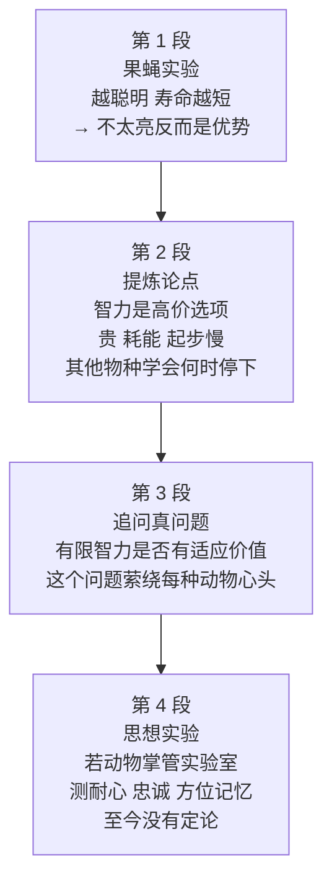

# Passage 51 · 动物智力与智力的代价

## 答题记录

| 轮次  | 日期         | 题号  | 正确  | 错误  | 正确率 | 用时    | 错题归因 |
| --- | --- | --- | --- | --- | --- | --- | --- |
| 1 |  | 1-20 |  |  |  |  |  |
| 2 |  | 1-20 |  |  |  |  |  |
| 3 |  | 1-20 |  |  |  |  |  |

> [!tip] 填写口径
> - **用时**以分钟计，只计做题时间，不含精读复盘。
> - **错题归因**填「题型·错误类型」，如：动词辨析·搭配不熟、逻辑关系·句间关系读反、形容词辨析·主旨代入缺失。
> - 纵向看趋势：正确率升而用时过长 → 熟练度不足；用时降而正确率波动 → 定位不稳。

> [!info] 文章档案
> - **来源**：考研英语（一）2009 年完形填空（书中标注类别：文艺教育类）
> - **题材**：由果蝇实验（更聪明的果蝇寿命更短）引出「智力是高价的选择」，进而追问有限智力的适应价值，并反推「动物若对人类做实验会研究什么」
> - **结构**：4 段 / 17 句 / 20 个挖空
> - **难度**：★★★★☆
> - **一句话主旨**：智力是高价的选择——对动物智力的研究让我们追问「有限智力」的适应价值，也让我们借动物的视角重新审视人类自己；而动物究竟会从我们身上测出什么，迄今为止没有定论。

## 一、篇章脉络

- **第 1 段**：以果蝇实验开篇立现象——「越聪明 → 越短命」，④句用灯泡类比推出「不太亮（不太聪明）反而是优势」，为全篇「智力有代价」奠基。
- **第 2 段**：提炼论点——智力是高价选项：维护更贵、燃料更多、起步更慢，因其依赖学习（渐进过程）而非本能；其他物种显然学会了「何时停下」。
- **第 3 段**：抛出研究真问题——有限智力是否有适应价值；该研究不伤感回望被人类甩在身后的物种，而是含蓄追问人类智力的真正代价；这也是每种动物脑际萦绕的问题。
- **第 4 段**：思想实验——若动物掌管实验室，会测定我们的耐心、忠诚心与方位记忆力的极限，会判定智力的真正用途，还会研究「人类是否意识到自己的世界」这一根本问题；到目前为止，没有定论。

> [!tip] 行文逻辑
> 现象（果蝇实验）→ 论点（智力高价）→ 追问（有限智力的价值）→ 反推（动物视角看人类）。典型的「由他者反观自身」科普结构；完形的逻辑题集中在 for instance（例证）/ if（虚拟条件）/ Above all（递进）/ So far（时间评注）四处，动词题占 6 处为本篇最大类。

## 二、逐段精读

### 第 1 段 · 果蝇实验：越聪明，寿命越短

**原文**

① Research on animal intelligence always makes us wonder just how smart humans are.
② Consider〔1〕 the fruit-fly experiments described by Carl Zimmer in the Science Times.
③ Fruit flies who were taught to be smarter than the average fruit fly tended〔2〕 to live shorter lives.
④ This suggests that dimmer〔3〕 bulbs burn longer, that there is a(n) advantage〔4〕 in not being too bright.

**译文**

① 对动物智力的研究，总是让我们好奇人类到底有多聪明。
② 想想卡尔·齐默在《科学时代》周刊中所描述的果蝇实验吧。
③ 经过训练、比一般果蝇更聪明的果蝇，寿命往往更短。
④ 这表明，越暗的灯泡寿命越长——不那么明亮（不那么聪明），反倒是一种优势。

> [!note] 段落要点
> - 功能：①②句引话题（研究动物智力的意义＋引出具体实验），③句给发现（更聪明→更短命），④句由此及彼作类比（灯泡），推出「不亮反而是优势」。
> - This suggests that 是全文论证的起点句式；④句两个 that 从句并列，同作 suggests 的宾语。

#### 长难句 · 本段

> [!abstract] 本段第 ④ 句 · This suggests that dimmer bulbs burn longer, that there is a(n) advantage in not being too bright.

**结构拆解**

- **主干**：This suggests that...（主谓宾：主语 This 回指③句的实验发现，谓语 suggests「表明」，宾语是 that 从句）
- **并列宾语从句一**：that dimmer bulbs burn longer（dimmer 是比较级，与③句 smarter 形成「更聪明↔更暗」的对仗）
- **并列宾语从句二**：that there is a(n) advantage in not being too bright（there be 存现句；in not being too bright 是介词短语，作 advantage 的后置定语，注意 not being 是动名词的否定形式）
- **修辞**：dimmer bulbs 是比喻——以「灯泡不够亮」喻「智力不过高」，dimmer 一词双关（更暗的／更笨的）

**参考译文**

这表明，越暗的灯泡寿命越长——不那么明亮（不那么聪明），反倒是一种优势。

> [!tip] 拆解要点
> 见到「suggests that..., that...」要意识到两个 that 从句并列共用一个谓语；别把第二个 that 从句误当作修饰 advantage 的定语从句（从句结构完整：there is...）。

#### 本段重点词汇

| 单词 / 短语 | 词性 | 文中意 | 常用考义与拓展 | 英文示例搭配（中译） |
| --- | --- | --- | --- | --- |
| **research on** | （短语） | 对…的研究 | research 不可数；research into 亦可 | Research on animal intelligence（对动物智力的研究） |
| **animal intelligence** | （短语） | 动物智力 | intelligence 指「智力」，区别于 information（信息） | Research on animal intelligence（动物智力研究） |
| **humans** | n. | 人类 | 名词 human；比较 mankind／humanity | how smart humans are（人类有多聪明） |
| **wonder** | v. | 好奇；想知道 | make sb wonder 使某人好奇；后接 wh- 从句 | makes us wonder just how smart（让我们好奇到底多聪明） |
| **just how** | （短语） | 到底多么 | just 修饰 wh- 词表强调 | just how smart humans are（人类到底有多聪明） |
| **smart** | adj. | 聪明的 | 同义 intelligent／bright；反义 dull／dim | smarter than the average fruit fly（比一般果蝇更聪明） |
| **Consider** | v. | 考虑；细想 | 无主语祈使句中＝「不妨想想／看看」；consider doing | Consider the fruit-fly experiments（想想这组果蝇实验） |
| **fruit-fly** | n. | 果蝇 | 复合名词 fruit＋fly；复数 fruit-flies | the fruit-fly experiments（果蝇实验） |
| **experiments** | n. | 实验 | 动词 experiment（on/with）；experimental adj. | the fruit-fly experiments（果蝇实验） |
| **described** | v. | 描述；记述 | describe 的过去分词；described by「由…记述的」 | experiments described by Carl Zimmer（齐默记述的实验） |
| **taught** | v. | 教；训练 | teach-taught-taught；此处指「训练（动物）」 | were taught to be smarter（被训练得更聪明） |
| **average** | adj. | 一般的；平均的 | 熟词僻义：名词「平均」→形容词「一般的」；the average person 普通人 | the average fruit fly（一般果蝇） |
| **tend to (do)** | （短语） | 往往会… | 表规律性倾向；比较 happen to do「碰巧」 | tended to live shorter lives（寿命往往更短） |
| **suggests** | v. | 表明；暗示 | 常见考义「建议」，此处「表明、说明」 | This suggests that...（这表明…） |
| **dimmer** | adj. | 更暗淡的；更愚笨的 | 一词双关：物理「暗」＋智力「笨」；比较级 | dimmer bulbs burn longer（越暗的灯泡寿命越长） |
| **bulbs** | n. | 灯泡 | 比较 dimmable（可调光的）；bulb 亦指植物球茎 | dimmer bulbs（更暗的灯泡） |
| **burn** | v. | 燃烧 | burn-burned/burnt；引申「消耗（燃料）」 | bulbs burn longer（灯泡燃烧更久） |
| **advantage** | n. | 优势；有利因素 | there is an advantage in doing「做…是有优势的」 | an advantage in not being too bright（不太亮反倒有优势） |
| **bright** | adj. | 明亮的；聪明的 | 与 dim 互为反义；比喻「聪明」 | not being too bright（不是太明亮／太聪明） |

### 第 2 段 · 提炼论点：智力是高价选项

**原文**

① Intelligence, it turns out〔5〕, is a high-priced option.
② It takes more upkeep, burns more fuel and is slow **off**〔6〕 the starting line because it depends on learning—a(n) gradual〔7〕 process—instead of instinct.
③ Plenty of other species are able to learn, and one of the things they've apparently learned is when to stop〔8〕.

**译文**

① 结果表明，智力是一项高价的选择。
② 它需要更多的维护，消耗更多的燃料，离开起点线时也慢人一步——因为它依赖的是学习（一个渐进的过程），而不是本能。
③ 其他许多物种也有学习能力，而它们显然已经学会的事情之一，就是知道何时停下。

> [!note] 段落要点
> - ①句是段旨（turns out 作插入语，逗号隔开）；②句列三项代价（upkeep / fuel / slow off the starting line），并用 because 给出原因（依赖学习而非本能）；③句以其他物种反衬——它们学会了「何时停下」，暗示人类没有。
> - high-priced option 的比喻贯穿全篇：第 3 段 costs 与之呼应。

#### 长难句 · 本段

> [!abstract] 本段第 ② 句 · It takes more upkeep, burns more fuel and is slow off the starting line because it depends on learning—a(n) gradual process—instead of instinct.

**结构拆解**

- **主干**：It takes more upkeep, burns more fuel and is slow off the starting line（主语 It 回指①句 Intelligence；三个并列谓语 takes / burns / is）
- **并列谓语细节**：takes more upkeep（需要更多维护）；burns more fuel（消耗更多燃料）；is slow off the starting line（离开起点线时迟缓＝起步慢）
- **原因状语从句**：because it depends on learning... instead of instinct（depend on 后接名词 learning；instead of instinct「而不是本能」）
- **破折号插入**：a(n) gradual process 是 learning 的同位语，解释「学习是什么样的过程」

**参考译文**

它需要更多的维护，消耗更多的燃料，离开起点线时也慢人一步——因为它依赖的是学习（一个渐进的过程），而不是本能。

> [!tip] 拆解要点
> slow off the starting line 是体育用语的比喻（离开起点线时缓慢）；看见「名词 + 破折号 + 名词 + 破折号」要识别为同位语插入，还原后句子结构更清晰。

#### 本段重点词汇

| 单词 / 短语 | 词性 | 文中意 | 常用考义与拓展 | 英文示例搭配（中译） |
| --- | --- | --- | --- | --- |
| **intelligence** | n. | 智力 | 形容词 intelligent；比较 information（信息） | Intelligence is a high-priced option（智力是高价选择） |
| **turn out** | （短语） | 证明是；结果是 | 插入语 it turns out「结果表明」；后接 that 从句或 to be | it turns out, is a high-priced option（结果表明是高价选择） |
| **high-priced** | adj. | 高价的；昂贵的 | 复合形容词 high＋priced；近义 expensive | a high-priced option（高价的选择） |
| **option** | n. | 选择；选项 | 本义「可选之物」→「（权衡后的）选择」；optional adj. | a high-priced option（代价高昂的选择） |
| **upkeep** | n. | 维护；保养（费） | 不可数；动词短语 keep up | takes more upkeep（需要更多维护） |
| **fuel** | n. | 燃料 | 动词「给…加燃料」；add fuel to the fire 火上浇油 | burns more fuel（消耗更多燃料） |
| **slow** | adj. | 慢的 | be slow to do／be slow off...；副词 slowly | is slow off the starting line（起步慢） |
| **starting line** | （短语） | 起点线 | 体育用语借指「起点」 | slow off the starting line（离开起点线时迟缓） |
| **depend on** | （短语） | 依赖；取决于 | on 是介词，后接名词／动名词；dependable adj. 可靠的 | it depends on learning（它依赖学习） |
| **learn** | v. | 学习；学会 | learn to do 学会做；learning n. 学习 | are able to learn（有学习能力） |
| **gradual** | adj. | 逐渐的；逐步的 | 副词 gradually；反义 sudden | a gradual process（渐进的过程） |
| **process** | n. | 过程；进程 | 比较 procedure（程序）；in the process of 在…过程中 | a gradual process（渐进的过程） |
| **instinct** | n. | 本能 | 形容词 instinctive；与 learning 对举 | instead of instinct（而不是本能） |
| **plenty of** | （短语） | 许多；大量 | 后接可数／不可数均可；近义 a great deal of | Plenty of other species（许多其他物种） |
| **species** | n. | 物种 | 单复数同形（a species / many species） | other species（其他物种） |
| **apparently** | adv. | 显然地；看来 | 形容词 apparent；近义 evidently | they've apparently learned（它们显然已学会） |
| **stop** | v. | 停下；停止 | stop to do（停下来去做）vs stop doing（停止做） | when to stop（何时停下） |

### 第 3 段 · 追问：有限智力是否有适应价值？

**原文**

① Is there an adaptive value to limited〔9〕 intelligence?
② That's the question behind this new research.
③ Instead of casting a wistful glance backward〔10〕 at all the species we've left in the dust I.Q.-wise, it implicitly asks what the real costs〔11〕 of our own intelligence might be.
④ This is **on**〔12〕 the mind of every animal we've ever met.

**译文**

① 有限的智力是否也有适应价值呢？
② 这正是这项新研究背后的问题。
③ 它并没有伤感地回望那些在智商方面被我们远远甩在身后（只能吃灰）的物种，而是含蓄地追问：我们自己智力的真正代价可能是什么？
④ 这也是我们见过的每一种动物脑际萦绕的问题。

> [!note] 段落要点
> - ①②句一问一答，点明研究真问题（有限智力的适应价值）；③句用 Instead of 划清研究姿态——「不伤感回望」对比「追问代价」，costs 回扣第 2 段 high-priced option；④句把问题推及所有动物，为下段「动物对人类做实验」的设想铺垫。

#### 长难句 · 本段

> [!abstract] 本段第 ③ 句 · Instead of casting a wistful glance backward at all the species we've left in the dust I.Q.-wise, it implicitly asks what the real costs of our own intelligence might be.

**结构拆解**

- **主干**：it implicitly asks what the real costs of our own intelligence might be（主谓宾；it 回指 this new research；what 引导宾语从句，从句谓语是 might be，主语 the real costs of our own intelligence）
- **句首状语**：Instead of casting a wistful glance backward at all the species...（介词 Instead of＋动名词短语，表「而不是…」；glance at「瞥向」；backward 修饰 glance）
- **定语从句**：we've left in the dust I.Q.-wise 修饰 species（we have left... in the dust「我们把…远远甩在身后、让其吃灰」；I.Q.-wise 是副词性构词「在智商方面」）

**参考译文**

它并没有伤感地回望那些在智商方面被我们远远甩在身后（只能吃灰）的物种，而是含蓄地追问：我们自己智力的真正代价可能是什么？

> [!tip] 拆解要点
> Instead of＋doing 是高频干扰结构（第 14 题也考 for instance 与它的分工）；-wise 后缀（I.Q.-wise＝「在智商方面」）遇词不慌，按「就…而言」理解即可。

#### 本段重点词汇

| 单词 / 短语 | 词性 | 文中意 | 常用考义与拓展 | 英文示例搭配（中译） |
| --- | --- | --- | --- | --- |
| **adaptive** | adj. | 适应的；有适应能力的 | 动词 adapt；adaptive value 适应价值（进化生物学术语） | an adaptive value to limited intelligence（有限智力的适应价值） |
| **value** | n. | 价值 | 动词 evaluate；of value ＝ valuable | an adaptive value（适应价值） |
| **limited** | adj. | 有限的 | 动词 limit；反义 unlimited | limited intelligence（有限的智力） |
| **behind** | prep. | 在…背后 | the question behind...「…背后的问题」 | the question behind this new research（这项新研究背后的问题） |
| **instead of** | （短语） | 而不是 | of 是介词，后接名词／动名词；区别于副词 instead | Instead of casting a wistful glance（没有伤感地回望） |
| **cast a glance** | （短语） | 投去一瞥 | cast-cast-cast；glance 一瞥（quick look）；glance at | casting a wistful glance backward（伤感地回望） |
| **wistful** | adj. | 伤感的；惆怅的 | 副词 wistfully；a wistful glance 伤感的一瞥 | a wistful glance（伤感的一瞥） |
| **backward** | adv. | 向后；朝反方向 | 亦作 backwards；反义 forward | glance backward at...（回望…） |
| **dust** | n. | 灰尘；尘土 | leave sb in the dust「把某人远远甩在身后」 | left in the dust I.Q.-wise（在智商上被远远甩在身后） |
| **I.Q.-wise** | adv. | 在智商方面 | -wise 后缀＝「在…方面」；I.Q.＝intelligence quotient 智商 | I.Q.-wise（就智商而言） |
| **implicitly** | adv. | 含蓄地；隐含地 | 动词 imply；反义 explicitly | it implicitly asks（它含蓄地追问） |
| **costs** | n. | 成本；代价 | 动词 cost（cost-cost）；at the cost of 以…为代价 | the real costs of our own intelligence（人类智力的真正代价） |
| **mind** | n. | 头脑；心思 | keep...in mind 牢记；make up one's mind 下定决心 | the mind of every animal（每种动物的心头） |
| **on one's mind** | （短语） | 萦绕在…心头 | 比较 in one's mind（在脑海中）；out of one's mind（发疯） | This is on the mind of every animal（萦绕在每种动物心头） |

### 第 4 段 · 思想实验：动物会对人类做什么？

**原文**

① Research on animal intelligence also makes us wonder what experiments animals would perform〔13〕 on humans if they had the chance.
② Every cat with an owner, for instance〔14〕, is running a small-scale study in operant conditioning.
③ We believe that **if**〔15〕 animals ran the labs, they would test us to determine〔16〕 the limits of our patience, our faithfulness, our memory for locations.
④ They would try to decide what intelligence in humans is really **for**〔17〕, not merely how much of it there is.
⑤ Above all〔18〕, they would hope to study a(n) fundamental〔19〕 question: Are humans actually aware of the world they live in?
⑥ So far〔20〕 the results are inconclusive.

**译文**

① 对动物智力的研究也让我们好奇：如果有机会，动物会在人类身上做什么实验？
② 例如，每一只有主人的猫，都在进行一项小规模的操作性条件反射研究。
③ 我们相信，如果动物掌管了实验室，它们会测试我们，以测定我们的耐心、忠诚心和方位记忆力的极限。
④ 它们会试图判定人类智力的真正用途，而不仅仅是测定人类有多少智力。
⑤ 最重要的是，它们会希望研究一个根本性的问题：人类是否真的意识到自己所生存的世界？
⑥ 到目前为止，研究结果还没有定论。

> [!note] 段落要点
> - ①②句由泛论推到日常例子（猫＝以主人为对象的「研究者」）；③句起是与现在事实相反的虚拟思想实验，连用四个 would 排比（would test / would try to decide / would hope to study），末句 So far 收束为「没有定论」，留开放式结尾。
> - ④句 what...for 与 not merely how much 对举：问「用途」而非「多少」，是全文立意最高的一句。

#### 长难句 · 本段

> [!abstract] 本段第 ③ 句 · We believe that if animals ran the labs, they would test us to determine the limits of our patience, our faithfulness, our memory for locations.

**结构拆解**

- **主干**：We believe that...（that 引导宾语从句，从句内是完整的条件复句）
- **条件状语从句**：if animals ran the labs（ran 是过去式，与现在事实相反——动物并没有掌管实验室）
- **主句**：they would test us to determine the limits of...（would＋动词原形，虚拟语气；to determine... 是不定式作目的状语）
- **of 的宾语**：the limits of our patience, our faithfulness, our memory for locations（三个并列名词短语：耐心／忠诚心／方位记忆力；memory for locations「方位记忆」）

**参考译文**

我们相信，如果动物掌管了实验室，它们会测试我们，以测定我们的耐心、忠诚心和方位记忆力的极限。

> [!tip] 拆解要点
> if＋过去式 / would＋原形＝与现在事实相反的虚拟假设（第 15 题的语法考点）；「would test us to determine...」的不定式表目的，别误译为「测试我们测定…」。

> [!abstract] 本段第 ⑤ 句 · Above all, they would hope to study a(n) fundamental question: Are humans actually aware of the world they live in?

**结构拆解**

- **主干**：they would hope to study a(n) fundamental question（would hope to do「会希望做」； Above all 是评注性状语，表递进）
- **冒号后**：Are humans actually aware of the world they live in? 是 question 的同位语（一般疑问句形式），解释这个「根本问题」的具体内容
- **定语从句**：they live in 修饰 the world（介词 in 未后置，口语化表达；aware of「意识到」）

**参考译文**

最重要的是，它们会希望研究一个根本性的问题：人类是否真的意识到自己所生存的世界？

> [!tip] 拆解要点
> 冒号在句中常引出同位语（此处引出一个疑问句作 question 的同位语）；be aware of 与 be aware that 的转换是完形与阅读的双向考点。

#### 本段重点词汇

| 单词 / 短语 | 词性 | 文中意 | 常用考义与拓展 | 英文示例搭配（中译） |
| --- | --- | --- | --- | --- |
| **perform** | v. | 做；履行；执行 | perform experiments on sb 对某人做实验（固定搭配） | what experiments animals would perform（动物会做什么实验） |
| **chance** | n. | 机会 | by chance 偶然；take a chance 冒险 | if they had the chance（如果有机会） |
| **owner** | n. | 主人；所有者 | 动词 own；ownership n. 所有权 | Every cat with an owner（每一只有主人的猫） |
| **for instance** | （短语） | 例如 | 插入语；比较 for example（更正式，多引整句） | Every cat with an owner, for instance,...（例如…） |
| **run (ran)** | v. | 管理；经营 | run-ran-run；熟词僻义「掌管（实验室）」 | if animals ran the labs（如果动物掌管实验室） |
| **labs** | n. | 实验室 | laboratory 的缩略；the labs 此处统指实验室 | ran the labs（掌管实验室） |
| **small-scale** | adj. | 小规模的 | 反义 large-scale；复合形容词 | a small-scale study（小规模研究） |
| **operant conditioning** | （短语） | 操作性条件反射 | 斯金纳学派概念：以后果（强化）塑造行为 | operant conditioning（操作性条件反射） |
| **believe** | v. | 相信；认为 | We believe that...「我们认为…」 | We believe that...（我们相信…） |
| **test** | v. | 测试；检验 | run tests on... 对…进行测试；testable adj. | they would test us（它们会测试我们） |
| **determine** | v. | 测定；查明 | determine the limits 测定极限；比较 decide（主观判定） | determine the limits of our patience（测定耐心的极限） |
| **limits** | n. | 极限；限度 | within limits 在一定范围内；off limits 禁止入内 | the limits of our patience（耐心的极限） |
| **patience** | n. | 耐心 | 形容词 patient；lose patience 失去耐心 | our patience（我们的耐心） |
| **faithfulness** | n. | 忠诚；忠实 | 形容词 faithful；后缀 -ness 构成抽象名词 | our faithfulness（我们的忠诚心） |
| **memory for locations** | （短语） | 方位记忆力 | memory for...「对…的记忆」 | our memory for locations（我们的方位记忆力） |
| **decide** | v. | 判定；决定 | decide＋wh- 从句；decision n. | try to decide what...（试图判定…） |
| **merely** | adv. | 仅仅；只不过 | 形容词 mere；not merely...「不仅仅…」 | not merely how much（不仅仅是多少） |
| **above all** | （短语） | 最重要的是 | 表递进；比较 after all（毕竟，表让步） | Above all, they would hope to...（最重要的是…） |
| **fundamental** | adj. | 根本的；基本的 | 名词 fundament／foundation | a fundamental question（一个根本性的问题） |
| **aware** | adj. | 意识到的；知道的 | be aware of／be aware that；awareness n. | Are humans aware of the world...（人类是否意识到…） |
| **so far** | （短语） | 到目前为止 | 多与现在完成时连用；本句一般现在时表现状 | So far the results are inconclusive（迄今为止结果未定） |
| **inconclusive** | adj. | 没有定论的；非决定性的 | 动词 conclude；反义 conclusive | the results are inconclusive（结果没有定论） |

## 三、全篇重点词汇汇总（自测用）

> [!info] 说明
> 本表只列「单词 / 词性 / 所在段」，不含释义与搭配，用于遮表自测：说出词义后再回该段核对。
> 收录**全篇所有段落词汇，共 72 条，不删减**；按「逐段词汇表 → 本表」同源同序汇总，**跨段复现的词条只收入其首次出现的段落**（如 experiment 首现于第 1 段②句、第 4 段①句的 experiments 为复现；wonder 首现于第 1 段①句、第 4 段①句为复现；research on 首现于第 1 段①句、第 3 段②句 this new research 为复现）。用法：遮住「词性」「所在段」两列自测。

> - 本表与逐段词汇表**等长同源同序**：第 1 段 19 条 → 第 2 段 17 条 → 第 3 段 14 条 → 第 4 段 22 条，共 72 条。

| 单词 / 短语 | 词性 | 所在段 |
| --- | --- | --- |
| **research on** | （短语） | 第 1 段 |
| **animal intelligence** | （短语） | 第 1 段 |
| **humans** | n. | 第 1 段 |
| **wonder** | v. | 第 1 段 |
| **just how** | （短语） | 第 1 段 |
| **smart** | adj. | 第 1 段 |
| **Consider** | v. | 第 1 段 |
| **fruit-fly** | n. | 第 1 段 |
| **experiments** | n. | 第 1 段 |
| **described** | v. | 第 1 段 |
| **taught** | v. | 第 1 段 |
| **average** | adj. | 第 1 段 |
| **tend to (do)** | （短语） | 第 1 段 |
| **suggests** | v. | 第 1 段 |
| **dimmer** | adj. | 第 1 段 |
| **bulbs** | n. | 第 1 段 |
| **burn** | v. | 第 1 段 |
| **advantage** | n. | 第 1 段 |
| **bright** | adj. | 第 1 段 |
| **intelligence** | n. | 第 2 段 |
| **turn out** | （短语） | 第 2 段 |
| **high-priced** | adj. | 第 2 段 |
| **option** | n. | 第 2 段 |
| **upkeep** | n. | 第 2 段 |
| **fuel** | n. | 第 2 段 |
| **slow** | adj. | 第 2 段 |
| **starting line** | （短语） | 第 2 段 |
| **depend on** | （短语） | 第 2 段 |
| **learn** | v. | 第 2 段 |
| **gradual** | adj. | 第 2 段 |
| **process** | n. | 第 2 段 |
| **instinct** | n. | 第 2 段 |
| **plenty of** | （短语） | 第 2 段 |
| **species** | n. | 第 2 段 |
| **apparently** | adv. | 第 2 段 |
| **stop** | v. | 第 2 段 |
| **adaptive** | adj. | 第 3 段 |
| **value** | n. | 第 3 段 |
| **limited** | adj. | 第 3 段 |
| **behind** | prep. | 第 3 段 |
| **instead of** | （短语） | 第 3 段 |
| **cast a glance** | （短语） | 第 3 段 |
| **wistful** | adj. | 第 3 段 |
| **backward** | adv. | 第 3 段 |
| **dust** | n. | 第 3 段 |
| **I.Q.-wise** | adv. | 第 3 段 |
| **implicitly** | adv. | 第 3 段 |
| **costs** | n. | 第 3 段 |
| **mind** | n. | 第 3 段 |
| **on one's mind** | （短语） | 第 3 段 |
| **perform** | v. | 第 4 段 |
| **chance** | n. | 第 4 段 |
| **owner** | n. | 第 4 段 |
| **for instance** | （短语） | 第 4 段 |
| **run (ran)** | v. | 第 4 段 |
| **labs** | n. | 第 4 段 |
| **small-scale** | adj. | 第 4 段 |
| **operant conditioning** | （短语） | 第 4 段 |
| **believe** | v. | 第 4 段 |
| **test** | v. | 第 4 段 |
| **determine** | v. | 第 4 段 |
| **limits** | n. | 第 4 段 |
| **patience** | n. | 第 4 段 |
| **faithfulness** | n. | 第 4 段 |
| **memory for locations** | （短语） | 第 4 段 |
| **decide** | v. | 第 4 段 |
| **merely** | adv. | 第 4 段 |
| **above all** | （短语） | 第 4 段 |
| **fundamental** | adj. | 第 4 段 |
| **aware** | adj. | 第 4 段 |
| **so far** | （短语） | 第 4 段 |
| **inconclusive** | adj. | 第 4 段 |

> [!example] 同义替换链（阅读题高频）
> - **聪明**：smart = intelligent = bright（第 1 段 smart ↔ 第 2 段 Intelligence ↔ not being too bright）
> - **代价**：high-priced option ≈ costs（第 2 段 a high-priced option ↔ 第 3 段 the real costs）
> - **有限的**：limited = finite ≠ indefinite（第 9 题 [B] 与 [C] 对读）
> - **表明**：suggest = show = indicate（第 1 段 This suggests that）
> - **没有定论**：inconclusive = not yet settled（第 20 题所在句）

## 四、知识点补充

> [!question] 背景知识
> - **Carl Zimmer（卡尔·齐默）**：美国科普作家、耶鲁大学讲师，长期为《纽约时报》等撰写进化生物学专栏；文中果蝇实验的记述刊于《科学时代》（Science Times，《纽约时报》周二科学版）。
> - **果蝇实验**：研究显示，经过训练、记忆与学习能力更强的果蝇，寿命反而更短——「更聪明」以「更短命」为代价，这正是「智力是高价选项」的实验证据。
> - **operant conditioning（操作性条件反射）**：斯金纳提出的学习理论——行为的后果（奖励或惩罚）决定该行为重复的概率。文中调侃「每一只有主人的猫都在对人做研究」：人喂食（奖励）恰恰塑造了猫的行为，猫才是实验者。
> - **adaptive value（适应价值）**：进化生物学概念，指某一性状对生物生存与繁衍的贡献度。第 3 段的追问「有限智力是否有适应价值」即把人类放回进化框架自省。

> [!warning] 语法点
> - **it turns out (that)... 作插入语**：还原为 it turns out that intelligence is a high-priced option；that 可省略，it 是形式主语（第 5 题）。
> - **slow off the starting line**：off 表「离开（起点）」，引申「起步慢」；同类表达 slow off the mark（第 6 题）。
> - **instead of +  doing**：of 是介词，后接动名词（casting）；区别于副词 instead（单独作状语）（第 3 段③句）。
> - **-wise 后缀**：I.Q.-wise＝「在智商方面」，同类构词 money-wise／career-wise，遇词按「就…而言」理解。
> - **虚拟语气**：if animals ran the labs（过去式）, they would test us（would＋原形）——与现在事实相反的假设（第 15 题）。
> - **what...for 隔空搭配**：what intelligence is really for ＝ what intelligence is used for「智力的真正用途」，介词 for 表目的（第 17 题）。
> - **on one's mind**：介词 on 表「萦绕于心」；比较 in one's mind（在…脑海中，指思维场所）（第 12 题）。

> [!success] 写作可迁移句型
> - **This suggests that...**：「这表明…」，由证据推出结论的万能句（第 1 段④句）。
> - **Intelligence is a high-priced option.**：「…是一项高价的选择」，比喻式论点句，适用于「代价与收益」类议论文。
> - **Instead of doing A, it does B**：「它不做 A，而是做 B」，对比论证、划清立场（第 3 段③句）。
> - **We believe that if..., they would...**：「我们相信，如果…，它们会…」，虚拟假设展开思想实验（第 4 段③句）。
> - **So far the results are inconclusive.**：「到目前为止，结果还没有定论」，审慎收尾、留开放式结论（第 4 段⑥句）。

> [!danger] 易混辨析
> - **consider / observe / suppose / imagine**：consider「考虑、细想」（可无主语引导话题）；observe「观察」（须亲见）；suppose／imagine「假定／想象」——第 1 题。
> - **tend to do / happen to do**：tend to「往往会」（规律性）；happen to「碰巧」（偶然性）——第 2 题。
> - **dim / thin / stable / light**：dim 既指「暗」又指「笨」，一词双关是第 3 题题眼；其余三项为常识干扰。
> - **adaptive / adopted**：adaptive「适应性的；有适应能力的」；adopted「收养的；采纳的」——第 9 题词根辨析。
> - **perform / apply / deliver / carry**：能与 experiments on 搭配的只有 perform（perform experiments on sb「对某人做实验」）——第 13 题。
> - **determine / decide**：determine「测定、查明」（重客观数据）；decide「判定、决定」（重主观判断）——第 16 题与第 4 段④句 to decide 对读。
> - **on one's mind / in one's mind / out of one's mind**：on one's mind「萦绕心头」；in one's mind「在脑海中」；out of one's mind「发疯」——第 12 题。
> - **above all / after all / however / otherwise**：above all 递进「最重要的是」；after all 让步「毕竟」；however 转折；otherwise「否则」——第 18 题。

## 五、题目分析

> [!info] 题目总览
> | 题号 | 题型 | 定位 | 答案 |
> | --- | --- | --- | --- |
> | 1 | 动词辨析 | 第 1 段②句 | B |
> | 2 | 动词辨析 | 第 1 段③句 | A |
> | 3 | 形容词辨析 | 第 1 段④句 | D |
> | 4 | 名词辨析 | 第 1 段④句 | B |
> | 5 | 动词（短语）辨析 | 第 2 段①句 | C |
> | 6 | 介词辨析 | 第 2 段②句 | A |
> | 7 | 形容词辨析 | 第 2 段②句 | D |
> | 8 | 动词辨析 | 第 2 段③句 | C |
> | 9 | 形容词辨析 | 第 3 段①句 | B |
> | 10 | 副词辨析 | 第 3 段③句 | D |
> | 11 | 名词辨析 | 第 3 段③句 | D |
> | 12 | 介词辨析 | 第 3 段④句 | B |
> | 13 | 动词辨析 | 第 4 段①句 | C |
> | 14 | 逻辑关系题 | 第 4 段②句 | D |
> | 15 | 逻辑关系题 | 第 4 段③句 | A |
> | 16 | 动词辨析 | 第 4 段③句 | C |
> | 17 | 介词辨析 | 第 4 段④句 | B |
> | 18 | 逻辑关系题 | 第 4 段⑤句 | A |
> | 19 | 形容词辨析 | 第 4 段⑤句 | A |
> | 20 | 逻辑关系题 | 第 4 段⑥句 | C |

### 第 1 题 · 动词辨析

> [!question] 原题
> ____ the fruit-fly experiments described by Carl Zimmer in the Science Times.
> - A. Suppose 假定，设想
> - B. Consider 考虑，细想
> - C. Observe 观察，看到
> - D. Imagine 想象，设想

**正确答案**：**B. Consider（考虑；不妨想想）**

**辨析**：句子无主语，只能凭语义关系做题。宾语是 the fruit-fly experiments described by Carl Zimmer in the Science Times（《科学时代》周刊里卡尔·齐默所记述的果蝇实验）——既然是刊物上「记述的」实验，就谈不上当场「观察」（Observe），也无需「假定／想象」（Suppose／Imagine）。Consider 代入意为「不妨想想这组实验」，功能是引出下文例证，语义通顺。

### 第 2 题 · 动词辨析

> [!question] 原题
> Fruit flies who were taught to be smarter than the average fruit fly ____ to live shorter lives.
> - A. tended (to do) 往往会
> - B. feared (to do) 害怕做
> - C. happened (to do) 碰巧做，恰好
> - D. threatened (to do) 威胁做

**正确答案**：**A. tended（往往会…）**

**辨析**：tend to do 表规律性倾向，与「经过训练的果蝇比一般果蝇更聪明，寿命往往更短」这一实验结论吻合。happen to do 表偶然现象，与实验得出的规律矛盾；feared／threatened 代入语义明显不通。

### 第 3 题 · 形容词辨析

> [!question] 原题
> This suggests that ____ bulbs burn longer, that there is a(n) ____ in not being too bright.
> - A. thinner 更薄的；更细的；更稀的
> - B. stabler 更稳定的，更稳固的
> - C. lighter 更明亮的；更轻的
> - D. dimmer 更暗淡的；更愚笨的

**正确答案**：**D. dimmer（更暗淡的；更愚笨的）**

**辨析**：This suggests that 表明空格句是由上文实验（越聪明的果蝇寿命越短）推出的结论；再由 not being too bright 可判断本句在「亮灯泡」与「普通灯泡」之间对比，只能选 dimmer「越暗的」。dimmer 一词双关——既表示「更暗淡的」，又含「更愚笨的」，恰好与上句 smarter（更聪明的）对仗。thinner 代入不通；stabler 利用「性能稳定的灯泡寿命长」这一常识设扰，与上文结论相反；lighter 是反义干扰。

### 第 4 题 · 名词辨析

> [!question] 原题
> ...that there is a(n) ____ in not being too bright.
> - A. tendency 倾向，趋势
> - B. advantage 优势，有利因素
> - C. inclination 倾向，意愿，趋势
> - D. priority 优先权

**正确答案**：**B. advantage（优势，有利因素）**

**辨析**：由上文「聪明的果蝇寿命短、暗淡的灯泡用得久」推出：灯泡不是很亮未必是坏事，而可能是自身的某种优势，故选 advantage。tendency 与 inclination 义近（都有「倾向」义），但代入文中不合逻辑；priority（优先权）语义不通。

### 第 5 题 · 动词（短语）辨析

> [!question] 原题
> Intelligence, it ____, is a high-priced option.
> - A. insists on 坚决要求
> - B. sums up 总结，概括
> - C. turns out 证明是，结果是，原来是
> - D. puts forward 提出，提议

**正确答案**：**C. turns out（证明是；结果是）**

**辨析**：空格部分是插入语，还原句首为 it ____ (that) intelligence is a high-priced option。只有 turns out 既符合语法要求又符合文意——「结果表明，智力是个代价昂贵的选择」，与上段「智力要付出代价」的意思一致。insists on／sums up／puts forward 后面通常都不跟 that 从句，且 insists on 与 puts forward 的主语往往是人，故排除。

### 第 6 题 · 介词辨析

> [!question] 原题
> It takes more upkeep, burns more fuel and is slow ____ the starting line because it depends on learning...
> - A. off 离开
> - B. behind 在……的后面；落后
> - C. over（覆盖在）……上面；从一边到另一边，穿越
> - D. along 沿着，顺着

**正确答案**：**A. off（离开）**

**辨析**：选项均为方位介词，作者借「人和起跑线间的方位关系」说明「智力缓慢的具体情况或方式」：slow off the starting line「离开起点线时缓缓慢行」，延伸为「一开始、起步时」的意思，与后半句「智力非天生，而是慢慢学习而成」的内容吻合。behind 表静态落后；over／along 代入均不合句意。

### 第 7 题 · 形容词辨析

> [!question] 原题
> ...because it depends on learning—a(n) ____ process—instead of instinct.
> - A. incredible 极好的；难以置信的
> - B. spontaneous 自动的，自发的
> - C. inevitable 必然发生的，不可避免的
> - D. gradual 逐渐的，逐步的

**正确答案**：**D. gradual（逐渐的，逐步的）**

**辨析**：由前后逻辑关系判断，学习是个不同于本能的过程；只有 gradual（逐渐的）符合「学习过程」的特点，也与上句 slow off the starting line（起步慢）呼应。incredible／spontaneous／inevitable 虽然都能形容 process，但代入文中都不符合学习过程的特点。

### 第 8 题 · 动词辨析

> [!question] 原题
> Plenty of other species are able to learn, and one of the things they've apparently learned is when to ____.
> - A. fight 打斗；打架
> - B. doubt 怀疑，不信任
> - C. stop (使)中断，停止；(使)停止运转
> - D. think 想，思考

**正确答案**：**C. stop（停止）**

**辨析**：结合上句「智力发展缓慢是因为依赖学习（渐进过程）」可知，这里强调的是学习是个循序渐进的过程，最后要适时停下来，故选 stop。选项中与学习有关的只有 stop 和 think；think 虽与 learn 有关，但放在句中与上下文无直接语义联系。

### 第 9 题 · 形容词辨析

> [!question] 原题
> Is there an adaptive value to ____ intelligence?
> - A. invisible 看不见的，隐形的
> - B. limited 有限的
> - C. indefinite 期限不定的；模糊不清的
> - D. different 不同的，各种的

**正确答案**：**B. limited（有限的）**

**辨析**：四项都能修饰 intelligence，须据主旨判断。上文一直讲「高智力也有劣势、代价高昂」，并用「相对不那么聪明的动物」反衬人类高智力背后暗藏的副作用——作者想追问的是「有限的智力」是否也有适应价值，故选 limited。

### 第 10 题 · 副词辨析

> [!question] 原题
> Instead of casting a wistful glance ____ at all the species we've left in the dust I.Q.-wise...
> - A. upward 向上，向高处
> - B. forward 向前；向将来
> - C. afterward 以后，后来
> - D. backward 向后；朝反方向

**正确答案**：**D. backward（向后；朝反方向）**

**辨析**：空格副词修饰 casting a wistful glance at 这一动作；该动作的宾语是 all the species we have left in the dust I.Q.-wise（在智商方面被我们远远甩在身后、只能吃灰的物种）——被甩在身后的物种，当然只能「往后看」，故选 backward。upward／forward 方向相反；afterward 表时间先后，不表空间方向。

### 第 11 题 · 名词辨析

> [!question] 原题
> ...it implicitly asks what the real ____ of our own intelligence might be.
> - A. features 特色，特点
> - B. influences 影响，作用
> - C. results 后果，结果
> - D. costs 成本，代价

**正确答案**：**D. costs（成本，代价）**

**辨析**：从搭配和词义看，各选项代入文中均能成立，只能根据主旨判断。全文一直在论述智力的种种不好（贵、耗能、起步慢），costs 与文章中心最贴近；features／influences／results 与中心无明显关系。

### 第 12 题 · 介词辨析

> [!question] 原题
> This is ____ the mind of every animal we've ever met.
> - A. outside 在外面
> - B. on 在……上
> - C. by 在……旁边
> - D. across 从……一边到另一边

**正确答案**：**B. on（在……上）**

**辨析**：on 与 the mind of 搭配，意为「惦念、放在心上」，代入后句子意为「这一问题一直萦绕在我们见过的每一种动物的脑海中」，与下段「动物一旦有机会会对人类做什么实验」的设想相呼应。outside／by／across 都不能和 the mind of 构成有意义的搭配。

### 第 13 题 · 动词辨析

> [!question] 原题
> ...what experiments animals would ____ on humans if they had the chance.
> - A. deliver 发表；递送
> - B. carry 拿，携带
> - C. perform 做，履行，执行
> - D. apply 使用，应用

**正确答案**：**C. perform（做；执行）**

**辨析**：从句主语是 animals、宾语是 experiments，正常语序为 animals would ____ what experiments on humans；能与 experiments on humans 搭配的只有 perform，意为「对人类做实验」。deliver／carry／apply 都不符合文意。

> [!note] 书中口径差异
> 本题解析引文作 "Research on animal intelligence also makes me wonder"，真题册正文实测为 "makes **us** wonder"（p073 实测），引用时以正文为准。

### 第 14 题 · 逻辑关系题

> [!question] 原题
> Every cat with an owner, ____, is running a small-scale study in operant conditioning.
> - A. by chance 碰巧，偶然
> - B. in contrast 相比之下
> - C. as usual 照旧，像往常一样
> - D. for instance 例如，比如

**正确答案**：**D. for instance（例如，比如）**

**辨析**：上句讲「动物有机会会在人类身上做实验」，本句讲「每一只有主人的猫都在进行小规模的操作性条件反射研究」——后者是前者的例证，空处需填入逻辑关系词来引出例子，故选 for instance。by chance 表偶然；in contrast 表对比；as usual 表惯常，代入均不合逻辑。

### 第 15 题 · 逻辑关系题

> [!question] 原题
> We believe that ____ animals ran the labs, they would test us to ____ the limits of our patience...
> - A. if 如果
> - B. unless 除非
> - C. as 当……时，随着；因为
> - D. lest 免得，以免

**正确答案**：**A. if（如果）**

**辨析**：「动物掌管实验室」并非真实情况，再从空后的 ran（过去式）和主句 would test us 可知，本句用虚拟语气，故选 if。unless 表条件，代入相当于 if not，此处语义不通；as 不能引导虚拟条件句；lest 后面的虚拟语气结构为「should＋动词原形」，与文中的 ran 不符。

### 第 16 题 · 动词辨析

> [!question] 原题
> ...they would test us to ____ the limits of our patience, our faithfulness, our memory for locations.
> - A. moderate 缓和，使适中
> - B. overcome 克服，解决
> - C. determine 查明，测定
> - D. reach 达到，进入

**正确答案**：**C. determine（查明，测定）**

**辨析**：空处需与 the limits of our patience, our faithfulness, our memory for locations（耐心、忠诚心、方位记忆力的极限）搭配：determine the limits「测定…的极限」，符合「做实验」的语境。moderate／overcome／reach 依次代入均不如 determine 切题。此外，下一句 They would try to decide... 与本句并列（两句间无明显转折词），本题的 to determine 与下文的 to decide 相呼应，也能锁定 determine。

### 第 17 题 · 介词辨析

> [!question] 原题
> They would try to decide what intelligence in humans is really ____, not merely how much of it there is.
> - A. at 在……
> - B. for 为了……
> - C. after 在……之后
> - D. with 和……一起

**正确答案**：**B. for（为了……）**

**辨析**：空所在部分是 what 引导的宾语从句（作 decide 的宾语），正常语序为 intelligence in humans is really ____ what，即「人类的智力实际是干什么」——该空处的介词与 be 搭配，表示目的、用途，只有 for 符合逻辑。what... for is 是一种常见固定用法，是对 what 所指事物的说明。at／after／with 代入均不符合逻辑。

### 第 18 题 · 逻辑关系题

> [!question] 原题
> ____, they would hope to study a(n) ____ question: Are humans actually aware of the world they live in?
> - A. Above all 最重要的是，尤其是
> - B. After all 毕竟；终究
> - C. However 然而，仍然
> - D. Otherwise 否则，不然

**正确答案**：**A. Above all（最重要的是）**

**辨析**：空前后两句话主语一致（都是 they would do sth.），是递进或并列的关系——前句讲「判定智力的真正用途」，后句讲「研究一个根本问题」，层层深入。由此可知本句与上一句之间不存在转折关系，故排除 However／Otherwise／After all。Above all 表递进，符合文章逻辑。

### 第 19 题 · 形容词辨析

> [!question] 原题
> ...they would hope to study a(n) ____ question: Are humans actually aware of the world they live in?
> - A. fundamental 根本的；基本的
> - B. comprehensive 详尽的；全部的
> - C. equivalent 相等的
> - D. hostile 敌意的，敌对的

**正确答案**：**A. fundamental（根本的；基本的）**

**辨析**：四个选项都可对 question 进行修饰，须结合语境推导。从 question 后的同位语「人类是否真的意识到他们所生存的世界」可以看出，这是一个根本问题；且由上文 really、not merely 可判断：针对人类智力，动物想研究的问题越来越深入——从「智力高低」到「智力的真正用途」，再到「智力的本质问题」，故选 fundamental。comprehensive／equivalent／hostile 均不符合文意。

### 第 20 题 · 逻辑关系题

> [!question] 原题
> ____ the results are inconclusive.
> - A. By accident 偶然，意外地
> - B. In time 迟早；最后
> - C. So far 到目前为止
> - D. Better still 更好的是

**正确答案**：**C. So far（到目前为止）**

**辨析**：空前一句提到「它们会研究这一根本的问题」，空后却说「对此仍无定论」。只有 So far（到目前为止）能将这两句很好地衔接起来——问题已经提出，但迄今为止没有答案。By accident／In time／Better still 代入文中都不符合前后的逻辑关系。

## 六、复盘清单

- [ ] 过汇总表 72 词（逐段 19/17/14/22），遮住「所在段」列自测，重点过 8 个熟词僻义（average 一般的／dim 愚笨的／upkeep 维护费／dust 吃灰受挫／run 掌管／for 用途／mind 心头／faithfulness 忠诚）
- [ ] 复写五个句型：It turns out... / This suggests that... / Instead of..., it... / We believe that if..., they would... / So far the results are inconclusive.
- [ ] 整理本题四类逻辑关系词的分布：例证（for instance）、虚拟条件（if）、递进（Above all）、时间评注（So far）
- [ ] 重做错题，重点复盘「主旨代入法」：第 9／11 题四个选项代入搭配都通，只能靠全文主旨（智力的代价）锁定答案
- [ ] 口译第 4 段虚拟思想实验（if animals ran the labs...），注意四个 would 的连续使用与 So far 的审慎收尾

## 七、关联笔记

- [[Passage50-拉美独立的理想与折扣]]
- [[考研英语 · 完形填空方法论]]
- [[考研英语 · 熟词僻义汇总]]
