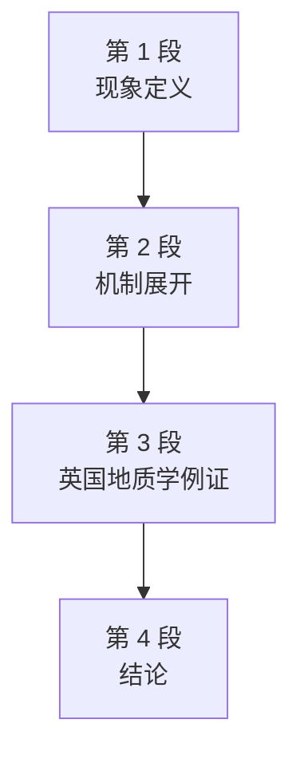

# Passage 52 · 专业化与业余研究的退场

## 答题记录

| 轮次  | 日期         | 题号  | 正确  | 错误  | 正确率 | 用时    | 错题归因 |
| --- | --- | --- | --- | --- | --- | --- | --- |
| 1 |  | 1-4 |  |  |  |  |  |
| 2 |  | 1-4 |  |  |  |  |  |
| 3 |  | 1-4 |  |  |  |  |  |

> [!tip] 填写口径
> - **用时**以分钟计，只计做题时间，不含精读复盘。
> - **错题归因**填「题型·错误类型」，如：细节题·无中生有、细节题·混淆概念、细节题·与原文相反、猜词题·偷换概念、主旨题·局部夸大。
> - 纵向看趋势：正确率升而用时过长 → 熟练度不足；用时降而正确率波动 → 定位不稳。
> - 本篇 **4 题**，题号栏填 1-4；第 1 题是**细节题**；第 2 题是**推断题**；第 3 题是**例证题**；第 4 题是**原因题**。（本篇答案：1.D 2.B 3.A 4.C）

> [!info] 文章档案
> - **来源**：考研英语（一）2001 年 Text 1
> - **题材**：科学技术（专业化 × 职业化 × 业余研究者）
> - **结构**：4 段 / 16 句（4＋4＋6＋2）＋ 4 题（按句号断句与行首缩进实测；正文在 PDF p074 下半–p075，题目全在 p075，解析在 p188–p190）
> - **难度**：★★★☆☆
> - **一句话主旨**：科学活动的专业化（specialisation）与职业化（professionalisation）如何挤压业余研究者（amateurs）的生存空间——以英国地质学百年变迁为标本。

## 一、篇章脉络

- **第 1 段**：**现象定义，4 句**。开宗明义——专业化是对科学知识不断累积的回应；拆分学科、缩小单位，个人才能继续处理信息。但专业化只是影响交流过程的系列发展之一，与之并存的另一发展是科学活动的职业化。
- **第 2 段**：**机制展开，4 句**。先退一步说业余与专业之间没有截然分界（例外无处不在），但 amateur 一词自带言外之意——未充分融入科学界、未必共享其价值观。19 世纪专业化要求更长更复杂的训练，对业余参与构成更大障碍；此趋势在以数学或实验室训练为基础的科学领域最明显，可用英国地质学的发展来阐明。
- **第 3 段**：**英国地质学例证，6 句**。一个半世纪的英国地质学出版物对比显示：研究优先性被强化、合格论文的定义在变——19 世纪地方性研究自有价值，20 世纪只有纳入更大图景才被专业界接受；业余者则照旧研究地方课题。后果是进入专业期刊更难，而同行审稿制度的普及（先全国性期刊、后地方性期刊）强化了这一结果，最终刊物与学会双双分化。
- **第 4 段**：**结论，2 句**。职业化与专业化 19 世纪已在英国地质学展开，但其全部后果迟至 20 世纪才显现；总体而言，19 世纪是科学结构变革的关键期。

> [!tip] 行文逻辑
> 本文是典型的「现象—机制—例证—结论」结构，四段一条线。
> 科学知识的膨胀催生专业化，专业化连带职业化，二者合力把业余研究者挤出了专业期刊与全国性学会——英国地质学一个半世纪的变迁，是这场退场的完整标本。

## 二、逐段精读

### 第 1 段 · 现象：知识累积催生专业化，专业化只是系列发展之一

**原文**

① Specialisation can be seen as a response to the problem of an increasing accumulation of scientific knowledge.
② By splitting up the subject matter into smaller units, one man could continue to handle the information and use it as the basis for further research.
③ But specialisation was only one of a series of related developments in science affecting the process of communication.
④ Another was the growing professionalisation of scientific activity.

**译文**

① 专业化可以被看作是对科学知识不断累积这一问题所做出的回应。
② 通过把主题拆分成更小的单位，个人才能继续处理这些信息，并将其用作进一步研究的基础。
③ 但专业化只是科学领域一系列相关发展之一，这些发展影响着交流的过程。
④ 另一发展是科学活动日益职业化。

#### 本段重点词汇

| 单词 | 词性 | 文中意 | 拓展 | 文中用法 |
| --- | --- | --- | --- | --- |
| **specialisation** | n. | 专业化 | 英式拼写，美式 specialization；动词 specialise in 专攻；第 1、4 题题干关键词 | Specialisation can be seen as a response to...（专业化可被视为对……的回应） |
| **accumulation** | n. | 积累，累积 | 动词 accumulate；an increasing accumulation of 不断累积的；第 4 题 C 项同义改写来源 | an increasing accumulation of scientific knowledge（科学知识的不断累积） |
| **split up** | 短语 | 拆分，分割 | split...into... 把……拆成……；split 的过去式仍为 split | By splitting up the subject matter into smaller units（通过把主题拆分成更小的单位） |
| **subject matter** | 短语 | 主题，题材 | 正式用语，指论述/研究的对象 | splitting up the subject matter into smaller units（把主题拆分成更小的单位） |
| **unit** | n. | 单位，单元 | smaller units 更小的单位 | into smaller units（拆成更小的单位） |
| **handle** | vt. | 处理，应对 | handle information 处理信息；近义 deal with | one man could continue to handle the information（个人才能继续处理这些信息） |
| **basis** | n. | 基础，依据 | on the basis of 以……为基础；as the basis for 作为……的基础 | use it as the basis for further research（将其用作进一步研究的基础） |
| **a series of** | 短语 | 一系列的 | 后接复数名词 | one of a series of related developments（一系列相关发展之一） |
| **related** | adj. | 相关的 | relate to 与……有关；related developments 相关的发展 | a series of related developments in science（科学领域一系列相关发展） |
| **affect** | vt. | 影响 | effect n. 效果／vt. 实现，勿混；affecting the process of communication 影响交流过程 | developments in science affecting the process of communication（影响交流过程的科学发展） |
| **process** | n. | 过程，进程 | in (the) process of 在……过程中 | the process of communication（交流的过程） |
| **communication** | n. | 交流，传播 | 动词 communicate；第 4 题 A 项词 | the process of communication（交流的过程） |
| **professionalisation** | n. | 职业化 | 动词 professionalise；与 specialisation（专业化）对举，第 2 题 A 项区别点；第 4 段①句复现 | the growing professionalisation of scientific activity（科学活动日益职业化） |

#### 长难句 · 本段第 ② 句

> [!abstract] 本段第 ② 句 · 原句
> By splitting up the subject matter into smaller units, one man could continue to handle the information and use it as the basis for further research.

**结构拆解**

- 主干：one man could continue to handle the information and use it as the basis for further research
- `By splitting up the subject matter into smaller units`：方式状语，说明「个人仍能处理信息」的前提
- `to handle... and (to) use...`：could 后接两个并列不定式，第二个 to 省略
- `as the basis for further research`：use 的宾语补足语（use sth as sth 结构）

**参考译文**

通过把主题拆分成更小的单位，个人才能继续处理这些信息，并将其用作进一步研究的基础。

> [!tip] 拆解要点
> ① `By doing...` 放句首＝手段／前提，阅读时先跳读它抓主干；② `use A as B`（把 A 用作 B）是高频写作句型；③ one man 泛指「一个人」，不是「某个男人」。

### 第 2 段 · 机制：业余与专业没有截然分界，但专业化抬高了门槛

**原文**

① No clear-cut distinction can be drawn between professionals and amateurs in science: exceptions can be found to any rule.
② Nevertheless, the word "amateur" does carry a connotation that the person concerned is not fully integrated into the scientific community and, in particular, may not fully share its values.
③ The growth of specialisation in the nineteenth century, with its consequent requirement of a longer, more complex training, implied greater problems for amateur participation in science.
④ The trend was naturally most obvious in those areas of science based especially on a mathematical or laboratory training, and can be illustrated in terms of the development of geology in the United Kingdom.

**译文**

① 在科学领域，专业人员和业余研究者之间无法划出截然的分界：任何规则都能找到例外。
② 然而，amateur 一词确实带有一种言外之意：所谓业余研究者是指没有充分融入科学界的人，尤其可能是不完全认同科学界价值观的人。
③ 19 世纪专业化的成长，随之要求更长、更复杂的训练，这意味着业余研究者参与科学将面临更大的困难。
④ 这一趋势在以数学或实验室训练为基础的科学领域自然最为明显，可以用英国地质学的发展来阐明。

#### 本段重点词汇

| 单词 | 词性 | 文中意 | 拓展 | 文中用法 |
| --- | --- | --- | --- | --- |
| **clear-cut** | adj. | 清晰明确的，截然分明的 | 近义 well-defined；反义 vague；第 2 题 A 项词 | No clear-cut distinction can be drawn（无法划出截然的分界） |
| **distinction** | n. | 区别，差别 | draw a distinction between... 在……之间作区分；distinct adj. | No clear-cut distinction can be drawn between...（在……之间无法划出截然分界） |
| **professional** | n./adj. | 专业人员；专业的 | 动词 profess；profession 职业；与 amateur 对举 | between professionals and amateurs in science（科学领域的专业人员和业余研究者之间） |
| **amateur** | n./adj. | 业余研究者；业余的 | 源出拉丁语「爱者」；全文核心词，第 2、3 题反复出现 | professionals and amateurs in science（专业人员和业余研究者） |
| **exception** | n. | 例外 | an exception to... ……的例外；without exception 无一例外 | exceptions can be found to any rule（任何规则都能找到例外） |
| **nevertheless** | adv. | 然而，不过 | ＝nonetheless，语气比 but 正式；逻辑副词，前后对比 | Nevertheless, the word "amateur" does carry a connotation...（然而 amateur 一词确实带有言外之意） |
| **connotation** | n. | 含义，言外之意 | 与 denotation（字面义）相对；动词 connote | does carry a connotation that...（确实带有一种言外之意） |
| **concerned** | adj. | 有关的，涉及的 | 后置定语 the person concerned 相关人员；主动关心用 be concerned about | the person concerned is not fully integrated...（相关人员没有充分融入……） |
| **integrate** | vt. | 使融入，使整合 | be integrated into 融入……；integration n. 融合；segregate 反义 | is not fully integrated into the scientific community（没有充分融入科学界） |
| **community** | n. | 群体，界 | the scientific community 科学界；a community of... ……群体 | the scientific community（科学界） |
| **in particular** | 短语 | 尤其，特别 | ＝particularly，插入语位置常用逗号隔开 | and, in particular, may not fully share its values（尤其可能是不完全认同其价值观） |
| **share** | vt. | 共有，共享 | share values 共享价值观；share sth with sb | may not fully share its values（可能不完全认同科学界的价值观） |
| **values** | n. | 价值观，价值观念 | value n. 价值；动词 value 珍视 | share its values（认同其价值观） |
| **consequent** | adj. | 随之而来的 | 副词 consequently 因此；consequence n. 后果（第 3 段复现） | with its consequent requirement of a longer... training（随之而来的对更长训练的要求） |
| **requirement** | n. | 要求，必要条件 | require vt. 需要，要求；meet the requirement 满足要求 | requirement of a longer, more complex training（对更长更复杂训练的要求） |
| **complex** | adj. | 复杂的 | complexity n. 复杂性；反义 simple | more complex training（更复杂的训练） |
| **imply** | vt. | 意味着，暗示 | implication n. 含义；与 infer（读者推断）方向相反，高频考点 | implied greater problems for amateur participation（意味着业余参与面临更大问题） |
| **participation** | n. | 参与 | participate vi. (in)；participant n. 参与者 | amateur participation in science（业余研究者参与科学） |
| **trend** | n. | 趋势，倾向 | a growing trend 日益明显的趋势；trendy adj. 时髦的 | The trend was naturally most obvious...（这一趋势自然最为明显……） |
| **mathematical** | adj. | 数学的 | mathematics n. 数学；mathematician n. 数学家 | based especially on a mathematical or laboratory training（以数学或实验室训练为基础） |
| **illustrate** | vt. | 说明，阐明 | illustrate... with... 用……说明……；illustration n. 插图／例证 | can be illustrated in terms of the development of geology（可以用地质学的发展来阐明） |
| **in terms of** | 短语 | 就……而言，在……方面 | 阅读高频替换：as shown by／as reflected in | in terms of the development of geology in the United Kingdom（就英国地质学的发展而言） |
| **geology** | n. | 地质学 | geological adj. 地质学的（第 3 段首词）；geologist n. 地质学家 | the development of geology in the United Kingdom（英国地质学的发展） |
| **United Kingdom** | 短语 | 英国（UK） | ＝Britain，正式全称；与 England（英格兰）范围不同 | in the United Kingdom（在英国） |

#### 长难句 · 本段第 ② 句

> [!abstract] 本段第 ② 句 · 原句
> Nevertheless, the word "amateur" does carry a connotation that the person concerned is not fully integrated into the scientific community and, in particular, may not fully share its values.

**结构拆解**

- 主干：the word "amateur" does carry a connotation
- `Nevertheless`：逻辑副词，与①句「无截然分界」形成让步转折
- `does carry`：do＋动词原形构成**强调**（确实带有），去掉 does 意思不变、语气减弱
- `that the person concerned...`：**同位语从句**，具体解释 connotation 的内容（that 在从句中不充当成分，这是与定语从句的区别）
- `the person concerned`：concerned 后置＝「相关的」，修饰 person
- `is not fully integrated into... and may not fully share...`：从句内两个并列谓语（is integrated / may share），第二个 may 前省略了 fully

**参考译文**

然而，amateur 一词确实带有一种言外之意：所谓业余研究者是指没有充分融入科学界的人，尤其可能是不完全认同科学界价值观的人。

> [!tip] 拆解要点
> ① 强调句 do/does/did＋动词原形，功能相当于「确实」；② 同位语从句 vs 定语从句：that 在从句中充当成分（主语／宾语）的是定语从句，不充当成分的是同位语从句——本句 that 后面已是完整句，故为同位语从句；③ concerned 后置修饰人（the person concerned ＝ the relevant person），前置时意为「担心的」。

#### 长难句 · 本段第 ③ 句

> [!abstract] 本段第 ③ 句 · 原句
> The growth of specialisation in the nineteenth century, with its consequent requirement of a longer, more complex training, implied greater problems for amateur participation in science.

**结构拆解**

- 主干：The growth of specialisation implied greater problems for amateur participation
- `in the nineteenth century`：时间状语，限定「专业化的成长」
- `with its consequent requirement of a longer, more complex training`：**with 复合结构**作插入语，its 回指 growth，补充说明「随之而来的要求」
- `for amateur participation in science`：介词短语点明「对谁而言的问题」

**参考译文**

19 世纪专业化的成长，随之要求更长、更复杂的训练，这意味着业余研究者参与科学将面临更大的困难。

> [!tip] 拆解要点
> `with＋名词＋of 短语`（with its consequent requirement of...）是写作中表达「伴随状况」的高级替换，比用 and 连接的并列句更紧凑；阅读时遇到 with 插入语可暂时跳过抓主干。

### 第 3 段 · 例证：英国地质学——准入更难、刊物与学会双双分化

**原文**

① A comparison of British geological publications over the last century and a half reveals not simply an increasing emphasis on the primacy of research, but also a changing definition of what constitutes an acceptable research paper.
② Thus, in the nineteenth century, local geological studies represented worthwhile research in their own right; but, in the twentieth century, local studies have increasingly become acceptable to professionals only if they incorporate, and reflect on, the wider geological picture.
③ Amateurs, on the other hand, have continued to pursue local studies in the old way.
④ The overall result has been to make entrance to professional geological journals harder for amateurs, a result that has been reinforced by the widespread introduction of refereeing, first by national journals in the nineteenth century and then by several local geological journals in the twentieth century.
⑤ As a logical consequence of this development, separate journals have now appeared aimed mainly towards either professional or amateur readership.
⑥ A rather similar process of differentiation has led to professional geologists coming together nationally within one or two specific societies, whereas the amateurs have tended either to remain in local societies or to come together nationally in a different way.

**译文**

① 对一个半世纪以来英国地质学出版物的比较，不仅揭示出对研究首要性的日益强调，也揭示出「什么才构成一篇合格的研究论文」这一定义正在变化。
② 因此，在 19 世纪，地方性地质研究本身就值得作为研究；但到了 20 世纪，地方研究只有纳入并思考更大的地质图景，才越来越被专业人员接受。
③ 另一方面，业余研究者一直在沿用老办法研究地方课题。
④ 总体后果是，业余研究者进入专业地质学期刊变得更难，而审稿制度的广泛引入强化了这一后果——先是 19 世纪的全国性期刊，然后是 20 世纪的几家地方性地质期刊。
⑤ 这一发展的合乎逻辑的结果是，如今出现了各自独立的期刊，主要面向专业读者群或业余读者群。
⑥ 一个颇为相似的分化过程，使专业地质学家在全国范围汇入一两个专门的学会，而业余研究者要么留在地方学会，要么以另一种方式在全国联合。

#### 本段重点词汇

| 单词 | 词性 | 文中意 | 拓展 | 文中用法 |
| --- | --- | --- | --- | --- |
| **comparison** | n. | 比较 | compare A with B 把 A 与 B 比较；by/in comparison 相比之下 | A comparison of British geological publications...（对英国地质学出版物的比较……） |
| **geological** | adj. | 地质学的 | geology n. 地质学（首现于第 2 段）；geologist n. 地质学家 | British geological publications（英国地质学出版物） |
| **publication** | n. | 出版物；发表 | publish vt. 出版；the publication of the paper 论文发表 | publications over the last century and a half（过去一个半世纪的出版物） |
| **reveal** | vt. | 揭示，显示 | reveal that...／reveal sth to sb；revelation n. 揭示 | reveals not simply... but also...（不仅揭示出……而且揭示出……） |
| **emphasis** | n. | 强调 | place/lay emphasis on 强调……；emphasise vt. | an increasing emphasis on the primacy of research（对研究首要性的日益强调） |
| **primacy** | n. | 首要地位，首位 | primary adj. 首要的；the primacy of... ……的首要地位 | the primacy of research（研究的首要性） |
| **research** | n./vi. | 研究 | do/conduct research on 做研究；research paper 研究论文 | the primacy of research（研究的首要性） |
| **constitute** | vt. | 构成，组成 | 被动 be constituted by；constitution n. 宪法／构成 | what constitutes an acceptable research paper（什么才构成一篇合格的研究论文） |
| **acceptable** | adj. | 可接受的 | accept vt.；acceptable to sb 对某人而言可接受 | an acceptable research paper（一篇合格的研究论文） |
| **thus** | adv. | 因此，从而 | 正式逻辑副词＝therefore；therefore 语气更强 | Thus, in the nineteenth century...（因此，在 19 世纪……） |
| **local** | adj. | 地方性的，当地的 | locality n. 地点；local studies 地方性研究；与 national 对举 | local geological studies（地方性地质研究） |
| **worthwhile** | adj. | 有价值的，值得的 | worth (doing) sth 值得（做）；worthy (of) 配得上的，辨析见第四节 | represented worthwhile research（代表着有价值的研究） |
| **in one's own right** | 短语 | 凭自身，独立地 | by right 正当地；right 此处＝「正当理由」 | research in their own right（本身就值得作为研究） |
| **increasingly** | adv. | 越来越，日益 | increasing adj. 不断增长的；修饰形容词/动词表趋势 | have increasingly become acceptable to professionals（越来越被专业人员接受） |
| **incorporate** | vt. | 纳入，吸收 | incorporate... into... 把……纳入……；corporate adj. 公司的，勿混 | only if they incorporate... the wider geological picture（只有纳入更大的地质图景） |
| **reflect on** | 短语 | 思考，反思 | reflect 单独用＝反射／反映 | and reflect on, the wider geological picture（并思考更大的地质图景） |
| **on the other hand** | 短语 | 另一方面 | 与 on the one hand 对举；表对比转折 | Amateurs, on the other hand, have continued...（另一方面，业余研究者一直在……） |
| **pursue** | vt. | 从事，追求 | pursue a career/studies 从事职业／研究；pursuit n. 追求 | have continued to pursue local studies（继续从事地方课题研究） |
| **overall** | adj. | 总体的，全面的 | all in all 总而言之；overall result 总体结果 | The overall result has been to...（总体后果是……） |
| **entrance** | n. | 进入，准入 | 注意与 entry（进入权/条目）辨析；entrance examination 入学考试 | make entrance to professional geological journals harder（使进入专业地质期刊更难） |
| **journal** | n. | 期刊，杂志 | journalist n. 记者；academic journal 学术期刊 | professional geological journals（专业地质学期刊） |
| **reinforce** | vt. | 加强，巩固 | reinforcement n. 增援；reinforced concrete 钢筋混凝土 | a result that has been reinforced by...（被……强化的结果） |
| **widespread** | adj. | 广泛的，普及的 | wide＋spread 复合构词；widely adv. | the widespread introduction of refereeing（审稿制度的广泛引入） |
| **refereeing** | n. | 审稿（制度） | referee n. 审稿人／裁判员 vi. 担任审稿；与 reference（参考）词形近义远 | the widespread introduction of refereeing（审稿制度的广泛引入） |
| **logical** | adj. | 合乎逻辑的 | logic n. 逻辑；as a logical consequence 作为合乎逻辑的结果 | As a logical consequence of this development（作为这一发展合乎逻辑的结果） |
| **consequence** | n. | 结果，后果 | as a consequence of 由于……；consequent adj. 随之而来的（第 2 段） | As a logical consequence of this development（作为这一发展合乎逻辑的结果） |
| **separate** | adj. | 不同的，各自的 | separate... from... 把……分离；separately adv. | separate journals have now appeared（如今出现了各自独立的期刊） |
| **readership** | n. | 读者群 | reader n. 读者；－ship 表「集体/身份」 | professional or amateur readership（专业或业余读者群） |
| **differentiation** | n. | 分化 | differentiate vt. (between)；differentiation of... ……的分化 | a rather similar process of differentiation（一个颇为相似的分化过程） |
| **whereas** | conj. | 然而，但是 | 表对比，必连接两个并列分句；比 while 正式 | whereas the amateurs have tended...（而业余研究者往往……） |
| **tend to** | 短语 | 倾向于 | tend to do 往往……；tendency n. 倾向 | the amateurs have tended either to remain...（业余研究者要么留在……） |

#### 长难句 · 本段第 ① 句

> [!abstract] 本段第 ① 句 · 原句
> A comparison of British geological publications over the last century and a half reveals not simply an increasing emphasis on the primacy of research, but also a changing definition of what constitutes an acceptable research paper.

**结构拆解**

- 主干：A comparison of British geological publications reveals not simply... but also...
- `over the last century and a half`：介词短语作时间状语（＝150 年）
- `not simply A, but also B`：**平行结构**，A＝an increasing emphasis on the primacy of research，B＝a changing definition of...
- `of what constitutes an acceptable research paper`：介词 of 后接**宾语从句**，what 在从句中作主语（什么才构成）

**参考译文**

对一个半世纪以来英国地质学出版物的比较，不仅揭示出对研究首要性的日益强调，也揭示出「什么才构成一篇合格的研究论文」这一定义正在变化。

> [!tip] 拆解要点
> ① `not simply... but also...` 是写作强调「双重发现」的黄金句型，替换 not only... but also...；② `what constitutes...`＝「什么构成……」，what 引导的从句整体当一个名词用（此处作 of 的宾语）；③ century and a half ＝ 一个半世纪，注意语序是「century and a half」不是「half century」。

#### 长难句 · 本段第 ② 句

> [!abstract] 本段第 ② 句 · 原句
> Thus, in the nineteenth century, local geological studies represented worthwhile research in their own right; but, in the twentieth century, local studies have increasingly become acceptable to professionals only if they incorporate, and reflect on, the wider geological picture.

**结构拆解**

- 本句由**分号**连接两个对照分句：19 世纪 vs 20 世纪
- 分句一：local geological studies represented worthwhile research in their own right（in their own right ＝ 凭自身资格）
- 分句二：local studies have increasingly become acceptable to professionals only if they incorporate, and reflect on, the wider geological picture
- `only if`：**only＋条件状语从句**，意为「只有在……条件下才」，是 20 世纪与 19 世纪规则变化的标志
- `incorporate, and reflect on,`：两个并列动词，被插入的 and 拆开（倒装逗号是书面停顿）

**参考译文**

因此，在 19 世纪，地方性地质研究本身就值得作为研究；但到了 20 世纪，地方研究只有纳入并思考更大的地质图景，才越来越被专业人员接受。

> [!tip] 拆解要点
> ① 分号前后是**今昔对比**的典型排布，抓对比词（in the nineteenth century / in the twentieth century）即可理清逻辑；② only if 引导的条件句是强条件，＝「除非……否则不」；③ in their own right（凭自身）是阅读高频短语。

#### 长难句 · 本段第 ④ 句

> [!abstract] 本段第 ④ 句 · 原句
> The overall result has been to make entrance to professional geological journals harder for amateurs, a result that has been reinforced by the widespread introduction of refereeing, first by national journals in the nineteenth century and then by several local geological journals in the twentieth century.

**结构拆解**

- 主干：The overall result has been to make entrance... harder for amateurs
- `make＋宾语 entrance＋宾补 harder for amateurs`：make... harder for sb 使某人对……更难
- `a result that has been reinforced by...`：**同位语**（a result）＋定语从句，对主句结果作补充说明——考研阅读经典的「句末拖尾巴」结构
- `by the widespread introduction of refereeing`：定语从句内的被动施事
- `first by national journals... and then by several local geological journals...`：两个并列 by 短语，给出时间推进（先全国性、后地方性）

**参考译文**

总体后果是，业余研究者进入专业地质学期刊变得更难，而审稿制度的广泛引入强化了这一后果——先是 19 世纪的全国性期刊，然后是 20 世纪的几家地方性地质期刊。

> [!tip] 拆解要点
> ① 主句后「, a result that...」＝用同位语从句补充评价前文，功能相当于 which also shows that...；② first... and then... 串起两个时间阶段，细节题常在此设问；③ make sth harder for sb 是「使……更困难」的写作句型。

#### 长难句 · 本段第 ⑥ 句

> [!abstract] 本段第 ⑥ 句 · 原句
> A rather similar process of differentiation has led to professional geologists coming together nationally within one or two specific societies, whereas the amateurs have tended either to remain in local societies or to come together nationally in a different way.

**结构拆解**

- 主干：A process of differentiation has led to professional geologists coming together...
- `lead to sb doing sth`：to 是介词，后接动名词复合结构（geologists coming）
- `within one or two specific societies`：地点状语，专业地质学家汇入「一两个专门学会」
- `whereas the amateurs have tended either to remain... or to come together...`：whereas 引导**对比分句**，与前半句「专业者全国联合」形成鲜明对照
- `either to remain... or to come together...`：either...or... 连接两个不定式，业余者的两条出路

**参考译文**

一个颇为相似的分化过程，使专业地质学家在全国范围汇入一两个专门的学会，而业余研究者要么留在地方学会，要么以另一种方式在全国联合。

> [!tip] 拆解要点
> ① `lead to＋名词/doing`（to 为介词），to 后不能接动词原形——高频考点；② whereas 与 while 都表对比，whereas 更正式且必用于分句级对比；③ either...or... 表「二选一」，第 2 题 D 项的排除依据正在于此。

### 第 4 段 · 结论：后果延迟显现，19 世纪是关键期

**原文**

① Although the process of professionalisation and specialisation was already well under way in British geology during the nineteenth century, its full consequences were thus delayed until the twentieth century.
② In science generally, however, the nineteenth century must be reckoned as the crucial period for this change in the structure of science.

**译文**

① 尽管职业化和专业化的过程在 19 世纪的英国地质学中早已在进行之中，但其全部后果却因此迟至 20 世纪才显现。
② 然而总体而言在科学上，19 世纪必须被视为科学结构发生这一变革的关键时期。

#### 本段重点词汇

| 单词 | 词性 | 文中意 | 拓展 | 文中用法 |
| --- | --- | --- | --- | --- |
| **although** | conj. | 尽管，虽然 | 引导让步状语从句，不能与 but 连用（本文①句内即只用 although） | Although the process... was already well under way...（尽管……早已在进行之中……） |
| **under way** | 短语 | 在进行中，已开始 | 形容词性短语，与 be 动词搭配：be under way | was already well under way（早已在进行之中） |
| **full** | adj. | 完全的，全部的 | full consequences 全部后果；to the full 充分地 | its full consequences were thus delayed（其全部后果因此被延迟） |
| **delay** | vt./n. | 延迟，推迟 | delayed adj. 延迟的；without delay 毫不迟延 | were thus delayed until the twentieth century（迟至 20 世纪才显现） |
| **generally** | adv. | 总体上，一般而言 | in general 通常；generally speaking 一般而言 | In science generally, however...（然而总体而言在科学上……） |
| **reckon** | vt. | 认为，估计 | reckon... as... 把……视为……；reckon on 指望 | must be reckoned as the crucial period（必须被视为关键时期） |
| **crucial** | adj. | 关键的，至关重要的 | crucial to/for... 对……至关重要；近义 critical/vital | the crucial period for this change（这一变革的关键时期） |
| **period** | n. | 时期，阶段 | a period of... 一段……的时期 | the crucial period for this change（这一变革的关键时期） |
| **structure** | n. | 结构 | structural adj. 结构性的；the structure of science 科学的结构 | this change in the structure of science（科学结构的这一变革） |

#### 长难句 · 本段第 ① 句

> [!abstract] 本段第 ① 句 · 原句
> Although the process of professionalisation and specialisation was already well under way in British geology during the nineteenth century, its full consequences were thus delayed until the twentieth century.

**结构拆解**

- `Although...`：让步状语从句，「尽管过程 19 世纪已开始」
- 主句：its full consequences were thus delayed until the twentieth century
- `thus`：承上指代，回连第 3 段所述的刊物／学会分化
- `until the twentieth century`：时间状语，点明「后果」与「起因」的时间差——本句的信息重心在后半

**参考译文**

尽管职业化和专业化的过程在 19 世纪的英国地质学中早已在进行之中，但其全部后果却因此迟至 20 世纪才显现。

> [!tip] 拆解要点
> ① Although 让步从句「以退为进」，主句才是不变的重点（后果延迟）；② although 与 but 英语中不能连用，需用 yet/however；③ be well under way（深入进行中）是描述「进程」的地道表达。

## 三、全篇重点词汇汇总（自测用）

> 收录**全篇所有段落词汇，共 77 条，不删减**；按「逐段词汇表 → 本表」同源同序汇总，**跨段复现的词条只收入其首次出现的段落**（如 specialisation 首现于第 1 段①句，第 2 段③句与第 4 段①句为复现不重复收；professionalisation 首现于第 1 段④句，第 4 段①句为复现；geology 首现于第 2 段④句，geological 词形不同故与 geology 分列）。用法：遮住「词性」「所在段」两列自测。

| 单词 / 短语 | 词性 | 所在段 |
| --- | --- | --- |
| **specialisation** | n. | 第 1 段 |
| **accumulation** | n. | 第 1 段 |
| **split up** | 短语 | 第 1 段 |
| **subject matter** | 短语 | 第 1 段 |
| **unit** | n. | 第 1 段 |
| **handle** | vt. | 第 1 段 |
| **basis** | n. | 第 1 段 |
| **a series of** | 短语 | 第 1 段 |
| **related** | adj. | 第 1 段 |
| **affect** | vt. | 第 1 段 |
| **process** | n. | 第 1 段 |
| **communication** | n. | 第 1 段 |
| **professionalisation** | n. | 第 1 段 |
| **clear-cut** | adj. | 第 2 段 |
| **distinction** | n. | 第 2 段 |
| **professional** | n./adj. | 第 2 段 |
| **amateur** | n./adj. | 第 2 段 |
| **exception** | n. | 第 2 段 |
| **nevertheless** | adv. | 第 2 段 |
| **connotation** | n. | 第 2 段 |
| **concerned** | adj. | 第 2 段 |
| **integrate** | vt. | 第 2 段 |
| **community** | n. | 第 2 段 |
| **in particular** | 短语 | 第 2 段 |
| **share** | vt. | 第 2 段 |
| **values** | n. | 第 2 段 |
| **consequent** | adj. | 第 2 段 |
| **requirement** | n. | 第 2 段 |
| **complex** | adj. | 第 2 段 |
| **imply** | vt. | 第 2 段 |
| **participation** | n. | 第 2 段 |
| **trend** | n. | 第 2 段 |
| **mathematical** | adj. | 第 2 段 |
| **illustrate** | vt. | 第 2 段 |
| **in terms of** | 短语 | 第 2 段 |
| **geology** | n. | 第 2 段 |
| **United Kingdom** | 短语 | 第 2 段 |
| **comparison** | n. | 第 3 段 |
| **geological** | adj. | 第 3 段 |
| **publication** | n. | 第 3 段 |
| **reveal** | vt. | 第 3 段 |
| **emphasis** | n. | 第 3 段 |
| **primacy** | n. | 第 3 段 |
| **research** | n./vi. | 第 3 段 |
| **constitute** | vt. | 第 3 段 |
| **acceptable** | adj. | 第 3 段 |
| **thus** | adv. | 第 3 段 |
| **local** | adj. | 第 3 段 |
| **worthwhile** | adj. | 第 3 段 |
| **in one's own right** | 短语 | 第 3 段 |
| **increasingly** | adv. | 第 3 段 |
| **incorporate** | vt. | 第 3 段 |
| **reflect on** | 短语 | 第 3 段 |
| **on the other hand** | 短语 | 第 3 段 |
| **pursue** | vt. | 第 3 段 |
| **overall** | adj. | 第 3 段 |
| **entrance** | n. | 第 3 段 |
| **journal** | n. | 第 3 段 |
| **reinforce** | vt. | 第 3 段 |
| **widespread** | adj. | 第 3 段 |
| **refereeing** | n. | 第 3 段 |
| **logical** | adj. | 第 3 段 |
| **consequence** | n. | 第 3 段 |
| **separate** | adj. | 第 3 段 |
| **readership** | n. | 第 3 段 |
| **differentiation** | n. | 第 3 段 |
| **whereas** | conj. | 第 3 段 |
| **tend to** | 短语 | 第 3 段 |
| **although** | conj. | 第 4 段 |
| **under way** | 短语 | 第 4 段 |
| **full** | adj. | 第 4 段 |
| **delay** | vt./n. | 第 4 段 |
| **generally** | adv. | 第 4 段 |
| **reckon** | vt. | 第 4 段 |
| **crucial** | adj. | 第 4 段 |
| **period** | n. | 第 4 段 |
| **structure** | n. | 第 4 段 |

> [!info] 说明
> - 本表与逐段词汇表**等长同源同序**：第 1 段 13 条 → 第 2 段 24 条 → 第 3 段 31 条 → 第 4 段 9 条，共 77 条。
> - **跨段复现只收首现段**：specialisation（1→2、4 段）、professionalisation（1→4 段）、geology/geological（词形不同分列）、research（3 段内多句复现收一次）、training（2 段③④句收一次）。
> - 未收词说明：science/scientific、century、study、paper 等过于基础的词与 19th/twentieth 等年份词未列入。

> [!example] 同义替换链（阅读题高频）
> - **知识累积**：an increasing accumulation of scientific knowledge ↔ the expansion of scientific knowledge（第 4 题 C 项）
> - **产生影响**：affecting the process of communication ↔ the development in communication（第 4 题 A 项，且因果方向被倒置）
> - **与此同时**：Another was the growing professionalisation ↔ the growth of professionalisation（第 4 题 B 项，并存≠原因）
> - **越来越被接受**：have increasingly become acceptable to professionals ↔ acceptable research paper（合格论文的定义变化）
> - **准入变难**：make entrance to professional geological journals harder ↔ it is harder for amateurs to publish in professional journals（细节题同义改写方向）
> - **导致分化**：A rather similar process of differentiation ↔ separate journals / come together nationally（刊物与学会两个层面的分化）

## 四、知识点补充

> [!question] 背景知识
> - **英国地质学的职业化**：19 世纪是英国地质学「从业余绅士科学走向专业学科」的世纪。1807 年伦敦地质学会（Geological Society of London）成立，标志专业地质学家群体的组织化；此后全国性专门学会与地方学会并存，正对应文中 professional societies 与 local societies 的双轨格局。
> - **同行审稿（refereeing）**：论文发表前由匿名专家评审的制度，19 世纪起先后被全国性期刊、地方性地质期刊采用。它本为质量控制，客观上提高了发表门槛——本文即把它列为业余研究者「准入更难」的制度性推手。今天学术出版的开放获取变革可视为这条线索的当代延续（参见 [[Passage32-学术出版模式的变革]]）。
> - **业余科学家（amateur scientist）的历史地位**：近代科学早期，绅士博物家、乡绅教士是科学主力（地质学、博物学尤其如此）。19 世纪后期训练专业化后，业余者逐渐退出前沿，但在天文学、气象学、博物学等领域长期保留贡献——本文写的是「退出」的一端。
> - **两个易混概念**：specialisation（学科内部分工越来越细）与 professionalisation（以科研为职业的群体形成行规、门槛与共同体）是两个相互交织但不同的过程，本文第 1 段即刻意把二者对举，第 2 题 A 项的陷阱正建在这对概念上。

> [!warning] 语法点
> - **do/does/did＋动词原形表强调**：第 2 段②句 does carry a connotation（确实带有）。 Removing does 意思不变、语气变弱——阅读中遇到它，提示作者在下判断。
> - **with 复合结构**：第 2 段③句 with its consequent requirement of...（with＋名词＋of 短语）。功能＝伴随状况说明，阅读时可整体跳过抓主干；写作中可替代 and 并列句。
> - **not simply... but also... 平行结构**：第 3 段①句 reveals not simply A, but also B。谓语后接两个名词性短语作宾语，结构工整，是「揭示双重事实」的写作模板。
> - **only if 条件句**：第 3 段②句 acceptable... only if they incorporate...。only 置于条件句首时若接句首要倒装（Only if they incorporate... will local studies be accepted...），阅读时注意 only if ≠ if only（if only 表愿望「要是……就好了」）。
> - **whereas 对比从句**：第 3 段⑥句 professionals... whereas the amateurs...。whereas 必连接两个并列分句表对照，功能类似 while，语气更正式。

> [!success] 写作可迁移句型
> - **定义现象**：X can be seen as a response to the problem of...（X 可被视为对……问题的回应）→ 用于各类「因果引入」开头。
> - **今昔对比**：In the nineteenth century, A represented... in their own right; but, in the twentieth century, A have become... only if... → 用于「标准变迁」类论述。
> - **后果递进**：The overall result has been to make... harder for..., a result that has been reinforced by... → 先给后果、再用同位语补述推手，一句话两层信息。
> - **收束全文**：In science generally, however, the nineteenth century must be reckoned as the crucial period for this change... → 「然而总体而言，……必须被视为……的关键期」，用于结论段拔高。

> [!danger] 易混辨析
> - **specialisation vs professionalisation**：前者是「学科分工细化」（知识维度），后者是「职业门槛与共同体形成」（组织维度）。本文第 1 段④句把二者并列为「系列相关发展」，第 4 段①句又合称「the process of professionalisation and specialisation」——命题正是利用这对概念设「混淆区别」陷阱（第 2 题 A 项）。
> - **worth / worthwhile / worthy**：worth doing（值钱做）｜worthwhile（值得花时间的，形容词性最强，本文 worthwhile research）｜worthy of being done / worthy to be done（配得上的）。三词后接结构不同，完形常考。
> - **referee vs reference**：referee n. 审稿人／裁判员，本文 refereeing＝审稿制度；reference n. 参考（文献）／提及。词形只差一尾，意义全不相干。
> - **imply vs infer**：imply 是「作者暗示」（说的一方），infer 是「读者推断」（读的一方）——第 2 题题干 We can infer 明确要求读者端操作，方向勿反。
> - **entrance vs entry**：entrance 侧重「进入的入口/动作」（本文 entrance to journals 进入期刊）；entry 侧重「进入权/登记项/词条」。二者常可互换，但考试中倾向考 entrance 的「准入」义。

## 五、题目分析

> [!info] 题目总览
> | 题号 | 题型 | 定位 | 答案 |
> | --- | --- | --- | --- |
> | 1 | 细节题 | 第 2 段④句 | D |
> | 2 | 推断题 | 第 2 段④句 | B |
> | 3 | 例证题 | 第 2 段④句 | A |
> | 4 | 原因题 | 第 1 段①句 | C |

### 第 1 题 · 细节题：19 世纪专业化最明显的科学领域

> [!question] 原题
> 1. The growth of specialisation in the 19th century might be more clearly seen in sciences such as
> - A. sociology and chemistry.
> - B. physics and psychology.
> - C. sociology and psychology.
> - D. physics and chemistry.

**正确答案**：**D. physics and chemistry.（物理学与化学）**

**定位与依据**

- 第二段④句——"The trend was naturally most obvious in those areas of science based especially on a mathematical or laboratory training"。专业化趋势在「以数学或实验室训练为基础的科学领域」最明显；四个选项涉及社会学、化学、物理学、心理学，其中**物理与化学**正是以数学和实验室训练为基础的科学，而社会学与心理学不是，故锁定 D。

**干扰项分析**

| 选项 | 选项内容 | 判断 | 排除理由 |
| --- | --- | --- | --- |
| A | sociology and chemistry | ✗ | 化学符合「实验室训练」，但社会学不是以数学/实验室为基础的科学，配对失败 |
| B | physics and psychology | ✗ | 物理学符合，心理学不属于以数学或实验室训练为基础的科学（19 世纪尚未形成此类训练体系） |
| C | sociology and psychology | ✗ | 两个学科均不符合原文「mathematical or laboratory training」的限定 |
| D | physics and chemistry | ✓ | 二者均以数学和实验室训练为基础，与第二段④句完全吻合 |

> [!tip] 解题思路
> ① 抓题干关键词 **The growth of specialisation in the 19th century**，直接命中第二段④句（该词组的原句复现）；② 原文给的是「**领域特征**」（数学/实验室训练），选项给的是「**学科名称**」——须做一次「特征→学科」的映射；③ 四个选项是两两组合，只需判断「社会学、心理学是否属于数学/实验室型科学」这一个点，即可整体排除——**组合型选项先找分组规律**。

### 第 2 题 · 推断题：从文中可推出什么

> [!question] 原题
> 2. We can infer from the passage that
> - A. there is little distinction between specialisation and professionalisation.
> - B. amateurs can compete with professionals in some areas of science.
> - C. professionals tend to welcome amateurs into the scientific community.
> - D. amateurs have national academic societies but no local ones.

**正确答案**：**B. amateurs can compete with professionals in some areas of science.（业余研究者可在某些科学领域与专业研究者竞争）**

**定位与依据**

- 由多个句子拼合排除后锁定 B。第二段④句说专业化趋势「**most obvious** in those areas of science based especially on a mathematical or laboratory training」——「在数学/实验室型领域最明显」是最高级表述，**反推**在其他领域该趋势不那么明显，即业余研究者在另一些领域仍可与专业人员竞争。

**干扰项分析**

| 选项 | 选项内容 | 判断 | 排除理由 |
| --- | --- | --- | --- |
| A | 专业化与职业化几乎没有区别 | ✗ | 第一段③④句：specialisation 只是「一系列相关发展之一」，another was professionalisation——二者是并列的不同过程，区别分明 |
| B | 业余研究者可在某些科学领域与专业研究者竞争 | ✓ | 第二段④句 most obvious 的最高级反推：数学/实验室领域趋势最强 ⇒ 其他领域门槛相对低，业余者仍可参与 |
| C | 专业人员倾向于欢迎业余人员进入科学界 | ✗ | 第三段④⑤句：进入专业期刊更难（make entrance... harder）、审稿制度强化该结果——与「欢迎」相反 |
| D | 业余人员有全国性学会但无地方性学会 | ✗ | 第三段⑥句：业余者 either to remain in local societies or to come together nationally——地方与全国两种都有，且与选项表述相反 |

> [!tip] 解题思路
> ① **题干 We can infer**（可推断）提示答案多为原文信息的**同义转写或反向推理**，很少原词复现；② 本题最优策略是**逐项回原文找反证**：A 找第一段③④句、C 找第三段④⑤句、D 找第三段⑥句——三个干扰项都能被一句原文直接推翻；③ B 项的关键推理是「**最高级 ⇒ 非最高级的反方向**」：most obvious in X ⇒ 在非 X 领域不明显 ⇒ 业余者仍有空间。这是推断题的高频推理模型。

### 第 3 题 · 例证题：作者写地质学发展是为了说明什么

> [!question] 原题
> 3. The author writes the development of geology to demonstrate
> - A. the process of specialisation and professionalisation.
> - B. the hardship of amateurs in scientific study.
> - C. the change of policies in scientific publications.
> - D. the discrimination of professionals against amateurs.

**正确答案**：**A. the process of specialisation and professionalisation.（专业化与职业化的过程）**

**定位与依据**

- 第二段④句末尾——"can be **illustrated** in terms of the development of geology in the United Kingdom"，地质学是用来「阐明」前文所述趋势（即科学的专业化与职业化）的**例子**。第三段整段随之展开：出版标准变化、两类研究方式分化、专业与业余两种刊物和团体的形成——这些都是职业化和专业化形成过程的具体表现，合起来说明的正是 A。

**干扰项分析**

| 选项 | 选项内容 | 判断 | 排除理由 |
| --- | --- | --- | --- |
| A | 专业化和职业化形成的过程 | ✓ | 第二段④句点名 geology 用于 illustrate 的正是「专业化趋势」；第三段各细节（标准变化、准入更难、刊物/学会分化）都是该过程的具体环节 |
| B | 业余研究者在科学研究中的困难 | ✗ | 困难只是过程中的一个环节（第三段④句），不足以概括整段例证 |
| C | 科学出版物出版方针的变化 | ✗ | 出版标准变化（第三段①②句）同为例证的一个侧面，非例子旨在说明的问题 |
| D | 专业人员对业余研究者的歧视 | ✗ | 文中只客观陈述准入变难与分化，未使用歧视性表述，属无据推断 |

> [!tip] 解题思路
> ① **例证题铁律：例子为上文论点服务**。看到 the development of geology，先往上文找论点句——第二段④句末尾的 illustrated in terms of 就是「例子—论点」的明示钩子；② 区分「**例子的内容**」与「**例子证明的观点**」：B、C 都是第三段写到的内容，但它们是过程的具体表现，不是例子要证明的论点——干扰项的经典构造法即「用例子内容冒充例子目的」；③ 题干动词 demonstrate 对应原文 illustrate，同义复现可直接定位。

### 第 4 题 · 原因题：造成专业化的直接原因

> [!question] 原题
> 4. The direct reason for specialisation is
> - A. the development in communication.
> - B. the growth of professionalisation.
> - C. the expansion of scientific knowledge.
> - D. the splitting up of academic societies.

**正确答案**：**C. the expansion of scientific knowledge.（科学知识的扩张）**

**定位与依据**

- 第一段①句——"Specialisation can be seen as **a response to** the problem of **an increasing accumulation of scientific knowledge**"，科学知识的不断累积是专业化的动因；C 项 the expansion of scientific knowledge 正是该名词短语的同义改写。

**干扰项分析**

| 选项 | 选项内容 | 判断 | 排除理由 |
| --- | --- | --- | --- |
| A | 交流的发展 | ✗ | 第一段③句：专业化是「影响交流过程」的系列发展之一——交流是受影响的对象（结果侧），非原因 |
| B | 职业化的发展 | ✗ | 第一段④句：professionalisation 与 specialisation 是并列的「另一发展」，是并存现象而非成因 |
| C | 科学知识的扩展 | ✓ | 第一段①句 an increasing accumulation of scientific knowledge 的同义改写，与 a response to 构成因果 |
| D | 学术团体的分裂 | ✗ | 刊物与学会的分化是第三段所述的专业化**后果**，因果方向倒置 |

> [!tip] 解题思路
> ① 抓题干 **The direct reason**（直接原因）→ 回第一段找因果词，①句的 a response to（对……的回应）就是标志；② **因果方向甄别**是本題核心：A 项把「被影响的对象」当原因，B 项把「并存现象」当原因，D 项把「结果」当原因——三个干扰项共享同一种错法「因果倒置/并列充因」，识别模型即可一并排除；③ 正确答案 C 与原文构成 **accumulation ↔ expansion** 的名词同义替换，验证了「正确选项多为同义改写、干扰项多为原文词歪曲」的命题规律。

## 六、复盘清单

- [ ] 合上书复述四段功能：定义（知识累积→专业化）→ 机制（amateur 的言外之意＋训练门槛）→ 例证（英国地质学：标准变化→准入更难→刊物/学会分化）→ 结论（后果延迟，19 世纪是关键期）
- [ ] 复述第 2 题 B 项的推理：most obvious in X ⇒ 非 X 领域门槛相对低 ⇒ 业余者可竞争
- [ ] 复述第 3 题方法：例子往上文找论点（illustrated in terms of 钩子），区分「例子内容」与「例子目的」
- [ ] 过汇总表 77 词（逐段 13/24/31/9），遮住「所在段」列自测，重点过 8 个熟词僻义（handle 处理／share 认同／concerned 后置「相关的」／imply 意味着／illustrate 阐明／in one's own right 凭自身／entrance 准入／reckon 认为）
- [ ] 复盘 4 个干扰项的错法归类：因果倒置（Q4-A/D）、并存充因（Q4-B）、例子内容冒充目的（Q3-B/C）、最高级反推缺失（Q2）、组合选项配对失败（Q1）
- [ ] 自查记录：specialisation/professionalisation 的概念辨析是否已能脱口而出

## 七、关联笔记

- [[Passage32-学术出版模式的变革]]：学术出版与审稿制度（refereeing）的当代延续，可与本文第三段对读
- [[Passage49-被低估的才智]]：同涉教育与社会对「专业/才智」的态度，可对照阅读
- [[Passage30-为动物研究一辩]]：科学研究的价值与边界，科学共同体价值观的延伸讨论
